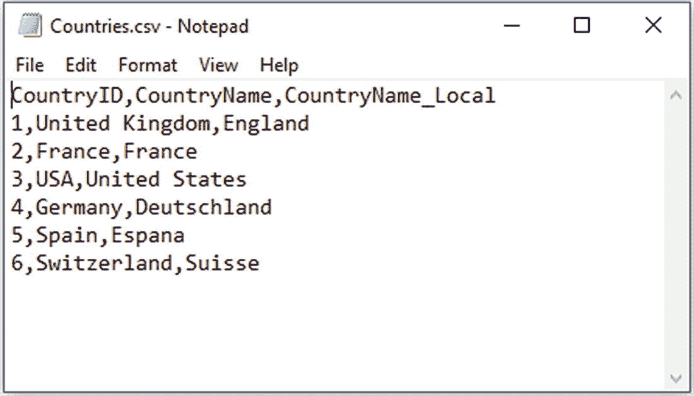
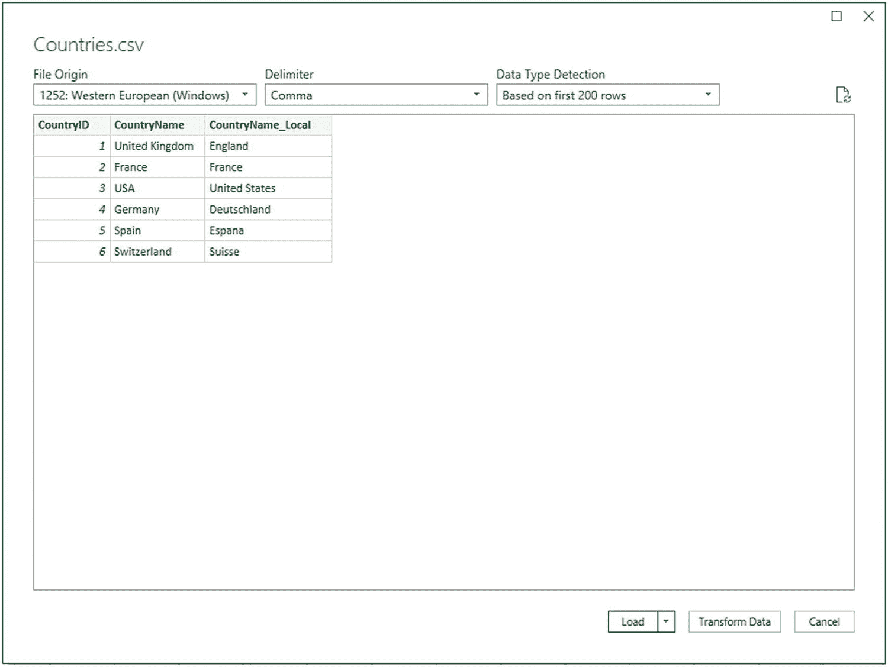
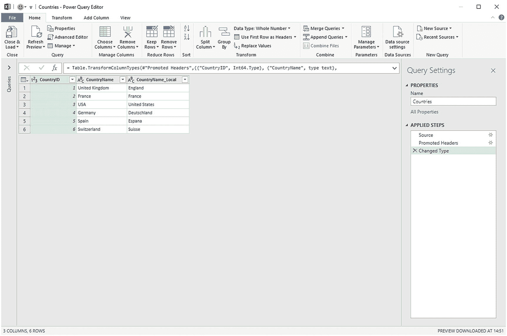
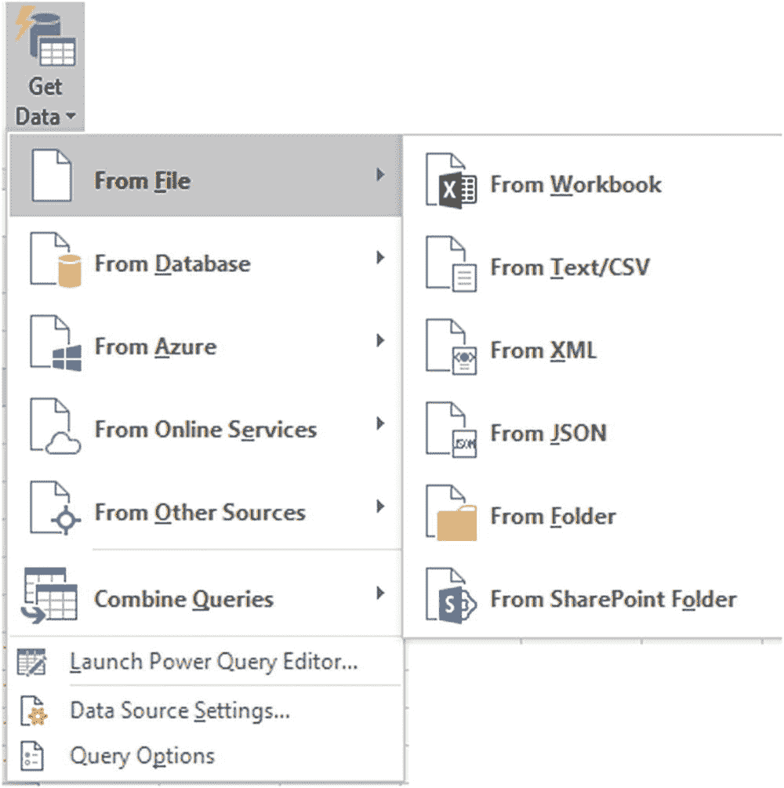
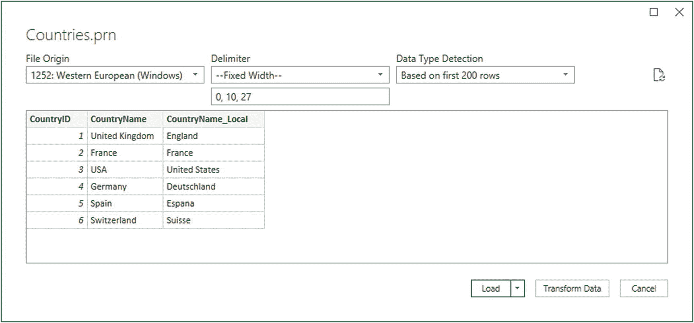
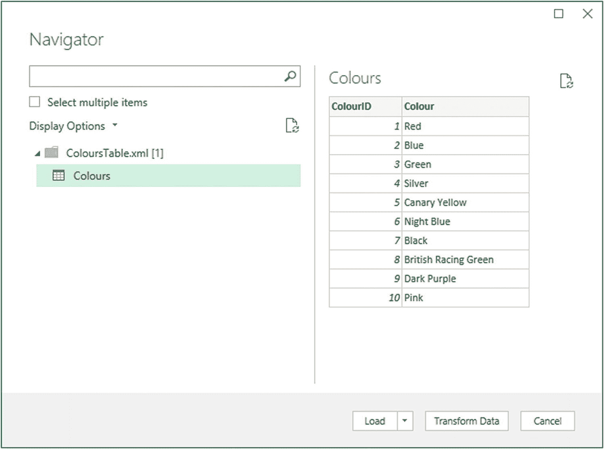
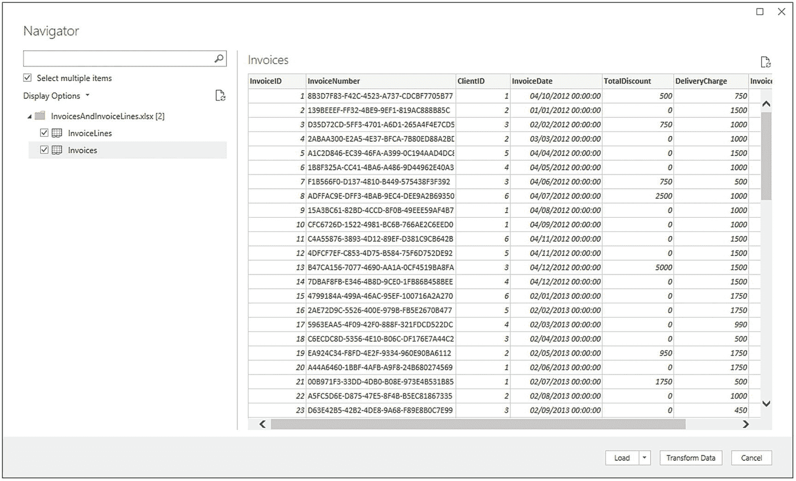
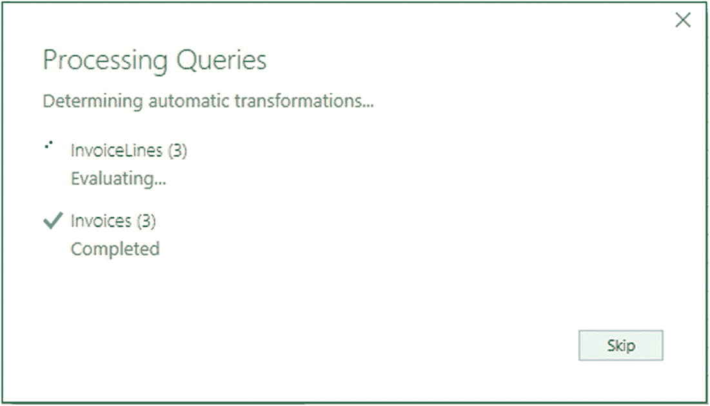
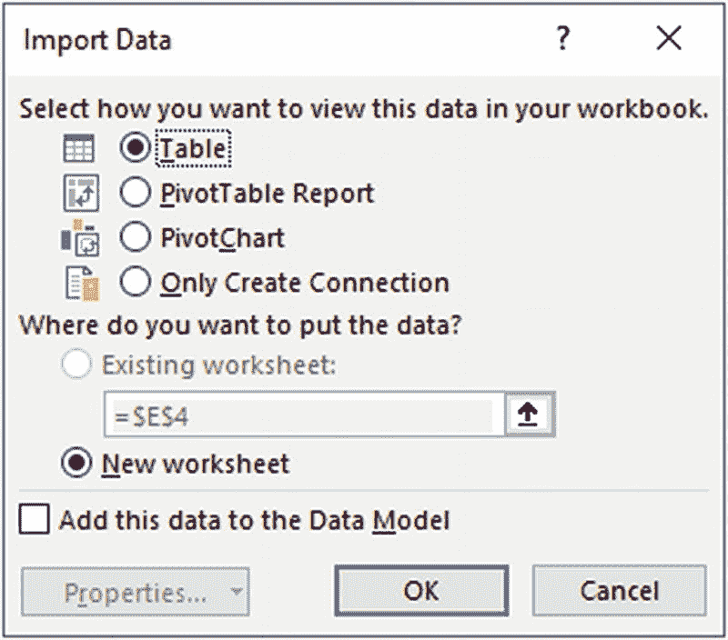
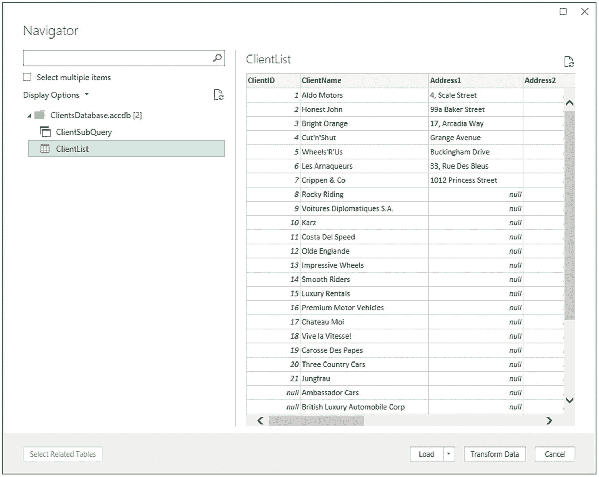

# 2. 使用 Power Query 发现和加载基于文件的数据

通过网络、互联网或电子邮件发送文件已成为我们大多数人的第二天性。只要你获得的文件符合当前使用的一些广泛认可的标准（你将在稍后了解这些标准），将它们加载到 Power Query 中就不会有太大困难。

作为数据混搭过程的第一部分，本章将向你展示如何从各种基于文件的源中查找和加载数据。这些数据类型通常是那些你可以位于共享网络驱动器上、从互联网下载、作为电子邮件附件接收或复制到计算机本地驱动器上的文件。本章示例中使用的文件可在 Apress 网站上找到。如果你已经按照附录 A 中的下载说明进行操作，那么这些文件将位于 `C:\DataMashupWithExcelSamples` 文件夹中。

## 文件源

在本章中，我们将介绍如何从以下源导入基于文件的数据：

-   CSV 文件
-   文本文件
-   XML 文件
-   Excel 文件
-   Access 数据库

Power Query 当前可以读取并从中加载数据的文件源见表 2-1。

**表 2-1**: 文件源

| 文件源 | 说明 |
| --- | --- |
| Excel | 允许您读取 Microsoft Excel 文件（版本 97 至 2019）并加载工作表、命名区域和表格 |
| CSV | 允许您加载符合 CSV（逗号分隔值）格式的文本文件 |
| XML | 允许您从 XML 文件加载数据 |
| 文本 | 允许您使用各种列分隔符加载文本文件 |
| 文件夹 | 允许您加载有关文件夹中所有文件的信息 |
| SharePoint 文件夹 | 允许您列出 SharePoint 文件夹中的文件 |
| Access 数据库 | 允许您连接到网络上的 Microsoft Access 文件并加载查询和表格 |
| JSON | 帮助您从 JSON 文件加载数据 |

更高级的技术（例如导入整个文件夹的文本或 Excel 文件的内容，或导入*复杂*的 XML 文件和 JSON 文件）将在第 10 章中描述。我更喜欢单独处理这些内容，因为它们需要更高级的数据转换技术知识——而你需要首先学习这些知识。

**注意**：我意识到 Power Query 将 MS Access 视为数据库，而不是"文件"数据类型。虽然我完全同意这种分类，但我还是倾向于将 Access 视为基于文件的数据源，因为所有数据都驻留在单个文件中，该文件可以复制和通过电子邮件发送，而不是位于远程服务器上的数据库中。因此，我们将在本章中介绍 MS Access，而不是在讨论企业数据源的下一章中介绍。

## 从文件加载数据

是时候开始了解 Power Query 的"繁重工作"方面以及如何使用它从各种不同源加载数据了。我将从简单的小坡（或者用我们英国人的说法叫"初学者"坡道）开始，以一个从文本文件加载数据的简单示例为例。然后，鉴于可用的数据源种类繁多，并且为了给这个过程提供更清晰的结构，我们将从多个在工作场所中普遍存在的基于文件的数据源中加载数据。这些数据源是你在第 6 章到第 12 章中将学习调整和"混搭"的数据的基础。

### CSV 文件

场景如下：你收到了一个包含一些有用信息的 CSV 文件，需要将其加载到 Excel 中进行进一步分析。现在，你希望使用 Power Query 查看数据，并考虑需要采取哪些操作（如果有的话）来使其可用。这次，你决定先将数据加载到 Power Query 中，并在对源数据结构进行必要的修改后再将数据加载到 Excel 中。

首先，你需要了解要加载的数据。如果用文本编辑器（例如记事本）打开源文件 `C:\DataMashupWithExcelSamples\Countries.csv`（在 Windows 资源管理器中右键单击该文件，然后选择“打开方式” ➤ “记事本”），就可以查看其内容。你可以在图 2-1 中看到这些内容。

**图 2-1** `Countries.csv` 文件的内容

以下步骤说明了将文件内容加载到 Power Query 中所需执行的操作：

**图 2-2** Power Query 文件对话框

1. 在 Excel 中，单击 **数据**。
2. 单击 **获取数据** 按钮。
3. 单击 **来自文本/CSV**。将出现“导入数据”对话框。
4. 导航到包含要加载的文件的文件夹，然后选择该文件（在本示例中为 `C:\DataMashupWithExcelSamples\Countries.csv`）。
5. 单击 **导入**。将出现一个对话框，显示文件的初始内容，如图 2-2 所示。

**图 2-3** 加载了 CSV 文件内容的 Power Query 窗口

6. 单击 **转换数据** 按钮。Power Query 窗口出现，其中包含 CSV 文件内容的样本——如果文件不大，也可能包含整个文件。你可以在图 2-3 中看到这一点。
7. 单击 Power Query 窗口中的 **关闭并加载** 按钮（你可以在图 2-3 的左上角看到它）。Power Query 编辑器将关闭并返回到 Excel。源数据将被加载到新工作表中。

> **提示**  
> 在第 7 步中，请确保单击 **关闭并加载** 按钮的上半部分。否则，你将看到一个包含若干选项的弹出菜单。如果看到弹出菜单，只需单击 **关闭并加载**。

到此为止，操作就完成了。你只需点击几次鼠标，就将源文件中的数据加载到了 Excel 中，数据已经准备好进行进一步分析。在后续章节中，你将学习如何对数据进行塑形。不过现在，让我们继续看看其他基于文件的数据源。

> **注意**  
> 如果第 7 步之后数据没有出现在新工作表中，请重新执行该过程，但这次请单击 **关闭并加载** 按钮上的弹出菜单，然后选择 **加载到**——并在对话框（如图 1-16 所示）中选择 **新工作表** 单选按钮。

#### 什么是 CSV 文件？

在我们继续讨论其他文件类型之前，我需要就 CSV 文件做一些说明。关于“真正的”CSV 文件，是有技术规范的，但我不会拿这个烦你。更重要的是，许多生成 CSV 文件的程序并不总是严格遵循该定义。关键在于，Power Query 可以处理满足以下条件的文本文件：

- 通常具有 `.csv` 扩展名（默认情况下，它以此应用正确的处理方式）。当然，它也可以接受你指定的任何扩展名。
- 使用逗号分隔行中的元素。这也是一个默认设置，可以通过从图 2-2 所示的对话框中选择分隔符来覆盖。
- 以换行符、回车符或换行符/回车符结尾。
- 可以（可选地）包含用于封装字段的双引号。这些双引号将在数据加载过程中被去除。如果存在双引号，它们不必出现在每个字段中，甚至不必出现在每个记录中，字段中偶尔可能出现不一致的双引号。
- 可以包含“不规则”记录，即那些并非包含标准记录中每个元素的行。但是，第一行（无论是否包含标题）必须涵盖列表中所有剩余记录中的每个元素。简而言之，任何其他记录可以比第一行短，但不能比它长。
- 不包含数据本身之外的任何内容。如果文件包含不属于数据一部分的标题行或页脚行，那么 Power Query 在没有进一步处理的情况下无法加载数据集。针对这个非常常见的问题，有一些变通方法；第 8 章给出了一个方法。

### 文本文件

如果你按照上一节中加载 CSV 文件的过程操作，你会发现加载文本文件几乎完全相同。这并不奇怪。两者都是基于文本的文件，并且都应包含一个单一的数据列表。以下是核心区别：

- 文本文件可以使用逗号*以外*的符号来分隔列表中的元素。你可以在定义加载步骤时指定分隔符。
- 文本文件的扩展名通常应为 `.txt`（尽管这也可以被覆盖）。
- 文本文件*必须*格式完美；也就是说，每个记录（行）必须与其他每个记录具有相同数量的元素。
- 如果你希望首次加载数据毫无问题，那么文本文件也*不能*包含数据集之外的任何内容。
- 如果文本文件遇到问题，它应将数据作为单个列导入，然后你可以尝试将其拆分为多个列，如第 8 章所述。

那么，以下是将文本文件加载到 Power Query 中的方法：

1. 打开一个新的空白 Excel 文件。
2. 在 **数据** 功能区中，单击 **来自文本/CSV**。将显示“导入”对话框。
3. 导航到包含该文件的文件夹并选择该文件（在本示例中为 `C:\DataMashupWithExcelSamples\CountryList.txt`）。
4. 单击 **导入**。将出现一个对话框，显示文件的初始内容（此对话框与你在图 2-2 中看到的 CSV 文件的对话框基本相同）。当然，你也可以双击文件名，而无需单击 **打开**。
5. 单击 **取消** 按钮（因为快速查看文件内容后，你决定并不真正需要它）。

Power Query 真正聪明的地方在于，它可以对文本文件的结构做出非常准确的推断；也就是说，它几乎总能猜出字段分隔符（将列表中的每个元素与其他元素隔开的字符）。因此，它不仅会将列表分解为列，还会避免导入列分隔符。如果它猜得不正确，也不要灰心。你将学习如何在第 8 章中修正这个问题。

查看文件内容然后决定不使用它，是*数据探索*过程的一部分，当你在使用 Power Query 时，会发现自己经常这样做。这个练习的目的是向你展示，快速浏览潜在数据源，然后决定是否将其导入数据模型，是多么容易。此外，直接在 Power Query 的加载对话框中查看大型文本或 CSV 文件的前几行，可能比在文本编辑器中打开整个文件更容易。

> **提示**  
> 尽管可能显而易见，但还是要提一下：你可以按 Enter 键接受对话框中的默认选项，按 Esc 键取消对话框。

### 文本与 CSV 选项

从图 2-3 可以看出，加载文本或 CSV 文件时可供调整的选项并不多。大多数情况下，`Power Query` 会自动为您猜测出正确的设置。不过，偶尔您也需要对这些参数进行微调。您可以修改的潜在选项包括：

- `文件来源`
- `分隔符`
- `数据类型检测`

#### 文件来源

此选项定义文件存储时使用的字符编码。不同的字符集可以处理不同范围的字符，例如重音符号和其他变音符号。通常 `Power Query` 会正确解释此信息，您只需在极少数情况下才需要选择其他字符集（文件来源）。

#### 分隔符

`Power Query` 会尝试猜测文本或 CSV 文件中用于分隔数据“列”的特殊字符。如果您希望覆盖所选的分隔符，可以选择以下选项：

- `冒号`
- `逗号`
- `等号`
- `分号`
- `空格`
- `制表符`

您还可以决定输入自定义分隔符，例如管道符（`|`），甚至指定每个字段具有固定宽度。选择这两个选项中的任意一个，将显示另一个输入字段，您可以在其中输入所需的分隔符。

#### 数据类型检测

`Power Query` 会对文本或 CSV 文件中的数据编码和数据类型进行合理猜测。默认情况下，为节省时间，它仅读取前 200 条记录。但是，您可以从以下三个选项中进行选择：

- 读取前 200 行
- 读取整个文件
- 不进行数据类型检测

**注意**：请注意，完整读取一个大型文件可能会耗费相当长的时间。然而，没有准确的数据类型检测，您可能会在输出数据中遇到格式错误的列。

### 固定宽度文本文件

您偶尔可能会遇到的另一种文本文件形式是固定宽度文件。这种源数据确保每列包含完全相同的字符数。图 2-4 展示了其可能的样貌。

*图 2-4* – 固定宽度文本源数据

要加载此类数据：

*图 2-5* – Power Query 中的文件数据连接器

1.  在 `数据` 菜单中，依次点击 `获取数据` ➤ `来自文件` ➤ `来自文本/CSV`。您将看到如图 2-5 所示界面。

*图 2-6* – 固定宽度文本文件导入对话框

2.  从文件夹 `C:\DataMashupWithExcelSamples` 中选择文件 `Countries.prn`。
3.  点击 `打开`。将出现图 2-6 中显示的对话框。
4.  点击 `加载`。源数据将被加载到一个新的工作表中。

从图 2-6 可以看出，`Power Query` 为您提供了关于固定宽度文件的若干信息。具体来说，它计算了每列的长度，并在分隔符弹出菜单下提供了所需的列长度。您可以更改此设置，但希望您永远不需要这么做。

与文本和 CSV 文件的情况一样，如果您认为有必要，可以通过从 `数据类型检测` 弹出菜单中选择 `基于整个数据集` 来强制 `Power Query` 对整个源文件进行采样。

### 简单的 XML 文件

`XML`，即 `可扩展标记语言`，是 IT 系统之间传输数据的标准方式。因此，您很可能有一天需要加载一个 XML 文件。尽管 XML 文件只是文本，但它是以一种非常特定的方式格式化的文本，如果您在文本编辑器（如 `记事本`）中打开 XML 文件，就会看到这一点。请按照以下步骤加载 XML 文件：

*图 2-7* – 加载 XML 文件前的导航器对话框

1.  在 `数据` 功能区中，点击 `获取数据` 按钮，然后依次点击 `来自文件` 和 `来自 XML`。将出现 `导入数据` 对话框。
2.  导航至包含该文件的文件夹，并选择文件（在此示例中为 `C:\DataMashupWithExcelSamples\ColoursTable.xml`）。
3.  点击 `导入`。将打开 `导航器` 对话框。
4.  在 `导航器` 对话框的左侧窗格中点击 `Colours` 数据集。XML 文件该部分的内容将显示在 `导航器` 对话框的右侧，如图 2-7 所示。
5.  点击 `转换数据` 按钮。`Power Query 数据` 窗口将显示 XML 文件的内容。
6.  点击 `Power Query 数据` 窗口中的 `关闭并加载` 按钮。颜色列表将被加载到一个新的工作表中。

XML 文件的实际内部格式可能极其复杂。有时一个 XML 文件只包含一个数据集；有时则包含多个独立的数据集。在其他情况下，它会包含一个其记录包含嵌套数据层级的数据集，您需要通过展开元素层次结构来处理。在您学习了所需的数据转换技术后，将在第 10 章中了解 `导航器` 对话框如何处理 XML 数据的嵌套层次结构。

**注意**：某些类型的数据源允许您同时加载多个数据集。XML 文件（与 CSV 和文本文件不同）*可以*包含多个独立的数据集。如果您先在 `导航器` 窗口中选中 `选择多项` 复选框，然后再选中要从 XML 文件加载的每个数据集左侧的复选框，则您可以同时加载多个数据集。

### Excel 文件

您很可能已经是 Excel 重度用户，拥有大量存满数据的电子表格，希望将这些数据整合起来，用于在 Power Query 中进行分析和展示。此外，在上一章中，您已经了解了如何从 Excel 文件中加载单个工作表。那么，这次让我们来看看如何从一个 Excel 文件中同时加载多个工作表。这个练习能让您从头到尾详细了解整个过程。

图 2-8
从 Excel 工作簿加载数据前的导航器对话框

1. 在 Excel 的“数据”选项卡中，依次点击 `获取数据` ➤ `来自文件` ➤ `从工作簿`。此时将弹出“导入数据”对话框。
2. 导航至包含您要查看文件的目录（本例中为 `C:\DataMashupWithExcelSamples`）。
3. 选择源文件（本例中为 `InvoicesAndInvoiceLines.xlsx`），然后点击 `导入`。将弹出“导航器”对话框，显示工作簿文件中的工作表、表格和区域。
4. 点击“导航器”对话框左侧列出的一个数据集。所选电子表格的前几行将显示在对话框右侧，让您查看所选数据集中的数据样貌。
5. 确保选中 `选择多项` 复选框。
6. 点击左侧 `Invoices` 和 `InvoiceLines` 数据集左侧的复选框。此时“导航器”对话框将如图 2-8 所示。

图 2-9
“正在处理查询”对话框

7. 点击 `加载` 按钮右侧的弹出箭头。
8. 选择 `加载到`。将短暂弹出“正在处理查询”对话框。您可以在图 2-9 中看到此对话框。

图 2-10
“导入数据”对话框

9. 现在将弹出“导入数据”对话框。确保未选中 `将此数据添加到数据模型`，并保持选中 `表` 和 `新工作表` 单选按钮。您可以在图 2-10 中看到此设置。
10. 点击 `确定`。选定的源数据集将被加载到单独的 Excel 工作表中。

**注意**

某些类型的数据源允许您同时加载多组数据。XML 文件（不同于 CSV 和文本文件）可以包含多个独立的数据集。您可以通过选中要从 XML 文件加载的每个数据集左侧的复选框，来同时加载多个数据集。

从这个简单示例可以看出，让 Power Query 读取 Excel 数据其实并不难。您本可以在加载之前在 Power Query 编辑器中编辑这些数据，但由于这些数据看起来简洁可用，我倾向于将其直接加载到 Excel（或者更准确地说是 Excel/Power Pivot 数据模型）中。此外，您还看到 Power Query 可以从单个数据源同时加载多个数据集。不过，您可能仍对在此过程中看到的一些内容有疑问，因此，这里提供一些预见性的说明：

导航器对话框显示

*   工作表（如图 2-8 中的 `Invoices` 和 `InvoiceLines`）
*   命名区域
*   命名表格

上述每个元素在导航器对话框中都由不同的图标表示。有时，这些实际上可能是指向同一数据的重复引用，因此您应尽可能使用最精确的数据源。例如，我建议使用命名表格或区域名称，而不是工作表源，因为后者很容易最终包含“噪声”数据（即来自您所关注的区域之外的行和列的数据），这会使加载过程变得不必要的复杂——甚至导致加载失败。确实，除非工作表以简单表格格式准备好并结构化，从而可以加载到 Power Query 中，否则您的数据模型中可能会混入多余数据。

然而，真正酷的地方在于，您可以从单个 Excel 工作簿中同时加载任意多个您想要的工作表、表格或区域。您无需逐个加载每个源数据集。

**注意**

*如果*与外部数据源（如 SQL Server、Oracle 或 SQL Server Analysis Services）的数据连接处于活动状态并已将数据返回到工作簿，那么 Power Query 将列出并使用源 Excel 工作簿中的这些数据连接。一旦与 Power Query 建立了链接，您就可以删除源 Excel 工作簿中的数据表本身——但仍然可以通过源工作簿中的数据连接将数据加载到 Power Query 中。

Power Query *不会*考虑 Excel 数据表上的任何数据筛选器，而是加载源表中的所有数据。因此，如果您想要对源数据进行子集化，则需要在 Power Query 中重新应用任何筛选器（您将在第 6 章中了解更多信息）。

此时，您需要了解几个重要事项：

1. 多个工作表、表格或命名区域都可以在单个加载操作中从同一个工作簿（即 Excel 文件）导入。但是，对于每个单独的 Excel 文件，您需要定义单独的加载操作。
2. 也可以使用 Power Query 同时加载多个结构相同的 Excel 文件。这将在第 10 章中进行说明。

### 为何使用 Power Query 连接到 Excel

此时，您可能会想，既然可以从其他 Excel 工作表中复制粘贴，或者仅仅跨工作簿链接单元格，为何还要使用 Power Query 从 Excel 加载数据呢？

这是一个非常好的问题。不过，即使是加载 Excel 数据，通过 Power Query “绕道而行”也有几个非常合理的理由：

1. Power Query 中可用的数据清理和修改选项比 Excel 中相应的操作要简单得多。
2. 在 Power Query 中筛选源数据（并且仅加载数据的子集）异常简单。
3. Power Query 会自动适应源数据记录数量的减少或增加。
4. 刷新源数据只需一次点击操作。
5. 对源数据的任何更改都可以仅在您希望刷新数据时才生效。

### 从表/区域

有时，您可能会接手一个已包含所需数据的 Excel 工作簿（这可能是使用较旧技术创建的外部数据连接的结果）。您可能需要使用 Power Query 修改和清理这些数据——即使源数据与您要放置处理后输出的数据在同一个文件中。这同样是完全可以实现的。

1. 打开 Excel 文件 `Chapter02Sample1.xlsx`。该文件位于文件夹 `C:\DataMashupWithExcelSamples` 中。
2. 选择您要在 Power Query 中用作修改数据来源的表格内的一个单元格。在此示例中，您需要确保位于 `SourceData` 选项卡中。
3. 在 Excel 的“数据”选项卡中，点击 `来自表格/区域`。Power Query 编辑器将打开。
4. 在“查询设置”窗格中点击查询名称，为此数据源输入一个新名称。
5. 在 Power Query 编辑器中对数据执行任何您需要的修改（您将在第 6 章到第 12 章中学习这些技巧）。
6. 点击 `关闭并加载`。转换后的数据将被加载到一个具有新名称的新工作表中。

**注意**

如果在点击 `从表/范围` 按钮之前没有点击现有表格内部，您将收到一条提示，要求您选择源数据。

### Microsoft Access 数据库

另一种目前在许多企业中广泛使用的数据存储库是 Microsoft Access。它是一个强大的桌面级关系型数据库，可以包含数百张表，每张表可容纳数百万条记录。因此，我们需要了解如何从这个特定来源加载数据。此外，Power Query 在处理 Access 数据时尤为有用，因为它允许你在*无需安装 Access 本身*的情况下查看 Access 数据库的内容。

图 2-11：从 Access 数据库加载数据前的导航器对话框

1.  在“数据”功能区中，依次点击`获取数据` ➤ `来自数据库` ➤ `来自 Microsoft Access 数据库`。

2.  导航到包含你要加载数据的 MS Access 数据库（本例中为 `C:\DataMashupWithExcelSamples\ClientsDatabase.accdb`）。

3.  选择 Access 文件并点击`导入`。此时会弹出“导航器”对话框，其中列出了 Access 数据库中的所有表和查询。

4.  选择 `ClientList` 数据集。这将显示该表的内容，如图 2-11 所示。

5.  点击`加载`。来自 Access 的源数据将被加载到新的工作表中。

**注意：** 如果你希望同时导入多个 Access 表或查询，只需确保勾选了`选择多项`复选框即可。这将使你能够从 Access 数据库中选择多个源数据表或视图。

如果你仔细观察图 2-11 中导航器对话框的左侧，可以发现它为 Access 对象显示了两种不同的图标：

*   Access 数据表的表图标
*   代表两个小窗口的 Access 查询图标

这可以帮助你理解在 Access 数据库中查看的数据类型。

**注意：** Power Query *无法*查看 Access 中的链接表，只能查看已导入的表或实际存在于 Access 数据库中的表。不过，它可以读取叠加在原生数据、链接数据或导入数据之上的查询。

### JSON 文件

JSON 文件与 XML 类似，是一种允许用户（和计算机）在系统之间发送复杂数据结构的文件格式。通常，JSON 文件需要进行一些调整，才能以 Power Query 可用的状态加载。因此，我们将在第 9 章中学习如何加载和准备 JSON 文件，届时你将已经掌握了第 6 章至第 8 章中必要的数据转换技术。

## 总结

在本章中，你已经了解了 Excel 的强大扩展——Power Query——如何帮助你从各种基于文件的数据源中查找和加载数据。这些数据源可以是 Access、Excel、CSV、XML 或文本/CSV 文件。

你已经看到，Power Query 允许你查看其能读取的数据源内容样本，而无需任何其他应用程序。这使其成为窥探数据源并判断文件是否实际包含所需数据的绝佳工具。事实上，Power Query 的导航器可以帮助你筛选 Excel 文件、XML 文件或 Access 数据库中的多个数据集，预览每个数据集，并仅选择你想要加载的数据集。当然，如果多个数据集都存储在同一源中，它也可以一次性加载数十个数据集。

本章并非加载基于文件的数据源的完整概述。因此，如果你需要加载复杂的 XML 文件或 JSON 文件，或者需要了解如何加载整个文件夹的内容（例如，或 Excel 文件中的所有工作表），那么你可以直接跳到第 9 章来学习这些技术。

然而，基于文件的数据源只是整体图景的一小部分。Power Query 还可以从各种关系型数据库和数据仓库中加载数据。我们将在下一章中探讨其中的一部分。

