# 4. 从 Web 和云加载数据

在本章中，我们将探讨通过互联网可用、且快速增长的广泛数据源中的一部分，你可以将这些数据源用作 Excel 的分析数据源。虽然你将在后续页面中看到的数据源可能千差万别，但它们都有一个共同点：它们都存储在企业的外部，并可通过互联网连接使用。

详细探讨所有可用的数据源需要一整本书的篇幅，因此我将只演示如何访问当前提供的一些**主流**服务。一旦你学会了如何访问其中几个服务，你应该就能将基本技术扩展到访问 Power Query 目前可用于将数据导入 Excel 的几乎所有 Web 和云服务。

使用 Power Query 可访问的、不断增长的数据源由多个不同的供应商提供。因此，本章中概述的几乎所有数据连接都需要访问特定的在线源。这些源大多是企业级的——且并非免费。然而，如果你的企业没有订阅这些服务，但你仍希望试用它们，那么不妨看看本章中概述的许多（即便不是全部）服务提供商所提供的免费试用方案。因此，这些数据源中的许多仅可通过 Excel Pro 或企业版许可证使用。

## Web 和云服务

在深入探讨某些可用的 Web 和云服务的细节之前，让我们先从一个较高的层面来了解这些服务究竟是什么。这些数据源包括（但不限于）：

*   网页

*   在线服务，例如 Salesforce 或 MS Dynamics 365

*   Microsoft Azure，包括在 Azure Blob 服务中托管文件、在 Azure SQL Database 中存储数据，或在 Azure Synapse Analytics 中存储数据（甚至在 Azure HDInsight 中读取大数据）

## 网页

如果你需要收集一些在 Web 浏览器中以表格形式呈现的数据，你可以使用 Power Query 连接到相关页面的 URL，然后从页面上的任意表格中加载所有数据。

### 在线服务

*在线服务*是一个统称，用于描述你可以通过互联网访问的数据。大多数可供 Power Query 使用的在线服务都是所谓的“平台”。这些（通常是庞大的）软件和数据资源，要么仅能在线访问，要么曾驻留在企业系统中，但现在以服务的形式存在于互联网上。目前有几种可以使用 Power Query 连接的在线服务，它们列在表 4-1 中。

表 4-1：当前可用的 Power Query 在线服务

| 源 | 说明 |
| --- | --- |
| Salesforce Objects | 允许你访问 Salesforce 中的数据 |
| Salesforce Reports | 允许你访问构成内置 Salesforce 报表基础的数据对象（包括原生和自定义） |
| Facebook | 访问 Facebook 数据 |
| SharePoint Online | 连接到 Microsoft SharePoint 的云托管版本 |
| Microsoft Exchange Online | 连接到 Microsoft Exchange 的云托管版本 |
| Dynamics 365 Online | 连接到 Microsoft Dynamics 365（MS CRM 和 ERP 解决方案）的云托管版本 |

### Microsoft Azure

Azure 是微软云。Power Query 当前可以连接、并从中预览和加载数据的 Azure 数据源列在表 4-2 中。

表 4-2：Azure 源

| 源 | 说明 |
| --- | --- |
| Microsoft Azure SQL Database | 允许你连接到基于云的 Microsoft SQL Server 数据库，并从你有权访问的所有数据表和视图中导入记录 |
| Microsoft Azure SQL 数据仓库（现已更名为 Azure Synapse Analytics） | 允许你连接到微软基于云的、可弹性伸缩的企业级数据仓库 |
| Microsoft Azure Blob Storage | 从基于云的非结构化数据存储中读取数据 |
| Microsoft Azure Table Storage | 从 Microsoft Azure 表中读取数据 |
| Microsoft Azure Data Lake Storage（Gen1 和 Gen2） | 允许你连接到微软的原始数据云存储 |
| Microsoft Azure HDInsight | 在 Microsoft Azure 环境中读取基于云的 Hadoop 文件 |

显然，随着 Azure 产品的扩展，微软可能会在 Excel 的 Power Query 中增加更多的 Azure 连接选项。

**注意：** Power Query 也可以访问本地 SharePoint 和 MS Exchange 数据。但是，本书将不探讨这些连接。

## 网页

作为第一个极为简单的示例，让我们从网页中抓取一些数据。Power Query 让这一过程变得异常简单，因为它能够读取任何网页中的数据表格。由于我希望专注于方法而非数据本身，我将使用一个与本书其他部分所使用的示例数据无关的网页。这里仅将网页作为使用 Power Query 从网页加载数据过程的简单介绍。

假设你已经启动了 Excel

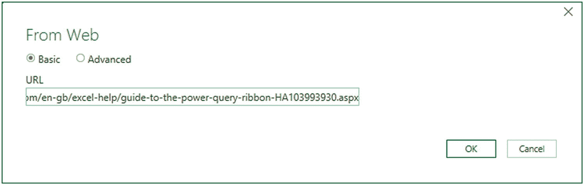

图 4-1 `从 Web` 对话框

1.  在 `数据` 功能区中，点击 `从 Web`。
2.  输入以下 URL（这是微软关于 Power Query 的帮助页面，其中包含几个数据表格）：`http://office.microsoft.com/en-gb/excel-help/guide-to-the-power-query-ribbon-HA103993930.aspx`。当然，我希望在你阅读本书时它依然能访问。当然，如果你有自己的 URL 想要尝试，请随意！对话框将类似于图 4-1。

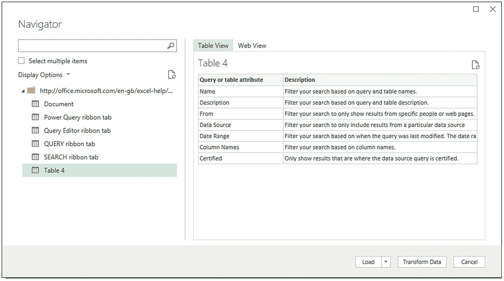

图 4-2 `导航器` 对话框预览网页上表格的内容

3.  点击 `确定`。`导航器` 对话框将出现。在 Power Query 连接到网页的几秒钟后，网页中可用数据表格的列表将会显示出来。
4.  点击 `导航器` 对话框左侧的某个表格名称。该表格的内容将显示在 `导航器` 对话框的右侧，展示所选表格中的数据样貌，如图 4-2 所示。
5.  在 `导航器` 对话框中选择复选框（如图 4-2 中表 4 左侧所示）。
6.  点击窗口底部的 `加载`。数据将被加载到一个新的工作表中。

**提示**
另一种访问网页的方式是点击 `数据` 功能区中 `获取数据` 按钮底部的小三角形，然后从弹出的菜单中选择 `来自其他源 ➤ 从 Web`。

这个简单的示例展示了如何从网页中选择数据表格并将其加载到 Excel 中。

### 高级 Web 选项

在前一个示例的第 3 步中，你本可以选择 `高级` 按钮。如果你这样做了，`从 Web` 对话框将会展开，允许你通过添加 URL 部分来构建复杂的 URL。你可以在图 4-3 中看到这样的示例。

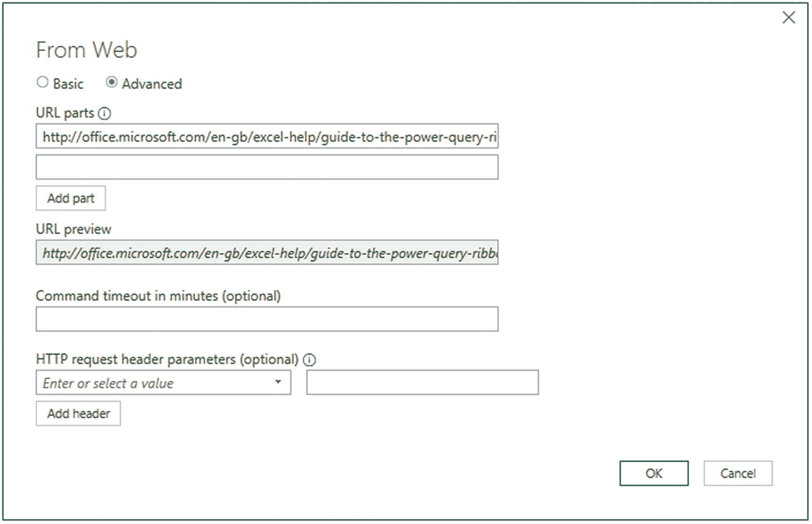

图 4-3 `从 Web` 对话框中的 `高级` 选项

点击 `添加部分` 按钮可以定义多个 URL 部分。

如果需要，你还可以指定提交 URL 时将使用的 HTTP 请求头部参数。某些网页可能会要求这些参数。对这些内容的讨论超出了本书的范围。

### 查看源网页

在 `导航器` 中只看到网页中的表格，而看不到网页本身，可能会让人感到有些不适应。毕竟，Web 本质上是一种视觉媒体。

因此，Power Query 为 `导航器` 添加了一个仅适用于网页的有用功能。那就是可以在 `导航器` 中查看网页本身——就像它在网页浏览器中显示的那样。要尝试这个功能：

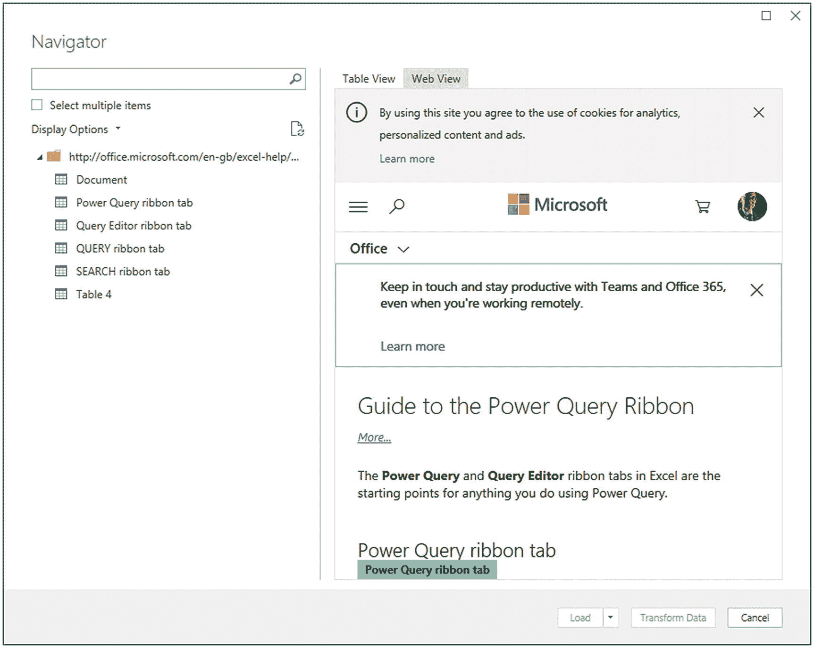

图 4-4 在 `从 Web` 对话框中查看源网页

1.  按照之前描述的步骤 1 到 3 操作。
2.  点击 `导航器` 右侧的 `网页视图`。你应该会看到类似图 4-4 所示的页面。

现在你可以向下滚动页面——并通过点击对话框右侧的 `表格视图` 切换回仅查看页面中表格数据的模式。

## Salesforce

Salesforce 是软件即服务（SaaS）领域的先驱之一——如今毫无疑问也是领导者之一。因此，Power Query 允许你连接到 Salesforce 并将你有权限使用 Salesforce 账户查看的任何数据加载到 Excel 中，这几乎是必然的。

事实上，Salesforce 是一项如此广泛且完整的服务，以至于你有两种可能的方法来访问你的数据：

- `对象`
- `报告`

简而言之，Salesforce 对象是底层的数据结构（你可以将其视为各种表），其中包含你想要访问的信息。而 Salesforce 报表则是从数据表中整理出来、以更易访问的输出形式呈现的数据。

**提示**
如果你没有企业 Salesforce 账户，但仍想了解如何使用 `Power Query` 连接到 Salesforce 数据，你可以随时建立一个免费的 30 天试用账户。其 URL 是 `www.salesforce.com/form/signup/freetrial-sales.jsp`。

### 从 Salesforce 对象加载数据

假设您拥有一个有效的 Salesforce 帐户，以下是将数据从 Salesforce 对象加载到 Excel 的方法：

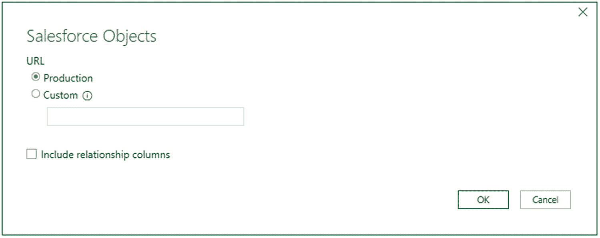
图 4-5 `Salesforce 对象`对话框

1. 打开一个新的 `Excel` 应用程序。
2. 在 `Excel` 的`数据`功能区中，单击`获取数据`按钮。
3. 点击`来自在线服务` ➤ `来自 Salesforce 对象`。系统将显示`Salesforce 对象`对话框。它应该看起来像图 4-5 所示。

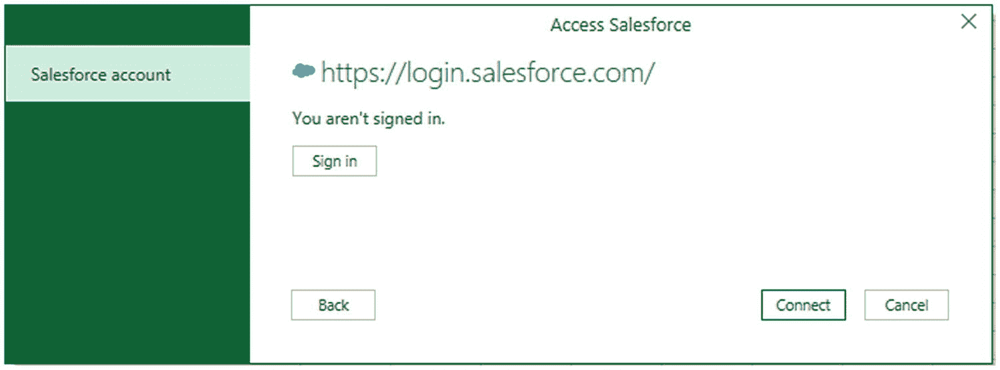
图 4-6 `访问 Salesforce` 登录对话框

4. 选择`生产`按钮并点击`确定`。系统将显示`访问 Salesforce` 登录对话框。它应该看起来像图 4-6 所示。

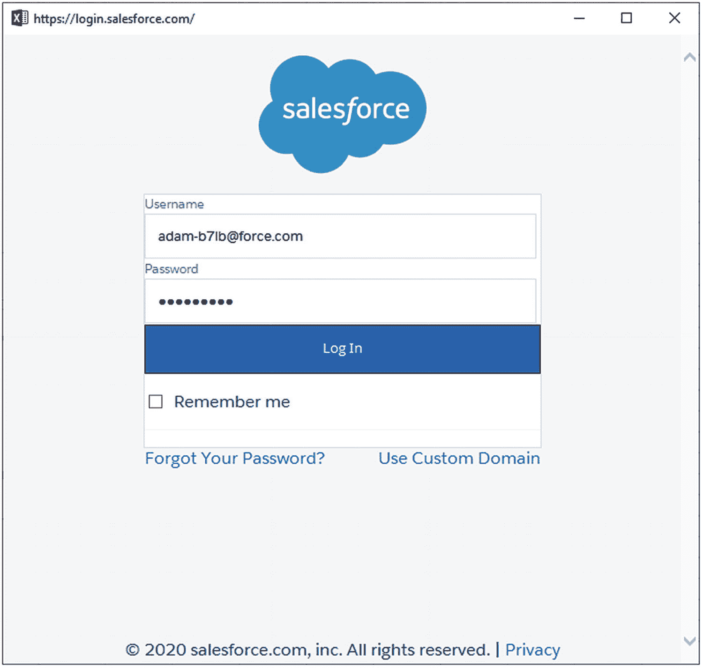
图 4-7 Salesforce 登录对话框

5. 除非您已登录，否则请点击`登录`。系统将显示 Salesforce 登录对话框。
6. 输入您的 Salesforce 用户名和密码。对话框应类似于图 4-7 所示。

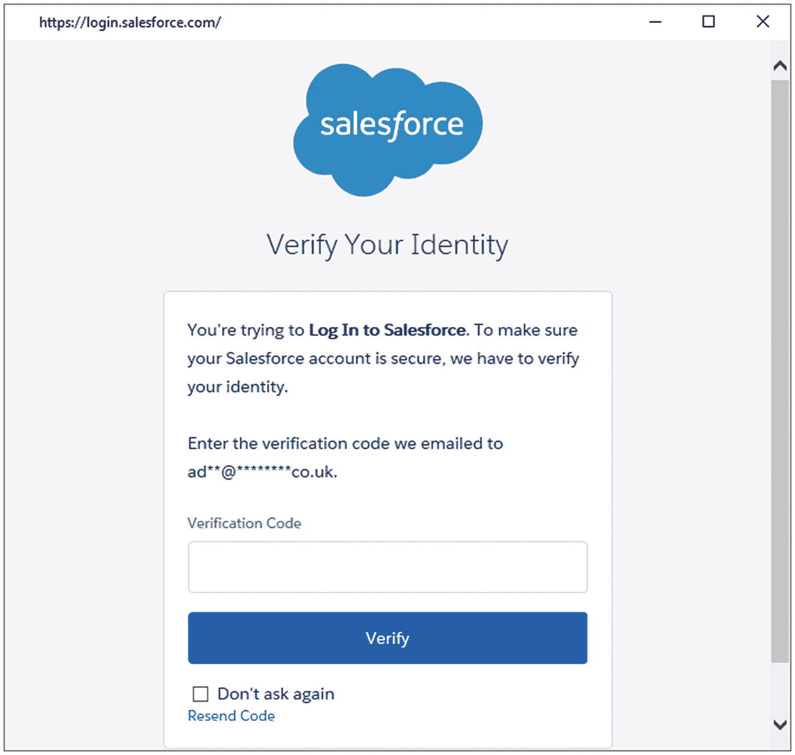
图 4-8 `Salesforce 验证您的身份`对话框

7. 如果这是您第一次从`Power Query`连接到 Salesforce（或者您已要求 Salesforce 在每次登录时请求确认），系统将要求您验证身份。系统将显示`Salesforce 验证您的身份`对话框，如图 4-8 所示。

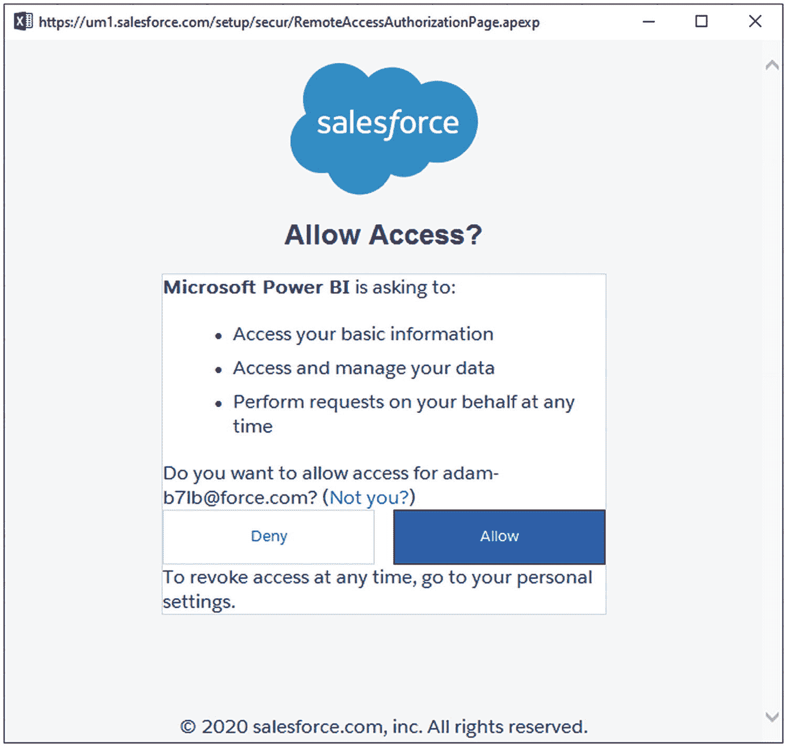
图 4-9 `Salesforce 允许访问`对话框

8. 点击`验证`。Salesforce 将向您用于登录 Salesforce 的电子邮件帐户发送一个验证码。
9. 在`验证码`字段中输入该代码，然后点击`确定`。您将看到`允许访问`对话框，如图 4-9 所示。

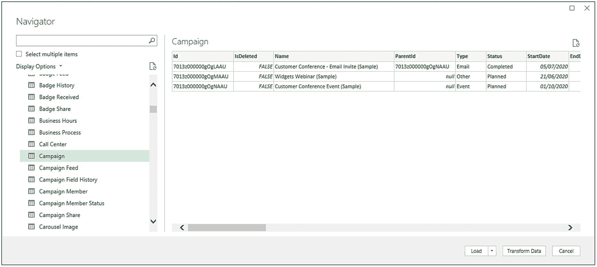
图 4-10 在`导航器`中查看的 Salesforce 对象

10. 点击`允许`。您将返回到`访问 Salesforce` 对话框，但此时您已登录。
11. 点击`连接`。系统将显示`导航器`，其中列出了您有权访问的 Salesforce 对象。您可以在图 4-10 中看到一个示例。
12. 选择您希望将其数据加载到 Excel 中的对象，然后点击`加载`。数据将被加载到 Excel 中，以便您根据 Salesforce 数据创建报告。

**提示**
为避免在每次使用 Salesforce 数据创建新的 Excel 报告套件时都需要向 Salesforce 确认您的身份，您可以在 Salesforce 登录对话框中勾选“记住我”，并在`Salesforce 验证您的身份`对话框中勾选“不再询问”。

Salesforce 对象包含大量数据。然而，从`Power Query`的角度来看，这类似于访问数据库结构。这意味着您必须对底层数据的存储方式有一定的了解。如果您想了解 Salesforce 数据的结构化方式，我建议您从当前位于 [`https://trailhead.salesforce.com/en/modules/data_modeling/units/objects_intro`](https://trailhead.salesforce.com/en/modules/data_modeling/units/objects_intro) 的 Salesforce 文档开始。

### Salesforce 报告

如果您发现 Salesforce 中的数据量让您不知所措，您可以直接访问标准 Salesforce 报告背后的数据。这将避免您需要了解底层数据结构。缺点是您不易扩展这些数据集。

要访问 Salesforce 报告数据，只需按照上一节中概述的步骤操作即可。但是，在步骤 3 中，选择`Salesforce 报告`而不是`Salesforce 对象`。在这种情况下，`导航器`对话框将类似于图 4-11 所示。

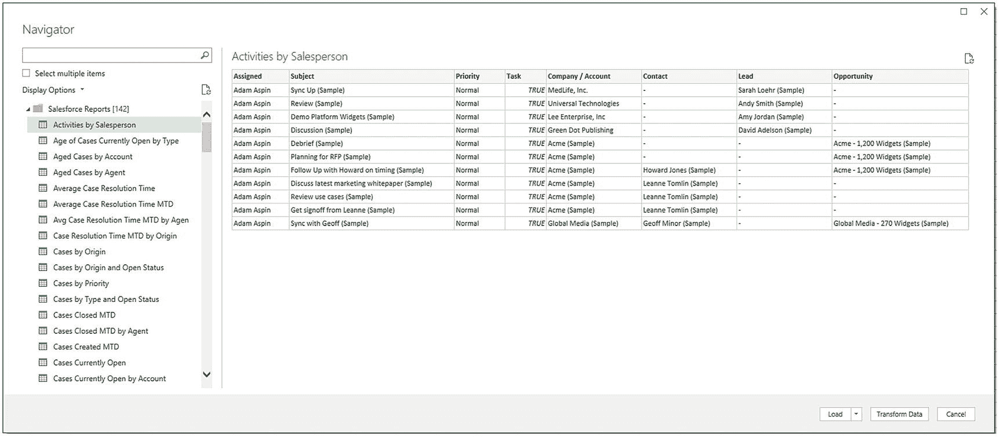
图 4-11 显示`Salesforce 报告`数据的`导航器`对话框

在这里，您可以选择并加载来自 Salesforce 的、您希望用于进一步分析的报告数据。

## Microsoft Dynamics 365

另一个包含大量宝贵企业数据的在线服务是 Microsoft Dynamics 365。正如您所料，`Excel` 中的`Power Query`可以轻松连接到 Microsoft 在线源，例如 Dynamics。如果您所在组织使用此特定平台，操作方法如下：

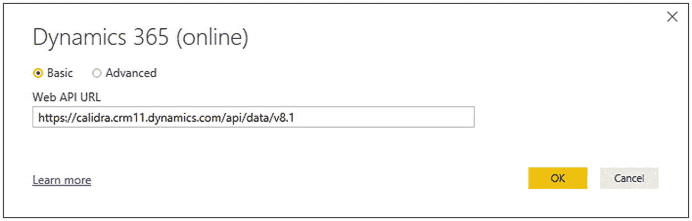
图 4-12 `Dynamics 365 (在线)`对话框

1. 打开一个新的 `Excel` 应用程序。
2. 在 `Excel` 的`数据`功能区中，单击`获取数据`按钮。
3. 点击`来自在线服务` ➤ `来自 Dynamics 365 (在线)`。
4. 点击`连接`。系统将显示`Dynamics 365 (在线)`对话框。
5. 输入您用于连接 Dynamics 365 的 URL，并添加 `/api/data/v8.1`（至少在本节付印时是如此）。它可能看起来像图 4-12 所示。但请注意，此 URL 将根据您在世界上的位置而变化。
6. 点击`确定`。系统将显示`OData 源`对话框。这是因为`Power Query`使用`OData`连接到 Dynamics 365 Online。
7. 选择`组织帐户`作为安全访问方法。
8. 点击`登录`以登录您的 Dynamics 365 帐户，并遵循 Microsoft 登录流程。
9. 点击`连接`。系统将显示`导航器`对话框，其中列出了您有权连接的所有 Dynamics 对象。

**注意**
在步骤 6 中，您看到 MS Dynamics 365 连接实际上是一个`OData`连接。`OData`将在下一章中更详细地解释。

Dynamics 365 表数量巨大——具体数量将取决于您的组织所订阅的服务。然而，实际上您是在访问一个数据库结构。这意味着您必须对底层数据的存储方式有一定的了解。如果您想了解 Dynamics 365 表，我建议您从位于 [`https://docs.microsoft.com/en-us/dynamics365/unified-operations/dev-itpro/data-entities/data-entities`](https://docs.microsoft.com/en-us/dynamics365/unified-operations/dev-itpro/data-entities/data-entities) 的 Microsoft 在线帮助开始。

## Azure SQL 数据库

# SQL Server 云连接选项

SQL Server 不仅仅作为本地数据库存在。它也可以作为“平台即服务”（也称 PaaS）使用。简而言之，这使您能够将按需付费模式应用于数据库需求，您可以在几分钟内在云中启动一个数据库服务器，然后根据需求进行扩展，而无需购买硬件和软件并对其进行维护。

## 连接到 Azure SQL 数据库

连接到微软的 PaaS 产品（称为 Azure SQL 数据库）非常简单。如果您有公司 Azure SQL 数据库的详细信息，可以使用它进行连接。如果没有，但仍想尝试将 Power Query 连接到 Azure SQL 数据库，您可以随时从 Microsoft 申请免费试用账户，并在几分钟内设置一个 Azure SQL 数据库。如果您选择此路径，可以在以下 URL 找到如何操作（包括加载您稍后将在本节中连接的示例数据）的说明：`https://docs.microsoft.com/en-gb/azure/sql-database/sql-database-get-started-portal`。

**提示**

当您创建自己的 Azure SQL 数据库以测试与 Power Query 的连接时，请务必将源定义为 `Sample`。这将确保 MS 示例数据加载到您的测试数据库中。

要使用 Power Query 从 Excel 连接到 Azure SQL 数据库：


`图 4-13` Azure SQL 数据库连接的 SQL Server 数据库对话框

1.  打开一个新的 Excel 应用程序。
2.  在 Excel 的“数据”功能区中，单击“获取数据”➤“来自 Azure”➤“来自 Azure SQL 数据库”。将出现 SQL Server 数据库对话框（毕竟，Azure SQL 数据库是 SQL Server 数据库，但运行在云中）。
3.  输入您从 Microsoft Azure 管理门户获得的 Azure SQL 数据库服务器名称（或由公司 DBA 提供给您的名称）。SQL Server 数据库对话框将如图 4-13 所示。


`图 4-14` Azure SQL 数据库连接的 SQL Server 凭据对话框

1.  单击“确定”。将出现凭据对话框。
2.  单击左侧的“数据库”，然后输入有效的用户名和密码。凭据对话框将如图 4-14 所示。
3.  单击“连接”。将出现导航器对话框，显示您在 Azure SQL Server 数据库中有权限访问的数据库。

**注意**

如果您正在设置 Azure SQL 数据库，请确保包含防火墙规则，以允许从运行 Excel 的计算机连接到 Azure SQL 数据库。

如果您按照第 3 章中的步骤连接到了本地 SQL Server 数据库，那么您可能会觉得此处使用的方法几乎相同。幸运的是，Power Query 开发团队努力使这两个过程尽可能相似。这延伸到：

*   确保数据源设置由 Power Query 存储，并且可以像本地数据库连接一样进行更新。

## Azure SQL 数据仓库 (Azure Synapse Analytics)

Azure 有许多可用的数据存储平台。其中特别适合 Power Query 的是 Azure SQL 数据仓库（现在称为 Azure Synapse Analytics）。这是一个托管在 Azure 中的 MPP（大规模并行处理）数据仓库。

我再次假设您手头有一个公司 Azure Synapse Analytics 实例，并且拥有对 Azure Synapse Analytics 的相关访问权限。此处，您也需要正确设置防火墙规则（尽管如果您之前为例如 Azure SQL 数据库设置了防火墙规则，这可能不是严格必需的）。我想您可能需要公司 IT 支持的帮助，以确保连接能够成功建立。

假设您可以访问 Azure Synapse Analytics 实例：


`图 4-15` Azure Synapse Analytics 连接的 SQL Server 数据库对话框

1.  打开一个新的 Excel 应用程序。
2.  在“数据”功能区中，单击“获取数据”➤“来自 Azure”➤“来自 Azure SQL 数据仓库”。
3.  输入您从 Microsoft Azure 管理门户获得的 Azure SQL 数据仓库服务器名称（或由公司 IT 提供给您的名称）。SQL Server 数据库对话框将如图 4-15 所示。这是因为 Azure Synapse Analytics 本质上是一个 SQL Server 数据库。
4.  选择“导入”按钮，然后单击“确定”。将出现凭据对话框。
5.  单击左侧的“数据库”，然后输入有效的用户名和密码。
6.  单击“连接”。将出现导航器对话框，显示您在 Azure SQL Server 数据库中有权限访问的数据库。
7.  选择所需的表，然后单击“加载”或“编辑”返回 Excel。如果要同时导入多个表，请记住单击“选择多项”。

**注意**

不要因为指定服务器和数据库的对话框标题显示“SQL Server 数据库”而感到困惑。这能正确地将您连接到 Azure SQL 数据仓库。

## 连接 Azure 虚拟机上的 SQL Server

如今，越来越多的数据库由云服务提供商托管在企业环境之外。借助亚马逊（提供 SQL Server 的 RDS 服务）或微软（在 Azure 中提供用于 SQL Server 的虚拟机）等提供商，你可以将数据库部署在企业外部，并几乎从世界任何地方访问它们。

因此，为了扩展 Power Query 可用的数据源范围，我们将简要介绍如何连接到 Azure 虚拟机上的 SQL Server。诚然，连接 Azure 虚拟机上的 SQL Server 与连接企业环境中的 SQL Server 几乎相同——正如你在第 3 章中所见。但仍有必要稍作说明，简要介绍如何使用 Power Query 从云端的 SQL Server 实例将数据返回到 Excel。

再次说明，如果你的企业环境中没有托管在 Azure 虚拟机上的 SQL Server 实例，你始终可以使用 Azure 试用账户来测试此过程。然而，我无法在此解释如何在虚拟机上设置 SQL Server 实例，因为这是一个庞大且独立的主题，超出了本书范围。不过，如果你需要，有许多资源可以解释如何执行此操作。

连接到 Azure 中虚拟机上的 SQL Server：


`图 4-16` Azure 虚拟机的 Microsoft SQL Server 数据库对话框

1.  打开一个新的 Excel 应用程序。
2.  在 Excel 功能区中，点击`获取数据`按钮底部的小三角形，然后点击 `SQL Server`。将出现 SQL Server 数据库对话框。
3.  在`服务器`文本框中输入描述服务器的完整字符串。该字符串要么由企业的数据库管理员提供，如果你使用自己的 Azure 账户，则可以在 Azure 管理门户中找到它。
4.  输入你有权访问的数据库对应的数据库名称。对话框将如图 4-16 所示。


`图 4-17` 连接到虚拟机时的 SQL Server 数据库对话框

5.  点击`确定`。将出现`访问 SQL Server 数据库`对话框。选择`数据库`作为安全模式，并输入用户名和密码，如图 4-17 所示。如果你使用自己的 Azure 账户，这些可以是你在设置虚拟机时指定的用户名和密码。
6.  如果出现加密支持对话框，点击`确定`。将出现`导航器`对话框，列出你在虚拟机上托管的 SQL Server 中有权限查看的所有表。

如你所见，该过程与你在第 3 章中连接 SQL Server 时遵循的过程几乎相同。尽管如此，我有几点需要提请你注意：

*   使用 Azure 虚拟机的多部分名称作为服务器名称。
*   与连接本地 SQL Server 实例时一样，如果需要，你可以选择数据库。
*   如果虚拟机指定了公共 IP 地址，你可以使用该 IP 地址作为数据库名称。

-   安全性是一个庞大而独立的问题。在企业环境中，你*可能*能够使用 Windows 安全进行连接。对于测试虚拟机，你几乎肯定必须使用数据库安全。

    与 Azure 中的常规情况一样，必须正确设置防火墙。

### Azure Blob 存储

本章中我想向你介绍的最后一个 Azure 数据源是 Azure Blob 存储。就 Excel 而言，你基本上可以将其视为云中的文件共享。因此，如果你需要访问存储为文件的数据，可以通过 Azure Blob 存储连接到这些文件。

同样，你需要企业级 Azure Blob 存储的访问权限或一个 Azure 试用账户。无论哪种情况，你都需要将文件夹`C:\PowerBiDesktopSamples\MultipleIdenticalFiles`中的两个示例文件复制到你的 Azure Blob 存储容器中。下载示例文件的说明在附录 A 中。

一旦源数据在 Azure Blob 存储中可用，你可以执行以下步骤：

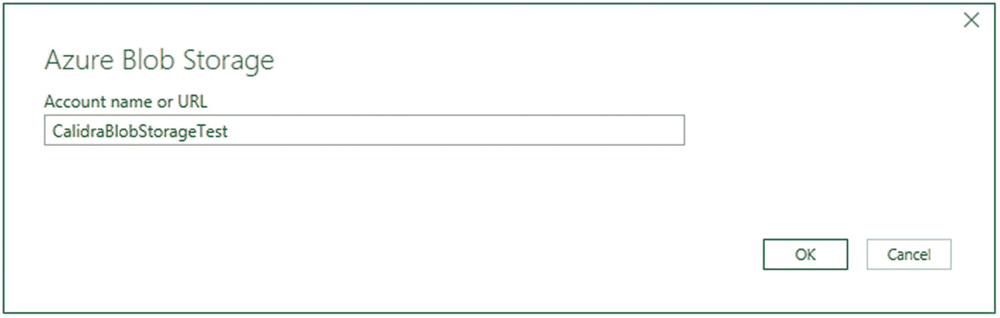

图 4-18 连接到 Azure Blob 存储

1.  打开一个新的 Excel 应用程序。
2.  在“数据”功能区中，点击`获取数据` ➤ `来自 Azure` ➤ `来自 Azure Blob 存储`。
3.  输入你用来连接 Azure Blob 存储的账户名称。Azure Blob 存储对话框将如图 4-18 所示。如果你使用的是企业级 Azure Blob 存储账户，系统管理员将提供此名称。在测试场景中，你可以通过打开 Azure 管理门户中的“存储账户”边栏选项卡，复制“Blob 服务终结点”来找到它。

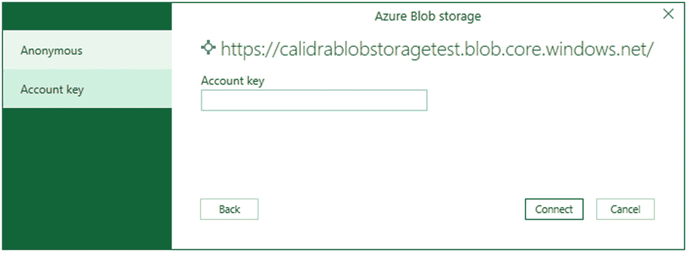

图 4-19 Azure Blob 存储账户密钥

4.  点击`确定`。将出现`Azure Blob 存储账户密钥`对话框。
5.  在 Azure 管理门户中，复制一个账户密钥。可以通过点击“存储账户”边栏选项卡，然后点击`访问密钥`在 Azure 管理门户中找到这些密钥。如果你从系统管理员处收到了账户密钥，则改用该密钥。你可以在此对话框中看到图 4-19。
6.  将账户密钥粘贴到`Azure Blob 存储账户密钥`对话框中。
7.  点击`连接`。将出现“导航器”，显示所选容器中的文件列表。
8.  点击`加载`。存储在 Azure 中的文件列表将出现在 Power Query 中。

**注意**

需要特别注意的是，至少目前，从 Azure 返回的是一个可用文件列表。第 9 章介绍如何选择并从部分或全部可用文件中将数据加载到 Excel，以便将其用作分析的基础。

### Azure 安全性

所有云服务提供商都极其重视安全性。如本章所述，你总是需要输入某种形式的安全令牌和/或指定有效的用户名和密码才能连接到基于云的数据。

## 其他源类型

显然，如果不耗费大量篇幅，就不可能解释如何使用所有潜在的数据源。此外，并非每个人都需要访问每一个存储外部数据的地方。事实上，大多数用户通常只需要从两到三个外部数据源获取数据。

这不可避免地意味着，你将在本书中看不到 Excel 的 `Power Query` 中提供的某些数据源。然而，正如我所提到的，`Power Query` 的基本优势之一是，一旦你学会了如何连接到几个数据源，你就差不多学会了如何使用所有数据源。

因此，本书未涵盖部分数据源，包括：
-   `Azure Data Lake`
-   `SharePoint`（本地和在线）
-   `Microsoft Exchange`（本地和在线）
-   `Microsoft Dynamics` 在线版
-   `Active Directory`
-   `Hadoop`
-   `Azure HDInsight`
-   `Facebook`

连接到 `SharePoint`、`Exchange`、`Microsoft Dynamics`、`Azure HDInsight` 或 `Hadoop` 将不可避免地意味着这些系统已在你组织中使用——并且你拥有必要的访问权限。

如果你在 Excel 中使用 `Power Query` 连接到 `Azure HDInsight` 或 `Hadoop`，我更愿意添加一句警告。这些是“大数据”源，顾名思义，它们可能包含海量数据。它们所包含的庞大数据量很容易让 Excel 不堪重负。因此，我建议你在尝试连接到大数据源*之前*，先阅读接下来几章中关于如何在加载数据之前选择和筛选数据的说明。

## 结论

在本章中，你简要了解了如何检索通过互联网访问的数据。其范围可以从网页上的数据表到庞大的 `Azure Synapse Analytics 数据仓库`。你可能甚至需要访问存储在 `Azure Blob 存储` 或 `Azure Data Lake` 中的数据。或者，你可能需要基于你的 `Salesforce` 或 `MS Dynamics 365` 数据创建报告。无论如何，`Power Query` 都可以连接并访问这些服务和存储库中可用的数据。

鉴于在线源的数量众多，本章仅能浅尝辄止地触及这些潜在数据存储库的范围。然而，由于 `Power Query` 严格标准化了数据访问方式，你应该能够将本章中学到的方法应用于许多其他数据服务，无论是当前还是未来的服务。

# 通用数据源

如果你仔细查看 `获取数据` 选项，会发现目前有 40 个数据源提供了 `Power Query` 连接器。然而，面对种类繁多的潜在源数据存储库，即使是这些连接器也显得微不足道。那么，当你面对一个不在当前可用列表中的外部数据源时，该怎么办？

一种解决方案是使用通用数据连接器来访问无法直接访问的数据存储。为了结束我们对一些可用源数据的快速浏览，本章将向你介绍：

- `ODBC` 数据

- `OLE DB` 数据

- `OData` 源

使用通用数据连接器的唯一难点在于，它们确实是通用的。这意味着它们采用了一种“最小公分母”的方法。这可能导致：

- 你依赖于外部第三方软件的提供者。

- 对于非技术用户来说，文档稀少或难以理解。

- 如果遇到任何技术挑战，你只能靠自己。

尽管存在这些注意事项，主要的通用连接器仍然打开了连接和摄取来自海量潜在外部数据源数据的大门。因此，我总是建议尽可能尝试让这些连接正常工作，因为其结果通常比尝试将源数据导出为文本文件或 `CSV` 文件后再加载要简单得多，效果也更好。

如果你想练习本章中描述的 `ODBC` 和 `OLE DB` 连接，你需要能够访问已启用这些连接类型的源数据。换句话说，你需要已经安装并运行了 `ODBC` 或 `OLE DB` 驱动程序。

## ODBC 数据源

至此，您已在本书中了解到，`Excel` 可以连接到多种数据源。然而，总会有些外部应用程序，`Excel` 并未为其内置特定的连接器。

这时，一种名为“开放式数据库连接”（`ODBC`）的通用解决方案便应运而生。`ODBC` 是一种连接数据源的标准方式，这些数据源大多为数据库或具有类似数据库的结构。简单来说，如果您要连接的应用程序存在相应的 `ODBC` 驱动程序，那么您就可以将数据从该程序加载到 `Excel` 中。

目前已有数百种 `ODBC` 驱动程序。有些是免费提供的，有些则需要您购买许可。它们覆盖了从大多数个人电脑上常见的应用到一些利基市场的产品，应用范围十分广泛。某些产品的 `ODBC` 驱动会随应用程序本身一同安装；另一些则需要您单独下载 `ODBC` 驱动。有些 `ODBC` 驱动是免费分发的，而其他的则需要您购买许可证。

尽管 `ODBC` 旨在提供一种访问应用程序数据的标准方式，但每个 `ODBC` 驱动程序之间都略有不同。因此，您可能需要花点时间熟悉您想要连接的那个应用程序所对应的驱动程序的界面特性。

在本节中，我们将使用 `FileMaker Pro` 作为数据源。这款产品是一个桌面及服务器数据库系统，已经存在相当长的时间。然而，目前还没有特定的 `Power Query` 连接器适用于它。好消息是，`FileMaker Pro` `确实` 拥有 `ODBC` 驱动程序。因此，我们将以 `FileMaker Pro` 为例，说明如何使用 `ODBC` 通过 `Power Query` 连接到 `Excel`。

我必须补充说明，我并非期望您为了完成这个练习而去安装一个 `FileMaker Pro`（即使是试用版）及其配套的 `ODBC` 驱动程序。我所要解释的是，当存在可用的 `ODBC` 驱动程序时，您如何使用 `ODBC` 连接到数据源。所以，如果您愿意，可以自行下载并安装 `FileMaker Pro` 及其 `ODBC` 驱动，但具体操作方法请参考 `FileMaker Pro` 的文档。

假设您有一个符合 `ODBC` 标准的数据源，并且该数据源有可正常工作的 `ODBC` 驱动程序，以下是一个使用 `ODBC` 和 `Power Query` 将数据加载到 `Excel` 的示例：

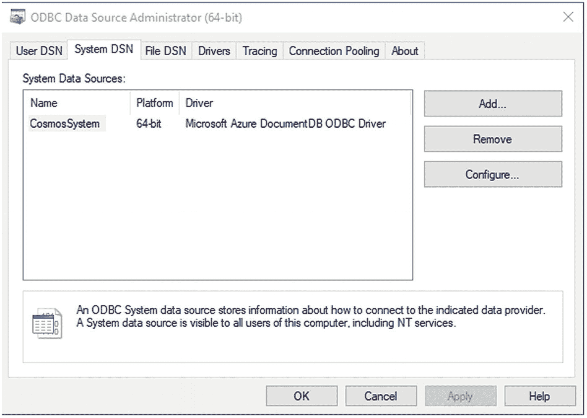

图 5-1 `ODBC` 数据源管理器

1. 运行“`ODBC` 数据源管理器”应用程序。该程序通常位于文件夹 `C:\ProgramData\Microsoft\Windows\Start Menu\Programs\Administrative Tools` 中。如果使用 64 位 `Excel`，请务必使用 64 位版本；如果使用 32 位 `Excel`，则使用 32 位版本。

2. 单击 `系统 DSN` 选项卡。您将看到如图 5-1 所示的对话框。

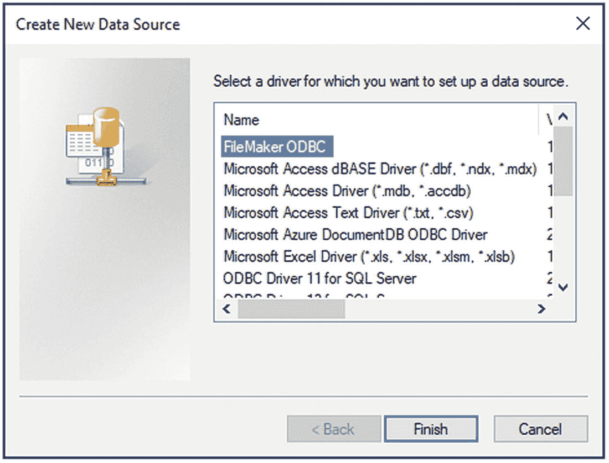

图 5-2 已安装的 `ODBC` 驱动程序列表

1. 单击 `添加`。您将看到计算机上当前所有已安装的 `ODBC` 驱动程序列表。这看起来应该类似于图 5-2 中所示的对话框。

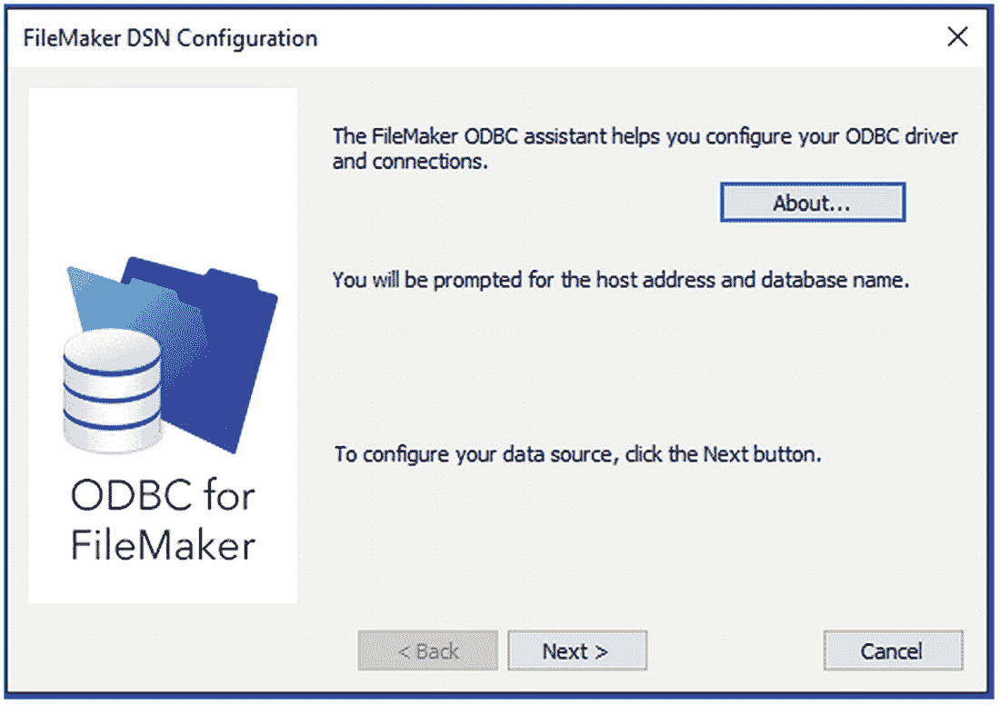

图 5-3 `FileMaker Pro` `ODBC` 配置助手

1. 选择与您要连接的数据源相对应的 `ODBC` 驱动程序（本例中为 `FileMaker ODBC`）。如果您看不到该 `ODBC` 驱动程序，则需要安装或重新安装该驱动程序。请查阅您所使用的 `ODBC` 驱动程序的文档以获取详细信息。

2. 单击 `完成`。您所选的特定 `ODBC` 驱动程序的配置对话框将出现。如果您使用 `FileMaker Pro`，该对话框将如图 5-3 所示。

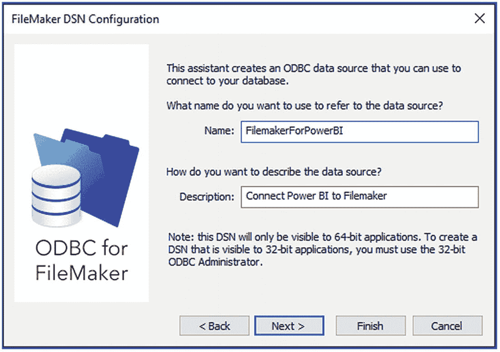

图 5-4 为 `FileMaker Pro` 命名 `ODBC` 连接

1. 单击 `下一步`，并为该 `ODBC` 连接输入名称和描述。这看起来可能类似于图 5-4 中所示的对话框。

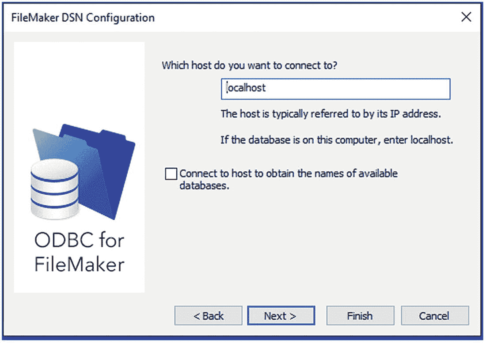

图 5-5 指定 `ODBC` 数据的主机

1. 单击 `下一步`，如果您在本地计算机上使用 `FileMaker` 试用版，请输入 `localhost` 作为主机名。否则，请输入 `FileMaker` 服务器的 `IP` 地址。您应该会看到如图 5-5 所示的对话框。当然，这特定于某一个 `ODBC` 驱动程序。使用其他驱动程序时，对话框会有所不同。

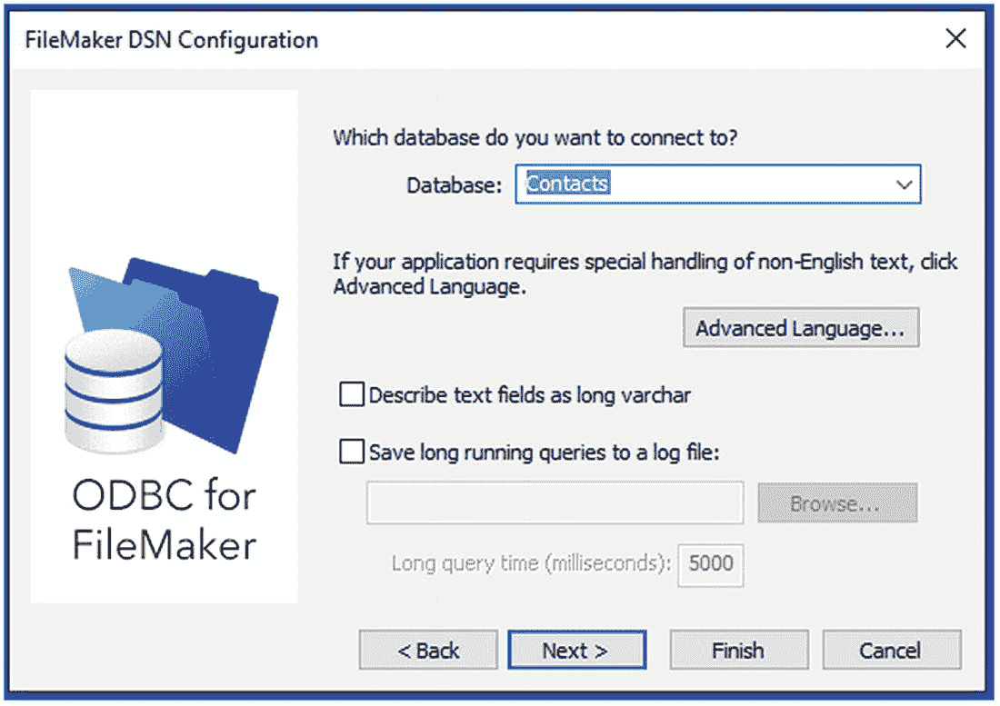

图 5-6 指定 `ODBC` 数据的数据库

1. 单击 `下一步`，然后在 `FileMaker Pro` 中选择您要连接的数据库。您将看到如图 5-6 所示的对话框（如果您*不是*使用 `FileMaker Pro` – 请记住，这些对话框可能会因具体的 `ODBC` 驱动程序而异）。

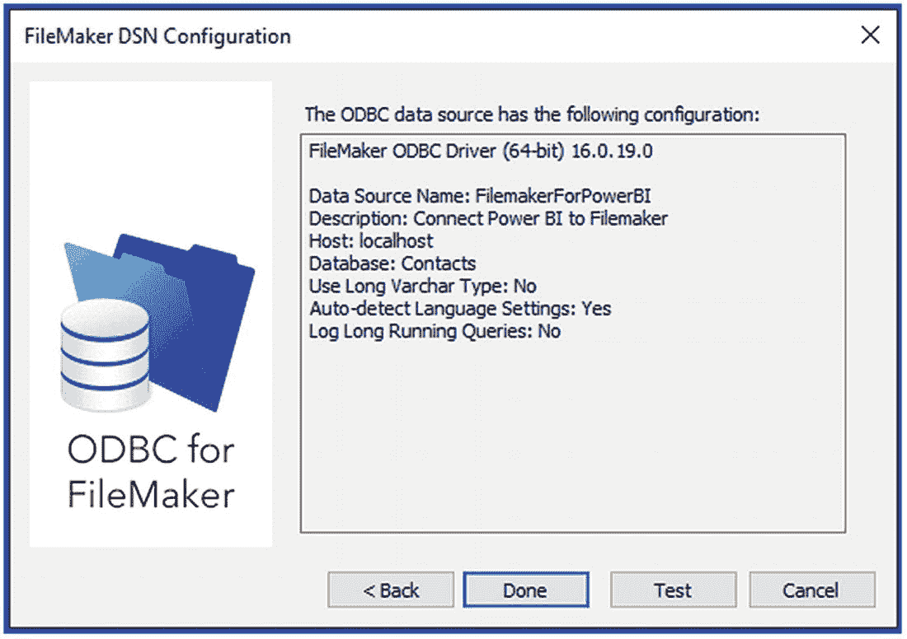

图 5-7 `ODBC` 连接确认对话框

1. 单击 `下一步`。`ODBC` 配置对话框将显示连接的摘要信息。这可能类似于图 5-7 中所示。

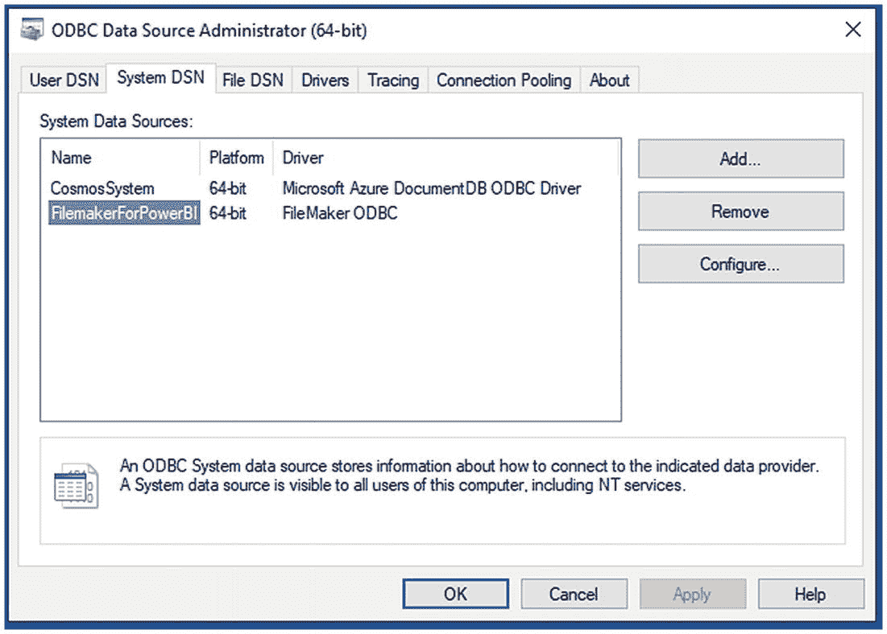

图 5-8 已配置 `ODBC` 驱动程序的“`ODBC` 数据源管理器”对话框

1. 单击 `完成`。您将返回到“`ODBC` 数据源管理器”，并且会看到刚刚创建的“`系统 DSN`”。“`ODBC` 数据源管理器”对话框应类似于图 5-8 所示。

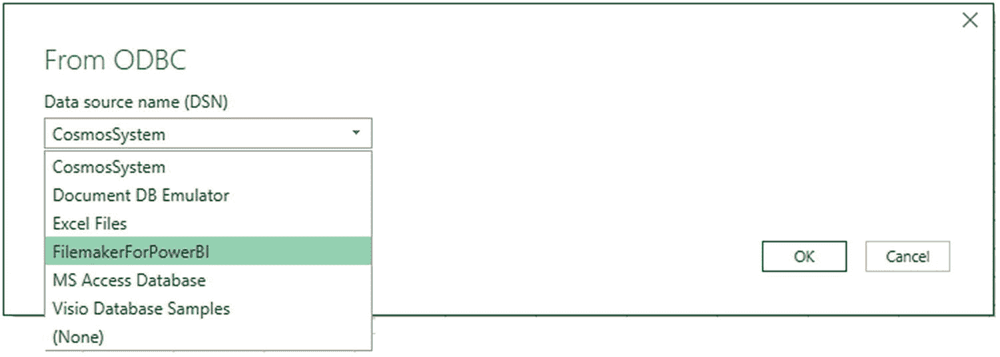

图 5-9 用于选择 `ODBC` 数据源的 `Excel`“从 `ODBC`”对话框

1. 单击 `确定`。这将关闭“`ODBC` 数据源管理器”对话框。

2. 启动 `Excel`。

3. 单击 `获取数据` ➤ `来自其他源` ➤ `来自 ODBC`。将出现“来自 `ODBC`”对话框。

4. 展开可用的 `DSN` 列表。“来自 `ODBC`”对话框将类似于图 5-9 所示。

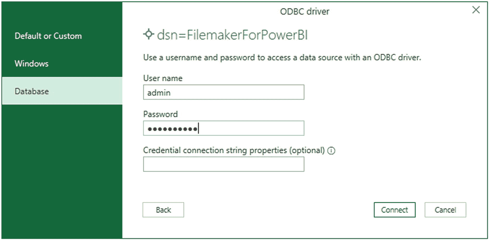

图 5-10 `ODBC` 驱动程序安全对话框

1. 选择您之前创建的 `DSN`（本例中为 `FilemakerForPowerBI`）。

2. 单击 `确定`。将出现凭据对话框。

3. 选择 `Windows 集成安全性`，或单击左侧的 `数据库` 并输入具有使用 `ODBC` 驱动程序连接权限的用户名。凭据对话框将类似于图 5-10 所示。

## ODBC 数据源

1. 单击 `连接`。您将在导航器窗口中看到 ODBC 数据源中可用的数据。

2. 选择要加载到 Excel 中的表。如果要同时加载多个表，请务必勾选 `选择多项` 复选框。

3. 单击 `加载` 以将数据从 ODBC 数据源加载到 Excel 中。

我意识到这个过程起初可能显得有些繁琐。但请记住，您很可能只需要设置一次 ODBC 连接。之后，您就可以随心所欲地使用它来连接源数据了。

创建好 ODBC DSN 后，你可以在多种场景以及众多不同产品中使用它——这些产品都需要获取你通过 ODBC 连接的数据源信息。这意味着我在此处创建的 ODBC 数据源可以用于 Excel 中的 Power Query、Power BI，以及其他许多需要访问 FileMaker Pro 数据的应用程序中。

需要注意的是，每个 ODBC 驱动程序都不尽相同。因此，在第 5 步到第 10 步中，对话框的外观会因你配置的 ODBC 驱动程序不同而略有差异。尽管如此，其中的关键元素始终是相同的，包括：

*   为 DSN 命名
*   指定数据所在的主机
*   定义数据存储库（或数据库）
*   指定访问数据源所需的任何凭据

关于如何创建和使用 ODBC 连接将数据加载到 Excel（或任何其他目标应用程序）中，还有很多内容可以探讨。然而，如果你需要深入了解这项特定技术，我不得不请你参考丰富的现有资源，无论是印刷版还是在线资源。一个很好的起点是 **Microsoft 文档**，其中解释了系统 DSN、用户 DSN 和文件 DSN 之间的区别，并描述了你可能需要了解的关键要素。

> **注意**
>
> 要使 ODBC 连接正常工作，数据源应用程序（本例中为 FileMaker Pro）必须已打开并正在运行。其他 ODBC 数据源可能有其自身的特定问题。

最后，我只能强烈建议你为打算与 Excel 中的 Power Query 配合使用的 ODBC 驱动程序，收集所有相关的文档。实际上，如果你使用的是采用 ODBC 驱动程序的企业级数据源，也许有企业内部的资源可以为你提供帮助，甚至帮你直接配置好 ODBC。

## OLE DB 数据源

OLE DB（对象链接与嵌入，数据库的缩写）在技术层面是一种被称为应用程序编程接口（API）的东西。从更通俗的层面讲，它是一种用于以通用方式连接数据库源的技术。

因此，与 ODBC 的方式有些类似，你可以使用 OLE DB 连接到各种数据源（通常是数据库，但也可以是其他数据源）。事实上，即使存在其他连接方法，你可能会发现 OLE DB 是一种连接到数据库的有效方式。

所以，无论你发现 OLE DB 有何用途，都值得去了解它是如何工作的。在本例中，我将使用 OLE DB 连接到 SQL Server 和一个示例数据库。

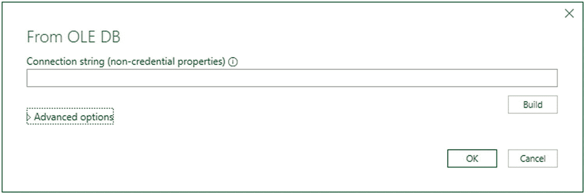

**图 5-11** `来自 OLE DB` 对话框

1.  打开一个新的 Excel 应用程序。

2.  在“数据”选项卡中，依次单击 `获取数据` ➤ `来自其他源` ➤ `来自 OLE DB`。此时将显示“来自 OLE DB”对话框。

3.  单击 `连接`。“来自 OLE DB”对话框将出现，外观应如图 5-11 所示。

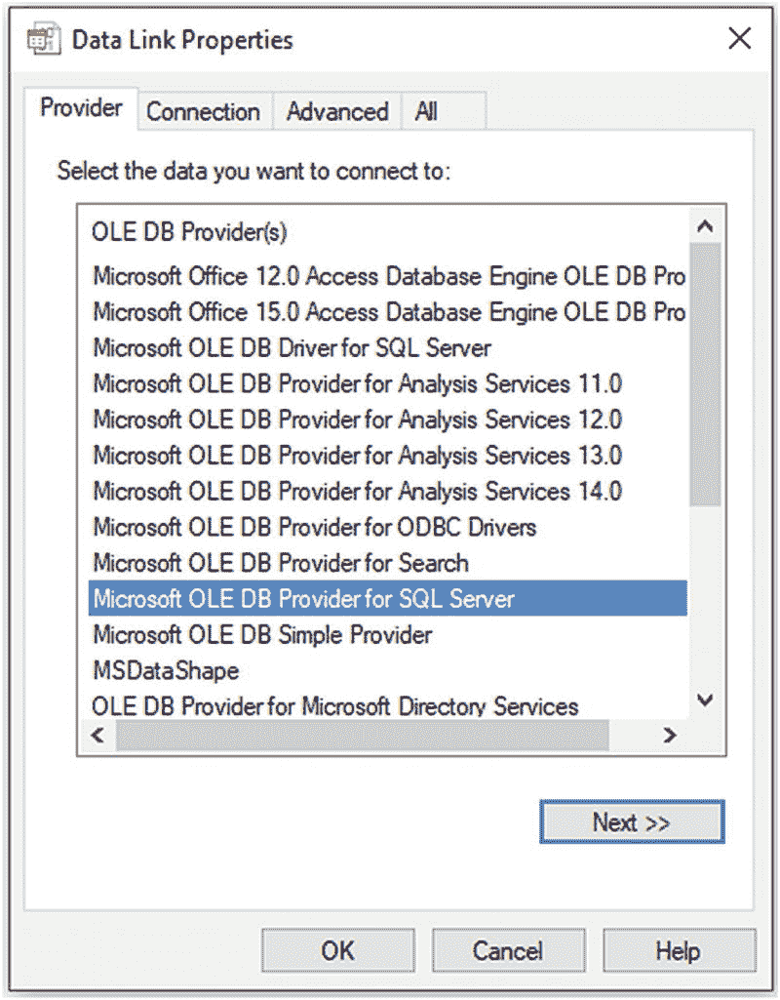

**图 5-12** `OLE DB 数据链接属性` 对话框

1.  如果你有功能完整的连接字符串，请在 `连接字符串` 文本框中输入。

2.  如果你没有连接字符串，请单击 `生成` 按钮。将显示“OLE DB 数据链接属性”对话框，如图 5-12 所示。

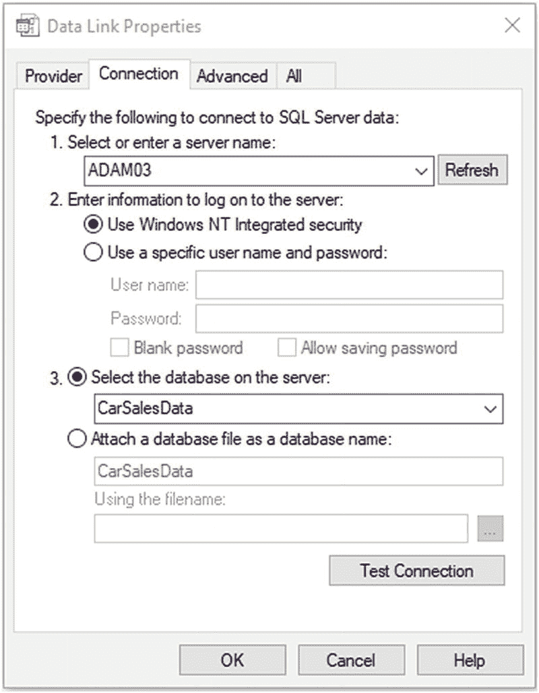

**图 5-13** `OLE DB 数据链接属性` 对话框的“连接”属性

1.  选择你想要使用的 OLE DB 数据提供程序。在本示例中，将选择 `Microsoft OLE DB Provider for SQL Server`。当然，你必须为你想要访问的数据源选择已安装的 OLE DB 提供程序。

2.  单击 `下一步`。将显示“OLE DB 数据链接属性”对话框的“连接”属性窗格。

3.  从“选择或输入服务器名称”弹出菜单中选择一个可用的 SQL Server（或输入其名称）。

4.  选择安全类型，如果你选择使用特定用户名而不是 Windows NT 集成安全性，则需要输入用户名和密码。

5.  从“选择服务器上的数据库”弹出菜单中选择源数据库。此时对话框应类似于图 5-13 所示。

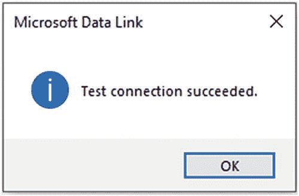

**图 5-14** 测试连接警报

1.  单击 `测试连接` 按钮以确保连接有效。你应该会看到图 5-14 所示的消息。

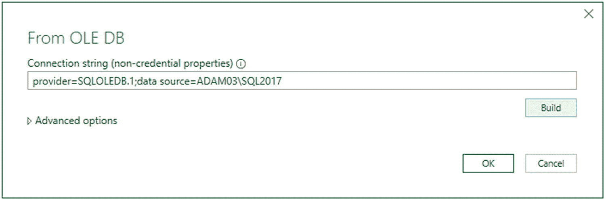

**图 5-15** 包含有效连接字符串的`来自 OLE DB` 对话框

1.  单击 `确定`。Excel 将生成连接字符串并将其插入到“来自 OLE DB”对话框中，如图 5-15 所示。

2.  单击 `确定`。将出现导航器窗口并显示相应的数据。

3.  选择你想要加载的表。

4.  单击 `加载` 将数据加载到 Excel 中。

> **注意**
>
> 如果是首次连接 OLE DB 数据源，系统可能会要求你输入用户名和密码，这与本章前面的示例情况类似。

步骤 8 到 10 是 SQL Server OLE DB 驱动程序特有的。对于其他驱动程序，这些步骤可能会有所不同。

你需要了解的是，OLE DB 连接要求运行 Excel 的计算机上安装了 OLE DB 驱动程序（或称“提供程序”）。然而，真正有趣的是，OLE DB 连接可以简化为一个简单的连接字符串。因此，如果你需要与其他用户共享此连接，很多情况下你只需将连接字符串通过电子邮件发送给他们即可。然后你的同事就可以简单地将该连接字符串粘贴到 Excel 的“来自 OLE DB”对话框中。换句话说（以本示例为模板），你只需向同事发送以下文本：

```
provider=SQLOLEDB.1;initial catalog=CarSalesData;data source=ADAM03\SQLSERVER2016
```

他们可以通过将此字符串粘贴到“来自 OLE DB”对话框中来连接到指定的数据库。同样，你的 IT 部门或许也能为你提供可以直接使用的合适连接字符串。

使用 OLE DB 连接还有其他优势。具体来说，你（或你的 IT 部门）可以在连接字符串中提供高级配置，以加快或改善对数据的访问。例如，这可以通过指定一个用于报表的镜像服务器来减轻主服务器的压力。在如此层面，技术细节将取决于 OLE DB 数据源以及所使用的驱动程序，并且其范围非常广泛，超出了本书的讨论范围。

## OData 源

OData 是开放数据协议（Open Data Protocol）的简称。该协议允许 Web 客户端发布和编辑由 URL 标识的资源。通过 OData 连接的数据可以是表格格式，也可以是其他不同的结构。

OData 是一种连接基于 Web 的数据的通用方法。因此，每个 OData 源可能与你之前使用过的其他源有所不同。

有大量的 OData 源可供使用。有些是公共的，有些则只有在你拥有相应权限时才能访问。然而，访问方法通常是大致相同的。下面是一个示例，展示如何连接到 Odata.org 免费提供的 OData 示例源（至少在本书付印时如此）：

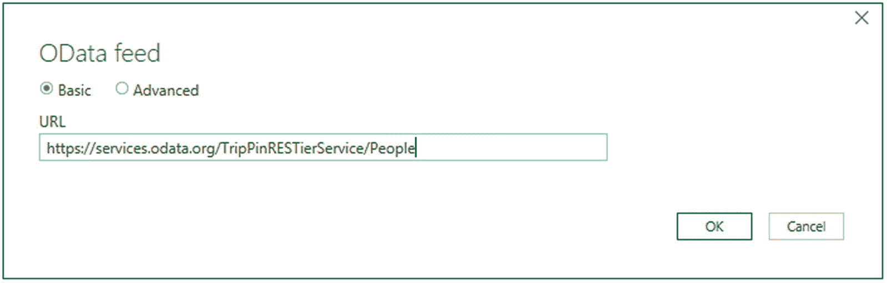

**图 5-16** OData 源对话框

1. 在 Excel 的“数据”选项卡中，依次单击 `获取数据` ➤ `来自其他源` ➤ `来自 OData 源`。此时会出现 OData 源对话框。

2. 输入你用于连接 OData 源的 URL。在此示例中，我将使用一个公共的 OData 源，你可以在 `https://services.odata.org/TripPinRESTierService/People` 找到它。对话框应如图 5-16 所示。

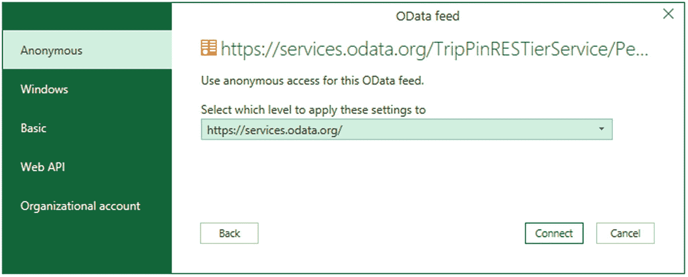

**图 5-17** OData 源凭据对话框

3.  单击 **确定**。此时会出现 OData 源凭据对话框。你可以在图 5-17 中看到它。

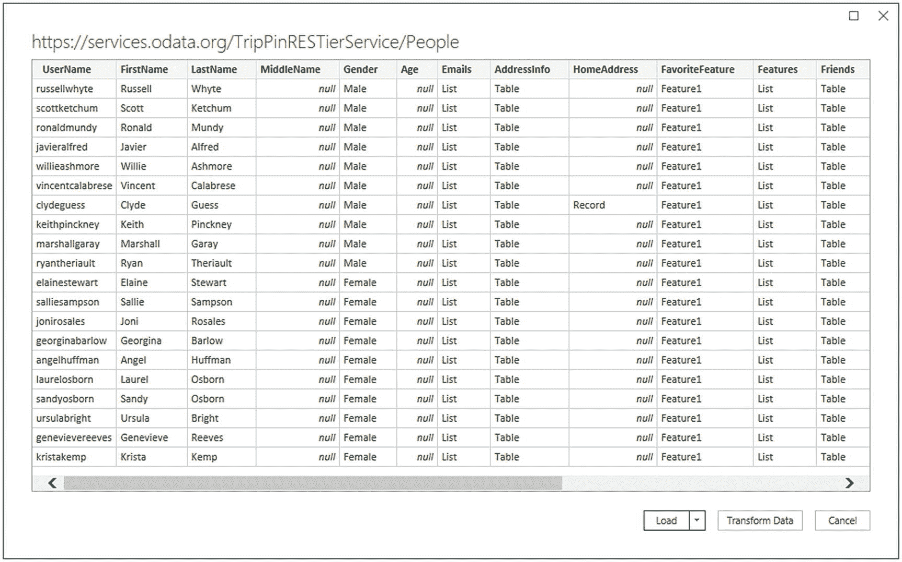

**图 5-18** 从 Power Query 导航器中的 OData 源返回的数据

4.  从对话框左侧的可用列表中选择凭据类型。在此示例中，接受匿名凭据，因此你无需输入用户名或密码。对于其他服务，你可能需要在左侧选择适当的安全方法，然后输入所需的凭据。

5.  单击 **连接**。此时会显示导航器对话框，并显示使用指定 URL 可用的数据。你可以在图 5-18 中看到从此示例 URL 返回的数据。

6.  单击 **加载**。数据将加载到新的 Excel 工作表和/或数据模型中，具体取决于你选择的加载配置选项。

> **注意** 有趣的是，Dynamics 365 Online 使用 OData 作为连接方法。

### OData 选项

OData 源对话框（与你在本章前面看到的 **从 Web** 对话框颇为相似）也包含一个 **高级** 按钮。选择此按钮将展开对话框，允许你向 URL 添加一个或多个 URL 部分。你可以在图 5-19 中看到这一点。

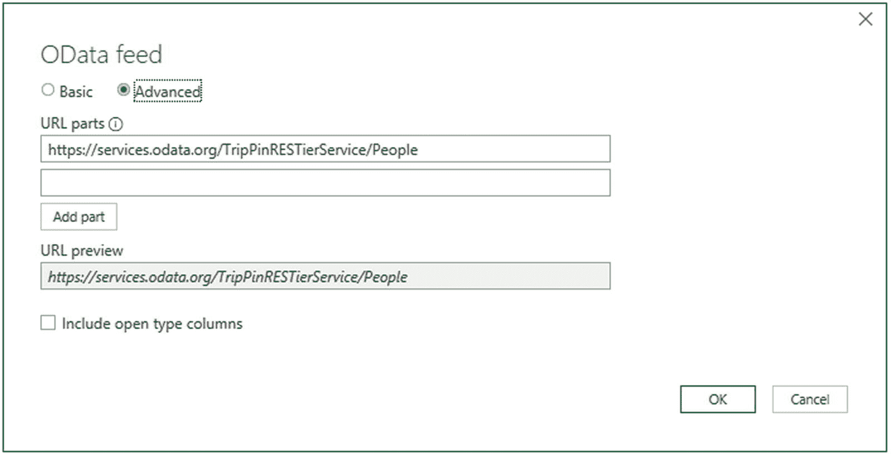

**图 5-19** OData 源对话框的高级选项

> **注意** URL 部分可以在 Power Query 编辑器中参数化。我将在第 11 章中解释参数化。

## 刷新数据

从数据库和数据仓库加载数据仅意味着将源数据的快照复制到 Excel 中。如果源数据被更新、扩展或删除，那么如果你希望分析反映数据的当前状态，你将需要获取最新版本的数据。

基本上，你有两个选项可以做到这一点：

- 刷新你定义的所有数据源中的所有源数据。
- 单独刷新一个或多个表。

### 刷新 Excel 内存模型中的整个数据

确保所有数据都是最新的只有一种方法。刷新整个数据可能需要更长的时间，但你会确信你的 Excel 文件包含来自你所连接的所有源的最新可用数据。

要执行完全刷新：

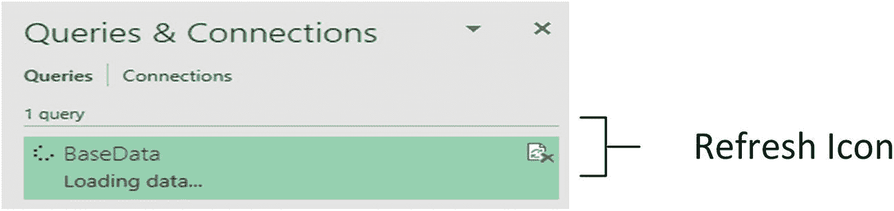

**图 5-20** 刷新对话框

1.  在“开始”选项卡中，单击 **刷新** 按钮。**查询和连接** 窗格将显示所有当前正在刷新的数据源。**查询和连接** 窗格将类似于图 5-20 中所示。

任何工作表或 Power Pivot 数据模型中的当前数据都将被更新，以显示源中可用的最新数据。

> **注意** 如果源数据量很大或网络连接速度较慢，完全数据刷新可能需要相当长的时间。

### 刷新单个查询

如果你确定只需要刷新 Excel 数据模型中的一个或多个表，那么你可以选择单独刷新这些表。操作步骤如下：

1.  在 **查询和连接** 窗格中，单击要刷新的表的刷新图标。如图 5-20 所示。

该表的现有数据将被最新数据替换。

## 结论

在本章中，你学习了可以使用通用数据访问连接器（ODBC、OLE DB 和 OData）来连接那些（尚）没有内置 Power Query 连接器的数据源。你还了解了如何在 Excel 中刷新数据。

本章结束了由五个章节组成的系列，该系列向你介绍了可以与 Excel 中的 Power Query 一起使用的众多不同数据源中的一部分。在这些篇幅中，你已经了解了如何从一系列可用源中加载数据。好消息是，Excel 能够从比我们在这里介绍的更多的源中读取数据。更好的消息是，你可以利用已获得的知识，使用标准化的 Power Query 界面连接到任何其他可用的数据源。

因此，我不会在本书中进一步描述其他数据源了。这是因为，既然你已经了解了构成 Power Query 将数据加载到 Excel 这一极其便捷方法的核心技术，那么你很可能不需要我提供更多信息就能够加载任何可用的连接类型。

既然你现在能够查找、访问和加载所需数据到 Excel 中，是时候进入下一步了。这意味着要清理和重构数据集，使其符合你的分析需求。应对这些挑战将是接下来七章的主题。

