# 3. 从数据库和数据仓库加载数据

当今世界上的大部分企业数据都存储在本地或云中的关系型数据库、数据仓库和数据仓库一体机中。`Excel`（通过 `Power Query`）可以连接到许多世界领先的商业和开源数据库及数据仓库。本章将向你展示如何从这些数据源中的若干个提取数据，以便利用 `Power Query` 驱动基于 `Excel` 的分析。实际上，你将发现，一旦学会了如何连接一两个数据库，由于 `Power Query` 为数据提取带来了标准化的接口和方法，你也就学会了如何使用几乎所有数据库。

不过，你需要注意，本章中的示例所使用的示例数据*不在* `Apress` 网站上提供。在本章中，我将让你使用自己的数据，或者使用通常随源数据库一起安装的示例数据。

**注意：** 这可能是显而易见的，但连接到数据库意味着该数据库必须已安装并正常运行，并且你已有权访问它。实际上，你可能还需要在运行 `Power Query` 的 PC 上安装特定的客户端软件。本章将不解释如何安装或使用任何所提及的数据库（或客户端软件）。为此，你需要查阅相关的数据库文档。不仅如此，本章中概述的许多数据源仅在你拥有专业版或企业版 `Excel` 订阅时才可用。

## 关系数据库

能够访问存储在关系数据库中的数据，对于当今大部分商业智能工作来说至关重要。由于企业级关系数据库仍承载着全球大部分数据，你真的需要知道如何挖掘这些数据库中蕴藏的庞大信息宝库。坏消息是，市面上有非常非常多的数据库，每个都有自己的复杂性和特性。好消息是，一旦你学会了从其中*一个*数据库中加载数据，就基本可以期待能够使用*任意*一个数据库。

在现实世界中，连接企业数据可能需要你拥有一个登录名以及通常用于连接的密码（除非数据库能够识别你的 Windows 登录信息，或者已实施单点登录解决方案）。我还假设你需要拥有读取包含数据的表（Table）和视图（View）的权限。因此，本章描述的技术可能只是简单的一环。困难的部分在于说服企业数据的守护者，让他们相信你确实*需要*这些数据，并且应该被允许查看它们。

`Power Query` 当前能够连接、预览并从中加载数据的数据库，如表 3-1 所示。

**表 3-1**

数据库源

| 数据库 | 说明 |
| --- | --- |
| SQL Server 数据库 | 允许你连接到本地 Microsoft SQL Server 数据库（位于本地、托管环境或云虚拟机中），并从你有权访问的所有数据表（Table）和视图（View）中导入记录 |
| Access 数据库 | 允许你连接到网络中的 Microsoft Access 文件，并加载查询和表（Table）（我们在前一章中探讨过） |
| SQL Server Analysis Services 数据库 | 允许你连接到 `SQL Server Analysis Services (SSAS)` 数据仓库。这可以是一个联机分析处理 (`OLAP`) 多维数据集，也可以是一个内存中的表格数据仓库 |
| Oracle 数据库 | 允许你连接到 Oracle 数据库，并从你有权访问的所有数据表（Table）和视图（View）中导入记录。这可能需要安装客户端软件 |
| IBM DB2 数据库 | 允许你连接到 IBM DB2 数据库，并从你有权访问的所有数据表（Table）和视图（View）中导入记录。这可能需要安装额外的软件 |
| MySQL 数据库 | 允许你连接到 MySQL 数据库，并从你有权访问的所有数据表（Table）和视图（View）中导入记录 |
| PostgreSQL 数据库 | 允许你连接到 PostgreSQL 数据库，并从你有权访问的所有数据表（Table）和视图（View）中导入记录。这可能需要安装额外的软件 |
| Sybase 数据库 | 允许你连接到 Sybase 数据库，并从你有权访问的所有数据表（Table）和视图（View）中导入记录 |
| Teradata 数据库 | 允许你连接到 Teradata 数据库，并从你有权访问的所有数据表（Table）和视图（View）中导入记录。这可能需要安装额外的软件 |
| SAP HANA 数据库 | 允许你连接到 SAP HANA 内存数据库，并导入你有权限访问的所有对象中的记录。这可能需要安装额外的软件 |

这些是当前可用于 `Power Query` 连接的数据库连接器。由于可以从 `Power Query` 连接的数据库和数据仓库源列表在持续发展，当你阅读本书时，这个列表很可能已经扩展，包含了新的项目。

**注意**

尽管 `Power Query` 将 Microsoft `Access` 归类为关系数据库，但我更倾向于将其作为基于文件的源来处理。因此，MS `Access` 数据已在上一章讨论过。

除了针对特定数据库的连接器，`Power Query` 还包含通用连接器，它们可以帮助你从不在可用数据库列表中的数据库读取数据。这些通用连接器在表 3-2 中进行了说明。

**表 3-2**

通用数据库访问

| 源 | 说明 |
| --- | --- |
| `ODBC` 数据源 | 允许你通过开放式数据库连接 (`ODBC`) 连接到数据库或数据源 |
| `OLE DB` 数据源 | 允许你通过对象链接和嵌入数据库 (`OLE DB`) 连接到数据库或数据源 |

需要注意的是，这些通用连接器并非对所有数据库都有效。但是，对于你已经获取、安装并配置了有效 `ODBC` 或 `OLE DB` 驱动程序的数据库，它们应该可以正常工作。这些连接类型将在第 5 章中解释。

## SQL Server

在此，我将以微软企业级关系数据库——`SQL Server`——为例，演示如何使用 `Power Query` 将数据从数据库加载到 `Excel` 中。这种设置的第一大优势是，您可能无需安装任何软件就能访问 `SQL Server`。第二大优势是，相关技术与 `Power Query` 所能连接的 Oracle、DB2 等数据库所使用和应用的方法十分相似。此外，您还可以一次性从数据库加载多个表或视图。要实际操作（在您的 `SQL Server` 数据库上）查看效果，请按以下步骤操作：

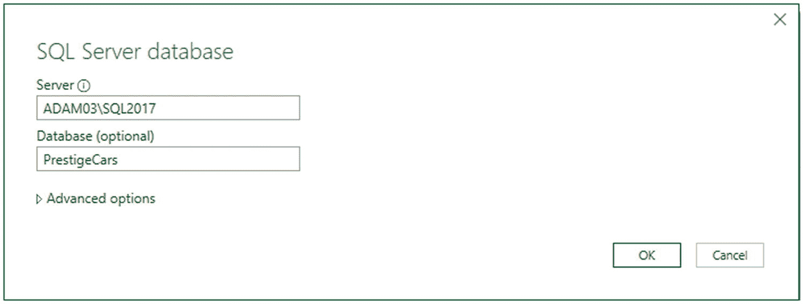

图 3-1 Microsoft SQL Server 数据库对话框

1. 打开一个新的 `Excel` 工作簿。

2. 在“数据”功能区中，依次点击 `获取数据 ➤ 来自数据库 ➤ 来自 SQL Server 数据库`。此时将出现 SQL Server 数据库对话框。

3. 在 `服务器` 文本框中输入服务器名称。这将是您的 `SQL Server` 名称，或是您组织使用的某个 `SQL Server` 资源。甚至可能是您安装在个人电脑上的 `SQL Server` 本地版本。

4. 输入数据库名称。对话框将如图 3-1 所示（当然，会显示您自己的服务器和数据库名称）。

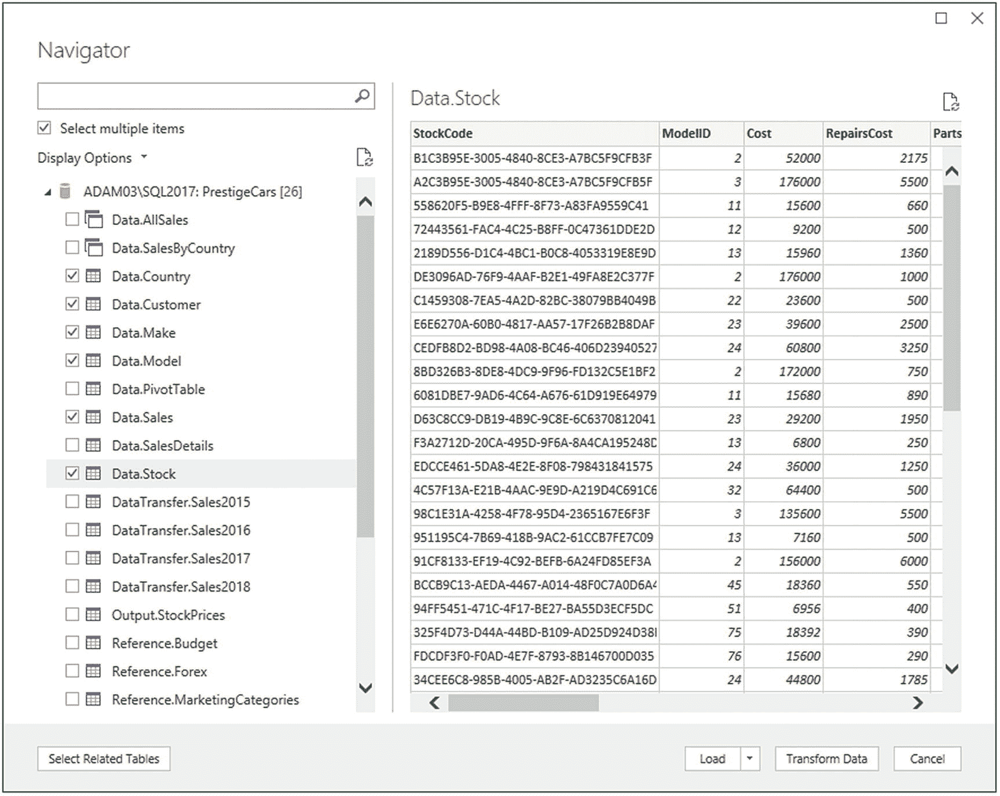

图 3-2 选择多个项目时的导航器对话框

5. 点击 `确定`。`Power Query` 将连接到服务器，并显示导航器对话框，其中包含您在所选服务器上有权查看的所有表和视图。

6. 确保勾选 `选择多项` 复选框。

7. 勾选您想要加载的表的复选框。最近选中的表的数据会显示在导航器对话框的右侧，如图 3-2 所示，其中选中了 `Stock` 表。

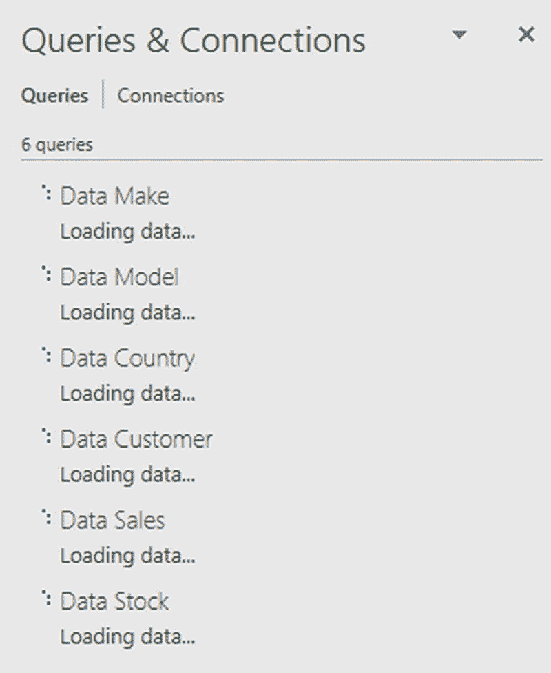

图 3-3 显示数据加载进度的“加载”对话框

8. 点击 `加载`。

9. 数据加载期间，`Power Query` 会显示 `查询和连接` 窗格，并展示每个选中表的加载进度。您可以在图 3-3 中看到此过程。

10. 加载完成后，`查询和连接` 窗格将显示已加载到数据模型中的每个源表的最终行数。

**提示**

选择多个表或视图时，您只能在导航器对话框中看到单个数据源的内容。但是，只需点击表或视图的名称，即可预览任何选中数据源（甚至任何未选中数据源）的内容。这不会影响您希望使用 `Power Query` 加载的选中表和视图的选择。

由于这与上一章从 `Access` 加载数据的方式非常相似，我猜您现在应该已经掌握了如何使用数据库源。导航器对话框再次提供了一种简单高效的方式来选择要加载到 `Excel` 中的数据集。

**注意**

如果您愿意，可以输入服务器 IP 地址代替服务器名称。如果同一台服务器上有多个 `SQL Server` 实例，您需要添加一个反斜杠和实例名称。此类详细信息可从企业数据库管理员处获取。

### 自动加载相关表

关系数据库几乎总是由许多相互依赖的表组成的复杂结构。实际上，您经常需要加载多个表才能获得所需的所有数据。

# 使用数据库

知道选择哪些表并不总是容易的。Power Query 会尝试通过自动检测源数据库中表之间存在的关联来帮助您；通过这种方式，您可以快速确定设计为协同工作的表集合。

请执行以下操作以查看相关的表组：

1.  按照上一节所述连接到源数据库。
2.  在导航器对话框中，单击包含您需要数据的表。
3.  点击 `选择相关表` 按钮。

数据库中与您在导航器对话框中选择的表相关联的任何表都会被选中。当然，您可以取消选择任何不需要的表。更重要的是，您可以点击选中表的名称来查看其内容。

> **注意**
>
> 有时您需要依次选择多个表并单击 `选择相关表`，以确保 Power Query 会选择支撑您分析所需的所有表。

## 数据库选项

——无论好坏——关系数据库的世界比文件或 MS Access 的世界要稍微复杂一些。因此，关于将数据库用作数据源（特别是如何连接到数据库）有一些需要说明的地方。

首先，我们讨论一下与服务器的初始连接。选项在表 3-3 中进行了解释。

**表 3-3** 数据库连接选项

| 选项 | 说明 |
| --- | --- |
| `服务器` | 您无法通过浏览找到服务器，因此需要输入或粘贴服务器名称。如果服务器有实例名称（稍后我会解释这个概念），您需要同时输入服务器和实例。如果您在办公环境中工作，您的 IT 部门将能提供此信息。 |
| `数据库` | 如果您知道数据库名称，则可以在此处输入（或粘贴）。这会限制导航器对话框中可用表的数量，并更容易找到正确的表或视图。 |
| `SQL 语句` | 您可以输入一段有效的 T-SQL 代码片段（或一个存储过程，或一个表值函数），该代码从数据库返回数据。 |

这些选项可能需要进一步的解释。因此，让我们逐一探讨它们。

### 服务器连接

关键在于，你需要知道想要连接的数据库的确切连接字符串。这可能是以下形式：

-   数据库服务器名称。
-   数据库服务器名称、反斜杠和实例名称（如果此物理或虚拟服务器包含多个 SQL Server 实例）。
-   数据库服务器 IP 地址。
-   数据库服务器 IP 地址、反斜杠和实例名称（如果有）。
-   如果 SQL Server 实例使用自定义端口，则必须在服务器名称末尾加上逗号，后跟端口号。这通常是企业级 DBA 负责的问题。
-   如果你在个人电脑上运行的是单个 SQL Server 实例，则可以使用名称 `localhost`（或一个句点）来引用本地服务器。

> **注意**
>
> 数据库实例是在同一物理或虚拟服务器上与其他实例并行运行的独立 SQL Server 服务。要成功连接，你始终需要同时提供服务器名称和此实例名称（如果有）。你也可以根据需要指定超时时间。

大多数 SQL Server 实例托管着许多数据库，有时数量可达数百个。有时，你难免会忘记要连接的是哪个数据库。幸运的是，Power Query 导航器允许你在授权的服务器上浏览数据库。为此，请执行以下操作：

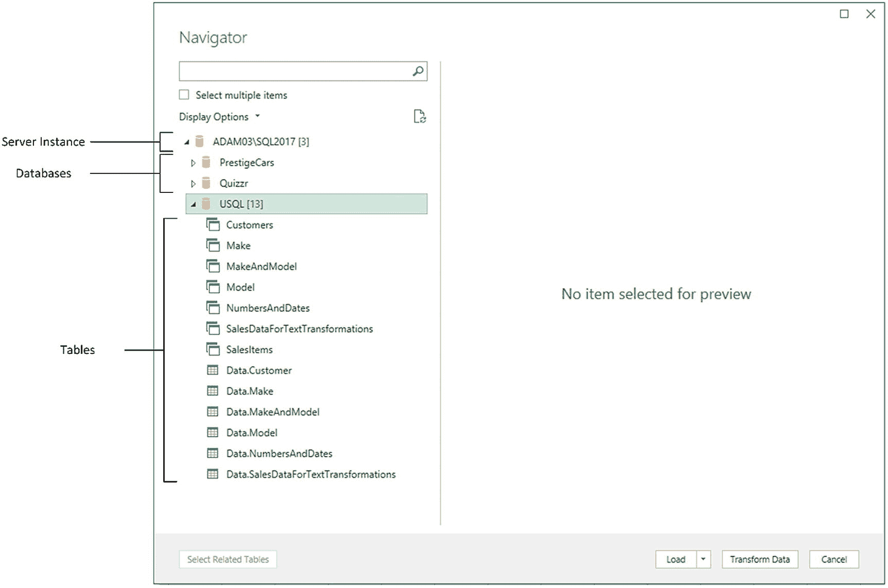

**图 3-4** 选择数据库时的导航器对话框

1.  在 Power Query 功能区中，点击**获取数据**按钮底部的小三角形，然后点击 `SQL Server`。此时将出现 SQL Server 数据库对话框。
2.  在**服务器**文本框中输入服务器名称，然后点击**确定**。*不要*输入数据库名称。导航器窗口将打开并显示所有可用的数据库，如图 3-4 所示。当然，实际显示的内容取决于你正在连接的服务器。

从图 3-4 中可以看到，如果你点击数据库左侧的小三角形，则能够看到在该数据库中你有权访问的所有表和视图。虽然在寻找所需的表或视图时，这可能意味着选择过多，但这仍然是提醒你所需数据集名称的一种便捷方式。

> **提示**
>
> 你在企业服务器上实际能看到的数据库取决于已授予你的权限。如果你看不到某个数据库，则必须与数据库管理员沟通以解决权限问题。

### 在导航器中搜索数据库、表和视图

如果导航器对话框左侧面板中显示的表和视图数量过多让你应接不暇，则可以使用导航器内置的搜索功能来帮助缩小潜在数据源的范围。

#### 搜索数据库

要隔离特定的数据库，请执行以下操作：

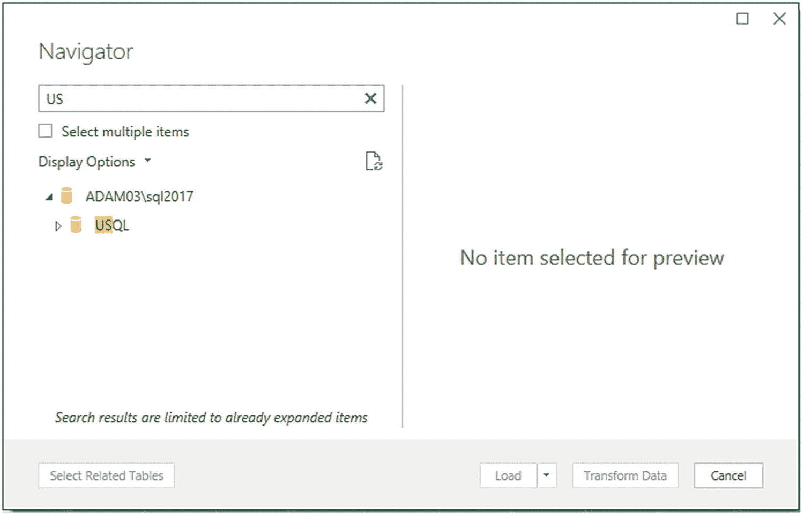

**图 3-5** 使用导航器搜索功能查找数据库

1.  执行前面“SQL Server”部分中的步骤 1 和 2，连接到 SQL Server 实例时*不*指定数据库。
2.  在导航器对话框的**搜索**框中，输入几个你知道包含在你要查找的表或视图名称中的字符。例如，在我的服务器上输入 `US`，会得到如图 3-5 所示的结果。

#### 搜索表

如果你要搜索表，请执行以下操作：

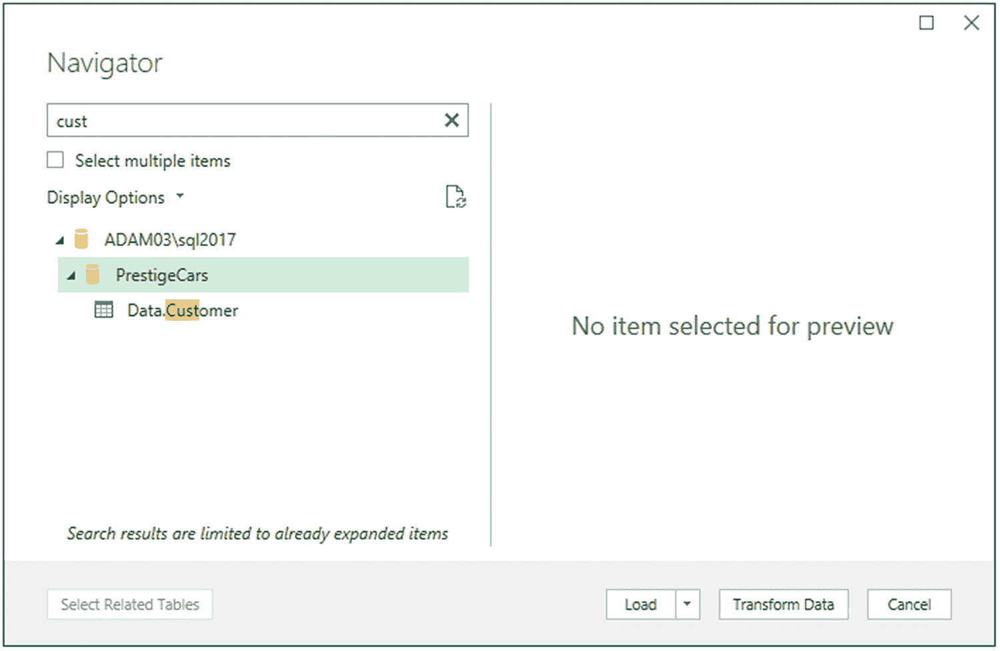

**图 3-6** 使用导航器搜索功能查找表

1.  展开你想要搜索特定表的任何数据库。
2.  在导航器对话框的**搜索**框中，展开你感兴趣的数据库，然后输入几个你知道包含在你要查找的表或视图名称中的字符。例如，在我的服务器上输入 `cust`，会得到如图 3-6 所示的结果。

搜索对象时，可以输入大写或小写文本（适用于大多数 SQL Server 安装），并且该文本可以出现在表或视图名称的任何位置，而不仅仅是名称的开头。每输入一个字符，潜在匹配项的列表就会越来越短。一旦找到你要查找的表或视图，只需按照前面所述的方法将数据加载到 Excel 中，即可使用 Power Query。

如果搜索没有返回你预期的任何视图中的表子集，只需点击**搜索**框右侧的叉号即可。这会取消搜索并显示所有可用的表，同时清空**搜索**框。

如果你不确定是否看到了数据库中所有的表和视图，请点击**搜索**框右下角的小图标（看起来像是一个带有两个绿色循环箭头的小页面）。这是**刷新**按钮，它会刷新与数据库的连接，并显示你有权限查看的所有表和视图。最后，值得注意的是，筛选表的功能也可以应用于 Excel 表、工作表、命名区域以及 Access 数据库。这是统一的导航器界面如何帮助最小化掌握 Power Query 的学习曲线的另一个例子。

### 数据库安全性

请记住，数据库的设计是极其安全的。因此，只有在你被授权访问时，才能看到服务器、数据库、表和视图。你可能需要与 IT 部门沟通，以确保你拥有所需的权限；否则，你正在寻找的表可能就在数据库中，但对你来说却是不可见的。

> **提示**
>
> 如果在首次尝试连接到 SQL Server 时遇到连接错误，只需点击**编辑**按钮返回 Microsoft SQL Server 数据库对话框并更正任何错误即可。这避免了重新开始整个过程。

## 使用 SQL 语句

若说使用 SQL Server 这类关系数据库作为数据源有什么缺点，那便是数据库存储的海量数据——即便只在一个表中——也可能庞大得令人望而生畏。幸运的是，在你加载数据之前，便可利用 SQL Server 的全部资源来筛选通过 Power Query 访问的数据。这样一来，你就不必在尚未开始分析数据之前，就冒着被信息淹没的风险加载整个数据表。

以下是可用来扩展 SQL Server 与 Power Query 协作关系的 SQL Server 技术：

- `SQL SELECT` 语句
- 存储过程
- 表值函数

诚然，这些是相当技术性的解决方案。事实上，如果你不是数据库专家，可能需要 IT 部门的协助才能使用这些选项来访问服务器中的数据。尽管如此，还是值得快速了解这些技术，以备现在或将来派上用场。

以上任一选项均可从 SQL Server 数据库对话框中进行应用。以下是一个使用 `SELECT` 语句从数据库表中筛选数据的示例：

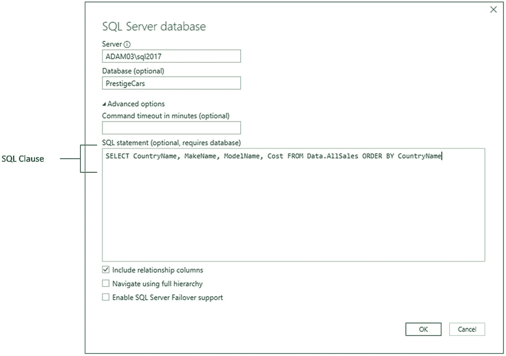

**图 3-7** 使用 SQL 选择数据库数据

1.  在“数据”功能区，单击 **获取数据** ➤ **来自数据库** ➤ **来自 SQL Server 数据库**。将显示 SQL Server 数据库对话框。
2.  输入服务器名称和数据库名称。这必须是您已被授予访问权限的服务器和数据库。
3.  单击 **高级选项** 左侧的三角形。这将打开一个可以输入 SQL 命令的框。
4.  输入您要应用的 SQL 命令。在此示例中（使用我电脑上的服务器和数据库），命令为：

```sql
SELECT CountryName, MakeName, ModelName, Cost FROM Data.AllSales ORDER BY CountryName
```

对话框将如图 3-7 所示——当然，**SQL 语句** 框中显示的是您输入的 SQL。

5.  单击 **确定**。相应数据的样本最终会显示在如图 3-8 所示的对话框中。实际返回的数据取决于您所使用的源系统。

6.  单击 `加载` 或 `转换数据` 以继续数据加载过程。或者，您可以单击 `取消` 并开始不同的数据加载。

> **提示**：在输入自定义 SQL 时（或使用存储过程时，如下节所述），最好在第 3 步中指定数据库名称。如果不提供数据库名称，则必须在 SQL 查询中使用三部分表示法。也就是说，您必须在查询中使用的`每个`表名的架构和表名之前加上数据库名称和句点。

### SQL Server 中的存储过程

使用函数或存储过程从 SQL Server 返回数据时，其原理相同。您将始终使用 `SQL 语句` 选项输入将返回数据的命令。请记住，要调用 SQL Server 存储过程或函数，您需要在 Microsoft SQL Server 数据库对话框中输入以下元素：

-   `服务器`：`<您的服务器名称>`

-   `数据库`：`<数据库名称>`

-   `SQL 语句`：`EXECUTE`（或 `EXEC`）`<输入架构（如果有，后跟句点）和存储过程名称，后跟任何参数>`

通过这种方式，您或您的 IT 部门可以创建复杂且安全的方法，以便将来自企业数据库的数据从数据库读取到 Power Query 中。

为了实际演示，以下是一个使用 SQL Server 存储过程仅返回可用数据子集的示例。该存储过程名为 `pr_DisplayUKClientData`，您可按如下方式应用它：

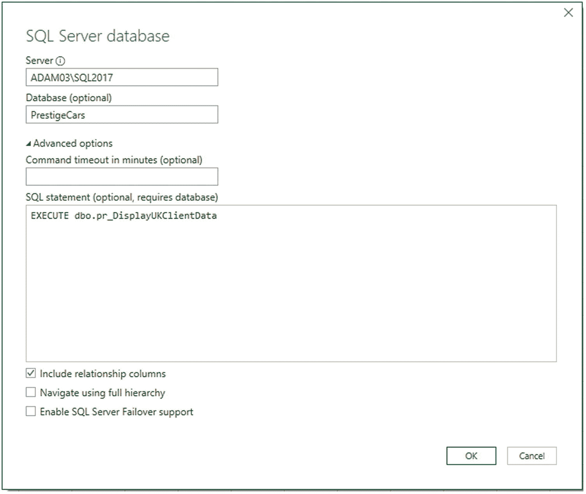

`图 3-9` 使用 SQL 选择数据库数据

-   在“数据”功能区，单击 `获取数据` ➤ `来自数据库` ➤ `来自 SQL Server 数据库`。将显示 SQL Server 数据库对话框。

-   输入服务器名称和数据库名称。

-   单击 `高级选项` 左侧的三角形。这将打开一个可以输入 SQL 命令的框。

-   输入您要应用的 SQL 命令。在本例中，该命令为 `EXECUTE dbo.pr_DisplayUKClientData`。对话框将如图 3-9 所示。

-   单击 `确定`。相应数据的样本将返回到导航器中。

-   单击 `加载` 或 `编辑` 以继续数据加载过程。或者，您可以单击 `取消` 并开始不同的数据加载。

在此示例中返回的数据仅是存储过程所选出的可用数据的一个子集。您需要了解存储过程可以对源数据执行多种任务。这些任务包括选择、排序和清理数据。

存储过程通常需要在存储过程名称后添加*参数*。在 Power Query 中执行存储过程时，这是完全可以接受的。例如：

```
EXECUTE dbo.pr_DisplayUKClientData 2020
```

在此特定示例中，参数是 `2020`。如果需要输入多个参数，它们必须用逗号分隔。

需要记住并向 IT 部门传达的关键是：Power Query 期望的 SQL 是源数据库所使用的 SQL 方言。因此，对于 SQL Server，这意味着要使用 `T-SQL`。事实上，这个 SQL 变成了一个“直通”查询，由底层数据库直接解释。

> **注意**：SQL 语句或存储过程仅会以*单个表*的形式返回数据。诚然，此表可能包含来自源数据库中多个基础表或视图的数据，但筛选源数据将阻止 Power Query 将来自多个表的数据作为单独查询加载。因此，您可能需要创建多个查询，而不是单个加载查询，以便从数据源中一组连贯的表中获取数据。

## Oracle 数据库

当今企业市场中活跃着众多数据库供应商，其中最具统治力的当属 Oracle。虽然我已使用 Microsoft 数据源开启探索如何通过 Power Query 使用数据库的旅程，但我若不解释如何访问其他供应商的数据库，便是有失职守。

现在正是展示 Power Query 真正开放性的时刻。它绝不会将你局限于 Microsoft 数据源——远非如此。事实上，使用其他供应商的数据库作为分析报告的数据源同样轻而易举。作为示例，让我们一起看看如何通过 Power Query 将 Oracle 数据加载到 Excel 中。

安装和配置 Oracle 数据库并非易事。因此，我不会提供 Oracle 示例数据库，而是建议你自行寻找可连接的企业数据库，或者更佳方案是查阅众多优秀资源——这些资源能出色地指导你如何搭建自己的 Oracle 数据库并安装可用的示例数据。

请注意，连接 Oracle 需要在运行 Power Query 的计算机上安装 Oracle 客户端软件，其配置过程也可能较为复杂。因此，若你计划测试使用 Oracle 数据与 Power Query 配合，或许需要寻求企业内专业人士或技术达人的帮助。

若你勇于尝试，可通过以下网址查找 Oracle 客户端软件。对于 32 位版本的 Power Query，可尝试通过以下链接下载并安装 32 位 Oracle 客户端：

```
www.oracle.com/technetwork/topics/dotnet/utilsoft-086879.html
```

对于 64 位版本的 Power Query，请使用以下链接下载并安装 64 位 Oracle 客户端：

```
www.oracle.com/technetwork/database/windows/downloads/index-090165.html
```

本书付印时，以上两个链接均有效。

如需确认当前使用的 Power Query 版本（32 位或 64 位），请依次单击 `File` ➤ `Help` ➤ `About`。弹出的对话框会显示当前版本信息。

现在，假设你已拥有可用的 Oracle 数据库（且已知服务器名称或 `SID` 以及有效的用户名和密码），以下步骤将演示如何从该数据源将数据加载到 Power Query。此示例中我将使用随示例数据库一同安装的标准 Oracle 示例数据。

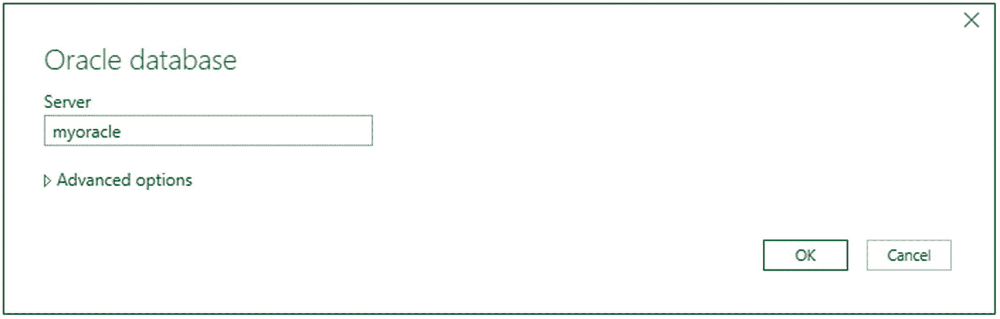

`图 3-10` Oracle 数据库对话框

1.  打开一个新的 Excel 工作簿。

2.  在 `Data` 功能区的 `Get Data` 菜单中，依次选择 `From Database` ➤ `From Oracle Database`。

3.  在 `Server` 文本框中输入服务器名称。这可以是您的 Oracle 服务器名称，或所在机构使用的某个 Oracle 服务器资源名称。

4.  点击 `Import` 按钮。此时对话框将如图 3-10 所示。

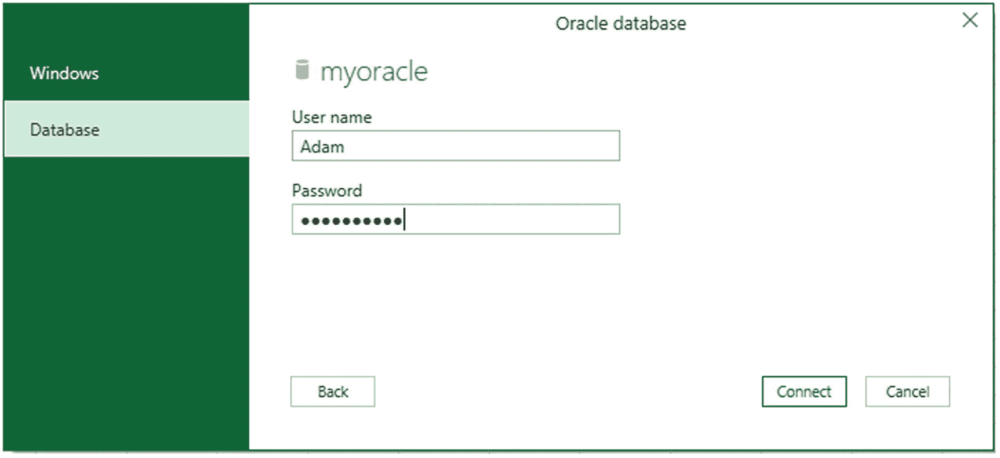

`图 3-11` Oracle 数据库安全对话框

5.  点击 `OK`。此时将出现 Oracle 数据库安全对话框。假设您无权使用 Windows 登录凭据连接数据库，请在对话框左侧点击 `Database`。

6.  输入用于登录 Oracle 的用户名和密码。您可在图 3-11 中查看此对话框。

7.  点击 `Connect`。Power Query 将连接至服务器，并显示 `Navigator` 对话框，其中包含您在所选服务器上有权查看的所有表和视图。某些情况下，您可能会看到提示“数据源不支持加密”的对话框。如果您接受非加密连接，请点击该对话框的 `OK` 按钮。

8.  展开 `HR` 文件夹。这是 Oracle 的标准示例模式，可能已安装在您的 Oracle 实例中。若未安装，您需要选择其他模式。

9.  勾选 `Select multiple items` 复选框。

10. 勾选您感兴趣的表对应的复选框。最近选中的数据会显示在 `Navigator` 对话框右侧，这与 SQL Server 的操作完全一致。

11. 点击 `Load`。此时将出现 `Queries & Connections` 窗格，显示每个选中表对应的查询。

如果您已按照本章之前的示例加载过 SQL Server 数据，那么您应该能体会到这两种技术的高度相似性。事实上，使用 Power Query 的一大优势在于：从不同数据源加载数据所遵循的方法大体相同，并共享许多相同的步骤和对话框。在数据库方面尤其如此——无论何种数据库，操作步骤几乎完全一致。

当然，没有两种数据库是完全相同的。因此，您可以连接到 Oracle 实例（或服务器），但无法像在 SQL Server（或 Sybase 等）中那样选择特定数据库。同理，Oracle 使用模式来隔离和组织数据表，而 SQL Server 则依赖数据库。尽管如此，Power Query 的导航器始终会将数据组织成层次清晰的文件夹结构，使您能够以清晰、简单且直观的方式查看底层数据结构。

## 其他关系型数据库

本章开头的表 3-1 列出了本书付印时 Power Query 能够连接的关系型数据库。我想，自本书出版以来，这个列表应该已经有所增加。不过好消息是，要连接任何可用的数据源数据库，你可能并不需要太多额外的信息。简而言之，如果你知道如何连接其中一个，你就能连接其中任何一个。

因此，我不会花大篇幅去重复解释如何从十几个甚至更多的关系型数据库中获取数据，这些解释实际上都大同小异。相反，我建议你直接用本章为 Oracle 和 SQL Server 学到的技术尝试连接即可。

但请注意，要连接到关系型数据库，你不可避免地需要知道以下详细信息：

*   服务器名称

*   数据库名称（可能）

*   有效的用户名（取决于已实施的安全策略）

*   你连接所用用户的有效密码（这也取决于已实施的安全策略）

不过，如果你掌握了这些信息，那么任何因素都不应阻碍你使用各种企业数据源作为 Power Query 分析的基础。当然，你需要拥有访问数据库及其所含数据的所有必要权限。

另外，值得一提的是，连接 DB2、MySQL、PostgreSQL、Sybase、IBM Informix、IBM Netezza、SAP HANA 或 Teradata，不仅需要数据库管理员授予你必要权限，还需要在你的电脑上安装了连接软件（即所谓的*驱动程序*或*提供程序*）。考虑到这些要求的“企业”性质，直接与你的 IT 部门沟通，让他们在企业 IT 环境中为你完成设置，可能会有所帮助。

要查明启用与特定数据库连接所需的软件是否已安装，一种方法是从 `Get Data` 对话框的可用列表中选择该数据库。如果驱动程序尚未安装，你会看到一个类似于图 3-12 所示的警告。

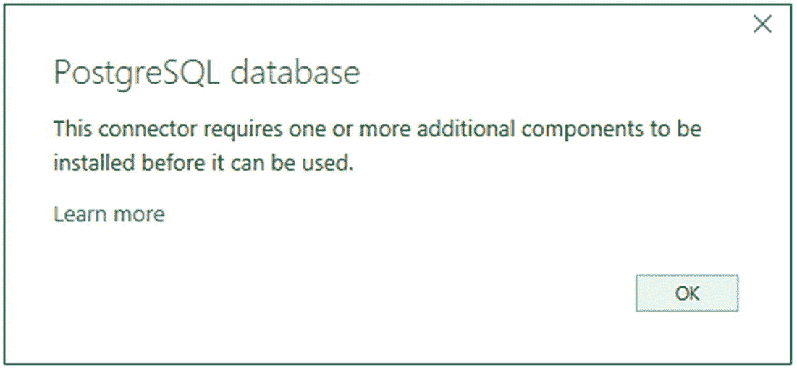

图 3-12

缺失驱动程序警报

点击 `了解详情` 链接将会跳转到缺失驱动程序的下载页面。但需要注意的是，在某些情况下，配置数据提供程序可能需要专业知识以及要安装驱动程序的计算机上的本地管理员权限。

## Microsoft SQL Server Analysis Services 数据源

Analysis Services 数据库是一种数据仓库技术，它可以包含大量为支持决策而优化的数据。*SSAS 多维数据集*（这些数据库的另一种叫法）由事实（度量值或数值）和维度（描述性属性）组成。

实际上——请数据仓库纯粹主义者见谅——SSAS 多维数据集本质上就是一个巨大的数据透视表。因此，如果你在 Excel 中使用过数据透视表，那么你就已经准备好访问 Power Query 中的数据仓库源，并对它们包含的数据进行切片和切块了。

> **注意**  

> 在本节中，我将解释如何访问*多维*（基于磁盘的）SSAS 数据仓库。我将在下一节解释*表格* SSAS。

请注意，本书没有提供示例 SSAS 数据库。这是因为安装和配置 SSAS 是一项艰巨的任务，需要专业知识。因此，我将留给你自己去获取公司 Analysis Services 数据库的登录详细信息，并使用这些信息进行试验。

如果你的工作环境使用 Analysis Services 数据库，则可以通过执行以下步骤来访问它们：

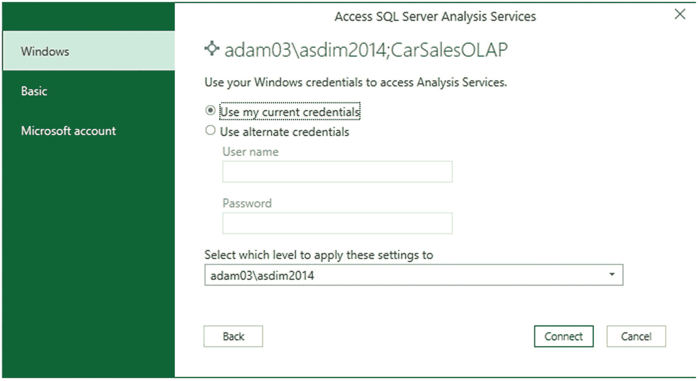

图 3-14

连接到 SSAS（多维）数据库时指定适当的安全性

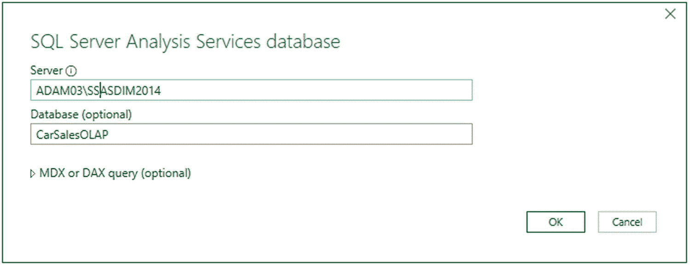

图 3-13

连接到 SSAS（多维）数据库

1.  在“数据”功能区，单击 `获取数据` ➤ `来自数据库` ➤ `来自 Analysis Services 数据库 (导入)`。

2.  单击 `连接`。将出现 `SQL Server Analysis Services 数据库` 对话框。

3.  输入 Analysis Services 服务器名称和数据库（或“多维数据集”）名称。我这里使用的数据库名为 `CarSalesOLAP`；你需要指定你自己的 SSAS 数据库名称。无论如何，你都需要使用自己的 SSAS 服务器名称。该对话框看起来会有点像图 3-13 所示——只是当然会使用你自己的服务器和数据库名称。

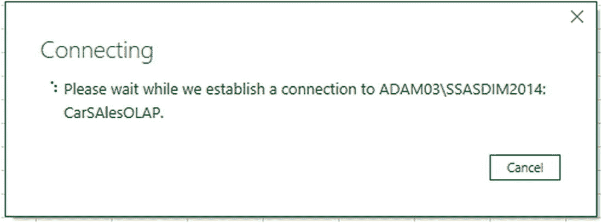

图 3-15

SQL Server Analysis Services 凭据对话框

4.  单击 `连接`。你可能会短暂看到 `正在连接` 对话框，如图 3-15 所示。

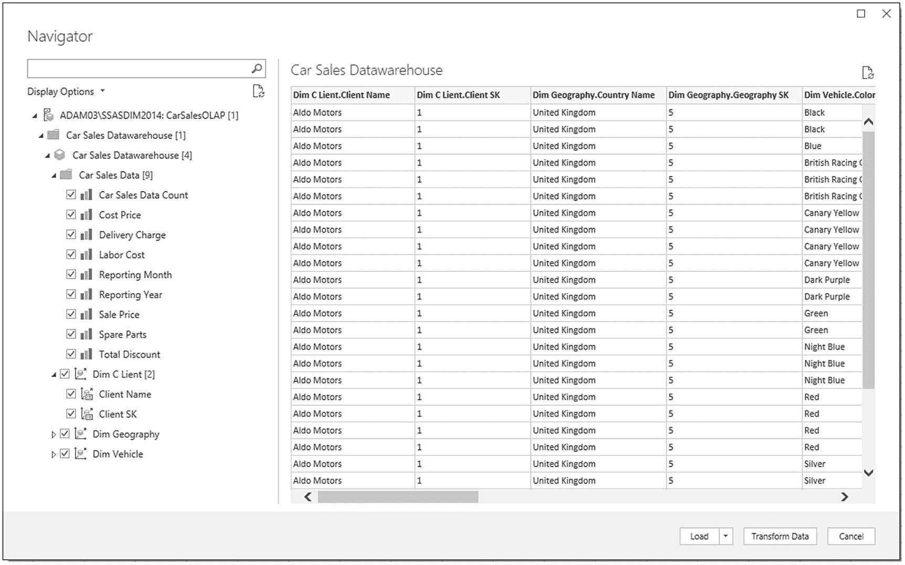

图 3-16

从 SSAS 多维数据集选择属性和度量值

5.  将出现 `导航器` 对话框。展开对话框左窗格中的文件夹。这样，你就可以查看数据仓库中包含的所有事实表和维度。

6.  选择你想要加载的事实表、维度，或者甚至是仅选择维度属性和度量值。在我的笔记本电脑上，该对话框看起来有点像图 3-16。显然，你将看到你所连接的 Analysis Services 实例托管的事实表和维度。

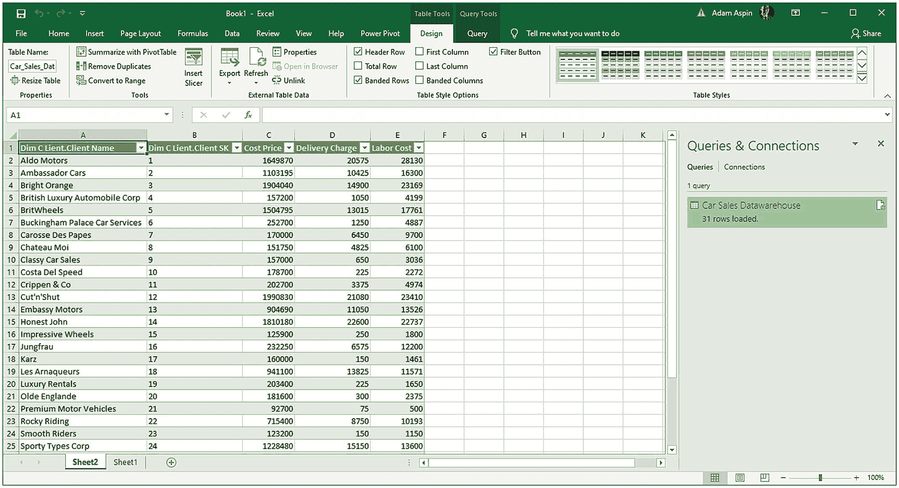

图 3-17

Excel 工作表中 SSAS 多维数据集的输出

7.  单击 `加载`。`查询 & 连接` 窗格将显示一个新查询，你选择的度量值和属性将出现在一个新工作表中。你可以在图 3-17 中看到一个示例。

当然，在第 7 步中，你可以单击 `加载` 按钮右侧的弹出三角形，并从你在第 2 章中看到的其他可能的加载选项中进行选择。

> **注意**

> 如果你在第 3 步中没有输入多维数据集（数据库）名称，那么 `导航器` 对话框将显示 SSAS 服务器上所有可用的多维数据集。从这里，你可以深入到你感兴趣的多维数据集，查询所需的数据。

SSAS 多维数据集可能非常庞大。它们可以包含数十个维度、多个事实表以及成千上万个度量值和属性。理解多维数据集及其工作原理超出了本书的范围。尽管如此，重要的是要理解，对于 Power Query 而言，多维数据集只是另一个数据源。这意味着你可以极其有选择性地加载多维数据集元素到 Power Query，只加载分析所需的元素。你可以加载整个维度或仅加载几个属性，就像你可以加载整个事实表或仅加载选定的度量值一样。

> **注意**

> 你可以通过在 `SQL Server Analysis Services 数据库` 对话框中展开 `MDX` 或 `DAX` 查询（可选）项来筛选从 SSAS 多维数据集加载的数据。然后，你可以在出现的框中输入 MDX 查询，再单击确定。请注意，“经典”（基于磁盘的）SSAS 多维数据集使用以 MDX 编写的查询——这是一种被认为是难以学习的专业语言。好消息是，如果 Analysis Services 专家已正确设置了多维数据集，你可以在查询编辑器中看到 SSAS 显示文件夹。

### 来自 Analysis Services

在 `获取数据 ➤ 来自数据库` 类别中看到两个都与 `Analysis Services` 相关的选项，可能看起来有些奇怪。这两个选项分别是：

*   `来自 Analysis Services 数据库 (导入)`

*   `来自 Analysis Services`

第一个选项是你在上一节中看到的，它是一个完全标准的 `Power Query` 连接过程。第二个选项则出人意料地，与 `Power Query` 毫无关系。实际上，这是一种从 Excel 2007 版本开始就存在的较旧的连接类型，被称为 `Office 数据连接`。

因此，即使这种连接类型无法在 `Power Query` 的上下文中使用（严格来说，也超出了本书的讨论范围），我还是倾向于对其进行解释——哪怕只是为了消除许多用户在面对这两种不同的访问 `SSAS` 数据的方法时感到的困惑。

要使用 `Office 数据连接` 连接到 `Analysis Services` 数据库：

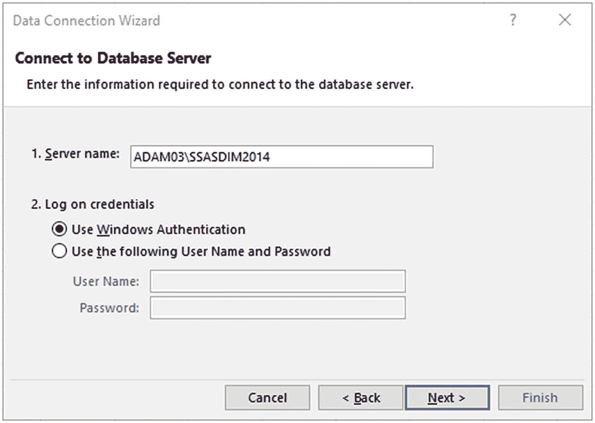

图 3-18 连接到数据库服务器对话框

1.  在 `数据` 选项卡中，点击 `获取数据 ➤ 来自数据库 ➤ 来自 Analysis Services 数据库`。将出现 `连接到数据库服务器` 对话框。

2. 输入 `Analysis Services` 服务器名称，如图 3-18 所示。当然，您必须使用自己的 `Analysis Services` 实例名称。

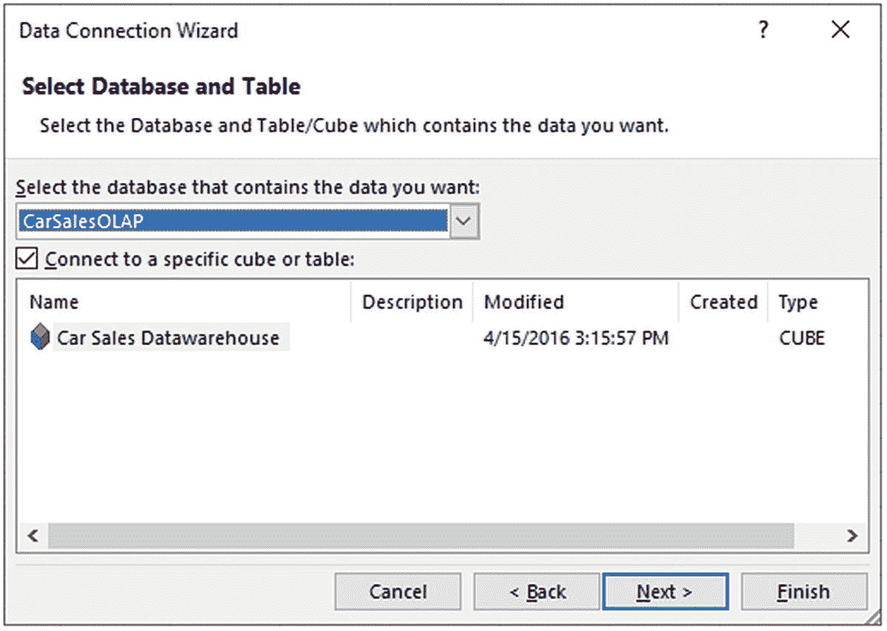

**图 3-19** `选择数据库和表` 对话框

3. 点击 `下一步`。将出现 `选择数据库和表` 对话框，如图 3-19 所示。您可以在此处从 `Analysis Services` 服务器上任何可用的数据库中进行选择。

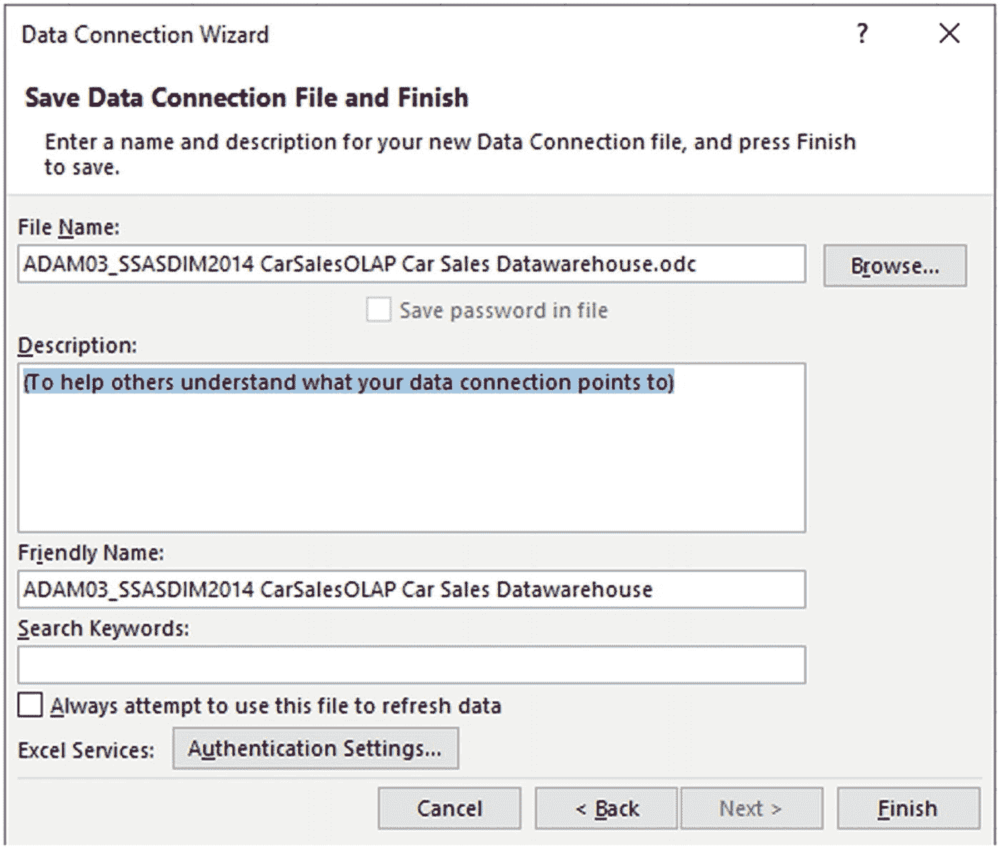

**图 3-20** `保存数据连接文件和完成` 对话框

4. 点击 `下一步`。将出现 `保存数据连接文件和完成` 对话框，如图 3-20 所示。您可以在此处添加描述和友好名称，以帮助您或其他用户从可用的连接中识别此连接。

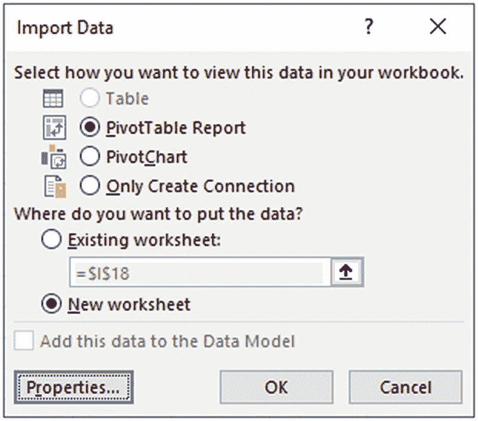

**图 3-21** `导入数据` 对话框

5. 点击 `完成`。将出现 `导入数据` 对话框，如图 3-21 所示。与之前使用 `Power Query` 连接到 `Analysis Services` 时相比，此对话框提供的选项稍有限制。

6. 点击 `确定`。Excel 将根据 `Analysis Services` 数据，在新的或现有的工作表中创建一个数据透视表（如果选择，也可创建数据透视图）。

我必须再次强调，当您使用此连接类型时，源数据*无法*在 `Power Query` 中进行清理、建模或调整，因此，您不会在 `查询和连接` 窗格中看到任何查询。

## SSAS 表格模型数据仓库

上一节展示了如何连接到“经典”的 SQL Server Analysis Services 多维数据集。然而，现在有两种类型的 SQL Server Analysis Services 数据仓库：

* “传统”的多维数据集

* “较新”的表格模型数据仓库

随着越来越多的数据仓库（至少是基于微软技术的数据仓库）使用较新的表格模型技术构建，花些时间了解如何使用 `Power Query` 快速便捷地连接到这些数据源是值得的。事实上，连接到这两种数据仓库源的步骤几乎完全相同。但是，由于 `Power Query` 正迅速成为查询表格模型数据仓库的首选工具，花几分钟学习如何使用它连接到 `SSAS` 表格模型（通常简称为 SSAS 表格）确实是值得的。

同样，您需要拥有自己的 `SSAS` 表格模型数据库，才能尝试连接到这种类型的 `Analysis Services` 数据库。

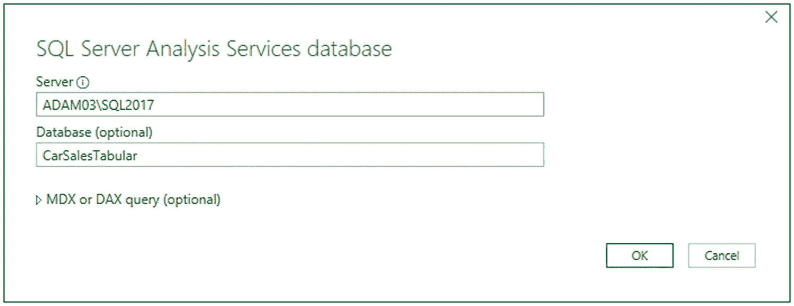

**图 3-22** 连接到 `SSAS`（多维）数据库

1. 在 `数据` 选项卡中，点击 `获取数据 ➤ 来自数据库 ➤ 来自 Analysis Services 数据库 (导入)`。将出现 `SQL Server Analysis Services 数据库` 对话框。

2. 输入 `Analysis Services` 服务器名称和表格模型数据库名称（我们通常不称其为多维数据集）。此处，我电脑上的数据库是 `CarSalesTabular`；您必须指定自己的表格模型数据库名称。无论如何，您都需要使用自己 `SSAS` 服务器的名称。

3. 点击 `导入`。

4. 对话框将如图 3-22 所示。

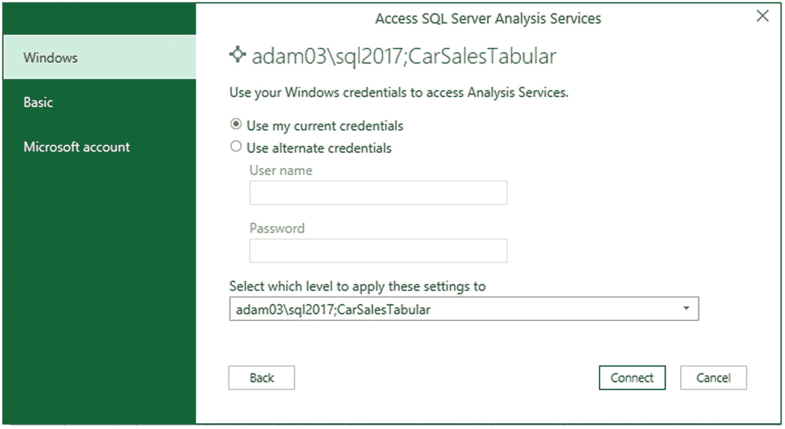

**图 3-23** 凭据对话框

5. 点击 `确定`。如果这是您第一次连接到该表格模型数据仓库，将出现 `访问 SQL Server Analysis Services` 对话框，以便您定义用于连接到 `Analysis Services` 数据库的凭据，您需要在此接受或更改凭据。您可以在图 3-23 中看到此对话框。

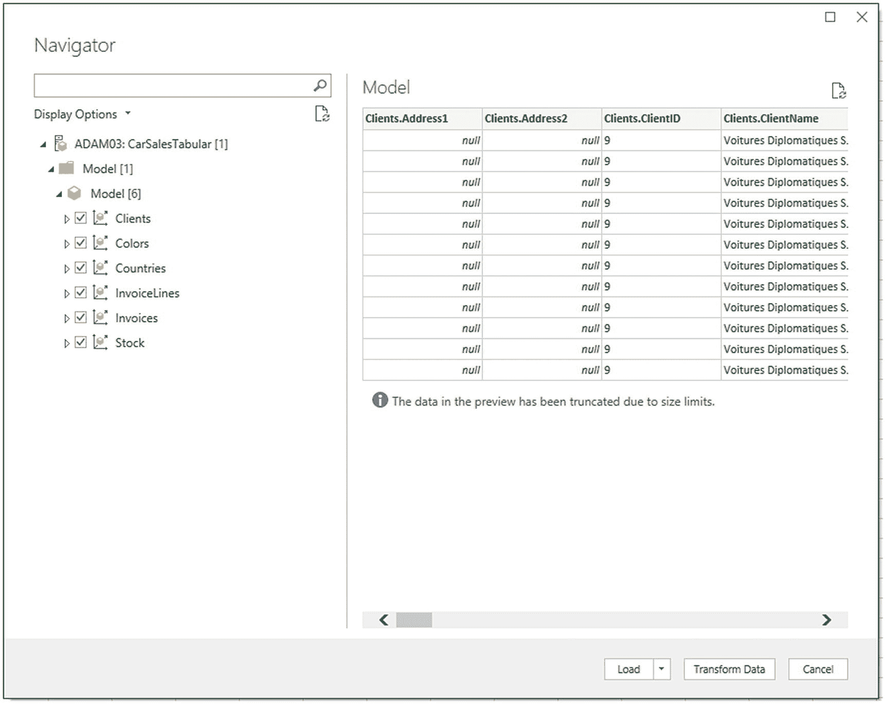

**图 3-24** 从 `SSAS` 表格模型数据源选择属性和度量值

6. 点击 `连接`。将出现 `导航器` 对话框。

7. 展开对话框左窗格中的文件夹。这样，您就可以看到数据仓库中包含的所有表。这些表的结构可能是事实表和维度表，也可能不是，这与“经典”SSAS 数据仓库的情况相同。

8. 选择要加载的表。对话框将如图 3-24 所示。

9. 点击 `加载`。数据将被加载（很可能加载到一个新的工作表中，但这取决于您的环境）。

> **提示**

> 您可以通过展开 `SQL Server Analysis Services 数据库` 对话框中的 `MDX 或 DAX 查询（可选）` 项，来过滤从 `SSAS` 表格模型数据库加载的数据。然后，您可以在出现的框中输入 `DAX` 查询，再点击 `确定`。`SSAS` 表格模型数据库使用一种名为 `DAX` 的特定语言编写的查询。

## 连接时的凭据类型

当连接到几乎任何数据库时——无论是微软数据库（如 SQL Server 或 Analysis Services），还是 Excel 中提供了连接器的非微软数据库——您都需要选择如何通过数据库进行身份验证。这涉及到指定您想要传递给要从中提取数据的数据库的凭据类型。

主要有三种连接类型（如图 3-14 所示）：

* `Windows`：这意味着使用您登录公司网络或本地工作组的 Windows 账户对数据库进行身份验证。这假定您的 Windows 登录账户已被授予访问数据库及其所包含数据的权限。

* `基本`：这意味着输入数据库能够识别的用户名和密码，并且该用户已被授予访问数据库及其所包含数据的权限。显然，您在尝试此类连接之前需要掌握这些信息。

* `Microsoft 账户`：这意味着使用您的 Microsoft 账户访问数据库及其包含的数据。同样，此账户必须已被授予访问数据库及其所包含数据的权限。

`Power Query` 会为您使用过的每个数据源连接保存数据源凭据或登录标识。

## 无法连接

当你在 Excel 的 Power Query 中无法连接到外部数据库时，这种情况是不可避免的。当你看到如图 3-25 所示的对话框时，你会很快发现这个问题。

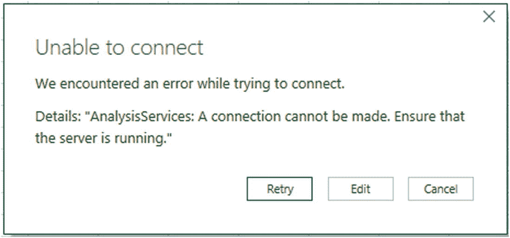

图 3-25

无法连接对话框

解决办法很简单：点击`编辑`按钮，这将重新显示此特定数据源的连接对话框。然后，你输入正确的连接信息——并再次尝试连接。

## 其他数据库连接

Power Query 并不仅限于一组预定义的可用的数据源。只要你的源数据库配备了通用数据提供程序之一——`ODBC` 或 `OLE DB`——那么 Power Query 几乎肯定也能访问这些源。你将在第 5 章中了解这些内容。

## 结论

在本章中，你了解了如何将 Power Query 连接到当前存在的大量数据库和数据仓库中的一部分。此外，你还了解到 Power Query 开箱即用，预置了与当前企业环境中一些最常用数据库的连接。