# 6. 结构化导入的数据

在前五章中，你已经了解了将数据查找并加载（或连接到）到 Excel 工作表或 Excel 数据模型的一些方法。这不可避免地是任何提取、转换和加载数据过程的第一部分。然而，这显然仅仅是一个开始。一旦使用 Power Query 访问了数据，就需要知道如何以多种方式调整数据以满足你的需求。这是因为并非所有数据都能立即投入使用。通常情况下，你需要在数据上做一些初步工作，使其更易于使用。在 Power Query 中调整源数据通常被称为`数据转换`，这也是本章以及接下来三章的主题。

Power Query 提供的转换范围广泛且多样。学习应用 Power Query 提供的技术，使你能够按原样获取数据，对其进行清理，然后将其作为一系列连贯且结构化的数据表推送回 Excel 工作表或 Excel 数据模型。只有到那时，数据才准备好用于创建有说服力的分析。

由于 Power Query 提供的数据转换选项极其广泛，很容易让人不知所措（至少一开始是这样），我将可能的修改分为四类。这些分类是我个人的建议，旨在便于理解：

*   `数据转换`：这包括添加和删除列和行、重命名列以及筛选数据。

*   `数据修改`：这涉及更改数据集中行和列中的实际数据。

*   `扩展数据集`：这包括添加更多列（可能将现有列扩展为更多列或行）以及添加计算。

*   `合并数据集`：这涉及将多个独立的数据集（可能来自不同的数据源）合并为一个数据集。

本章将向你介绍核心技术的数据转换技术，这些技术可用于对已加载的每个独立数据集进行塑形。这些转换包括：

*   重命名、删除和重新排序列

*   删除行组或行集

*   数据集去重

*   对数据进行排序

*   通过筛选数据排除记录

*   对记录进行分组

在第 7 章中，你将学习如何清理和修改数据。在第 8 章中，你将了解如何对列进行子集化以提取列中部分可用数据、计算列、合并来自不同查询的数据、添加包含不同类型计算的附加列，并学习数据透视和逆透视。因此，如果你在本章中找不到所需内容，答案很可能在接下来的两章中。

在本章中，我还将使用一组你可以在 Apress 网站上找到的示例文件。如果你已按照附录 A 中的说明操作，那么这些文件位于`C:\DataMashupWithExcelSamples`文件夹中。

## 在 Power Query 中扩展查询

在第 1 章中，你了解了如何将外部源数据直接加载到 Excel 中进行报告和分析。显然，这种方法的前提是你所使用的数据结构完美、干净且无错误。当数据来自“企业级”数据源（例如数据仓库，它们存储在关系型、维度型或表格型数据库中）时，源数据几乎总是正确且可直接用于分析。但当你面对多个不同的、未经预先清理和准备的源数据时，情况并非总是如此。日常的现实是，你可能需要清理和转换将在 Excel 中使用的大部分源数据。

真正的好消息是，过去需要昂贵服务器和企业级软件才能完成的那种数据转换，现在可以免费实现了。是的，Power Query 是一个强大的 ETL（**E**xtract，**T**ransform，**L**oad）工具，可以与许多花费数十万美元的应用程序相媲美。

Power Query 的数据转换是通过`查询`来执行的。正如你在前几章中所见，你不必修改源数据。如果数据准备就绪，你可以直接加载它。然而，如果需要清理数据，你可以在连接数据与将其加载到 Excel 数据模型之间添加一个中间步骤。这个中间步骤使用 Power Query 编辑器来调整源数据。

那么如何应用查询来转换数据呢？你有两种选择：

*   先从一个或多个源加载数据，然后再进行转换。

*   在加载之前，在查询中编辑每个源数据元素。

Power Query 非常宽容。它不会强迫你选择其中一种方法，然后让你受制于决策的后果。你可以先加载数据，然后发现它需要一些调整，切换到查询编辑器进行更改，然后返回基于此数据扩展电子表格。或者，你可以先专注于数据，在开始构建报告之前，尽力使其尽善尽美。选择完全取决于你。

为了说明这一点，让我们来看看这两种工作方式。

> **注意**
> 我可能有点迂腐和老派，但建议你在创建非常复杂的转换时做好笔记，因为稍后返回解决方案尝试进行调整时，如果没有文档记录可能会非常痛苦。

### 数据加载后的编辑操作

在第 1 章中，你已经了解了如何将 Excel 工作簿`CarSales.xlsx`直接加载到 Excel 中，以供后续分析使用。现在，我们假设你想要对已加载数据的数据结构进行一些修改。具体来说，你想要重命名`CostPrice`列。你要修改的文件是`C:\DataMashupWithExcelSamples`目录下的`Chapter06Sample1.xlsx`文件。

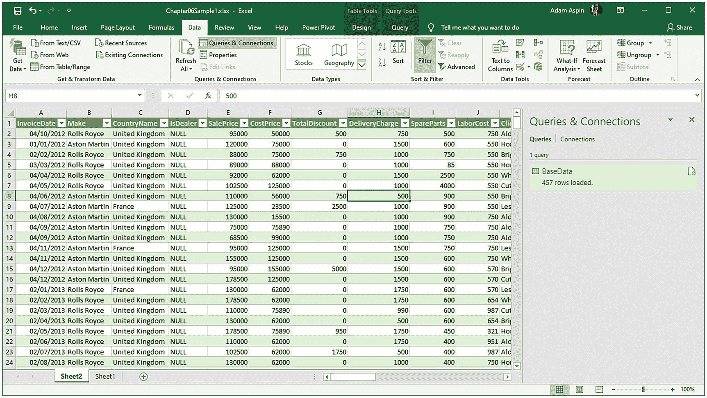

图 6-1. 初始数据加载

1.  启动 Excel。
2.  打开 Excel 文件`C:\DataMashupWithExcelSamples\Chapter06Sample1.xlsx`。你可以看到示例数据已加载到一个工作表中。
3.  单击 **数据** ➤ **查询和连接**。现在，你可以在图 6-1 的 **查询和连接** 窗格中看到执行此加载过程的查询（`BaseData`）。

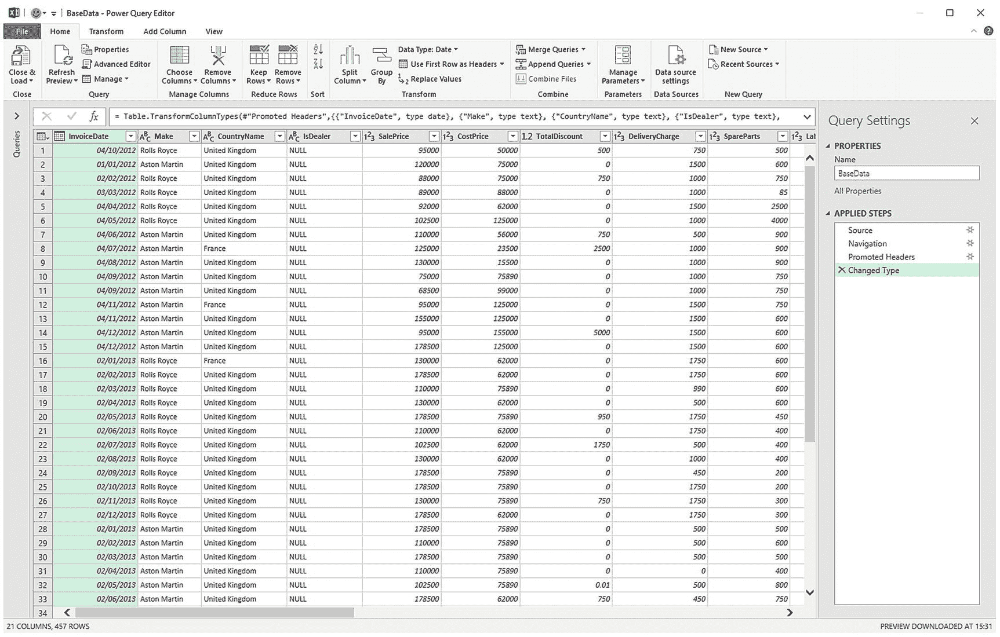

图 6-2. Power Query 编辑器

4.  在右侧的 **查询和连接** 窗格中，双击`BaseData`连接。这将连接并打开 Power Query。Power Query 窗口看起来将如图 6-2 所示。你可能会看到一个提示对话框，告诉你正在连接到一个未知的外部数据源。在这种情况下，请单击 **确定**。

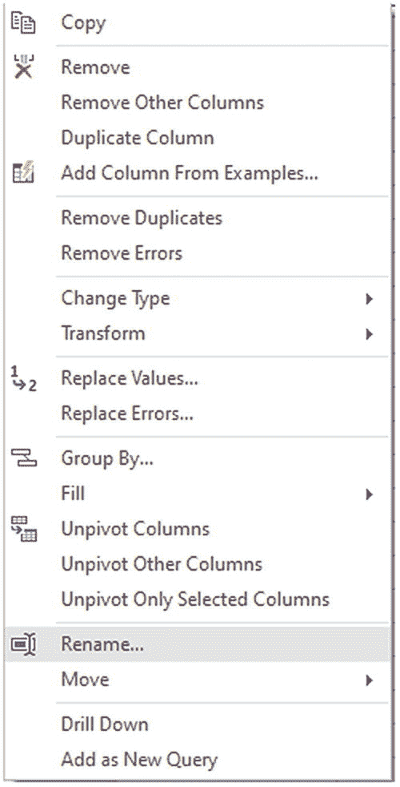

图 6-3. 查询编辑器中的列上下文菜单

5.  右键单击`CostPrice`列的标题（不要单击列右侧的箭头）。该列将被选中。
6.  从上下文菜单中选择 **重命名**。你可以在图 6-3 中看到上下文菜单。
7.  输入`VehicleCost`并按 **Enter** 键。列标题将更改为`VehicleCost`。
8.  在 Power Query 编辑器的 **开始** 功能区中，单击 **关闭并加载** 按钮。Power Query 编辑器将关闭，并返回 Excel，此时源数据已加载到新的工作表中。

我希望这个简单的例子能让你明白，转换源数据是一个快速且无痛的过程。你应用的技巧——重命名列——只是可用于转换数据的几十种可能技巧中的一种。然而，这里要传达的核心思想并非具体的转换操作。你需要记住的是，支撑你分析的数据始终存在，并且只需点击一下即可访问。任何时候，你都可以“切换”到数据并进行修改，只需在 **查询和连接** 窗格中双击相关查询即可。你做出的任何更改并确认后，数据在 Excel 中的更新几乎是即时的。

### 加载前的数据转换

在某些情况下，你可能更倾向于在加载数据之前对数据进行处理。这是在第 2 章中使用查询编辑器加载数据时所采用方法的一种变体。请执行以下操作，在数据出现在 Excel 窗口*之前*对其进行转换：

1.  打开一个新的 Excel 工作簿。
2.  在 **数据** 功能区中，单击 **获取数据** 按钮上的小三角形。
3.  选择 **来自文件** ➤ **来自工作簿**，然后单击 **导入** 选择 Excel 文件`C:\DataMashupWithExcelSamples\CarSales.xlsx`。
4.  在 **导航器** 窗口中，选择`CarData`工作表。
5.  单击 **转换数据** 按钮（*不是* **加载** 按钮）。
6.  Power Query 编辑器将打开，并将源数据显示为表格。
7.  执行上一个示例中的步骤 4 到 6，重命名`CostPrice`列。
8.  在 Power Query 编辑器的 **开始** 功能区中，单击 **关闭并加载** 按钮。Power Query 编辑器将关闭，并返回 Excel 窗口。

这一次，你是在将数据集加载到 Excel *之前* 对其进行了简单的修改。数据修改技巧完全相同。直接加载数据与绕道 Power Query 之间的唯一区别在于，在 **导航器** 对话框中单击的是 **编辑数据** 而不是 **加载**。这意味着数据只会在你在 Power Query 编辑器中完成对源数据的所有修改后才会加载。

## 查询还是加载？

Excel 始终为你提供两种选择：直接加载数据，或者绕道 Power Query 进行建设性的预处理。遵循哪条路径完全取决于你自己，也明显取决于每种具体情况。尽管如此，当面对使用不熟悉数据的新挑战时，你可能需要考虑以下基本原则：

# Power Query 决策指南与编辑器介绍

本节提供一系列问题，帮助你判断是否需要使用 Power Query。这些是粗略的指导方针，但随着使用经验的积累，它们将帮助你培养直觉。请记住，`Power Query` 是为了提供帮助，即使直接加载的数据集也是基于查询的，因此你可以先加载数据，再根据需要调整。

所有这些都意味着你可以自由采用自己感到满意的工作方式。`Power Query` 将轻松且几乎无形地适应你的风格，让你能够在数据和 `Excel` 之间无缝切换。

## Power Query 编辑器

所有数据转换操作都将在 `Power Query` 编辑器中进行。它是一个与 `Excel` 界面分开的窗口，布局略有不同。

`Power Query` 编辑器由六个主要元素组成：
*   四个主要功能区：“主页”、“转换”、“添加列”和“视图”。
*   “查询”列表窗格。
*   “数据”窗口。
*   “查询设置”窗格，包含“应用步骤”列表。
*   数据上方的公式栏，显示使用“`M`”语言编写的代码。
*   状态栏。

这些元素的标注如图 6-4 所示。

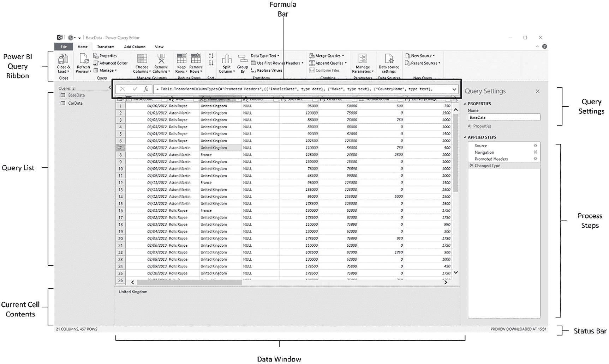

图 6-4. `Power Query` 编辑器详解

> **注意：** 如果您没有看到公式栏，只需在 `Power Query` 编辑器菜单中单击 `视图` > `公式栏`。

### “应用步骤”列表

数据转换本质上是顺序过程。因此，“查询”窗口会存储您在清理和整理源数据时所做的每次修改。这些步骤从“应用步骤”列表的顶部开始（几乎总是以“源”步骤开始），并可以扩展到数十个单独的步骤，这些步骤追溯了您的数据在加载到数据模型之前的演变过程。

当您依次单击“应用步骤”列表中的每一步时，“数据”窗口中的数据会相应变化，以反映每次转换的结果，为您提供一个完整且可见的修改轨迹。

### `Power Query` 编辑器功能区

`Power Query` 编辑器使用四个核心功能区：
*   “主页”功能区
*   “转换”功能区
*   “添加列”功能区
*   “视图”功能区

#### “主页”功能区

由于我们将大量使用 `Power Query` 编辑器的“主页”功能区来转换数据，因此了解其功能很重要。我在图 6-5 和表 6-1 中解释了各种选项。

表 6-1. 查询编辑器“主页”功能区选项

| 选项 | 说明 |
| --- | --- |
| 关闭并加载 | 完成处理步骤；保存并关闭查询 |
| 刷新预览 | 刷新预览数据 |
| 查询管理 | 允许您删除、复制或引用查询 |
| 管理列 | 允许您从源数据中所有可用的列中选择要保留的列，或删除一个或多个列 |
| 减少行 | 保留或删除表格顶部或底部指定数量的行 |
| 排序 | 使用所选列作为排序关键字对表格进行排序 |
| 拆分列 | 将列拆分为两个或多个单独的列 |
| 分组依据 | 对数据进行分组并进行可能的聚合 |
| 数据类型 | 设置列的数据类型 |
| 将第一行用作标题 | 将第一条记录提升为标题定义 |
| 替换值 | 将列中的值替换为其他值 |
| 合并查询 | 连接两个单独查询中的数据 |
| 追加查询 | 将一个或多个查询中的数据添加到另一个结构相同的查询中 |
| 合并文件 | 将给定列中的所有文件合并到单个表中 |
| 管理参数 | 允许您查看和修改在 `Power Query` 中为此 ETL 过程定义的任何参数 |
| 数据源设置 | 允许您管理和编辑已连接到的数据源的设置 |
| 新建查询 | 允许您连接到其他外部数据或重用现有连接 |

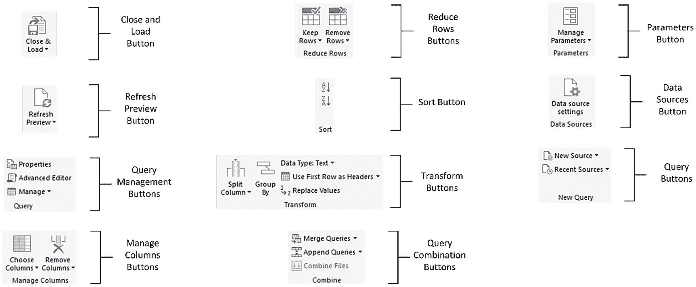

图 6-5. 查询编辑器“主页”功能区

#### “转换”功能区

顾名思义，“转换”功能区包含了丰富的数据转换功能。其中包含的各种选项在图 6-6 和表 6-2 中进行了说明。

表 6-2. 查询编辑器“转换”功能区选项

| 选项 | 说明 |
| --- | --- |
| 分组依据 | 使用指定的列集对表进行分组；为此分组聚合所有数值列 |
| 将第一行用作标题 | 将第一行用作列标题 |
| 转置 | 将列转换为行，将行转换为列 |
| 反转行 | 按相反顺序显示源数据，将最后几行显示在窗口顶部 |
| 对行计数 | 对表中的行进行计数，并用行数替换数据 |
| 数据类型 | 将选定的数据类型应用于列 |
| 检测数据类型 | 检测要应用于多个列的正确数据类型 |
| 重命名 | 重命名列 |
| 替换值 | 在列内执行搜索和替换操作，将一个指定值替换为另一个值 |
| 填充 | 将上方或下方单元格中的数据复制到列中的空白单元格中 |
| 透视列 | 使用选定列中的数据作为列标题，创建一组新列 |
| 逆透视列 | 取一组列中的值并对数据进行逆透视，使用列标题作为描述性元素创建新列 |
| 移动 | 移动列 |
| 转换为列表 | 将列的内容转换为列表。例如，这可用作查询参数 |
| 拆分列 | 在指定的分隔符处或在指定数量的字符之后，将一列拆分为一列或多列 |
| 格式 | 修改列中数据的文本格式（大写、小写、首字母大写）或删除尾随空格 |
| 合并列 | 获取多列中的数据并将其放置在一列中，可以添加可选的分隔符 |
| 提取 | 使用当前数据中定义的子集替换列中的数据。您可以指定要从列的开头或结尾保留的字符数量，设置从指定字符开始的字符范围，甚至可以列出列中的字符数 |
| 分析 | 根据列中元素的内容创建 `XML` 或 `JSON` 文档 |

# “转换”功能区

## 统计信息
返回列中所有值的总和、平均值、最大值、最小值、中位数、标准偏差、计数或非重复值计数

## 标准
使用您指定的值应用于列中的每个单元格，执行基本的数学计算（加、减、除、乘、整数除法或返回余数）

## 科学
对列中的每个单元格执行基本的科学计算（平方、立方、n 次方、平方根、指数、对数或阶乘）

## 三角学
使用您指定的值应用于列中的每个单元格，执行基本的三角计算（正弦、余弦、正切、反正弦、反余弦或反正切）

## 舍入
将列中的值舍入到下一个整数（向上或向下）或指定的因子

## 信息
用简单信息替换列中的值：是奇数、是偶数或正/负

## 日期
从列中的日期值中分离出元素（日、月、年等）

## 时间
从列中的日期/时间或时间值中分离出元素（小时、分钟、秒等）

## 持续时间
根据可以解释为天数、小时数、分钟数等的值计算持续时间

## 展开
将另一个查询中（结构相同的）数据添加到当前查询中

## 聚合
计算另一个查询中数值列的总和或乘积，并将结果添加到当前查询中

## 提取值
将列的内容值提取为单个文本值

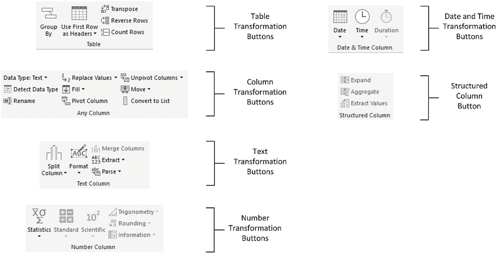
**图 6-6.** 查询编辑器“转换”功能区

# “添加列”功能区

“添加列”功能区的作用远不止添加列。它还包含将列分解为多列，以及基于现有列添加包含日期和计算结果的列的功能。其中包含的各种选项在图 6-7 和表 6-3 中进行了说明。

**表 6-3.** 查询编辑器“添加列”功能区选项

| 选项 | 说明 |
| --- | --- |
| 从示例中的列 | 允许使用一个或多个列作为示例来创建新列 |
| 自定义列 | 使用公式创建列的内容来添加新列 |
| 调用自定义函数 | 将“M”语言函数应用于每一行 |
| 条件列 | 添加一个新列，该列根据条件从选定列中添加值 |
| 索引列 | 在新列中添加一个序列号以唯一标识每一行 |
| 重复列 | 创建当前列的副本 |
| 格式 | 修改新列中数据的文本格式（大写、小写、首字母大写）或删除尾随空格 |
| 合并列 | 获取多列中的数据并将其放置在一列中，可以添加可选的分隔符 |
| 提取 | 使用当前数据中定义的子集创建新列。您可以指定要从列的开头或结尾保留的字符数量，设置从指定字符开始的字符范围，甚至可以列出列中的字符数 |
| 分析 | 基于列中的 `XML` 或 `JSON` 创建新列 |
| 统计信息 | 创建一个新列，返回列中所有值的总和、平均值、最大值、最小值、中位数、标准偏差、计数或非重复值计数 |
| 标准 | 创建一个新列，使用您指定的值应用于列中的每个单元格，返回基本的数学计算结果（加、减、除、乘、整数除法或返回余数） |
| 科学 | 创建一个新列，为列中的每个单元格返回基本的科学计算结果（平方、立方、n 次方、平方根、指数、对数或阶乘） |
| 三角学 | 创建一个新列，使用您指定的值应用于列中的每个单元格，返回基本的三角计算结果（正弦、余弦、正切、反正弦、反余弦或反正切） |
| 舍入 | 将新列中的值舍入到下一个整数（向上或向下）或指定的因子 |
| 信息 | 用简单信息替换列中的值：是奇数、是偶数或正/负 |
| 日期 | 在新列中，从日期值中分离出元素（日、月、年等） |
| 时间 | 在新列中，从日期/时间或时间值中分离出元素（小时、分钟、秒等） |
| 持续时间 | 在新列中，根据可以解释为天数、小时数、分钟数和秒数的值计算持续时间 |

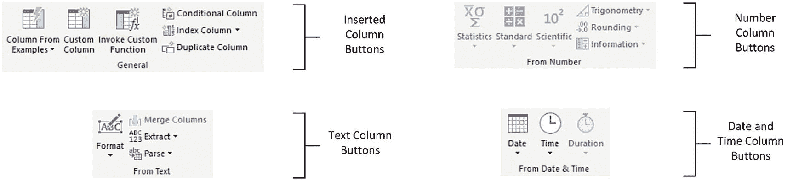
**图 6-7.** 查询编辑器“添加列”功能区

## “视图”功能区

“视图”功能区允许您更改一些查询编辑器设置，并查看底层的数据转换代码。其中包含的各种选项将在下一章中进行说明。

# 数据集整形

现在，您正看着一个已加载到 Excel 中的数据表。为便于论述，我们假设它是示例数据目录中的 `C:\DataMashupWithExcelSamples\Chapter06Sample1.xlsx` 文件，并且您已双击“查询和连接”窗格中的 `BaseData` 查询以显示 Power Query 编辑器。那么，对于当前可见的 `BaseData` 数据集，您可以做些什么呢？接下来，我们将介绍一些可应用于整形初始数据集的核心技术。这些技术包括：
- 重命名列
- 对列进行重新排序
- 删除列
- 合并列
- 删除记录
- 删除重复记录
- 筛选数据集

我将这些技术归为一组，因为它们会影响数据的初始大小和形状。此外，作为数据建模者，通常不仅最佳实践是，而且对您而言也更容易，即从一开始就排除任何不需要的行和列。我还发现，如果列从开始就逻辑清晰并赋予易于理解的名称，数据集就更容易理解。总而言之，从长远来看，这会使数据处理工作更加轻松。

### 重命名列

尽管我们在本章开头部分已简要了解了重命名列，但让我们更详细地再次审视这项技术。我承认，重命名列实际上并没有修改数据表的形式。然而，在处理数据时，我认为让所有数据都清晰可辨至关重要。这意味着要为每一列赋予有意义的列名。因此，我认为这种修改对于数据的形状至关重要，并且也是导入源数据时必不可少的最佳实践。

重命名列的方法：
1.  单击要重命名的列的内部（或列标题上）。
2.  单击“转换”以激活“转换”功能区。
3.  单击“重命名”按钮。列名将被突出显示。
4.  输入新名称或编辑现有名称。
5.  按 `Enter` 键或单击列标题外部。

该列现在将拥有一个新标题。右侧的“应用的步骤”列表现在将包含另一个元素 `已重命名的列`。此步骤将被突出显示。

> **注意**
>
> 作为使用“转换”功能区的替代方法，您可以右键单击列标题并选择“重命名”。

### 对列进行重新排序

Power Query 会按照数据源中定义的顺序加载数据。因此，列顺序将完全取决于源数据（或者，如果您使用了源数据库（如第 3 章所述），则取决于 SQL 查询）。然而，这种列顺序并非一成不变，如果有助于您理解和处理数据，您可以对列进行重新排序。更改列顺序的操作如下：
1.  单击要移动的列的标题。
2.  将该列向左或向右拖动到新位置。执行此操作时，您会看到列标题横向滑过其他列标题，并且一条较粗的灰色线将指示释放鼠标按钮时列将被放置的位置。`已重新排序的列` 将出现在“应用的步骤”列表中。

图 6-8 展示了此操作。

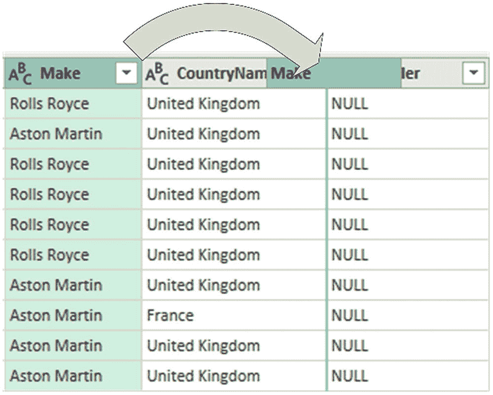
**图 6-8.** 对列进行重新排序

如果查询包含数十甚至数百列，您可能会发现拖动一列可能既缓慢又费力。同样，如果列非常宽，可能难以将列“向左”或“向右”微调。在这些情况下，Power Query 可以通过“转换”功能区中的“移动”按钮来帮助您。单击此按钮将显示表 6-4 中概述的菜单选项。

**表 6-4.** 移动按钮选项

| 选项 | 描述 |
| --- | --- |
| 向左 | 将当前选定的列移动到其左侧紧邻的列左侧 |
| 向右 | 将当前选定的列移动到其右侧紧邻的列右侧 |
| 移至开头 | 将当前选定的列移动到查询中所有列的左侧 |
| 移至末尾 | 将当前选定的列移动到查询中所有列的右侧 |

“移动”命令也适用于通过 `Ctrl` 单击和/或 `Shift` 单击选择的一组列。实际上，如果需要，您甚至可以移动一组不连续的列。

> **注意**
>
> 您需要先选择一列（或一组列），然后再单击“移动”按钮。如果没有选择，那么第一次使用“移动”时，Power Query 会选择列，但不会移动它们。

### 删除列

那么如何删除一列或多列呢？操作如下：
1.  单击要删除的列的内部，或者如果要一次删除多列，请按住 `Ctrl` 键单击要删除的列的标题。
2.  单击“主页”功能区中的“删除列”按钮。这些列将被删除，并且 `已删除列` 将成为“应用的步骤”列表中的最新元素。

> **提示**
>
> 删除选定列的另一种方法是按 `Delete` 键。这也会在“应用的步骤”列表中添加一个 `已删除列` 步骤。

在处理您无法控制的导入数据集时，您可能会经常发现只需要大型数据表中的几列。如果是这种情况，您很快就会厌倦按住 `Ctrl` 键单击众多列来选择要删除的列。Power Query 提供了另一种方法。只需选择要保留的列，然后删除其他列即可。操作如下：
1.  按住 `Ctrl` 键单击要保留的列的标题。
2.  单击“主页”功能区中“删除列”按钮旁边的小三角形。从菜单中选择 `删除其他列`。所有未选定的列都将被删除，并且 `已删除其他列` 将被添加到“应用的步骤”列表中。

在选择要删除或保留的连续列范围时，可以使用标准的 Windows `Shift` 单击技术，从要选择的列块中的第一列选择到最后一列。

## 删除列与选择列

`**注意**`  

如果您愿意，这两种删除列的选项也可以通过上下文菜单使用。删除列时，上下文菜单会显示 `删除`（或 `删除列`，如果选择了多列），如果您右键单击列标题，还会显示 `删除其他列`。

### 选择列

如果你不喜欢在宽数据集中滚动，但仍需要选择一部分列作为报表的基础，那么还有另一种方法可以定义你要使用的字段集合。你可以像这样选择要保留的列（相应地，也就定义了要排除的列）：

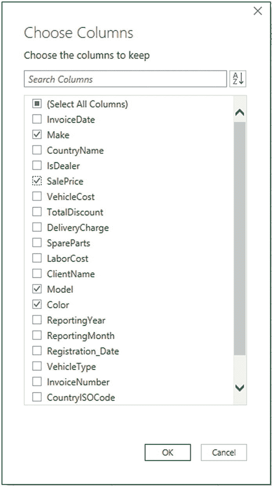

图 6-9. “选择列”对话框

1.  打开文件夹 `C:\DataMashupWithExcelSamples` 中的示例文件 `Chapter06Sample1.xlsx`（如果尚未打开）。
2.  在右侧的 `查询和连接` 窗格中（可通过“数据”功能区中的 `查询和连接` 选项切换其显示状态），双击连接 `BaseData`。查询编辑器将打开。
3.  在查询编辑器的“开始”功能区中，单击 `选择列` 按钮。
4.  单击 `(全选列)` 以取消选择数据集中的所有列。
5.  选择 `Make`、`Model`、`Color` 和 `SalePrice` 这些列。`选择列` 对话框将如图 6-9 所示。
6.  单击 `确定`。查询编辑器将仅显示你选择的列。

`选择列` 对话框附带一些额外功能，在您选择要使用的列集时可能会很有用：

-   您可以通过单击 `选择列` 对话框右上角的排序图标（小 `A-Z`）并选择所需选项，按字母顺序排序列列表（或恢复为原始顺序）。
-   只需在对话框顶部的 `搜索列` 字段中输入几个字符，即可过滤显示的列列表。
-   `(全选列)` 选项可在全选和取消全选列表中的所有列之间切换。

## 合并列

源数据并不总是完全如您所愿（有时这还是一种轻描淡写的说法）。某些数据源的数据可能分布在许多列中，而这些列完全可以合并到单个列中。因此，发现 Power Query 也能执行此类操作可能并不令人意外。操作方法如下：

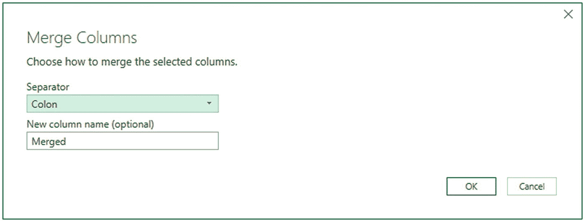

图 6-10. “合并列”对话框

1.  按住 `Ctrl` 键并单击要合并的列的标题（本例中为 `BaseData` 数据集中的 `Make` 和 `Model`）。
2.  在“转换”功能区中，单击 `合并列` 按钮。将显示 `合并列` 对话框。
3.  从 `分隔符` 弹出菜单中选择一个可用的分隔符元素。在此示例中，我选择了 `冒号`。
4.  为由两个原始列创建的新列输入名称（我将其命名为 `MakeAndModel`）。对话框应如图 6-10 所示。

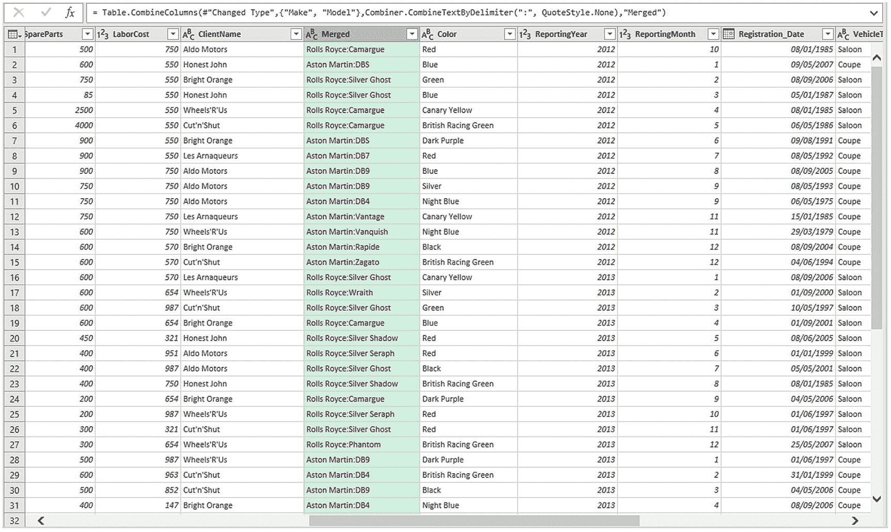

图 6-11. 合并列的结果

5.  单击 `确定`。您选择的列将被替换为在步骤 1 中所有选定列的数据，如图 6-11 所示。
6.  重命名生成的列（Power Query 将其命名为 `Merged`）。

我需要对此过程做几点说明：

-   合并列时，您可以选择任意数量的列。
-   如果在 `合并列` 对话框中未给结果列命名，它将简单地被命名为 `Merged`。您以后随时可以根据需要重命名它。
-   选择列的顺序会影响数据合并的方式。因此，始终从选择其数据必须出现在合并列左侧的列开始，然后是其数据应出现在下一位置的列，依此类推。您不必按照列在数据集中最初的顺序来选择它们。
-   如果您不想使用 Power Query 建议的任何标准分隔符，可以随时自定义。只需在 `合并列` 对话框的弹出菜单中选择 `--自定义--`。对话框中会出现一个新框，您可以在其中输入您选择的分隔符。如果您真的需要，它可以由多个字符组成。
-   从“转换”功能区合并列会删除所有选定的列，并用单个列替换它们。相同的选项也可从“添加列”功能区获得——只是在这种情况下，此操作会添加一个新列，并保留数据集中的原始列。

`**注意：**` 如果您右键单击列标题，此选项也可从上下文菜单中获得。

可用的合并分隔符在表 6-5 中进行了描述。

**表 6-5.** 合并分隔符

| 选项 | 描述 |
| --- | --- |
| `冒号` | 使用冒号 (`:`) 作为分隔符 |
| `逗号` | 使用逗号 (`,`) 作为分隔符 |
| `等号` | 使用等号 (`=`) 作为分隔符 |
| `分号` | 使用分号 (`;`) 作为分隔符 |
| `空格` | 使用空格 (` `) 作为分隔符 |
| `制表符` | 使用制表符作为分隔符 |
| `自定义` | 允许您输入自定义分隔符 |

`**提示：**` 如果您愿意，可以使用上下文菜单来拆分、删除和复制列。只需记住右键单击列标题以显示正确的上下文菜单。

### 转到特定列

Power Query 可以加载包含数百列的数据集。由于在数十列之间左右滚动可能会让人非常沮丧，因此您可以随时跳转到特定的列。

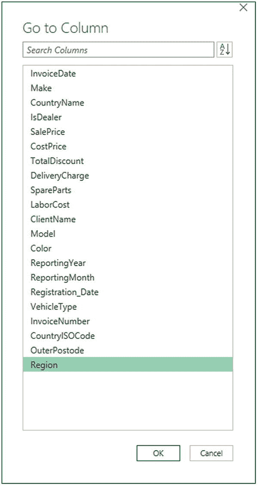

图 6-12. “转到列”对话框

1.  在查询编辑器的“开始”功能区中，单击 `选择列` 按钮底部的小三角形。选择 `转到列`。将出现 `转到列` 对话框。
2.  选择您要跳转到的列。对话框将如图 6-12 所示。
3.  单击 `确定`。Power Query 将选择所选列。

`**提示：**` 如果您愿意，可以在 `转到列` 对话框中双击列名称以跳转到所选列。

## 删除记录

您可能并非始终需要已加载到 Power Query 中的*所有*数据。这可能有几个原因：

-   您正在初步查看数据，只需要一个样本来了解数据的概况。
-   数据包含您明确不需要且从一开始就能轻松识别的记录。
-   您正在测试数据清理，并且想要一个更小的数据集来真正加速复杂数据提取和转换过程的开发。
-   您想要分析一个精简后的数据集以推断出论点，将完整数据集的分析留待以后，或者使用更强大的工具集，例如 `SQL Server Integration Services`。

为了允许您减小数据集的大小，Power Query 提供了两种基本方法：

-   保留某些行
-   删除某些行

不可避免的是，您采用哪种技术将取决于具体情况。如果通过包含来指定要采样的行更容易，那么保留某些行的方法是最佳选择。相反，如果您想通过排除来进行，那么删除某些行的技术是最好的。让我们依次看看这些方法。

### 保留行

此方法允许你指定要继续使用的行。其基于以下三个选项之一的应用：

-   保留前 *n* 条记录。
-   保留后 *n* 条记录。
-   保留指定范围的记录——即，每 *y* 条记录保留 *n* 条。

这些技术大多非常相似，所以我们先设想你希望保留示例文件 `C:\DataMashupWithExcelSamples\Chapter06Sample1.xlsx` 中的前 50 条记录。

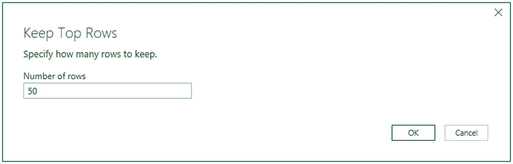

`**图 6-13.**` `保留首行` 对话框

1.  打开源文件，然后在“查询和连接”窗格中双击 `BaseData` 查询，打开 `Power Query 编辑器`。
2.  在“查询编辑器”的“主页”功能区中，点击“保留行”按钮。将出现菜单。
3.  选择“保留首行”。将出现“保留首行”对话框。
4.  在“行数”框中输入 `50`，如图 6-13 所示。
5.  点击“确定”。除前 50 条记录外的所有记录均被删除，并且“已保留首行”被添加到“应用的步骤”列表中。

要保留后 *n* 行，方法几乎完全相同。按照上一个示例中的步骤操作，但在步骤 2 中选择“保留尾行”。在这种情况下，“应用的步骤”列表会显示“已保留尾行”。

要保留一个范围的记录，你需要指定起始记录以及从该处开始要保留的记录数。例如，假设你想丢掉前 10 条记录，但保留接下来的 25 条。操作步骤如下：

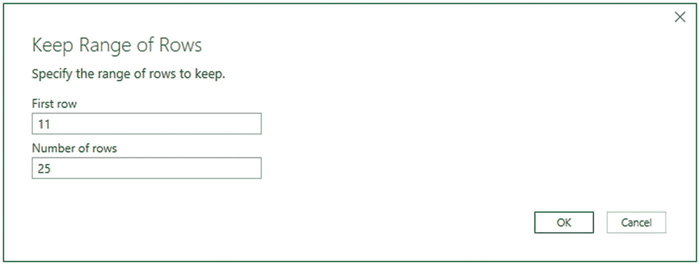

`**图 6-14.**` `保留行的范围` 对话框

1.  在“主页”功能区中，点击“保留行”按钮。
2.  选择“保留行的范围”。将出现“保留行的范围”对话框。
3.  在“首行”框中输入 `11`。
4.  在“行数”框中输入 `25`，如图 6-14 所示。

## 数据删除与管理

### 删除行

删除行的过程与你刚刚使用的保留行过程几乎相同。由于删除前 `n` 或后 `n` 行非常相似，我就不详细介绍了。你只需点击“主页”功能区中的“删除行”按钮，然后像保留行一样进行操作即可。在这种情况下，“应用的步骤”列表会显示“已删除首行”或“已删除尾行”，并且记录会被删除，而非保留在数据集中。

删除行的方法确实有一个非常有用的选项，可以用作采样技术。它允许你每隔几条记录就删除一条或多条记录，以生成源数据的子集。为此，你需要执行以下操作：

1. 在“查询”窗口的“主页”功能区中，点击“删除行”按钮。将出现菜单。
2. 选择“删除隔行”。将出现“删除隔行”对话框。
3. 输入 `10` 作为“要删除的首行”。
4. 输入 `2` 作为“要删除的行数”。
5. 输入 `10` 作为“要保留的行数”。

对话框将如图 6-15 所示。

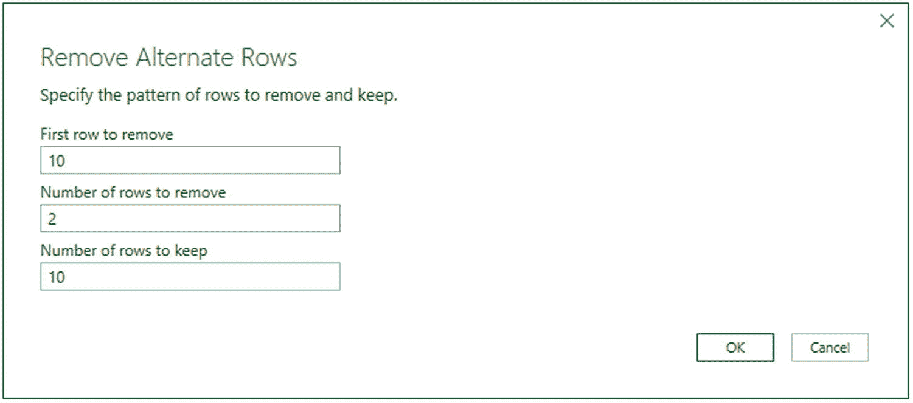

**图 6-15.** `删除隔行` 对话框

6. 点击“确定”。除了与你对话框中输入的模式匹配的记录外，所有记录均被删除。随后，“已删除隔行”被添加到“应用的步骤”列表中。

> **注意：** 如果你确实决心提取一个你认为能代表关键数据的样本，那么你始终可以在子集化数据之前过滤数据以排除任何异常值。本章稍后会解释数据过滤。

### 删除空行

如果你的源数据包含完全为空的行，你可以按如下方式删除它们：

1. 在“查询”窗口的“主页”功能区中，点击“删除行”按钮。将出现菜单。
2. 选择“删除空行”。

这将导致空行被删除。随后，“已删除空行”被添加到“应用的步骤”列表中。

### 删除重复记录

外部数据源可能并不像你希望的那么完美。低质量数据最令人困扰的特性之一就是存在重复项。这些重复项具有危害性，因为它们会伪造结果，而且并不总是可见。如果你怀疑数据表包含*严格*重复项（即，两条或更多记录中的*每个*字段都相同），那么你可以像这样删除重复项：

1. 点击表弹出菜单中的“删除重复项”（位于表格网格的左上角）。所有重复记录均被删除，并且“已删除重复项”被添加到“应用的步骤”列表中。

> **注意：** 我必须强调，该方法只会移除*完全*相同的记录，即重复行中每一列的每个元素都严格相同。如果两条记录只有一个字符或数字不同，但其他所有内容都相同，那么它们*不会*被 `Power Query` 视为重复项。或者，如果你想隔离并检查重复记录，你可以通过从表的弹出菜单中选择“保留重复项”，仅显示完全相同的记录。

所以，如果你怀疑或确信正在处理的数据表包含重复项，实际的解决方案是什么？这可能是一个真正的难题，但有一些你可以应用的基本技术：

- 移除所有你确定在后续数据处理过程中不会用到的列。这样，`Power Query` 就只会被要求比较潜在重复记录中的关键数据。
- 根据核心列对数据进行分组（本章稍后会解释）。

> **注意：** 如你所见，`Power Query` 可以帮助你只需点击几下即可聚焦于数据集中的关键元素。需要注意的是，在从查询中排除数据时，要小心*不要删除*有价值的数据——以免因此导致分析结果出现偏差。

## 数据排序

虽然严格来说这不是一个数据修改步骤，但在某个阶段，你可能希望对导入的表进行排序，哪怕只是为了更清楚地了解你所处理的数据。按以下步骤对数据进行排序：

1. 打开文件夹 `C:\DataMashupWithExcelSamples` 中的示例文件 `Chapter06Sample1.xlsx`（如果尚未打开）。
2. 在右侧的“查询和连接”窗格中，双击连接 `BaseData`。将打开“查询编辑器”。
3. 点击你想排序的列内部。
4. 在“主页”功能区中点击“升序排序”（`A/Z` 图标）或“降序排序”（`Z/A` 图标）。

数据将按字母顺序（从小到大）或反向字母顺序（从大到小）排序。如果你想执行复杂的排序操作（例如，先按某列排序，如果该列在多行中包含相同元素，则再按另一列排序），只需依次对各列进行排序即可。`Power Query 编辑器`会在列标题右侧添加一个微小的 `1`、`2`、`3` 等数字来指示排序顺序。你可以在图 6-16 中看到这一点，我*首先*按 `Make` 列排序，*最后*按 `Model` 列排序。

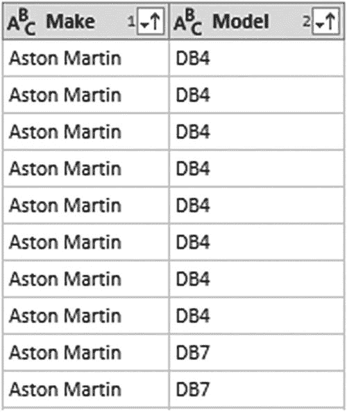

**图 6-16.** 对多列进行排序

如果你仔细查看列标题，你会看到指示排序顺序的微小 `1` 和 `2`，以及指示该列按升序排序的箭头。

> **注意：** 另一种数据排序技术是点击列的弹出菜单（列标题右侧的向下三角形），然后从弹出菜单中选择“升序排序”或“降序排序”。

### 反转行顺序

如果你发现正在查看的数据看起来上下颠倒了（即底部的行出现在顶部，反之亦然），只需单击一下即可反转行顺序（如果你愿意的话）。具体操作如下：

在`转换`功能区中，单击`反转行`按钮。

整个数据集将被反转，底部的行将变为顶部的行。

### 撤销排序操作

如果你之后决定不想保留数据的排序状态，可以随时撤销排序操作，方法如下：

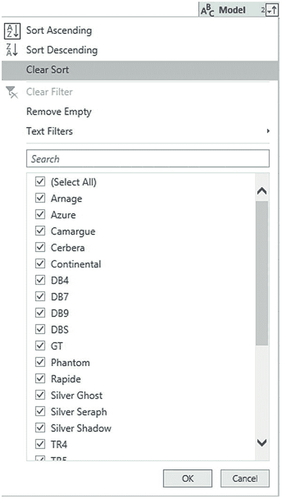

**图 6-17.** 移除排序操作

1. 单击用作排序依据的列名称右侧的排序图标。将出现上下文菜单，如图 6-17 所示。
2. 单击`清除排序`。

你应用的排序顺序将被移除，数据将恢复为其原始的行顺序。

由于排序数据被视为数据修改过程的一部分，它也会在`已应用步骤`列表中显示为`已排序行`。这意味着你也可以通过删除`已应用步骤`列表中的相关步骤来移除排序操作。

**注**

如果你对数据集中的多个列进行了排序，可以选择通过单击你用来排序数据的*第一个*列来移除所有应用的排序顺序。这将移除你应用于*所有*用来定义排序条件的列的排序顺序。如果你只想撤销用于对记录集进行排序的最后一列的排序，则可以仅清除该列上的排序操作。

## 筛选数据

根据我的经验，限制数据集最常用的方法是在已加载的表格上使用筛选器。现在，我意识到你可能是用了多年 Excel 之后，或者使用了一段时间 Power Pivot 之后才接触 Power Query，你即将看到的筛选技术可能看起来与你在那两种工具中使用的技术非常相似。然而，由于在加载源数据时包含和排除适当的记录是基础操作，我宁愿详细解释 Power Query 的筛选器，即使这意味着某些读者会有强烈的既视感。

在 Power Query 中筛选数据有两种基本方法：

- 从所选列的唯一元素列表中选择一个或多个特定值。
- 定义要包含或排除的数据范围。

第一种方法适用于所有数据类型，无论是文本、数字还是日期/时间。第二种方法则根据用于筛选数据的列的数据类型而有所不同。

### 选择特定文本值

选择数据列中存在的一个或多个值非常简单（假设你仍在处理 Excel 文件 `Chapter06Sample1.xlsx` 并位于`查询编辑器`中）：

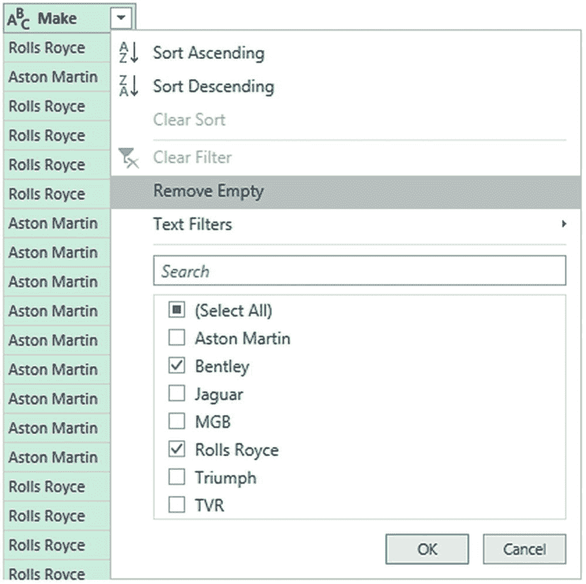

**图 6-18.** 筛选菜单

1. 单击一列的弹出菜单。（我在此处使用了示例数据集 `Chapter06Sample1.xlsx` 中的 `品牌` 列。）将出现筛选菜单。
2. 勾选所有你想保留的元素，并取消勾选所有你想排除的元素。在此示例中，我保留了 `宾利` 和 `劳斯莱斯`，如图 6-18 所示。
3. 单击`确定`。`已筛选行`被添加到`已应用步骤`列表中。

**注**

你可以通过单击（全选）复选框取消选择所有项；再次选择此复选框可重新选择所有项。因此，如果你只想保留几个元素，先取消选择所有元素，然后只选择你想保留的元素可能会更快。如果你想排除在正在筛选的列中没有值的任何记录，请从筛选菜单中选择`删除空值`。

### 在筛选列表中查找元素

在筛选列表中上下滚动可能会极其繁琐。将列表快速限制为可用元素子集的方法是执行以下操作（假设你仍在处理 Excel 文件 `C:\DataMashupWithExcelSamples\Chapter06Sample1.xlsx` 的`查询编辑器`中）：

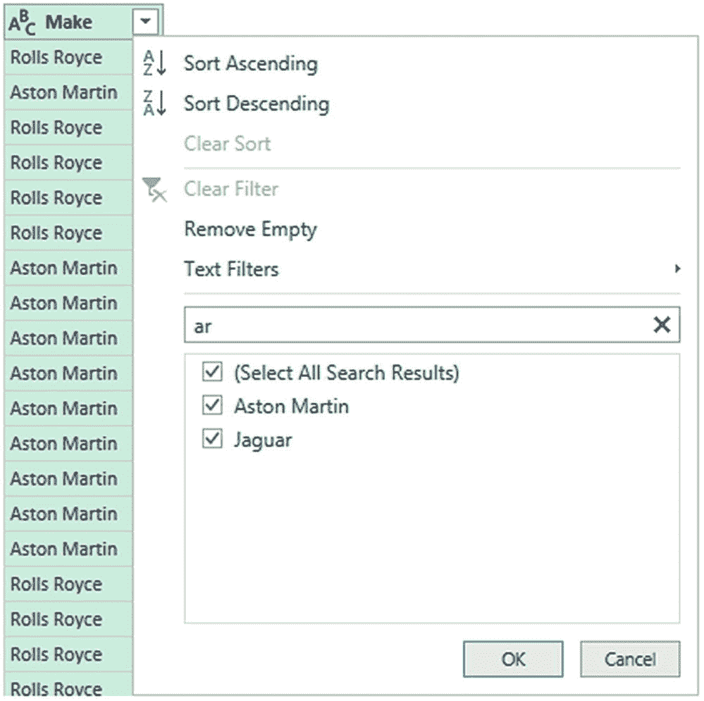

**图 6-19.** 搜索筛选菜单

1. 单击一列的弹出菜单。（我在本例的示例数据集中使用了 `型号` 列。）将出现筛选菜单。

### 筛选文本范围

如果列包含文本，则可以使用特定选项来筛选数据。这些选项位于任何基于文本的列的筛选弹出窗口的`文本筛选器`子菜单中。选项见表 6-6。

**表 6-6.** 文本筛选选项

| 筛选选项 | 描述 |
| --- | --- |
| 等于 | 设置必须与单元格内容匹配的文本 |
| 不等于 | 设置必须*不*与单元格内容匹配的文本 |
| 开头是 | 设置在单元格内容左侧的文本 |
| 开头不是 | 设置必须*不*出现在单元格内容左侧的文本 |
| 结尾是 | 设置在单元格内容右侧的文本 |
| 结尾不是 | 设置必须*不*出现在单元格内容右侧的文本 |
| 包含 | 允许输入将作为单元格内容一部分的文本 |
| 不包含 | 允许输入将*不*作为单元格内容一部分的文本 |

### 筛选数字范围

如果列包含数字，则还可以使用特定选项来筛选数据。这些选项位于任何基于数字的列的筛选弹出窗口的`数字筛选器`子菜单中。选项见表 6-7。

**表 6-7.** 数字筛选选项

| 筛选选项 | 描述 |
| --- | --- |
| 等于 | 设置必须与单元格内容匹配的数字 |
| 不等于 | 设置不得与单元格内容匹配的数字 |
| 大于 | 单元格内容必须大于此数字 |
| 大于或等于 | 单元格内容必须大于或等于此数字 |
| 小于 | 单元格内容必须小于此数字 |
| 小于或等于 | 单元格内容必须小于或等于此数字 |
| 介于 | 单元格内容必须介于你指定的两个数字之间 |

### 筛选日期和时间范围

如果列中包含日期或时间（或两者兼有），则还可以应用特定选项来筛选数据。这些元素位于任何基于文本的列的筛选弹出窗口中的`Date/Time Filters`子菜单下。选项如表 6-8 所示。

**表 6-8.** 日期和时间筛选选项

| 筛选元素 | 说明 |
| --- | --- |
| `Equals` | 筛选数据，仅包含所选日期的记录 |
| `Before` | 筛选数据，仅包含所选日期之前的记录 |
| `After` | 筛选数据，仅包含所选日期之后的记录 |
| `Between` | 允许您设置一个上界和下界日期，以排除该范围之外的记录 |
| `In the Next` | 允许您指定未来一定数量的天、周、月、季度或年 |
| `In the Previous` | 允许您指定截止到当前日期一定数量的天、周、月、季度或年 |
| `Is Earliest` | 筛选数据，仅包含最早日期的记录 |
| `Is Latest` | 筛选数据，仅包含最晚日期的记录 |
| `Is Not Earliest` | 筛选数据，仅包含不包括最早日期的记录 |
| `Is Not Latest` | 筛选数据，仅包含不包括最晚日期的记录 |
| `Day ➤ Tomorrow` | 筛选数据，仅包含当前系统日期之后的日期记录 |
| `Day ➤ Today` | 筛选数据，仅包含当前系统日期的记录 |
| `Day ➤ Yesterday` | 筛选数据，仅包含当前系统日期之前的日期记录 |
| `Week ➤ Next Week` | 筛选数据，仅包含下一个日历周内的记录 |
| `Week ➤ This Week` | 筛选数据，仅包含当前日历周内的记录 |
| `Week ➤ Last Week` | 筛选数据，仅包含上一个日历周内的记录 |
| `Month ➤ Next Month` | 筛选数据，仅包含下一个日历月内的记录 |
| `Month ➤ This Month` | 筛选数据，仅包含当前日历月内的记录 |
| `Month ➤ Last Month` | 筛选数据，仅包含上一个日历月内的记录 |
| `Month ➤ Month Name` | 筛选数据，仅包含指定日历月的记录 |
| `Quarter ➤ Next Quarter` | 筛选数据，仅包含下一个季度的记录 |
| `Quarter ➤ This Quarter` | 筛选数据，仅包含当前季度的记录 |
| `Quarter ➤ Last Quarter` | 筛选数据，仅包含上一个季度的记录 |
| `Quarter ➤ Quarter Name` | 筛选数据，仅包含指定季度的记录 |
| `Year ➤ Next Year` | 筛选数据，仅包含下一年的记录 |
| `Year ➤ This Year` | 筛选数据，仅包含当前年份的记录 |
| `Year ➤ Last Year` | 筛选数据，仅包含上一年份的记录 |
| `Year ➤ Year To Date` | 筛选数据，仅包含从当前年初至今的记录 |
| `Custom Filter` | 允许您为选定的日期范围设置特定筛选器。 |

### 筛选数值数据

无论被筛选的数据类型是文本、数值、逻辑值还是日期/时间，筛选数据都使用一种全局相似的方法。举一个简单的例子，以下是如何对售价应用数值筛选器，以查找售价低于 £5,000.00 的车辆（同样是在文件 `Chapter06Sample1.xlsx` 的 `Query Editor` 中）：

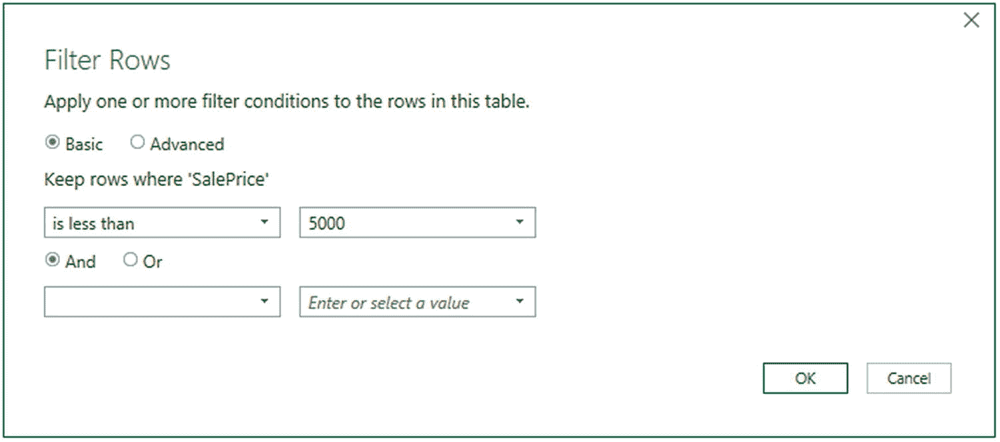

**图 6-20.** `Filter Rows` 对话框

1.  单击 `SalePrice` 列的弹出菜单。
2.  单击 `Number Filters`。子菜单将会出现。
3.  选择 `Less Than`。`Filter Rows` 对话框将会显示。
4.  在“小于”框旁边的输入框中输入 `5000`，如图 6-20 所示。
5.  单击 `OK`。数据集将只显示符合您所定义筛选条件的行。

尽管应用起来极其简单，但筛选器仍需要注意以下几点：

- 在基本筛选器中最多可以组合两个元素。这些元素可以相互包含（`AND` 筛选器），也可以互为替代（`OR` 筛选器）。
- 您可以在高级筛选器中组合多个元素——您将在下一部分中了解这一点。
- 输入数字时不应应用任何格式。
- 筛选的任何文本都不区分大小写。
- 如果您选择了错误类型的筛选器（例如，选择了 `greater than` 而不是 `less than`），您无需取消并重新开始。只需在 `Filter Rows` 对话框左侧的弹出菜单中选择正确的筛选器类型即可。

**提示**
如果您设置的筛选值排除了表中的所有记录，Power Query 将显示一个空表，并显示“此表为空。”字样。您始终可以通过单击 `Applied Steps` 列表中 `Filtered Rows` 左侧的叉号来移除该筛选器。这将删除该步骤并将数据恢复到之前的状态。

### 应用高级筛选器

如果您在筛选数据时需要极其精确，您可以随时使用 Power Query 的高级筛选器。这些筛选器允许您扩展筛选元素，以便将记录包含或排除到非常精细的细节级别。以下是在文件 `Chapter06Sample1.xlsx` 的 `Query Editor` 中的操作步骤：

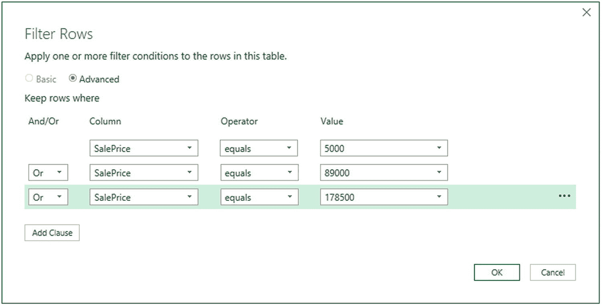

**图 6-21.** 高级筛选器

1.  单击 `SalePrice` 列的弹出菜单。
2.  单击 `Number Filters`。子菜单将会出现。
3.  选择 `Equals`。`Filter Rows` 对话框将会显示。
4.  单击 `Advanced`。
5.  在对话框中为第一个筛选元素输入值 `5000`。
6.  从弹出菜单中选择 `Or` 作为第二个筛选元素的筛选类型。
7.  选择 `equals` 作为运算符。
8.  在对话框中为第二个筛选器输入值 `89000`。
9.  单击 `Add Clause`。一个新的筛选元素将会添加到现有元素下方的对话框中。
10. 选择 `Or` 作为筛选类型，选择 `equals` 作为运算符。
11. 在对话框中为第三个筛选元素输入值 `178500`。此时 `Filter Rows` 对话框将如图 6-21 所示。
12. 单击 `OK`。Power Query 编辑器中只会显示包含您在 `Filter Rows` 对话框中输入数值的记录。

关于筛选器这个话题，我想以几点说明作为结尾：

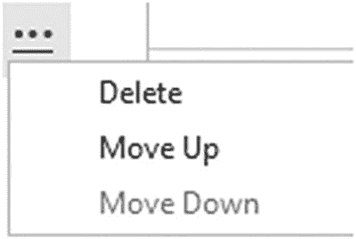

**图 6-22.** 排序筛选器

# 高级筛选与记录分组

## 高级筛选

- 在 `Advanced filter` 对话框中，您可以通过“混合搭配”列和运算符来达到您想要的筛选结果。

- 如果需要，您还可以对筛选器序列进行排序。为此，只需单击某个筛选行内部，该行将以灰色背景显示（如图 6-21 中的第三个筛选器）。然后，单击该筛选行右侧的省略号，并从弹出菜单中选择 `Move Up` 或 `Move Down`。您可以在图 6-22 中看到这一点。

- 要删除一个筛选器，请单击该筛选行右侧的省略号并选择 `Delete`。

> **注意**：当您处理非常大的数据集时，您可能会发现筛选器并不总能显示源数据中的所有可用值。这是因为 `Query Editor` 只加载了数据的示例子集。在这种情况下，您会在筛选弹出菜单中看到一个警告和一个“Load more”链接。单击此链接将强制 Power Query 重新加载一个更大的数据样本集。但是，内存限制可能会阻止它加载您需要的所有数据。在这种情况下，您应考虑修改源查询（如果可能的话，例如在连接到数据库时），以便它返回一个能够放入内存的代表性数据集。

## 记录分组

有时，你需要以极端方式转换原始数据——即对数据进行分组。这与筛选数据、删除重复项或清理列内容截然不同。当你对数据进行分组时，你正在改变数据集的结构，以便“汇总”记录，具体操作如下：

- 定义属性列，这些列将成为分组数据表中的唯一元素
- 指定应用于分组表中任何数值列的聚合方式

数据分组通常是一种极具选择性的操作。这是不可避免的，因为你选择分组的属性（即非数值）列越少，分组表中可能包含的记录就越少。然而，这始终取决于你正在处理的特定数据集，而高效地对数据进行分组始终需要技巧、实践，以及良好的、传统的反复试错。

### 简单分组

为了理解分组是如何工作的——以及它如何从根本上改变数据集的结构——让我们看一个简单的行分组实例：

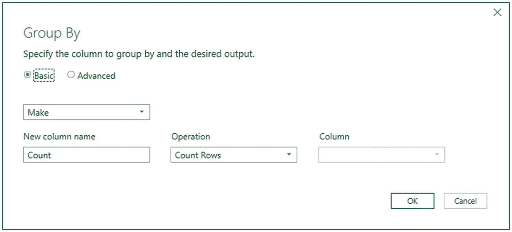

图 6-23. 简单分组

1.  在 Power Query 中，针对示例文件 `Chapter06Sample1.xlsx`，点击 `Make` 列内部。
2.  在 `Home` 功能区或 `Transform` 功能区中，点击 `Group By` 按钮。将出现 `Group By` 对话框，如图 6-23 所示。
3.  点击 `OK`。数据集现在将仅包含车辆品牌列表以及每个品牌的记录数。你可以在图 6-24 中看到结果。

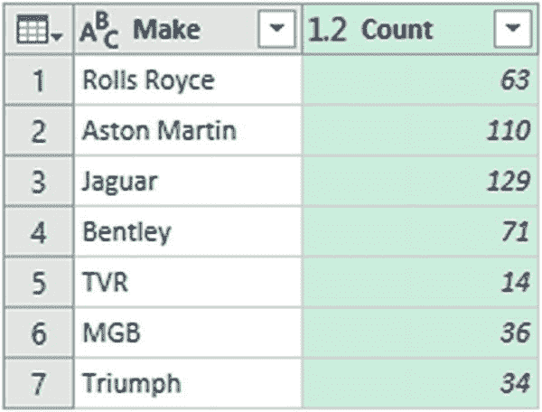

图 6-24. 简单分组输出

当你对数据集应用分组时，Power Query 会向 `Applied Steps` 列表中添加一个名为 `Grouped Rows` 的步骤。

> **注意：** 取消分组操作的最佳方法是删除 `Applied Steps` 列表中的 `Grouped Rows` 步骤。

尽管 Power Query 默认计算行数，但在分组数据时，你还可以应用其他几种操作。这些操作在表 6-9 中概述。

**表 6-9.** 分组时的聚合操作

| 聚合操作 | 描述 |
| --- | --- |
| `Count Rows` | 计算记录数量 |
| `Count Distinct Rows` | 计算唯一记录数量 |
| `Sum` | 返回数值列的总和 |
| `Average` | 返回数值列的平均值 |
| `Median` | 返回数值列的中位数 |
| `Min` | 返回数值列的最小值 |
| `Max` | 返回数值列的最大值 |
| `All Rows` | 为每个分组的元素创建一个记录表 |

### 复杂分组

Power Query 可以通过创建更复杂的数据分组，以更高级的方式帮助你塑造数据集。例如，你可以尝试以下操作，按 `Make` 和 `Model` 进行分组，并添加显示总销售额和平均成本的列：

1.  打开示例文件 `C:\DataMashupWithExcelSamples\Chapter06Sample1.xlsx`。
2.  双击 `BaseData` 连接以打开查询编辑器。
3.  选择以下列（通过 `Ctrl`+点击列标题）：
    1.  `Make`
    2.  `Model`
4.  在 `Home` 功能区或 `Transform` 功能区中，点击 `Group By`。
5.  在 `新建列名称` 框中，输入 `TotalSales`。
6.  选择 `Sum` 作为操作。
7.  在 `列` 弹出列表中选择 `SalePrice` 作为源列。
8.  点击 `添加聚合` 按钮并重复操作，只是这次使用以下设置：
    1.  新建列名称：`AverageCost`
    2.  操作：`Average`
    3.  列：`CostPrice`

`Group By` 对话框应如图 6-25 所示。

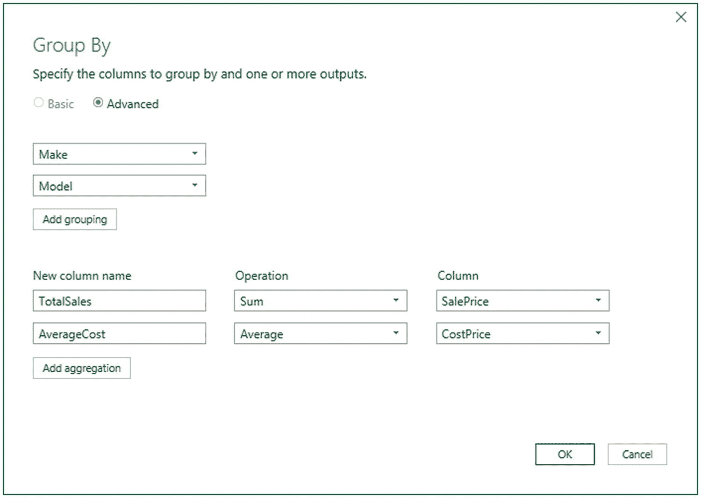

图 6-25. `Group By` 对话框

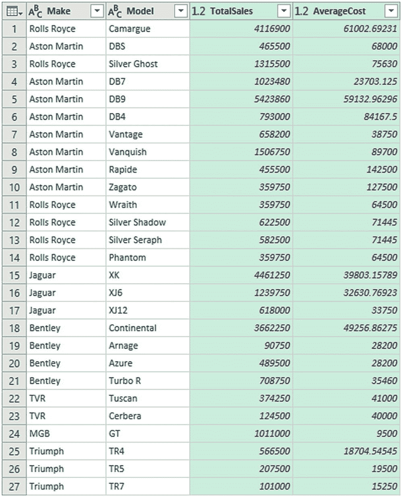

图 6-26. 对数据集进行分组

9.  点击 `OK`。除了你在 `Group By` 对话框中指定的列之外，所有其他列都将被删除，并且表格将按图 6-26 所示进行分组和聚合。`Grouped Rows` 将被添加到 `Applied Steps` 列表中。我同时按 `Make` 和 `Model` 列对表格进行了排序，以便更易于理解分组。

如果你创建了一个非常复杂的分组，然后意识到需要更改列的顺序，一切并非不可挽回。你可以通过点击 `Group By` 对话框中每个列定义右侧的省略号，并选择 `上移` 或 `下移` 来更改输出中列的顺序。`Group By` 对话框中列的顺序就是结果数据集中列的顺序（从左到右）。

> **注意：** 你不必使用 `Ctrl`+点击来选择分组列。你可以通过点击 `添加聚合` 按钮将它们逐一添加到 `Group By` 对话框中。同样，你可以通过点击列名右侧的省略号并从弹出菜单中选择 `删除` 来移除分组列（或已添加和聚合的列）。

### 行数计数

在某些情况下，你可能会发现一个简单有用的选项是 `Count rows`（行数计数）功能。顾名思义，此功能显示源数据集中可用的总行数。

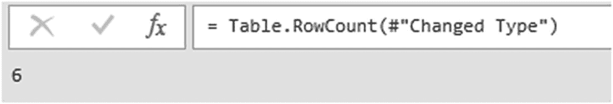

图 6-27. 返回源数据集的行数

1.  在 Power Query 的 `Transform` 菜单中，点击 `Count rows`。记录数将显示在现有数据集的位置，如图 6-27 所示。

## 在查询编辑器中保存更改

与你可能预期的相反，你*不能*在使用 Power Query 编辑器时随时保存所做的任何更改。相反，你必须先退出查询编辑器，然后像往常一样保存底层的 Excel 文件。

## 退出查询编辑器

与上述保存选项类似，你可以选择如何退出查询编辑器并返回到 Excel 中的报表。默认选项（点击 `关闭并加载` 按钮时）是应用你对数据所做的所有更改，用新数据更新数据模型（如果已选择此选项），然后返回到 Excel。

但是，你还有另一个可能很有用的选项。它出现在查询编辑器的 `文件` 菜单中。

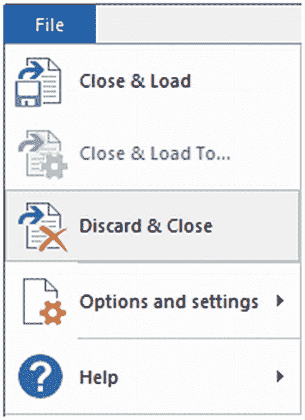

图 6-28. 放弃 Power Query 中的修改

1.  在查询编辑器中，点击 `文件`。
2.  选择 `放弃并关闭`。你可以在图 6-28 中看到此选项。

如果你选择不应用所做的更改，那么你将返回 Excel 工作簿，并丢失已做的所有修改——*且不会有任何确认提示*。

## 结论

本章带你踏上了使用 Power Query 转换数据集的道路。你了解了如何通过删除行和列来精简数据集。你还学习了如何通过选择交替行组，从数据源中抽取数据子集。

你还看到了如何选择要在 Excel 中使用的列、如何在数据集中移动列，以及如何重命名列，以便在后续作为分析基础使用时，数据易于理解。接着，你了解了如何筛选和排序数据，以及如何删除重复项以确保数据集只包含后续可视化所需的精确行。最后，你学习了如何分组和聚合数据。

尽管如此，必须承认，准备用于分析的原始数据并非总是一帆风顺，可能需要一段时间才能将其处理好。然而，稍加练习，`Power Query` 就能让这项任务变得非常轻松。所以，既然你已经掌握了基础，是时候继续前进，探索更多数据转换技术了。具体来说，你将看到如何转换并潜在地清理已导入的数据。这正是下一章的主题。

