# 4. 从 Web 和云加载数据

在本章中，我们将探讨通过互联网可用、且快速增长的广泛数据源中的一部分，你可以将这些数据源用作 Excel 的分析数据源。虽然你将在后续页面中看到的数据源可能千差万别，但它们都有一个共同点：它们都存储在企业的外部，并可通过互联网连接使用。

详细探讨所有可用的数据源需要一整本书的篇幅，因此我将只演示如何访问当前提供的一些**主流**服务。一旦你学会了如何访问其中几个服务，你应该就能将基本技术扩展到访问 Power Query 目前可用于将数据导入 Excel 的几乎所有 Web 和云服务。

使用 Power Query 可访问的、不断增长的数据源由多个不同的供应商提供。因此，本章中概述的几乎所有数据连接都需要访问特定的在线源。这些源大多是企业级的——且并非免费。然而，如果你的企业没有订阅这些服务，但你仍希望试用它们，那么不妨看看本章中概述的许多（即便不是全部）服务提供商所提供的免费试用方案。因此，这些数据源中的许多仅可通过 Excel Pro 或企业版许可证使用。

## Web 和云服务

在深入探讨某些可用的 Web 和云服务的细节之前，让我们先从一个较高的层面来了解这些服务究竟是什么。这些数据源包括（但不限于）：

*   网页

*   在线服务，例如 Salesforce 或 MS Dynamics 365

*   Microsoft Azure，包括在 Azure Blob 服务中托管文件、在 Azure SQL Database 中存储数据，或在 Azure Synapse Analytics 中存储数据（甚至在 Azure HDInsight 中读取大数据）

## 网页

如果你需要收集一些在 Web 浏览器中以表格形式呈现的数据，你可以使用 Power Query 连接到相关页面的 URL，然后从页面上的任意表格中加载所有数据。

### 在线服务

*在线服务*是一个统称，用于描述你可以通过互联网访问的数据。大多数可供 Power Query 使用的在线服务都是所谓的“平台”。这些（通常是庞大的）软件和数据资源，要么仅能在线访问，要么曾驻留在企业系统中，但现在以服务的形式存在于互联网上。目前有几种可以使用 Power Query 连接的在线服务，它们列在表 4-1 中。

表 4-1：当前可用的 Power Query 在线服务

| 源 | 说明 |
| --- | --- |
| Salesforce Objects | 允许你访问 Salesforce 中的数据 |
| Salesforce Reports | 允许你访问构成内置 Salesforce 报表基础的数据对象（包括原生和自定义） |
| Facebook | 访问 Facebook 数据 |
| SharePoint Online | 连接到 Microsoft SharePoint 的云托管版本 |
| Microsoft Exchange Online | 连接到 Microsoft Exchange 的云托管版本 |
| Dynamics 365 Online | 连接到 Microsoft Dynamics 365（MS CRM 和 ERP 解决方案）的云托管版本 |

### Microsoft Azure

Azure 是微软云。Power Query 当前可以连接、并从中预览和加载数据的 Azure 数据源列在表 4-2 中。

表 4-2：Azure 源

| 源 | 说明 |
| --- | --- |
| Microsoft Azure SQL Database | 允许你连接到基于云的 Microsoft SQL Server 数据库，并从你有权访问的所有数据表和视图中导入记录 |
| Microsoft Azure SQL 数据仓库（现已更名为 Azure Synapse Analytics） | 允许你连接到微软基于云的、可弹性伸缩的企业级数据仓库 |
| Microsoft Azure Blob Storage | 从基于云的非结构化数据存储中读取数据 |
| Microsoft Azure Table Storage | 从 Microsoft Azure 表中读取数据 |
| Microsoft Azure Data Lake Storage（Gen1 和 Gen2） | 允许你连接到微软的原始数据云存储 |
| Microsoft Azure HDInsight | 在 Microsoft Azure 环境中读取基于云的 Hadoop 文件 |

显然，随着 Azure 产品的扩展，微软可能会在 Excel 的 Power Query 中增加更多的 Azure 连接选项。

**注意：** Power Query 也可以访问本地 SharePoint 和 MS Exchange 数据。但是，本书将不探讨这些连接。

## 网页

作为第一个极为简单的示例，让我们从网页中抓取一些数据。Power Query 让这一过程变得异常简单，因为它能够读取任何网页中的数据表格。由于我希望专注于方法而非数据本身，我将使用一个与本书其他部分所使用的示例数据无关的网页。这里仅将网页作为使用 Power Query 从网页加载数据过程的简单介绍。

假设你已经启动了 Excel

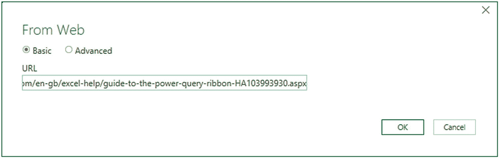

图 4-1 `从 Web` 对话框

1.  在 `数据` 功能区中，点击 `从 Web`。
2.  输入以下 URL（这是微软关于 Power Query 的帮助页面，其中包含几个数据表格）：`http://office.microsoft.com/en-gb/excel-help/guide-to-the-power-query-ribbon-HA103993930.aspx`。当然，我希望在你阅读本书时它依然能访问。当然，如果你有自己的 URL 想要尝试，请随意！对话框将类似于图 4-1。

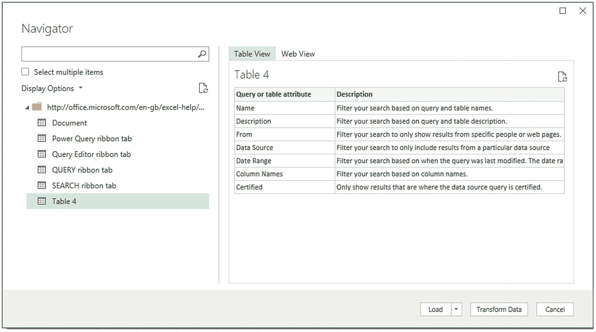

图 4-2 `导航器` 对话框预览网页上表格的内容

3.  点击 `确定`。`导航器` 对话框将出现。在 Power Query 连接到网页的几秒钟后，网页中可用数据表格的列表将会显示出来。
4.  点击 `导航器` 对话框左侧的某个表格名称。该表格的内容将显示在 `导航器` 对话框的右侧，展示所选表格中的数据样貌，如图 4-2 所示。
5.  在 `导航器` 对话框中选择复选框（如图 4-2 中表 4 左侧所示）。
6.  点击窗口底部的 `加载`。数据将被加载到一个新的工作表中。

**提示**
另一种访问网页的方式是点击 `数据` 功能区中 `获取数据` 按钮底部的小三角形，然后从弹出的菜单中选择 `来自其他源 ➤ 从 Web`。

这个简单的示例展示了如何从网页中选择数据表格并将其加载到 Excel 中。

### 高级 Web 选项

在前一个示例的第 3 步中，你本可以选择 `高级` 按钮。如果你这样做了，`从 Web` 对话框将会展开，允许你通过添加 URL 部分来构建复杂的 URL。你可以在图 4-3 中看到这样的示例。

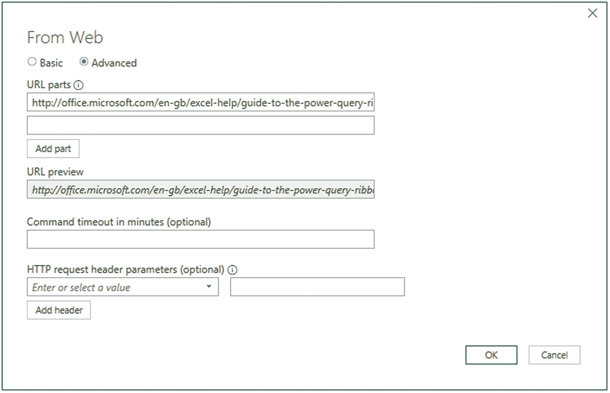

图 4-3 `从 Web` 对话框中的 `高级` 选项

点击 `添加部分` 按钮可以定义多个 URL 部分。

如果需要，你还可以指定提交 URL 时将使用的 HTTP 请求头部参数。某些网页可能会要求这些参数。对这些内容的讨论超出了本书的范围。

### 查看源网页

在 `导航器` 中只看到网页中的表格，而看不到网页本身，可能会让人感到有些不适应。毕竟，Web 本质上是一种视觉媒体。

因此，Power Query 为 `导航器` 添加了一个仅适用于网页的有用功能。那就是可以在 `导航器` 中查看网页本身——就像它在网页浏览器中显示的那样。要尝试这个功能：

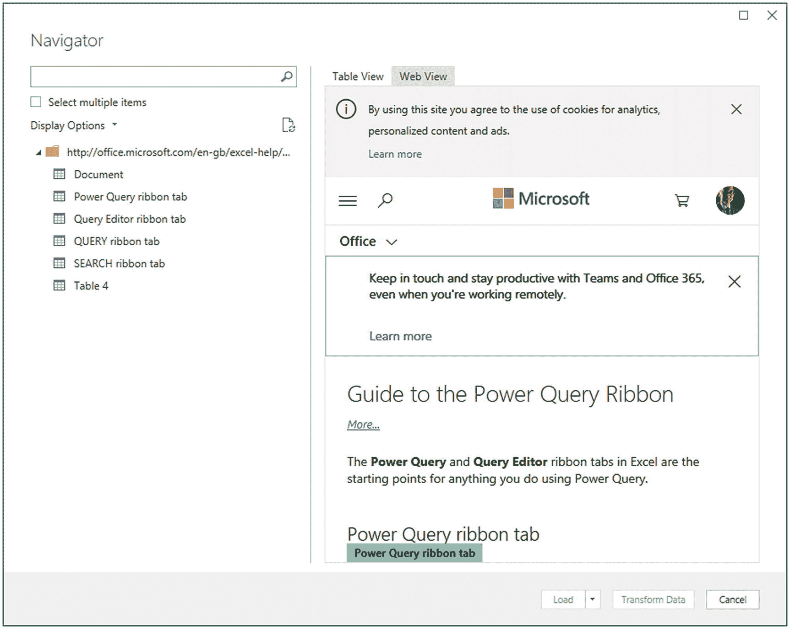

图 4-4 在 `从 Web` 对话框中查看源网页

1.  按照之前描述的步骤 1 到 3 操作。
2.  点击 `导航器` 右侧的 `网页视图`。你应该会看到类似图 4-4 所示的页面。

现在你可以向下滚动页面——并通过点击对话框右侧的 `表格视图` 切换回仅查看页面中表格数据的模式。

## Salesforce

Salesforce 是软件即服务（SaaS）领域的先驱之一——如今毫无疑问也是领导者之一。因此，Power Query 允许你连接到 Salesforce 并将你有权限使用 Salesforce 账户查看的任何数据加载到 Excel 中，这几乎是必然的。

事实上，Salesforce 是一项如此广泛且完整的服务，以至于你有两种可能的方法来访问你的数据：

- `对象`
- `报告`

简而言之，Salesforce 对象是底层的数据结构（你可以将其视为各种表），其中包含你想要访问的信息。而 Salesforce 报表则是从数据表中整理出来、以更易访问的输出形式呈现的数据。

**提示**
如果你没有企业 Salesforce 账户，但仍想了解如何使用 `Power Query` 连接到 Salesforce 数据，你可以随时建立一个免费的 30 天试用账户。其 URL 是 `www.salesforce.com/form/signup/freetrial-sales.jsp`。

### 从 Salesforce 对象加载数据

假设您拥有一个有效的 Salesforce 帐户，以下是将数据从 Salesforce 对象加载到 Excel 的方法：

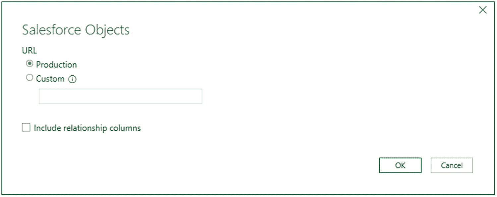
图 4-5 `Salesforce 对象`对话框

1. 打开一个新的 `Excel` 应用程序。
2. 在 `Excel` 的`数据`功能区中，单击`获取数据`按钮。
3. 点击`来自在线服务` ➤ `来自 Salesforce 对象`。系统将显示`Salesforce 对象`对话框。它应该看起来像图 4-5 所示。

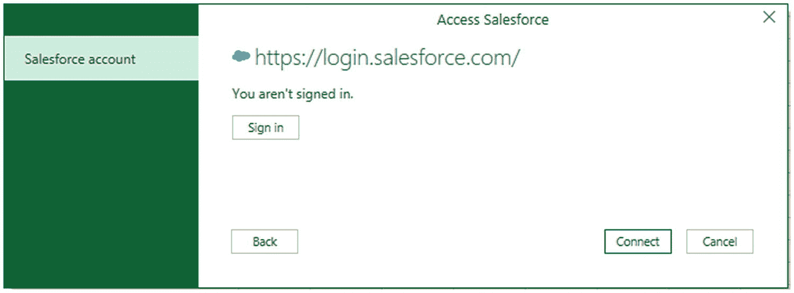
图 4-6 `访问 Salesforce` 登录对话框

4. 选择`生产`按钮并点击`确定`。系统将显示`访问 Salesforce` 登录对话框。它应该看起来像图 4-6 所示。

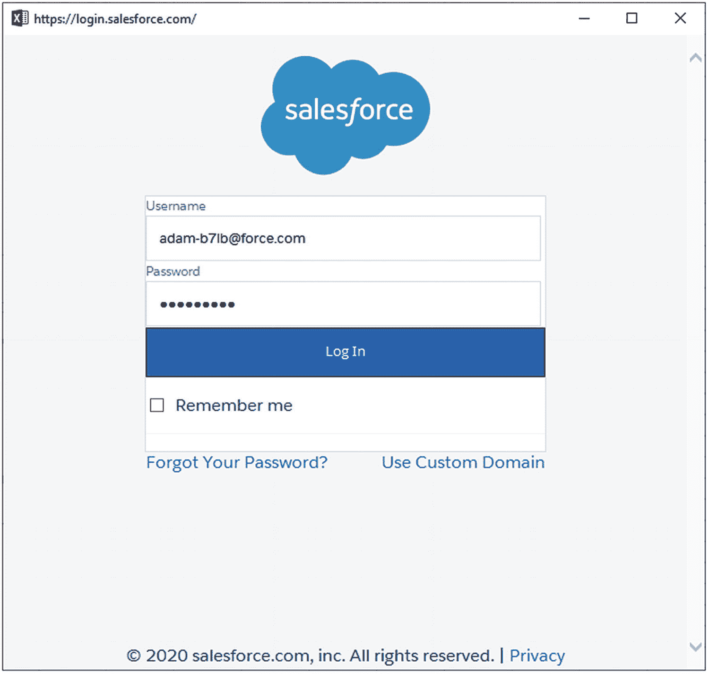
图 4-7 Salesforce 登录对话框

5. 除非您已登录，否则请点击`登录`。系统将显示 Salesforce 登录对话框。
6. 输入您的 Salesforce 用户名和密码。对话框应类似于图 4-7 所示。

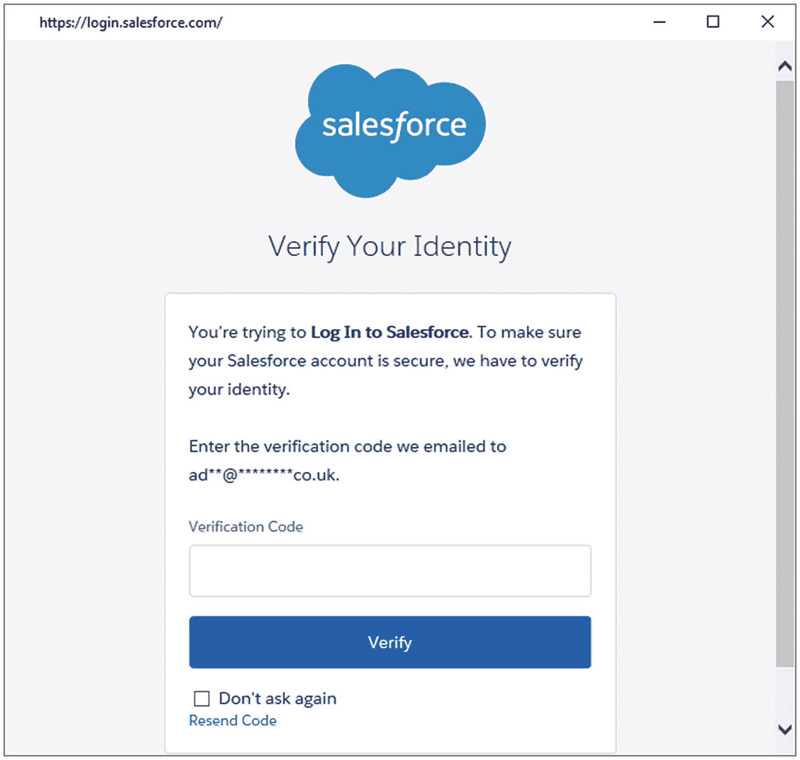
图 4-8 `Salesforce 验证您的身份`对话框

7. 如果这是您第一次从`Power Query`连接到 Salesforce（或者您已要求 Salesforce 在每次登录时请求确认），系统将要求您验证身份。系统将显示`Salesforce 验证您的身份`对话框，如图 4-8 所示。

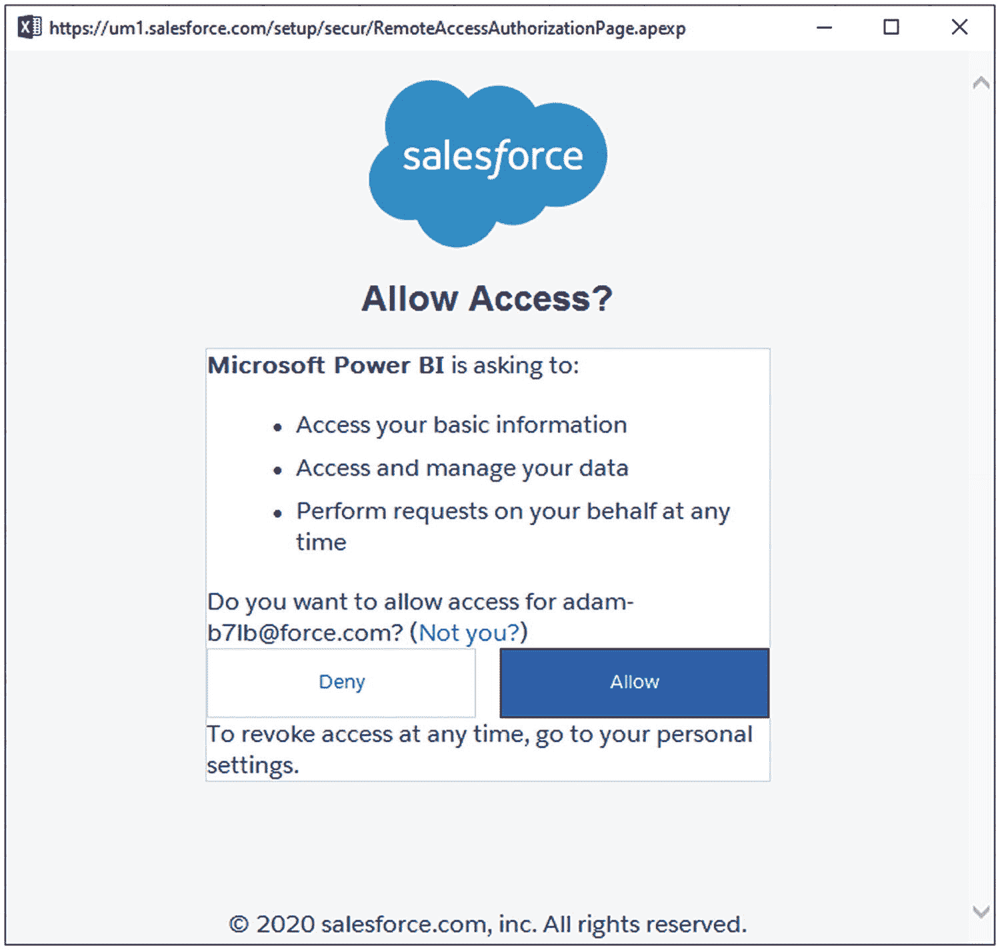
图 4-9 `Salesforce 允许访问`对话框

8. 点击`验证`。Salesforce 将向您用于登录 Salesforce 的电子邮件帐户发送一个验证码。
9. 在`验证码`字段中输入该代码，然后点击`确定`。您将看到`允许访问`对话框，如图 4-9 所示。

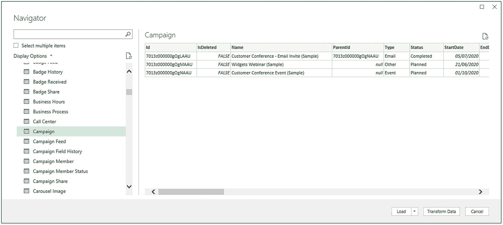
图 4-10 在`导航器`中查看的 Salesforce 对象

10. 点击`允许`。您将返回到`访问 Salesforce` 对话框，但此时您已登录。
11. 点击`连接`。系统将显示`导航器`，其中列出了您有权访问的 Salesforce 对象。您可以在图 4-10 中看到一个示例。
12. 选择您希望将其数据加载到 Excel 中的对象，然后点击`加载`。数据将被加载到 Excel 中，以便您根据 Salesforce 数据创建报告。

**提示**
为避免在每次使用 Salesforce 数据创建新的 Excel 报告套件时都需要向 Salesforce 确认您的身份，您可以在 Salesforce 登录对话框中勾选“记住我”，并在`Salesforce 验证您的身份`对话框中勾选“不再询问”。

Salesforce 对象包含大量数据。然而，从`Power Query`的角度来看，这类似于访问数据库结构。这意味着您必须对底层数据的存储方式有一定的了解。如果您想了解 Salesforce 数据的结构化方式，我建议您从当前位于 [`https://trailhead.salesforce.com/en/modules/data_modeling/units/objects_intro`](https://trailhead.salesforce.com/en/modules/data_modeling/units/objects_intro) 的 Salesforce 文档开始。

### Salesforce 报告

如果您发现 Salesforce 中的数据量让您不知所措，您可以直接访问标准 Salesforce 报告背后的数据。这将避免您需要了解底层数据结构。缺点是您不易扩展这些数据集。

要访问 Salesforce 报告数据，只需按照上一节中概述的步骤操作即可。但是，在步骤 3 中，选择`Salesforce 报告`而不是`Salesforce 对象`。在这种情况下，`导航器`对话框将类似于图 4-11 所示。

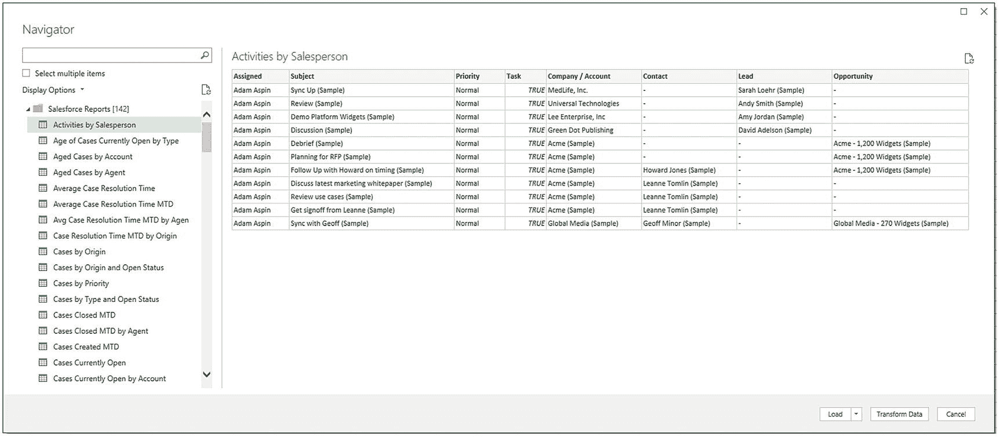
图 4-11 显示`Salesforce 报告`数据的`导航器`对话框

在这里，您可以选择并加载来自 Salesforce 的、您希望用于进一步分析的报告数据。

## Microsoft Dynamics 365

另一个包含大量宝贵企业数据的在线服务是 Microsoft Dynamics 365。正如您所料，`Excel` 中的`Power Query`可以轻松连接到 Microsoft 在线源，例如 Dynamics。如果您所在组织使用此特定平台，操作方法如下：

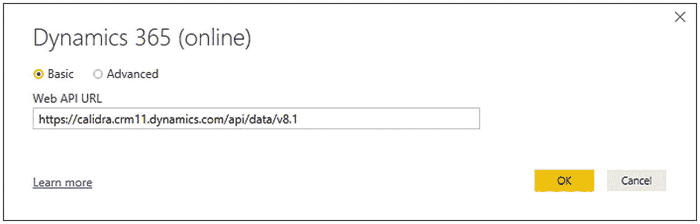
图 4-12 `Dynamics 365 (在线)`对话框

1. 打开一个新的 `Excel` 应用程序。
2. 在 `Excel` 的`数据`功能区中，单击`获取数据`按钮。
3. 点击`来自在线服务` ➤ `来自 Dynamics 365 (在线)`。
4. 点击`连接`。系统将显示`Dynamics 365 (在线)`对话框。
5. 输入您用于连接 Dynamics 365 的 URL，并添加 `/api/data/v8.1`（至少在本节付印时是如此）。它可能看起来像图 4-12 所示。但请注意，此 URL 将根据您在世界上的位置而变化。
6. 点击`确定`。系统将显示`OData 源`对话框。这是因为`Power Query`使用`OData`连接到 Dynamics 365 Online。
7. 选择`组织帐户`作为安全访问方法。
8. 点击`登录`以登录您的 Dynamics 365 帐户，并遵循 Microsoft 登录流程。
9. 点击`连接`。系统将显示`导航器`对话框，其中列出了您有权连接的所有 Dynamics 对象。

**注意**
在步骤 6 中，您看到 MS Dynamics 365 连接实际上是一个`OData`连接。`OData`将在下一章中更详细地解释。

Dynamics 365 表数量巨大——具体数量将取决于您的组织所订阅的服务。然而，实际上您是在访问一个数据库结构。这意味着您必须对底层数据的存储方式有一定的了解。如果您想了解 Dynamics 365 表，我建议您从位于 [`https://docs.microsoft.com/en-us/dynamics365/unified-operations/dev-itpro/data-entities/data-entities`](https://docs.microsoft.com/en-us/dynamics365/unified-operations/dev-itpro/data-entities/data-entities) 的 Microsoft 在线帮助开始。

## Azure SQL 数据库

# SQL Server 云连接选项

SQL Server 不仅仅作为本地数据库存在。它也可以作为“平台即服务”（也称 PaaS）使用。简而言之，这使您能够将按需付费模式应用于数据库需求，您可以在几分钟内在云中启动一个数据库服务器，然后根据需求进行扩展，而无需购买硬件和软件并对其进行维护。

## 连接到 Azure SQL 数据库

连接到微软的 PaaS 产品（称为 Azure SQL 数据库）非常简单。如果您有公司 Azure SQL 数据库的详细信息，可以使用它进行连接。如果没有，但仍想尝试将 Power Query 连接到 Azure SQL 数据库，您可以随时从 Microsoft 申请免费试用账户，并在几分钟内设置一个 Azure SQL 数据库。如果您选择此路径，可以在以下 URL 找到如何操作（包括加载您稍后将在本节中连接的示例数据）的说明：`https://docs.microsoft.com/en-gb/azure/sql-database/sql-database-get-started-portal`。

**提示**

当您创建自己的 Azure SQL 数据库以测试与 Power Query 的连接时，请务必将源定义为 `Sample`。这将确保 MS 示例数据加载到您的测试数据库中。

要使用 Power Query 从 Excel 连接到 Azure SQL 数据库：

`图 4-13` Azure SQL 数据库连接的 SQL Server 数据库对话框

1.  打开一个新的 Excel 应用程序。
2.  在 Excel 的“数据”功能区中，单击“获取数据”➤“来自 Azure”➤“来自 Azure SQL 数据库”。将出现 SQL Server 数据库对话框（毕竟，Azure SQL 数据库是 SQL Server 数据库，但运行在云中）。
3.  输入您从 Microsoft Azure 管理门户获得的 Azure SQL 数据库服务器名称（或由公司 DBA 提供给您的名称）。SQL Server 数据库对话框将如图 4-13 所示。

`图 4-14` Azure SQL 数据库连接的 SQL Server 凭据对话框

1.  单击“确定”。将出现凭据对话框。
2.  单击左侧的“数据库”，然后输入有效的用户名和密码。凭据对话框将如图 4-14 所示。
3.  单击“连接”。将出现导航器对话框，显示您在 Azure SQL Server 数据库中有权限访问的数据库。

**注意**

如果您正在设置 Azure SQL 数据库，请确保包含防火墙规则，以允许从运行 Excel 的计算机连接到 Azure SQL 数据库。

如果您按照第 3 章中的步骤连接到了本地 SQL Server 数据库，那么您可能会觉得此处使用的方法几乎相同。幸运的是，Power Query 开发团队努力使这两个过程尽可能相似。这延伸到：

*   确保数据源设置由 Power Query 存储，并且可以像本地数据库连接一样进行更新。

## Azure SQL 数据仓库 (Azure Synapse Analytics)

Azure 有许多可用的数据存储平台。其中特别适合 Power Query 的是 Azure SQL 数据仓库（现在称为 Azure Synapse Analytics）。这是一个托管在 Azure 中的 MPP（大规模并行处理）数据仓库。

我再次假设您手头有一个公司 Azure Synapse Analytics 实例，并且拥有对 Azure Synapse Analytics 的相关访问权限。此处，您也需要正确设置防火墙规则（尽管如果您之前为例如 Azure SQL 数据库设置了防火墙规则，这可能不是严格必需的）。我想您可能需要公司 IT 支持的帮助，以确保连接能够成功建立。

假设您可以访问 Azure Synapse Analytics 实例：

`图 4-15` Azure Synapse Analytics 连接的 SQL Server 数据库对话框

1.  打开一个新的 Excel 应用程序。
2.  在“数据”功能区中，单击“获取数据”➤“来自 Azure”➤“来自 Azure SQL 数据仓库”。
3.  输入您从 Microsoft Azure 管理门户获得的 Azure SQL 数据仓库服务器名称（或由公司 IT 提供给您的名称）。SQL Server 数据库对话框将如图 4-15 所示。这是因为 Azure Synapse Analytics 本质上是一个 SQL Server 数据库。
4.  选择“导入”按钮，然后单击“确定”。将出现凭据对话框。
5.  单击左侧的“数据库”，然后输入有效的用户名和密码。
6.  单击“连接”。将出现导航器对话框，显示您在 Azure SQL Server 数据库中有权限访问的数据库。
7.  选择所需的表，然后单击“加载”或“编辑”返回 Excel。如果要同时导入多个表，请记住单击“选择多项”。

**注意**

不要因为指定服务器和数据库的对话框标题显示“SQL Server 数据库”而感到困惑。这能正确地将您连接到 Azure SQL 数据仓库。

## 连接 Azure 虚拟机上的 SQL Server

如今，越来越多的数据库由云服务提供商托管在企业环境之外。借助亚马逊（提供 SQL Server 的 RDS 服务）或微软（在 Azure 中提供用于 SQL Server 的虚拟机）等提供商，你可以将数据库部署在企业外部，并几乎从世界任何地方访问它们。

因此，为了扩展 Power Query 可用的数据源范围，我们将简要介绍如何连接到 Azure 虚拟机上的 SQL Server。诚然，连接 Azure 虚拟机上的 SQL Server 与连接企业环境中的 SQL Server 几乎相同——正如你在第 3 章中所见。但仍有必要稍作说明，简要介绍如何使用 Power Query 从云端的 SQL Server 实例将数据返回到 Excel。

再次说明，如果你的企业环境中没有托管在 Azure 虚拟机上的 SQL Server 实例，你始终可以使用 Azure 试用账户来测试此过程。然而，我无法在此解释如何在虚拟机上设置 SQL Server 实例，因为这是一个庞大且独立的主题，超出了本书范围。不过，如果你需要，有许多资源可以解释如何执行此操作。

连接到 Azure 中虚拟机上的 SQL Server：

`图 4-16` Azure 虚拟机的 Microsoft SQL Server 数据库对话框

1.  打开一个新的 Excel 应用程序。
2.  在 Excel 功能区中，点击`获取数据`按钮底部的小三角形，然后点击 `SQL Server`。将出现 SQL Server 数据库对话框。
3.  在`服务器`文本框中输入描述服务器的完整字符串。该字符串要么由企业的数据库管理员提供，如果你使用自己的 Azure 账户，则可以在 Azure 管理门户中找到它。
4.  输入你有权访问的数据库对应的数据库名称。对话框将如图 4-16 所示。

`图 4-17` 连接到虚拟机时的 SQL Server 数据库对话框

5.  点击`确定`。将出现`访问 SQL Server 数据库`对话框。选择`数据库`作为安全模式，并输入用户名和密码，如图 4-17 所示。如果你使用自己的 Azure 账户，这些可以是你在设置虚拟机时指定的用户名和密码。
6.  如果出现加密支持对话框，点击`确定`。将出现`导航器`对话框，列出你在虚拟机上托管的 SQL Server 中有权限查看的所有表。

如你所见，该过程与你在第 3 章中连接 SQL Server 时遵循的过程几乎相同。尽管如此，我有几点需要提请你注意：

*   使用 Azure 虚拟机的多部分名称作为服务器名称。
*   与连接本地 SQL Server 实例时一样，如果需要，你可以选择数据库。
*   如果虚拟机指定了公共 IP 地址，你可以使用该 IP 地址作为数据库名称。

-   安全性是一个庞大而独立的问题。在企业环境中，你*可能*能够使用 Windows 安全进行连接。对于测试虚拟机，你几乎肯定必须使用数据库安全。

    与 Azure 中的常规情况一样，必须正确设置防火墙。

### Azure Blob 存储

本章中我想向你介绍的最后一个 Azure 数据源是 Azure Blob 存储。就 Excel 而言，你基本上可以将其视为云中的文件共享。因此，如果你需要访问存储为文件的数据，可以通过 Azure Blob 存储连接到这些文件。

同样，你需要企业级 Azure Blob 存储的访问权限或一个 Azure 试用账户。无论哪种情况，你都需要将文件夹`C:\PowerBiDesktopSamples\MultipleIdenticalFiles`中的两个示例文件复制到你的 Azure Blob 存储容器中。下载示例文件的说明在附录 A 中。

一旦源数据在 Azure Blob 存储中可用，你可以执行以下步骤：

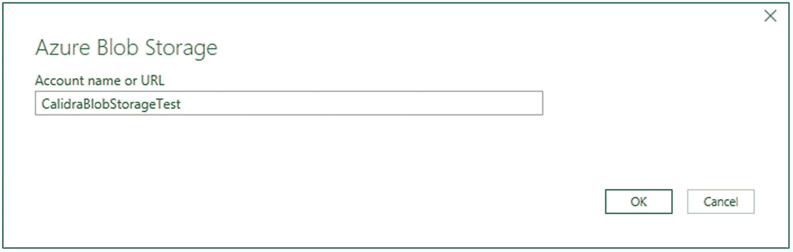

图 4-18 连接到 Azure Blob 存储

1.  打开一个新的 Excel 应用程序。
2.  在“数据”功能区中，点击`获取数据` ➤ `来自 Azure` ➤ `来自 Azure Blob 存储`。
3.  输入你用来连接 Azure Blob 存储的账户名称。Azure Blob 存储对话框将如图 4-18 所示。如果你使用的是企业级 Azure Blob 存储账户，系统管理员将提供此名称。在测试场景中，你可以通过打开 Azure 管理门户中的“存储账户”边栏选项卡，复制“Blob 服务终结点”来找到它。

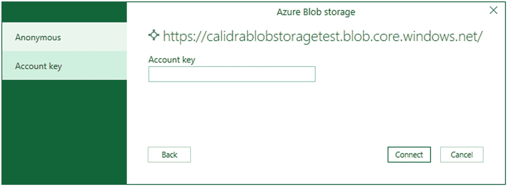

图 4-19 Azure Blob 存储账户密钥

4.  点击`确定`。将出现`Azure Blob 存储账户密钥`对话框。
5.  在 Azure 管理门户中，复制一个账户密钥。可以通过点击“存储账户”边栏选项卡，然后点击`访问密钥`在 Azure 管理门户中找到这些密钥。如果你从系统管理员处收到了账户密钥，则改用该密钥。你可以在此对话框中看到图 4-19。
6.  将账户密钥粘贴到`Azure Blob 存储账户密钥`对话框中。
7.  点击`连接`。将出现“导航器”，显示所选容器中的文件列表。
8.  点击`加载`。存储在 Azure 中的文件列表将出现在 Power Query 中。

**注意**

需要特别注意的是，至少目前，从 Azure 返回的是一个可用文件列表。第 9 章介绍如何选择并从部分或全部可用文件中将数据加载到 Excel，以便将其用作分析的基础。

### Azure 安全性

所有云服务提供商都极其重视安全性。如本章所述，你总是需要输入某种形式的安全令牌和/或指定有效的用户名和密码才能连接到基于云的数据。

## 其他源类型

显然，如果不耗费大量篇幅，就不可能解释如何使用所有潜在的数据源。此外，并非每个人都需要访问每一个存储外部数据的地方。事实上，大多数用户通常只需要从两到三个外部数据源获取数据。

这不可避免地意味着，你将在本书中看不到 Excel 的 `Power Query` 中提供的某些数据源。然而，正如我所提到的，`Power Query` 的基本优势之一是，一旦你学会了如何连接到几个数据源，你就差不多学会了如何使用所有数据源。

因此，本书未涵盖部分数据源，包括：
-   `Azure Data Lake`
-   `SharePoint`（本地和在线）
-   `Microsoft Exchange`（本地和在线）
-   `Microsoft Dynamics` 在线版
-   `Active Directory`
-   `Hadoop`
-   `Azure HDInsight`
-   `Facebook`

连接到 `SharePoint`、`Exchange`、`Microsoft Dynamics`、`Azure HDInsight` 或 `Hadoop` 将不可避免地意味着这些系统已在你组织中使用——并且你拥有必要的访问权限。

如果你在 Excel 中使用 `Power Query` 连接到 `Azure HDInsight` 或 `Hadoop`，我更愿意添加一句警告。这些是“大数据”源，顾名思义，它们可能包含海量数据。它们所包含的庞大数据量很容易让 Excel 不堪重负。因此，我建议你在尝试连接到大数据源*之前*，先阅读接下来几章中关于如何在加载数据之前选择和筛选数据的说明。

## 结论

在本章中，你简要了解了如何检索通过互联网访问的数据。其范围可以从网页上的数据表到庞大的 `Azure Synapse Analytics 数据仓库`。你可能甚至需要访问存储在 `Azure Blob 存储` 或 `Azure Data Lake` 中的数据。或者，你可能需要基于你的 `Salesforce` 或 `MS Dynamics 365` 数据创建报告。无论如何，`Power Query` 都可以连接并访问这些服务和存储库中可用的数据。

鉴于在线源的数量众多，本章仅能浅尝辄止地触及这些潜在数据存储库的范围。然而，由于 `Power Query` 严格标准化了数据访问方式，你应该能够将本章中学到的方法应用于许多其他数据服务，无论是当前还是未来的服务。