# 7. 数据转换

数据集经过筛选和塑形（如前一章所述）后，可能仍需要一些修改才能投入使用。本质上，这些修改中的许多都是你为了清理和标准化数据而应用的一系列相当简单但必要的技术。我选择将这些方法归入*数据转换*的标题下。

在最终将源数据加载到数据模型之前，你可能想要做的事情通常涵盖一系列*清理*数据的过程。它们可以包括以下内容：

- 更改列的数据类型——例如，通过告知 Power Query 该列包含数字
- 确保第一行用作标题（如果需要的话）
- 移除列内容的一部分
- 将单元格中的值替换为其他值
- 转换列的内容——例如，将文本设为大写，或移除数字的小数部分
- 向下或向上填充数据以跨越空单元格，确保记录完整
- 对数字列应用数学、统计（甚至三角）函数
- 将日期或时间数据转换为日期元素，如天、月、季度、年、小时或分钟

转换数据不仅包括缩减数据。有时你可能需要*扩展*数据以使其可用。这通常意味着向数据表添加更多列。实现此目的的技术包括：

- 复制一列，并可能更改复制列中数据的格式
- 将列中的部分数据提取到新列中
- 将一个列中的所有多个数据元素分离，使每个数据元素出现在单独的列中
- 将多列合并到新列中
- 添加自定义列，这些列可能包含计算，或将列的部分数据提取到新列中，甚至连接多列
- 添加“索引”列，对行进行编号以确保唯一性或记住排序顺序

本章将带你了解这些必不可少的数据转换类型。阅读完本章后，你应有信心以粗糙的原始数据源为起点，并将其转换为一个精炼且连贯的数据表，使其成为 Excel 分析中不可或缺的一部分。不仅如此，你完成这项繁重工作的速度将比使用企业级工具或你已知的大多数 Excel 技术更快、更轻松。

本章练习所需的示例数据位于文件夹 `C:\DataMashupWithExcelSamples` 中。

## 查看完整记录

在开始清理数据之前，你可能需要仔细查看数据。虽然 Power Query 编辑器非常适合上下滚动列以查看单个字段的数据比较情况，但通常较难察觉单条记录的完整内容。

因此，为了避免在数据行中狂乱地左右滚动，Power Query 编辑器提供了另一个极其简单的解决方案。如果您单击某一行（更具体地说，是单击左侧网格中的行号），Power Query 编辑器将在数据集下方的单个窗口中显示整个记录的内容。你可以在图 7-1 中看到一个示例。

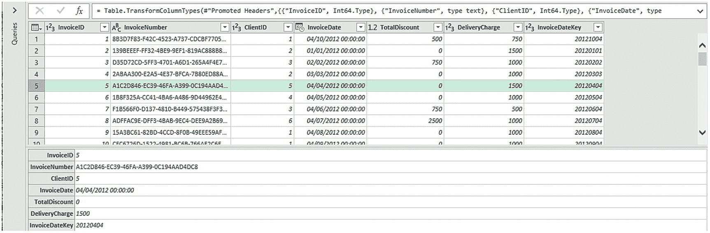

图 7-1：查看完整记录

注意

您可以通过向上或向下拖动上下窗口之间的灰色分隔线，来调整记录集和数据集窗口的相对高度。

## Power Query 编辑器上下文菜单

与 Windows 程序的常规做法一致，Power Query 编辑器充分利用了上下文（或“右键单击”）菜单作为功能区之外的替代方案。在转换数据集时，你可能会发现主要用到以下三个上下文菜单：

- *表菜单*：当您右键单击包含数据的网格的顶角（或单击数据网格左上角的小三角形）时，将显示此菜单。
- *列菜单*：当您右键单击列标题时，将显示此菜单。
- *单元格菜单*：当您右键单击数据单元格时，将显示此菜单。

虽然在解释如何转换数据时我已经大量引用了上下文菜单，但现在快速查看一下它们，以便你了解各种选项，可能会更容易理解。图 7-2 快速展示了这三个上下文菜单的概览。

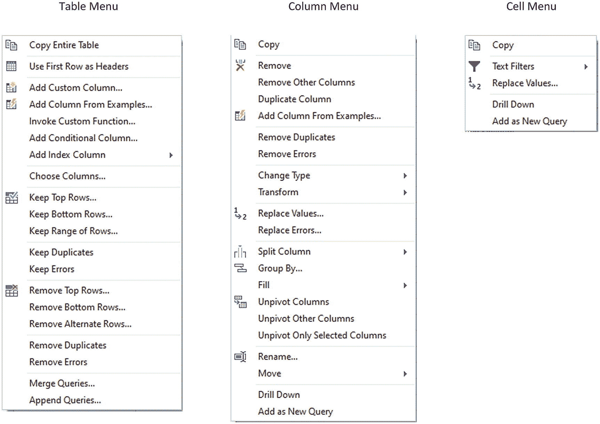

图 7-2：Power Query 编辑器上下文菜单

由于上下文菜单中提供的选项将在本章、前一章以及后续章节中详细解释，因此我在此不逐一说明。

注意

单元格上下文菜单中的筛选选项会反映该单元格的数据类型。因此，数值单元格将显示“数字筛选器”选项。

### 将第一行用作标题

Power Query 非常擅长判断是否需要将源数据集的第一条记录用作列标题。这之所以重要，有两个原因：

- 可以避免将列命名为 `Column1`、`Column2` 等。如果你这样泛泛地命名，会使用户（甚至包括你自己）不必要地难以理解数据。
- 可以避免在一个数字列中出现文本元素（本应是列标题），这在后续处理中可能会引发问题。这是因为一个完整的列需要具有统一的数据类型，才能应用另一种数据类型。例如，如果第一行中存在标题文本，则会妨碍为数值和日期/时间数据类型应用正确的类型。这是因为标题是文本，而该列的其余部分包含数字或日期。

然而，偶尔也会出现 Power Query 猜测错误的情况，它会认为数据集中的第一条记录是数据，而实际上它却是标题信息。这样一来，你看到的就不是标题，而是一组通用的列标题，比如 `Column1`、`Column2` 等。幸运的是，纠正这个问题并将第一行用作标题是一项简单任务：

1. 在 Power Query 窗口的“转换”功能区中，单击“将第一行用作标题”。

几秒钟后，第一条记录消失，列标题变为第一条记录中的内容。右侧的“应用的步骤”列表中现在包含一个“提升的标题”元素，指示刚刚执行的操作。此步骤会被突出显示。

> **注意**
>
> Power Query 通常能够在数据源为数据库时自动应用此步骤。当数据源为文件时，它通常也能正确猜测。然而，它并非总能准确猜测，因此有时你需要手动干预。你可以通过检查 Power Query 是否向“应用的步骤”列表中添加了“提升的标题”步骤，来判断它是否必须猜测第一行是否包含标题。

在极少数情况下，如果 Power Query 操作错误，将并非标题的第一行误认为是列标题，你可以单击“将第一行用作标题”按钮右侧的小三角形，将标题重置回第一行。这会显示一个简短菜单，你可以在其中单击“将标题用作第一行”选项。右侧的“应用的步骤”列表中现在包含一个“降级的标题”元素，列标题变为 `Column1`、`Column2` 等。随后，你可以根据需要重命名这些列。

### 更改数据类型

数据修改的一个真正基本方面是确保数据类型正确；也就是说，如果你有一列数字需要在某个时候进行计算，那么该列应该是数字列。如果它包含日期，则应将其设置为日期或时间数据类型之一。我意识到这看起来可能很繁琐，甚至多余；但是，*如果你希望确保数据能够在后续流程中被正确地进行切片和切块分析*，那么从一开始就设置正确的数据类型是*至关重要的*。另一个好处是，如果你在加载数据过程的早期就验证数据类型，那么从一开始就能发现数据潜在的问题——例如，无法被识别为日期的日期。这使你能够在处理数据集的工作早期就决定如何处理质量较差或不可靠的数据。

好消息是，对于许多数据源，Power Query 会自动应用适当的数据类型。具体来说，如果你从数据库加载数据，Power Query 将识别每列的源数据类型，并应用合适的 Power Query 数据类型，因为数据库已提供了必要的信息，使 Power Query 能够应用正确的数据类型。不幸的是，对于文件源，情况可能会更棘手一些，特别是 CSV、文本、（偶尔）Excel 文件以及某些 XML 文件。对于这些文件类型，Power Query 通常会尝试猜测数据类型，但有时会失败。如果它已经尝试推断数据类型，你会在“应用的步骤”列表中看到“更改的类型”步骤。因此，如果你从这些源获取数据，你很可能会需要手动为许多列应用数据类型。

> **注意**
>
> 在某些情况下，数字并不应被解释为数值数据。例如，法国邮政编码是五位数字，但永远不会进行任何计算。因此，当数值数据类型不合适时，最好通过将数据类型更改为文本来告知 Power Query。

按照以下步骤更改一列或多列的数据类型：

1. 加载示例文件 `C:\DataMashupWithExcelSamples\Chapter07Example1.xlsx`。
2. 通过单击“数据”功能区中的“查询和连接”来显示“查询和连接”窗格（如果此窗格已可见，则无需操作）。
3. 双击“查询和连接”窗格中的 `BaseData` 查询，切换到查询编辑器。
4. 单击要更改数据类型的列内部。如果要修改多列，请按住 `Ctrl` 键并单击相应的列标题。在此示例中，你可以选择 `CostPrice` 和 `TotalDiscount` 列。
5. 单击“转换”功能区中的“数据类型”按钮。将出现一个包含可能数据类型的弹出菜单。
6. 选择适当的数据类型。如果你选择了 `CostPrice` 和 `TotalDiscount` 列，那么“整数”是需要选择的类型。

几秒钟后，数据类型将应用完毕。“更改的类型”将出现在“应用的步骤”列表中。你可以应用的数据类型在表 [7-1] 中概述。

#### 表 7-1: Power Query 中的数据类型

| 数据类型      | 描述                 |
| ------------- | -------------------- |
| `十进制数`    | 将数据转换为十进制数 |

## 注意

`Data Type`按钮也位于`Home`功能区中。同样，您可以右键单击列标题并选择`Change Type`来切换不同的数据类型。

不可避免地，有时您尝试应用的数据类型根本无法用于某列数据。例如，将文本列（如示例数据表中的`Make`列）转换为日期是行不通的。如果这样做，Power Query会将列内容替换为`Error`错误值。这并非最终结果，也毫无危险，您只需按照前一章所述的技术，在`Applied Steps`（应用步骤）列表中删除`Changed Type`（已更改的类型）步骤，即可将数据恢复到之前的状态。

有时您可能会在数据类型已经更改后，再次尝试更改它。在这种情况下，您将会看到一个类似于图 7-3 所示的提示。

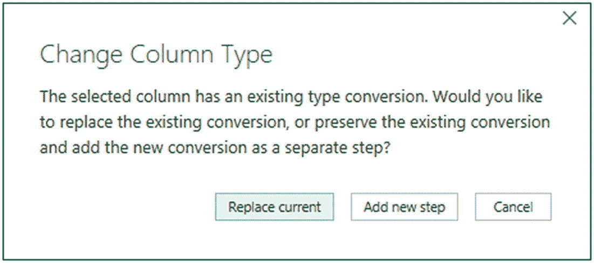

图 7-3：`Change Column Type`（更改列类型）提示

如果出现这种情况，您可以执行以下两项操作之一：

*   让Power Query使用您刚刚选择的数据类型来更新现有的转换步骤。

*   添加一个新的转换步骤。

您的选择将取决于您对底层数据集应用的具体转换类型。

同时为一组您认为需要此操作的列更改数据类型会很有帮助。采用这种方法有几个很好的理由：

*   您可以集中精力设置正确的数据类型，如果工作有条理，就不太可能忘记设置某个数据类型。

*   为多个列应用数据类型（即使您是通过多次操作，对单列或多列进行设置）也只会在`Applied Steps`列表中添加一个步骤。

注意：不要在Power Query中寻找任何数据格式选项；它们不存在。这是有意为之，因为此工具旨在结构化、加载和清理数据，但*不*用于展示数据。您应在Excel中像往常一样进行格式化。

### 检测数据类型

为几十列应用正确的数据类型可能相当耗时。幸运的是，Power Query现在包含一个选项，可以为整个表自动应用数据类型。假设您仍在位于`C:\DataMashupWithExcelSamples\Chapter07Example1.xlsx`文件的`BaseData`查询中：

1.  在`Transform`（转换）功能区中，点击`Detect Data Type`（检测数据类型）按钮。

2.  `Changed Type`将出现在`Applied Steps`列表中。大多数列将被应用正确的数据类型。

这种技术并不总能产生完美的结果，有时您会希望覆盖Power Query已应用的数据类型选择。然而，它仍然是数据准备工具集中一个受欢迎的补充，可以在准备数据集时为您节省大量时间。

### 数据类型指示器

不得不猜测每一列设置的是哪种数据类型会非常低效。因此，Power Query通过可视化的方式为您提供帮助，指示每列对应的数据类型。如果您仔细观察每个列标题的左侧，您会看到一个小图标。每个图标都指明了该列的数据类型。每个图标的含义见表 7-2。

表 7-2：Power Query编辑器中的数据类型图标

| 数据类型图标 | 描述 |
| :--- | :--- |
| 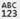 | 任何可能的数据类型 |
|  | 整数 |
|  | 小数 |
|  | 固定小数位数 |
|  | 百分比 |
|  | 文本 |
|  | 真/假 |
|  | 日期/时间 |
|  | 日期 |
|  | 时间 |
|  | 日期/时间/时区 |
|  | 持续时间 |
|  | 二进制 |

### 切换数据类型

另一种快速更改某列数据类型的方法是单击列标题左侧的数据类型图标，然后从右键上下文菜单中选择所需的数据类型，如图 7-4 所示。

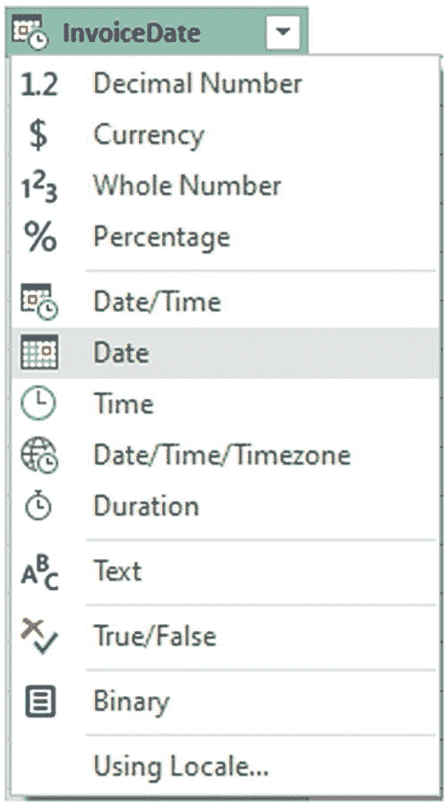

图 7-4：数据类型上下文菜单

### 使用区域设置数据类型

在转换数据类型时，您还可以选择使用当前区域设置来指定日期、时间和数字格式。这意味着在其他国家/地区从Excel打开Power Query的用户将看到适应当地格式惯例的日期、时间和数字格式。操作步骤如下：

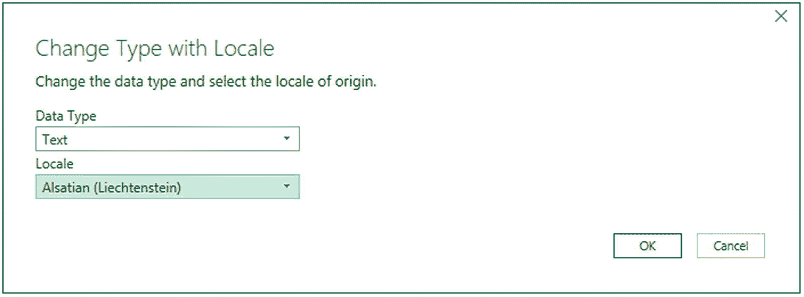

图 7-5：`Change Type with Locale`（使用区域设置更改类型）对话框

1.  打开查询编辑器（从源文件`C:\DataMashupWithExcelSamples\Chapter07Example1.pbix`内部）。

2.  单击列标题左侧的数据类型图标。

3.  从弹出菜单中选择`Using Locale`（使用区域设置）。将出现`Change Type with Locale`对话框。

4.  从可用数据类型列表中选择要应用的新数据类型。

5.  从全球区域设置列表中选择所需的区域设置。对话框将如图 7-5 所示。

6.  点击`OK`（确定）。

数据类型将转换为所选的区域设置。`Applied Steps`列表中将会包含一个名为`Changed Type with Locale`（已使用区域设置更改类型）的步骤。

### 替换值

在加载某些数据时，你可能需要进行一种全局查找和替换操作，将特定值替换为其他值——就像在 Microsoft Word 文档中那样。例如，也许你需要统一拼写，因为某个汽车品牌（以当前示例数据集为例）录入有误。要执行这项特定的数据清理操作（假设你已打开文件 `Chapter07Sample1.xlsx` 中的查询编辑器），请执行以下步骤：

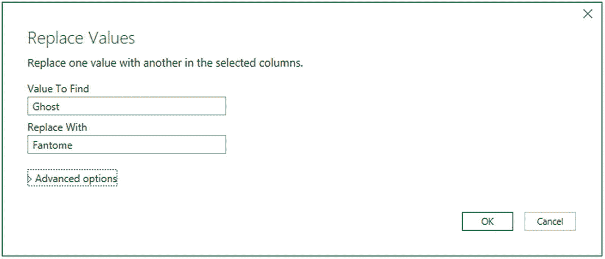

`图 7-6` “替换值”对话框

1. 单击包含要替换数据的列标题。该列将被选中。在本示例中，我使用了 `Model` 列。

2. 在“开始”功能区中，单击 `替换值` 按钮。将弹出“替换值”对话框。

3. 在 `要查找的值` 框中，输入要替换的文本或数字。在本示例中，我输入了 `Ghost`。

4. 在 `替换为` 框中，输入要替换成的文本或数字。在本示例中，我输入了 `Fantôme`，如图 7-6 所示。

5. 单击 `确定`。数据将在整个列中被替换。`替换的值` 将添加到 `应用的步骤` 列表中。

关于此技术，我只有几点说明：

- `替换值` 过程会搜索所选列的每条记录中所有匹配的文本。它不会搜索单元格的整个内容，除非你通过勾选“高级选项”中的 `匹配整个单元格内容` 复选框来特别指定。

- 如果在开始此过程之前，单击包含要替换内容的单元格（而不是像我们刚才那样单击列标题），Power Query 会自动将该单元格内容填入“替换值”对话框作为要查找的值。

- 你只能替换包含文本元素的列中的文本。这不适用于设置为数值或日期数据类型的列。实际上，如果你输入的值与所选列的数据类型不匹配，你会在“替换值”对话框中看到一个黄色警告三角形。

- 如果你确实必须将日期或数值列中的部分数据替换为其他日期或数字，那么你可以：
  - 将该列转换为文本数据类型
  - 执行替换操作
  - 将该列转换回原始数据类型

“替换值”对话框还有一些你可以应用的高级选项。点击左侧三角形展开“高级选项”项即可看到。这些选项如图 7-7 所示，并在表 7-3 中进行了解释。

`表 7-3` 高级替换选项

| 选项 | 说明 |
| --- | --- |
| 匹配整个单元格内容 | 仅当搜索值构成某行列的全部内容时才进行替换 |
| 使用特殊字符替换 | 将搜索值替换为一个非打印字符 |
| 制表符 | 将搜索值替换为一个制表符 |
| 回车符 | 将搜索值替换为一个回车符 |
| 换行符 | 将搜索值替换为一个换行符 |
| 回车符和换行符 | 将搜索值替换为回车符和换行符 |

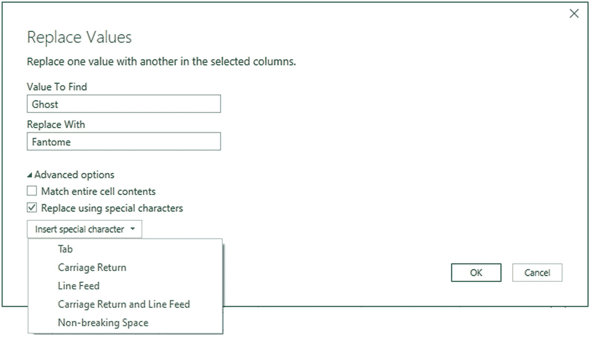

`图 7-7` 高级替换选项

> **注意：** 替换那些是其他单词子集的单词是危险的。在替换任何数据时，请确保除了你打算更改的元素外，不要损坏其他元素。

最后，纯粹作为题外话，我必须补充一点，我永远不会建议给劳斯莱斯更名，因为这近乎是汽车行业的亵渎。

## 转换列内容

Power Query 拥有一个强大的自动化数据转换工具箱，允许你通过多种方式标准化列的内容。这些包括：

- 设置文本列的大小写
- 对数值数据进行四舍五入或应用数学函数
- 从日期列中提取年份、月份或日期（以及其他）等日期元素

Power Query 对于将转换应用于适当类型的数据非常严格。这是因为`转换完全取决于所选列的数据类型`。这再次证实了应用所需数据类型是应该在任何数据转换过程的早期执行的操作——当然是在`转换列内容之前`。请记住，只有当列是数值数据类型时，你才能选择数值转换；只有当列是日期数据类型时，你才能选择日期转换。同样，基于文本的转换只能应用于文本数据类型的列。

### 文本转换

让我们看一个实际的简单转换操作示例。作为示例，我将让 Power Query 将 `Make` 列转换为大写字符。

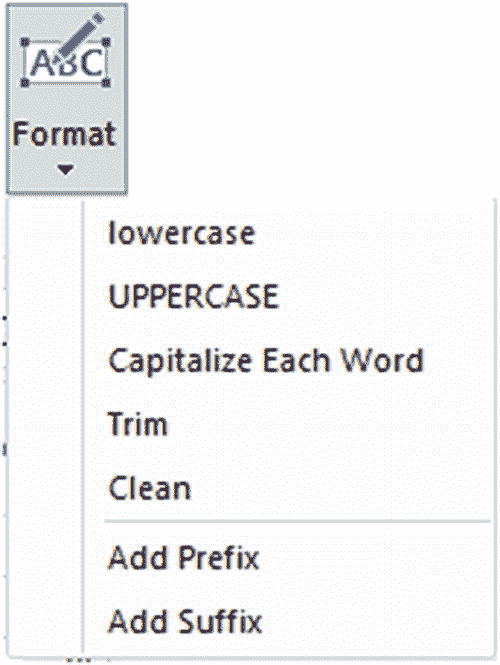

`图 7-8` “格式”菜单

1. 还是在从文件 `Chapter07Example1.xlsx` 打开的查询编辑器中，单击要转换内容的列（在本示例中为 `Make` 列）的任意位置。

2. 在“转换”功能区中，单击 `格式` 按钮。将出现一个弹出菜单。

3. 选择 `大写`，如图 7-8 所示。

整个列的内容将转换为大写。`大写的文本` 将添加到 `应用的步骤` 列表中。

从 `格式` 按钮的菜单可以看出，在格式化（或转换）文本时，有七个可能的选项。这些选项在表 7-4 中进行了解释。

`表 7-4` 文本转换

| 转换 | 说明 | 应用的步骤定义 |
| --- | --- | --- |
| 小写 | 将所有文本转换为小写 | 小写的文本 |
| 大写 | 将所有文本转换为大写 | 大写的文本 |
| 将每个单词首字母大写 | 将每个单词的首字母转换为大写 | 每个单词已首字母大写 |
| 修整 | 移除文本前后的所有空格 | 已修整的文本 |
| 清理 | 移除任何非打印字符 | 已清理的文本 |
| 添加前缀 | 在列内容开头添加文本 | 已添加前缀 |
| 添加后缀 | 在列内容末尾添加文本 | 已添加后缀 |

> **注意：** 我知道 Power Query 将文本转换称为格式化。尽管如此，这些选项是整体数据转换选项的一部分。

### 添加前缀或后缀

你还可以为列中的所有数据添加前缀或后缀。操作非常简单，如下所示：

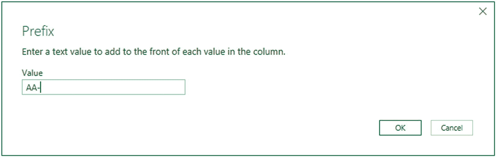

`图 7-9` 为文本添加前缀

1. 单击要添加前缀的列内部。

2. 在“转换”功能区中，选择 `格式` ➤ `添加前缀`。将显示“前缀”对话框，如图 7-9 所示。

3. 在 `值` 字段中输入要添加的前缀。

4. 单击 `确定`。

你指定的前缀将放置在该数据集所选字段的每条记录的开头。

> **注意：** 如果你向数值或日期/时间列添加前缀或后缀，则该列的数据类型将自动转换为文本。

### 删除前导和尾随空格

你不可避免地会遇到这样的场景：继承的数据在数据本身之前、之后或前后都包含额外的空格。这可能具有隐蔽性，因为它会导致：

- 数据重复，因为带有尾随空格的值被视为与没有空格的相同文本*不*相同
- 排序问题，因为前导空格会使元素出现在排序列表的*顶部*
- 分组错误，因为带空格的元素与不带空格的元素不属于同一组

幸运的是，`Power Query` 提供了一种彻底高效的解决方案来解决此问题。假设你在 Excel 文件 `Chapter07Sample1.xlsx` 的查询编辑器中：

1.  单击要转换其内容的列中的任意位置（本例中为 `Make`）。

2.  在 `转换` 功能区中，单击 `格式` 按钮。将出现一个弹出菜单。

3.  从菜单中选择 `修整`。

所有多余的前导和尾随空格都将从该列的数据中删除。这有助于在排序、分组和删除重复记录时使用。

### 删除非打印字符

某些源数据可能包含称为非打印字符的隐蔽元素。即使它们对人类来说几乎总是不可见的，也可能在某些情况下导致问题。

如果你怀疑源数据包含非打印字符，可以像这样简单地删除它们：

1.  单击你知道包含（或怀疑包含）非打印字符的列内部（或选择这些列）。

2.  单击 `格式` ➤ `清除`。

`Power Query` 会将 `已清除文本` 添加到 `已应用步骤` 列表中。

### 数字转换

正如你可以转换基于文本的列的内容一样，你也可以对数值应用转换。例如，假设你想在查询编辑器中将一列中的所有数字向上舍入到最接近的整数。

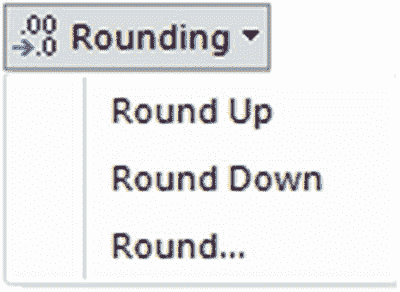

`图 7-10` 舍入选项

1.  打开 Excel 文件 `Chapter07Sample1.xlsx` 的查询编辑器（当然，除非它已经打开）。

2.  单击要转换其内容的列中的任意位置（本例中为 `TotalDiscount`）。

3.  在 `转换` 功能区中，单击 `舍入` 按钮。将出现一个弹出菜单，显示所有可用选项。你可以在图 7-10 中看到这一点。

4.  选择 `向上舍入`。

整个列中的值将向上舍入到最接近的整数。`已向上舍入` 将被添加到 `已应用步骤` 列表中。

其他可用的数值转换描述见表 7-5。由于这些数值转换在 `转换` 功能区中使用多个按钮或菜单选项序列，我已指出使用哪个按钮来获得所需结果。

**表 7-5** 数字转换

| 转换 | 描述 | 已应用步骤定义 |
| --- | --- | --- |
| `舍入` ➤ `向上舍入` | 将每个数字舍入到指定的小数位数 | `已向上舍入` |
| `舍入` ➤ `向下舍入` | 将每个数字向下舍入 | `已向下舍入` |
| `舍入...` | 将每个数字舍入到你指定的小数位数。如果指定负数，你将舍入到给定的小数位 | `已舍入` |
| `科学` ➤ `绝对值` | 使数字成为绝对值（正数） | `绝对值` |
| `科学` ➤ `幂` ➤ `平方` | 返回每个单元格中数字的平方 | `已计算平方` |
| `科学` ➤ `幂` ➤ `立方` | 返回每个单元格中数字的立方 | `已计算立方值` |
| `科学` ➤ `幂` ➤ `幂` | 将每个数字提升到你指定的幂 | `已计算幂` |
| `科学` ➤ `平方根` | 返回每个单元格中数字的平方根 | `已计算平方根` |
| `科学` ➤ `指数` | 返回每个单元格中数字的指数 | `已计算指数` |
| `科学` ➤ `对数` ➤ `以 10 为底` | 返回每个单元格中数字的以 10 为底的对数 | `已计算以 10 为底的对数` |
| `科学` ➤ `对数` ➤ `自然` | 返回每个单元格中数字的自然对数 | `已计算自然对数` |
| `科学` ➤ `阶乘` | 给出列中数字的阶乘 | `已计算阶乘` |
| `三角函数` ➤ `正弦` | 给出列中数字的正弦值 | `已计算正弦` |
| `三角函数` ➤ `余弦` | 给出列中数字的余弦值 | `已计算余弦` |
| `三角函数` ➤ `正切` | 给出列中数字的正切值 | `已计算正切` |
| `三角函数` ➤ `反正弦` | 给出列中数字的反正弦值 | `已计算反正弦` |
| `三角函数` ➤ `反余弦` | 给出列中数字的反余弦值 | `已计算反余弦` |
| `三角函数` ➤ `反正切` | 给出列中数字的反正切值 | `已计算反正切` |

`Power Query` 甚至不允许你尝试对文本或日期应用数值转换。如果你单击字母或日期列内部，相关的按钮将保持灰色。

## 计算数值

Power Query 也能对列中的数字应用简单算术运算。例如，假设你想将所有的销售价格乘以 110% 作为预测的一部分。以下是在 Excel 文件 `Chapter07Sample1.xlsx` 的查询编辑器中实现此操作的方法：

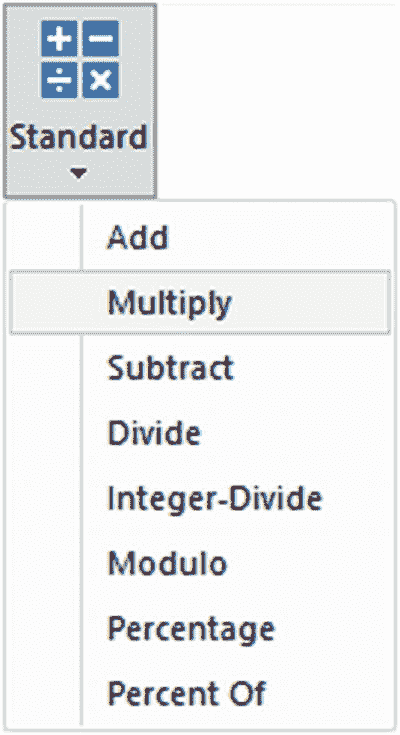

**图 7-11** – 对列应用计算

1. 单击任意一个数字列内部。在此示例中，我使用了 `SalePrice` 列。

2. 在 **转换** 功能区中，单击 **标准** 按钮。菜单将出现，如图 7-11 所示。

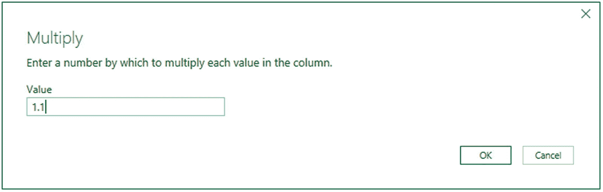

**图 7-12** – 对列应用计算

1. 单击 **乘**。将出现 **乘** 对话框。

2. 在 **值** 框中输入 `1.1`。对话框将如图 7-12 所示。

3. 单击 **确定**。

所选列中的所有数字都将乘以 `1.1`。换句话说，它们现在是原始值的 110%。表 7-6 描述了可以在 Power Query 中执行的可能数学运算。

**表 7-6** – 应用基本计算

| 转换 | 描述 | 已应用步骤定义 |
| --- | --- | --- |
| 加 | 向列中的数字添加一个选定值 | 添加到列 |
| 乘 | 将列中的数字乘以一个选定值 | 已乘列 |
| 减 | 从列中的数字中减去一个选定值 | 从列中减去 |
| 除 | 将列中的数字除以一个选定值 | 已除列 |
| 整数除 | 将列中的数字除以一个选定值并移除任何余数 | 整数除列 |
| 模数 | 将列中的数字除以一个选定值并只保留余数 | 已计算模数 |
| 百分比 | 将选定的百分比应用于列 | 已计算百分比 |
| 百分比为 | 将列中的值表示为您输入的值的百分比 | 已计算百分比为 |

**注意：** 你也可以在 Excel 中执行多种类型的计算，避免在查询编辑器中进行计算。实际上，许多 Excel 纯粹主义者似乎更倾向于任何类似计算的操作都应在电子表格内完成，而不是在查询阶段进行。我会让你自己决定更喜欢哪种方法。

最后，重要的是要记住，当你执行此类操作时，你正在修改数据。在实际工作中，在深度修改数据之前，复制一列可能更安全。这样你可以保留初始数据可用，尽管代价是增加加载时间和最终生成的 Excel 文件的大小。

## 日期转换

转换日期遵循与转换文本和数字类似的原理。以下是在 Excel 文件 `Chapter07Sample1.xlsx` 的查询编辑器中，如何从日期中提取月份的示例：

1. 单击 `InvoiceDate` 列内部。

2. 在 **转换** 功能区中，单击 **日期** 按钮。菜单将出现。

3. 单击 **年**。将出现子菜单。

4. 选择 **年**。日期的年份部分将替换 `InvoiceDate` 列中的所有日期。

其他可能的日期转换见表 7-7。

**表 7-7** – 日期转换

| 转换 | 描述 | 已应用步骤定义 |
| --- | --- | --- |
| 年龄 | 计算原始日期与当前本地时间之间的日期和时间差（以天和小时计） | 已计算年龄 |
| 仅日期 | 将数据转换为不含时间元素的日期 | 已计算日期 |
| 年 ➤ 年 | 从日期中提取年份 | 已计算年 |
| 年 ➤ 年初 | 返回该日期所在年份的第一天 | 已计算年初 |
| 年 ➤ 年末 | 返回该日期所在年份的最后一天 | 已计算年末 |
| 月 ➤ 月 | 从日期中提取月份数 | 已计算月 |
| 月 ➤ 月初 | 返回该日期所在月份的第一天 | 已计算月初 |
| 月 ➤ 月末 | 返回该日期所在月份的最后一天 | 已计算月末 |
| 月 ➤ 月天数 | 返回该日期所在月份的天数 | 已计算月天数 |
| 月 ➤ 月份名称 | 返回该日期所在月份的名称 | 已计算月份名称 |
| 日 ➤ 日 | 从日期中提取日 | 已计算日 |
| 日 ➤ 周几 | 将星期几返回为数字（星期一为 1，星期二为 2，以此类推） | 已计算周几 |
| 日 ➤ 年天数 | 计算该日期自年初以来的天数 | 已计算年天数 |
| 日 ➤ 日初 | 将值转换为日期和时间的当天开始时刻 | 已计算日初 |
| 日 ➤ 日末 | 将值转换为日期和时间的当天结束时刻 | 已计算日末 |
| 日 ➤ 星期名称 | 将星期几返回为星期名称 | 已计算星期名称 |
| 季度 ➤ 季度 | 返回该日期所在年份的日历季度 | 已计算季度 |
| 季度 ➤ 季初 | 返回该日期所在年份日历季度的第一个日期 | 已计算季初 |
| 季度 ➤ 季末 | 返回该日期所在年份日历季度的最后一个日期 | 已计算季末 |
| 周 ➤ 年周数 | 计算该日期自年初以来的周数 | 已计算年周数 |
| 周 ➤ 月周数 | 计算该日期自月初以来的周数 | 已计算月周数 |
| 周 ➤ 周初 | 返回该日期所在周的第一天（星期一）的日期 | 已计算周初 |
| 周 ➤ 周末 | 返回该日期所在周的最后一天（星期日）的日期 | 已计算周末 |

## 时间变换

您也可以使用 Power Query 将日期/时间或时间值转换为它们的组成部分。这与您应用日期变换的方式非常相似，但为了完整性，下面说明了在 Excel 文件 `Chapter07Sample1.xlsx` 的查询编辑器打开后如何执行此操作：

1. 点击 `InvoiceDate` 列内部。

2. 在“转换”功能区中，点击“时间”按钮。将出现一个菜单。

3. 点击“小时”。时间的小时部分将替换 `InvoiceDate` 列中的所有值。

> **注意：** 时间变换只能应用于日期/时间或时间数据类型的列。

时间变换的范围如表 7-8 所示。

**表 7-8** 时间变换

| 转换 | 描述 | 应用的步骤定义 |
| --- | --- | --- |
| 仅时间 | 从日期和时间中分离出时间部分 | 提取的时间 |
| 本地时间 | 将日期/时间从日期/时间和时区值转换为本地时间 | 提取的本地时间 |
| 解析 | 从文本中提取日期和/或日期/时间元素 | 已解析的日期时间 |
| 小时 ➤ 小时 | 从日期/时间或日期值中分离出小时 | 提取的小时 |
| 小时 ➤ 小时开始 | 从日期/时间或时间值中返回小时的开始时刻 | 计算的开始小时 |

| 小时 ➤ 小时结束 | 从日期/时间或时间值中返回小时的结束时刻 | 计算的结束小时 |
| --- | --- | --- |
| 分钟 | 从日期/时间或时间值中分离出分钟 | 提取的分钟 |
| 秒 | 从日期/时间或时间值中分离出秒 | 提取的秒 |
| 最早 | 从日期/时间或时间值中返回最早的时间 | 计算的最早 |
| 最晚 | 从日期/时间或时间值中返回最晚的时间 | 计算的最晚 |

> **注意：** 在实际工作中，您可能希望保持源列不变，而对列的副本应用数字或日期变换。要做到这一点，只需应用相同的变换技巧，但使用“添加列”功能区中的按钮，而不是“转换”功能区中的按钮。

# 持续时间

如果列中的值可以解释为持续时间（以天、小时、分钟和秒为单位），那么 Power Query 可以将持续时间的组成部分提取为数据变换。但是，要使此功能生效，该列*必须*设置为持续时间数据类型。这意味着 Power Query 必须将列的内容解释为持续时间。与此数据类型不兼容的任何值都将被设置为错误值。

那么，您可能会问，持续时间到底是什么样的？持续时间表示为：
- 天
- 小时
- 分钟
- 秒

更具体地说，持续时间必须表示为 `天.小时:分钟:秒` 的形式。例如，一个持续时间可能是 `11.23:5:45`。这表示 11 天、23 小时、5 分钟和 45 秒。

处理持续时间时有几个注意事项：
- 天数后面跟一个句点——其他分隔符是冒号。
- 持续时间中的小时不能大于 23。
- 持续时间中的分钟或秒不能大于 60。

如果您在 Power Query 的列中有持续时间数据，可以像这样提取其组成部分：
1. 打开一个新的空白 Excel 文件。
2. 点击 **数据 ➤ 获取数据 ➤ 来自文件 ➤ 来自工作簿**，并选择文件 `C:\DataMashupWithExcelSamples\Durations.xlsx`。
3. 点击工作表 `Sheet1`，然后点击“转换数据”打开查询编辑器。您将注意到，Power Query 会自动添加一个步骤，将 `DurationOnForecourt` 列的数据类型更改为持续时间，因为它能识别该数据格式。
4. 点击 `DurationOnForecourt` 列内部。
5. 在“转换”功能区中，点击“持续时间”按钮。将出现一个菜单。
6. 点击“小时”。时间的小时部分将替换 `InvoiceDate` 列中的所有值。

持续时间变换的范围如表 7-9 所示。

**表 7-9** 持续时间变换

| 转换 | 描述 | 应用的步骤定义 |
| --- | --- | --- |
| 天 | 从持续时间值中分离出天元素 | 提取的天数 |
| 小时 | 从持续时间值中分离出小时元素 | 提取的小时数 |
| 分钟 | 从持续时间值中分离出分钟元素 | 提取的分钟数 |
| 秒 | 从持续时间值中分离出秒元素 | 提取的秒数 |
| 总天数 | 将持续时间值显示为天数，以及表示小时、分钟和秒的小数部分 | 计算的总天数 |
| 总小时数 | 将持续时间值显示为小时数，以及表示分钟和秒的小数部分 | 计算的总小时数 |
| 总分钟数 | 将持续时间值显示为分钟数，以及表示秒的小数部分 | 计算的总分钟数 |
| 总秒数 | 将持续时间值显示为秒数，以及表示毫秒的小数部分 | 计算的总秒数 |
| 乘以 | 将持续时间（及其所有组成部分）乘以您输入的值 | 已乘的列 |
| 除以 | 将持续时间（及其所有组成部分）除以您输入的值 | 已除的列 |
| 统计 ➤ 求和 | 返回列中所有持续时间元素的总计 | 计算的总和 |
| 统计 ➤ 最小值 | 返回列中所有持续时间元素的最小值 | 计算的最小值 |
| 统计 ➤ 最大值 | 返回列中所有持续时间元素的最大值 | 计算的最大值 |
| 统计 ➤ 中位数 | 返回列中所有持续时间元素的中位数 | 计算的中位数 |
| 统计 ➤ 平均值 | 返回列中所有持续时间元素的平均值 | 计算的平均值 |

> **注意：** 如果您对持续时间进行乘法或除法运算，Power Query 会显示一个对话框，以便您输入要对持续时间进行乘法或除法的值。

## 向下填充空单元格

假设有一个数据源，其中数据以矩阵式结构进入 Power Query。结果就是，某些列中每个元素只有一个示例，其后是一系列空单元格，直到列表中的下一个元素。如果这难以想象，那么请查看图 7-13 中所示的示例文件 `CarMakeAndModelMatrix.xlsx`。

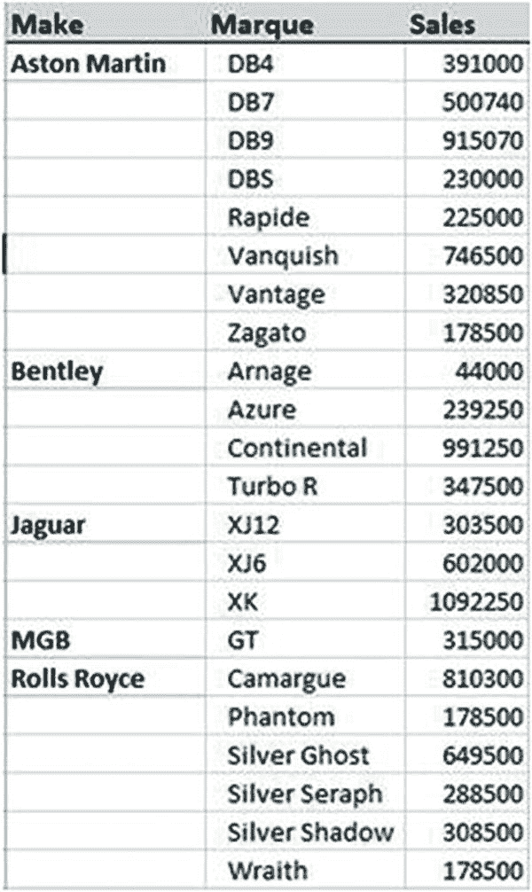

*图 7-13* — Excel 中的矩阵数据表

所有这些空白单元格都是问题，因为你需要一个在数据集中没有任何空白单元格的完整数据表，才能在 Excel 工作表和数据模型中分析数据。或者更确切地说，如果 Power Query 没有一种非常巧妙的方法来克服这个特定难题，那么空白单元格就会成为一个问题。请执行以下步骤来解决此问题：
1. 打开一个新的 Excel 文件。
2. 在“数据”功能区中，单击“获取数据 ➤ 来自文件 ➤ 来自工作簿”。
3. 在“获取数据”对话框中，选择 `Excel`。然后单击“连接”并导航到 `C:\DataMashupWithExcelSamples\CarMakeAndModelMatrix.xlsx`。
4. 单击“导入”，选择 `Sheet1`，然后单击“转换数据”。这将打开 Power Query 编辑器。
5. 选择包含空单元格的列。
6. 在“转换”功能区中，单击“填充”。菜单将出现。
7. 选择“向下”。空白单元格将被上面第一个非空单元格中的值替换。`Filled Down` 将添加到“已应用步骤”列表中。

现在，表格将如图 7-14 所示。

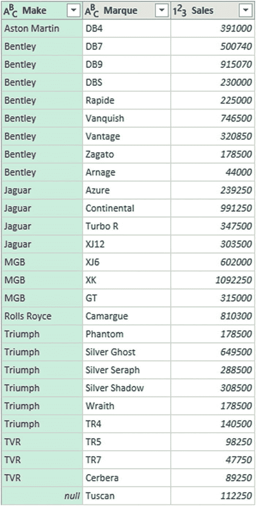

*图 7-14* — 空白单元格已被正确数据替换的数据表

> **注意**：此技术旨在处理一个相当具体的问题，并且仅当导入的数据按包含缺失元素的列进行分组时才真正有效。
>
> 尽管不常见，你也可以使用此技术从下方单元格的值填充空单元格。如果需要这样做，只需从“转换”功能区中选择“填充 ➤ 向上”。无论哪种情况，你都需要注意，该技术会应用于整个列。

## 提取列内容的一部分

很多时候，源列的内容可能包含超过实际需要的数据。在这种情况下，Power Query 可以通过仅提取列的一部分来帮助你。此技术的工作原理如下：

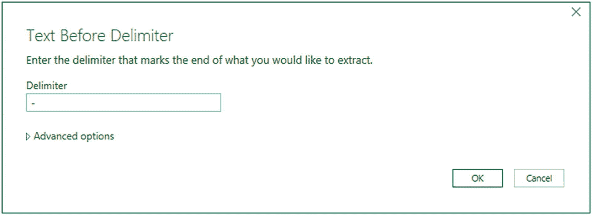

*图 7-15* — “分隔符之前的文本”对话框

1. 加载示例文件 `C:\DataMashupWithExcelSamples\Chapter07Example1.xlsx`。
2. 单击“数据”功能区中的“查询和连接”，以显示“查询和连接”窗格。
3. 双击 `BaseData` 查询以切换到查询编辑器。
4. 单击 `InvoiceNumber` 列内部。如你所见，发票编号由多个元素组成，每个元素由连字符分隔。
5. 在“转换”功能区中，单击“提取 ➤ 分隔符之前的文本”。将显示“分隔符之前的文本”对话框。
6. 在“分隔符”字段中输入连字符（或减号）。对话框将如图 7-15 所示。
7. 单击“确定”。字段的内容将被替换为连字符之前的字符。一个名为 `Extracted Text Before Delimiter` 的步骤将添加到“已应用步骤”列表中。

`Extract` 函数允许你从多种方式中选择一种来从列中提取数据子集。当前可用的选项在表 7-10 中进行了解释。

**表 7-10** — 提取转换

| 转换 | 描述 | 已应用步骤定义 |
| --- | --- | --- |
| 长度 | 显示字段内容的字符长度 | `Extracted Length` |
| 首字符 | 显示字段左侧指定数量的字符 | `Extracted First Characters` |
| 尾字符 | 显示字段右侧指定数量的字符 | `Extracted Last Characters` |
| 范围 | 显示指定起始和结束位置之间（从字段左侧算起，以字符为单位）指定数量的字符 | `Extracted Range` |
| 分隔符之前的文本 | 显示指定字符之前的所有文本 | `Extracted Text Before Delimiter` |
| 分隔符之后的文本 | 显示指定字符之后的所有文本 | `Extracted Text After Delimiter` |
| 分隔符之间的文本 | 显示两个指定字符之间的所有文本 | `Extracted Text Between Delimiters` |

### 高级提取选项

三个 `Extract` 选项（“分隔符之前的文本”、“分隔符之后的文本”和“分隔符之间的文本”）允许你应用一些高级选项，从而在从列中提取数据时更进一步。这些技术将在以下两节中说明。

#### 分隔符之前和之后的文本

如果你正在从列中间提取数据，并且使用分隔符来隔离要保留的文本，那么你有几个额外的选项可用。你可以通过单击“高级选项”从你在图 7-15 中看到的对话框中访问这些选项。对话框将如图 7-16 所示。

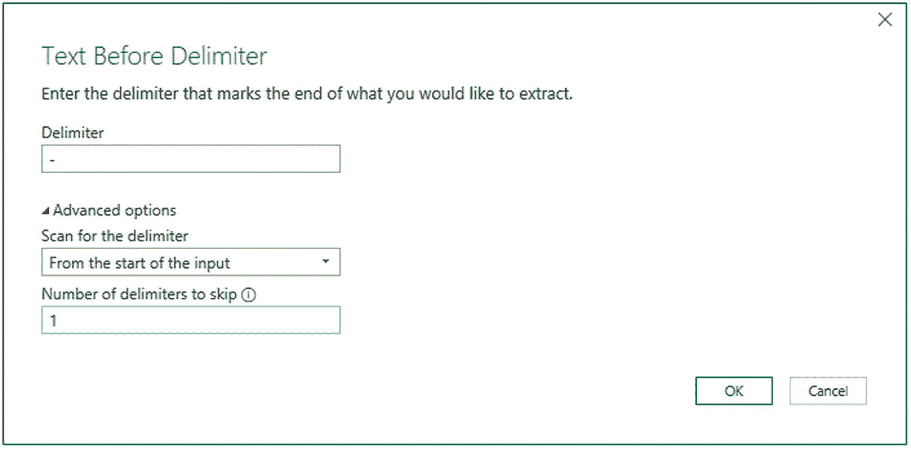

*图 7-16* — “分隔符之前和之后的文本”对话框的“高级选项”

你现在拥有的两个选项是：

- `扫描分隔符`：此选项允许你选择从列内容开头向前搜索，还是从列内容末尾向后搜索，以定位你要查找的分隔符。
- `要跳过的分隔符数`：在此处你可以指定你所关注的是第 *n* 个分隔符出现的位置。

#### 分隔符之间的文本

“分隔符之间的文本”对话框的“高级选项”基本上允许你应用之前看到的相同选项，只是要针对起始分隔符和结束分隔符。在图 7-17 中，你可以在“分隔符之间的文本”对话框中看到这一点。

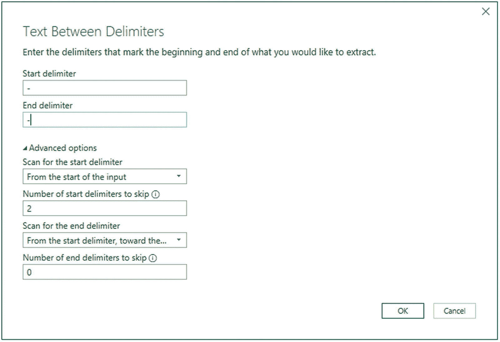

*图 7-17* — “分隔符之间的文本”对话框的“高级选项”

> **注意**：`Extract` 按钮可以在“转换”和“新列”功能区中找到。如果你从“转换”功能区执行此操作，则现有列的内容将被替换。如果你使用“添加列”功能区中的按钮，则将在任何现有列的右侧添加一个包含提取文本的新列。

### 复制列

有时，你只是需要简单复制一列，不添加任何内容，也不删除任何内容。这时，`复制列` 按钮就派上用场了。

1. 加载示例文件 `C:\DataMashupWithExcelSamples\Chapter07 Example1.xlsx`。
2. 切换到“数据”选项卡，点击 `查询和连接` 以显示 `查询和连接` 窗格（如果它尚未显示）。
3. 双击 `BaseData` 查询以切换到查询编辑器。
4. 点击你想要复制的列的内部（或标题）。在本示例中，我将使用 `Make` 列。
5. 在 `添加列` 选项卡中，点击 `复制列` 按钮。几秒钟后，该列的一个副本将在现有表格的右侧创建。`复制的列` 将出现在 `应用的步骤` 列表中。
6. 滚动到表格的右侧，重命名现有的列；当前其名称为 `Make-Copy`。

**注意**

复制的列被命名为 `原始列名-Copy`。我发现，在数据混合过程中，尽早重命名列的副本会有所帮助，而不是延迟操作。

### 拆分列

有时，源列包含的数据确实需要拆分成两个或多个更小的数据块。以下是此情况的典型案例：

- 一列包含一个由特定字符（称为*分隔符*）分隔的元素列表。
- 一列包含一个元素列表，但元素可以在列中的特定位置进行分割。
- 一列包含需要拆分成其组成元素的拼接文本（例如银行账号或社保号码）。

以下小节将解释如何处理这类情况。

### 按分隔符拆分列

这是你可能偶尔遇到的另一个需求。导入的数据中有一列需要进一步拆分成多列，并且你希望这个过程是自动完成的。想象一个文本文件，其中的列由分号分隔，而这些子列中的每个列又包含一个由逗号分隔的元素列表。一旦你导入了文件，就需要进一步分离这个使用了不同分隔符的列中的内容。

以下是你可以将一个列的数据拆分到多个列的操作方法：

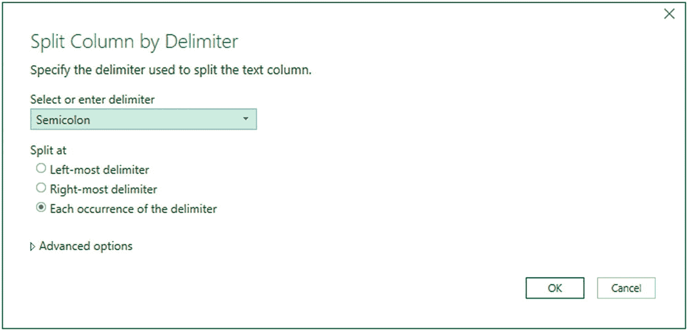

**图 7-18** 使用分隔符拆分列

1. 打开一个新的 Excel 文件。
2. 在 `数据` 选项卡中，点击 `获取数据` ➤ `来自文件` ➤ `来自工作簿`。
3. 在查询编辑器中，选择示例文件 `C:\DataMashupWithExcelSamples\DataToParse.xlsx`。
4. 点击 `ClientList` 工作簿。
5. 点击 `转换数据` 以打开查询编辑器。
6. 在 `转换` 选项卡中，点击 `将第一行用作标题`。
7. 点击 `ClientList` 列的内部。你可以看到该列包含多个数据元素，每个元素由分号分隔。
8. 在 `转换` 选项卡中，点击 `拆分列` ➤ `按分隔符`。将出现“按分隔符拆分列”对话框。
9. 在“选择或输入分隔符”弹出窗口中，从可用选项列表中选择 `分号`（尽管查询编辑器可能已经检测到了这一点）。
10. 点击“每个分隔符实例”作为拆分文本列的位置。对话框的外观应如图 7-18 所示。
11. 点击 `确定`。`按分隔符拆分列` 将出现在 `应用的步骤` 列表中。

初始列被替换，所有新列被命名为 `ClientList.1`、`ClientList.2` 等。创建的新列数量与分隔符数量一致；每个列被命名为 `(Column.n)`，并按顺序编号。此操作的结果如图 7-19 所示。

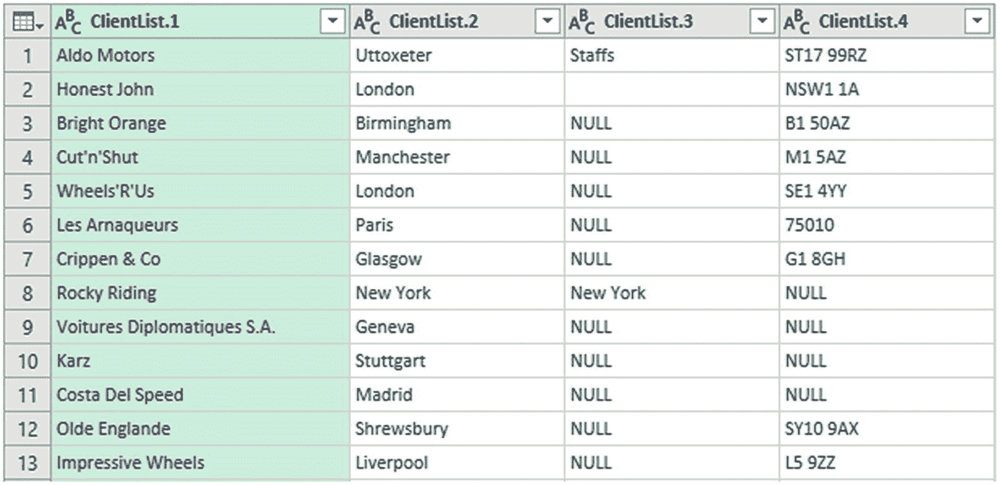

**图 7-19** 拆分列的结果

这个特定的过程有几个选项，就数据而言，它们的影响可能相当深远。表 7-11 包含了可用选项的描述。

**表 7-11** 分隔符拆分选项

| 选项 | 描述 |
| --- | --- |
| 冒号 | 使用冒号 (`:`) 作为分隔符 |
| 逗号 | 使用逗号 (`,`) 作为分隔符 |
| 等号 | 使用等号 (`=`) 作为分隔符 |
| 分号 | 使用分号 (`;`) 作为分隔符 |
| 空格 | 使用空格 (` `) 作为分隔符 |
| 制表符 | 使用制表符作为分隔符 |
| 自定义 | 允许您输入自定义分隔符 |
| 在最左侧分隔符处 | 仅在第一次出现分隔符时拆分一次列 |
| 在最右侧分隔符处 | 仅在最后一次出现分隔符时拆分一次列 |
| 在每个分隔符实例处 | 将列拆分为与分隔符数量相同的列数 |
| 拆分为列 | 保持数据集中的行数不变，并为拆分操作产生的每个新元素创建新列 |
| 拆分为行 | 为拆分操作产生的每个新元素创建一个新行，并复制现有记录，复制次数与拆分元素的数量相同 |

### 分隔符拆分的高级选项

按分隔符拆分文本时，有少数几个高级选项可用。当您在“按分隔符拆分列”对话框中点击 `高级选项` 元素时，会显示这些选项，并在表 7-12 中进行了解释。

**表 7-12** 分隔符拆分的高级选项

| 高级选项 ➤ 拆分的列数 | 允许您设置将数据拆分为给定字符数块的最大列数。任何多余的列都将放置在最后一列中 |
| --- | --- |
| 高级选项 ➤ 引号字符 | 不将双引号内的文本中的分隔符用于拆分文本为列。将此选项设置为“无”将拆分引号内的元素 |
| 使用特殊字符拆分 | 启用 `插入特殊字符` 按钮。然后您可以点击此按钮并选择要用于拆分数据的特殊字符。可选选项包括制表符、回车符、换行符、回车符和换行符以及不间断空格 |

### 按字符数拆分列

此主题的另一种变体是，当每列中的文本具有固定的字符数，并且需要在特定间隔处将其分解为组成部分时。例如，假设某个字段中每组（特定数量）的字符具有特定含义，而你想将其拆分为多列。或者，假设你想提取最左侧或最右侧的 *n* 个字符并保留其余部分。银行账号或社会保险号就是这样的例子。此时，按字符数拆分列就能派上用场。由于其原理与我们刚刚看到的流程非常相似，此处不再赘述。你只需在上一个练习的步骤 8 中选择“按字符数”菜单选项即可。下表 7-13 列出了此类型操作的选项。

**表 7-13** 按字符数拆分列时的选项

| 选项 | 说明 |
| --- | --- |
| 字符数 | 允许你定义拆分列之前数据的字符数 |
| 一次，尽可能向左 | 仅在从左侧起指定字符数处拆分列一次（如果行中数据的长度允许） |
| 一次，尽可能向右 | 仅在从右侧起指定字符数处拆分列一次（如果行中数据的长度允许） |
| 重复 | 根据需要多次拆分列，以按定义的字符数将其分割成若干段 |
| 高级选项 ➤ 拆分成列数 | 允许你设置一个最大列数，用于将数据按给定字符数分块拆分。任何多余的列都将放置在最右侧的列中 |
| 拆分到列 | 保持数据集中的行数不变，并为拆分操作产生的每个新元素创建新列 |
| 拆分到行 | 为拆分操作产生的每个新元素创建新行，并重复现有记录，重复次数与拆分元素的数量相同 |

拆分列时需要注意以下几点：

- 当按分隔符拆分时，Power Query 会尽力猜测源列必须拆分到的最大列数。如果猜测错误（你可以展开 `高级选项` 框查看它的估算值），你可以在此处覆盖该数字。

# 合并与创建列

如果选择 `自定义分隔符`，Power Query 会在对话框中显示一个新框，你可以在其中输入特定的分隔符。

并非每条记录都必须具有相同数量的分隔符。如果某行的拆分元素较少，Power Query 只需将最右侧的列留空即可。

> **注意：** 只有当列是文本数据时才能拆分。如果你尝试拆分日期或数字列，`拆分列` 按钮将保持灰色不可用。但是，你可以在拆分列之前将数据类型从日期、日期时间或数字数据类型转换为文本数据类型。

## 合并列

读到本节标题时，你可能会感到一种似曾相识的错觉。毕竟，我们在前一章中已经看到了如何合并列（即将多列中的数据合并到一个更宽的单一列中），不是吗？

是的，确实如此。然而，这并不是本章中你唯一会看到之前尝试过的内容。这是因为 Power Query 在 `添加列` 功能区中重复了 `转换` 功能区中的几个选项。虽然这些功能的工作原理大致相同，但有一个关键区别。如果你从 `转换` 功能区选择一个选项，那么你选择的列会被修改。如果你从 `添加列` 功能区选择类似的选项，则原始列不会被更改，而是会添加一个新列，其中包含数据转换的结果。

合并列就是一个典型的例子。由于我在前一章中已详细介绍了如何执行此类数据转换，因此这里不再重复描述。简而言之，如果你按住 `Ctrl` 键单击两个或多个列的标题，然后在 `添加列` 功能区中单击 `合并列`，你仍然会看到所选列的数据被连接成一个单独的列。但是，这次原始列仍然保留在数据集中。新列被命名为 `Merged`，这与使用 `转换` 功能区合并列时选择的第一个列的情况完全相同。

以下是可以覆盖现有列中的数据**或**将结果显示为新列的其他功能：

- **格式**：修剪文本或更改文本的大小写
- **提取**：取列的一部分并据此创建另一列
- **解析**：添加一个包含源列数据（作为 JSON 或 XML 字符串）的列
- **统计**：创建一个新的聚合数值列
- **标准**：创建一个新的计算数值列
- **科学**：通过对列中的值应用某些数学运算来创建一个新列
- **三角**：通过对列中的值应用某些三角运算来创建一个新列
- **舍入**：通过对列中的值进行舍入来创建一个新列
- **信息**：创建一个新列，指示列中值的算术信息
- **日期**：通过从日期列的值中提取日期元素来创建一个新列
- **时间**：通过从时间或日期/时间列的值中提取时间元素来创建一个新列
- **持续时间**：通过计算两个日期或日期/时间之间的持续时间来创建一个新列。

在转换数据时，技巧在于决定在应用这些功能之一之前你是否想或需要保留原始列。然而，如果后来发现做出了错误的决定，也并非至关重要，因为你随时可以回溯。或者，你也可以始终将插入新列作为一项原则，然后在数据转换过程的后期阶段删除任何你确实不需要的列。

## 从示例创建列

如果你之前没有太多使用 Excel 或 Power Pivot 公式的经验，自己创建列可能会有些棘手，因此 Power Query 开发团队试图通过添加另一种创建自定义列的方式，让你的工作更轻松。你可以利用行中的实际数据来构建新列，而无需通过列名（并处理方括号和其他特殊字符）来引用列。

以下步骤展示了如何操作：

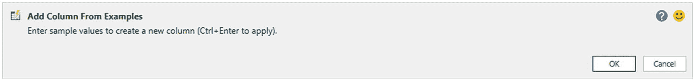

**图 7-20** – 从示例创建列

1. 加载 `C:\DataMashupWithExcelSamples\Chapter07Example1.xlsx` 示例文件。
2. 如有必要，通过单击 `数据` 功能区中的 `查询和连接` 来显示 `查询和连接` 窗格。
3. 双击 `BaseData` 查询以切换到 `查询编辑器`。
4. 在 `添加列` 功能区中，单击 `从示例创建列`。数据上方将出现一种新型公式栏。其外观将如图 7-20 所示。同时，在现有数据的右侧将创建一个新的空白列。

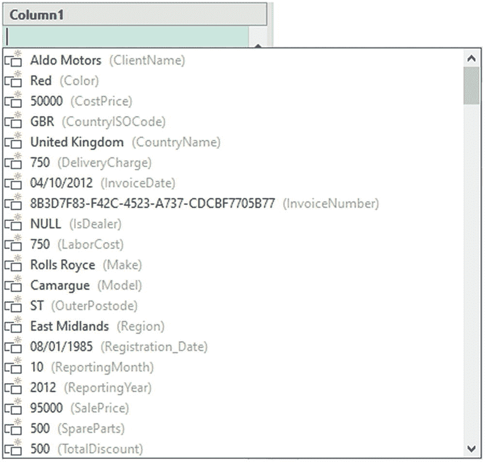

**图 7-21** – 从示例创建列时显示行数据

5. 双击右侧的新列。将显示每个字段中的数据列表，如图 7-21 所示。
6. 双击 `Red` 以选择 `Color` 列中的数据。
7. 输入一个空格、一个连字符和一个空格，然后输入 **Camargue**（这是此行模型名称）。
8. 单击顶部公式栏中的 `确定`。

`Power Query` 将添加一个新列，其中包含颜色、分隔符以及 `Model`。`已插入的合并列` 将被添加为 `应用的步骤` 列表中的一个新步骤。实际上，`Power Query` 所做的是使用列内容作为列名的代理。

> **注意：** 在 `从示例创建列` 按钮的弹出菜单中，你可以选择将所有现有列作为示例基础，或者仅选择你之前选定的任何列。

从这个简短的示例可以看出，通过示例创建列允许你使用列中的数据，而不是列名。它还省去了编写代码创建新列（如上一节所述）时需要使用双引号和 & 字符的麻烦。

> **提示：** 如果你选择 `从示例创建列` ➤ `从所选内容`，那么在双击新列以查看数据示例时（如本示例步骤 6 所示），你只会看到所选列中的数据。

## 添加条件列

并非所有额外的列都是简单提取或连接现有数据。有时，你需要应用一些简单的条件来定义新列的内容。这时，Power Query 的 `条件列` 功能就派上用场了。

`条件列` 可能通过一个实际示例来理解最佳。那么，假设你想添加一个列，其中包含对 Brilliant British Cars 产品购买者类型的评注。具体操作如下：

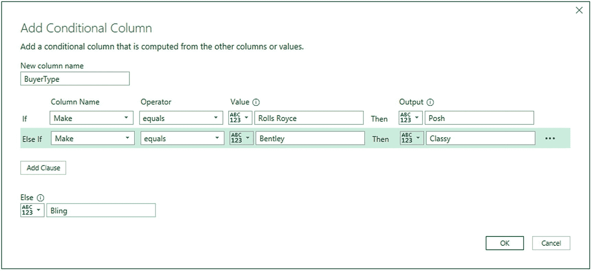

**图 7-22** – `添加条件列` 对话框

1. 加载 `C:\DataMashupWithExcelSamples\Chapter07Example1.xlsx` 示例文件。
2. （如有需要）通过单击 `数据` 功能区中的 `查询和连接` 来显示 `查询和连接` 窗格。
3. 双击 `BaseData` 查询以切换到 `查询编辑器`。
4. 在 `添加列` 功能区中，单击 `条件列`。将出现 `添加条件列` 对话框。
5. 在“新列名”字段中输入 **BuyerType**。
6. 选择 `Make` 作为列名。
7. 将运算符保留为 `等于`。
8. 输入 **Rolls Royce** 作为值。
9. 输入 **Posh** 作为输出。
10. 单击 `添加子句`。
11. 选择 `Make` 作为列名，将运算符保留为 `等于`，输入 **Bentley** 作为值，并添加 **Classy** 作为输出。
12. 在 `Else` 字段中输入 **Bling**。对话框将如图 7-22 所示。
13. 单击 `确定`。将添加新列，根据每条记录的品牌，其内容为 `Posh`、`Classy` 或 `Bling`。`已添加条件列` 将作为新步骤出现在 `应用的步骤` 列表中。

从 `添加条件列` 对话框可以看出，它提供了一系列选项，你可以在定义数据匹配逻辑时进行调整。这些选项在表 7-14 中进行了概述。

**表 7-14** – 自定义列运算符

| 运算符 | 描述 |
| --- | --- |
| `等于` | 设置必须与所选字段内容匹配的文本，以便应用输出 |
| `不等于` | 设置不得与所选字段内容匹配的文本，以便应用输出 |
| `开头为` | 设置必须位于所选字段左侧的文本，以便应用输出 |
| `非开头为` | 设置不得位于所选字段左侧的文本，以便应用输出 |
| `结尾为` | 设置必须位于所选字段右侧的文本，以便应用输出 |
| `非结尾为` | 设置不得位于所选字段右侧的文本，以便应用输出 |
| `包含` | 设置可以出现在所选字段任意位置的文本，以便应用输出 |
| `不包含` | 设置不能出现在所选字段任意位置的文本，以便应用输出 |

同样值得注意的是，比较值、输出和替代输出可以是值（如本例所示）、列或参数（你将在第 9 章中了解）。如果要删除一条规则，只需单击所需规则右侧的省略号，然后选择 `删除`。

> **提示：** 如果你想更改 `添加条件列` 对话框中规则的顺序，只需单击所选规则右侧的省略号，然后从弹出菜单中选择 `上移` 或 `下移`。

## 索引列

索引列是一个新列，用于按顺序对表中的每条记录进行编号。这种编号方案应用于当前已排序的表，并从零开始。在许多情况下，索引列都很有用。以下是一些示例：

- 重新应用之前的排序顺序。
- 为每条记录创建唯一引用。
- 准备一个记录集，以用作 Power Pivot 数据模型中的维度表。在这种情况下，索引列就成为了维度建模者所称的代理键。

此列表并非详尽无遗；在使用 Power Query 的过程中，您几乎肯定会发现其他用途。无论需求如何，以下是在 Power Query 中添加索引列的方法：

1.  在 `Add Column` 功能区中，点击 `Index Column`。新的顺序编号列会添加到表格右侧，同时 `Added Index` 会被添加到 `Applied Steps` 列表中。

2.  滚动到表格右侧并重命名索引列；它当前的名称为 `Index`。

在决定如何开始为索引列编号时，您有相当大的自由度。选项如下：

-   从 `0` 开始，每行递增 `1`。
-   从 `1` 开始，每行递增 `1`。
-   从任意数字开始，并以任意数字递增。

正如您在添加索引列时所看到的，默认情况下 Power Query 从 `0` 开始对行进行编号。但是，您可以通过单击 `Add Index Column` 按钮右侧的小三角形来选择其他选项。这会显示一个包含上述三个选项的菜单。

选择第三个选项 `Custom`，会显示如图 7-23 所示的对话框。

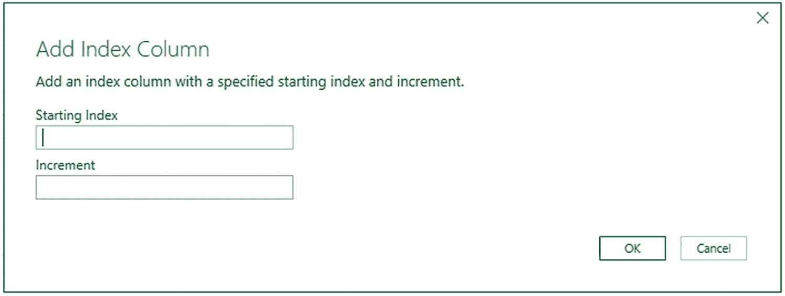

图 7-23 – `Add Index Column` 对话框

此对话框允许您指定数据集中第一行的起始编号，以及每条记录所增加的增量。

## 结论

在本章中，您学习了一些可用于清理和结构化数据集的基本技术。您了解了如何对数字进行向上和向下舍入、如何提供格式统一的文本呈现，以及如何从数据列中删除多余的空格和非打印字符。

您还了解了如何替换列内的值，以及对数字应用数学、统计和三角函数的方法。其他涉及的技术包括从日期/时间和持续时间列中提取日期、时间和持续时间元素。

最后，您学习了一系列基于现有列中的数据添加新列的技术。这些技术涵盖从简单的整列复制或列合并，到提取列数据的一部分，甚至使用简单逻辑推理出要添加到新列中的不同数据。

现在是时候了解如何将此前分离的数据集合并到单个查询中，并解析复杂数据类型以将其添加到数据集中了。您甚至将学习如何在单个查询中追加多个文件，以及如何对数据进行透视和逆透视。所有这些都将是下一章的主题。

