# 通用数据源

如果你仔细查看 `获取数据` 选项，会发现目前有 40 个数据源提供了 `Power Query` 连接器。然而，面对种类繁多的潜在源数据存储库，即使是这些连接器也显得微不足道。那么，当你面对一个不在当前可用列表中的外部数据源时，该怎么办？

一种解决方案是使用通用数据连接器来访问无法直接访问的数据存储。为了结束我们对一些可用源数据的快速浏览，本章将向你介绍：

- `ODBC` 数据

- `OLE DB` 数据

- `OData` 源

使用通用数据连接器的唯一难点在于，它们确实是通用的。这意味着它们采用了一种“最小公分母”的方法。这可能导致：

- 你依赖于外部第三方软件的提供者。

- 对于非技术用户来说，文档稀少或难以理解。

- 如果遇到任何技术挑战，你只能靠自己。

尽管存在这些注意事项，主要的通用连接器仍然打开了连接和摄取来自海量潜在外部数据源数据的大门。因此，我总是建议尽可能尝试让这些连接正常工作，因为其结果通常比尝试将源数据导出为文本文件或 `CSV` 文件后再加载要简单得多，效果也更好。

如果你想练习本章中描述的 `ODBC` 和 `OLE DB` 连接，你需要能够访问已启用这些连接类型的源数据。换句话说，你需要已经安装并运行了 `ODBC` 或 `OLE DB` 驱动程序。

## ODBC 数据源

至此，您已在本书中了解到，`Excel` 可以连接到多种数据源。然而，总会有些外部应用程序，`Excel` 并未为其内置特定的连接器。

这时，一种名为“开放式数据库连接”（`ODBC`）的通用解决方案便应运而生。`ODBC` 是一种连接数据源的标准方式，这些数据源大多为数据库或具有类似数据库的结构。简单来说，如果您要连接的应用程序存在相应的 `ODBC` 驱动程序，那么您就可以将数据从该程序加载到 `Excel` 中。

目前已有数百种 `ODBC` 驱动程序。有些是免费提供的，有些则需要您购买许可。它们覆盖了从大多数个人电脑上常见的应用到一些利基市场的产品，应用范围十分广泛。某些产品的 `ODBC` 驱动会随应用程序本身一同安装；另一些则需要您单独下载 `ODBC` 驱动。有些 `ODBC` 驱动是免费分发的，而其他的则需要您购买许可证。

尽管 `ODBC` 旨在提供一种访问应用程序数据的标准方式，但每个 `ODBC` 驱动程序之间都略有不同。因此，您可能需要花点时间熟悉您想要连接的那个应用程序所对应的驱动程序的界面特性。

在本节中，我们将使用 `FileMaker Pro` 作为数据源。这款产品是一个桌面及服务器数据库系统，已经存在相当长的时间。然而，目前还没有特定的 `Power Query` 连接器适用于它。好消息是，`FileMaker Pro` `确实` 拥有 `ODBC` 驱动程序。因此，我们将以 `FileMaker Pro` 为例，说明如何使用 `ODBC` 通过 `Power Query` 连接到 `Excel`。

我必须补充说明，我并非期望您为了完成这个练习而去安装一个 `FileMaker Pro`（即使是试用版）及其配套的 `ODBC` 驱动程序。我所要解释的是，当存在可用的 `ODBC` 驱动程序时，您如何使用 `ODBC` 连接到数据源。所以，如果您愿意，可以自行下载并安装 `FileMaker Pro` 及其 `ODBC` 驱动，但具体操作方法请参考 `FileMaker Pro` 的文档。

假设您有一个符合 `ODBC` 标准的数据源，并且该数据源有可正常工作的 `ODBC` 驱动程序，以下是一个使用 `ODBC` 和 `Power Query` 将数据加载到 `Excel` 的示例：

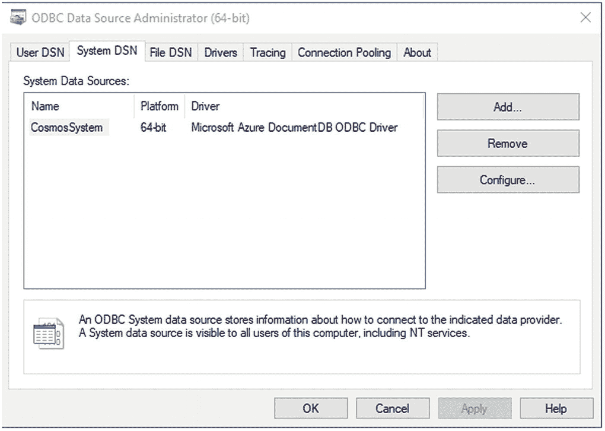

图 5-1 `ODBC` 数据源管理器

1. 运行“`ODBC` 数据源管理器”应用程序。该程序通常位于文件夹 `C:\ProgramData\Microsoft\Windows\Start Menu\Programs\Administrative Tools` 中。如果使用 64 位 `Excel`，请务必使用 64 位版本；如果使用 32 位 `Excel`，则使用 32 位版本。

2. 单击 `系统 DSN` 选项卡。您将看到如图 5-1 所示的对话框。

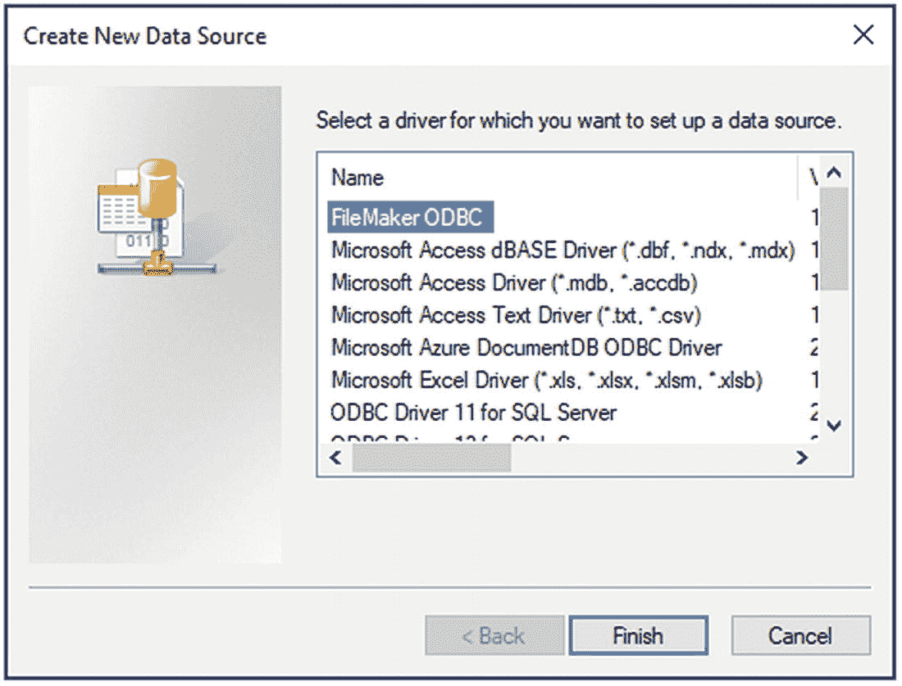

图 5-2 已安装的 `ODBC` 驱动程序列表

1. 单击 `添加`。您将看到计算机上当前所有已安装的 `ODBC` 驱动程序列表。这看起来应该类似于图 5-2 中所示的对话框。

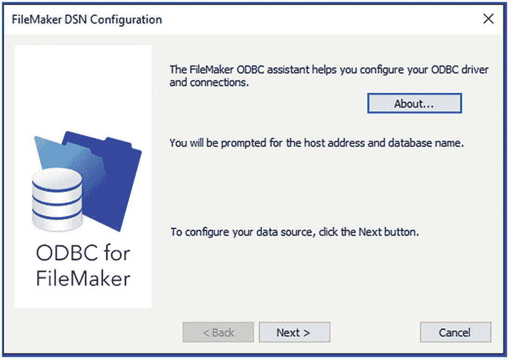

图 5-3 `FileMaker Pro` `ODBC` 配置助手

1. 选择与您要连接的数据源相对应的 `ODBC` 驱动程序（本例中为 `FileMaker ODBC`）。如果您看不到该 `ODBC` 驱动程序，则需要安装或重新安装该驱动程序。请查阅您所使用的 `ODBC` 驱动程序的文档以获取详细信息。

2. 单击 `完成`。您所选的特定 `ODBC` 驱动程序的配置对话框将出现。如果您使用 `FileMaker Pro`，该对话框将如图 5-3 所示。

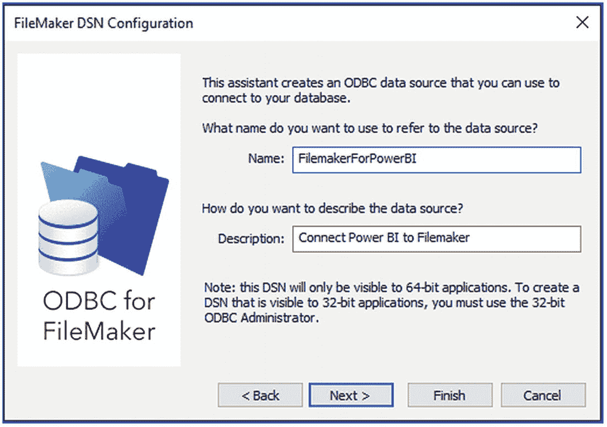

图 5-4 为 `FileMaker Pro` 命名 `ODBC` 连接

1. 单击 `下一步`，并为该 `ODBC` 连接输入名称和描述。这看起来可能类似于图 5-4 中所示的对话框。

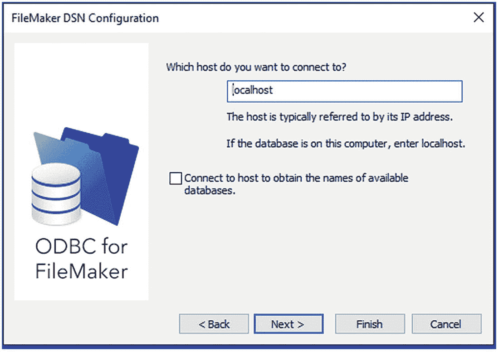

图 5-5 指定 `ODBC` 数据的主机

1. 单击 `下一步`，如果您在本地计算机上使用 `FileMaker` 试用版，请输入 `localhost` 作为主机名。否则，请输入 `FileMaker` 服务器的 `IP` 地址。您应该会看到如图 5-5 所示的对话框。当然，这特定于某一个 `ODBC` 驱动程序。使用其他驱动程序时，对话框会有所不同。

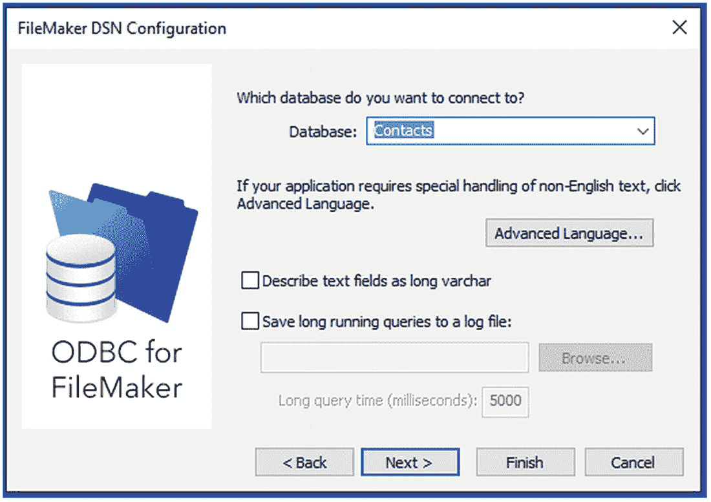

图 5-6 指定 `ODBC` 数据的数据库

1. 单击 `下一步`，然后在 `FileMaker Pro` 中选择您要连接的数据库。您将看到如图 5-6 所示的对话框（如果您*不是*使用 `FileMaker Pro` – 请记住，这些对话框可能会因具体的 `ODBC` 驱动程序而异）。

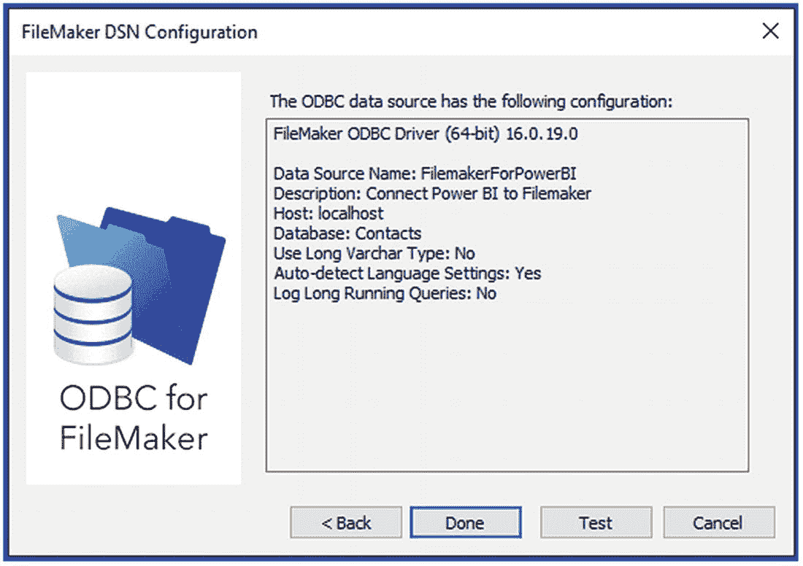

图 5-7 `ODBC` 连接确认对话框

1. 单击 `下一步`。`ODBC` 配置对话框将显示连接的摘要信息。这可能类似于图 5-7 中所示。

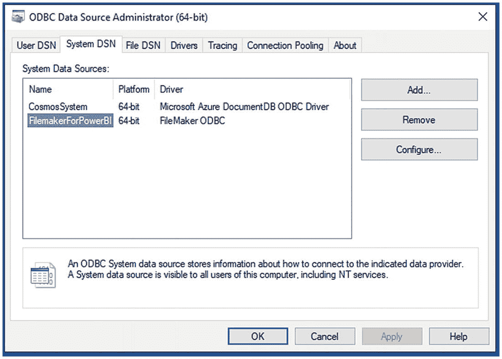

图 5-8 已配置 `ODBC` 驱动程序的“`ODBC` 数据源管理器”对话框

1. 单击 `完成`。您将返回到“`ODBC` 数据源管理器”，并且会看到刚刚创建的“`系统 DSN`”。“`ODBC` 数据源管理器”对话框应类似于图 5-8 所示。

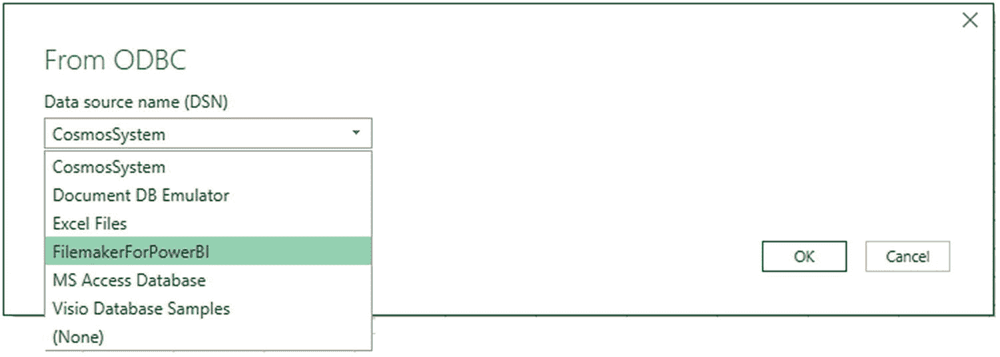

图 5-9 用于选择 `ODBC` 数据源的 `Excel`“从 `ODBC`”对话框

1. 单击 `确定`。这将关闭“`ODBC` 数据源管理器”对话框。

2. 启动 `Excel`。

3. 单击 `获取数据` ➤ `来自其他源` ➤ `来自 ODBC`。将出现“来自 `ODBC`”对话框。

4. 展开可用的 `DSN` 列表。“来自 `ODBC`”对话框将类似于图 5-9 所示。

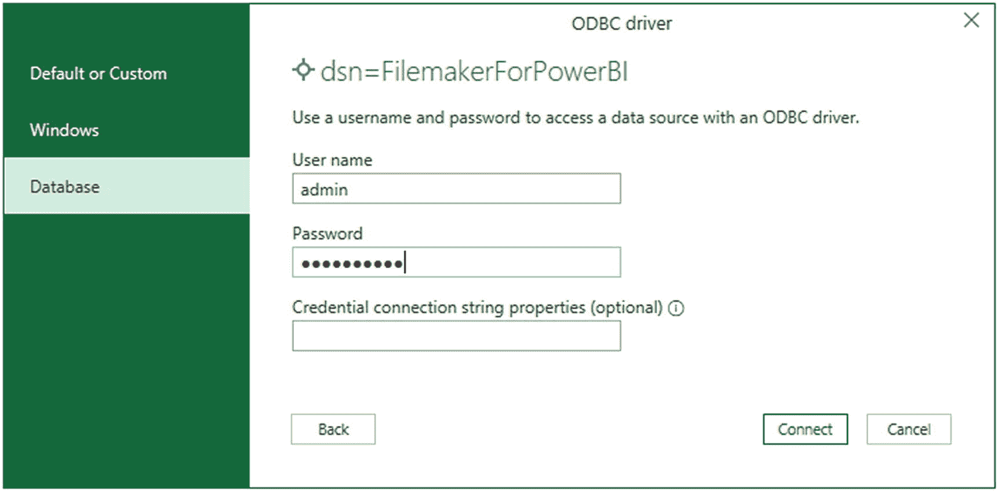

图 5-10 `ODBC` 驱动程序安全对话框

1. 选择您之前创建的 `DSN`（本例中为 `FilemakerForPowerBI`）。

2. 单击 `确定`。将出现凭据对话框。

3. 选择 `Windows 集成安全性`，或单击左侧的 `数据库` 并输入具有使用 `ODBC` 驱动程序连接权限的用户名。凭据对话框将类似于图 5-10 所示。

## ODBC 数据源

1. 单击 `连接`。您将在导航器窗口中看到 ODBC 数据源中可用的数据。

2. 选择要加载到 Excel 中的表。如果要同时加载多个表，请务必勾选 `选择多项` 复选框。

3. 单击 `加载` 以将数据从 ODBC 数据源加载到 Excel 中。

我意识到这个过程起初可能显得有些繁琐。但请记住，您很可能只需要设置一次 ODBC 连接。之后，您就可以随心所欲地使用它来连接源数据了。

创建好 ODBC DSN 后，你可以在多种场景以及众多不同产品中使用它——这些产品都需要获取你通过 ODBC 连接的数据源信息。这意味着我在此处创建的 ODBC 数据源可以用于 Excel 中的 Power Query、Power BI，以及其他许多需要访问 FileMaker Pro 数据的应用程序中。

需要注意的是，每个 ODBC 驱动程序都不尽相同。因此，在第 5 步到第 10 步中，对话框的外观会因你配置的 ODBC 驱动程序不同而略有差异。尽管如此，其中的关键元素始终是相同的，包括：

*   为 DSN 命名
*   指定数据所在的主机
*   定义数据存储库（或数据库）
*   指定访问数据源所需的任何凭据

关于如何创建和使用 ODBC 连接将数据加载到 Excel（或任何其他目标应用程序）中，还有很多内容可以探讨。然而，如果你需要深入了解这项特定技术，我不得不请你参考丰富的现有资源，无论是印刷版还是在线资源。一个很好的起点是 **Microsoft 文档**，其中解释了系统 DSN、用户 DSN 和文件 DSN 之间的区别，并描述了你可能需要了解的关键要素。

> **注意**
>
> 要使 ODBC 连接正常工作，数据源应用程序（本例中为 FileMaker Pro）必须已打开并正在运行。其他 ODBC 数据源可能有其自身的特定问题。

最后，我只能强烈建议你为打算与 Excel 中的 Power Query 配合使用的 ODBC 驱动程序，收集所有相关的文档。实际上，如果你使用的是采用 ODBC 驱动程序的企业级数据源，也许有企业内部的资源可以为你提供帮助，甚至帮你直接配置好 ODBC。

## OLE DB 数据源

OLE DB（对象链接与嵌入，数据库的缩写）在技术层面是一种被称为应用程序编程接口（API）的东西。从更通俗的层面讲，它是一种用于以通用方式连接数据库源的技术。

因此，与 ODBC 的方式有些类似，你可以使用 OLE DB 连接到各种数据源（通常是数据库，但也可以是其他数据源）。事实上，即使存在其他连接方法，你可能会发现 OLE DB 是一种连接到数据库的有效方式。

所以，无论你发现 OLE DB 有何用途，都值得去了解它是如何工作的。在本例中，我将使用 OLE DB 连接到 SQL Server 和一个示例数据库。

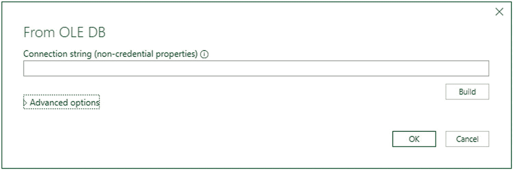

**图 5-11** `来自 OLE DB` 对话框

1.  打开一个新的 Excel 应用程序。

2.  在“数据”选项卡中，依次单击 `获取数据` ➤ `来自其他源` ➤ `来自 OLE DB`。此时将显示“来自 OLE DB”对话框。

3.  单击 `连接`。“来自 OLE DB”对话框将出现，外观应如图 5-11 所示。

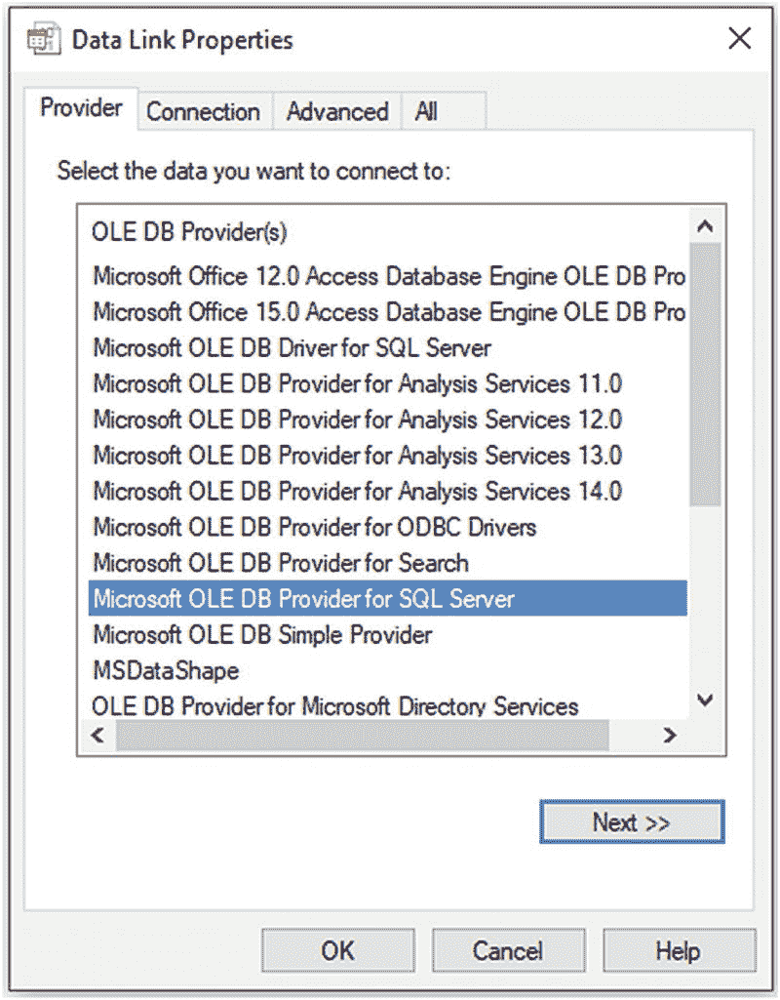

**图 5-12** `OLE DB 数据链接属性` 对话框

1.  如果你有功能完整的连接字符串，请在 `连接字符串` 文本框中输入。

2.  如果你没有连接字符串，请单击 `生成` 按钮。将显示“OLE DB 数据链接属性”对话框，如图 5-12 所示。

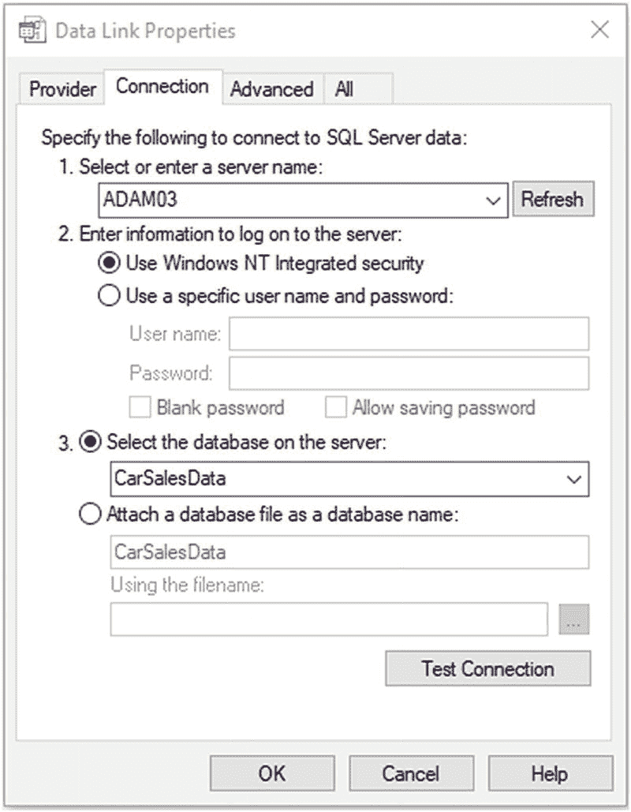

**图 5-13** `OLE DB 数据链接属性` 对话框的“连接”属性

1.  选择你想要使用的 OLE DB 数据提供程序。在本示例中，将选择 `Microsoft OLE DB Provider for SQL Server`。当然，你必须为你想要访问的数据源选择已安装的 OLE DB 提供程序。

2.  单击 `下一步`。将显示“OLE DB 数据链接属性”对话框的“连接”属性窗格。

3.  从“选择或输入服务器名称”弹出菜单中选择一个可用的 SQL Server（或输入其名称）。

4.  选择安全类型，如果你选择使用特定用户名而不是 Windows NT 集成安全性，则需要输入用户名和密码。

5.  从“选择服务器上的数据库”弹出菜单中选择源数据库。此时对话框应类似于图 5-13 所示。

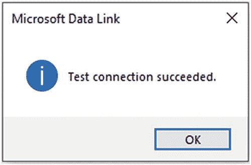

**图 5-14** 测试连接警报

1.  单击 `测试连接` 按钮以确保连接有效。你应该会看到图 5-14 所示的消息。

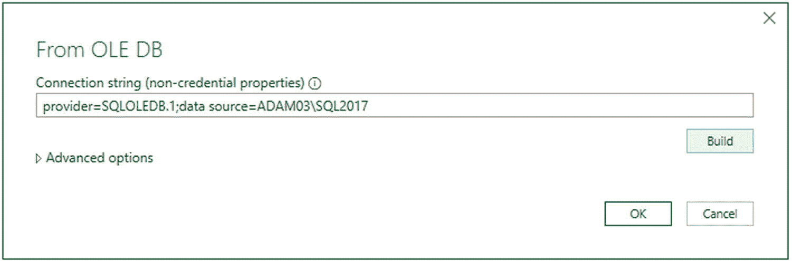

**图 5-15** 包含有效连接字符串的`来自 OLE DB` 对话框

1.  单击 `确定`。Excel 将生成连接字符串并将其插入到“来自 OLE DB”对话框中，如图 5-15 所示。

2.  单击 `确定`。将出现导航器窗口并显示相应的数据。

3.  选择你想要加载的表。

4.  单击 `加载` 将数据加载到 Excel 中。

> **注意**
>
> 如果是首次连接 OLE DB 数据源，系统可能会要求你输入用户名和密码，这与本章前面的示例情况类似。

步骤 8 到 10 是 SQL Server OLE DB 驱动程序特有的。对于其他驱动程序，这些步骤可能会有所不同。

你需要了解的是，OLE DB 连接要求运行 Excel 的计算机上安装了 OLE DB 驱动程序（或称“提供程序”）。然而，真正有趣的是，OLE DB 连接可以简化为一个简单的连接字符串。因此，如果你需要与其他用户共享此连接，很多情况下你只需将连接字符串通过电子邮件发送给他们即可。然后你的同事就可以简单地将该连接字符串粘贴到 Excel 的“来自 OLE DB”对话框中。换句话说（以本示例为模板），你只需向同事发送以下文本：

```
provider=SQLOLEDB.1;initial catalog=CarSalesData;data source=ADAM03\SQLSERVER2016
```

他们可以通过将此字符串粘贴到“来自 OLE DB”对话框中来连接到指定的数据库。同样，你的 IT 部门或许也能为你提供可以直接使用的合适连接字符串。

使用 OLE DB 连接还有其他优势。具体来说，你（或你的 IT 部门）可以在连接字符串中提供高级配置，以加快或改善对数据的访问。例如，这可以通过指定一个用于报表的镜像服务器来减轻主服务器的压力。在如此层面，技术细节将取决于 OLE DB 数据源以及所使用的驱动程序，并且其范围非常广泛，超出了本书的讨论范围。

## OData 源

OData 是开放数据协议（Open Data Protocol）的简称。该协议允许 Web 客户端发布和编辑由 URL 标识的资源。通过 OData 连接的数据可以是表格格式，也可以是其他不同的结构。

OData 是一种连接基于 Web 的数据的通用方法。因此，每个 OData 源可能与你之前使用过的其他源有所不同。

有大量的 OData 源可供使用。有些是公共的，有些则只有在你拥有相应权限时才能访问。然而，访问方法通常是大致相同的。下面是一个示例，展示如何连接到 Odata.org 免费提供的 OData 示例源（至少在本书付印时如此）：

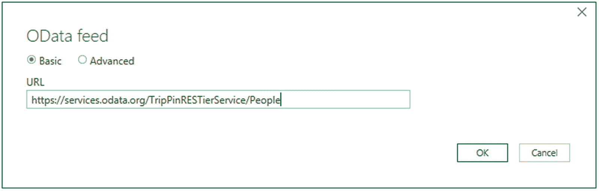

**图 5-16** OData 源对话框

1. 在 Excel 的“数据”选项卡中，依次单击 `获取数据` ➤ `来自其他源` ➤ `来自 OData 源`。此时会出现 OData 源对话框。

2. 输入你用于连接 OData 源的 URL。在此示例中，我将使用一个公共的 OData 源，你可以在 `https://services.odata.org/TripPinRESTierService/People` 找到它。对话框应如图 5-16 所示。

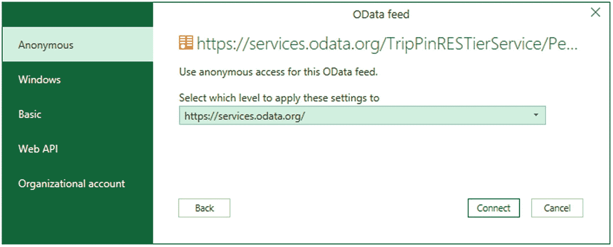

**图 5-17** OData 源凭据对话框

3.  单击 **确定**。此时会出现 OData 源凭据对话框。你可以在图 5-17 中看到它。

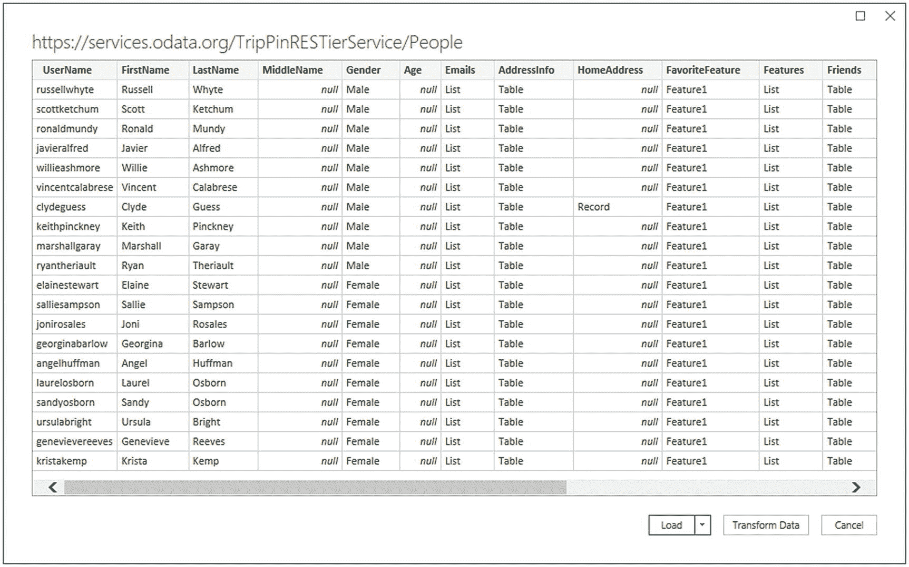

**图 5-18** 从 Power Query 导航器中的 OData 源返回的数据

4.  从对话框左侧的可用列表中选择凭据类型。在此示例中，接受匿名凭据，因此你无需输入用户名或密码。对于其他服务，你可能需要在左侧选择适当的安全方法，然后输入所需的凭据。

5.  单击 **连接**。此时会显示导航器对话框，并显示使用指定 URL 可用的数据。你可以在图 5-18 中看到从此示例 URL 返回的数据。

6.  单击 **加载**。数据将加载到新的 Excel 工作表和/或数据模型中，具体取决于你选择的加载配置选项。

> **注意** 有趣的是，Dynamics 365 Online 使用 OData 作为连接方法。

### OData 选项

OData 源对话框（与你在本章前面看到的 **从 Web** 对话框颇为相似）也包含一个 **高级** 按钮。选择此按钮将展开对话框，允许你向 URL 添加一个或多个 URL 部分。你可以在图 5-19 中看到这一点。

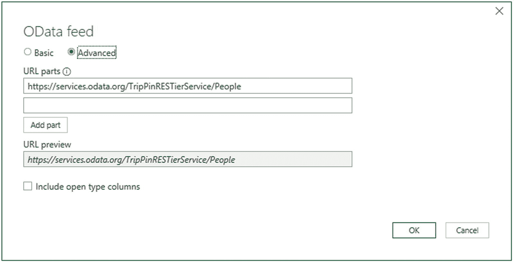

**图 5-19** OData 源对话框的高级选项

> **注意** URL 部分可以在 Power Query 编辑器中参数化。我将在第 11 章中解释参数化。

## 刷新数据

从数据库和数据仓库加载数据仅意味着将源数据的快照复制到 Excel 中。如果源数据被更新、扩展或删除，那么如果你希望分析反映数据的当前状态，你将需要获取最新版本的数据。

基本上，你有两个选项可以做到这一点：

- 刷新你定义的所有数据源中的所有源数据。
- 单独刷新一个或多个表。

### 刷新 Excel 内存模型中的整个数据

确保所有数据都是最新的只有一种方法。刷新整个数据可能需要更长的时间，但你会确信你的 Excel 文件包含来自你所连接的所有源的最新可用数据。

要执行完全刷新：


**图 5-20** 刷新对话框

1.  在“开始”选项卡中，单击 **刷新** 按钮。**查询和连接** 窗格将显示所有当前正在刷新的数据源。**查询和连接** 窗格将类似于图 5-20 中所示。

任何工作表或 Power Pivot 数据模型中的当前数据都将被更新，以显示源中可用的最新数据。

> **注意** 如果源数据量很大或网络连接速度较慢，完全数据刷新可能需要相当长的时间。

### 刷新单个查询

如果你确定只需要刷新 Excel 数据模型中的一个或多个表，那么你可以选择单独刷新这些表。操作步骤如下：

1.  在 **查询和连接** 窗格中，单击要刷新的表的刷新图标。如图 5-20 所示。

该表的现有数据将被最新数据替换。

## 结论

在本章中，你学习了可以使用通用数据访问连接器（ODBC、OLE DB 和 OData）来连接那些（尚）没有内置 Power Query 连接器的数据源。你还了解了如何在 Excel 中刷新数据。

本章结束了由五个章节组成的系列，该系列向你介绍了可以与 Excel 中的 Power Query 一起使用的众多不同数据源中的一部分。在这些篇幅中，你已经了解了如何从一系列可用源中加载数据。好消息是，Excel 能够从比我们在这里介绍的更多的源中读取数据。更好的消息是，你可以利用已获得的知识，使用标准化的 Power Query 界面连接到任何其他可用的数据源。

因此，我不会在本书中进一步描述其他数据源了。这是因为，既然你已经了解了构成 Power Query 将数据加载到 Excel 这一极其便捷方法的核心技术，那么你很可能不需要我提供更多信息就能够加载任何可用的连接类型。

既然你现在能够查找、访问和加载所需数据到 Excel 中，是时候进入下一步了。这意味着要清理和重构数据集，使其符合你的分析需求。应对这些挑战将是接下来七章的主题。