# 9. 复杂数据加载

并非所有的数据加载都只是简单地建立连接并对源数据应用转换（幸运的是，这些数据已经以结构清晰的表格形式呈现）。有时，你可能希望在加载数据时“挑战极限”，并准备更复杂的源数据结构，以便在你的 Excel 分析中使用。我的意思是，源数据最初并非立即可用的表格格式，需要对数据进行一些重组以准备一个干净的数据表以供使用。

为了解决这类挑战，本章将向你解释如何：

-   从源文件夹添加多个相同的文件
-   从源文件夹中选择要加载的相同源文件
-   从包含 JSON 数据的源文件加载简单的 JSON 结构
-   解析源文件中包含 JSON 数据的列
-   解析源文件中包含 XML 数据的列
-   加载复杂的 JSON 文件——并选择要使用的元素
-   加载复杂的 XML 文件——并选择要使用的元素
-   将列转换为列表，以便用于复杂的加载例程

最后——纯粹是为了完善 `Power Query` 编辑器及其功能的整体概述——我将提及如何：

-   重用最近使用的查询
-   修改最近使用的查询列表
-   从 `Power Query` 编辑器导出数据

本章中使用的任何示例文件均可按照附录 A 中的说明从 Apress 网站下载。

## 从源文件夹添加多个文件

现在我们来考虑一个有趣的数据导入挑战。你收到了一批文本文件，可能是从 FTP 站点下载或通过电子邮件接收的，并且将它们全部放入了特定目录。然而，如果有几百个文件，你不想像第 2 章那样逐个加载，然后再将每个文件单独追加到一起，创建最终的复合数据表（就像你在第 8 章中看到的那样）。

以下是一种实现此目标的更高效方法。

> **注意**  
> 只有所有文件**严格相同**时，`Query Editor` 才能加载多个文件。这意味着必须确保每个文件中的所有列顺序一致且名称相同。

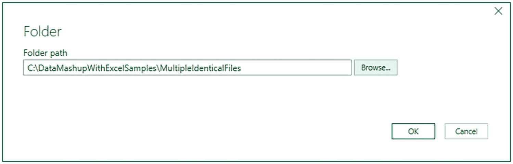

1.  新建一个 Excel 文件。

2.  在“数据”功能区中，依次点击 `获取数据` > `来自文件` > `来自文件夹`。此时将显示“文件夹”对话框。

3.  单击“浏览”按钮，导航至包含待加载文件的文件夹。在此示例中，文件夹路径为 `C:\DataMashupWithExcelSamples\MultipleIdenticalFiles`。如果你愿意，也可以直接粘贴或输入文件夹路径。“文件夹”对话框将如图 9-1 所示。

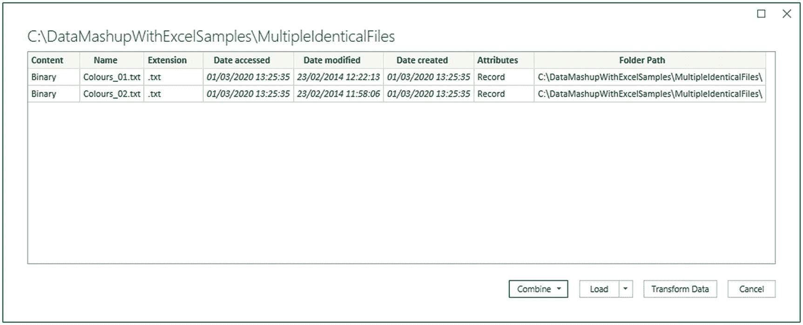

4.  点击 `确定`。文件列表窗口随即打开。该文件夹及其所有子文件夹的内容将以表格形式列出，如图 9-2 所示。

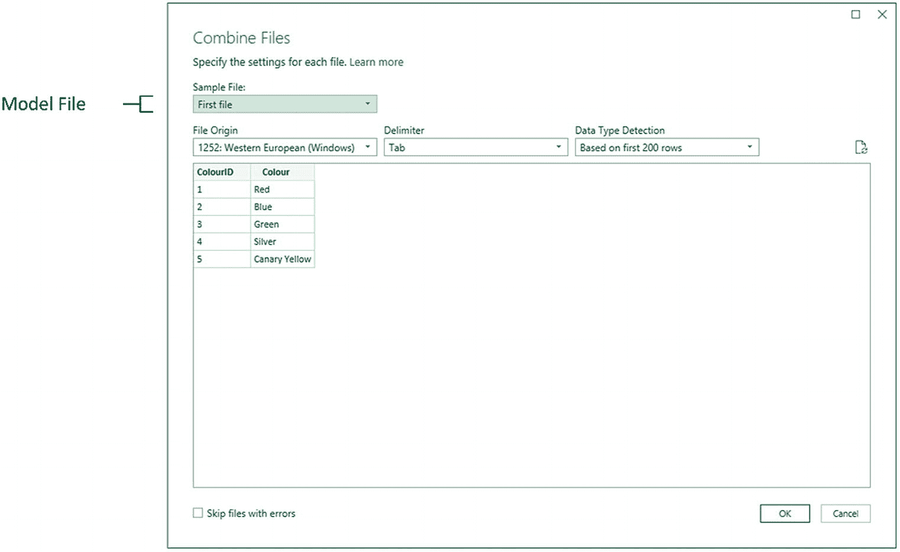

5.  点击 `合并` 按钮右侧的弹出箭头，然后选择 `合并并转换数据`。将出现“合并文件”对话框，如图 9-3 所示。在此处，你可以选择文件夹中的哪个文件作为待导入文件的模板。

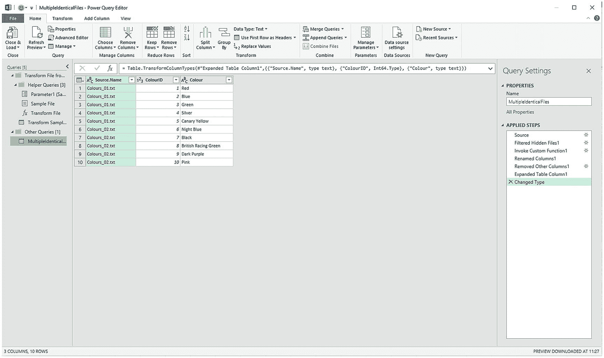

6.  点击 `确定`。`Power Query Editor` 将显示导入的数据，如图 9-4 所示。

7.  点击 `关闭并加载`。所有源文件中的数据都将加载到 Excel 数据模型中。

如你所见，`Power Query` 在输出中添加了一个额外列，其中包含每条源记录所在文件的名称。如果你愿意，可以删除此列。

> **注意**  
> “合并文件”对话框中的其他选项在第 2 章中有详细说明。

### 筛选文件夹中的源文件

有时你可能只想从文件夹中导入文件的*子集*。或许是因为文件不完全相同，或者你根本不需要源目录中的某些可用文件。无论出于何种原因，这里有一种方法可以让 `Power Query` 完成筛选目录的工作，并且*只*加载符合你指定的文件名或扩展名规范的文件。换句话说，`Query Editor` 允许你在加载实际数据之前筛选源文件集。在此示例中，我将演示如何从同时包含 Excel 文件和文本文件的目录中加载多个 Excel 文件。

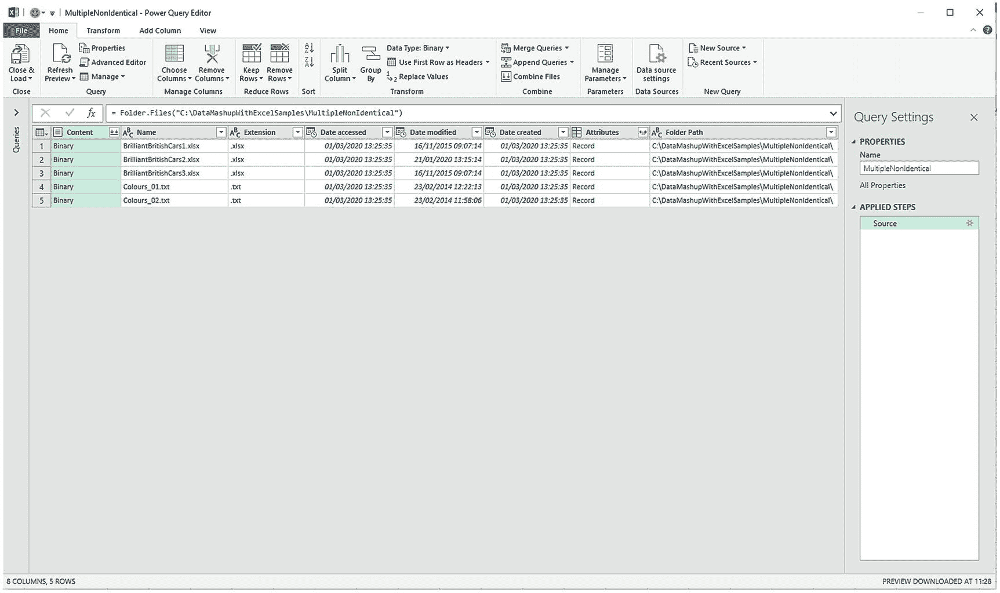

1.  执行本章前面“从源文件夹添加多个文件”部分的步骤 1 到步骤 5，以显示包含要加载文件的文件夹内容。在此场景中，文件夹路径为 `C:\DataMashupWithExcelSamples\MultipleNonIdentical`。

2.  点击 `转换数据`。`Query Editor` 窗口将打开并显示目录中的文件列表及其许多属性。你可以在图 9-5 中看到此示例。

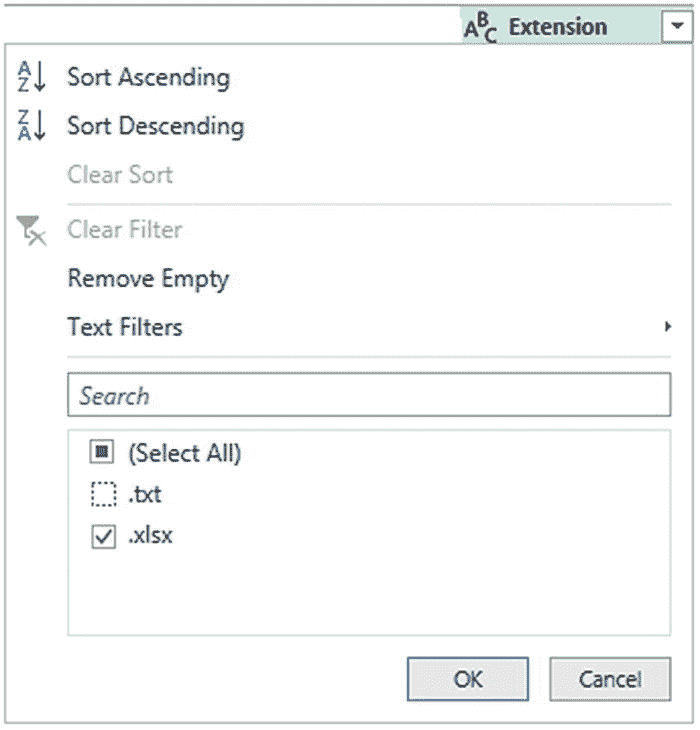

3.  由于你只想加载 Excel 文件并避免其他类型的文件，请点击 `Extension` 列标题的筛选弹出菜单，并取消选中除 `.xlsx` 之外的所有元素。此操作如图 9-6 所示。

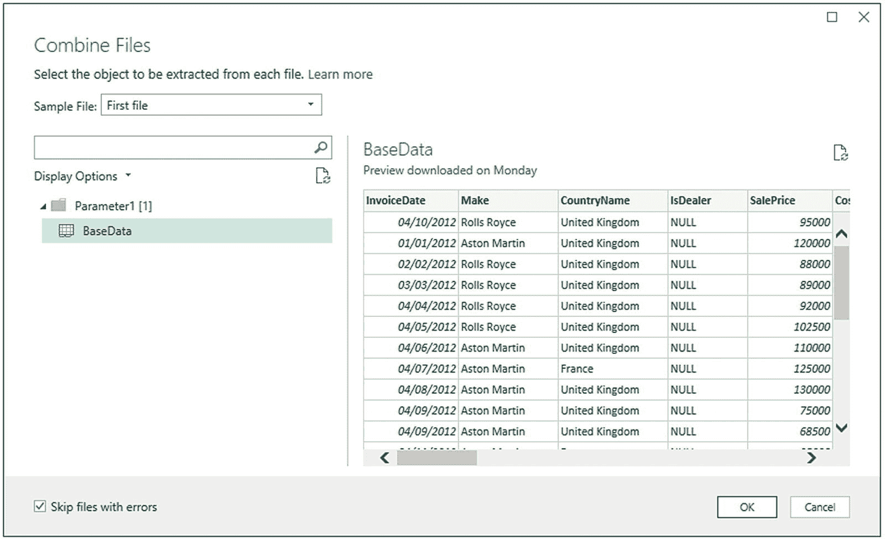

4.  点击 `确定`。现在，你将在 `Query Editor` 中仅看到 Excel 文件。

5.  单击第一列标题右侧的展开图标（两个向下箭头）；此列名为 `Content`，该列中的每一行都包含单词 *Binary*。`Power Query` 将显示你之前在图 9-3 中看到的 `合并文件` 对话框。

6.  从可用文件中选择要用作数据加载示例文件的那个文件。

7.  选择 `BaseData` 工作表作为加载所用结构。

8.  勾选 `跳过包含错误的文件`。此时，对话框将如图 9-7 所示。

9.  点击 `确定`。`Power Query Editor` 将加载所有文件并显示结果。

所有源文件的内容现在都已加载到 `Power Query Editor` 中，并可以像任何其他数据集一样进行转换和使用。这可能涉及删除多余的标题行（如下一节所述）。更重要的是，如果你向源目录添加更多文件，然后点击“开始”功能区中的 `刷新`，那么*所有*符合筛选条件的源文件都会被重新加载，包括自初始加载以来添加到指定目录中且符合筛选条件的新文件。

> **注意**  
> 加载多个 Excel 文件时，需要确保数据源（无论是工作表、命名范围还是表）在所有源文件*必须*具有相同的名称，否则数据将无法加载。

### 显示与筛选文件属性

当你在 `Query Editor` 中显示文件夹内容时，你会看到一组可用于筛选数据的文件属性。这些属性涵盖基本元素，例如：

-   文件名
-   文件扩展名
-   文件夹路径
-   创建日期
-   上次访问日期
-   修改日期

但是，还有更多可用于描述文件的属性，你只需在 `Query Editor` 中显示它们即可访问。以下是操作方法：

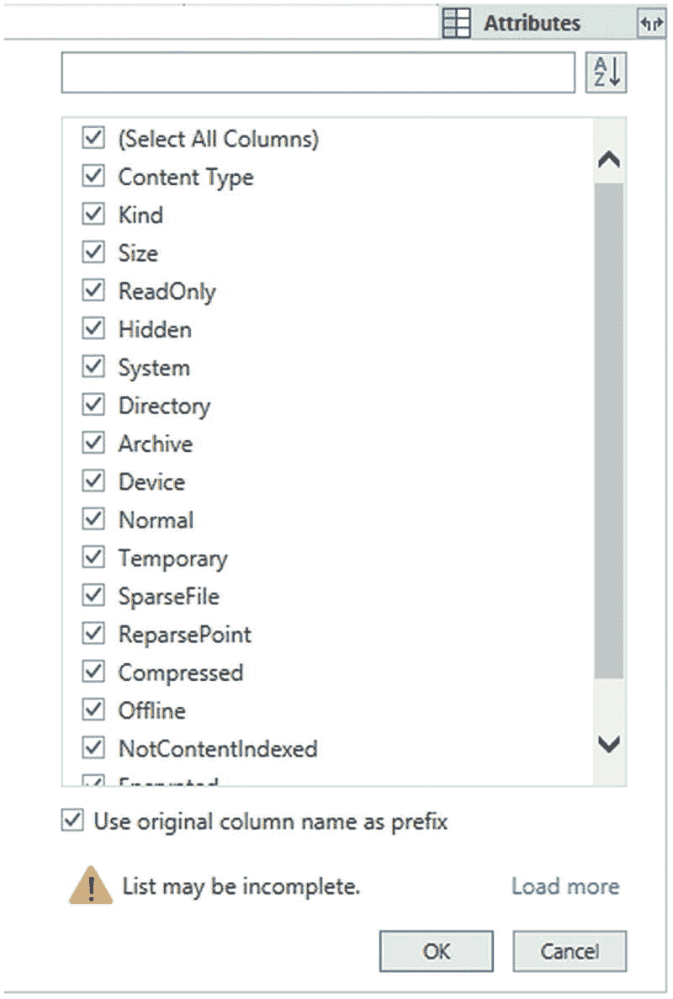

1.  执行上一节中的步骤 1 和步骤 2。

2.  点击属性列右侧的展开图标（双向箭头）以显示可用属性。将显示可用属性列表，如图 9-8 所示。

3.  从列表中选择要显示的属性，然后点击 `确定`。

每个属性将在 `Query Editor` 中作为新列出现。现在，你可以根据这些列进行筛选，从而基于扩展后的属性列表选择文件。

> **注意**  
> 你也可以根据目录、日期或显示的任何文件信息进行筛选。只需应用你在第 6 章中学到的筛选技术即可。

### 加载多个文件后删除标题行

如果源文件中包含每个源文件加载时自带的标题行，这里有一种快速将其从数据中删除的实用方法：

1.  如果（且仅当）每个文件都包含标题行，则在生成的表中向下滚动，直到找到标题元素。在本示例中，它是 `ColourID` 列中的 `ColourID` 一词。

2.  右键单击 `ColourID`，然后选择 `文本筛选器 ➤ 不等于`。所有包含多余列标题的行都将被删除。

> **注意**  
> 如果你的源目录中仅包含要加载的文件，则第 2 步并非必要。不过，我总会添加此类步骤，以防后续添加了“错误”类型的文件，导致后续任何处理过程运行失败。同样，你也可以对文件名设置筛选器，以限制加载的文件。

### 合并结构相同的文件

`Power Query` 还可以通过与前文所学技术略有不同的方式来合并源文件。此技术同样适用于文本、CSV、固定宽度、XML 或 JSON 文件。

1.  执行“从源文件夹添加多个文件”部分中的第 1 到第 5 步，以显示包含你要加载的文件的文件夹内容。在此场景中，该文件夹为 `C:\DataMashupWithExcelSamples\MultipleIdenticalFiles`。

2.  单击名为 `Content` 的列。

3.  在 `Power Query` 的 `主页` 功能区中，单击 `合并文件` 按钮。将会出现如图 9-7 所示的 `合并文件` 对话框。

4. 单击`确定`。

Power Query 将评估源文件的格式，并将所有源文件追加到单个查询中。

> **注意**
>
> Power Query 将创建一组辅助查询来执行此操作。如果展开 Power Query 的`查询`窗格，你将看到它添加的新查询。这些查询也将显示在 Excel 的`查询和连接`窗格中。

# 加载并解析 JSON 文件

如今，越来越多的数据以名为 JSON 的格式进行交换。JSON 代表 JavaScript 对象表示法，它被认为是一种高效且轻量级的方式来传输可能大量数据。JSON 文件本质上是一种包含按特定方式结构化的数据的文本文件。

虽然 Power Query 可以非常轻松地连接到 JSON 数据文件（毕竟它们只是一种文本文件），但其中包含的数据并非总是立即可理解。因此，你现在将学习如何加载文件，然后了解如何调整此连接以将其转换为有意义的信息。将源文本转换为可理解的格式通常被称为*解析*数据。

要连接到 JSON 文件并将其包含的数据解析为可用的表：

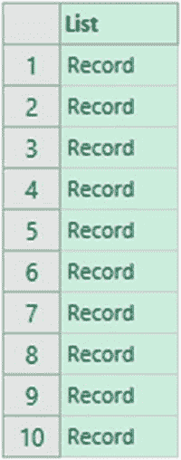
图 9-9 初始导入后的 JSON 文件

1.  在`数据`功能区中，单击`获取数据` > `来自文件` > `来自 JSON`。

2.  选择文件`C:\DataMashupWithExcelSamples\Colors.json`，然后单击`导入`。你将看到一个类似图 9-9 所示的记录列表。

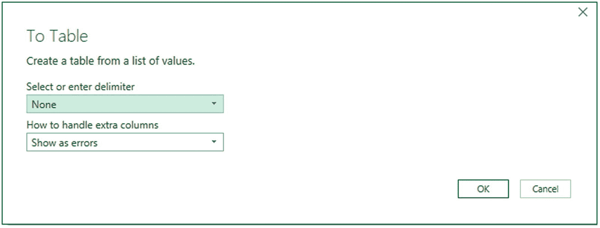
图 9-10 “到表”对话框

3.  你将看到查询编辑器已将`列表工具转换`功能区添加到菜单栏。此功能区将在下一节详细说明。单击此功能区中的`到表`按钮。将会出现如图 9-10 所示的`到表`对话框。

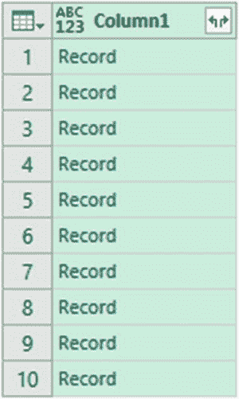
图 9-11 转换为表的 JSON 文件

4.  单击`确定`。数据列表将被转换为表。这意味着它现在会在列标题右侧显示`展开`图标，如图 9-11 所示。

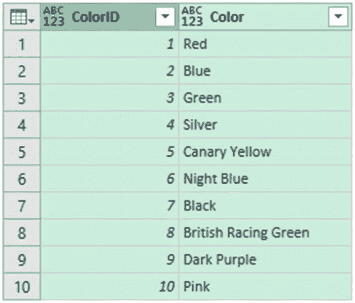
图 9-12 转换为数据集的 JSON 文件

5.  单击列标题右侧的`展开`图标，并在弹出的对话框中取消选中“使用原始列名作为前缀”。

6.  单击`确定`。JSON 文件的内容现在显示为标准数据集，如图 9-12 所示。

虽然这个过程并不特别困难，但可能看起来有点反直觉。不过，它确实有效，你可以用它来处理复杂的 JSON 文件，以便在 Excel 中使用其中包含的数据。

## “列表工具转换”功能区

Power Query 将某些数据视为列表，而非数据表。它处理列表的方式略有不同，并会显示一个特定的功能区来修改列表数据。`列表工具转换`功能区如图 9-13 和表 9-1 所示。

**表 9-1 列表工具转换功能区选项**

| 选项 | 说明 |
| --- | --- |
| 到表 | 将列表转换为表结构 |
| 保留项目 | 允许你保留列表顶部或底部的若干项目，或列表中的一个项目范围 |
| 删除项目 | 允许你删除列表顶部或底部的若干项目，或列表中的一个项目范围 |
| 删除重复项 | 从列表中删除任何重复项 |
| 反转项目 | 反转列表顺序 |
| 排序 | 按从低到高或从高到低对列表进行排序 |
| 统计信息 | 返回关于列表元素的计算统计信息 |

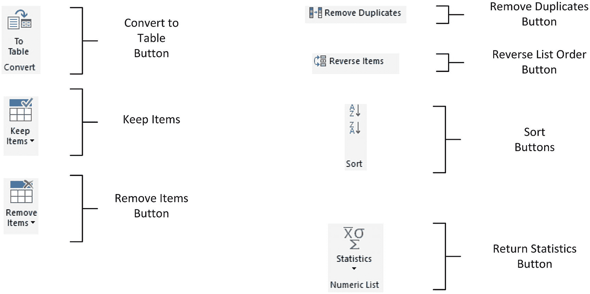
图 9-13 “列表工具转换”功能区

## 从列中解析 XML 数据

某些数据源（尤其是数据库数据源）的字段中实际上包含 XML 数据。这里的问题是，当数据加载时，Power Query 会将 XML 数据解释为纯文本。如果你查看图 9-14 中高亮显示的 `AvailableColors` 列，就会发现这并没有什么用处，甚至难以理解。

因此，Power Query 再次为这类问题提供了解决方案。为了演示如何将此类文本转换为可用数据，你将找到一个示例 Excel 文件 (`C:\DataMashupWithExcelSamples\XMLInColumn.xlsx`)，该文件包含一个包含 XML 数据的列。请按以下步骤操作：

1.  在`数据`功能区中，点击`获取数据` > `来自文件` > `从工作簿`。

2.  选择文件`XMLInColumn.xlsx`并点击`导入`。

3.  在导航器左侧选择`Sales`表，然后点击`转换数据`以切换到查询编辑器。

4.  向右滚动数据集，并选择最后一列：`AvailableColors`。查询编辑器界面如图 9-14 所示。

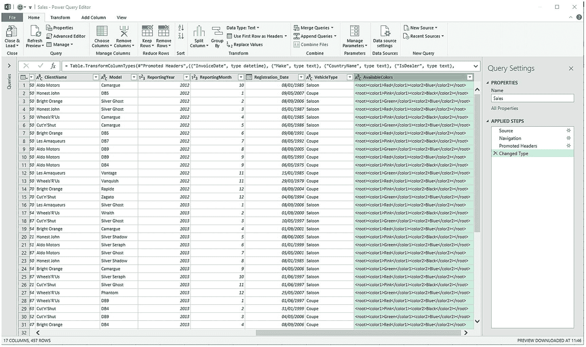
**图 9-14** 包含 XML 的列

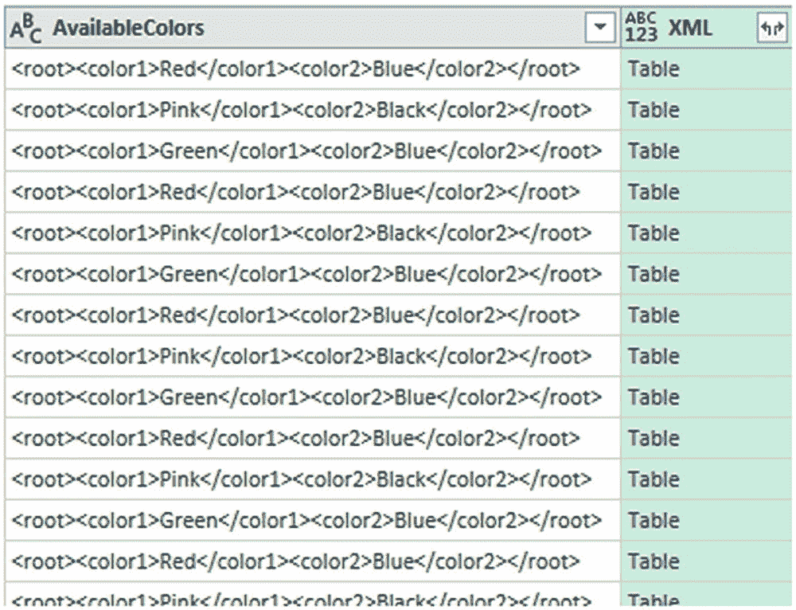
**图 9-15** 转换为表格列的 XML 列

5.  在`添加列`功能区中，点击`解析`按钮上的小三角形，然后选择`XML`。一个新的列将被添加到右侧。它将如图 9-15 所示，并带有标题 `XML`。

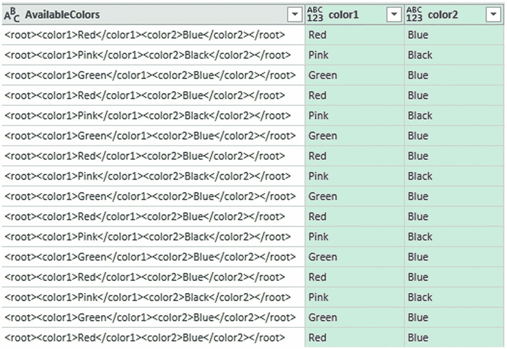
**图 9-16** XML 数据展开到新列

6.  点击 `XML` 列标题右侧的`展开`图标，并在弹出的对话框中取消勾选“使用原始列名作为前缀”。确保选中所有列，然后点击`确定`。两个新列（实际上与 XML 数据元素数量相同）将出现在数据集的右侧。查询编辑器将如图 9-16 所示。

7.  选择包含原始 XML 的列，并在上下文菜单中点击`删除列`，以移除包含初始 XML 数据的列。

8.  重命名任何新列，赋予其有意义的标题。

使用此技术，你现在可以提取源数据集中的 XML 数据，并用它来扩展现有原始数据。

### 从列中解析 JSON 数据

有时，你也可能会遇到字段中包含 JSON 的数据。从数据集内的字段中提取此数据并将其转换为列的技术，与你之前在 XML 数据部分看到的方法几乎相同。

鉴于该方法非常相似，并且与你之前导入 JSON 文件时看到的相差无几，我将仅提供流程最终结果的截图。在此你将能够看到源 JSON 以及从 JSON 中提取并添加到数据集的各列数据。

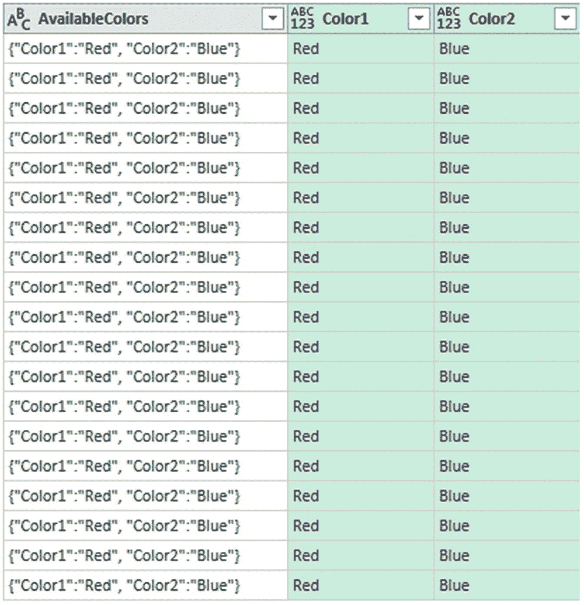
**图 9-17** JSON 数据展开到新列

1.  遵循先前示例的步骤 1 到 4，但使用文件 `C:\DataMashupWithExcelSamples\JSONInColumn.xlsx`。选择此文件中的唯一工作表：`Sales`。

2.  向右滚动数据集，并选择最后一列：`AvailableColors`。

3.  在`添加列`功能区中，点击`解析` > `JSON`。一个新的列将被添加到右侧，并带有标题 `JSON`。

4.  点击 `JSON` 列标题右侧的`展开`图标，并在弹出的对话框中取消勾选“使用原始列名作为前缀”。确保选中所有列，然后点击`确定`。两个新列（实际上与 JSON 数据元素数量相同）将出现在数据集的右侧。查询编辑器将如图 9-17 所示。

5.  删除包含初始 JSON 数据的列。

6.  如有必要，重命名任何新列。

诚然，本例中 JSON 数据的结构非常简单。现实世界中的 JSON 数据可能要复杂得多。不过，你现在有了一个起点，可以在解析存储在数据集列中的 JSON 数据时，以此为基础进行构建。

#### 复杂 JSON 文件

# 处理复杂 JSON 文件

JSON 文件的结构并非总像你之前看到的 `Colors.json` 文件那样简单。实际上，JSON 文件可能包含多个层级的数据，这些数据被组织成独立的*节点*。每个节点可能包含多个以逻辑方式组合在一起的数据元素。通常，你可能希望从源文件中选取数据的“子层级”，或者仅选取部分子层级元素，而非全部。

本节将展示如何从复杂的 JSON 结构中选取你感兴趣的数据元素。具体来说，示例源数据文件（`CarSalesJSON_Complex.json`）包含一个“根”层级，该层级显示核心数据，如发票号码、销售日期和销售价格（以及其他元素），以及包含以下信息的三个“子层级”：
- 车辆
- 财务数据
- 客户

这里的挑战在于将 `Vehicle` 和 `FinanceData` 节点中的数据“扁平化”为可随后用于分析的标准列。

> **注意**
> 如果你想了解包含多个嵌套节点的复杂 JSON 文件是什么样的，只需在文本编辑器中打开 `C:\DataMashupWithExcelSamples\CarSalesJSON_Complex.json` 文件即可。

在本示例中，你将看到如何从源文件中可用的一个或多个（但并非全部）数据元素中进行选择。

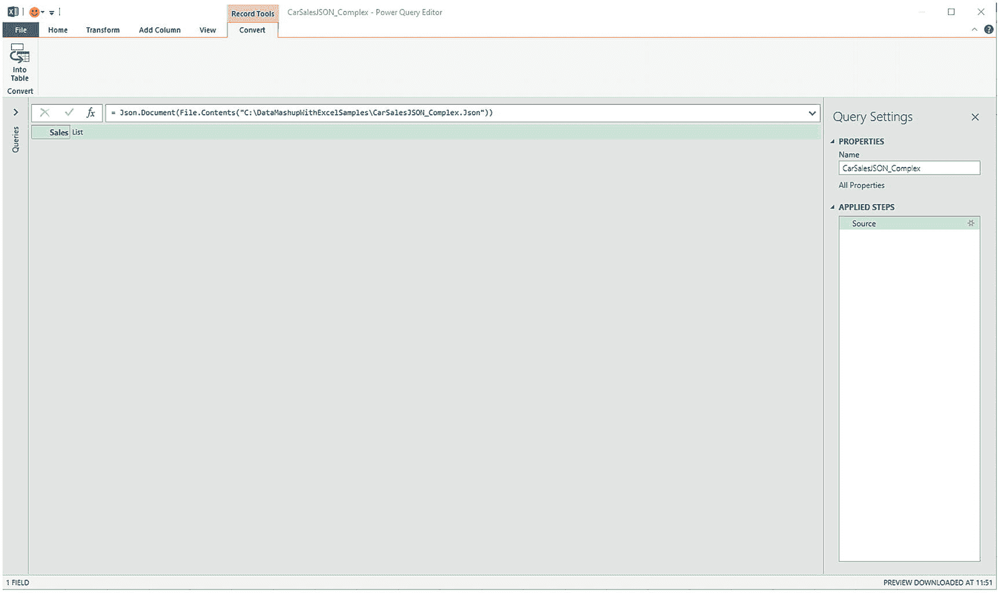 *图 9-18：打开一个复杂的 JSON 文件*

1. 在 Excel 功能区中，依次点击 `获取数据` ➤ `来自文件` ➤ `来自 JSON`。导航到包含你想要加载的 JSON 文件的文件夹（本例中为 `C:\DataMashupWithExcelSamples\CarSalesJSON_Complex.json`）。
2. 点击 `导入`。将出现查询编辑器窗口，并自动显示 `记录工具转换` 功能区。你可以在图 9-18 中看到此界面。

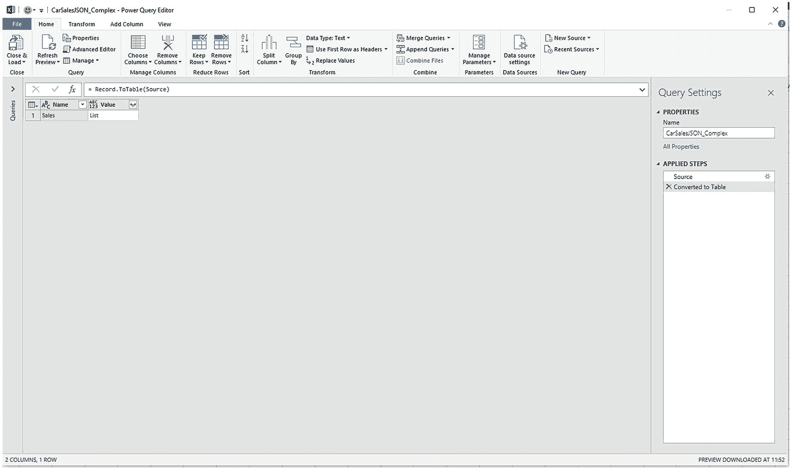 *图 9-19：一个复杂的 JSON 文件*

3. 从 `记录工具转换` 功能区中点击 `转到表格`。此时查询编辑器将如图 9-19 所示。

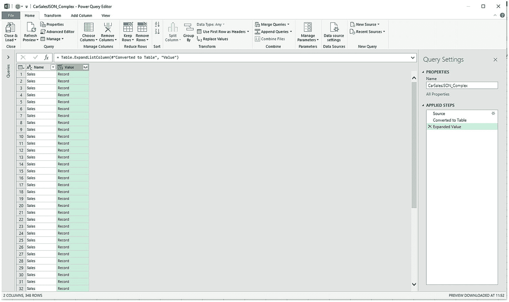 *图 9-20：展开一个 JSON 文件*

4. 点击 `Value` 列右上角的展开图标，然后选择 `扩展到新行`。此时查询编辑器将如图 9-20 所示。

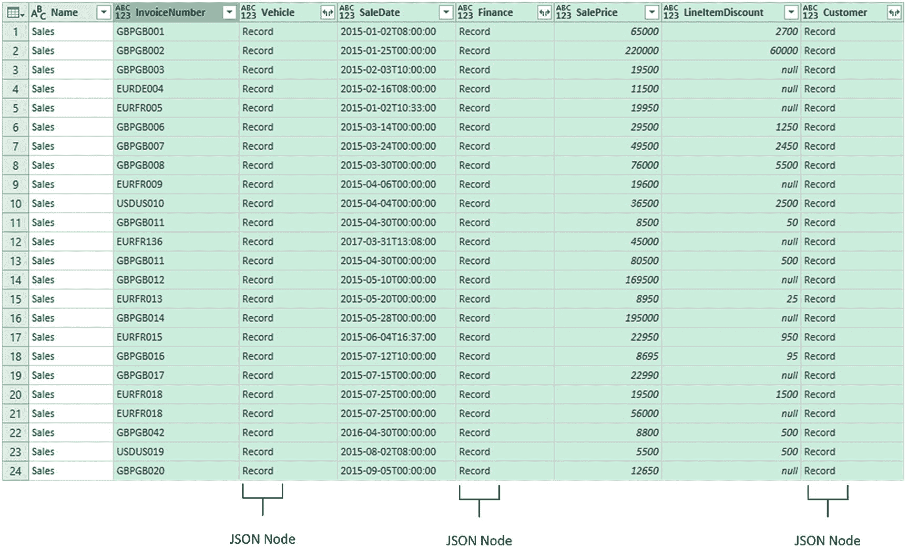 *图 9-21：查看 JSON 文件的结构*

5. 点击 `Value` 列右上角的展开图标，并取消选中 `使用原始列名称作为前缀`。
6. 点击 `确定` 以显示所有 JSON 属性。查询编辑器窗口将如图 9-21 所示。每个包含“记录”一词的列实际上都是一个包含更深层数据子层级的 JSON 节点。

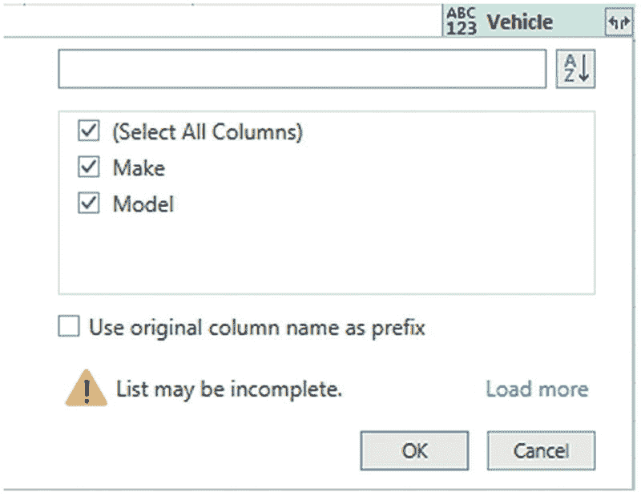 *图 9-22：JSON 文件中的嵌套元素*

7. 选择 `Vehicle` 列，并点击列标题右侧的展开图标。将显示源 JSON 内部较低层级“嵌套”的可用元素列表。你可以在图 9-22 中看到此界面。

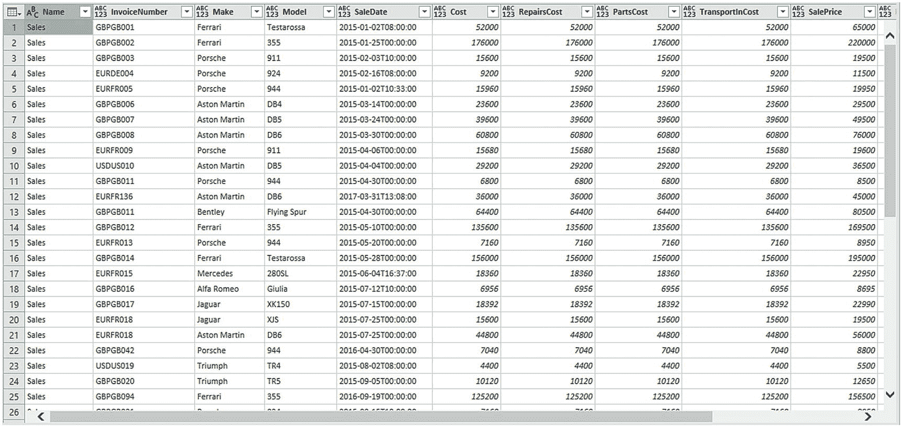 *图 9-23：解析后的 JSON 文件*

8. 点击 `确定`。新的列将被添加到数据表中。
9. 选择 `Finance` 列，并点击列标题右侧的展开图标。将显示该列源 JSON 内部较低层级“嵌套”的可用元素列表。仅选择 `Cost` 列，然后点击 `确定`。
10. 移除 `Customer` 列，因为在本示例中我们不会使用该列的数据。查询编辑器窗口将如图 9-23 所示，现在所有必需的列都显示在数据表中。
11. 点击 `Power Query 主页` 菜单中的 `关闭并加载`，将“扁平化”后的 JSON 数据返回到 Excel 工作表中。

> **注意**
> 在识别 JSON 节点中的嵌套数据时，最好点击展开弹出菜单中的 `加载更多` 链接。这将强制 Power Query 扫描更多数量的记录，并可能返回更完整的嵌套字段列表。

这种方法让你能够极为精确地选择从 JSON 文件中加载的数据。你可以选择包含源结构中任何层级的任何列。如你所见，你可以极为轻松地选择（或忽略）嵌套数据的整个子层级。

本节只是对解析复杂 JSON 文件的一个简单介绍。由于这种特定的数据结构可能包含多个数据子层级，并且可以在 JSON 文件的每个节点中混合数据和子层级，因此源数据结构可能极其复杂，并且可能包含层层嵌套的节点。幸运的是，你刚刚学到的技术可以扩展以处理任何复杂程度的 JSON，并帮助你驯服那些最令人生畏的数据结构。

> **注意**
> “扁平化”源数据非常重要，以便移除所有子层级（或节点，如果愿意这么称呼的话），并将其包含的数据显示为查询中的简单列。否则，这些数据将难以在 Excel 中使用。

# 处理复杂 XML 文件

与 JSON 文件类似，XML 文件也可以包含由多个数据子层级组成的复杂嵌套结构，这些结构被分组到单独的节点中。好消息是，Power Query 编辑器以相同的方式处理这两种数据结构。

这两种方法非常相似，因此我不会展示所有截图——它们与上一节中的截图几乎相同。

1. 在 Excel 功能区中，依次点击 `获取数据` ➤ `来自文件` ➤ `来自 XML`。导航到包含你想要加载的 XML 文件的文件夹（本例中为 `C:\DataMashupWithExcelSamples\ComplexXML.xml`）。
2. 点击 `导入`。将出现导航器对话框。
3. 在左侧选择 `Sales` 作为源数据表。
4. 点击 `转换数据`。将出现查询编辑器。
5. 选择 `Vehicle` 列，并点击列标题右侧的展开图标。将显示源 XML 内部较低层级“嵌套”的可用元素列表。
6. 取消选中 `使用原始列名称作为前缀` 复选框。
7. 点击 `确定`。
8. 点击 `Finance` 列右上角的展开图标，并取消选中 `使用原始列名称作为前缀` 复选框。
9. 点击 `加载更多` 以显示更详尽的数据元素列表。
10. 点击 `确定`。新的列将被添加到数据表中。
11. 选择 `Customer` 列，并点击列标题右侧的展开图标。将显示源 XML 内部较低层级“嵌套”的可用元素列表。仅选择 `CustomerName` 列，然后点击 `确定`。
12. 点击 Power Query 窗口顶部的 `关闭并加载`。

与 JSON 文件的情况一样，这种方法让你能够极为精确地选择从 XML 源文件中加载的数据。你可以选择包含源结构中任何层级的任何列。你可以极为轻松地选择（或忽略）嵌套数据的整个子层级。

# 将列转换为列表

有时你需要以列表格式使用数据。在第 11 章学习如何参数化查询时，你将看到一个实际示例。幸运的是，Power Query 让你能够轻松地将列转换为列表：

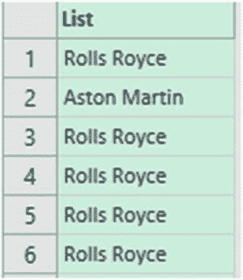 图 9-24 转换为列表操作所得到的列表

1. 点击 `获取数据` ➤ `来自文件` ➤ `来自 Excel`，然后选择 Excel 文件 `C:\DataMashupWithExcelSamples\BrilliantBritishCars.xlsx`。
2. 点击 `导入` 以显示 `导航器`。
3. 选择工作表 `BaseData`，然后点击 `转换数据` 以打开 `查询编辑器`。
4. 通过点击列标题选择要转换为列表的列。在本示例中，我将使用 `Make` 列。
5. 在 `转换` 功能区中，点击 `转换为列表`。`查询编辑器` 将显示生成的列表，如图 9-24 所示。

现在，在某些情况下，执行更高级的数据转换过程时，可以使用此列表。

# 重用数据源

在第 2 章到第 5 章中，你已经了解了如何从各种源访问数据，以在一系列报表中构建一系列查询。实际情况很可能是，你会频繁地想反复指向相同的数据源。为此，Power Query 开发团队找到了一种方法，让你的工作更轻松。

Excel 会记住你最近使用的数据源，并允许你在任何报表中快速轻松地重用它们。操作方法如下：

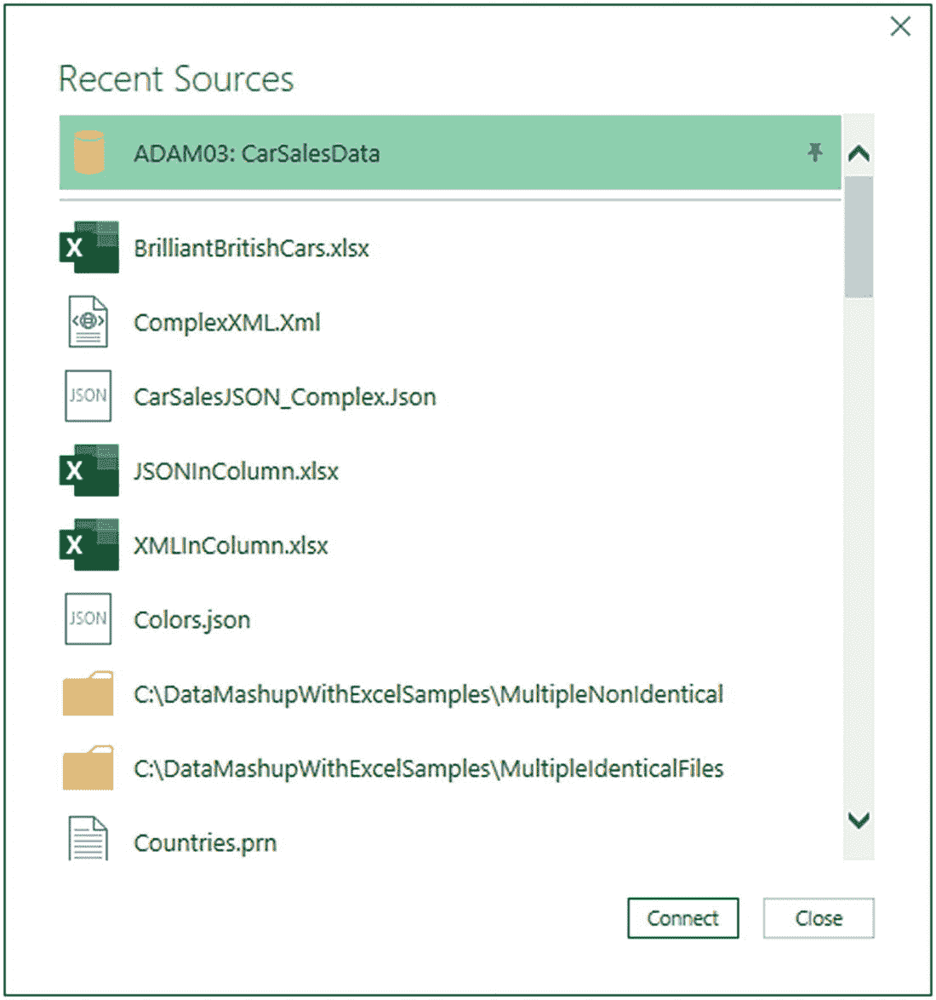

图 9-25 最近使用的源

### 最近使用的源

1.  在 `主页` 功能区中，点击 `最近使用的源` 按钮。将出现一个包含最近使用过的数据源的对话框。你可以在图 9-25 中看到此对话框。

2.  点击你想要重新连接的源，然后点击 `连接` 按钮以继续加载数据或建立连接。

### 固定数据源

如果仔细观察图 9-25，你会发现数据库连接 `ADAM03:CarSalesData` 被固定在 `最近使用的源` 对话框的顶部，这反映了我最近建立的一个数据库连接。这可以确保你某些数据源始终随手可用，随时准备重用。

请执行以下操作，将最近使用的数据源固定到“最近使用的源”菜单和对话框：

1.  点击 `数据` 功能区中的 `最近使用的源` 按钮。将显示 `最近使用的源` 对话框。

2.  将鼠标悬停在最近使用的数据源上。数据源名称的右侧会出现一个图钉图标。

3.  点击图钉图标。该数据源将被固定在 `最近使用的源` 菜单和 `最近使用的源` 对话框的顶部。数据源名称的右侧会保留一个小图钉图标。

> **注意**
>
> 要从 `最近使用的源` 菜单和 `最近使用的源` 对话框中取消固定数据源，你只需点击已固定数据源的图钉图标即可。这将取消固定，并使其重新出现在最近使用的数据源列表中。

如果你愿意，还可以在决定要在 `最近使用的源` 列表中显示哪些元素时应用以下选项：

*   从列表中删除

*   清除列表中未固定的项目

## 从 Power Query 编辑器复制数据

Power Query 被设计为数据目的地。它本身没有数据导出功能。不过，你可以手动从 Power Query 编辑器复制数据。更准确地说，你可以复制以下任何内容：

*   查询中的数据

*   数据列

*   单个单元格

在所有情况下，过程都是相同的：

1.  点击要复制的元素。这可以是：

    1.  数据网格左上角的方块

    2.  列标题

    3.  单个单元格

2.  右键单击并从上下文菜单中选择 `复制`。

然后，你可以将剪贴板中的数据粘贴到目标应用程序中。

> **注意**
>
> 此过程有些局限，因为你无法选择一定范围的单元格。而且你必须记住，在查询编辑器中看到的只是示例数据。由于你可以简单地将数据从 Power Query 加载到 Excel 中，所以我只是将其作为一个次要点进行解释，在实践中意义有限。

## 结论

本章通过解释如何处理基于 Excel 和文本数据的多个文件加载，将你在 Power Query 编辑器中的数据转换知识提升到了一个新水平。然后，你学习了处理来自包含复杂嵌套源结构（特别是 JSON 和 XML 文件）的源文件的数据的方法。你还了解了如何解析来自其他数据源中包含的列的 JSON 和 XML 元素。

接着，你学习了如何重用数据源和管理常用数据源以节省时间。最后，你学习了如何将数据转换过程中产生的示例数据复制到其他应用程序中。

至此，使用 Power Query 编辑器进行数据加载和转换的基础介绍就结束了。现在是时候转向更高级的技术了，你可以应用这些技术来加速、增强、管理和结构化你的数据转换过程，并添加一定程度的交互性。这些方法将是接下来两章的主题。

