# 8. 重构数据

在前两章中，您了解了如何在 Power Query 中打磨您的数据集，以便只定义您真正需要作为分析基础的数据行和列。然后，您学习了如何清理和补全它们包含的数据。在本章中，您将学习如何在这些基础上进一步构建，以交付准备好塑造成结构化和可用数据模型的数据。

在 Power Query 中，此类数据准备的通用术语是*重构数据*。它包括以下内容：

- *联接查询*：这涉及获取两个查询并将它们链接起来，以便将两个来源的数据显示为单个数据集。您将学习如何用第二个查询中的多个列扩展一个查询，以及如何聚合第二个查询中的数据并将其添加到初始数据集。您还将了解如何在合并查询时创建复杂的联接。
- *透视和逆透视数据*：如果您需要将行中的数据切换为列来显示（反之亦然），那么可以请 Power Query 编辑器帮助您精确地完成此操作。这意味着您可以保证您使用的所有表中的数据都符合标准化的表格结构，这对于 Power Query 高效运行至关重要。
- *转置数据*：可能需要将列切换为行，反之亦然。

这些技术可以——并且很可能——与您之前在第 6 章和第 7 章中看到的许多技术一起使用。毕竟，Power Query 的一大优势在于它认识到数据转换是一项复杂的工作，因此不强加任何严格的工作方式。实际上，它允许您自由地尝试多种数据转换选项。所以请记住，在转换源数据时，您有权采取任何您想要的方法。唯一重要的是您使用它来获得您想要的结果。

## Power Query 编辑器视图功能区

到目前为止，我们一直将注意力集中在 Power Query 编辑器的 `Home`、`Transform` 和 `Add Column` 功能区上。这是由于一个充分且简单的理由：这些功能区几乎是所有操作发生的地方。然而，还有第四个基本的 Power Query 编辑器功能区——`View` 功能区。它所包含的按钮如图 8-1 所示，其选项在表 8-1 中进行了说明。

表 8-1 – Power Query `View` 功能区选项

| 选项 | 说明 |
| --- | --- |
| `Query Settings` | 显示或隐藏 Power Query 窗口右侧的 `Query Settings` 窗格。其中包括 `Applied Steps` 列表 |
| `Monospaced` | 使用等宽字体显示预览 |
| `Show whitespace` | 显示空白字符和换行符 |
| `Go to Column` | 允许您选择特定列 |
| `Always allow` | 允许在数据源和转换对话框中进行参数化。参数化是第 11 章的主题 |
| `Advanced Editor` | 显示 `Advanced Editor` 对话框，其中包含查询步骤的所有代码 |
| `Query Dependencies` | 显示查询链接和依赖关系的顺序 |

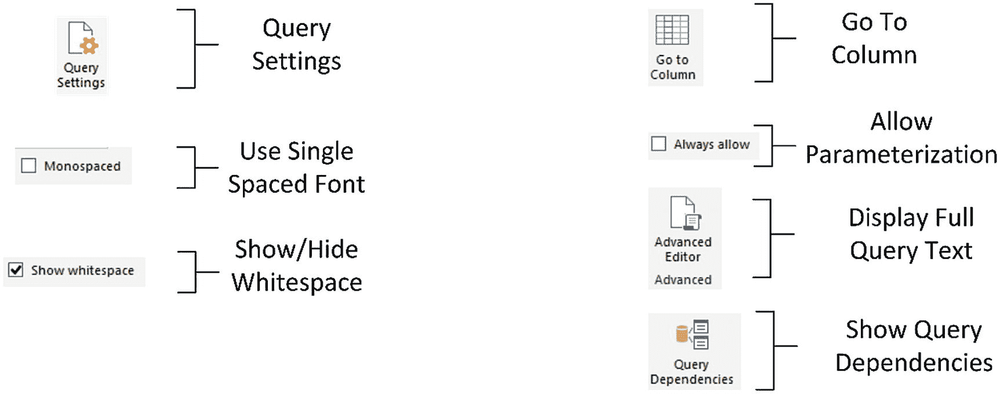

图 8-1 – Power Query `View` 功能区

可能唯一不是马上就能自明其义的选项是 `Advanced Editor` 按钮。它将查询中所有转换的代码显示为单个“M”语言脚本块。关于这一点，您将在第 12 章中了解更多。

**提示**

就我个人而言，我发现 `Query Settings` 窗格和公式栏在转换数据时对于 Power Query 窗口来说太重要了，不能移除。因此，我倾向于让它们保持可见。然而，如果您需要屏幕空间，您随时可以暂时隐藏它们。

## 合并数据

到目前为止，我们一直将每个单独的查询视为独立存在。但实际上，你经常需要将一个查询的输出与另一个查询的输出结合使用，以不同方式连接来自不同数据源的数据。假设两个查询的结果共享一个（或多个）公共字段，你就可以将多个查询“联接”成一个单一的“扁平化”数据表。Power Query 将此称为合并操作，它使你能够（除其他功能外）：

-   在另一个“引用”表中查找数据元素，以添加查找数据。例如，当主表中只有客户参考代码或编号时，你可能希望添加客户名称。
-   从“明细”表（如发票行）中聚合数据，并将汇总结果包含在粒度更粗的表中，例如发票表。

这个过程同样并不复杂。唯一的根本因素是，你要合并的两个表或查询必须共享一个或多个字段，以便两个表能够连贯地匹配记录。让我们来看几个例子。

### 使用合并数据扩展查询

首先，让我们尝试通过从第二个查询添加链接数据来扩展现有查询：

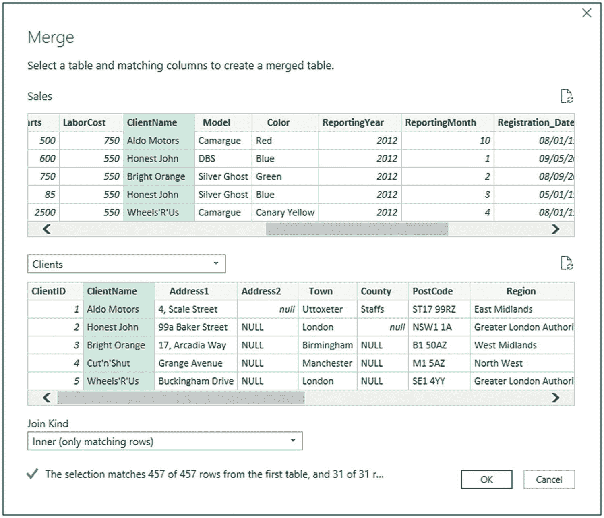

图 8-2 合并对话框

1.  在一个新的空白 Excel 文件中，使用 Power Query 连接到 `C:\DataMashupWithExcelSamples\SalesData.xlsx` Excel 文件中的两个工作表。这两个工作表分别是 `Sales` 和 `Clients`。
2.  不要加载数据，而是点击 **主页** 选项卡中的 **转换数据** 按钮。这将在 Power Query 编辑器中显示两个独立的源数据集。
3.  在 Power Query 窗口的 **查询** 窗格中，点击名为 `Sales` 的查询。
4.  点击 **主页** 选项卡中的 **合并查询** 按钮。将出现 **合并** 对话框。
5.  在对话框的上半部分——显示当前查询输出的概览——向右滚动并点击 `ClientName` 列标题。此列将被高亮显示。
6.  在上方表格下方的弹出菜单中，选择 `Clients` 查询。该查询的输出将出现在对话框的下半部分。
7.  在下方表格中，选择与你在步骤 5 中选择的列相匹配的列的列标题——即联接列。这也将是 `ClientName` 列。然后，该列将在下方表格中被选中。
8.  从 **联接种类** 弹出菜单中选择 `内部（仅匹配的行）`。对话框将如图 8-2 所示。

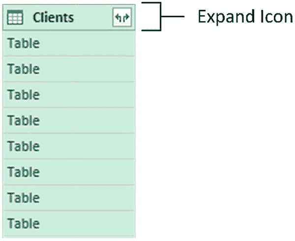

图 8-3 新的合并列

1.  点击 **确定**。现有数据表的右侧将添加一个新列。该列命名为 `Clients`——代表合并后的表。
2.  向右滚动到现有数据表的右侧。刚刚从合并步骤创建的新列在每个单元格中都包含单词 **Table**。此列看起来会有点像图 8-3。

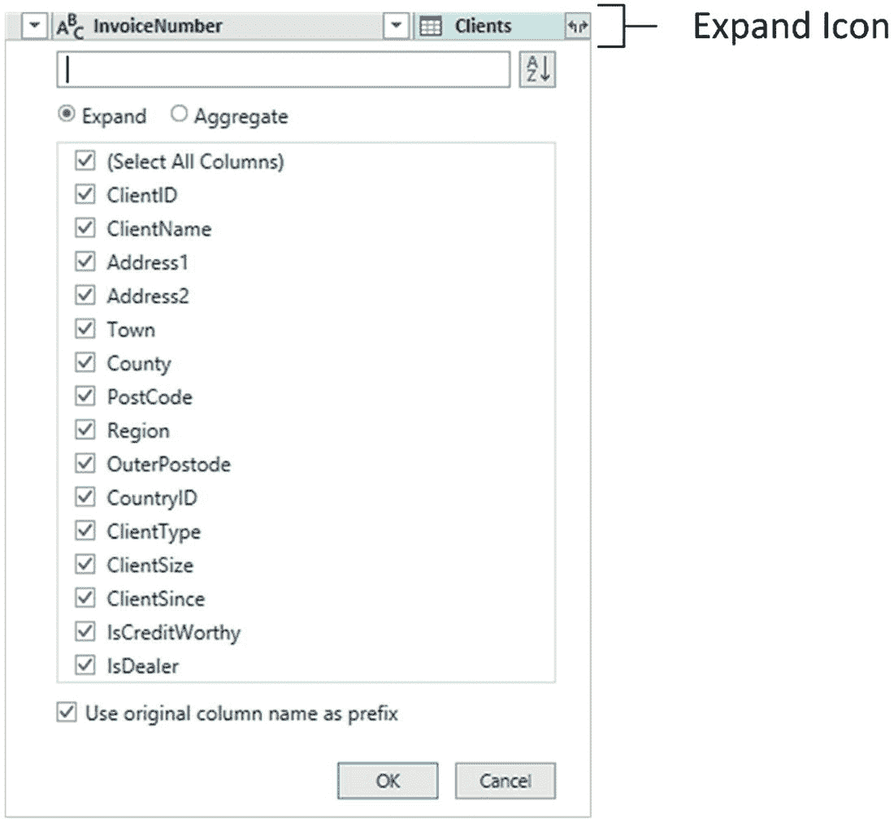

图 8-4 联接查询中可用的字段

1.  点击添加的列名右侧的 **展开** 图标。将显示此数据表（或者如果你愿意，称为查询）中所有可用字段的弹出列表，如图 8-4 所示。

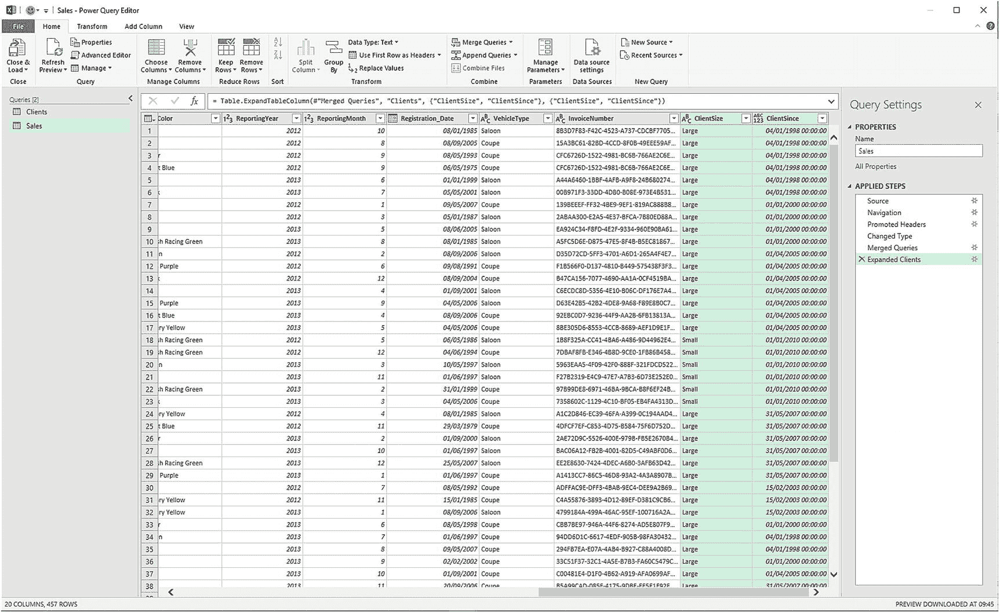

图 8-5 合并列输出

1.  确保选中 **展开** 单选按钮。
2.  通过取消选中 **(选择所有列)** 复选框来清除所有列的选择。
3.  选择以下列：
    - `ClientSize`
    - `ClientSince`
4.  取消勾选 **使用原始列名作为前缀**。
5.  点击 **确定**。合并表中的选定列将添加到主表中，并且与引用表（新列）的链接将被移除。
6.  如有需要，重命名添加的列。结果应如图 8-5 所示。

你现在拥有一个包含来自两个链接数据源数据的单一数据表。重新处理 `Sales` 查询也会重新处理其依赖的 `Clients` 查询，并导致加载最新版本的数据。

值得注意的是，不必从第二个查询中选择你已经从第一个查询中选择过的任何列，否则你只会返回重复的列。

> **注意：** 你可能注意到 **合并** 对话框指示了两个查询中有多少条匹配记录。这可以是一个有用的提示，表明你已选择了正确的列来联接两个查询。

### 在合并操作期间聚合数据

如果你不只是查找参考数据，而是需要从另一个表聚合数据，然后将结果添加到当前查询中，那么过程大致类似。然而，第二种方法是为了满足另一种完全不同的需求而设计的。之前，你看到的是当前查询中有许多记录映射到查找表中的*单个*记录的情况。第二种方法适用于当前（或主）查询中有单个记录，而第二个查询中存在*多个*关联记录的情况。因此，你需要聚合第二个表中的数据，以将数据带入第一个表。这里有一个简单的例子，使用了来自 `C:\DataMashupWithExcelSamples` 文件夹中的一些示例数据：

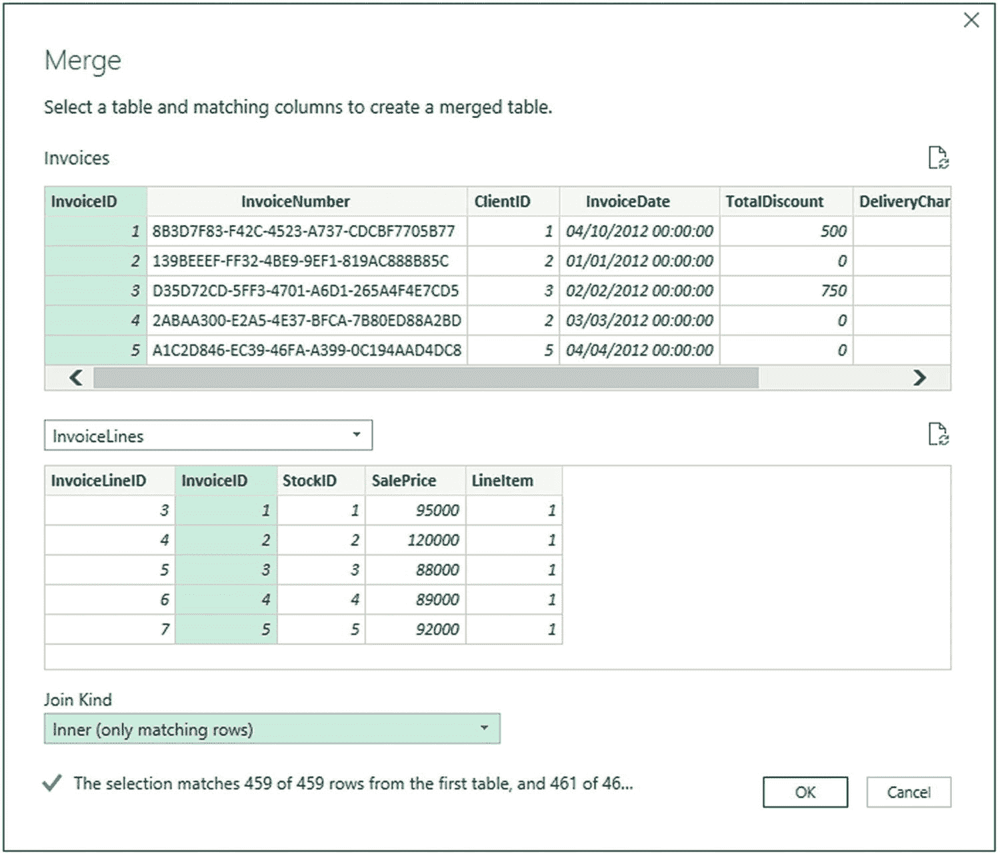

**图 8-6** 聚合数据时的“合并”对话框

1.  打开一个新的 Excel 工作表。
2.  在**数据**菜单中，单击**获取数据** ➤ **来自文件** ➤ **来自工作簿**。
3.  在 `C:\DataMashupWithExcelSamples` 文件夹中找到 `InvoicesAndInvoiceLines.xlsx` Excel 源文件。
4.  勾选**选择多项**复选框。
5.  在导航器中，选择它包含的两个工作表（`Invoices` 和 `InvoiceLines`）。
6.  单击**转换数据**。这将创建两个查询，并打开**Power Query 编辑器**。
7.  在左侧的**查询**窗格中，单击名为 `Invoices` 的查询。
8.  在**开始**功能区中，单击**合并查询**按钮。将打开**合并**对话框。你会在对话框的上半部分看到 `Invoices` 数据集中的一些数据。
9.  单击 `InvoiceID` 列内的任意位置。此列被选中。
10. 在弹出的菜单中，选择 `InvoiceLines` 查询。你会在对话框的下半部分看到 `InvoiceLines` 数据集中的一些数据。
11. 单击下方表格的 `InvoiceID` 列内的任意位置。此列被选中。
12. 在**联接种类**弹出菜单中选择**内部（仅限匹配行）**。对话框将如图 8-6 所示。

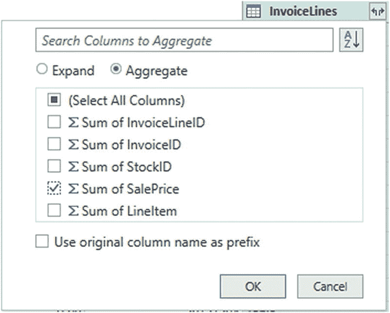

**图 8-7** 合并数据集中的可用字段

1.  单击**确定**。**合并**对话框将关闭，并在 `Invoices` 查询的右侧添加一个名为 `InvoiceLines` 的新列。
2.  滚动到现有数据表的右侧。你会看到新列（名为 `InvoiceLines`），其中每个单元格都包含单词 *Table*。
3.  单击新列标题右侧的**展开**图标（左右方向的两个箭头）。将显示 `InvoiceLines` 查询中所有可用字段的弹出列表。
4.  选择**聚合**单选按钮。
5.  选择**Sum of SalePrice** 字段，并取消选中所有其他字段。
6.  取消选中 **“使用原始列名作为前缀”** 复选框。对话框将如图 8-7 所示。
7.  单击**确定**。

Power Query 将累加每张发票的总销售价格，并将其添加为新列。当然，如果求和不是你想要的结果，你可以选择希望应用的聚合类型（在单击**确定**之前）。为此，将光标悬停在要聚合的列上（参见前面练习中的步骤 11），然后单击字段名称右侧的弹出菜单。Power Query 将会建议一组选项。可用的聚合选项在表 8-2 中进行了说明。

**表 8-2** 合并聚合选项

| 选项 | 说明 |
| --- | --- |
| 求和 | 返回字段的总值 |
| 平均值 | 返回字段的平均值 |
| 中位数 | 返回字段的中位数 |
| 最小值 | 返回字段的最小值 |
| 最大值 | 返回字段的最大值 |
| 计数（全部） | 计算数据集中的所有记录 |
| 计数（非空） | 计算数据集中所有非空的记录 |

**提示**  
如果你在第 1 步中加载了数据而不是编辑查询，只需单击**开始**功能区中的**转换数据**按钮，即可切换到**查询编辑器**。

你刚刚看到的合并过程，虽然本身并不复杂，但却突然开启了众多新的可能性。这意味着你现在可以创建多个独立的查询，然后一起使用它们来扩展数据，从而能够准备相当复杂的数据集。

关于合并操作，我有几点需要说明：

-   只有先前在 Power Query 窗口中创建好的查询才能用于合并数据集。因此，请记得在尝试进行合并操作之前，连接到所有你需要的数据集。
-   刷新一个查询会导致合并到该查询中的任何其他查询也随之刷新。这样，你将始终从流程中的所有查询中获得最新的数据。

### 将合并结果作为新查询使用

在前两节中，你通过从另一个查询添加数据来扩展了一个现有查询。关于合并查询这一主题的最后一个变体，是基于合并两个源查询的结果来创建一个全新的查询。这种方法的好处是，它保留了源查询的完整性，以便在其他查询中重复使用，或者在新合并的查询未给出所需结果时更容易恢复到原始状态。

**图 8-8** 将表合并为新查询

1.  遵循“使用合并数据扩展查询”一节中的第 1 到第 3 步。
2.  在**开始**功能区中，单击**合并查询**按钮右侧的小三角形。你可以在图 8-8 的弹出菜单中看到可用选项。
3.  选择**将查询合并为新查询**。
4.  继续执行“使用合并数据扩展查询”一节中的第 5 到第 17 步。

这将创建一个新查询（命名为 `Merge`——但你可以稍后重命名），并且保持初始查询不变。

这种方法可以比简单地扩展现有查询更加灵活和敏捷。你可以放心，如果你刷新数据，新的合并查询也会作为该过程的一部分被刷新。

### 联接类型

在合并查询（无论是为了联接数据还是聚合值）时，您需要选择如何链接两个查询。联接类型的选择会对结果数据集产生深远影响。因此，了解可用的六种联接类型非常重要。这些类型在表 8-3 中进行了描述。

**表 8-3** 联接类型

| 联接类型 | 说明 |
| --- | --- |
| 左外部 | 保留 `Merge`（合并）对话框中上方数据集（开始合并操作时处于活动状态的数据集）中的所有记录。保留第二个数据集中所有匹配的行（在联接列中共享共同值的行）。丢弃第二个数据集中的所有其他行 |
| 右外部 | 保留 `Merge`（合并）对话框中下方数据集（开始合并操作时未处于活动状态的数据集）中的所有记录。保留上方数据集中所有匹配的行（在联接列中共享共同值的行）。丢弃上方数据集（开始合并操作时处于活动状态的数据集）中的所有其他行 |
| 完全外部 | 两个查询中的所有行都保留在结果数据集中。任何在联接字段中不共享共同值的记录，其某些列将包含空白 |
| 内部 | 仅联接在所选联接列上完全匹配的查询。丢弃任一查询中在联接列上不共享共同值的所有行 |
| 左反 | 仅保留上方（第一个）查询中的行 |
| 右反 | 仅保留下方（第二个）查询中的行 |

> **注意：** 当您使用任何 *外部* 联接时，您保留了在第二个查询中没有对应记录的行。因此，结果数据集中某些列将包含空值。

当您展开作为链接到合并数据集的列时，有几种值得了解的有用选项：

- 使用原始列名作为前缀
- 搜索要展开的列

#### 使用原始列名作为前缀

您可能会发现，来自已联接查询的某些列在两个源数据集中可能具有相同的名称。因此，您需要识别出哪些列来自哪个数据集。如果您保持选中“使用原始列名作为前缀”合并选项（默认选项），则所有合并的列将包含源查询名称，以帮助您更准确地识别数据。

如果您发现这些较长的列名反而碍事，可以取消选中此复选框。这将使来自第二个查询的添加列保留其原始名称。但是，由于 Power Query 无法接受重复的列名，任何新列的名称将添加 `.1`、`.2` 等后缀。

#### 搜索要展开的列

如果您正在将一个查询与另一个包含大量列的查询合并，那么滚动查找您想要包含的列可能会非常费力。要缩小搜索范围，您可以在 `Search columns to aggregate`（搜索要聚合的列）框中输入您要查找的列名的几个字符。您输入的字符越多，`Expansion`（展开）弹出对话框中显示的匹配列就越少。

### 基于多列进行联接

到目前为止的示例中，您仅基于单个列联接了查询。如果您处理的是来自结构清晰的源（例如关系数据库）的数据，这可能可行，但当联接来自不同源的查询时，您可能需要扩展该原则。幸运的是，Power Query 允许您在需要时基于*多*列联接查询。

以此为例，示例数据中包含一个我准备好的文件，它演示了如何基于多列联接查询。此示例文件包含您在前几章中看到的源数据。但这些数据已被建模为数据仓库星型架构。要完成此模型，您需要将一个名为 `Geography`（地理信息）的维度联接到一个名为 `Sales`（销售）的事实表，以便将 `GeographySK` 字段添加到事实表中。然而，`Sales` 表和 `Geography` 表共享三个字段（`Country`（国家）、`Region`（地区）和 `Town`（城镇）），这些字段必须对应才能将查询联接起来。以下解释了如何使用多个字段执行联接：

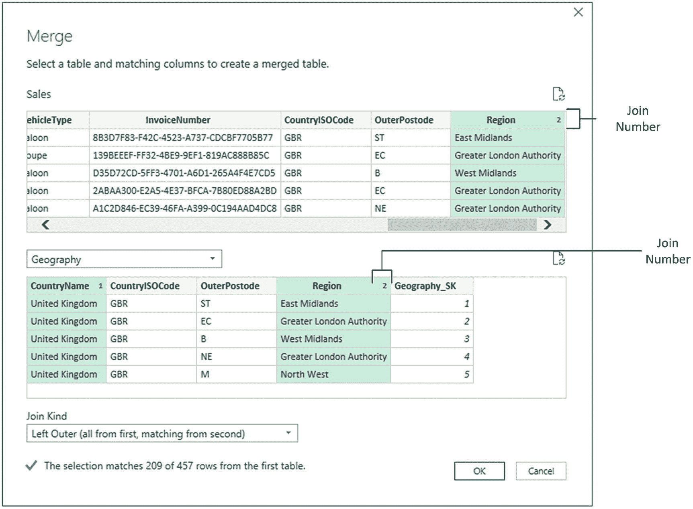

**图 8-9** 使用多列联接查询

1. 在 Excel 文件中，于 `Data`（数据）功能区中，单击 `Get Data`（获取数据） ➤ `From File`（来自文件） ➤ `From Workbook`（来自工作簿），然后连接到 Excel 文件 `C:\DataMashupWithExcelSamples\StarSchema.xlsx`。

2. 选中 `Select multiple items`（选择多项）复选框。

3. 选择两个工作表（`Geography` 和 `Sales`）。

4. 单击 `Transform Data`（转换数据）以打开 `Query Editor`（查询编辑器）。

5. 从 Power Query 窗口左侧的 `Queries`（查询）窗格的现有查询列表中，选择 `Sales` 查询。

6. 在 `Home`（开始）功能区中，单击 `Merge Queries`（合并查询）按钮。将出现 `Merge`（合并）对话框。

7. 在查询弹出列表中，选择 `Geography` 作为要联接到第一个（上方）查询的第二个查询。

8. 从 `Join Kind`（联接种类）弹出菜单中选择 `Inner (only matching rows)`（内部（仅匹配行））。

9. 在上方字段列表（来自 `Sales` 表）中，*按此顺序*按住 Ctrl 键并单击 `CountryName` 和 `Region` 字段。每个列标题的右侧将出现一个小数字，指示您选择列的顺序。

10. 在下方字段列表（来自 `Geography` 表）中，*按此顺序*按住 Ctrl 键并单击 `CountryName` 和 `Region` 字段。每个列标题的右侧将出现一个小数字，指示您选择列的顺序。

11. 在对话框底部的信息消息中，验证匹配行的数量是否合理。对话框将如图 8-9 所示。

12. 单击 `OK`（确定）。

然后您可以继续重组数据。例如，在此示例中，这将涉及将 `GeographySK` 字段添加到 `Sales` 查询，然后从 `Sales` 查询中移除 `Country`、`Region` 和 `Town` 字段。

联接查询时，可用作联接的列数没有实际限制。这完全取决于源数据的结构。但是，用于定义联接的每个列必须*同时*存在于两个数据集中，并且每一对列的数据类型必须*相同*（或相似）。

### 为联接准备数据集

在联接查询之前，您可能需要对现实世界的数据集进行一些准备工作。更具体地说，您要联接的任何列都必须具有相同的基本数据类型。简而言之，您需要将基于文本的列联接到其他基于文本的列，将数字列联接到数字列，将日期列联接到日期列。如果列的数据类型*不*相同，当您在 `Merge`（合并）对话框中尝试联接这些列时，您将收到一条警告消息。

因此，在开始合并操作*之前*，检查将用于联接查询的列几乎总是一个好主意。请记住，数据类型不必完全相同，只需相似即可。例如，十进制数类型可以映射到整数。

在尝试合并查询之前，您可能还需要清理用于联接的列中的数据。这可能涉及您在第 7 章中学到的以下技术：

- 删除基于文本的列中的尾随或前导空格
- 隔离列的一部分（无论是在原始列中还是作为新列）以用于联接
- 验证联接列中是否使用了适当的数据类型

### 正确与错误的连接

不幸的是，合并查询是一种在理论上往往比实践中更容易的数据重组操作。如果源查询基于关系型甚至维度型数据库中的表，那么连接它们可能相对容易，因为数据架构师（希望如此）会设计出便于连接的数据库表。但是，如果你要连接两个完全独立的查询，可能会面临几个主要问题：

* 列不匹配。
* 列匹配，但结果是一个包含重复记录的巨大表格。

我们来看看这些可能的问题。

#### 列不匹配

如果列不匹配（即你已连接数据但未获得任何结果记录），那么你需要仔细检查用于建立连接的那些列中的数据。你需要问以下问题：

* 两个查询中的值是否为相同的数据类型？
* 这些值真的能匹配，还是根本不同？
* 你使用的列是否正确？
* 你是否使用了过多的列，从而指定了并非两个查询中都有的数据？

#### 列匹配，但结果是一个包含重复记录的巨大表格

连接查询依赖于在两个源查询中隔离出*唯一*的数据。有时，单列不足以建立唯一引用，从而无法唯一地标识查询中的某一行。

在这些情况下，你需要使用两个或多个列来连接查询——否则结果中会出现重复的行。因此，你需要再次仔细审视数据，并决定可以用来正确连接查询的最小列数。

> **提示**  
> `Merge`（合并）对话框底部的注释会告诉你两个表之间有多少条记录匹配。这是判断你是否选择了正确的连接列和合适的连接类型的一个有效且有用的指标。

### 检查已连接的数据

连接数据表并不总是容易的。判断合并操作的结果是否能产生你期望的结果同样不易。因此，Power Query 为这类困境提供了一种解决方案。它可以帮助你更清晰地看到连接操作的结果。更具体地说，它可以向你显示第一个查询中每条记录精确地连接了第二个查询中的哪些行。

请按照以下步骤查看实际效果：

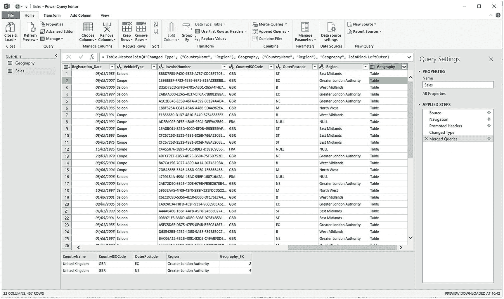

**图 8-10** 已连接的数据

1. 执行前面示例（“基于多列连接”一节）中的步骤 1 到 10。
2. 向右滚动数据表。你将看到名为 `Geography` 的新列（如图 8-10 所示）。
3. 在你想查看已连接数据的行中，点击 `Table` 一词的*右侧*。注意，*不要*点击 `Table` 这个词。主查询数据表下方会出现第二个表，其中包含为此特定行连接的第二个查询的数据。图 8-10 展示了这样一个示例。

这项技术既简单又实用。不过，我有几点意见需要说明：

* 你可以通过向上或向下拖动顶部数据表的下边框来调整下方表格的大小（从而显示更多或更少的来自第二个连接表的数据）。
* 点击 `NewColumn` 列中 `Table` 一词的右侧，将启用 `Transform`（转换）功能区中的 `Expand`（展开）和 `Aggregate`（聚合）按钮。
* 点击 `NewColumn` 列中的 `Table` 一词，会向查询中添加一个新步骤，该步骤会用链接的数据替换源数据。你也可以通过在 `NewColumn` 列内右键单击并选择 `Drill Down`（向下钻取）来执行此操作。

> **注意**  
> 向下钻取到合并后的表实际上会将查询限制为子表的行。因此，如果你想访问合并表中的所有数据，则必须删除此步骤。

## 追加数据

并非所有源数据都以单个文件或单个数据库表的形式完整提供。你可能会被授予访问两个或多个表或文件的权限，这些表或文件需要加载到 Excel 或 Power Pivot 的单个表中。在某些情况下，你可能会发现自己面临数百个文件——都是文本、CSV 或 Excel 格式——并且需要将它们全部加载到一个将用作分析基础的单个表中。好吧，Power Query 也能处理这些情况。

### 将一个查询的内容添加到另一个查询

在最简单的情况下，你可能有两个结构完全相同的数据源（即它们具有相同顺序的相同列），你所需要做的就是将一个添加到另一个，从而得到一个输出两个源合并内容的查询。这称为*追加数据*，只要两个数据源具有*完全相同*的结构，这就很简单；这意味着：

* 它们具有相同数量的列。
* 列的顺序相同。
* 每列的数据类型相同。
* 列的名称相同。

只要满足所有这些条件，你就可以将一个查询的输出（Power Query 也称之为 `Tables`，包括我在内的许多人称之为数据集）追加到另一个查询中。这些查询的数据不必来自相同的源类型，因此你可以将 CSV 文件的输出追加到来自 Oracle 数据库的数据，例如。作为示例，我们将采用两个文本文件，并用它们创建一个单一输出：

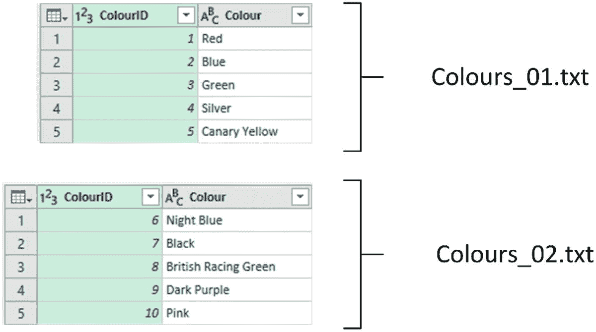

**图 8-11** 用于追加的源数据

1. 创建查询以将以下每个文本文件加载到 Excel 工作表中。由于这在第 2 章中已有解释，我在此不再重复原理。两个文件均位于 `C:\DataMashupWithExcelSamples\MultipleIdenticalFiles` 文件夹中：
   1. `Colours_01.txt`
   2. `Colours_02.txt`
2. 将查询命名为 `Colours_01` 和 `Colours_02`。你可以在图 8-11 中看到这两个查询的内容。

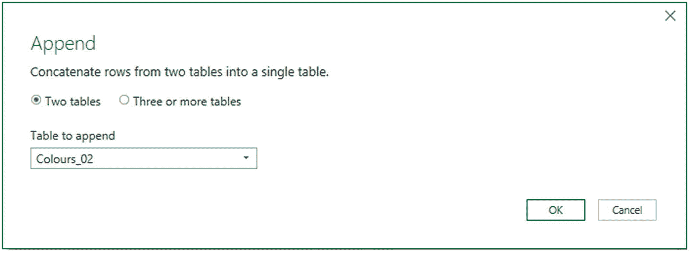

**图 8-12** `Append`（追加）对话框

1. 通过双击 `Queries & Connections`（查询和连接）窗格中的某个查询名称（我使用 `Colours_01`，但任何一个都可以）打开该查询。这将打开 Power Query 编辑器。
2. 在 Power Query 编辑器 Home（主页）功能区中，点击 `Append Queries`（追加查询）按钮右侧的箭头，然后选择 `Append queries as new`（将查询追加为新查询）。将出现 `Append`（追加）对话框。
3. 确保选中 `Two tables`（两个表）单选按钮。
4. 从 `Select Table to Append`（选择要追加的表）弹出窗口中，选择查询 `Colours_02`。该对话框将类似于图 8-12 所示。

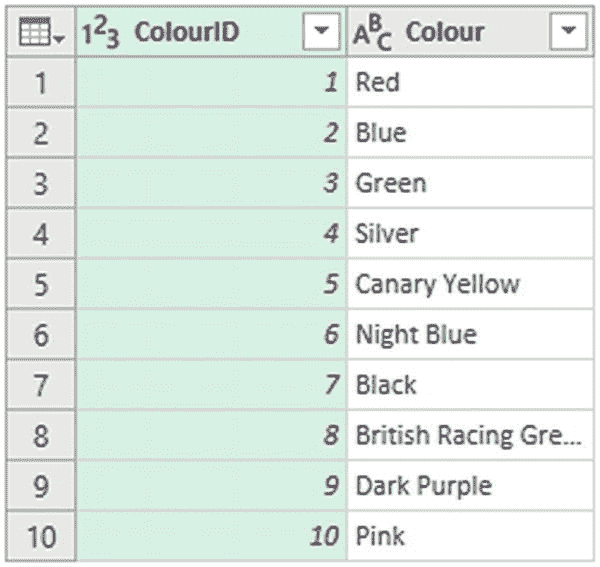

**图 8-13** 包含追加数据的新查询

1. 点击 `OK`。两个输出表的数据会追加到一个新查询中。你可以在图 8-13 中看到结果输出的示例。

现在，你可以继续应用所需的任何修改。你会注意到，当表被追加时，列名不会作为数据的一部分重复出现。

这种方法的一个有趣之处在于，你已经在两个源表和新查询之间建立了链接。这意味着，当你刷新源数据时，不仅 `Colours_01` 和 `Colours_02` 表中的数据会更新，你刚刚创建的“派生”查询也会更新。

#### 追加多个查询的内容

`查询编辑器`并不限制你一次只能追加两个文件。你可以（如果确实需要）追加数量几乎不限的相同文件。此外，追加 Excel 文件与追加文本或 CSV 文件一样简单——如下例所示：

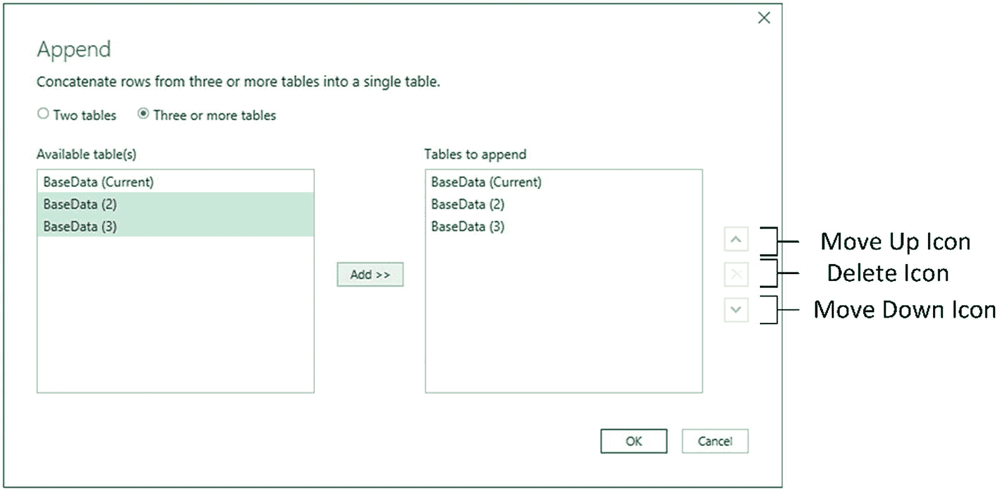

*图 8-14: 追加多个查询*

1. 创建查询，加载文件夹 `C:\DataMashupWithExcelSamples\MultipleIdenticalExcel` 中 Excel 文件 `BrilliantBritishCars1.xlsx` 内名为 `BaseData` 的工作表数据。
2. 重复步骤 1，加载同一文件夹下文件 `BrilliantBritishCars2.xlsx` 和 `BrilliantBritishCars3.xlsx` 中包含的数据。
3. 双击右侧`查询和连接`窗格中名为 `BaseData` 的查询，以打开`查询编辑器`。
4. 单击`追加查询`按钮。
5. 在`追加`对话框中，选中`三个或多个表`单选按钮。
6. 按住 Ctrl 键并单击对话框左侧`可用表`列表中的 `BaseData (2)` 和 `BaseData (3)`。
7. 单击`添加`按钮。此时`追加`对话框的外观如图 8-14 所示。
8. 单击`确定`。来自查询 `BaseData (2)` 和 `BaseData (3)` 的数据将被追加到当前查询 (`BaseData`) 中。

通过此技术，你将多个源表“编译”成了一个输出表。值得注意的是，你可以：

-   通过单击查询（或按住 Ctrl 键单击多个查询），然后点击对话框右侧的叉号图标，从右侧要追加的查询列表中移除查询。
-   通过单击要移动的查询，然后点击对话框右侧的上箭头和下箭头来更改查询的加载顺序。

## 更改数据结构

有时，你的需求会超出我们到目前为止在讨论数据清洗和转换时所介绍的技术范畴。鉴于你获取的数据形状，某些数据结构需要更彻底的改造。我将此类别中的内容列举如下：

-   逆透视数据
-   透视数据
-   转置行和列

这些技术中的每一种都是为了满足数据加载中特定但频繁出现的需求而设计的，所有这些内容都将在接下来的几页中描述。

### 逆透视表

有时，你可能需要分析以“透视”或“非规范化”格式提供的数据。这实质上意味着，本应放在单个列中的信息被拆分并放置到了多个列中。图 8-15 给出了一个透视数据集的前几行示例，该数据集可以在文件 `C:\DataMashupWithExcelSamples\PivotedDataSet.xlsx` 中找到。

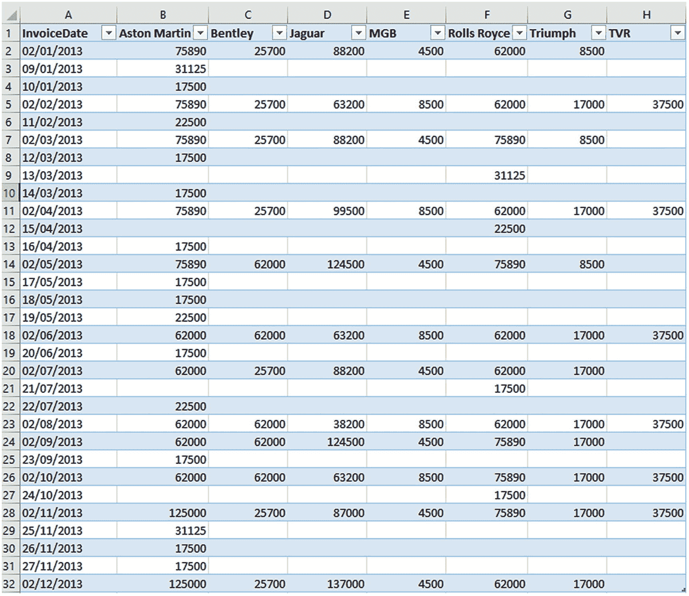

*图 8-15: 一个透视数据集*

要正确分析此数据，我们需要将汽车品牌从列标题转换为特定列的内容。幸运的是，这并不难：

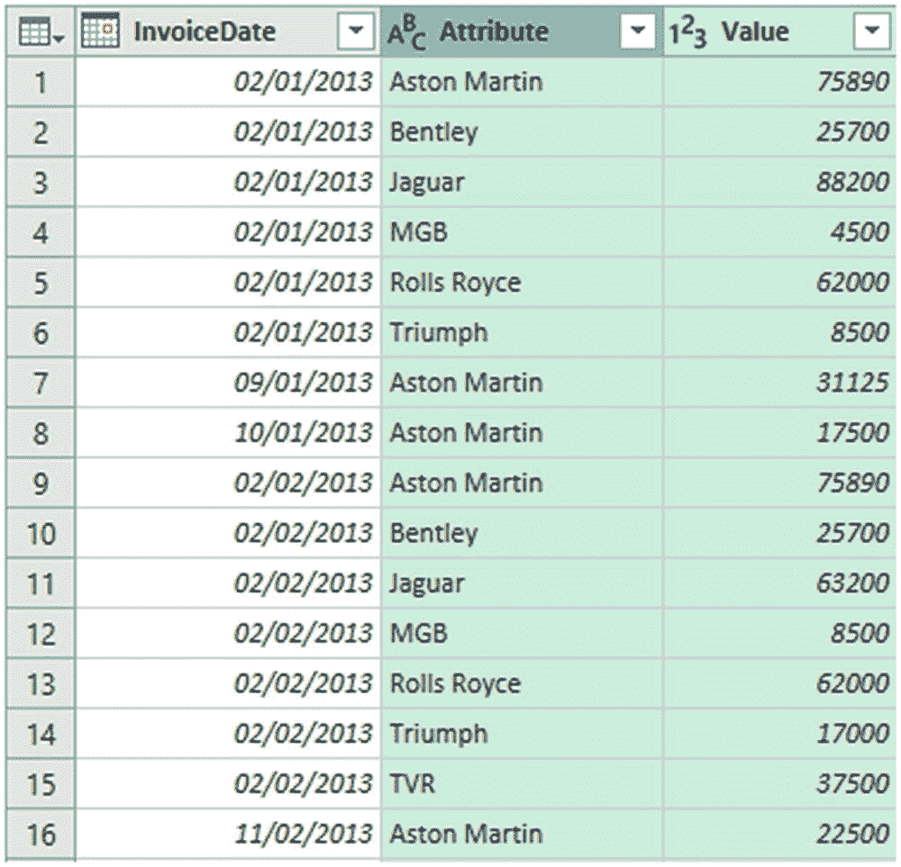

*图 8-16: 一个逆透视数据集*

1. 在一个新的 Excel 文件中，单击`获取数据 ➤ 来自文件 ➤ 来自 Excel`，以连接来自 `C:\DataMashupWithExcelSamples\PivotedDataSet.xlsx` 文件的 `PivotedCosts` 表到 Power Query 中。确保不要加载数据，而是从`导航器`中单击`转换数据`。
2. 确保第一行被设置为表标题。
3. 在`查询编辑器`中，选择所有你想要逆透视的列。在此示例中，这意味着所有*除了第一列之外*的列（所有汽车品牌）。
4. 在`转换`功能区，单击`逆透视列`按钮（或右键单击任意选中的列，然后从上下文菜单中选择`逆透视列`）。表格会被重新组织，前几条记录如图 8-16 所示。`逆透视的列` 被添加到`应用的步骤`列表中。
5. 重命名 Power Query 命名为 `属性` 和 `值` 的列。

现在数据以标准的表格形式呈现，因此可用于创建数据模型（或加载到 Excel 工作表中），作为进一步分析的基础。

> **注意：** 如果你单击`逆透视`按钮右侧的小三角形，会显示另一个菜单选项。这是`逆透视其他列`选项，当运行转换时，它会将*未*选中的所有列的内容切换为行。

#### 逆透视选项

使用`转换`功能区中的`逆透视列`按钮弹出菜单进行逆透视数据时，有几个可用的选项：

-   *逆透视其他列*：这将把所有其他列的内容添加到逆透视输出中。
-   *仅逆透视选中的列*：这只将所有预先选中的列的内容添加到逆透视输出中。

> **注意：** 与应用`查询编辑器`中的许多技术一样，在执行透视和逆透视操作之前，选择正确的列非常重要。

### 透视表

在某些情况下，你可能需要将数据从列切换到行，以便高效使用。这种操作称为*透视数据*。毫不奇怪，它与你上一节看到的逆透视过程非常相似。由此产生的数据通常称为“交叉表”或“数据透视表”。

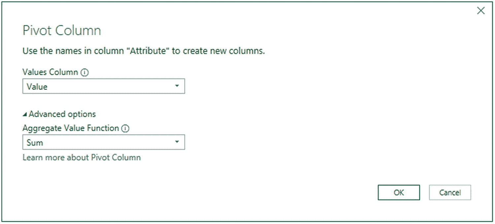

*图 8-17: 透视列对话框*

1. 按照上一节的步骤 1 到 3 进行操作，最终得到如图 8-15 所示的数据表。
2. 单击 `属性` 列内部。
3. 在`转换`功能区，单击`透视列`按钮。将出现`透视列`对话框。
4. 选择 `值`（数据列）作为通过透视转换进行聚合的值列。
5. 展开`高级选项`，确保选择`求和`作为`聚合值函数`。`透视列`对话框将如图 8-17 所示。

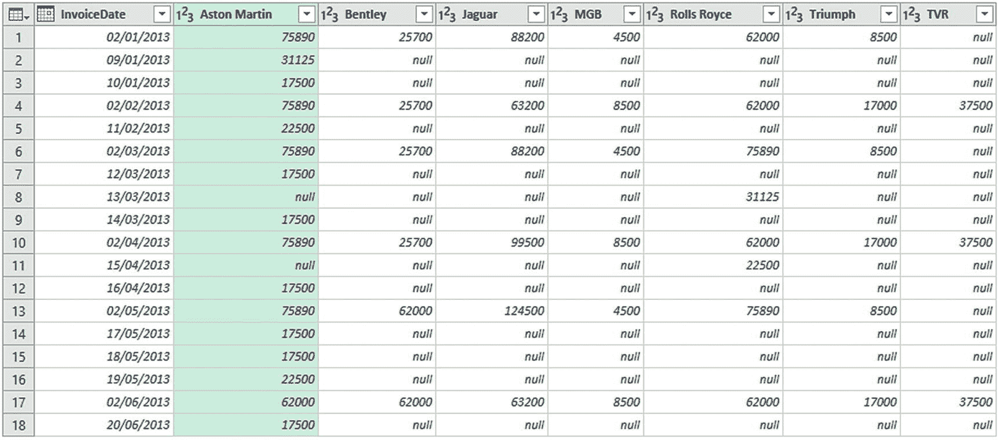

*图 8-18: 透视后的数据*

6. 单击`确定`。表格被透视，外观如图 8-18 所示。`透视的列` 被添加到`应用的步骤`列表中。

> **注意：** `透视列`对话框中的`高级选项`部分允许你选择应用于透视表中值的聚合操作。

### 转置行和列

有时，你可能会遇到一个源表，其列需要变成行，而行需要变成列。幸运的是，对于 Power Query 来说，这是一键转换。操作方法如下：

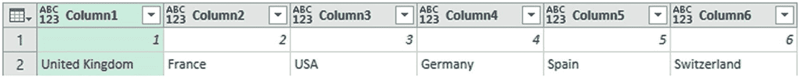

*图 8-19: 一个需要转置的数据集*

1. 在 Power Query 编辑器中连接到 Excel 文件 `C:\DataMashupWithExcelSamples\DataToTranspose.xlsx`。你需要选择 `Sheet1`。你将看到一个如图 8-19 所示的数据表。
2. 在`转换`功能区，单击`转置`按钮。数据被转置并显示为两列，就像你在第 2 章中看到的 `CountryList.txt` 文件一样。
3. 重命名生成的列。

好的，作为高级文档工程师和翻译员，我将遵循您的注意事项和示例，将提供的英文文本翻译成中文。

## 直接从查询编辑器内部加载数据

毫无疑问，有时你会希望扩展现有的数据转换流程，并向已在 Power Query 中创建的任何现有查询添加一个新查询。幸运的是，你可以直接从查询编辑器内部完成此操作，而无需切换回 Excel。

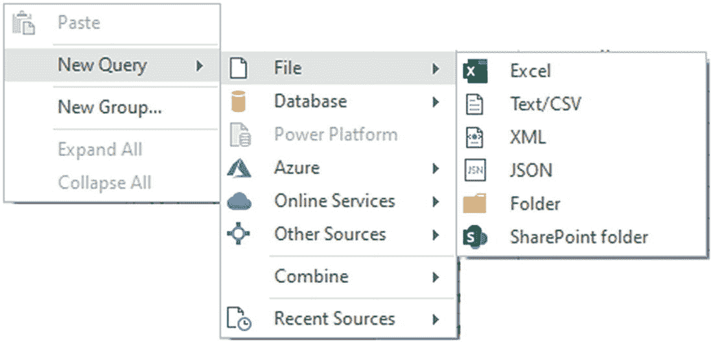

图 8-20：用于在 Power Query 编辑器内部直接添加更多查询的弹出菜单

1.  在查询编辑器中，展开左侧的“查询”窗格（如果尚未显示）。
2.  在“查询”窗格内右击。
3.  选择 `新建查询 ➤ 文件 ➤ Text/CSV`。你可以在图 8-20 中看到此弹出菜单。
4.  按照你在第 2 章中学到的方法，加载 CSV 文件 `Countries.csv`。

一个新查询将被添加到 Power Query 编辑器的“查询”窗格以及 Excel 的“连接和查询”窗格中。

此技术虽然有些隐蔽，但特别有用，因为它可以避免你关闭查询编辑器来创建新查询，然后再返回查询编辑器继续工作。在查询编辑器内部创建新查询时，Excel 的 `获取数据` 按钮中提供的所有数据源选项均可用。

**注意：** 由于你已经在查询编辑器内部，因此在连接到新数据源时没有 `转换数据` 按钮。实际上，你已经在转换数据了。

## 错误显示

有时源数据可能明显包含错误。在这种情况下，Power Query 会标记包含明显错误的单元格。它不会擅自修改数据——毕竟，即使数据被标记为包含错误或异常，它可能仍然有用。

但是，它可以帮助你应用一些基本的数据清理。要了解错误的显示方式：

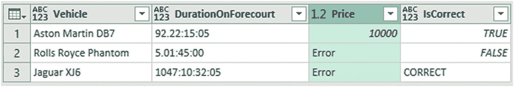

图 8-21：显示错误

1.  打开一个新的空白 Excel 工作簿。
2.  单击 `数据 ➤ 获取数据 ➤ 从文件 ➤ 从工作簿`。
3.  选择 Excel 文件 `SampleErrors.xlsx`，然后单击 `导入`。
4.  选择 `Sheet1`，然后单击 `转换数据` 以在 Power Query 编辑器中显示数据。
5.  单击 `Price` 列内部，然后在“开始”功能区中，将数据类型设置为小数。
6.  在出现的 `更改列类型` 对话框中，单击 `替换当前`。其中两行将显示错误，如图 8-21 所示。

在某些数据集中，被标记为错误的数据可能是你想要更详细检查的数据。关键在于，你可以看到潜在的错误，并决定是将其删除（如下所述），还是返回到源数据并在重新加载数据之前进行更正。

### 删除错误

假设你不需要 Power Query 标记为包含错误的记录，你可以通过一次操作删除所有此类记录：

1.  单击包含错误的列内部；或者，如果你想一次从多个列中删除错误，请按住 Ctrl 键单击包含错误的列标题。
2.  单击“开始”功能区中 `删除行` 按钮上的弹出三角形。将显示弹出菜单。
3.  单击 `删除错误`。任何在选定列中标记有错误的记录都将被删除。`已删除的错误` 将被添加到 `应用步骤` 列表中。

在此处你必须非常小心，不要删除有效数据。只有你自己才能判断，一旦你查看了数据，某一列中的错误是否意味着可以安全地丢弃该数据。在所有其他情况下，最好建议你考虑清理数据，或者干脆保留包含错误的记录。潜在错误的范围和多样性就像数据本身一样广泛。

### 查看错误

如果你保存并关闭包含错误的查询，`查询和连接` 窗格将指示每个查询的错误数量——如图 8-22 所示。

图 8-22：在“查询和连接”窗格中显示包含错误的查询

单击错误链接（在查询中以蓝色显示）将打开查询编辑器并仅显示错误记录。你可以在图 8-23 中看到这一点。

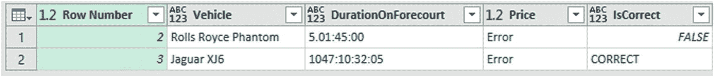

图 8-23：仅显示错误记录

## 数据转换方法

我很理解，面对数量繁多的可用转换选项，你可能会感到困惑。因此，此时记住几个关键原则可能会有所帮助：

-   如有疑问，请右键单击要转换的列。上下文菜单中将列出最常用的可用选项。
-   要更改现有数据，请使用 `转换` 菜单。
-   要添加新列，请使用 `添加列` 菜单。
-   请记住，你可以通过删除数据转换过程中的步骤来“撤销”修改。

## 结论

本章向你展示了如何将源数据从一个或多个可能的源结构化为一个有效的数据表。除此之外，你还了解了如何透视和逆透视数据、如何向上和向下填充数据行，以及如何转置行和列。

你学到的最重要的东西，可能是如何联接各个查询，以便将一个查询中的数据添加到另一个查询中。这可能涉及从单独的查询中查找数据，或者将一个查询的聚合结果带入另一个查询。

最后，你学习了如何识别查询中的错误记录。

现在是时候将你的数据转换技能提升到一个新水平，并学习如何设置复杂的数据摄入和转换例程了。这些是第 9 章的主题。

