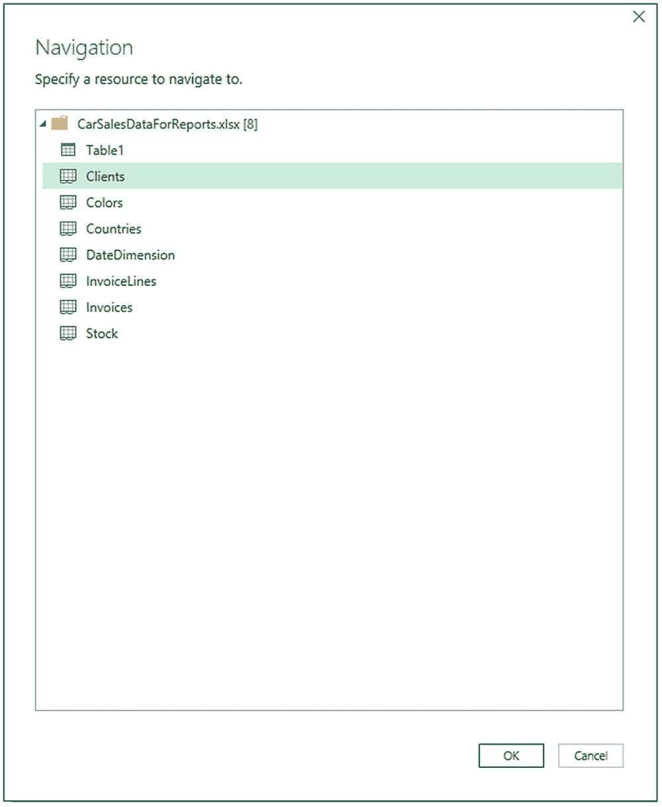
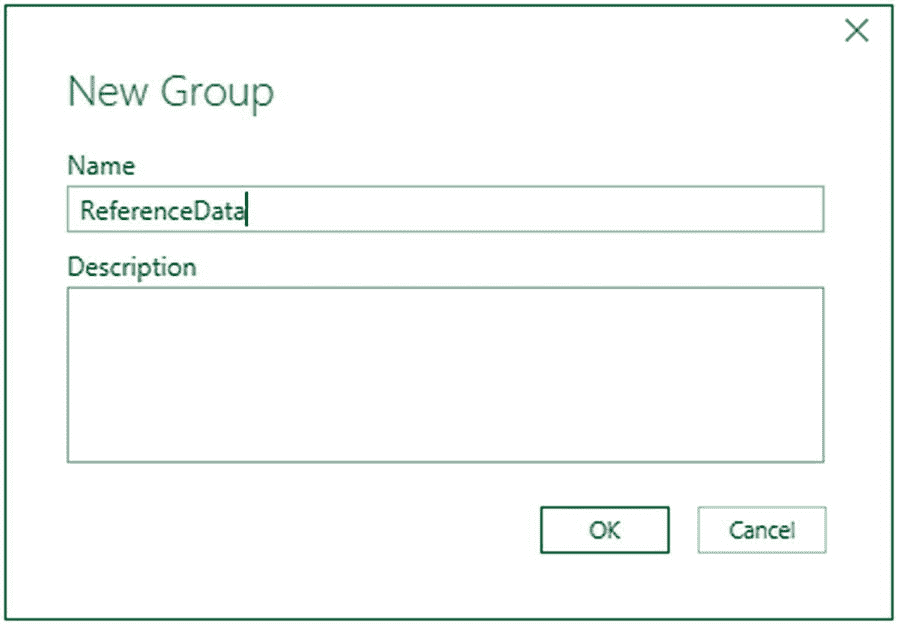
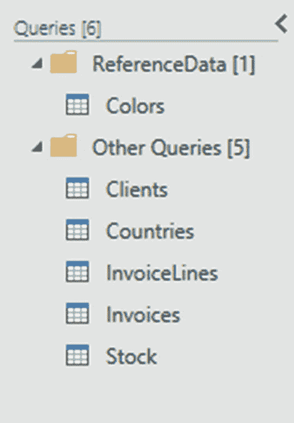
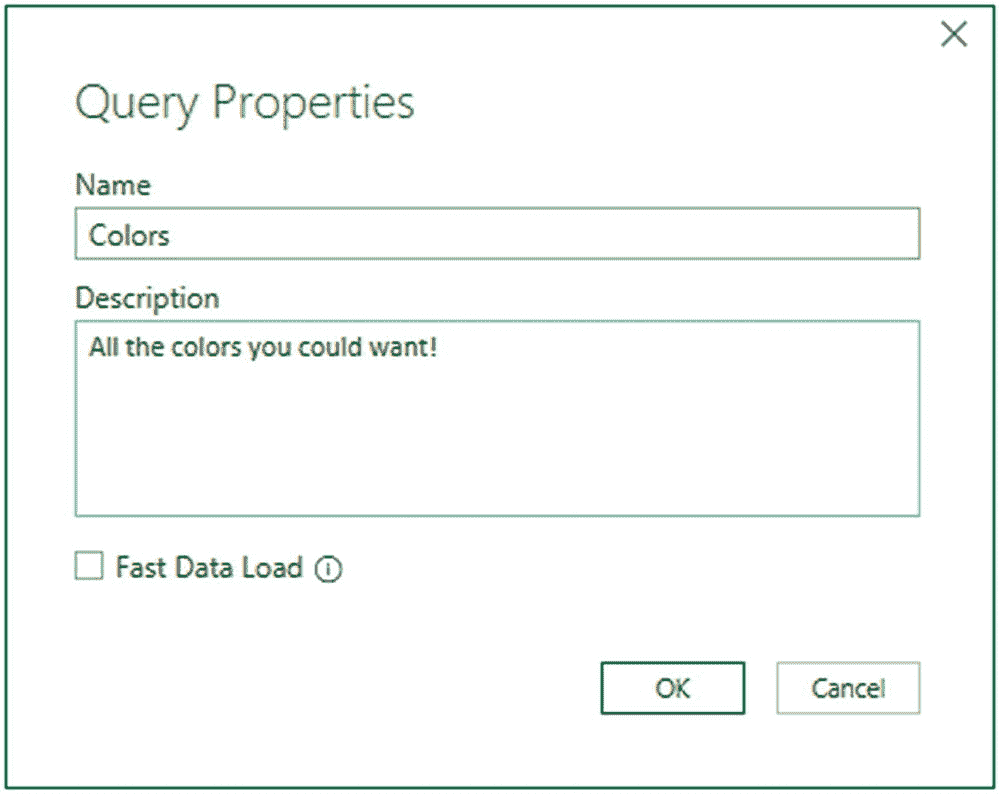
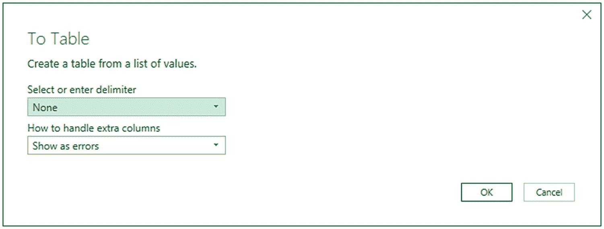
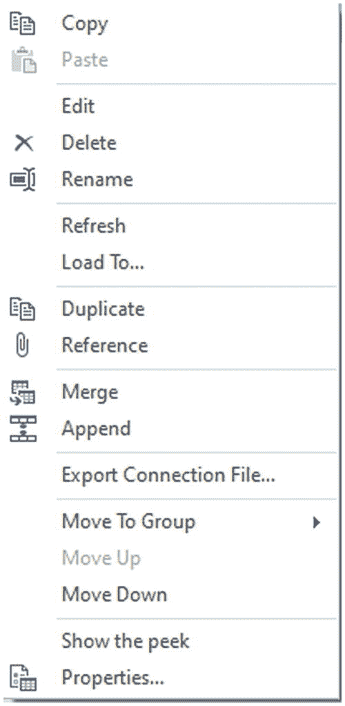

# 10. 组织和管理查询

生成一个稳健高效的数据查询，不仅仅是找到合适的加载和转换函数并将它们按正确顺序排列，还涉及扩展、维护和更新这个过程。这可能是为了在测试查询时纠正错误，也可能是为了使查询适应新的需求。本章将介绍一些你可以应用的技术，以处理查询生命周期的各个阶段。

交付具有洞察力的分析可能意味着要从大量、多样的查询中获取数据。这也可能意味着这些查询需要链接在一起，形成一个数据转换的级联，从而为整理自多个来源的、实用且可用的数据模型准备核心元素。因此，你需要知道如何*管理*你创建的查询，以便高效地使用它们，并在实际场景中让你的查询处于可控状态。

## 管理转换过程

到目前为止，我们应用的所有转换步骤几乎都是可以应用于任何数据表的独立元素。然而，即便是在执行简单的数据加载和转换过程时，你也可能需要逐步完成多个转换，以对数据进行塑形、清理和筛选，从而获得所需结果。这正是 Power Query 方法如此灵活的原因，因为你可以将大多数数据转换步骤应用于几乎任何数据表。其艺术在于将它们按顺序排列，这样每当数据发生变化时，就可以重新处理新的源数据并提供最新的输出结果，从而实现重复使用。

要理解并管理这一过程，关键在于熟悉**查询设置**窗格中的**已应用步骤**列表。该列表按应用顺序包含了你所应用的每个步骤的详细信息。每个步骤都保留了 Power Query 在创建时赋予的名称，并且可以通过以下方式进行修改：

-   重命名
-   删除
-   移动（在某些情况下）

更棒的是，在很多情况下，步骤是可以修改的。这样，你就不必受最初选择的限制，而是有机会对过程中的单个步骤进行调整和改进。这可以让你避免仅仅为了替换 ETL 过程中的一个元素而重建整个步骤序列。

为了尝试修改查询的各种方法，你需要一些初始数据。因此，我建议你首先使用以下 Excel 源文件：`C:\DataMashupWithExcelSamples\CarSalesDataForQueries.xlsx`。该源文件包含连接到另一个 Excel 文件中六个源表的查询，从而模拟了一个真实场景（其中数据源可能来自多个不同的源头，并且具有不同的来源：数据库、文本等）。

打开此文件后，通过双击**查询和连接**窗口中的任意现有查询，切换到**查询编辑器**窗口。

### 修改步骤

如何修改步骤取决于原始转换的应用方式。经过一点练习，这就会变成一种本能反应，并且始终需要先单击要修改的步骤，然后应用不同的修改。如果你调用功能区选项（例如更改数据类型），则只需直接从功能区应用另一种数据类型即可更改数据类型。如果你使用了显示对话框的选项（例如拆分列等），则可以右键单击**已应用步骤**列表中的该步骤，然后从上下文菜单中选择**编辑设置**。或者，如果你愿意，也可以单击大多数（但不是所有）步骤右侧显示的“齿轮”图标，以显示一个对话框，你可以在其中调整步骤设置。此对话框将显示你最初应用的所有选项和设置；你可以根据需要在此进行任何修改。

最后一种便于修改过程设置的方法是编辑每次单击某个步骤时在公式栏中显示的公式。然而，这需要理解作为数据转换过程基础的每段代码的所有复杂性。我将在第 12 章中简要介绍代码修改。

#### 提示

如果你能强迫自己组织好使用 Power Query 编写的过程，那么稍微的预先思考和规划就能带来巨大的回报。例如，某些任务（例如设置数据类型）可以在一个操作中完成。这意味着你只需在一个地方查找一组相似的数据转换。不仅如此，如果你稍后需要更改某列的数据类型，我建议你在进行任何进一步更改之前单击**已更改的类型**步骤。这样，你就可以扩展原始步骤，而不是创建其他步骤——后者可能会使过程更加混乱且不必要地冗长。

### 重命名步骤

Power Query 使用应用的转换名称来命名步骤。这意味着如果稍后应用了另一个类似的步骤，Power Query 会使用相同的名称并加上数字增量。由于在审查一系列转换步骤时，这并不总是易于理解，因此你可能更愿意为各个步骤指定更用户友好的名称。操作方法如下：

1.  选择查询（或源表/工作表，如果你愿意）。在此示例中，我将使用**客户**查询。
2.  右键单击要重命名的步骤，例如**已更改的类型**。
3.  从上下文菜单中选择**重命名**。
4.  输入新名称。我将使用 `NewDataTypes`。
5.  按 Enter 键。

该步骤即被重命名，新名称将出现在**查询设置**窗格的**已应用步骤**列表中。这样，当你在数天、数周甚至数月后重新查看数据转换过程时，就能更直观地理解你所定义的过程，以及当初为何如此塑造数据。

#### 注意

在 Power Query 中命名步骤时，你可以使用大写或小写字符，或者两者混合。你也可以添加空格和特殊字符。

### 删除一个步骤或一系列步骤

删除一个步骤非常容易，但这样做可能会产生严重后果。这是因为 ETL 过程通常是一系列紧密耦合的事件，每个事件都密切依赖于前一个事件。因此，删除一个步骤可能导致所有后续步骤失败。知道哪些事件可以在没有严重后果的情况下删除，取决于你正在开发的过程类型以及你对 Power Query 的经验。无论如何，如果你需要删除一个步骤，应该这样做：

**图 10-1** – 删除步骤对话框

1.  将指针悬停在要删除的过程步骤上。
2.  单击出现的交叉 (×) 图标。
3.  选择**删除**。*可能会*出现**删除步骤**对话框（如果删除此步骤可能会产生意外的负面后果），如图 10-1 所示。
4.  单击**删除**按钮确认。该步骤即被删除。

如果——并且这非常可能——删除此步骤导致过程其余部分出现问题，你将看到数据表被一条错误消息替代。此消息的内容将根据 Power Query 遇到的错误类型而有所不同。

在描述此技术时，我特意提到了你*可能会*看到**删除步骤**对话框。如果你删除的是步骤序列中的最后一个步骤，那么你很可能不会看到它，因为应该不会有任何潜在的可怕后果；最坏的情况是，你需要重新创建该步骤。如果你删除的是过程中间的某个步骤，那么在可能造成大量问题之前，你可能需要认真考虑是否要这样做。因此，在这些情况下，系统会要求你确认删除。

另一种方法是右键单击要删除的步骤，然后选择**删除**。你可能仍然需要确认删除。

如果你意识到某个过程步骤中的错误导致你截至过程结束的所有工作都无效，那么与其逐个删除多个元素，不如在前述练习的第 2 步中，从上下文菜单中选择**删除至结尾**。

### 放弃更改

如果在使用 Power Query 工作时，你突然发现自己刚刚毁掉了数小时的工作成果，那么（深吸一口气后）

图 10-2 Power Query 中的放弃更改对话框

1.  点击 Power Query 编辑器窗口右上角的关闭按钮（小叉号）。将会出现如图 10-2 所示的对话框。
2.  点击 `Discard` 关闭 Power Query，不应用任何更改。

不要指望像在其他桌面应用程序中那样使用撤销功能。为了降低你的血压，你或许更倾向于在*删除*任何步骤之前，保存一份包含复杂数据转换过程的文件副本。你也可以将整个数据转换过程复制为“M”代码——正如你将在第 12 章中学到的那样。

### 修改现有步骤

当你创建一系列已应用步骤来生成和转换数据流时，Power Query 并不会试图将你锁定在一个僵化的事件序列中。当你发现需要更改过程中的某个步骤时，这一点就变得尤为明显。

例如，假设你发现从 Excel 文件中选择初始数据时加载了错误的工作表。你无需重复整个过程，只需将一个工作表名称替换为另一个即可。

假设你已经打开了 Excel 工作簿 `CarSalesDataForQueries.xlsx` 并切换到了查询编辑器：

图 10-3 用于步骤修改的导航对话框

1.  选择你想要修改的查询（在此示例中为“Clients”）。
2.  点击要修改的步骤（在此例中，将是 `Navigation`）。
3.  点击步骤名称右侧的齿轮图标。相应的对话框将会出现。在此例中，将是你在图 10-3 中看到的 `Navigation` 对话框。
4.  点击你想要用来替换当前数据集的表或工作表（在此示例中为 `Table1`）。
5.  点击 `OK`。

查询编辑器会将一个源数据集替换为另一个。它还可能会添加额外的步骤，以确保数据适用于查询。

正如你在前九章中看到的，Power Query 提供了极其广泛的数据引入和修改可能性。因此，我无法在这里就修改 `已应用步骤` 描述所有可能的选项。不过，其原则很简单：

- 如果查询编辑器可以修改某个步骤，齿轮图标将显示在该步骤名称的右侧。
- 点击修改（齿轮）图标将显示用于创建该步骤的对话框（即使该步骤是由 Power Query 自动创建的）——或者显示一个允许你修改该步骤的对话框。

某些步骤不会显示修改图标。这是因为该步骤无法被修改，只能被移除（至少在使用查询编辑器界面时是如此）。作为示例，请添加以下步骤：

1.  选择你想要修改的查询（在此示例中为“Clients”）。
2.  点击最后一个步骤。
3.  右键点击 `Address2` 列，然后选择 `Remove`。

在 `已应用步骤` 列表中会出现一个新步骤，名为 `Removed Columns`。此步骤没有修改图标。因此，目前你可以移除它，但*不能*修改它——至少不能通过图形用户界面进行修改。不过，你可以修改步骤的代码，正如你将在第 12 章中学到的那样。

**注意**：修改现有步骤并非“万能灵药”。这是因为一系列数据转换可能高度依赖于为特定数据结构开发的定制逻辑。例如，这也就意味着你只能将数据源替换为另一个结构几乎完全相同的源。然而，在许多情况下，修改某个步骤可以避免你重写整个数据流序列。

### 添加步骤

你可以在序列的任何位置添加步骤。你所需要做的就是，在点击与要插入的新步骤相对应的任何功能区图标*之前*，先点击*位于*该新步骤*之前*的步骤。与删除步骤时的情况一样，Power Query 会显示一个警告提示，告知你此操作*可能*会从这个新步骤开始，给后续流程带来问题。

### 更改流程步骤顺序

从技术上讲，可以对过程中的步骤重新排序。然而，根据我的经验，这并非总是可行，因为更改过程中步骤的顺序可能像删除步骤一样造成严重破坏。尽管如此，你仍然可以像这样尝试：

1.  右键点击你想要重新排序的步骤。
2.  从上下文菜单中选择 `上移` 或 `下移`。

我仍持悲观态度，认为这不会有多大奇效，但知道有这个功能也不错。

**提示**：请记住，在调整流程应用顺序之前，点击任何流程步骤都会使 Power Query 窗口中的表格刷新，以显示截至该选定步骤的数据状态。这是理解流程以及 ETL 过程如何执行的非常清晰的视觉指南。实际上，逐一点击步骤将会“滚动浏览”数据中的变化，并精确演示整个流程是如何构建和工作的。

### 排序方法

考虑到可用的数据转换选项众多，你可能很想知道如何使用 Power Query 来最好地处理新的 ETL 项目。我明白所有项目都各不相同，但作为一个粗略的指南，我建议尝试按如下顺序组织你的项目：

1.  将样本数据加载到 Power Query 中。
2.  提升或添加易于理解的列标题。例如，当某个列本可以命名为（比如）`ClientName` 时，你肯定不想在处理过程第 47 步时还要琢磨 `Column29` 是什么。
3.  移除任何你不需要的列。数据集越小，处理速度越快。更重要的是，如果你只关注真正需要的信息，你会发现更容易集中精力理解数据。任何被移除的列都可以通过删除或编辑执行移除操作的步骤来恢复到数据集中。
4.  更改表中每一列的数据类型。正确的数据类型是许多转换步骤的基础，并且对于筛选至关重要，因此最好尽早解决它们。
5.  筛选掉任何你不需要的记录。再次强调，数据集越小，处理速度越快。这包括去重。
6.  解析任何复杂的 JSON 或 XML 元素。
7.  执行任何必要的数据清洗。
8.  执行任何必要的转换。
9.  执行任何必要的列拆分或添加自定义列。
10. 添加任何派生列。
11. 添加任何计算或数据的逻辑转换。
12. 处理 ETL 过程中产生的任何错误记录。

再次强调，我必须申明这并不是一个权威指南。然而，我希望当你使用 Power Query 创建数据加载和转换过程时，它能帮助你“透过树木看到森林”。

### 错误记录

某些数据转换操作会导致错误。在整合源数据时，这有时是不可避免的事实。例如，在一个大型数据集中，可能有几行数据里，某个日期列包含了一些文本或数字的记录。如果你将该列转换为日期数据类型，那么任何无法转换的值都会显示为错误值。

## 管理查询

一旦你使用 Power Query 一段时间，你很可能会沉迷于基于更广泛的数据源创建更多、更深入的分析。这不可避免地意味着要学习如何高效且富有成效地管理那些为数据模型提供数据的数据源。

幸运的是，Power Query 内置了一整套小巧的查询管理工具来帮助你。这些工具包括：

- 将查询整理并分组到文件夹中
- 复制查询
- 引用查询
- 记录查询
- 将列添加为新查询

让我们逐一来看这些功能。

> **注意**：查询管理在很大程度上依赖于`查询`窗格。Power Query 默认隐藏此窗格，因此你需要点击数据左侧折叠的`查询`窗格右上角的 V 形图标来显示它。此外，许多查询管理功能也可以直接从 Excel 内部的`查询和连接`窗格的弹出菜单中使用。

### 整理查询

当你在 Power Query 编辑器中使用的查询数量从几个到几十个时，你可能会希望对它们的组织方式施加一些控制。首先，你可以修改查询在 Power Query 编辑器窗口左侧`查询`窗格中的显示顺序。这让你可以覆盖默认顺序，即最近添加的数据源会出现在列表底部。

要更改查询在列表中的位置，请执行以下操作：

1.  如果`查询`窗格尚未显示，请将其显示出来。
2.  右键单击要移动的查询。
3.  从上下文菜单中选择`上移`（或`下移`）。

你需要多次执行此操作才能将查询向上或向下移动多个位置。因此，另一种方法——在列表中向上或向下拖动查询——可能也值得使用。

### 分组查询

你还可以创建自定义组，以更好地组织在 Excel 文件中使用的查询。这不会对查询的工作方式产生任何影响。分组查询仅仅是一种组织技术，它不会以任何方式改变你在 Excel 报表模式下看到的数据表。但是，你会在 Excel 的`查询和连接`窗格中看到你创建的组。

#### 创建新组

以下是创建新组的方法：

**图 10-4** 新建组对话框

1.  右键单击要添加到新组的查询。我将使用从 Excel 文件 `CarSalesDataForQueries.xlsx` 中打开的查询编辑器中的 `Colors` 查询。
2.  从上下文菜单中选择`移动到组` > `新建组`。将出现`新建组`对话框。
3.  输入组名，并（可选）输入描述。我将组命名为 `ReferenceData`。对话框将类似于图 10-4 所示。
4.  单击`确定`。

新组创建完成，所选查询将出现在该组中。`查询`窗格将类似于图 10-5 所示。

**图 10-5** 添加了新组的“查询”窗格

> **注意**：默认情况下，所有其他查询都会添加到名为`其他查询`的组中。

如果你创建了数十个查询，这项技术确实可以帮助你管理复杂的数据加载过程。正如你所料，你可以通过单击文件夹名称左侧的三角形来展开或折叠一个组。

#### 重命名组

你可以重命名任何已添加的组。

1.  右键单击要重命名的组。
2.  从上下文菜单中选择`重命名`。
3.  编辑或替换名称。
4.  按`回车键`。

> **注意**：`其他查询`组无法重命名或删除。默认情况下，所有新查询都将添加到此组。你也可以双击该组直接进行重命名。

#### 向组中添加查询

要将查询从其当前组移动到另一个组，可以执行以下步骤：

1.  右键单击要添加到另一个现有组的查询。
2.  从上下文菜单中选择`移动到组` > *目标组名称*。

所选查询将被移动到选定的组。该组结构也将在 Excel 的`查询和连接`窗格中可见。

### 复制查询

如果你已经做了大量的数据转换工作，你很可能会希望在进行任何可能有风险的修改之前，保留原始查询的副本。幸运的是，这非常简单。

1.  右键单击要复制的查询。
2.  从上下文菜单中选择`复制`。

查询被复制，副本会出现在与源查询相同的组内的查询列表中。它的名称与原始查询相同，但末尾会附加一个带括号的数字。你可以在`查询设置`窗格、查询编辑器窗口左侧的`查询`窗格或 Excel 本身的`查询和连接`窗格中随时重命名它。

> **注意**：如果你愿意，也可以复制并粘贴查询。这种技术的优点在于，你可以在*粘贴*查询副本之前，通过单击所需目标组的文件夹图标，为复制的查询选择目标组。

#### 引用查询

如果你正在构建一个复杂的 **ETL**（提取、转换、加载）例程，你可能会考虑将工作分阶段进行，以便更好地管理流程。为了帮助你实现这一点，Power Query 编辑器允许你将一个查询的输出用作另一个查询的源。这使你能够将流程的不同部分（例如，结构、筛选、然后清洗）分解到单独的查询中，这样你就可以在不同的查询中专注于转换的不同方面。

要将一个查询的输出用作另一个查询的源数据，你需要*引用*一个查询，操作如下：

1.  右键单击要用作新查询源数据的查询。
2.  从上下文菜单中选择 `Reference`。一个新的查询将出现在“查询”窗格的查询列表中。
3.  右键单击新查询，选择 `Rename`，并为其指定一个有意义的名称。

除非你重命名该查询，否则新查询将与原始查询同名，并在末尾附加一个带括号的数字。如果单击新查询，你会在被引用的查询中看到与单击源查询中最后一步时完全相同的数据。

从现在开始，你在被引用（源）查询中所做的任何修改，都会对用作第二个查询源的数据产生影响。换句话说，你已经在数据引入过程中创建了一个查询序列。

在实践中，我认为你不会希望使用同一个查询的两个副本来创建报表。实际上，如果一个查询被用作“中间”查询，它所包含的数据甚至可能不是完全可用的。因此，你可能希望*阻止中间查询将数据输出到 Excel*。操作如下：

1.  在“数据”功能区中，单击 `获取数据` ➤ `来自文件` ➤ `从工作簿`。
2.  选择文件 `BrilliantBritishCars.xlsx` 并单击 `导入`。
3.  在“导航器”对话框中，选择源表 `BaseData`。
4.  单击 `加载` 按钮右侧的弹出菜单，然后选择 `加载到`。将显示“导入数据”对话框。
5.  单击 `仅创建连接`。
6.  单击 `确定`。

源查询将出现在 `查询和连接` 窗格中，但会被标记为 `仅限连接`。

**提示**

你无法在 Excel 的 `查询和连接` 窗格中隐藏查询，但你可以将引用查询放在一个自定义组中，以便在视觉上隔离它们。

你可能想知道为什么要创建“中间”查询。这里有一些想法：

-   你希望将复杂的数据转换隔离到更易于管理的子集中。例如，你可能想要一个中间查询来转换数据，然后由后续查询来清洗数据。
-   你可能希望应用一组通用的初始转换，然后将这些转换分别输入到两条独立的数据准备路径中——一条是数据的详细视图，另一条是汇总视图。

**注意**

将现有查询转换为仅连接（以备用作引用查询）的方法是，删除包含输出数据的工作表（或 Power Pivot 工作表）。

#### 记录查询

在一个复杂的 **ETL** 过程中，很容易混淆或干脆忘记哪个查询做什么。因此，我总是建议通过添加有意义的说明来记录查询。

*图 10-6* 为查询添加说明

1.  右键单击你想要添加注释的查询。
2.  从上下文菜单中选择 `属性`。将出现“查询属性”对话框。
3.  添加说明。其结果可能类似于图 10-6 中所示的对话框。
4.  单击 `确定`。

如果你将光标悬停在查询编辑器“查询”窗格的查询列表中的查询名称上，你添加的说明现在将作为工具提示显示。如果你将鼠标指针悬停在 Excel 的 `查询和连接` 窗格中的查询上，你还会在此查询的“预览”窗口中看到该说明。

**注意**

单击 `快速数据加载` 会尝试更快地加载数据，但在加载数据期间，Power Query 可能会在一段时间内无响应。

#### 将列添加为新查询

有时你可能希望提取一列数据并将其用作单独的查询。例如，可能是你需要它包含的数据作为另一个查询的参考数据。以下步骤说明了如何实现这一点：

*图 10-7* “到表”对话框

1.  在左侧的查询列表中，选择包含你想要隔离为新查询的列的查询。
2.  右键单击包含你要隔离的数据的列标题。
3.  从上下文菜单中选择 `添加为新查询`。将创建一个新查询。它以原始查询和源列的名称命名。
4.  在“转换”功能区中，单击 `到表`。将出现“到表”对话框，如图 10-7 所示。
5.  单击 `确定`。新查询将成为一个数据表，并具有你选择的列的名称。
6.  如果你认为有必要，请重命名该查询。

现在，你可以在数据模型中使用此查询，并将其用作一组链接查询流程的一部分。

**注意**

以这种方式创建的查询与从中获取数据的源查询是*完全断开的*。换句话说，对源数据的任何刷新对从列创建的新查询都*没有*影响。

## 从“查询和连接”窗格管理查询

你不必切换到查询编辑器来执行本章中介绍的许多查询管理任务。你可以直接从 `查询和连接` 窗格执行多个操作。

例如：

*图 10-8* “查询和连接”窗格弹出菜单

1.  打开 Excel 文件 `Chapter10Sample.xlsx`，并显示 `查询和连接` 窗格。
2.  右键单击其中一个查询。将出现弹出菜单，如图 10-8 所示。
3.  单击你想要的菜单选项。

如你所见，并非所有查询管理选项都可用。但是，你可以使用此上下文菜单来：

-   创建、删除和修改查询组或查询
-   在组之间和组内移动查询
-   展开和折叠组
-   更改组属性
-   复制和粘贴查询和组
-   复制和引用查询
-   合并和追加查询
-   更改查询和组属性
-   刷新查询
-   显示查询的预览窗口

**注意**

上下文菜单的内容将根据你是右键单击一个组还是一个单独的查询而有所不同。

## 结论

在本章中，你了解了如何管理和扩展可以使用 Power Query 创建的查询的内容。具体来说，你了解了如何修改数据加载和转换过程中的单个步骤。这包括从重命名步骤到更改过程中步骤的顺序，甚至更改步骤实际执行的规范。

然后你了解了如何管理整个查询。你学习了如何重命名和分组查询，以及如何将查询链接起来，以便一个查询的输出成为另一个查询的数据源。

最后，你学习了如何引用或链接查询，以隔离数据引入过程的各个部分，或将复杂的过程分解为易于管理的部分。

现在是时候学习如何使用 Power Query 中的参数为流程添加交互性了。你将在下一章中发现这一点。

