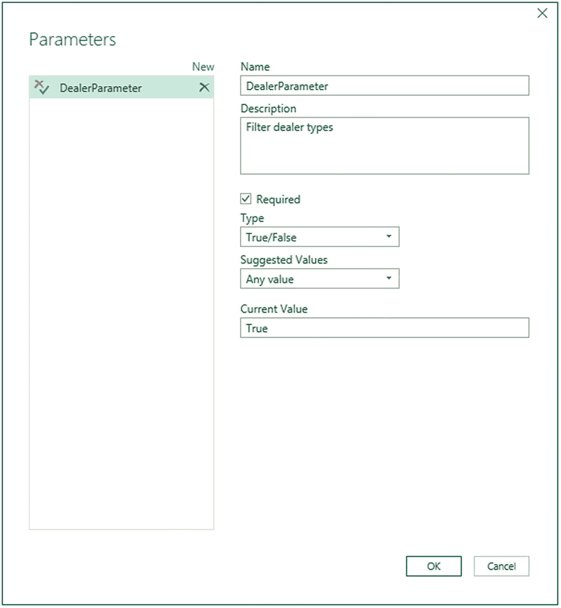
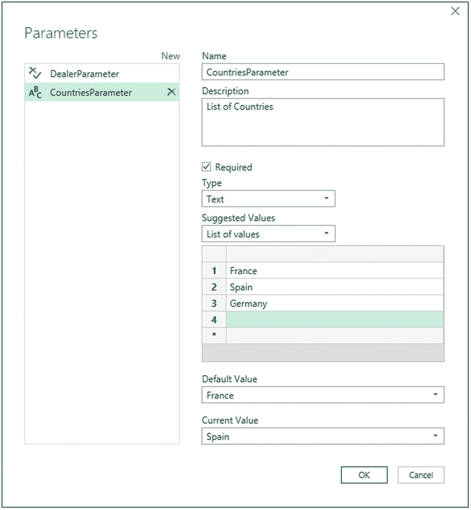
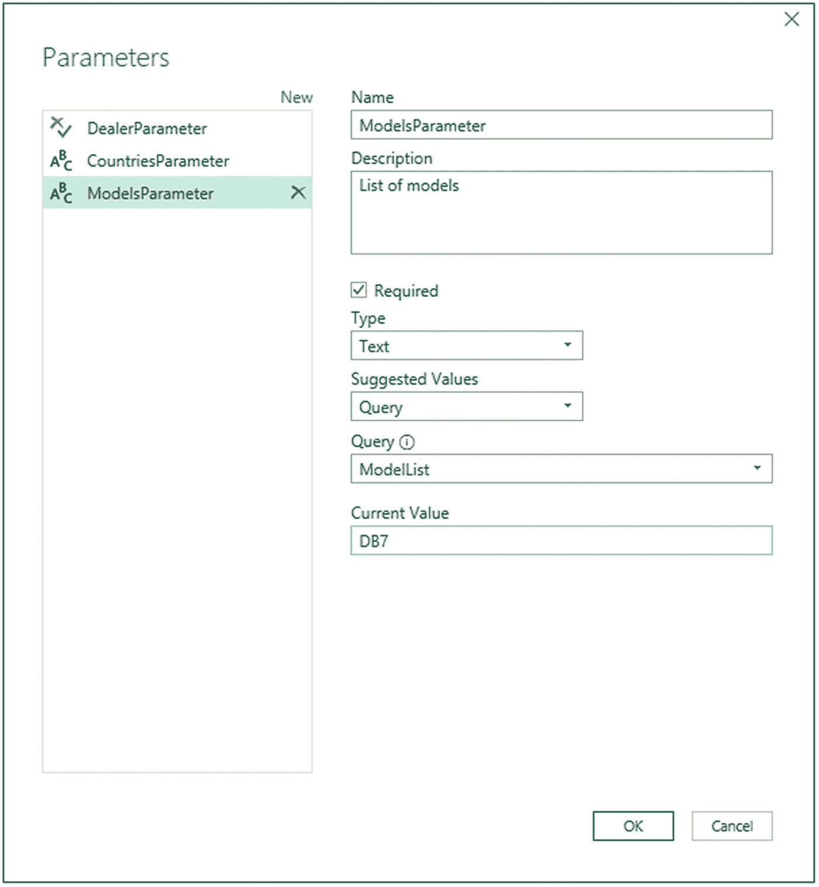
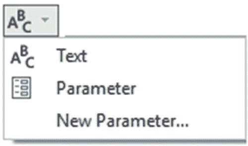
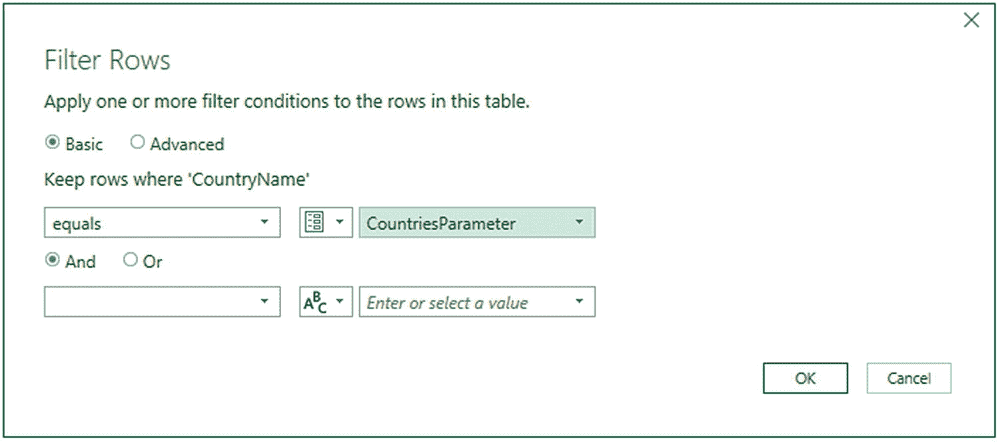
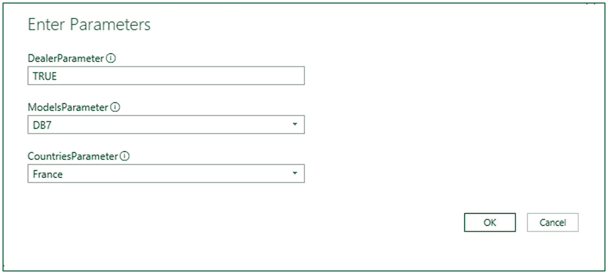
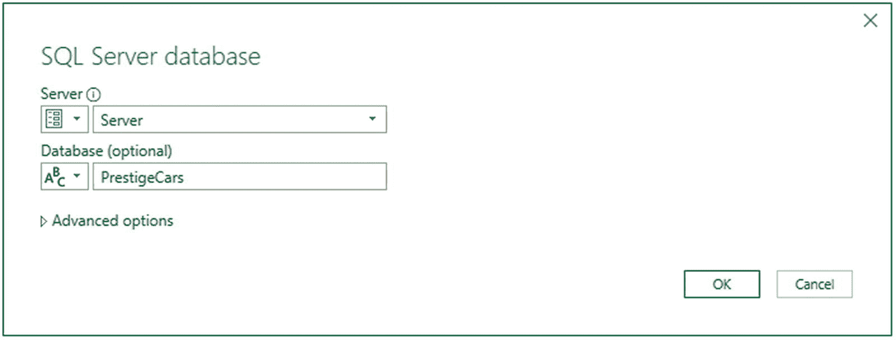

# 11. 参数化查询

并非所有数据流都是固定且可预测的。不可避免地，在某些情况下，您可能希望根据源数据的某些特征来调整数据摄入过程。这可能意味着对查询进行参数化，以允许用户交互或动态调整数据流。为查询添加参数，使您能够针对查询处理的某些方面定义并应用特定条件。

本章示例中使用的所有文件均可从 Apress 网站下载，具体方式参见附录 A。

由于参数完全在查询编辑器内部管理，因此要执行本章中的任何示例，您都需要打开查询编辑器。

## 参数化查询

从本质上讲，参数是一种技术，它使您能够：

*   选择一个值，该值可在一个或多个查询中使用，通过将所需元素注入查询步骤来改变查询流程。例如，该值可以是文件源或筛选值。
*   将潜在参数值的可选范围限制为预定义的选项列表，供用户选择。

目前，用户在运行将应用所选参数的查询之前，有三种基本方式可以选择参数。参数可以是：

*   由您或用户输入的单个值
*   从您手动输入的可能值列表中选择一个值
*   从您使用现有查询创建的可能值列表中选择一个值

因此，使用参数是一个两步过程：

1.  创建参数。
2.  将其应用于查询。

参数实际上不过是一种特殊类型的查询。由于它是一个查询，您可以：

*   将其加载到数据模型中（尽管这很少需要）
*   从另一个查询中引用它
*   像其他任何查询一样构建和修改它

本章将解释如何创建和应用参数。这将包括向您展示在查询编辑器中应用参数以筛选或转换数据的一些方法。

### 创建一个简单参数

最简单的参数就是一个您存储的值，以便稍后用于辅助数据转换。以下是存储一个包含 `True` 值、准备用于筛选后续数据集的参数的方法：



图 11-1 – 参数对话框

1.  打开 Excel 文件 `C:\DataMashupWithExcelSamples\CarSalesDataForQueries.xlsx`（当然，如果它已经打开，则无需此操作）。
2.  显示“查询和连接”窗格（如果尚未显示）。双击“查询和连接”窗格中的任意一个查询，以打开查询编辑器。
3.  在查询编辑器的“主页”功能区中，单击“管理参数”按钮底部的小三角形，然后从可用菜单选项中选择“新建参数”。将出现“参数”对话框。
4.  输入 `DealerParameter` 作为参数名称，并输入 `Filter dealer types` 作为描述。
5.  确保选中“必填”复选框。
6.  从类型弹出列表中选择 `True/False`。
7.  从当前值弹出列表中选择 `True`。对话框将如图 11-1 所示。
8.  单击“确定”。新参数将出现在左侧的“查询”列表中。您可以在图 11-2 中看到这一点。

目前，您所做的只是创建了一个参数并在其中存储了一个值。您将在稍后几页中看到如何使用此参数。如您所见，参数作为查询的一种类型存储在 Power Query 编辑器的“查询”窗格中，默认值显示在查询名称后的括号中。

### 创建一组参数值

虽然单个参数通常很有用，但实际上您可能需要潜在参数的列表。这将允许您或其他用户在某些情况下从预定义列表中选择一个参数值。以下是一个创建参数的示例，该参数包含示例数据中可用国家名称的一个子集：



图 11-3 – 用于一组选项的参数对话框

1.  使用您在上一节中创建的 Excel 文件（基于 Excel 文件 `C:\DataMashupWithExcelSamples\CarSalesOverview.xlsx` 的那个），打开查询编辑器——除非它已经打开。
2.  在查询编辑器的“主页”功能区中，单击“管理参数”按钮底部的小三角形，然后从可用菜单选项中选择“新建参数”。将显示“参数”对话框。
3.  输入 `CountriesParameter` 作为参数名称。
4.  确保选中“必填”复选框。
5.  从类型弹出列表中选择 `Text`。
6.  在“建议的值”弹出列表中，选择“值列表”。
7.  在出现的网格中输入以下三个值：
   1. France
   2. Spain
   3. Germany
8.  从默认值弹出列表中选择 `France`。
9.  从当前值弹出列表中选择 `Spain`。对话框将如图 11-3 所示。
10. 单击“确定”。新参数将出现在左侧的“查询”列表中。

同样，您所做的只是创建了该参数。您将在几页后看到如何应用它。

> **注意**
>
> 如您所见，您选择的任何当前值都会以括号形式显示在“查询”窗格中参数名称的右侧。这有助于您记住当前是哪个值——以及它可能正被用于塑造数据流过程。

好的，作为高级文档工程师和翻译员，我将严格遵循您给出的注意事项和示例格式，将以下英文文本翻译成中文。


## 创建基于查询的参数

手动输入用于选择参数的值列表不仅费力，而且容易出错。因此，您可以使用现有查询中的数据来创建参数中可用的元素系列，而不是手动输入值列表。此外，您手动输入的任何列表都是完全静态的。因此，如果用户需求发生变化，您必须记得更新它们。相比之下，参数列表是动态的。也就是说，如果源数据发生变化，它们会自动更新。

以此为例，假设您想要一个包含公司销售的所有可用汽车品牌的参数：



图 11-4

选项列表的`参数`对话框

1.  使用 Excel 文件 `C:\DataMashupWithExcelSamples\CarSalesDataForQueries.xlsx`，双击 `查询和连接` 窗格中的任意查询以打开查询编辑器。

2.  在 `查询` 列表中选择 `Stock` 查询。

3.  右键单击名为 `Model` 的列标题，然后选择 `添加为新查询`。一个名为 `Model` 的新查询将出现在 `查询` 列表中。此查询包含您所选列的内容。

4.  在新创建的查询中，单击 `转换` 功能区中的 `删除重复项`。`List` 列将仅显示唯一值。

5.  将新创建的查询重命名为 `ModelList`。

6.  在查询编辑器的 `主页` 功能区中，单击 `管理参数` 按钮底部的小三角形，然后从可用菜单选项中选择 `新建参数`。将显示 `参数` 对话框。

7.  输入 `ModelsParameter` 作为参数名称。

8.  确保选中 `必需` 复选框。

9.  从类型弹出列表中选择 `文本`。

10. 在 `建议的值` 弹出列表中，选择 `查询`。

11. 从可用列表的弹出列表中选择 `ModelList` 作为包含要使用的值列表的查询。

12. 输入 `DB7` 作为 `当前值`。`参数` 对话框应类似于图 11-4 所示。

13. 单击 `确定`。新的参数将出现在左侧的 `查询` 列表中。

现在，您应该能够在 `查询` 窗格中看到您创建的所有三个参数，如图 11-5 所示。


图 11-5

`查询` 列表中的参数

> **注意**
>
> 参数和列表将出现在 Excel 的 `查询和连接` 窗格中。列表通常也会加载到新的 Excel 工作表中。除非您将它们定义为“仅限连接”，否则您需要记住——并警告用户——这些不是“经典”查询。

创建参数后，您可以通过单击 `关闭并加载` 按钮退出查询编辑器。现在，您的参数可用于塑造数据流过程。

> **提示**
>
> 当您想使用参数时，也可以“即时”创建它们（即，直接从使用参数的对话框内部）。但是，我发现事先准备参数是更好的做法——也更实用。这迫使您思考创建参数的原因以及其潜在的使用范围。它还可以避免您在尝试同时做两件不同的事情时出错。

### 修改参数

幸运的是，参数一旦创建并非一成不变。您可以轻松修改：

-   参数的结构
-   选定的参数元素（当前值）

#### 修改参数的结构

如果需要修改参数的构造方式，一种方法是执行以下操作：

1.  在查询编辑器的 `主页` 功能区中，单击 `管理参数`。将显示 `参数` 对话框，如前面的章节所示。

2.  在对话框的左窗格中，单击要修改的参数。参数定义将显示在右侧。

3.  执行任何所需的修改。

4.  单击 `确定`。

或者，您可以这样做：

1.  单击查询编辑器左侧 `查询` 窗格中的参数。

2.  单击 `管理参数` 按钮。将显示 `参数` 对话框。

3.  执行任何所需的修改。

4.  单击 `确定`。

如果您愿意，您也可以右键单击 `查询` 窗格中的参数，然后从弹出菜单中选择 `管理` 以显示 `参数` 对话框。

## 在筛选记录时应用参数

现在您已经了解了如何创建参数，是时候看看它们的实际应用了。作为应用参数的第一个示例，您将了解如何使用参数来筛选查询：



图 11-6

为筛选器选择参数

1.  打开文件 `C:\DataMashupWithExcelSamples\ParametersExample.xlsx`。此文件包含之前创建的三个参数。

2.  双击 `查询和连接` 窗格中的 `Countries` 查询，打开 Power Query 编辑器并选择 `Countries` 数据集。您可能需要通过单击 `数据` ➤ `查询和连接` 来显示 `查询和连接` 窗格。

3.  单击字段名称右侧 `CountryName` 列的下拉菜单。

4.  选择 `文本筛选器` ➤ `等于`。将显示 `筛选行` 对话框。

5.  将第一个选项保留为 `等于`。

6.  单击中间的弹出菜单（位于等于和输入或选择一个值之间），然后从列表中选择 `参数`。您可以在图 11-6 中看到这一点。



图 11-7

为筛选器应用参数

7.  为第三个弹出菜单选择 `CountriesParameter`。对话框将如图 11-7 所示。

8.  单击 `确定`。将应用当前参数值（您选择的国家/地区），并且数据集将使用当前参数值进行筛选。

> **注意**
>
> 要从筛选器中移除参数，只需删除 `应用的步骤` 列表中的相关步骤即可。


### 修改参数的当前值

如果你觉得仅仅为了筛选数据集而设置一个参数是否值得，这种想法情有可原。然而，当你修改参数的当前值，然后刷新数据以应用新参数时，这种整体方法会变得更有意思。下面是一个示例：



**图 11-8** 修改参数的当前值

1.  在`Query Editor Home`功能区中，点击小三角以显示`Manage Parameters`按钮的菜单。
2.  选择`Edit Parameters`。此时会弹出`Enter Parameters`对话框。
3.  从`CountriesParameter`的值弹出列表中，选择一个可用的值（而不是之前选中的那个）。对话框应如图 11-8 所示。
4.  点击`OK`。
5.  在`Query Editor Home`功能区中，点击`Refresh Preview`。数据将被刷新，新的参数值将应用于使用这些参数的筛选器。

当你需要测试多种筛选值组合时，这种方法尤其有用。本质上，你可以使用多个参数对多个列应用一系列筛选（或创建复杂筛选），然后通过`Enter Parameters`对话框测试不同参数组合在数据集上的结果。这种技术避免了手动反复修改多个筛选器。额外的好处是，你可以通过定义可用的参数选项列表，来限制用户（或你自己）只能选择特定的参数选项。当你选择`CountriesParameter`弹出列表或`ModelsParameter`弹出列表时，就能看到这一点。

### 将参数应用于数据源

在某些企业环境中，有许多可用的数据库服务器，甚至可能有更多的数据库。你可能会觉得记住所有这些信息很困难——你使用 Power Query 在 Excel 中准备报告的用户可能也有同感。

一种能让企业环境更易于导航的解决方案是准备包含可用服务器和数据库列表的参数。这些参数可以被使用和更新，以指导用户选择 SQL Server、Oracle 或其他数据库数据源。

要查看实际操作，首先需要准备两个参数：

-   服务器列表
-   数据库列表

然后，你可以了解如何使用这些参数连接到数据源。当然，你需要将我在步骤 6 中使用的示例服务器和数据库名称替换为你自己环境中的名称。

> **注意**  
> 只有在`Query Editor View`菜单中勾选了`Always allow`复选框时，才能应用参数。



**图 11-9** 使用参数选择服务器和数据库

1.  打开一个新的 Excel 文件。
2.  点击`Get Data` ➤ `From Database` ➤ `From SQL Server Database`。
3.  输入你的服务器和数据库，并连接到该数据库。
4.  选择一个或多个数据表。
5.  点击`Transform Data`打开`Query Editor`。
6.  使用以下元素创建一个新参数：
    -   *Name*：`Servers`
    -   *Type*：`Text`
    -   *Suggested Values*：`List of Values`
    -   *Values in the list*：`ADAM03` 和 `ADAM03\SQL2017`（或你的数据库服务器）
    -   *Default Value*：`ADAM03\SQL2017`（或你的数据库服务器）
    -   *Current Value*：`ADAM03\SQL2017`（或你的数据库服务器）
7.  选择你创建用于连接源数据的查询。
8.  在`Applied Steps`列表中，点击名为`Source`的第一步右侧的齿轮图标。
9.  在`Server`行上，点击服务器弹出菜单，选择`Parameter`。然后选择`Server`参数。SQL Server 数据库对话框将如图 11-9 所示。
10. 选择数据连接模式以及你想要设置的任何高级选项。
11. 点击`OK`。服务器连接过程和对话框将出现，然后你会看到`Navigator`对话框显示当前两个参数中服务器和数据库值的表和视图。

你也可以定义并应用数据库参数。不过，由于方法几乎完全相同，我将让你自行尝试完成。

### 参数的其他用途

这些示例仅涵盖了在 Power Query 中可以应用参数的部分情况。事实上，每次产品发布，可以应用参数的情况范围都在增加。因此，请留意所有提供使用参数选项的对话框。

### 在数据源步骤中使用参数

参数的一个能迅速证明其实在节省时间的用法是在查询的`Source`步骤中使用参数。简而言之，你可以使用参数代替固定的元素名称，例如：

-   Excel 文件名
-   文件路径
-   数据库或数据仓库服务器
-   数据库

使用参数来定义连接（即服务器和数据库引用）尤其有用，因为这样做：

-   为连接信息提供了一个中央参考点
-   避免你为来自同一服务器的类似查询反复输入连接详细信息——并将引入拼写错误的风险降至最低
-   使在开发、测试和生产服务器之间切换更加容易

为了说明这一点，假设你已经按照上一节创建了参数`Servers`，请尝试以下操作：

1.  创建一个到 SQL Server 数据库的连接（如第 3 章所述）。
2.  点击`Home`功能区中的`Transform Data`按钮。
3.  在`Query Editor`中，选择通过数据库连接创建的查询。
4.  点击右侧的第一个`Applied Steps`。此步骤应命名为`Source`。
5.  在公式栏中，将类似于以下的代码：

```
= Sql.Database("ADAM03\SQL2017", "PrestigeCars")
```

1.  替换为：

```
= Sql.Database(Servers, "PrestigeCars")
```

通过点击公式栏中的复选框或按`Enter`键确认你的修改。你几乎肯定需要确认你的数据库凭据。

> **注意**  
> 你需要知道，硬编码的服务器和数据库名称必须用双引号括起来，而参数则*绝不能*用引号括起来。还要注意，公式栏中使用的 M 语言是区分大小写的。因此，你需要*完全按照*参数创建时的名称来输入。你将在第 12 章中了解更多关于 M 语言的知识。


### 将参数应用于 SQL 查询

如果你正在使用关系型数据库（例如 Oracle 或 SQL Server）作为数据源，并且对源数据库使用的 SQL 方言相当熟悉，那么你可以使用 SQL 查询数据库，然后将 Power Query 参数应用于该源查询。

让我们通过实际操作来了解这一过程：

1.  打开一个新的 Excel 文件，打开查询编辑器，然后创建一个名为 `CountriesParameter` 的参数（你已在前面几页中看到过）。
2.  单击“关闭并加载”以关闭查询编辑器。
3.  在 Excel 报表界面中，单击“SQL Server 数据库”。
4.  输入你正在使用的服务器和数据库。（如果你使用的是 Apress 网站上的示例，则应为你的服务器和数据库 `CarSalesData`。）
5.  单击“高级选项”，然后输入以下 SQL 语句：

    ```sql
    SELECT  *
    FROM    CarSalesData.Data.CarSalesData
    WHERE   CountryName = 'Germany'
    ```

6.  单击“确定”，并确认所有关于数据访问和权限的对话框。
7.  单击“编辑”以连接到数据并打开查询编辑器。
8.  数据连接应该只有一个应用步骤。展开编辑栏并调整公式，使其如下所示：

    ```powerquery
    = Sql.Database("ADAM03\SQLSERVER2016", "CarSalesData", [Query="SELECT  * FROM CarSalesData.Data.CarSalesData WHERE   CountryName = '"& CountriesParameter &"'"])
    ```

9.  单击编辑栏中的勾选图标以确认你的更改。数据将发生变化，显示法国（当前的参数值）的数据，而非德国（SQL 中的初始值）的数据。

现在你可以更改参数值并刷新数据。这将把当前参数值放入 SQL 的 `WHERE` 子句中，并仅获取该参数对应的数据。

如果这看起来有些简略，让我们看看你在第 8 步进行更改*前*，Power Query 所使用的代码。M 语言的代码如下：

```powerquery
= Sql.Database("ADAM03\SQLSERVER2016", "CarSAlesDAta", [Query="SELECT  * FROM    CarSalesData.Data.CarSalesData WHERE   CountryName = 'France'"])
```

所做的更改，就是将 `France` 替换为了 `"& CountriesParameter &"`。

你所做的事情，就是用参数引用替换了硬编码的条件 `“France”`。实际上，就像在 Excel 中一样，你在公式中添加了双引号和“与”号（&），以便代码能够包含一个额外的文本元素。

这是一个极其简单的示例，但我希望它能为你打开一扇门，让你能够在数据库连接中对参数进行一些相当高级的应用。

> **注意**：参数更改后更新数据，可能需要接受数据更改和新的权限。

### 查询图标

正如你之前在图 11-9 中所见，有三种查询图标。表 11-1 对它们进行了解释。

**表 11-1** 查询图标

| 图标 | 查询类型 | 描述 |
| --- | --- | --- |
|  | 查询 | 标准查询的图标 |
|  | 列表 | 列表的图标 |
|  | 参数 | 参数的图标 |

## 总结

在本章中，你学习了如何向查询添加参数，以及如何以受控方式与查询进行交互。这使你能够使查询——以及整个 ETL 过程——更加灵活和交互。

