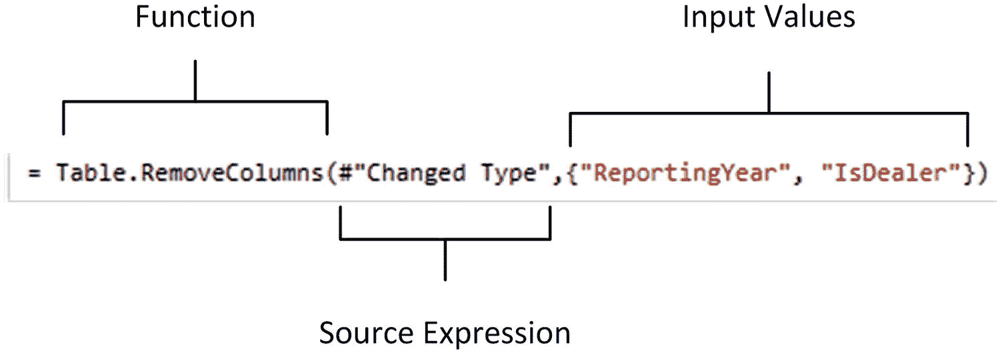
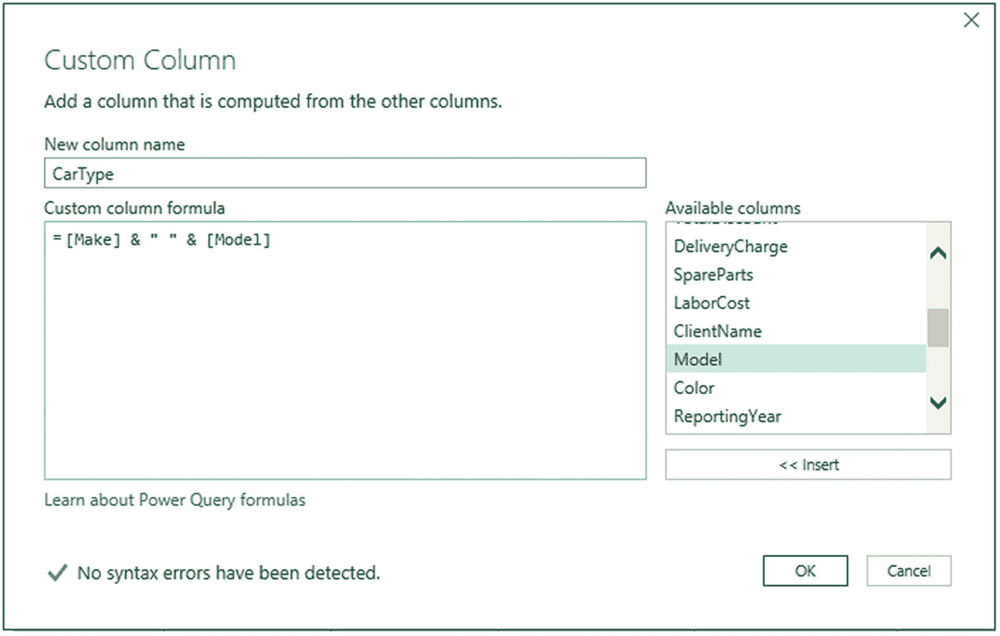
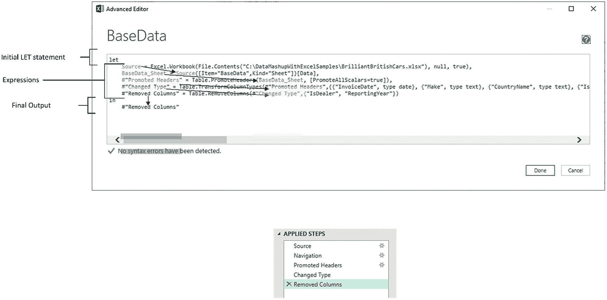
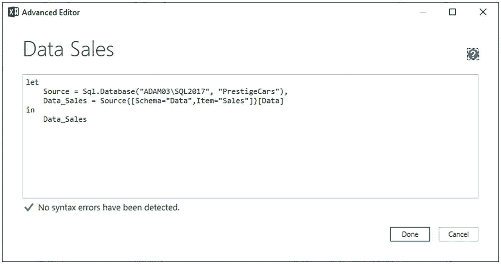
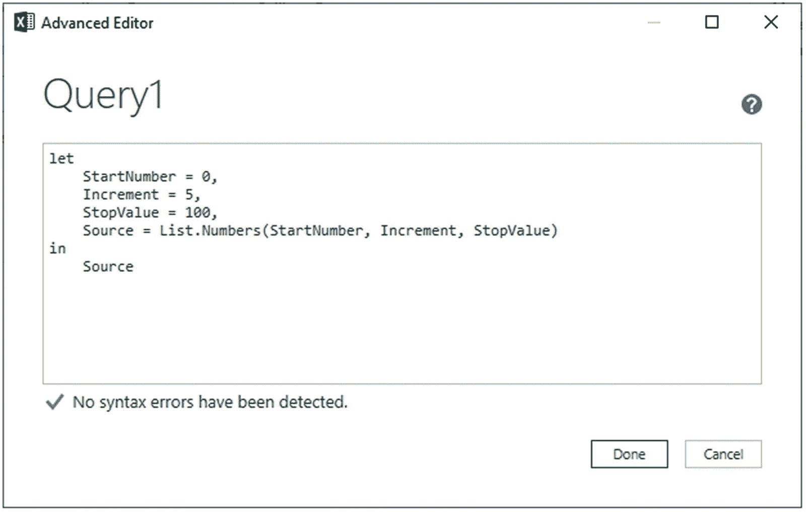
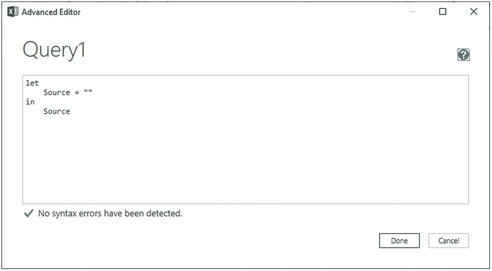
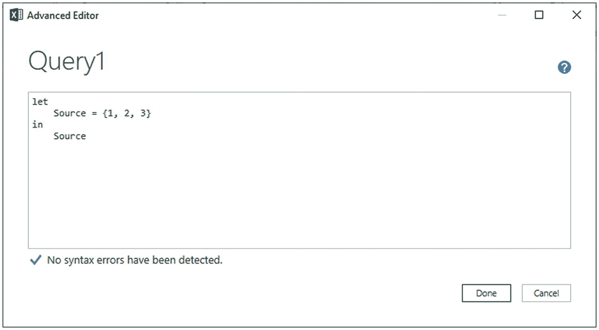
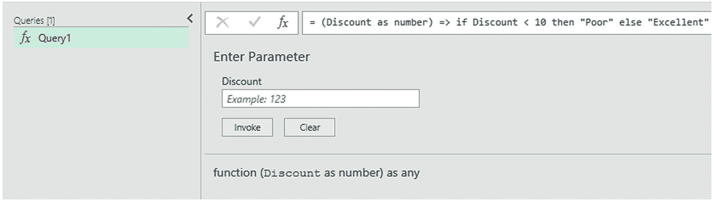

# 12. M 语言

在 Power Query 中，数据摄取和修改并非仅通过界面驱动。实际上，整个过程都是由一种高度特定的编程语言支撑和驱动的。这种语言被称为“M”，它贯穿于你在过去 11 章中所学的一切。

大多数用户——在大多数情况下——很可能根本不需要直接使用 M 语言。这是因为，迄今为止你在本书中学到的 Power Query 编辑器界面既全面又极其直观。然而，有时你可能需要：
-   添加一些无法直接通过图形界面访问的额外功能。
-   添加编程逻辑，例如生成日期或数字序列。
-   以编程方式创建或操作你自己的列表、记录或表。
-   创建自己的内置函数，以扩展或增强 M 语言中内置的功能。
-   使用高级编辑器修改代码。
-   为你的数据摄取过程添加注释。

在向你介绍这些概念之前，我需要补充几点注意事项：
-   支撑 Power Query 查询的“M”语言并非为胆怯者而设计。这种语言乍看之下可能晦涩难懂。
-   其文档技术性极强，对于未入门者来说不易理解。
-   即使对于有经验的程序员来说，学习曲线也可能很陡峭。
-   “M”语言与许多 Excel 高级用户所熟知的 VBA 有很大不同。
-   手动调整某个步骤可能会对精心构建的数据加载和转换过程造成严重破坏。

此外，“M”语言内容非常庞大，足以写成一本完整的书。因此，我特意选择在这里只提供最浅显（希望是有帮助的）的介绍。如需更详细的内容，我建议你查阅微软的官方文档。当前可通过以下网址获取：
-   `msdn.microsoft.com/en-us/library/mt779182.aspx`
-   `msdn.microsoft.com/en-us/library/mt807488.aspx`

在本章中，我假设读者没有任何深入的编程知识。我会与一些标准编程概念进行对比，以帮助那些有 VBA、C# 或 Java 编程经验的读者。但请放心，本意是为热情的 Power Query 用户打开新的视野，而不是陷入复杂的技术宇宙。

要最好地理解这一切，可能是基于你现有的知识，并解释你（仅仅通过使用 Power Query 图形界面）实际上一直在编写 M 代码。然后，你可以通过学习如何调整现有代码来扩展这些知识，最后你将看到如何独立编写 M 代码。

## 什么是 M 语言？

不过，我仍应从几项技术基础入手，解释什么是 Power Query 公式语言（即大家现在所称的 M 语言），以及它能做什么、不能做什么。

M 是一种*函数式*语言。它并非为执行通用编程而设计。实际上，经验丰富的程序员在其他语言中寻找核心的编码结构和技术时，在 M 语言中将一无所获。

冒昧地说，我更喜欢向初学者从以下三个方面将 M 介绍为一种函数式语言，尽管这可能会冒犯编程纯粹主义者：
-   它存在的目的是执行一个简单的功能：加载和转换数据。
-   它建立在包含 700 多个内置函数的函数库之上，每个函数都旨在执行特定的数据加载和/或转换逻辑。
-   它表现为一系列函数，每个函数都将一组输入值计算为单个输出值。

为了完成这个简要的介绍，你还需要知道：
-   M 是*区分大小写*的，因此在输入函数关键字和变量名时需要非常小心。
-   M 是*强类型*的——这意味着你必须尊重所用数据元素的核心类型，并在必要时将它们转换为适当的类型。M 不会自动为你完成此操作。
-   M 建立在一组关键字、运算符和标点符号之上。

我不想在此时过于深入技术细节。尽管如此，我希望这个高级概述能让你为本章后面将要学习的一些方法做好准备。

## M 语言与 Power Query 编辑器

关于 M 语言，好消息是：你已经会写了。我的意思是，你在前 11 章中学习的每个示例都为你编写了一行或多行 M 代码。实际上，当你使用 Power Query 编辑器时，你生成的每个数据加载和转换步骤都会自动为你创建 M 代码。

这意味着几件（非常积极的）事情：
-   你不必非要从头开始编写 M 代码。通常，你可以使用查询编辑器界面完成大部分工作，然后微调自动生成的代码，添加你需要的最终自定义元素。
-   你不必学习 700 多个函数来交付 M 代码，因为查询编辑器可以为你查找并编写许多合适的指令。
-   查询编辑器界面与 M 代码的编写方式紧密相连。因此，理解如何使用界面有助于你理解 M 代码是什么以及它是如何工作的。实际上，许多 Power Query 界面元素与底层的 M 函数之间存在着一一对应的关系。

### 修改步骤的代码

如果你希望深入探究 Power Query 的内部机制，可以通过编辑代码来修改查询中的步骤，这些代码是在每次添加或修改查询步骤时自动创建的。

快速了解可以做什么：


**图 12-1** 一个已应用步骤的“M”代码

1.  打开一个新的 Excel 文件。
2.  在“数据”功能区中，选择 获取数据 ➤ 来自文件 ➤ 来自工作表。
3.  选择 Excel 文件 `C:\DataMashupWithExcelSamples\BrilliantBritishCars.xlsx`。
4.  选择名为 `BaseData` 的源表。
5.  点击“转换数据”打开查询编辑器。
6.  选择 `IsDealer` 列并将其删除。
7.  点击 `BaseData` 查询中的“删除列”步骤。你将在公式栏中看到 M 代码。它将类似于图 12-1 所示。
8.  在公式栏中，编辑 M 代码，将 `IsDealer` 替换为 `ReportingYear`。
9.  按 Enter 键或点击公式栏中的勾选图标（复选标记）以确认你的更改。

该步骤及其后续数据将更新以反映你的更改。

你在步骤 8 中执行的修改实际上意味着你将把 `IsDealer` 列加回来，同时删除 `ReportingYear` 列。你本可以使用界面（通过点击此步骤的“已应用步骤”列表中的齿轮图标）来完成此操作，但关键在于理解这两种方式都是可行的，并且 Power Query 界面只是在生成和修改 M 代码。因此，如果你愿意，可以直接修改此代码。实际上，直接修改 M 代码通常比执行一系列基于界面的操作更快。

如果你是 Excel 高级用户（许多 Power Query 爱好者都是如此），那么你认为这类似于 Excel 宏开发是可以理解的。确实，在某些方面是类似的：
-   核心代码可以被录制（Excel 的 VBA，Power Query 的 M 语言）。
-   生成的代码随后可以被修改。

当然，这是一个过于简单的比较。这两种方法可能相似，但这两种语言却大相径庭。然而，如果这能作为一个比喻来鼓励你转向 M 语言开发，那也未尝不可。

在公式栏中修改查询步骤的 M 代码时，不可避免地会有一系列注意事项。这些包括（但远不止于此）：
-   任何错误不仅会导致该步骤失败，还会导致从当前步骤开始整个数据加载和转换过程失败。
-   你需要记住 M 是区分大小写的——即使是最细微的大小写错误也可能导致整个流程失败。
-   必须遵守使用引号定义文字元素（如列名）的规则。
-   M 大量使用圆括号和大括号。需要一些实践和理解底层逻辑，才能完全领会它们在不同上下文中的用法。

幸运的是，如果（或当）错误出现时，M 会提供相当清晰的错误消息。例如，如果你输入了一个错误的字段名，你可能会看到类似于图 12-2 所示的消息。


**图 12-2** 一条“M”错误消息

然而，我不想让你觉得修改 M 代码很困难或很危险。因此，为了扩展前面给出的示例，如果你想扩展代码以删除两列而不仅仅是一列，M 代码将如下所示：

```
= Table.RemoveColumns(#"Changed Type",{"ReportingYear", "IsDealer"})
```

**注意**：更一般地说，通常最好是查看现有步骤的代码——或者使用示例数据集并行创建“模拟”代码——以了解特定函数的 M 代码是什么样子的。这将指明如何最好地修改代码。

#### M 表达式

为了让您更清晰地理解每个 M“步骤”包含什么，图 12-3 展示了一个步骤的核心结构。不过只有 Power Query 界面才将其称为“步骤”。M 实际上将其称为 _ 表达式 _。因此，从现在开始我将使用这个术语。



图 12-3：一个 M 表达式

这里有几个基本要点需要您了解：

# M语言与Power Query编写

每个M表达式由函数构成。这些函数可以是任何内置函数（例如此处使用的`Table.RemoveColumns`），也可以是你自己定义的函数（本章稍后会解释）。它们也可以是计算或简单的逻辑。

正如您在本书前文所学，数据混合本质上是一系列单独的操作（或者像Power Query界面所称的“步骤”）。这些操作以“链”的形式连接，每个表达式都构建在——并引用——前一个表达式之上。在图12-3中，这个特定的表达式引用了位于其之前的`#"Changed Type"`表达式的输出。

M表达式可以变得极其复杂，并包含多个函数——颇像复杂的Excel公式。由于函数可以嵌套，这可能会导致相当复杂的表达式。

#### 通过添加自定义列编写M

编写某些类型M代码的另一种方法是添加自定义列。尽管在Power Query中这些被称为“自定义列”，但它们的通用叫法还有“派生列”或“计算列”。虽然它们可以完成许多工作，但其基本作用是执行以下任意或全部操作（并且此列表远未穷举）：

- 合并（或者如果您喜欢，可称为连接）现有列

- 向数据表添加计算

- 提取列的特定部分

- 根据现有数据向表添加标志

理解这些列的最佳方法可能是观察它们的实际运用。然后，您可以在自己的流程中扩展这些原则。然而，这可以成为学习基本M编码的极佳起点——尽管仅限于M中一个狭窄的数据处理领域。

首先，让我们执行列连接，并创建一个名为`Vehicle`的列，该列将`Make`和`Model`列连接起来，中间带一个空格。



图12-4：“自定义列”对话框

1.  打开一个空白Excel文件。

2.  连接到`C:\DataMashupWithExcelSamples\BrilliantBritishCars.xlsx`数据源。

3.  单击`Transform`打开Power Query编辑器。

4.  在`Add Column`功能区中，单击`Custom Column`。将显示“添加自定义列”对话框。

5.  单击右侧列列表中的`Make`列，然后单击`Insert`按钮；`=[Make]`将出现在对话框左侧的“自定义列公式”框中。

6.  在“自定义列公式”框中`=[Make]`之后输入`& " " &`。注意双引号之间的空格。

7.  单击右侧列列表中的`Model`列，然后单击`Insert`按钮。

8.  单击“新列名”框内部，并为此列输入一个名称。我将其命名为`CarType`。对话框将如图12-4所示。

9.  单击`OK`。新列将添加到数据表的右侧；它包含公式的结果。`Inserted Column`将出现在“应用的步骤”列表中。公式栏包含以下公式：

```
= Table.AddColumn(#"Changed Type", "CarType", each [Make] & " " & [Model])
```

您始终可以双击某列将其插入到“自定义列公式”框中，如果您更喜欢这样操作的话。要删除某列，只需在“自定义列公式”框中删除列名（包括方括号）即可。

> **提示**  
> 您必须始终将列名括在方括号中。

您可以看到这行M代码遵循了您已经见过的原则。它使用了一个M公式（`Table.AddColumn`），该公式引用了前一个表达式（`#"Changed Type"`），然后应用了执行表达式要求的代码——在本例中是添加一个包含基本M代码的新列。

> **注意**  
> `each`关键字是M的一种约定，表示该列中的每条记录都将应用此公式。

#### 高级编辑器

公式栏仅仅是在M中编码的初始步骤。在实践中，您几乎总是会在Power Query高级编辑器中编写M代码。这有几个基本原因：

- 高级编辑器会显示组成M查询的所有表达式。

- 它使得理解事件（或者如果您喜欢，步骤或表达式）的顺序变得容易得多。

- 它有一个语法检查器，有助于隔离和识别语法错误。

> **注意**  
> 遗憾的是，高级编辑器尚不具备内置的IntelliSense。这意味着您在键入时无法看到M函数弹出提示。

##### 高级编辑器中的表达式

您可以在公式栏中单独看到的M表达式并非孤立的。恰恰相反，它们始终是数据加载、清理和转换事件连贯序列的一部分。如果您现在查看之前从Excel文件加载数据表时创建的整个M代码块，可能会最好地理解这一点。

要查看M代码，您需要打开高级编辑器。



图12-5：高级编辑器中的语法检查

1.  在`Home`功能区中，单击`Advanced Editor`按钮。高级编辑器窗口将打开，如图12-5所示。您还可以看到Power Query编辑器中的“应用的步骤”列表，以帮助您理解每个步骤实际上就是一个M表达式。

此对话框包含您所创建的连接和转换过程的完整结构。它包含以下核心元素：

- 一个表达式序列（即步骤）

- 一个`let`表达式，作为数据转换表达式序列的外部容器

- 一个`in`表达式，返回整个查询的输出

如果您查看图12-5，可以看到关于`Let…In`块内部表达式序列的几件重要事情：

- 每个表达式都有名称——您可以在“应用的步骤”列表中看到其名称。

- 每个表达式（第一个除外）都引用另一个表达式（几乎总是前一个表达式）。

- 除最后一个表达式外，所有表达式都以逗号结束。

- 一个表达式可以跨越多行代码。除最后一个表达式外，都是在表达式结束时使用最后的逗号。

- 最后一个表达式成为查询的输出。

尽管这是一个相当简单的M查询，但它包含了展示M工作原理的所有基本元素。您构建的几乎所有M查询都将反映这些核心原则：

- 包含一个`Let…In`块

- 包含一个或多个包含函数的表达式

#### Let语句

`let`语句是M语言的核心元素。它的存在允许一组值被逐一求值，每个值都分配给一个变量名。这些变量形成了一个结构化的求值过程序列，随后在`in`语句之后的输出表达式中使用。你可以在很多方面将其视为一个“处理单元”。`let`语句可以嵌套以增加灵活性。

在大多数`let`语句中，变量序列会从上到下排序（如图12-5和12-6所示），其中每个命名的表达式都引用并构建于前一个表达式之上。这是查询编辑器将命名表达式呈现为步骤的方式，通常也是编写易于理解的M脚本最简单的方式。然而，严格来说，并不需要像这样对表达式进行排序，因为表达式的顺序可以是任意的。

#### 在高级编辑器中修改M

与所有Power Query相关的事物一样，通过一个示例最能理解高级编辑器。你在第3章中已经了解了如何创建和修改与数据源的连接。你也可以直接在M语言中修改连接。这需要你了解并理解正在使用的数据库。

1.  添加一个连接到SQL Server数据库的新查询。我使用的是我电脑上的SQL实例和数据库。

2.  在左侧的查询列表中选择此查询。

3.  在“主页”功能区中，单击“高级编辑器”按钮。将出现“高级编辑器”对话框，如图12-6所示。

    

    图12-6

    用于更改数据库连接的高级编辑器对话框

4.  更改以下任意元素：

    - `Source`行中的服务器名称（当前为`"ADAM03\SQL2017"`）。

    - 第二行中的数据库名称（当前为`Name="PrestigeCars"`）。

    - 第三行中的架构名称（当前为`Schema="Data"`）。

    - 第三行中的表名称（当前为`Item="Sales"`）。

5.  单击`Done`以确认任何更改并关闭高级编辑器。

这种方法确实是在没有安全网的情况下工作，我向你展示这一点更多是为了提高认识，而不是建议你总是以这种方式编写M代码。然而，如果你希望继续深入学习M语言，这种方法确实为一些影响深远的可能性打开了大门。

**注：** 当然，你可以单击`Cancel`来忽略你在高级编辑器中对M代码所做的任何更改。查询编辑器将要求你确认是否真的要放弃修改。

#### 语法检查

如果你打算编写和修改M代码，你很可能会频繁使用高级编辑器。因此，熟悉它能够提供的帮助无疑是值得的。具体来说，它的语法检查功能非常有用，而且是完全自动化的。

假设你（天理不容！）在代码中犯了一个错误。高级编辑器可能看起来像图12-7中的那样。

``

图 12-7 高级编辑器中的语法检查

如你所见，在这种情况下，高级编辑器不再在代码下方显示一个复选框以及令人安心的消息“未检测到语法错误”。相反，你会看到一条错误消息。单击 `Show error` 链接将通过以蓝色背景显示错误来源来突出显示它。

## 基础 M 函数

M 语言非常庞大——庞大到在一章中只能进行粗略的概述。尽管如此，为了给这个概述提供一些结构，了解一些 M 函数的关键类别是值得的，这些类别在你刚开始使用 M 时可能会发现很有用。

以下列表绝非详尽无遗，但希望可以成为你学习 M 函数之旅的起点。基础类别包括：

- 文本函数
- 日期函数
- 时间函数
- 日期时间函数
- 逻辑函数
- 数值函数

我关注这些类别，是因为它们在应用和使用上可能是最容易理解的。在你了解了其中一些函数之后，我们可以继续学习其他可用的函数。

大多数较基础的 M 函数都可以通过可能与它们在 Excel 中对应的函数相似的方式来应用。例如，如果你想扩展用于连接 `Make` 和 `Model` 列的公式，以便仅从 `Make` 中提取最左边的三个字符，你可以使用如下代码：

```
= Table.AddColumn(#"Changed Type", "CarType", each Text.Start([Make], 3) & " " & [Model])
```

结果如图 12-8 所示。

``

图 12-8 应用第一个文本函数

如你所见，将 `Make` 列包裹在此特定文本函数内，为表达式增加了一层额外的数据转换。

### 文本函数

与其逐一讲解所有可能的文本函数示例，我更倾向于向你展示一些更有用的文本函数（至少根据我的经验）。这些代码片段列于表 12-1 中，你无疑会从中认出许多迄今为止通过 Power Query 用户界面访问过的函数。事实上，你可能在电子表格中编写公式时使用过等效的 Excel 函数。

**表 12-1** 文本函数示例

| 输出 | 代码片段 | 说明 |
| --- | --- | --- |
| 左侧字符 | `Text.Start([Make],3)` | 返回 `Make` 列的前三个字符 |
| 右侧字符 | `Text.End([Make],3)` | 返回 `Make` 列的最后三个字符 |
| 直到特定字符 | `Text.Start([Make],Text.PositionOf([Make]," "))` | 返回从最左侧到第一个空格之间的字符 |
| 直到分隔符 | `Text.BeforeDelimiter([InvoiceNumber], "-" ,"2")` | 返回第三个连字符之前的文本 |
| 文本长度 | `Text.Length([Make])` | 查找文本的长度 |
| 提取子字符串 | `Text.Range([Make], 2, 3)` | 从文本的指定起始位置提取特定数量的字符 |
| 删除子文本 | `Text.RemoveRange([Make], 2, 3)` | 从文本的指定起始位置删除特定数量的字符 |
| 替换文本 | `Text.Replace([Make], "o", "a")` | 将文本或列中的所有 `o` 字符替换为 `a` |
| 修剪空格 | `Text.Trim([Make])` | 移除文本或列中的前导和尾随空格 |
| 转换为大写 | `Text.Upper([Make])` | 将文本或列转换为大写 |
| 转换为小写 | `Text.Lower([Make])` | 将文本或列转换为小写 |
| 首字母大写 | `Text.Proper([Make])` | 为文本或列中的每个单词添加首字母大写 |

> **注意**
> 如果你仔细看过这些函数，可能会注意到任何数字参数都是从零开始的。因此，要在拆分某列的文本时定义第三个连字符，你应该使用 `2` 而不是 `3`。

正如你所料，M 中还有更多可用的文本函数。然而，目的并非让读者淹没在技术细节中，而是让你了解 M 的工作方式以及其所能实现的功能。

你可能会好奇，既然在 Excel 公式中几乎可以做同样的事情，为什么还要在 Power Query 中执行此类操作。确实，两者存在一些重叠；因此你可以选择使用哪一种。但请记住，在 M 中无需将公式向下复制填充到整列，因为该公式默认会应用于整个列。

总的来说，你可以在数据准备和分析过程的多个阶段执行特定操作。这完全取决于你如何使用数据以及使用什么工具进行分析。

表 12-1 仅是 M 中可用文本函数的一个子集。如果你想查看完整列表，请访问微软网站 [`https://docs.microsoft.com/en-us/powerquery-m/text-functions`](https://docs.microsoft.com/en-us/powerquery-m/text-functions)。

### 数字函数

为了扩展你的知识，表 12-2 展示了 M 中部分可用的数字函数。在此，我重点向你展示一些数字类型转换以及核心计算函数。

**表 12-2** 数字函数示例

| 输出 | 代码片段 | 说明 |
| --- | --- | --- |
| 返回一个 8 位整数 | `Int8.From("25")` | 将文本或数字转换为 8 位整数 |
| 返回一个 16 位整数 | `Int16.From("2500")` | 将文本或数字转换为 16 位整数 |
| 返回一个 32 位整数 | `Int32.From("250000")` | 将文本或数字转换为 32 位整数 |
| 返回一个 64 位整数 | `Int64.From("2500000000")` | 将文本或数字转换为 64 位整数 |
| 返回一个十进制数 | `Decimal.From("2500")` | 将文本或数字转换为十进制数 |
| 根据给定值返回一个双精度数值 | `Double.From("2500")` | 将文本或数字转换为浮点数 |
| 将文本作为源转换为数值 | `Number.FromText("2500")` | 将文本转换为数字 |
| 对数字进行四舍五入 | `Number.Round(5000, 0)` | 将数字向上或向下舍入到指定位数（对于负数参数，则为十位、百位等） |
| 向上舍入数字 | `Number.RoundUp(5020, -2)` | 将数字向上舍入到指定位数（对于负数参数，则为十位、百位等） |
| 向下舍入数字 | `Number.RoundDown(100.01235, 2)` | 将数字向下舍入到指定位数（对于负数参数，则为十位、百位等） |
| 去除符号 | `Number.Abs(-50)` | 返回数字的绝对值 |
| 求幂 | `Number.Power(10, 4)` | 返回第一个参数的第二个参数次幂的值 |
| 取模 | `Number.Mod(5, 2)` | 返回数字除以除数的整数除法所得的余数 |
| 指示数字的符号 | `Number.Sign(-1)` | 如果数字为正数，返回 `1`；如果为负数，返回 `-1`；如果为零，返回 `0` |
| 求平方根 | `Number.Sqrt(4)` | 返回数字的平方根 |

> **注意**
> 如果你是 Excel 用户，可能会发现这与在 Excel 中（Power Pivot 的数据透视表中）构建公式有明显相似之处，区别在于此处（如同在 Power Pivot 中一样）你使用的是列名称而非单元格引用。

表 12-2 仅涵盖了 M 中大量可用数字函数的一小部分。如果你想查看完整列表，请访问微软网站 [`https://docs.microsoft.com/en-us/powerquery-m/number-functions`](https://docs.microsoft.com/en-us/powerquery-m/number-functions)。

### 日期函数

M 语言拥有许多日期函数。表 12-3 包含了一些可用且有潜在用途的函数示例。

表 12-3 只是 M 语言中可用日期函数的一个子集。如果你想查看完整列表，可以访问微软网站 [`https://docs.microsoft.com/en-us/powerquery-m/date-functions`](https://docs.microsoft.com/en-us/powerquery-m/date-functions)。

**表 12-3** 日期函数示例

| 输出结果       | 代码片段                                           | 描述                   |
| :----------- | :----------------------------------------------- | :--------------------- |
| 日             | `Date.Day(Date.FromText("25/07/2020"))`          | 从日期中返回星期中的第几天     |
| 月             | `Date.Month(Date.FromText("25/07/2020"))`        | 从日期中返回月份             |
| 年             | `Date.Year(Date.FromText("25/07/2020"))`         | 从日期中返回年份             |
| 星期几         | `Date.DayOfWeek(Date.FromText("25/07/2020"))`    | 从日期中返回星期几           |
| 星期几的名称     | `Date.DayOfWeekName(Date.FromText("25/07/2020"))` | 从日期中返回星期几的名称       |
| 月的第一天       | `Date.StartOfMonth(Date.FromText("25/07/2020"))`   | 从日期中返回该月的第一天       |
| 月的最后一天     | `Date.EndOfMonth(Date.FromText("25/07/2020"))`     | 从日期中返回该月的最后一天     |
| 年的第一天       | `Date.StartOfYear(Date.FromText("25/07/2020"))`    | 从日期中返回该年的第一天       |
| 年的最后一天     | `Date.EndOfYear(Date.FromText("25/07/2020"))`      | 从日期中返回该年的最后一天     |
| 年中的第几天     | `Date.DayOfYear(Date.FromText("25/07/2020"))`      | 从日期中返回该年在第几天       |
| 年中的第几周     | `Date.WeekOfYear(Date.FromText("25/07/2020"))`     | 从日期中返回该年的第几周       |
| 季度           | `Date.QuarterOfYear(Date.FromText("25/07/2020"))`  | 从日期中返回季度数字          |
| 季度的第一天     | `Date.StartOfQuarter(Date.FromText("25/07/2020"))` | 从日期中返回该季度的第一天     |
| 季度的最后一天   | `Date.EndOfQuarter(Date.FromText("25/07/2020"))`   | 从日期中返回该季度的最后一天   |

### 时间函数

M 语言同样拥有许多时间函数。表 12-4 包含了一些可用且有潜在用途的函数示例。

**表 12-4** 时间函数示例

| 输出结果     | 代码片段                         | 描述                 |
| :--------- | :----------------------------- | :------------------- |
| 小时         | `Time.Hour(#time(14, 30, 00))` | 从时间中返回小时         |
| 分钟         | `Time.Minute(#time(14, 30, 00))` | 从时间中返回分钟         |
| 秒           | `Time.Second(#time(14, 30, 00))` | 从时间中返回秒           |
| 从分数获取时间 | `Time.From(0.5)`               | 从天的小数部分返回时间 |

表 12-4 只是 M 语言中可用时间函数的一个子集。如果你想查看完整列表，可以访问微软网站 [`https://docs.microsoft.com/en-us/powerquery-m/time-functions`](https://docs.microsoft.com/en-us/powerquery-m/time-functions)。

同样，由于日期时间函数和日期时区函数与日期和时间函数非常相似，我在此不再赘述。这些函数也可以在微软网站上找到。

### 持续时间函数

M 语言也可以提取持续时间——以天、小时、分钟和秒为单位。表 12-5 展示了一些基本的持续时间函数。

**表 12-5** 持续时间函数示例

| 输出结果 | 代码片段                                 | 描述               |
| :----- | :------------------------------------- | :--------------- |
| 天       | `Duration.Days(#duration(10, 15, 55, 20))` | 按天计算的持续时间     |
| 小时     | `Duration.Hours(#duration(10, 15, 55, 20))` | 按小时计算的持续时间   |
| 分钟     | `Duration.Minutes(#duration(10, 15, 55, 20))` | 按分钟计算的持续时间   |
| 秒       | `Duration.Seconds(#duration(10, 15, 55, 20))` | 按秒计算的持续时间   |

表 12-5 几乎包含了 M 语言中所有可用的持续时间函数。如果你想查看剩余的几个函数，可以访问微软网站 [`https://docs.microsoft.com/en-us/powerquery-m/duration-functions`](https://docs.microsoft.com/en-us/powerquery-m/duration-functions)。

## M 概念

现在，是时候“拆掉自行车的辅助轮”，学习如何独立骑行（即无辅助编程）了。这意味着，首先要熟悉 M 语言的几个结构概念。

这意味着要从使用“入门级”函数修改数据内容，进阶到创建和修改数据结构本身。M 语言主要专注于加载和呈现表格数据结构，因此数据表是一种基本的数据结构。然而，它也可以处理其他数据结构——你在前面的章节中已经有所了解。在本章中，我们将探讨三种核心数据结构。总的来说，它们被归类为*结构化*值——与*原始*值（如文本、数字或日期和时间）相对。其中一些包括：

*   列表
*   记录
*   表

然而，在深入探讨这些结构化数据元素之前，你需要了解 M 语言的两个基本方面。它们是：

*   数据类型
*   M 值（也称为变量或标识符）

那么，事不宜迟，让我们开始你的 M 语言之旅吧。

## M 数据类型

如果你要创建自己的列表、记录和表，那么了解 M 中数据类型的基础知识将会很有帮助。

开始使用 M 语言时，你需要记住，原始数据值必须始终是以下类型之一：

*   数值
*   文本
*   日期
*   时间
*   日期时间
*   日期时区
*   持续时间
*   逻辑值（如果你更喜欢，也可以称为布尔值）
*   二进制
*   空值

还有其他类型，如 `function`、`any` 或 `anynonnull`，但我们不会在本章中介绍它们。

所有数据类型都期望以特定方式输入。实际上，你必须按照表 12-6 中所示的方式输入数据，以避免 M 代码中出现错误。

**表 12-6** 数据类型输入

| 数据类型   | 代码片段                                           | 注释                                       |
| :------- | :----------------------------------------------- | :----------------------------------------- |
| 数值       | `100` `0.12345` `2.4125E8`                       | 不要使用千位分隔符或货币符号等格式                     |
| 文本       | `"Calidra Power Query Training"`                 | 始终用双引号括起来。要输入实际的引号文本，请使用两个双引号     |

| 日期       | `#date(2020,12,25)` | 日期必须在 `#date()` 函数中按年、月、日的顺序指定 |
| ---------- | ------------------- | ------------------------------------------------- |
| 时间       | `#time(15,55,20)`   | 时间必须在 `#time()` 函数中按时、分、秒的顺序指定 |
| 日期时间   | `#datetime(2020,12,25,15,55,20)` | 日期时间必须在 `#datetime()` 函数中按年、月、日、时、分、秒的顺序指定 |
| 日期时区   | `#datetimezone(2020,12,25,15,55,20,-5,-30)` | 日期时区必须在 `#datetimezone()` 函数中按年、月、日、时、分、秒、天偏移、小时偏移的顺序指定 |
| 持续时间   | `#duration(0,1,0,0)` | 在 `#duration()` 函数内，以逗号分隔天、小时、分钟和秒 |
| 逻辑值     | `true`              | 小写的 `true` 或 `false` |

# M 值

在更深入地研究实际编码之前，你确实需要了解关于 M 值的几个基础知识：

- 值是表达式的结果。
- 值也是变量。
- 值的名称区分大小写。
- 如果值名称包含空格或受限制字符，则必须用 `#""`（井号后跟双引号）括起来。

这第四点显然引出了一个问题：“什么是受限制的字符？”简单的答案是——“任何非字母数字的字符”。这样就不用记住一长串符号列表了。

**注意：** Power Query 编辑器界面会尽可能通过添加空格来提高步骤（即表达式返回的值）的可读性。因此，这些值在 M 代码中总是以 `#"Step Name"` 的形式出现。

# 在 M 中定义你自己的变量

由于任何表达式返回的值也都是变量，因此在 M 中定义你自己的变量变得极其简单。你所要做的就是输入一个变量名（如果包含空格或受限字符，则需要带井号并用引号括起来）、一个等号，以及变量定义。

举一个非常简单的例子，请看图 12-9。这个 M 脚本定义了 `List.Numbers()` 函数所需的三个参数（你将在表 12-7 中看到这个函数），然后在函数内部使用了这些变量。



图 12-9 M 中的用户变量

在定义自己的变量时，只需记住以下几点：

- 它们遵循与 M 中输出值相同的命名约定。
- 变量可以在定义它的子表达式以及包含该子表达式的任何表达式中被引用。
- 变量可以是一个简单的值，也可以是一个返回值的计算。

# 编写 M 查询

在实际编写 M 代码之前，你需要知道如何以及在何处编写代码。假设你需要一个环境来练习本章剩余部分的示例：



图 12-10 准备用高级编辑器编写 M 代码

1. 打开一个空白的新 Excel 文件。
2. 在“数据”功能区中，单击“获取数据” ➤ “来自其他源” ➤ “空白查询”。Power Query 编辑器将打开。
3. 单击“高级编辑器”。将打开一个“高级编辑器”对话框，其中仅包含一个外部的 `let` 表达式，如图 12-10 所示。

> 注意
>
> 从技术上讲，M 中并不要求使用 `let` 子句。你可以直接输入一个表达式。但是，我更喜欢“按部就班”地编写 M ——至少一开始是这样。

## 列表

你在第 11 章中创建用于基于查询的参数的下拉列表时，已经接触过 M 列表（这再次说明了查询编辑器中的所有内容都基于 M）。列表只不过是一系列的值。

列表在 M 中有特定的用途，可以直接用在数据模型中。但是，它们更常被用作更复杂的数据转换过程中的中间步骤。如果你有编程背景，将列表视为类似于数组的东西可能会有所帮助。

### 手动创建列表

一个列表只是一组用大括号括起来的、以逗号分隔的值——例如：

```
{1,2,3}
```

一旦将其集成到 M 查询的结构中，它可能看起来像图 12-11 中所示的例子。



图 12-11 高级编辑器中的列表

一旦创建完成——无论是作为查询的中间步骤还是作为查询的最终输出——该列表就可以被任何需要列表作为输入的东西使用。实际上，如果你单击前面示例中的“完成”按钮，Power Query 编辑器将会把这部分 M 代码显示为一个可用的列表——与你第 11 章中创建的列表完全一样。因此，你现在可以快速轻松地为参数（例如）创建自定义列表。

关于列表，你需要了解一些技术信息：

- 列表的大小没有限制。
- 列表可以包含相同类型的数据（例如，所有元素都是数值、日期或文本），或者也可以是不同类型的数据。
- 列表可以为空——即由一对空大括号组成。
- 列表可以水平或垂直输入。也就是说，前面显示的列表也可以像下面这样输入：

```
Source = {
1,
2,
}
```

生成列表非常简单；知道何时使用列表才是难点。

### 使用列表生成序列

列表在 M 中有很多用途，但有一个领域它们特别出色，那就是生成数字、日期或文本的序列。与其逐一繁琐地解释每种方法，不如在表 12-7 中汇集一组用于列表生成的 M 代码片段示例。

表 12-7 列表生成

| 代码片段 | 描述 |
| --- | --- |
| `{1..100}` | 从 1 到 100（含）的连续数字序列 |
| `{1..100, 201..400}` | 从 1 到 100，然后从 201 到 400 的连续数字序列 |
| `List.Numbers(0, 100, 5)` | 从 0 开始，以 5 为增量，直至达到 100 |
| `{"A".."Z"}` | 从 A 到 Z 的大写字母 |
| `List.Dates(#date(2020, 1, 1), 366, #duration(1, 0, 0, 0))` | 2020 年的每一天——从 2020 年 1 月 1 日开始，增加 366 天（以天为持续时间表示） |
| `List.Times(#time(1, 0, 0), 24, #duration(0, 1, 0, 0))` | 从凌晨 1 点开始的一天中的每个小时 |

### 访问列表中的值

如果你进行更高级的 M 编码，你很可能希望在 M 脚本中引用列表中的值。最简单的方法是使用*位置引用*。下面是一段实现此功能的简短 M 代码：

```
let
    MyList = {"George","Bill","George W.", "Barack", "Donald"},
    source = MyList{3}
in
    source
```

这段代码片段的输出是列表中的*第四个*元素——这说明了 M 中的列表是*从零开始*的。也就是说，列表中的第一个元素是元素 0。

### 列表函数

M 中有几十个可用的列表函数。数量太多，无法在此一一详述。因此，为了让您了解一些可以操作列表的可能方法，请查看表 12-8。所有这些函数都使用了您之前看到的那个非常简单的列表。

表 12-8 列表函数

| 输出 | 代码片段 | 描述 |
| --- | --- | --- |
| 第一个值 | `List.First(MyList)` | 返回列表中的第一个元素 |
| 最后一个值 | `List.Last(MyList)` | 返回列表中的最后一个元素 |
| 排序列表值 | `List.Sort(MyList)` | 对列表中的值进行排序 |
| 提取范围 | `List.Range(MyList, 4)` | 从列表中提取一个值范围 |
| 返回值 | `List.Select(MyList , each _ ="Adam")` | 返回列表中符合条件的所有元素 |
| 生成列表 | `List.Generate()` | 创建一个连续值的列表 |
| 聚合值 | `List.Sum(MyList)` | 对列表中的数值进行聚合 |
| 替换值 | `List.ReplaceMatchingItems(MyList, {"Joe", "Fred"})` | 替换列表中的一组值 |

# M语言中的结构化数据类型

## 记录

如果说列表可以被视作M代码中可用的数据列，那么*记录*就是数据行。当您在M中创建更复杂的数据转换例程时，您很可能会发现自己需要定义记录。

以下是一个在M中创建的示例记录，其形式最为简单：
```
let
Source = [Surname = "Aspin", FirstName = "Adam"]
in
Source
```

如果您需要访问记录中某个元素的数据，可以将记录变量名称与字段名称一起放在方括号中，如下所示：
```
let
Source = [Surname = "Aspin", FirstName = "Adam"],
Output = Source[Surname]
in
Output
```

有一些记录函数可能对您有用。这些函数在表12-9中进行了概述。

**表12-9 记录函数**
| 输出 | 代码片段 | 描述 |
| --- | --- | --- |
| 添加字段 | `Record.AddField()` | 向记录添加一个字段 |
| 移除字段 | `Record.RemoveFields()` | 从记录中移除一个字段 |
| 重命名字段 | `Record.RenameFields()` | 重命名记录中的一个字段 |
| 输出字段 | `Record.Field()` | 返回记录中指定字段的值 |
| 计数 | `Record.FieldCount()` | 返回记录中的字段数量 |

表12-9只是M中可用的记录函数的一个子集。如果您想查看完整列表，可以在微软网站上找到：[`https://docs.microsoft.com/en-us/powerquery-m/record-functions`](https://docs.microsoft.com/en-us/powerquery-m/record-functions)。

## 表

您可能在M代码中使用的最后一种结构化数据类型是*表*类型。正如您对一种用于加载、清理和塑形表格数据的语言所期望的那样，表数据类型是M的基础。

如果您决定在M中手动创建自己的表，那么您需要至少包含以下结构元素：
* `#table()` 函数
* 一组列/字段标题，其中每个字段名称用双引号括起来，字段名称集合用大括号括起来
* 各个数据行，每行用大括号括起来并以逗号分隔，行的集合也用大括号括起来

一个非常简单的硬编码表示例可能如下所示：
```
#table(
{"Surname", "FirstName"},
{
{"Johnson","Vladimir"},
{"Putin","Emmanuel"},
{"Macron","Angela"},
{"Merkel","Boris"}
}
)
```

然而，这种方法的一个弱点是字段没有类型定义。因此，一种更健壮的方法是将表扩展成这样：
```
#table(
type table
[
#"Surname" = text,
#"FirstName" = text
],
{
{"Johnson","Vladimir"},
{"Putin","Emmanuel"},
{"Macron","Angela"},
{"Merkel","Boris"}
}
)
```
注意：用于定义所需数据类型的数据类型关键字已在本章前面概述。

M中有许多可用的表函数。我在表12-10中概述了一些更有用的函数。

**表12-10 表函数**
| 输出 | 代码片段 | 描述 |
| --- | --- | --- |
| 合并表 | `Table.Combine()` | 合并结构相似或不同的表 |
| 记录数 | `Table.RowCount()` | 返回表中的记录数 |
| 第一条记录 | `Table.First()` | 返回表中的第一条记录 |
| 最后一条记录 | `Table.Last()` | 返回表中的最后一条记录 |
| 查找行 | `Table.FindText()` | 返回表中包含所需文本的行 |
| 插入行 | `Table.InsertRows()` | 在表中插入行 |
| 输出行 | `Table.Range()` | 输出选定的行 |
| 删除行 | `Table.DeleteRows()` | 删除表中的行 |
| 选择列 | `Table.SelectColumns()` | 输出选定的列 |

表12-10只是M中可用表函数的一个微小子集。如果您想查看完整列表，可以在微软网站上找到：[`https://docs.microsoft.com/en-us/powerquery-m/table-functions`](https://docs.microsoft.com/en-us/powerquery-m/table-functions)。

## 其他函数领域

如前所述，M是一个庞大的主题，可以写成一本（非常厚的）书。我们已经快速概述了一些核心概念和函数，但如果您想精通M，还有很多东西需要学习。如果您真的有兴趣了解更多，我建议您搜索Microsoft文档中有关表12-11中列出的元素，以进一步加深您的知识。

**表12-11 其他函数领域**
| 函数领域 | 描述 |
| --- | --- |
| 数据访问函数 | 访问数据并返回表值 |
| 二进制函数 | 访问二进制数据 |
| 组合器函数 | 被其他库函数用于合并值以逐行应用逻辑 |
| DateTime函数 | 应用于日期时间数据的函数 |
| DateTimeZone函数 | 应用于带有时区信息的日期时间数据的函数 |
| 表达式函数 | 用于表达式的M代码 |
| 行函数 | 将数据转换为值列表 |
| 替换器 | 被库中的其他函数用于替换结构中的给定值 |
| 分割器 | 将值分割成子元素 |
| 类型 | 返回M类型 |
| Uri | 处理URL和URI |
| 值 | 处理M值 |

## M中的自定义函数

M还允许您编写自定义函数，这些函数可以重复执行高度特定的任务。

作为一个非常简单的自定义函数示例，请尝试将以下代码片段添加到新的空白查询中：
```
let DiscountAnalysis =
(Discount as number) =>
if Discount < 10 then "Poor" else "Excellent"
in DiscountAnalysis
```
当您关闭高级编辑器时，您将看到此查询已被识别为M函数，并相应地显示在查询列表中。您可以在图12-12中看到这一点（我将其重命名为“DiscountAnalysis”）。


**图12-12 M中的用户定义函数**

您现在可以通过输入一个值作为折扣并单击“调用”按钮来随时以交互方式调用该函数。您也可以在其他M函数内部使用此函数。实际上，这很可能正是您首先创建自定义函数的原因。

如果您想查看更高级的函数，请看以下代码片段，该片段会补齐日期，为日和月添加前导零（如果需要）：
```
let
FormatDate = (InDate as date) =>
let
Source = Text.PadStart(Text.From(Date.Month(InDate)),2,"0") & "/" & Text.PadStart(Text.From(Date.Day(InDate)),2,"0") & "/" &Text.From(Date.Year(InDate))
in
Source
in
FormatDate
```

## 向M代码添加注释

复杂的M代码可能非常密集。因此，当您数周或数月后重新查看时，很可能需要一些方法来记住创建某个流程的原因。

让自己工作更轻松的一个简单方法是向M代码中添加注释。您既可以为您自己编写的代码添加注释，也可以为自动生成的查询添加注释。

有两种添加注释的方法。

### 单行注释

要注释单行（可以在行首或行中间进行），只需添加两个正斜杠——如下所示：
```
//这是一个注释
```
从两个斜杠到行尾的所有内容都将被视为注释，不会被M求值。

### 多行注释

多行注释可以覆盖多行——甚至一行的一部分。它们涵盖所有包含在`/*`和`*/`之间的文本。

/* 这是一个注释
跨越多
行 */

`/*` 和 `*/` 内部的所有内容都将被视为注释，不会被 `M` 求值。

## 结语

作为本书的最后一章，本章为如何加载和转换用于 Excel 分析的源数据这一主题画上了句号。在本章中，你学习了 `M` 语言的基础知识，它是支撑本书此前所有内容的核心。

你首先了解了如何利用 `Power Query 编辑器`界面来辅助编写简短的 `M` 代码片段。接着，你深入探索了 `M` 语言的基本概念，如表达式、变量和值。最后，你学习了 `M` 语言中的数据类型，以及列表和表格等支撑复杂数据转换的更复杂的数据类型。这包括学习如何使用`高级编辑器`来编写和调试代码。

在本章及之前的 11 章中，你实际上经历了三个阶段：首先，找到数据；然后，将其加载到 `Power Query` 中；最后，对其进行清洗和修改。你可以使用的技术虽简单却功能强大，范围从更改数据类型到合并多个数据表。现在，你的数据已准备就绪，你可以将其添加到 `Power Pivot` / `Excel` 数据模型或直接添加到 `Excel` 工作表中，并开始使用它来实现真实的业务分析。

希望你喜欢阅读本书，并且它能帮助你掌握使用 `Power Query` 和 `M` 语言查找、转换外部数据并将其加载到 `Excel` 中的艺术。

```
if (condVar > someVal) {console.log("xxx")}
```