# 1. SAP BW/4HANA 建模对象

本章概述了SAP BW/4HANA应用程序中可用的主要建模对象。我将引导您了解来自SAP HANA和SAP BW/4HANA两个领域的建模对象。在本章中，您将学习现有建模对象发生了哪些变化，以及有哪些新的建模构件。

## 现代数据建模

SAP BW/4HANA于2016年推出，作为下一代业务数据仓库，用以取代旧的SAP BW应用。BW建模工具的核心设计界面现已统一。这意味着建模活动不再需要SAP GUI。BW/4HANA提供了一个全新的建模平台，为开发人员带来了诸多优势。

- 简化的建模，建模对象从九个减少为四个
- 专注于虚拟化能力并对其进行显著扩展
- 现代、易用、基于Eclipse的建模环境
- BW/4HANA建模工具的统一用户界面（不再使用SAP GUI进行建模，SAP BEx查询设计器已被基于Eclipse的查询设计器取代）
- 适用于BW和HANA建模的单一环境

从功能角度来看，除了所有新功能和特性之外，BW/4HANA最大的优势之一是其使用混合建模的能力。开发人员现在可以结合来自SAP BW和SAP HANA两个领域的建模工件。

SAP BW与BW/4HANA在建模上的重大区别在于，后者实现了敏捷数据仓库能力，而这在该产品的先前版本中是缺失的。BW/4HANA建模的重大变革在于其支持基于字段的建模方法，这节省了大量的开发时间和精力，尤其是在创建概念验证或试点数据模型时。尽管基于信息对象的建模仍然是企业数据仓库（EDW）的核心，但在某些场景下，仅仅为了交付一个原型而创建数十个信息对象是没有意义的。此外，业务部门通常需要一份临时的报告来对特定数据集进行分析。例如，业务部门可能需要一份仅用于某个特定项目或一次性活动（如数据抽取）的报告。在这种场景下，扩展现有的企业数据模型通常没有意义，因为这是一个巨大的工作量——开发人员需要进行适配差距分析，检查对现有模型的影响，考虑风险因素，最后基于设计来实施方案。借助BW/4HANA，可以独立于EDW创建临时报告，甚至无需持久化数据，只需利用HANA的内存处理特性来实现逻辑，从而基于源表实时处理并显示结果。

BW/4HANA的一大进步是虚拟化能力。这一概念利用了HANA虚拟表的特性，这些虚拟表随后可以被BW/4HANA建模对象消费。虚拟建模允许你在从其他数据库访问数据时避免数据持久化。通过虚拟化，可以将非SAP数据集成到SAP数据模型中，甚至创建基于外部数据源的独立数据模型。当然，在创建虚拟数据模型时，我们需要考虑性能限制。由于数据将来自外部系统，我们将无法获得HANA内存处理能力的任何好处。与标准BW数据模型（其中复杂的连接和表达式被预计算并物理存储）不同，在虚拟方法中，所有操作都将在用户运行报告时实时处理。

## 主要的SAP HANA建模对象

如前所述，在BW/4HANA中，可以利用SAP HANA原生的建模工件。

SAP HANA中的两个主要建模对象是计算视图和表函数。计算视图是使用SAP HANA建模器视角的图形界面进行建模的，因此不需要深入的SQL知识。表函数是使用SAP HANA开发视角创建的，并且完全基于SQL脚本。

图形化计算视图（CV）是使用SAP HANA建模器视角进行建模的。它们用于建模业务逻辑，并按要求的数据集作为输出返回。使用计算视图，你可以执行数据操作功能，如连接、并集、聚合和排名，以及应用过滤器和创建计算列。逐节点构建的方法使得实现和维护复杂的业务逻辑变得容易。

过去，有三种计算视图：属性视图、分析视图和计算视图。在SPS11中，这种方法被统一了，所有三种视图类型都被一个名为`计算视图`的单一建模对象所取代。SAP还提供了将分析视图和属性视图迁移到计算视图的功能。尽管所有这些视图类型在Eclipse中仍然可用，但已弃用的那些不应再使用。

表函数（TF）是基于SQL的建模对象，当图形化计算视图的功能不足以满足业务需求时使用。表函数的使用方式与计算视图类似，但主要区别在于整个逻辑是通过使用SQL脚本而非图形编辑器来开发的。此外，用于开发表函数的Eclipse视角也不同。与计算视图不同，表函数是使用Eclipse工具的SAP开发视角创建的。

表函数用于实现业务逻辑，然而，从报表的角度来看，它们不能作为独立对象使用。一旦创建了表函数，需要先通过在其之上创建的计算视图进行暴露，然后才能在报表层使用。

表函数是作为SQL脚本计算视图的替代品而引入的。使用Eclipse迁移工具，开发人员可以自动将已弃用的基于脚本的计算视图转换为表函数。

如你所见，对这两个对象进行建模的主要目的是在表或其他视图之上执行复杂的数据操作。在接下来的章节中，我将描述如何创建这些对象，并解释每个对象的用例、优势和局限性。

### 计算视图

要开始使用计算视图，请转到`SAP HANA`建模器透视图，右键单击包，然后选择新建 ➤ `计算视图`（图1-1）。

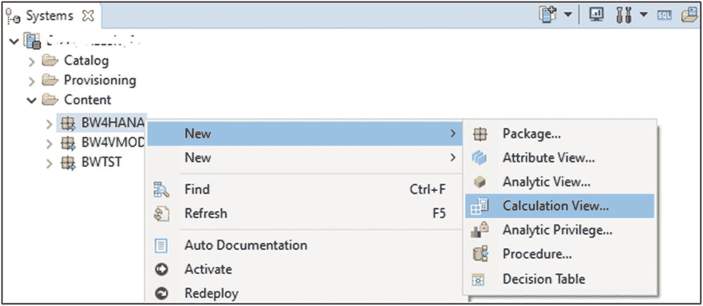

图1-1

创建新的计算视图

选择“`计算视图`”选项后，将打开用于定义计算视图常规设置的窗口（参见图1-2）。

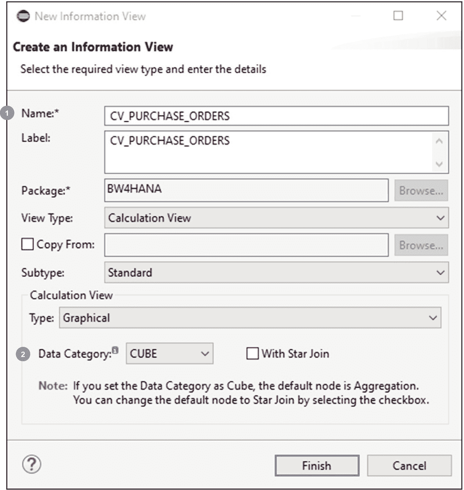

图1-2

新建信息视图窗口

在图1-2中，有两个重要字段：

1. `名称`：这是一个必填字段，是计算视图的技术名称。
2. `数据类别`：此字段包含以下选项：
    1. `CUBE`：图形编辑器中的最后一个默认节点将是聚合。此类视图可被报表工具使用。至少需要指定一个输出列作为度量。
    2. `DIMENSION`：图形编辑器中的最后一个默认节点将是投影。此类视图不能被报表工具使用。所有输出字段都是属性（无法使用度量）。

> 注意：一旦创建了计算视图，您将能够随时更改数据类别类型，而无需重建整个视图逻辑。

提供计算视图详细信息后，下一步是在图形设计器中建模业务逻辑。计算视图是使用称为`节点`的构建块构建的。图形视图支持以下节点类型：

- `连接`：连接操作用于基于特定列链接两个数据源。链接数据集时，您可以选择连接类型（参照、内连接、左外连接、右外连接、全外连接或文本连接），并可以指示连接基数（1..1、1..n、n..1、n..m）。
- `并集`：这些操作用于合并两个或多个数据源。SAP HANA是一个列式数据库，因此只要可能，使用并集节点总是比使用连接更好。
- `投影`：这是用于从目标源对象检索数据的节点。它允许您选择字段、应用过滤器或创建计算。投影节点可以使用以下源对象：表、虚拟表、视图、计算视图、表函数或模型中的任何其他节点。
- `聚合`：这允许您基于所选属性聚合数据，并对所选度量应用基本聚合函数（`Sum`、`Min`、`Max`、`Count`、`Avg`、`Var`、`StdDev`）。
- `排名`：在此节点内，可以根据排名定义过滤数据。此外，此节点允许您自动生成排名列。

最常用的节点是`Projection`，它只是从底层表读取数据。通过从面板中拖放节点来将节点添加到模型中（参见图1-3）。

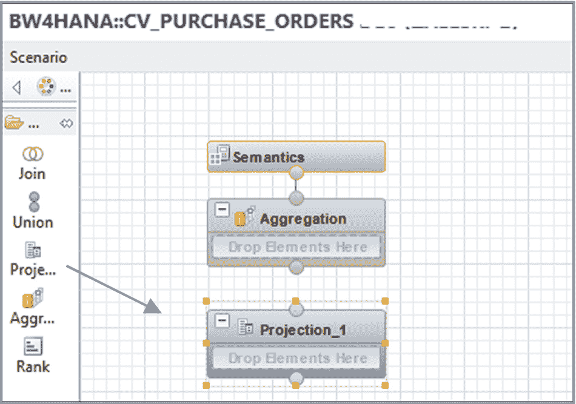

图1-3

向计算视图添加投影节点

添加所有其他节点类型的方式相同。一旦我们将节点添加到模型中，下一步我们需要定义源表（或任何其他对象，如其他计算视图、表函数或数据库视图）。通过单击“添加对象”按钮，您可以搜索所需的视图或表。

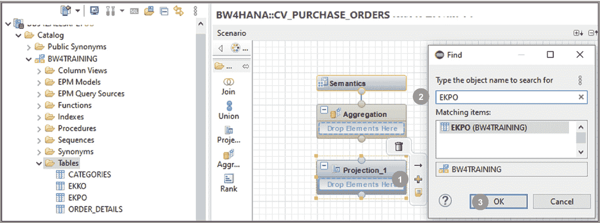

图1-4

向计算视图中的投影节点添加对象

搜索对象时，您应键入其名称（图1-4）。一旦找到并在“匹配项”部分中显示，选择它并单击“确定”继续。添加源对象的另一种方法是将其从左侧显示窗格直接拖放到节点上（节点上显示的“将元素拖放到此处”部分）。图1-5显示了一个示例计算视图，该视图在采购凭证抬头（`EKKO`）和采购凭证项目（`EKPO`）两张标准ERP表之间，基于凭证编号列（`EBELN`）进行连接。

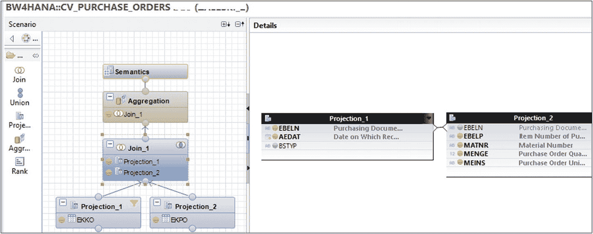

图1-5

采购订单的计算视图

如图 1-5 所示，此视图由四个节点组成：两个投影节点从两张采购表（`EKKO` 和 `EKPO`）中查询数据，连接节点合并这两张表，聚合节点是 `CUBE` 数据类别计算视图的默认节点。语义节点始终设置为所有类型计算视图的最后一个默认节点，并且无法删除。创建计算视图的更复杂场景将在后续章节中描述。

在您能够执行视图之前，与大多数 BW/4HANA 对象一样，视图需要被激活。要检查是否存在任何错误，您可以首先通过单击“验证”按钮来验证视图。一旦验证通过，您可以激活它，如图 1-6 所示。

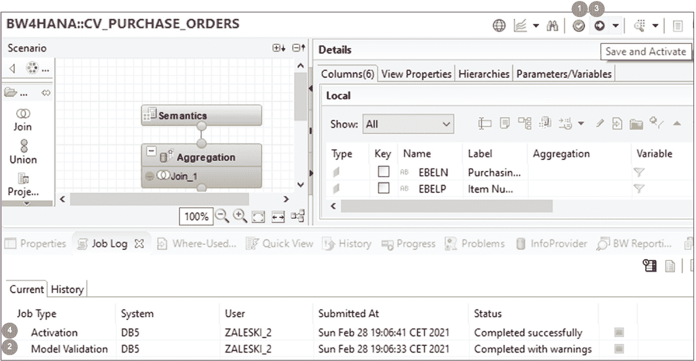

图 1-6 验证并激活计算视图

在验证和激活期间，系统会检查模型是否存在任何错误，并相应地在“作业日志”选项卡（图 1-6）上显示激活状态。

有多种方法可以执行计算视图以显示结果。第一个选项是右键单击语义节点，然后选择“数据预览”选项。系统将打开一个新选项卡（图 1-7），您可以在“原始数据”选项卡上看到视图的输出（默认显示 200 条记录）。

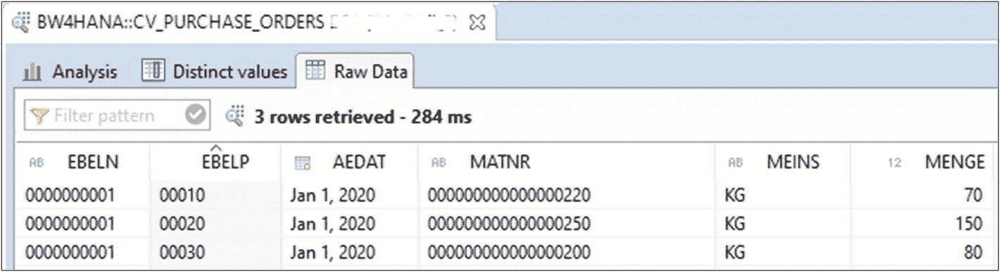

图 1-7 计算视图的数据预览

第二个选项是右键单击左侧窗格（在“系统”选项卡上）包树中的计算视图名称。那里有两个选项可以运行视图：`Data Preview` 和 `Generate Select SQL`。`Data Preview` 选项的工作方式与语义节点上的预览相同（参见图 1-7）。

`Generate Select SQL` 选项会打开 SQL 控制台，并基于该计算视图生成 SQL `SELECT` 语句。当您想要执行即席分析，将视图的输出与其他源对象（如其他计算视图或表）结合起来时，此选项非常有用。对计算视图 `CV_PURCHASE_ORDERS` 使用此选项时，会生成以下 SQL 代码：

```sql
SELECT
"EBELN",
"EBELP",
"AEDAT",
"MATNR",
"MEINS",
sum("MENGE") AS "MENGE"
FROM "_SYS_BIC"."BW4HANA/CV_PURCHASE_ORDERS"
GROUP BY "EBELN",
"EBELP",
"AEDAT",
"MATNR",
"MEINS"
```

**注意**
开发人员常问的一个问题是，是否可以将图形化计算视图的逻辑转换为 SQL 代码。答案是否定的。您可以从计算视图自动生成 SQL 查询，但这不会将整个视图逻辑转换为 SQL 连接和并集；相反，这只会在此计算视图之上创建一个 `SELECT` 语句。

在开始使用计算视图时，即使视图逻辑已正确建模，您也可能会遇到一些问题。以下是您可能遇到的最常见问题：

#### 问题：在每个计算视图节点上执行数据预览时，输出中未返回数据，尽管底层表中存在数据。
**原因：** 在计算视图属性中，`Session Client` 被设置为默认客户端。
**解决方案：** 在计算视图的语义中，进入 `视图属性` 选项卡，将 `默认客户端` 值从 `Session Client` 更改为 `Cross Client`（参见图 1-10）。

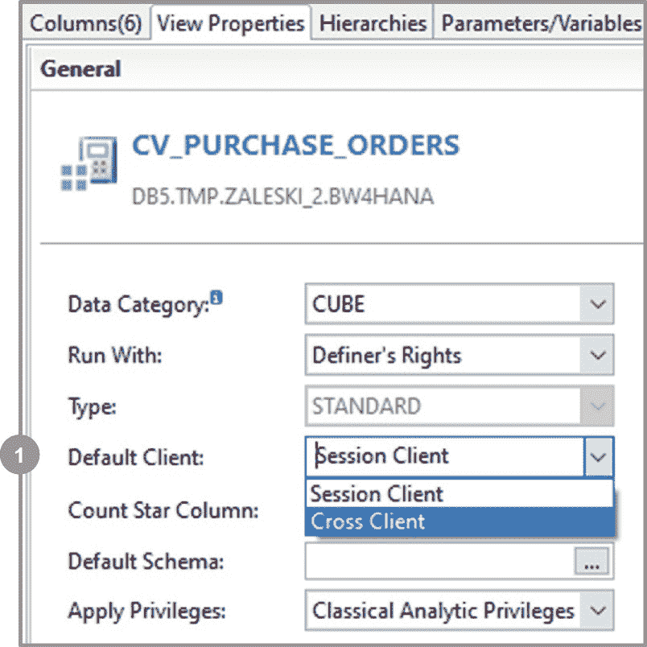  
图 1-10 – 在计算视图中设置默认客户端

#### 问题：在 SQL 控制台中，开发者能够查询特定模式(schema)表中的数据，但在尝试对计算视图执行数据预览时，出现以下错误信息：  
`Error: SAP DBTech JDBC: [258]: insufficient privilege`
**原因：** 已为计算视图应用了 SQL 分析权限。
**解决方案：** 在计算视图的语义中，进入 `视图属性` 选项卡，应用 `经典分析权限` 选项，而非 `SQL 分析权限`（参见图 1-9）。另一种方法是将计算视图分配给已分配给用户或用户角色的 `分析权限` 对象。

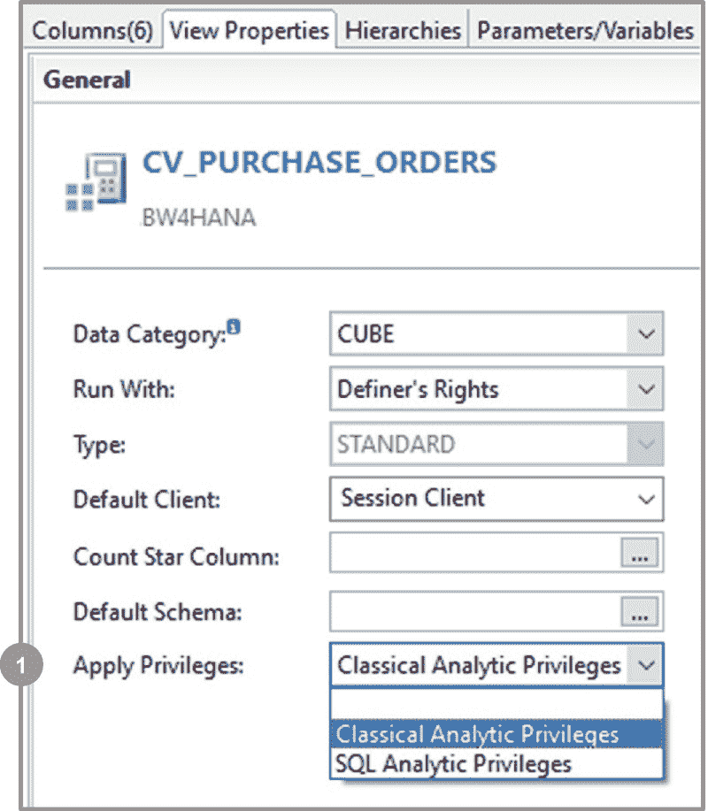  
图 1-9 – 在计算视图中应用权限

#### 问题：在 SQL 控制台中，开发者能够查询特定模式(schema)表中的数据，但在尝试激活其中一个表之上的视图时，出现以下错误信息：  
`Create Scenario failed: The following errors occurred: user is not authorized (2950)`
**原因：** 运行时对象由系统用户 `_SYS_REPO` 创建，该用户需要对该模式(schema)拥有 `SELECT` 权限。
**解决方案：** 将该模式(schema)的 `SELECT` 权限授予 `_SYS_REPO` 用户。您可以通过运行以下 SQL 代码来分配权限：

```sql
GRANT SELECT ON SCHEMA "SCHEMA_NAME" TO _SYS_REPO WITH GRANT OPTION
```

图 1-8 展示了 SQL 控制台，其中包含将 `SELECT` 权限授予 `_SYS_REPO` 用户（针对名为 `TEST_SCHEMA` 的模式(schema)）的代码。

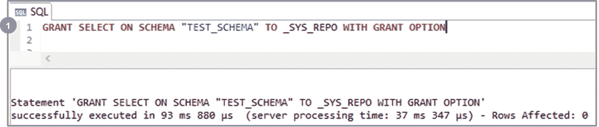  
图 1-8 – 授予权限给 `_SYS_REPO` 用户

计算视图是 SAP HANA 环境中的主要建模对象。得益于图形界面，开发者无需深入的 SQL 编程知识即可将大部分业务逻辑整合到数据模型中。计算视图提供了很大的开发灵活性，因此维护也不是一个大挑战。然而，在某些场景下，计算视图中可用的功能可能不足以满足需求。以下是 SAP HANA 计算视图的常见限制：
-   无法使用图形视图实现循环功能（如 `WHILE <condition> DO` 等）。
-   窗口函数（如 `LAG`、`LEAD`、`DENSE_RANK` 等）不可用。
-   复杂的 SQL 函数（如 `STRING_AGG`、`WORKDAYS_BETWEEN` 等）不可用。
-   不支持应用程序函数库。

幸运的是，还有另一种建模对象称为`表函数`，它支持更复杂的场景，但需要 SQL 编程知识。

### `表函数`
现在，让我们创建一个与上一节创建的计算视图逻辑相同的`表函数`。如图 1-5 所示，一个计算视图是通过对采购凭证抬头表（`EKKO`）和采购凭证项目表（`EKPO`）进行连接(join)而创建的。连接是在凭证编号列（`EBELN`）上进行的。

就我个人而言，在开始处理`表函数`逻辑时，我更喜欢在 SQL 控制台中构建整个代码。一旦我运行了代码并验证了结果，我会将 SQL 脚本复制到一个`表函数`对象中并进行必要的调整。通过这种方法，如果代码有任何问题，更容易进行调试，也可以预览该代码的结果。以下是连接 `EKKO` 和 `EKPO` 表的 SQL 代码：

```sql
SELECT EKPO."EBELN", EKPO."EBELP", EKKO."AEDAT", EKPO."MATNR",  EKPO."MEINS", EKPO."MENGE"
FROM "TEST_SCHEMA"."EKKO" EKKO
JOIN "TEST_SCHEMA"."EKPO" EKPO ON EKKO."EBELN" = EKPO."EBELN";
```

图 1-11 展示了 SQL 控制台执行上述代码后的结果。

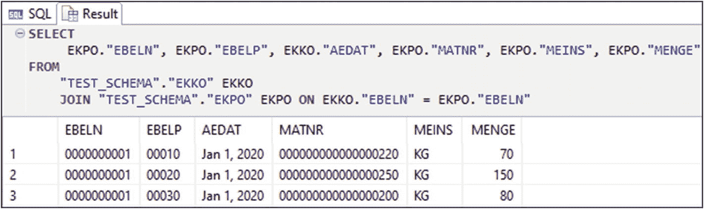  
图 1-11 – 用于连接 `EKPO` 和 `EKKO` 表的 SQL 脚本

执行图 1-11 中提供的脚本后，您可以看到结果与上一节创建的计算视图的输出相同。下一步，我将把 Eclipse 视图从 SAP HANA 建模器切换到 SAP HANA 开发视图。如果此前未使用过该视图，首先需要从 `仓库` 选项卡创建一个仓库工作区，如图 1-12 所示。

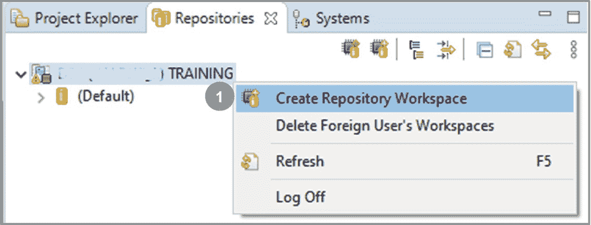  
图 1-12 – 创建仓库工作区菜单项

# 表函数

为工作区提供名称和物理路径后，即可使用。在已创建的工作区下的树形结构中，我将找到想要在其中创建表函数的包。要打开向导，请右键单击特定包并选择 **新建 ➤ 其他**。将弹出一个选择向导。输入 **表函数** 以找到正确的对象，如图 1-13 所示。

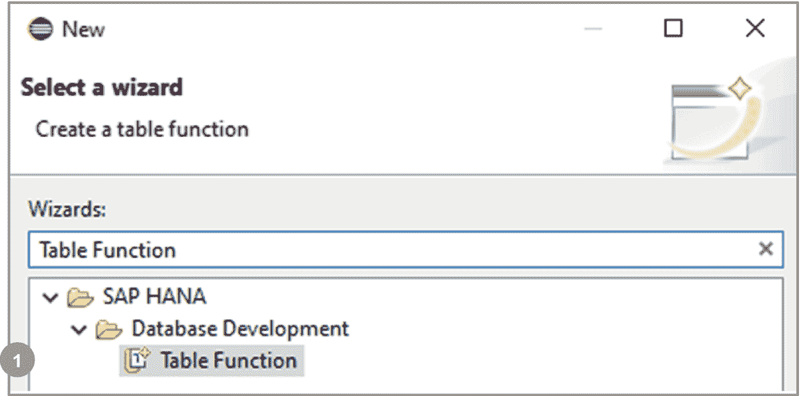
图 1-13 – 创建表函数向导

选择 `表函数` 后，为表函数提供一个名称。继续操作后，将打开一个表函数编辑器。这里是粘贴实际 SQL 查询的地方。图 1-14 显示了用于连接 `EKKO` 和 `EKPO` 表的表函数的最终定义。

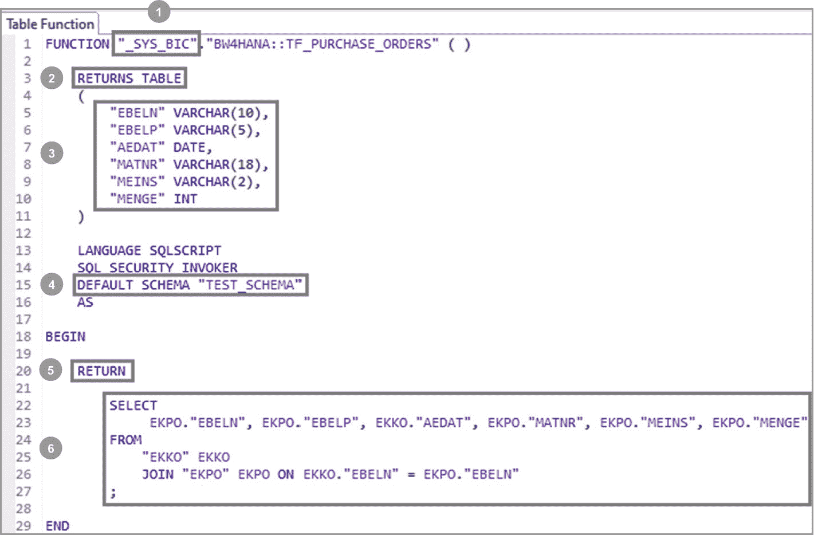
图 1-14 – 用于连接 `EKPO` 和 `EKKO` 表的表函数定义

在图 1-14 中，我高亮显示了代码的重要部分，这些部分应始终由开发者明确定义。

1.  默认情况下，在创建新表函数时，编辑器使用您的本地模式(schema)。考虑将此值更改为其他用户可以访问的模式(schema)。在我看来，最合适的模式(schema)是 `_SYS_BIC`，这也是所有由计算视图生成的列视图(column views)的存储位置。

    ```
    FUNCTION "_SYS_BIC"."BW4HANA::TF_PURCHASE_ORDERS" ( )
    ```

2.  表值应设置为表函数的输出类型。

3.  在此部分，您需要列出实际 SQL 代码中返回的所有列。您需要保持列顺序和列名（区分大小写）。此外，请确保数据类型与查询中返回的源列的所有数据类型一致。

    ```sql
    (
        "EBELN" VARCHAR(10),
        "EBELP" VARCHAR(5),
        "AEDAT" DATE,
        "MATNR" VARCHAR(18),
        "MEINS" VARCHAR(2),
        "MENGE" INT
    )
    ```

2. 此部分为可选操作；但是，如果你在模式（schema）中使用表，并且在生产环境中的模式名称不同（例如，在开发环境中模式名为 `TEST_SCHEMA`，而在生产系统中，同一模式名为 `PROD_SCHEMA`），则始终应在 TF 定义中提供此参数。如果在表函数定义中提供了默认模式，则在传输到下一环境时，该模式将自动替换为目标系统的模式（基于模式映射定义）。

    ```
    RETURNS TABLE
    ```

1.  在最后的 `SELECT` 语句之前添加 `RETURN` 短语。

    ```
    DEFAULT SCHEMA "TEST_SCHEMA"
    ```

1.  添加你实际的 SQL `SELECT` 查询，后跟分号（`;`）。如果在表函数定义中使用了 `DEFAULT SCHEMA` 参数，则应从查询中移除所有模式名称（使用 `"EKKO"` 代替 `"TEST_SCHEMA"."EKKO"`）。

    ```sql
    SELECT EKPO."EBELN", EKPO."EBELP", EKKO."AEDAT", EKPO."MATNR", EKPO."MEINS", EKPO."MENGE"
    FROM "EKKO" EKKO
    JOIN "EKPO" EKPO ON EKKO."EBELN" = EKPO."EBELN"
    ```

    ```
    RETURN
    ```

要测试该表函数，请转到 SQL 控制台并编写一条 `SELECT` 语句，在 `FROM` 子句中提供 TF 的全名。

```sql
SELECT * FROM "_SYS_BIC"."BW4HANA::TF_PURCHASE_ORDERS" ( ) ;
```

图 1-15 显示了 SQL 语句的结果，该语句从表函数中查询数据。

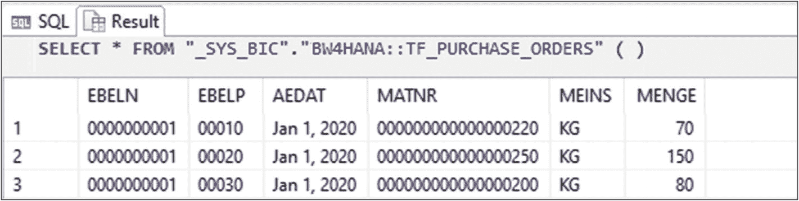
**图 1-15** 查询采购订单的表函数

创建并激活表函数后，为了使其输出可用于报表，需要创建一个计算视图，该视图将使用 TF 作为源。虽然此计算视图是在表函数之上创建的，但其属性将与常规计算视图相同（以图 1-2 作为参考）。唯一的区别是，该视图将仅包含一个指向表函数对象作为源的投影节点。图 1-16 展示了一个从表函数查询数据的计算视图。

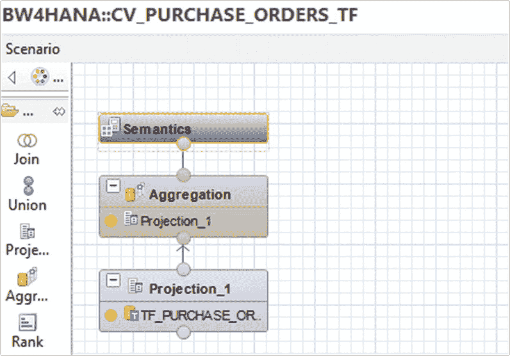
**图 1-16** 基于采购订单表函数的计算视图

使用表函数的缺点之一是容易出错。这里我列出了在处理表函数时常见的激活问题：

| **问题：** 激活表函数时，出现一般错误：*无法创建编录对象：一般错误；应为表函数定义 RETURN 语句* |
| :--- |
| **原因：** TF 定义中缺少 `RETURN` 短语。 |
| **解决方案：** 在最后的 `SELECT` 语句之前添加 `RETURN` 短语。 |

| **问题：** 激活表函数时，出现语法错误：*表函数对象中的语法错误："END" 附近的语法不正确* |
| :--- |
| **原因：** `SELECT` 语句后缺少分号。 |
| **解决方案：** 在最后一个 `SELECT` 语句后添加分号。TF 定义中的每个代码块后都应跟一个分号（`;`）。 |

| **问题：** 激活表函数时，出现不匹配错误：*无法创建编录对象：返回类型不匹配* |
| :--- |
| **原因：** TF 定义中列出的列与最终 `SELECT` 查询中列出的列不匹配。 |
| **解决方案：** 确保指定的最终 `SELECT` 查询中的列列表和顺序与 TF 定义中列出的列列表和顺序匹配。始终显式定义列名，避免使用星号（`SELECT * FROM`...）从表中选择所有列。 |

| **问题：** 激活表函数时，显示以下编码错误：*'<表函数名称>' 文件不支持编码 Cp1250；仅支持 UTF-8 编码。* |
| :--- |
| **原因：** 在 Eclipse 工具中默认文件编码设置为 `Cp1250`。 |
| **解决方案：** 从 Eclipse 工具栏中，选择 **窗口** ➤ **首选项** ➤ **常规** ➤ **工作空间**，并将文本文件编码值设置为 `UTF-8`（参见图 1-17）。 |
| 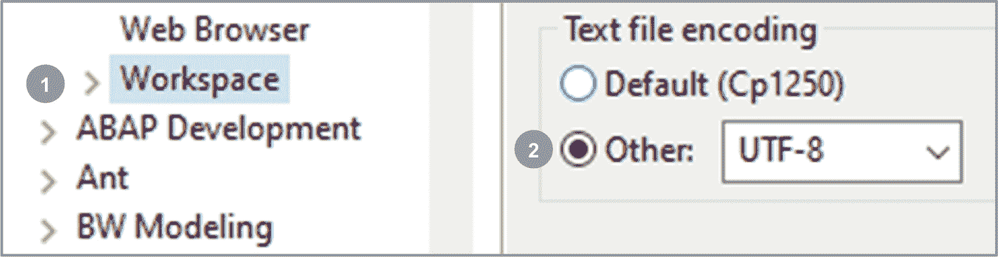 **图 1-17** Eclipse 文本文件编码 |

你现在可能会想，既然表函数比计算视图功能更多，那为什么我还要考虑在每种情况下默认使用图形化视图而不是 TF 呢？以下是表函数的一些缺点：

- **容易出错**：在表函数中编写的 SQL 代码需要遵循严格的规则。你需要始终记住保持列顺序，显式提供正确的数据类型，并在每个代码块后使用分号。
- **维护性**：对复杂 SQL 查询实施增强比图形化视图困难得多。
- **SQL 知识**：开发人员需要精通 SQL 才能实现复杂且高性能的查询。
- **传递多值可选输入参数存在限制**。

尽管存在所有这些缺点，我仍然倾向于使用表函数而非计算视图。这主要是因为在我的项目中，存在这样的情况：需要为复杂的计算视图增加图形化设计器不支持的功能。对于这些情况，我需要要么将整个逻辑重写为 SQL 代码，要么在现有计算视图之上创建一个表函数来应用图形化视图中无法实现的其他功能。无论如何，在可能的情况下，我建议坚持使用图形化方法，因为其易于维护。

### 虚拟表

借助智能数据访问（SDA）功能，SAP HANA 提供了从外部系统引入数据的能力，而无需在 SAP HANA 数据库中复制这些数据。通过 SDA，开发人员可以轻松建立远程连接，从而能够创建虚拟表，并像访问本地 HANA 表一样访问这些对象。

在 BW/4HANA 环境中，当创建非 SAP 数据模型或将外部数据集成到 SAP 数据模型时，SDA 可以发挥重要作用。将来自多个系统（如 Oracle、SQL Server、Hadoop 等）的数据集成到单个 SAP 企业数据仓库中，能够实现新的分析能力。

SDA 的另一个好处是它是一种成本效益高且节省时间的解决方案。首先，您无需复制数据并支付存储费用。当然，对于大型数据集和复杂模型，出于性能原因，可能仍然需要将外部数据持久化存储在 BW/4HANA 层。其次，无需设置和维护复制系统。此外，通过 SDA 访问的数据是实时的。借助虚拟表，您可以创建使用外部数据的查询，并将它们与驻留在 SAP HANA 系统中的数据相结合。

# SAP HANA 远程数据访问与 BW/4HANA 建模

要开始访问远程数据源，您需要首先设置连接。最简单的方法是使用 Eclipse GUI 创建一个新的远程源（作为创建远程源的替代方法，您也可以使用 SQL 脚本）。要建立远程连接，请打开 SAP HANA 模型器透视图并展开 `Provisioning` 目录。然后右键单击 `Remote Sources` 文件夹，选择 `New Remote Source`，如图 1-18 所示。

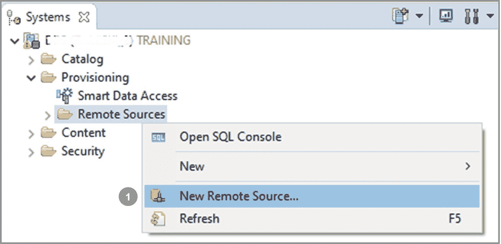

图 1-18 创建远程源 (SDA)

提供所有连接属性后，远程源对象将出现在 `Remote Source` 目录下。每个远程源将包含数据库名称以及所有可访问的模式和表的列表（见图 1-19）。

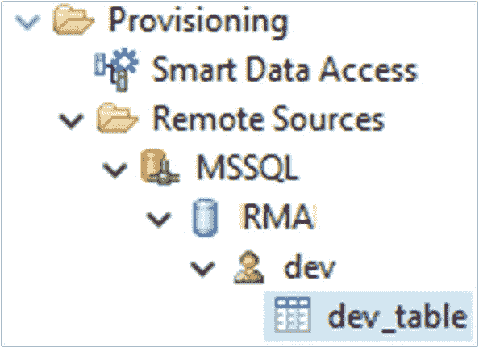

图 1-19 远程数据源视图

如图 1-19 所示，有一个名为 `MSSQL` 的远程连接，连接到名为 `RMA` 的数据库。此 `RMA` 数据库包含一个名为 `dev` 的模式，在该模式中有一个名为 `dev_table` 的表。此时，您还不能查询该表中的数据。

要开始查询来自远程源表的数据，您需要首先创建一种称为 `虚拟表` 的 HANA 对象。需要为您之后想要访问的每个远程表创建虚拟表。

> 提示：在创建虚拟表之前，一个好的做法是创建一个专用于远程表的 SAP HANA 数据库模式。这样，所有虚拟表都会驻留在一个位置。

与远程源一样，有两种创建虚拟表的方法：使用 GUI 或 SQL 脚本。图 1-20 展示了一种创建虚拟表的图形化方法。

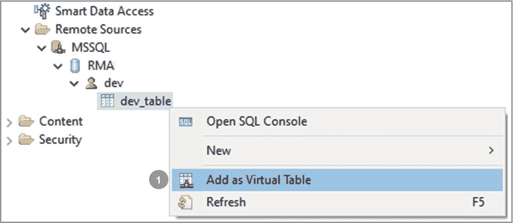

图 1-20 创建虚拟表

> 注意：对于每个远程源，您都需要获得创建虚拟表的授权。以下 SQL 查询授予此权限：
> ```sql
> GRANT CREATE VIRTUAL TABLE ON REMOTE SOURCE <SOURCE_NAME> TO <USER_NAME>
> ```

选择添加虚拟表的选项后，作为下一步，您需要输入虚拟表的名称和目标模式。一旦提供并确认此信息，虚拟表将在给定模式下创建。如果它是一个常规的 HANA 表，您可以开始在 SQL 控制台中使用虚拟表，或在图形视图中使用它。

## 主要的 SAP BW/4HANA 建模对象

在用于所有建模对象的 BW/4HANA SAP 统一用户界面中，开发人员现在可以使用 Eclipse 工具开发所有 BW 对象（见图 1-21）。另一个好处是，他们只需单击一下即可从 HANA 原生透视图切换到 BW/4HANA 建模透视图。为了开发 BW 工件，开发人员将使用 Eclipse 的 BW 建模透视图。每个 BW/4HANA 工件都可以通过右键单击信息区域，选择新建，并选择相应的对象来创建（如图 1-21 所示）。

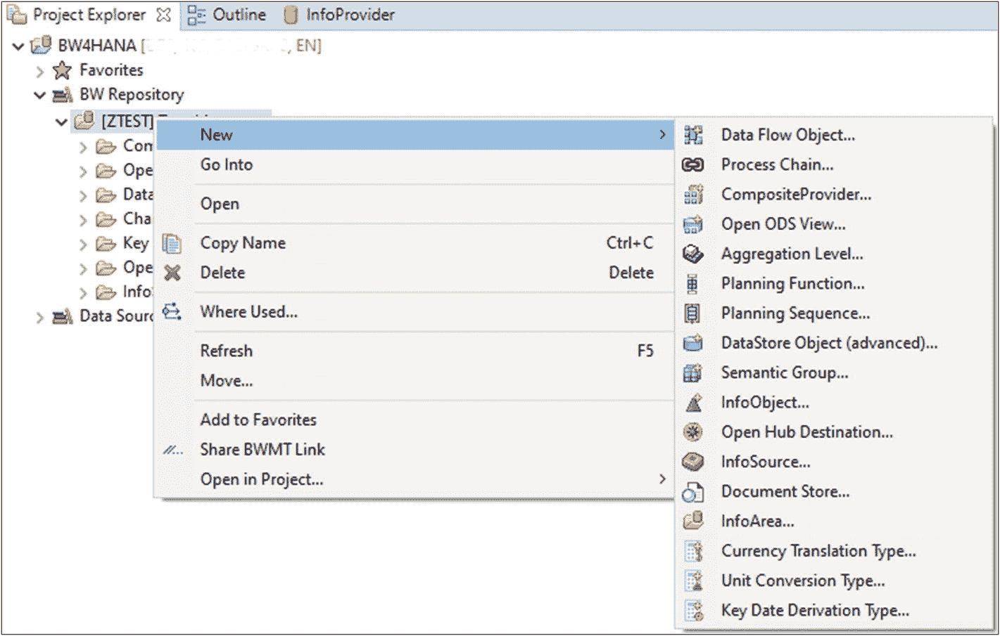

图 1-21 BW 建模透视图中的建模对象

对于特定的 BW/4HANA 任务，仍然需要使用 SAP GUI。为了将其使用与建模活动统一起来，SAP GUI 也已嵌入到 Eclipse 中。通过单击“打开 SAP GUI”按钮（或使用键盘快捷键 `Ctrl+6`），您可以在 Eclipse 工具中打开 SAP GUI（见图 1-22）。

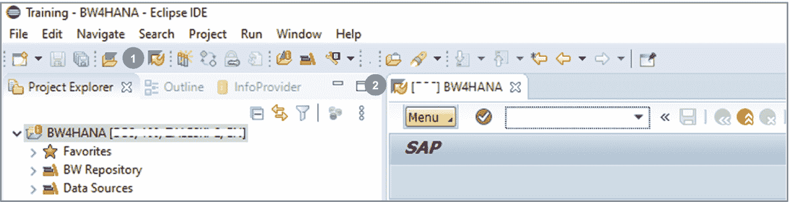

图 1-22 Eclipse 中的 SAP GUI

SAP BW/4HANA 通过将建模对象类型从九种限制为仅四种，简化了数据建模方法。就数据持久性而言，不再有称为 `InfoCube`、`PSA`、`DSO` 或 `HybridProvider` 的对象。它们全部被一个称为高级 DSO (`ADSO`) 的单一对象所取代。就虚拟层而言，以下遗留对象已合并为一个称为 `复合提供者` 的单一对象：`MultiProvider`、`InfoSet` 和 `VirtualProvider`。还有一个名为开放 ODS 视图的新建模对象。开放 ODS 视图对象具有类似于旧 `VirtualProvider` 对象的功能。`InfoObject` 的主要目的和功能保持不变。图 1-23 显示了 BW/4HANA 与旧版 SAP BW 系统相比如何简化了建模对象。

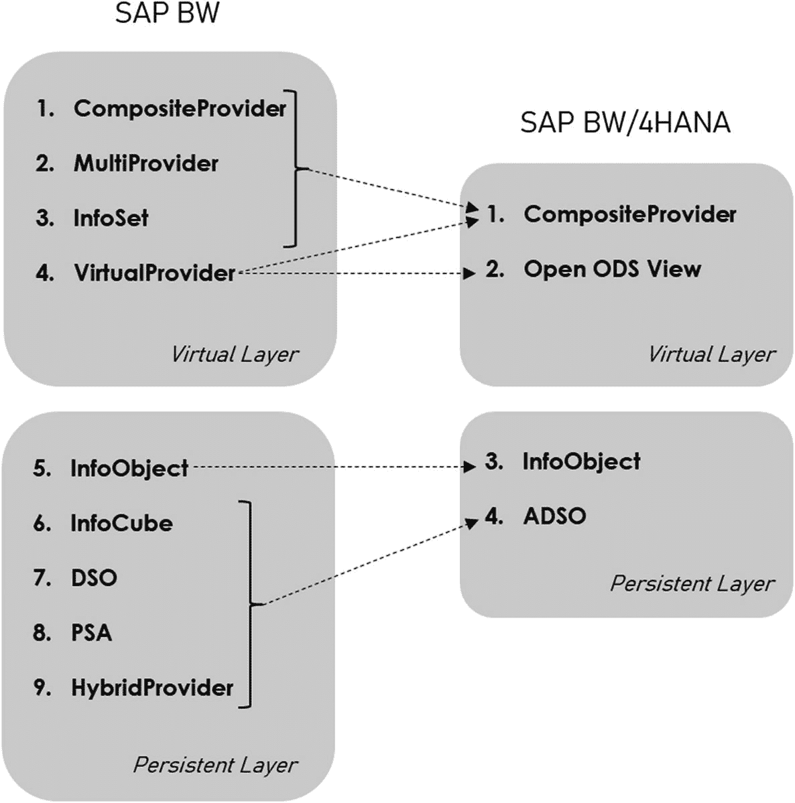

图 1-23 BW 与 BW/4HANA 中建模对象的比较

最基本的建模对象是信息对象。该对象的主要功能在 BW/4HANA 版本中没有改变。在早期版本 SAP BW 上工作的开发人员将会熟悉此对象。在下一节中，我不会详细讨论 `InfoObject` 的属性；我将重点介绍那些在新建模方法中有用的功能。

开放 ODS 视图是代表虚拟建模层的对象。这意味着它们不持久化任何数据。使用开放 ODS 视图，开发人员可以将外部数据引入 BW 报告层。与 `InfoObject` 不同，使用开放 ODS 视图，您可以决定基本的构建块是什么。它们可以基于 `InfoObject`、另一个开放 ODS 视图或原始字段构建。

使用开放 ODS 视图对象，开发人员可以轻松管理外部数据源并构建星型模式模型，而无需数据持久化。这意味着它们可以充当一种虚拟主数据或虚拟事实表。此外，借助开放 ODS 视图对象的基于字段的方法，我们避免了创建过多的 `InfoObject`，这在某些场景（概念验证、试点、表/视图数据供应）中不会带来任何价值，反而会因在系统中创建多个虚拟对象而产生额外的工作。

在 SAP BW/4HANA 中，像 `DSO`、`InfoCube`、`PSA` 和 `HybridProvider` 这些对象的功能现在已统一为单一建模对象。BW/4HANA 用于数据持久化的主要对象是 `ADSO`。与旧的 BW 持久化对象不同，`ADSO` 不必仅基于 `InfoObject` 构建；它可以使用基于字段的建模方法实现。在某些业务场景下，需要创建临时报表、概念验证或基于外部源的模型，并将它们加载到 BW/4HANA 系统中。定义 `ADSO` 结构时，您可以简单列出所有所需字段和数据类型，然后激活对象。您也无需指定将为 `ADSO` 使用哪种构建块类型；您可以在单个 `ADSO` 中灵活地混合使用 `InfoObject` 与原始字段。

`CompositeProvider` 是一个 BW/4HANA 对象，它集成了以前 `MultiProvider`、`InfoSet` 和 `VirtualProvider` 的所有功能。`CompositeProvider` 代表一个逻辑层，因此它不持久化任何数据（虚拟对象）。它允许您在创建用于报表的最终查询之前，合并来自多个 `InfoProvider` 或 HANA 计算视图的数据。一个良好的 BW/4HANA 建模实践是使用 `CompositeProvider` 作为逻辑层，该层随后被最终的 `Query` 对象消费。`CompositeProvider` 支持两种主要操作：联接（Join）和联合（Union）。此外，随着 BW/4HANA 2.0 的最新发布，可以在单个 `CompositeProvider` 中组合多个联接和联合操作。得益于此，构建逻辑模型类似于构建计算视图。用于建模 `CompositeProvider` 的节点类型也与计算视图的节点类型几乎相同。您可以使用联接（join）、联合（union）、投影（projection）和聚合（aggregation）节点来实现结合 `InfoProvider` 和计算视图的复杂场景。

BW/4HANA 2.0 还进一步为 `CompositeProvider` 赋予了 HANA SQL 脚本功能。因此，`CompositeProvider` 提供了实现基于 SQL 的计算列的能力。这是一个很好的改进，因为在旧的 BW 系统中一直缺少在特征上创建计算列的功能。借助此功能，您可以轻松创建计算列，例如，将两个 `InfoObject` 的值连接成一个字符串。所有 SQL 计算将在查询执行期间即时处理，这意味着对于复杂计算和大型数据集，性能可能会受到影响。SQL 脚本也可用于在 `CompositeProvider` 模型中消费的 `InfoProvider` 上实现过滤表达式。

总结一下，以下是 BW/4HANA 2.0 中 `CompositeProvider` 的主要优势和改进：
* `CompositeProvider` 可以将多个 PartProvider（`ADSO`、`Open ODS View`、`InfoObject`）合并到一个逻辑层中。

* SAP HANA 计算视图作为 `PartProvider` 得到支持。

* `CompositeProvider` 的输出结构可以使用 `InfoObject`、`Open ODS View` 和原始字段的混合来构建。

* 投影、聚合、联接和联合建模节点均可用。

* 联接操作提供了更大的灵活性，可以选择联接类型（内联接、参照联接、左外联接、右外联接、全外联接）、设置联接基数（`n:m`、`1:n`、`n:1`、`1:1`）以及使用联接运算符（`=`、`≠`、`<`、`≤`、`≥`、`>`）。

* 支持使用 SQL 脚本实现过滤表达式和计算列。

`Query` 对象用于报表，并可以被前端工具消费。它们可以在每个 `InfoProvider` 之上创建，但在我看来，最好总是创建一个 `CompositeProvider` 作为 `InfoProvider` 和最终 `Query` 对象之间的中间层。这提供了更大的灵活性，以便您将来需要对底层 `InfoProvider` 应用一些额外的逻辑或将其与其他 `InfoProvider` 组合。在这种情况下，您无需从头重新创建查询，只需增强逻辑层并继续使用当前查询即可。在 SAP BW/4HANA 中，不再支持 BEx Query Designer 工具。BEx Designer 的功能现已迁移到 Eclipse 平台。换句话说，BEx Query Designer 的功能现在作为基于 Eclipse 的 Query Designer 提供。

在本章中，我不会详细讲解查询的所有功能，因为其中大部分与 SAP BEx Query Designer 相同。本章侧重于数据建模能力；因此，我仅对 Query Designer 进行高层次概述。

BW/4HANA 系统中一个可能对建模有用的新对象是 `Data Flow` 对象。`Data Flow` 对象以图形方式解释所选 BW/4HANA 对象之间的依赖关系。借助 `Data Flow` 对象，您可以为数据流创建模板，并从图形模型生成所有对象。

在接下来的部分中，我将对 BW/4HANA 对象进行高层次概述，并试图突出那些在我看来对新型建模方法有用的特性。

### InfoObject

在使用 Eclipse BW 建模透视图创建新的 `InfoObject` 时，在 `General`（常规）选项卡上，您会找到两个用于生成外部 SAP HANA 视图的复选框。默认情况下，它们呈灰色不可用状态，但一旦您选中 `Master Data`（主数据）和 `Usable as InfoProvider`（可用作信息提供者）选项，它们就会变为可用状态（参见图 1-24）。

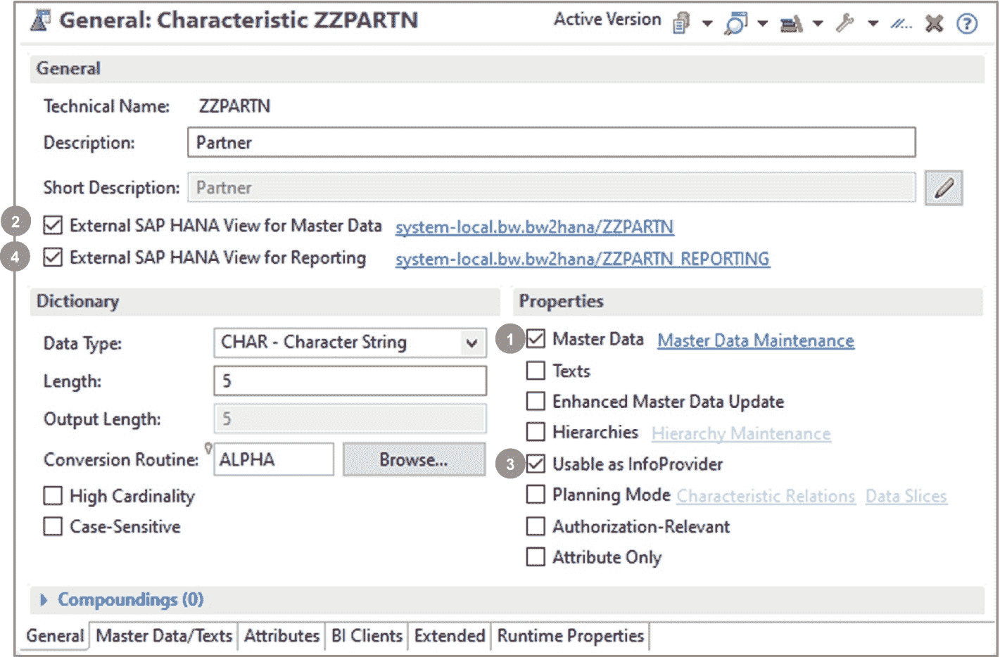

**图 1-24** `InfoObject` 外部 SAP HANA 视图选项

如图 1-24 所示，`Master Data`（主数据）复选框激活了 `External SAP HANA View for Master Data`（主数据外部 SAP HANA 视图）选项，而 `Usable as InfoProvider`（可用作信息提供者）复选框激活了 `External SAP HANA View for Reporting`（报表外部 SAP HANA 视图）选项。激活视图后，您将看到从 `InfoObject` 生成的每个 HANA 视图的位置。

> **注意**
> 从 BW 对象生成视图的默认位置是 `system-local.bw.bw2hana`。但是，您可以使用事务代码 `RS2HANA_VIEW` 定义一个不同的位置。

当我切换到 SAP HANA 建模器透视图并导航到图 1-24 所示的包路径时，我将看到两个已创建的 HANA 视图，它们是在 `InfoObject` 激活后生成的。第一个计算视图的名称与 `InfoObject` 相同。第二个视图的名称是 `InfoObject` 名称后跟 `_REPORTING` 字符串的组合（参见图 1-25 作为参考）。

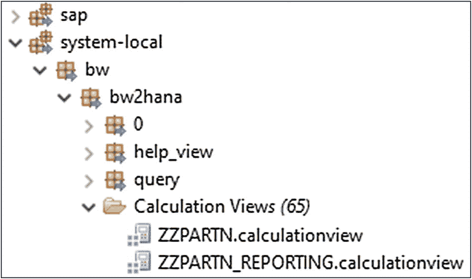

**图 1-25** 从 `InfoObject` 生成的计算视图

除了命名之外，这两个视图的主要区别在于：为 Master Data 对象生成的视图（`ZZPARTN`）属于 `DIMENSION`（维度）数据类别类型，这意味着它不能被报表工具消费，并且所有输出字段都是 `Attribute`（属性）类型。`ZZPARTN_REPORTING` 是一个 `CUBE`（立方体）类型的计算视图，可用于报表，并且同时包含属性和度量。根据您的需求，您可以决定哪种类型的外部视图更适合您的场景。

> **注意**
> 从 BW 对象生成外部 HANA 视图存在多种限制，因此您不应默认对每个 `InfoObject` 都选择该选项。有关从 BW/4HANA 系统生成 SAP HANA 视图的限制的更多信息，请参考官方 SAP 文档。

外部 HANA 视图生成时带有 `SQL Analytic`（SQL 分析）权限。在生成外部 HANA 视图期间，每个视图还会生成一个新的角色。图 1-26 展示了为 `ZZPARTN` InfoObject 的两个外部视图生成的两个角色。

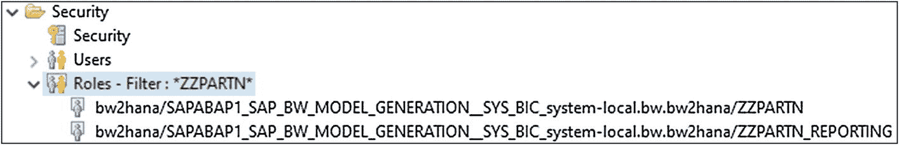

**图 1-26** 为 `InfoObject` 外部视图生成的角色

除非将这些角色分配给您的用户或分配给您的用户角色，否则在尝试执行外部视图时，您将遇到授权问题。为了避免每次创建新外部视图时都需要手动将生成的角色分配给用户，可以自动将这些角色分配给用户/角色（事务代码：`RS2HANA_ADMIN`、`RS2HANA_CHECK`）。

不应手动修改从 BW/4HANA 对象生成的外部视图。这是因为每次激活 `InfoObject` 时，外部视图都会重新生成，因此所有手动更改都将被默认设置覆盖。如果您想对该对象执行任何额外的数据操作，您需要创建一个常规的计算视图，并将外部视图作为源。在本书的后续章节中，我将介绍一些使用 `InfoObject` 外部视图的用例。

我认为另一个有用的 `InfoObject` 功能是将 `SAP HANA View`（SAP HANA 视图）选项设置为 `Read Access Type`（读取访问类型）参数。此功能可以在创建虚拟数据模型时使用。一旦设置了 `SAP HANA View`（SAP HANA 视图）访问类型，您无需将任何数据加载到 `InfoObject` 结构中；相反，只需将 SAP HANA 视图指定为源，并在计算视图字段与 `InfoObject` 属性之间应用关联即可（参见图 1-27）。

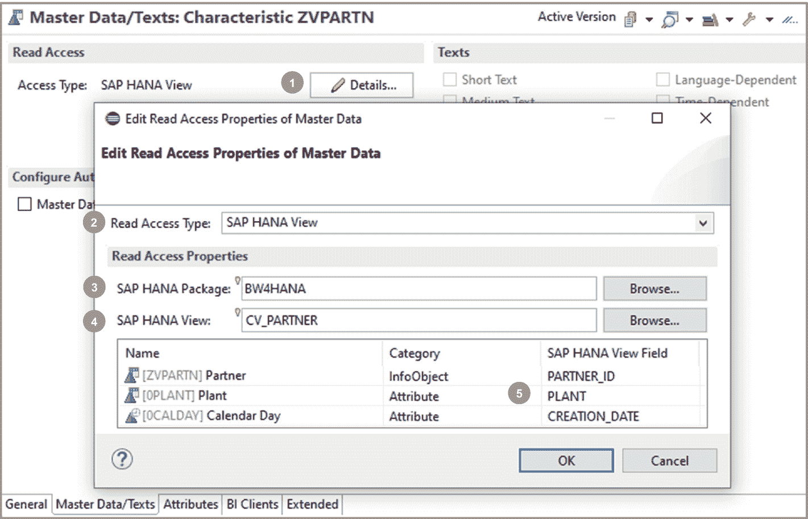

**图 1-27** 具有 SAP HANA 视图访问类型属性的 `InfoObject`

如图 1-27 所示，`InfoObject` `ZVPARTN` 设置了 `SAP HANA View`（SAP HANA 视图）访问类型。它从位于 BW/4HANA 包中的计算视图 `CV_PARTNER` 读取数据。`InfoObject` `ZVPARTN` 映射到计算视图的 `PARTNER_ID` 字段。`InfoObject` 属性 `0PLANT` 和 `0CALDAY` 分别映射到视图字段 `PLANT` 和 `CREATION_DATE`。

从我的角度来看，BW/4HANA `InfoObject` 最后一个值得注意的特性是传递属性功能。我将基于图 1-28 中显示的示例介绍此功能。

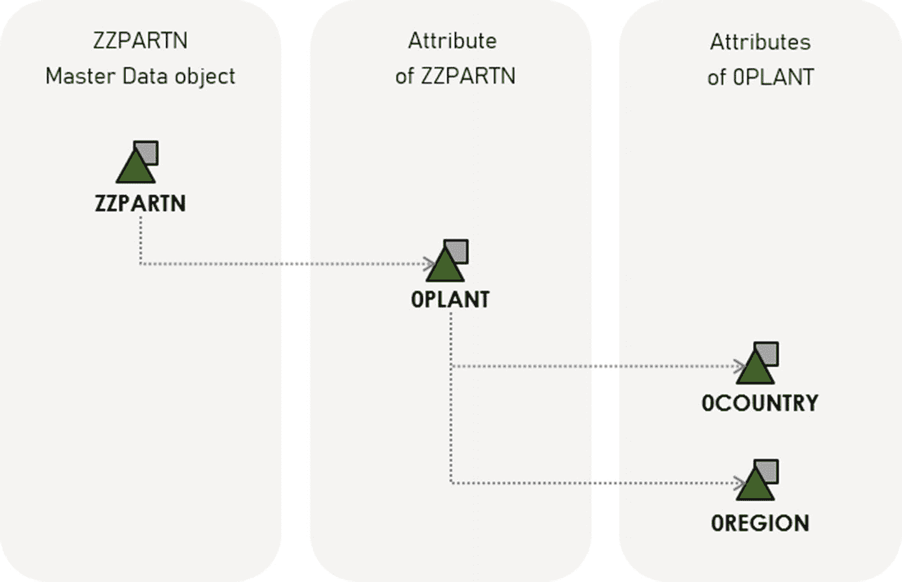

**图 1-28** 传递属性的用例

我创建了 `Partner`（合作伙伴）（`ZZPARTN`）`InfoObject`，并将其 `Plant`（工厂）（`0PLANT`）设置为导航属性。尽管与 `Partner`（合作伙伴）相关联的 `Plant`（工厂）信息可用，但报表需求是同时显示该 `Plant`（工厂）属性的 `Country`（国家）（`0COUNTRY`）和 `Region`（地区）（`0REGION`）值。这两个字段是 `Plant`（工厂）的导航属性。为了满足此需求，我打算将 `Plant`（工厂）及其属性都作为 `Partner`（合作伙伴）（`ZZPARTN`）`InfoObject` 的导航属性。可以通过为 `ZZPARTN` `InfoObject` 维护传递属性来满足此需求。在 `Attributes`（属性）选项卡上，右键单击 `Navigation Attributes`（导航属性）窗格并选择 "Maintain transitive attributes"（维护传递属性）（图 1-29）。

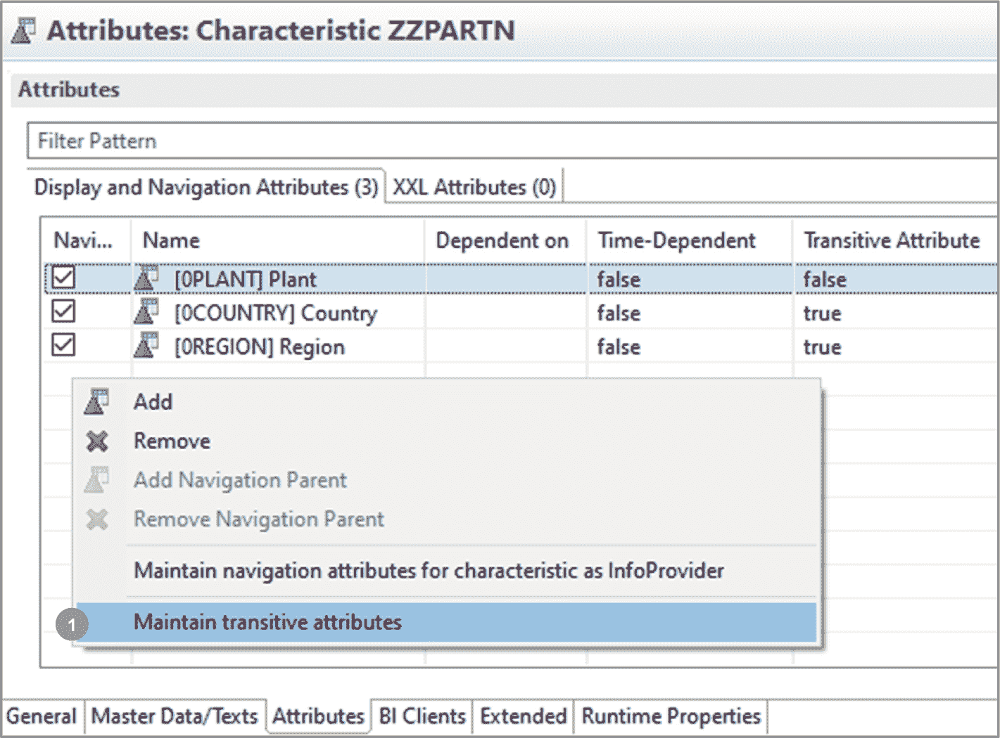

**图 1-29** InfoObject 的 "Maintain transitive attributes" 选项

一旦您从维护窗口中选择 `Transitive Attributes`（传递属性），这些属性将出现在 `Display and Navigation Attributes`（显示和导航属性）部分。在此部分中，有一个 `Transitive Attribute`（传递属性）列，基于该列您可以识别特定字段是常规属性还是传递属性。如图 1-29 所示，属性 `0COUNTRY` 和 `0REGION` 在 `Transitive Attribute`（传递属性）列中被标记了标志 `true`。通过此配置，`Country`（国家）和 `Region`（地区）列可用于报表，尽管它们不会实际加载到 `Partner`（合作伙伴）（`ZZPARTN`）主数据表中。传递属性简化了开发、减少了维护工作并消除了冗余。

## 打开 ODS 视图（Open ODS View）

在创建新的 `Open ODS View`（打开 ODS 视图）对象时，作为第一步，我们需要根据对象的用途，选择以下语义选项之一：`Facts`（事实）、`Master Data`（主数据）或 `Texts`（文本）。如前所述，`Open ODS View` 对象不会持久化任何数据，因此作为第二步，系统会要求我们为 `Open ODS View` 对象指明数据源。在 `BW/4HANA 2.0 SP04` 中，`Open ODS View` 对象支持以下源类型：

- `DataSource (BW)`（数据源 (BW)）
- `Database Table or View`（数据库表或视图）
- `Database Table or View via Linked Database or MDC`（通过链接数据库或 MDC 的数据库表或视图）
- `Virtual table using SAP HANA Smart Data Access`（使用 SAP HANA 智能数据访问的虚拟表）
- `Big Data`（大数据）
- `DataStore Object (Advanced)`（高级 DataStore 对象）
- `Transformation`（转换）

在为 `Open ODS View` 对象选择源对象后，我们就可以开始根据源字段定义其结构。图 1-30 展示了 `Open ODS View` 对象建模编辑器的 `General`（常规）选项卡。

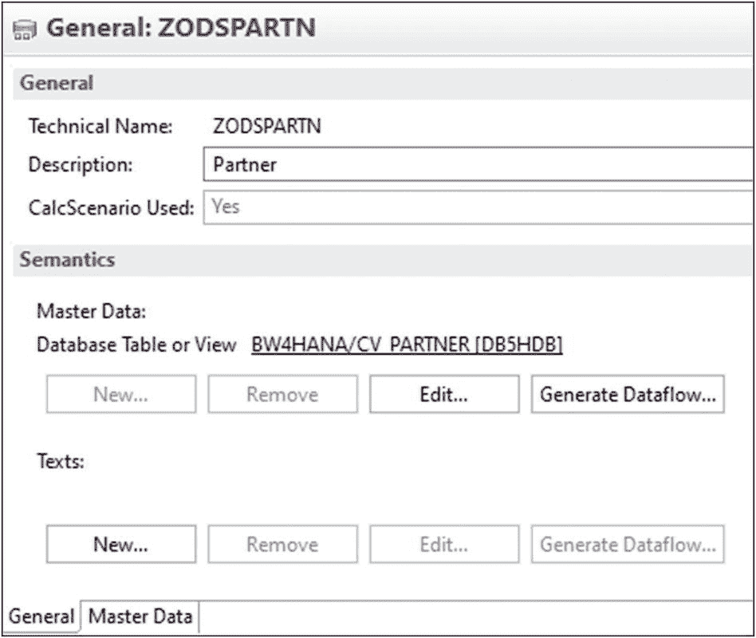

**图 1-30** Open ODS View 编辑器：常规选项卡

无论创建 `Open ODS View` 对象时选择何种语义类型，`General`（常规）选项卡始终可用。对于给定的示例（图 1-30），`Open ODS View` 对象使用 `CV_PARTNER` 计算视图作为源。`Edit`（编辑）选项允许您更改源对象。`Generate Dataflow`（生成数据流）选项使您能够自动生成源对象与 `Open ODS View` 对象之间的数据源和 `ADSO`（包含转换和 `DTP`）。如果我们将来希望通过将底层数据持久化到 `ADSO` 中来提高性能，而无需更改 `Open ODS View` 结构，则此选项很有用。在本书的后续章节中，我将通过示例更详细地描述此功能。

`Open ODS View` 编辑器的第二个选项卡可能因所选的语义类型而异。在给定的示例中，我选择了 `Master Data`（主数据）作为语义类型；因此，第二个选项卡被命名为 `Master Data`（主数据）（见图 1-31）。

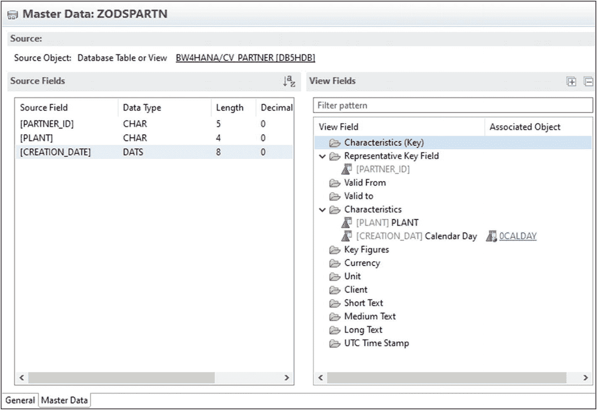

**图 1-31** Open ODS View 编辑器，主数据选项卡

在此选项卡中，我将为 `Open ODS View` 对象建模其结构。在左侧窗格中，有一个名为 `Source Fields`（源字段）的区域，您可以在其中找到源对象中所有可用字段的列表。要选择应用于建模 `Open ODS View` 对象的源字段，您可以简单地将它们从 `Source Fields`（源字段）区域拖放到 `View Field`（视图字段）区域。对于 `Master Data`（主数据）类型的 `Open ODS View` 对象，必须指明一个应放置在 `Representative Key Field`（代表键字段）组下的字段。在我的示例中，我将 `PARTNER_ID` 字段设置为代表键字段。其余两个字段：`PLANT` 和 `CREATION_DATE` 被分配到 `Characteristic`（特性）部分。您可能还会注意到，`PARTNER_ID` 和 `PLANT` 是原始字段，直接从源中获取，而 `CREATION_DATE` 字段已与 `0CALDAY` 信息对象关联。

在本练习中，我创建了 `Open ODS View` `ZODSPARTN`，其功能与本书上一节中创建的 `InfoObject` `ZVPARTN` 类似。主要区别在于，要构建 `Open ODS View`，我不必使用任何单个 `InfoObject`（我使用 `0CALDAY` 进行字段关联只是为了演示功能）。得益于此，创建 `Open ODS View` 对象极其灵活且快速。当您需要管理尚未在 `BW/4HANA` 环境中创建主数据的外部数据模型时，此对象尤其有用。这可以节省大量开发时间，而在使用旧的 `BW` 系统时，这些时间将用于为每个维度字段创建数十个 `InfoObject`。

## 高级 DSO

`Advanced DSO`（高级 DSO）由三个技术表组成：入站表、活动表和更改日志表。除了技术表之外，还会生成三个数据库视图（这些不是计算视图）：用于提取的视图、用于报表的视图和用于外部访问的视图。为 `ADSO` 生成的数据库对象存储在 `SAPABAP1` 模式中。表 1-1 展示了数据库生成的 `ADSO` 对象的命名模式。

**表 1-1** 为 ADSO 生成的数据库对象

| 对象类型 | 对象名称 | 描述 |
| --- | --- | --- |
| 表 | `/BIC/A*<ADSO 名称>*1` | 入站表 |
| 表 | `/BIC/A*<ADSO 名称>*2` | 活动数据表 |
| 表 | `/BIC/A*<ADSO 名称>*3` | 更改日志 |
| 视图 | `/BIC/A*<ADSO 名称>*6` | 提取视图 |
| 视图 | `/BIC/A*<ADSO 名称>*7` | 报表视图 |
| 视图 | `/BIC/A*<ADSO 名称>*8` | 外部访问视图 |

每个技术表的行为可能因 `ADSO` 设置而异。通常，入站表充当新数据表并存储数据加载详细信息。活动表包含用于报表目的的数据。更改日志表跟踪 `ADSO` 内的所有数据更改。在 `BW/4HANA` 转换中使用 `ABAP` 或 `AMDP/SQL` 脚本实现例程时，可能会使用外部 `SQL HANA` 视图。

`ADSO` 编辑器由三个选项卡组成：`General`（常规）、`Details`（详细信息）和 `Settings`（设置）。图 1-32 展示了 `ADSO` 编辑器的 `General`（常规）选项卡。

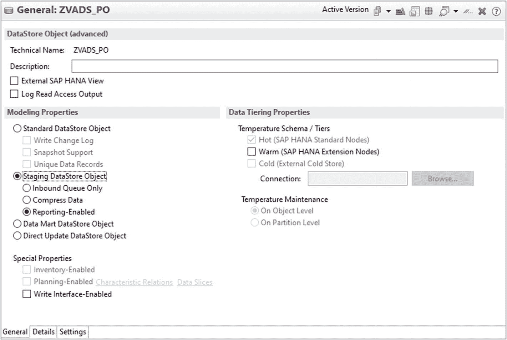

**图 1-32**

# 高级 DSO 编辑器：常规选项卡

在 `General`（常规）选项卡的左侧窗格中，您可以配置 `ADSO` 的建模属性。如图 1-32 所示，`ADSO` 具有以下建模属性：

- **标准 DataStore 对象**：此类型可以覆盖大多数报表场景。在此类型中，有额外的设置可用。
    - **写入更改日志**：选择此选项后，加载数据时，增量将保存在更改日志表中。更改日志存储请求激活历史记录；因此，当选择此选项时，可以将数据回滚到请求激活之前的状态。
    - **快照支持**：仅当选中 `Write Change Log`（写入更改日志）复选框时，此选项才处于活动状态。当 `ADSO` 始终以全量加载方式加载时，此选项很有用。加载请求中不可用的数据将从 `ADSO` 的活动表中删除并写入更改日志表。
    - **唯一数据记录**：如果 `ADSO` 将始终加载唯一记录，则应选择此选项。这可以加速 `ADSO` 的请求激活过程。如果数据集包含已存在于 `ADSO` 中的字段组合，则请求激活将失败。
- **暂存 DataStore 对象**：对于此类型，不支持更改日志。有以下属性可用：
    - **仅入站队列**：此类型的 `ADSO` 可用于暂存层，不能用于报表。所有数据都存储在单个入站表中。
    - **压缩数据**：数据最初写入入站表。在激活期间，它们被压缩（基于语义键进行聚合）并加载到活动表中。在激活期间，关键指标要么相加，要么覆盖（取决于在转换级别定义的聚合类型）。由于不使用更改日志表，因此无法按请求执行删除操作。
    - **启用报表**：此属性与 `Compress Data`（压缩数据）选项类似，区别在于在请求激活期间，入站表中的数据不会被删除。在报表场景中，数据取自活动表；但是，对于数据提取，将查询入站表。
- **`Data Mart DataStore Object`（数据集市数据存储对象）**：此 ADSO 类型的行为与先前名为`InfoCube`的 BW 对象功能相同。当加载增量数据时（关键指标值不可覆盖；仅允许`MAX`、`MIN`和`SUM`聚合），应使用此类型。数据最初加载到入站表中。激活时，数据会被压缩并加载到活动表中。对于此类型的 ADSO，所有字段均被视为键。在报表中使用此类型的 ADSO 时，数据将从入站表和活动表的并集中获取，这意味着即使加载请求未被激活，报表也会返回所有数据。
- **`Direct Update DataStore Object`（直接更新数据存储对象）**：使用此类型时，数据直接加载到活动表中。不使用其他技术表。无法进行请求激活，用于抽取和报表的数据始终从活动表中获取。数据可以通过`DTP`或 API 写入。

除了建模属性之外，在 ADSO 编辑器的`常规`选项卡（图 1-32）上还有一个`数据分层属性`部分。使用此属性，您可以根据数据类别（热、温或冷）实施数据分层存储策略。

创建 ADSO 时可用的第二个选项卡是`详细信息`选项卡。在此选项卡上进行实际的 ADSO 建模。图 1-33 显示了名为`ZVADS_PO`的 ADSO 的`详细信息`选项卡。

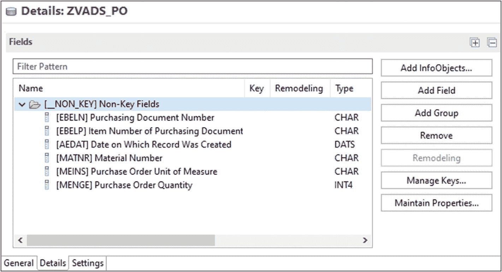

**图 1-33** 高级 DSO 编辑器，详细信息选项卡

创建新的 ADSO 时，您可以提供一个对象（`DataSource`、`InfoProvider`、`InfoObject`或`InfoSource`）作为模板。这样，所有`InfoObject`/字段都将从模板对象派生到 ADSO 结构中。当然，可以根据需要更改/移除其中的一些字段。在图 1-33 所示的示例中，创建 ADSO 时，我使用了`DataSource`作为模板。所选`DataSource`中的所有可用字段都已生成在`字段`部分中。您可能会注意到`ZVADS_PO`由原始字段组成。通过单击`添加 InfoObject` 或 `添加字段`，可以向`字段`部分添加新条目。`添加组`按钮允许您向 ADSO 字段结构中添加新文件夹。使用`移除`按钮，可以移除选定的字段。`重塑`按钮启用了图 1-34 中所示的选项。

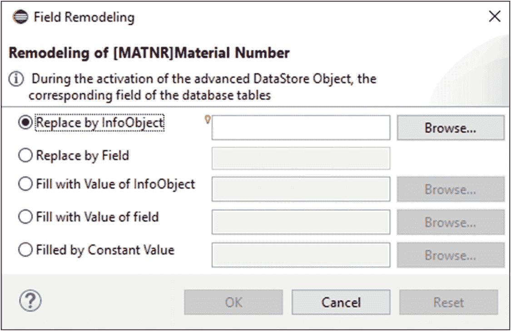

**图 1-34** ADSO 字段重塑窗口

选择字段`MATNR`并单击`重塑`按钮后，将打开`字段重塑`窗口（图 1-34）。可以选择以下活动之一：

- `Replace by InfoObject`（替换为 InfoObject）：特定的字段/`InfoObject`将被替换为另一个`InfoObject`。
- `Replace by Field`（替换为字段）：此特定字段/`InfoObject`将被替换为原始字段。给定的名称不应已在 ADSO 中使用。
- `Fill with Value of InfoObject`（填充为 InfoObject 的值）：这会将给定`InfoObject`的值加载到重塑的字段/`InfoObject`中。
- `Fill with Value of field`（填充为字段的值）：这会将给定字段的值加载到重塑的字段/`InfoObject`中。
- `Filled by Constant Value`（填充为常量值）：这会将常量值加载到重塑的字段/`InfoObject`中（只能填充新元素）。

在图 1-33 中，还有两个按钮：`管理键`和`维护属性`。根据 ADSO 配置，`管理键`按钮可以是非活动或强制性的。它用于指示唯一标识每条记录的键字段/`InfoObject`组合。

使用`维护属性`按钮，我们可以设置字段/`InfoObject`的属性（聚合类型或主数据检查行为）。您可以在`详细信息`部分的右侧窗格中找到更多字段属性（单击特定字段/`InfoObject`后将出现该窗格）。

## `CompositeProvider`

创建新的`CompositeProvider`时，与所有其他对象一样，第一步我们需要提供其技术名称。可选地，我们可以输入描述和要从中复制结构的另一个`CompositeProvider`的名称。在下一个屏幕上，我们可以选择源`PartProvider`和默认操作（连接或联合）。我们也可以通过单击`完成`并直接转到`CompositeProvider`编辑器来跳过此步骤。系统默认打开编辑器的`常规`选项卡，如图 1-35 所示。

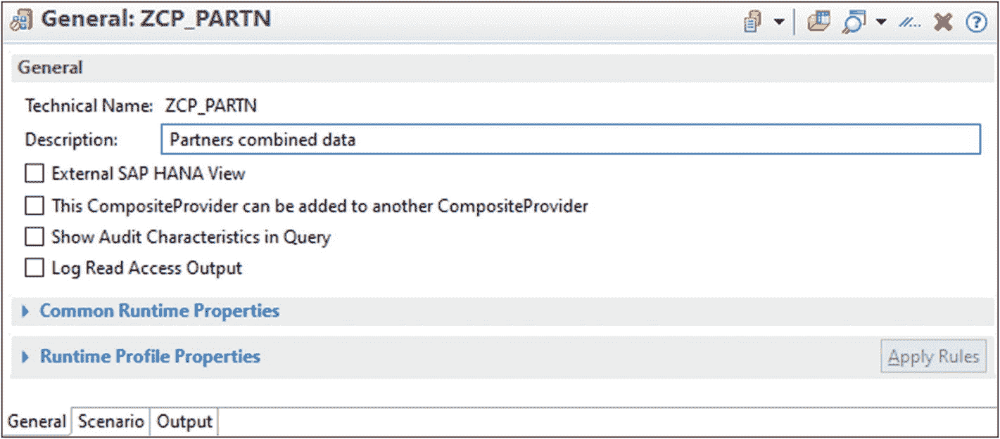

**图 1-35** `CompositeProvider`，常规选项卡

在此选项卡上，您可以配置`CompositeProvider`的运行时属性。此处还可以找到一个用于从`CompositeProvider`生成外部 SAP HANA 视图的复选框。您还可以指定此`CompositeProvider`是否可以作为提供者被另一个`CompositeProvider`使用（选项“此`CompositeProvider` 可以添加到另一个 `CompositeProvider`”）。

`CompositeProvider`编辑器的`方案`选项卡旨在实现实际的逻辑层。在此选项卡上，您可以指定源`PartProvider`并根据所需的业务逻辑定义适当的操作，以获得所需的输出。图 1-36 显示了`CompositeProvider`编辑器的`方案`选项卡。

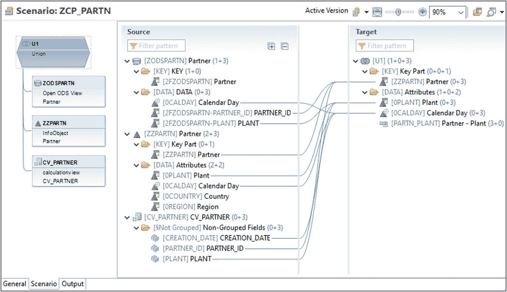

**图 1-36** `CompositeProvider`，方案选项卡

在我的示例中，我组合了来自三个不同对象的数据：Open ODS View 对象（`ZODSPARTN`）、`InfoObject`（`ZZPARTN`）和计算视图（`CV_PARTNER`）。联合运算符将来自所有底层对象的数据集组合起来，并将其字段从源映射到目标结构（图 1-36）。在`CompositeProvider`的目标结构中，有三个`InfoObject`：合作伙伴（`ZZPARTN`）、工厂（`0PLANT`）和日历日（`0CALDAY`）。尽管对象`CV_PARTNER`和`ZODSPARTN`由原始字段组成（Open ODS View 中的`0CALDAY`除外），但我能够将它们映射到目标`InfoObject`。在图 1-36 中，您还可以注意到字段`PARTN_PLANT`没有与任何`PartProvider`关联。这是一个计算列，可以通过右键单击`目标`部分并选择`创建计算字段`来创建。`计算字段`编辑器将在新窗口中打开，如图 1-37 所示。

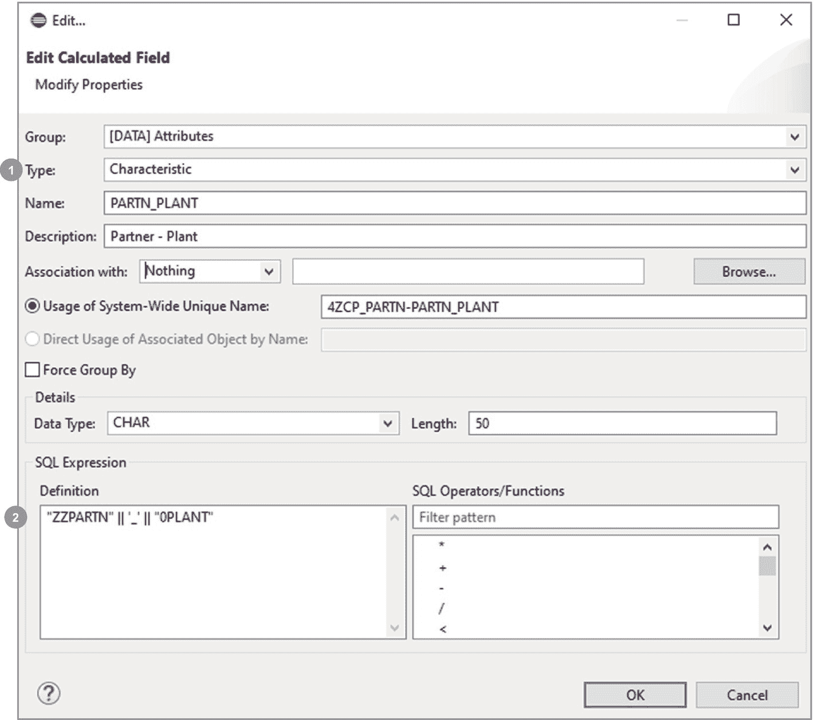

图 1-37 `CompositeProvider`，计算字段编辑器

在`计算字段`编辑器中，首先我们应该定义字段类型：根据是维度还是度量，选择`特征`或`关键指标`。我们还应为计算字段提供名称和描述。可以使用“关联于”选项在计算字段与`InfoObject`或`Open ODS View`对象之间建立关联。在我的示例中，我保持此字段不与主数据对象关联。指定数据类型后，在`定义`部分我们可以输入 SQL 表达式。如图 1-37 所示，我使用了以下 SQL 语法：

```
"ZZPARTN" || '_' || "0PLANT"
```

此表达式连接合作伙伴和工厂`InfoObject`的值，并在中间插入下划线。我建议您始终在 SQL 控制台（SAP HANA 模型器透视图）中测试代码，以验证其是否有效并返回所需结果。

创建计算字段时，在 SQL 表达式中只能引用 `CompositeProvider` 结构“目标”部分中可用的列。此外，表达式中指定的每个字段都应括在双引号中（例如 `"0PLANT"`）。

`CompositeProvider` 编辑器中最后一个可用的选项卡是“输出”选项卡（图 1-38）。

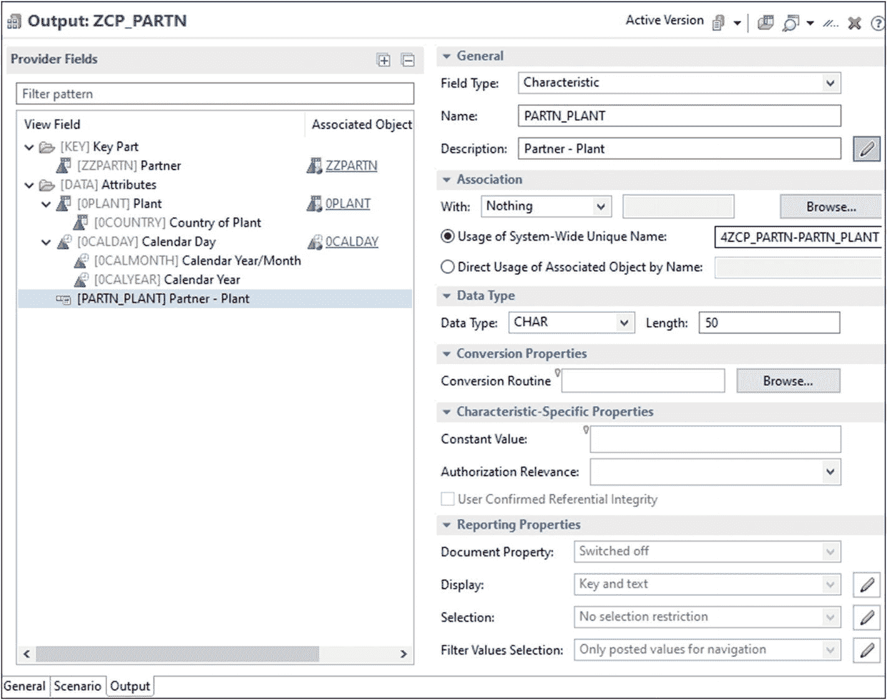

图 1-38 `CompositeProvider`，“输出”选项卡

在 `CompositeProvider` “输出”选项卡的左窗格中，有一个“提供程序字段”部分，您可以在其中找到所有在“场景”选项卡中添加至输出的字段。除了列出的字段外，您还可以启用特定 `InfoObject` 的导航属性以供报表使用（如果可用）。如果您从“提供程序字段”列表中右键单击一个 `InfoObject`，将会看到“导航属性”选项（如果所选 `InfoObject` 没有导航属性，则该选项将变灰）。选择此选项后，“导航属性”窗口将出现，您便可以选择这些属性。在图 1-38 所示的示例中，您可以看到已为“工厂”（`0COUNTRY`）和“日历天”（`0CALMONTH`、`0CALYEAR`）添加了导航属性。

“输出”选项卡的右窗格用于设置输出字段的属性。在此部分中，您可以应用字段与 `InfoObject`/`Open ODS View` 之间的关联，调整字段名称和描述，或更改字段数据类型。您还可以在此处指定输出字段的报表属性（图 1-38）。激活 `CompositeProvider` 后，即可将其用于报表。在下一节中，我将在该 `CompositeProvider` 之上创建一个查询以展示最终输出。

### 查询

通过右键单击特定的 `InfoProvider` 并选择 **新建** ➤ **查询**（见图 1-39）来创建查询。或者，您也可以使用 Eclipse 任务栏（**文件** ➤ **新建** ➤ **查询**）来创建查询。

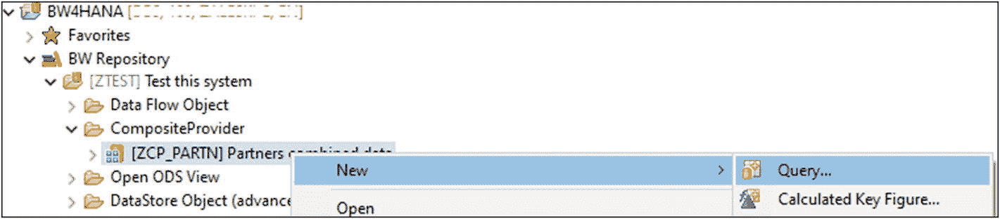

图 1-39 在 `CompositeProvider` 上创建新查询

在第一个屏幕上，照常需要提供查询的技术名称，并可选地提供描述。图 1-40 显示了查询编辑器的“常规”选项卡。

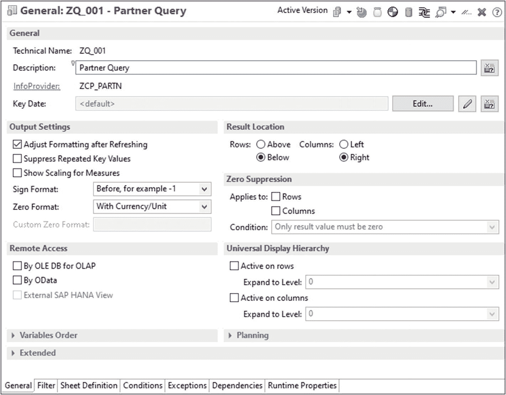

图 1-40 查询，“常规”选项卡

以下是 `Query Designer` 中所有可用选项卡的概述（如图 1-40 所示）。

- **常规**：此选项卡专用于设置通用查询属性（对第三方工具的可见性、默认显示选项、名称和描述等）。
- **筛选器**：用于设置查询筛选器和分配变量。
- **工作表定义**：使您能够定义默认报表结构。您可以在此处指定可用于报表的字段列表，以及定义默认输出结构。
- **条件**：允许您根据定义的规则限制报表输出（例如，收入值最高的前 N 条记录）。
- **异常**：在此处，您可以指定用于根据提供的范围高亮显示偏差的三色标度。
- **依赖项**：以图形化图表显示查询与其他查询组件（如变量、计算关键值、受限关键值）之间的依赖关系。
- **运行时属性**：如果需要，可以更改默认的查询运行时属性（查询处理、缓存、优化参数等）。

为了演示上一节中创建的 `CompositeProvider`（`ZCP_PARTN`）的最终输出，我在其上添加了一个简单查询。图 1-41 显示了该查询的定义。

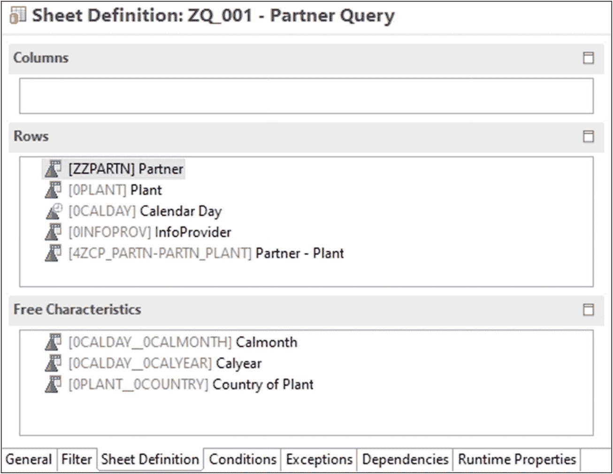

图 1-41 在 `CompositeProvider` 对象 `ZCP_PARTN` 上定义查询

如图 1-41 所示，查询 `ZQ_001` 的输出中添加了八个字段。其中五个字段位于“行”部分，在打开报表时将默认显示。其余三个字段被添加到“自由特征”部分。默认情况下，这些字段在报表输出中不可见；但用户可以根据需要添加它们。图 1-42 显示了查询 `ZQ_001` 在 `SAP Analysis for Microsoft Excel` 前端工具中的结果。

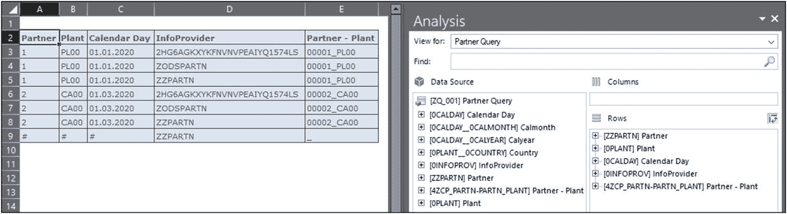

图 1-42 `SAP Analysis for Microsoft Office` 中的查询 `ZQ_001`

正如查询对象中所定义的那样，在 `Analysis for Microsoft Excel` 工具中运行报表时，您可以在输出中看到默认显示的五个字段（图 1-42）。如果您查看数据源名称下可用的字段列表，则其余三个字段也可用。在上一节中，我将 `CompositeProvider` 定义为三个对象的联合：`HANA View`、`Open ODS View` 和 `InfoObject`。所有三个对象都包含相同的数据，因此您可以注意到每条记录都显示三次（除了仅存在于 `InfoObject` 中的 `#` 值）。每条记录的唯一区分因素是“InfoProvider”列，您可以在其中找到源“部分提供程序”信息。借助该列，您可以轻松识别每条记录的源对象。您可能会注意到，对于计算视图，显示的值是其技术名称 `2HG6AGKXYKFNVNVPEAIYQ1574LS`。这是因为 `BW/4HANA` 会生成其自己的 HANA 视图技术标识符，其名称始终以 `2H` 字符串开头。

### 数据流

`数据流`对象有多种使用场景。首先，`数据流`对象可用于对流程流进行建模。在创建目标 BW/4HANA 对象之前，您可以先创建一个`数据流`对象来对所需的流程进行建模。要创建`数据流`对象，只需右键单击`信息区域`并选择`新建 ➤ 数据流对象`。提供对象名称后，`数据流`编辑器将打开（参见图 1-43）。

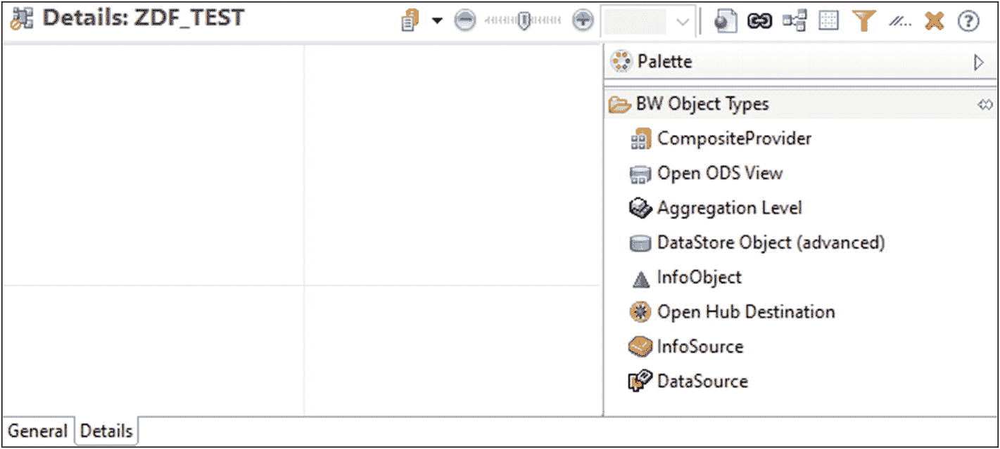

图 1-43 `数据流`对象编辑器

在右侧窗格（图 1-43）中，您可以看到可用于创建流程流的对象类型列表。您可以通过拖放功能，或右键单击建模区域并选择`新建`选项，将其添加到模型中。您还可以通过选择`添加对象`选项并提供对象名称，将现有的 BW/4HANA 对象包含到模型中。将对象添加到模型后，您可以使用箭头将它们连接起来，以描述依赖关系。图 1-44 显示了一个示例性的数据流模型。

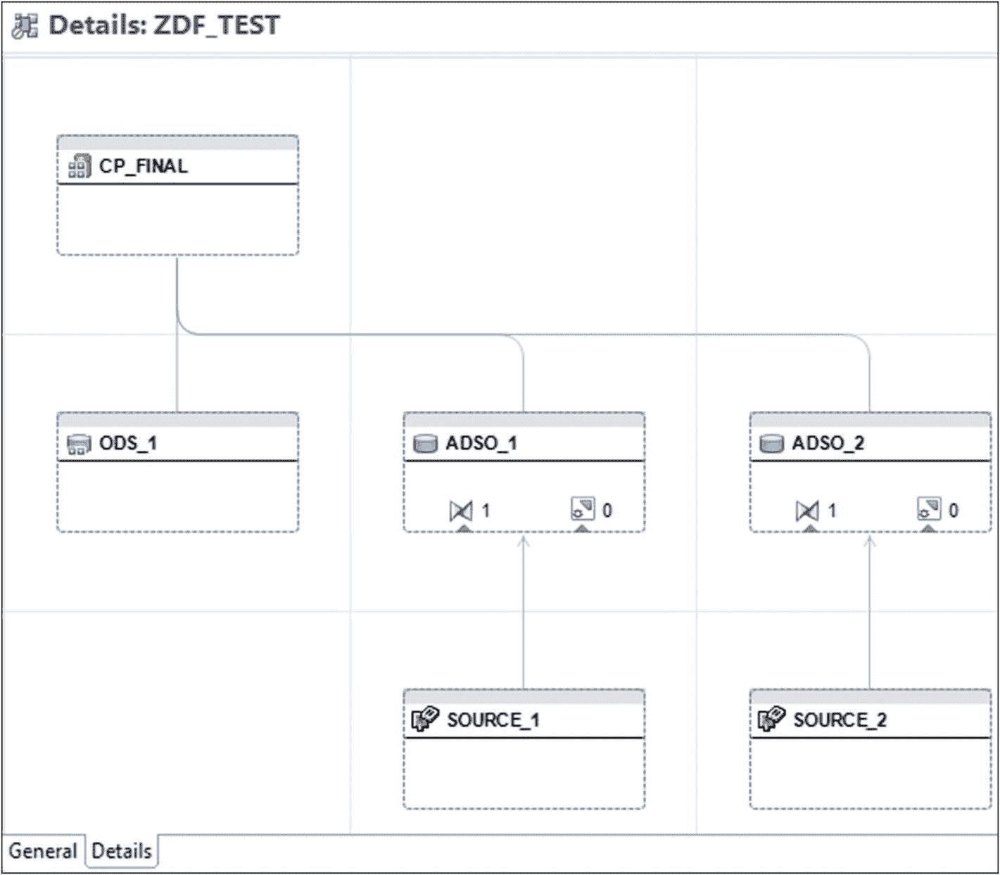

图 1-44 在`数据流`对象中创建的模型

如图 1-44 所示，该数据流由两个数据源（`SOURCE_1` 和 `SOURCE_2`）组成，它们与两个 ADSO（`ADSO_1` 和 `ADSO_2`）相关联。还有一个未链接到任何数据源的`开放 ODS 视图`对象（`ODS_1`）。`复合提供者`（`CP_FINAL`）被建模为一个逻辑层，并组合来自`开放 ODS 视图`和`高级 DSO` 的数据。在`数据流`模型中显示的对象与实际 BW/4HANA 对象无关。创建的数据流模型只是一个模板，后续可将其用作创建实际对象的参考。


## 数据流对象的用途

`数据流`对象的另一个重要用途是能够根据数据流模型生成持久对象。这意味着在创建流程流模板之后，我们可以将模型中的对象转换为实际的 BW/4HANA 对象。从底层的对象开始始终是个好办法。这样，输出结构可以从较低层对象向上层对象传递。双击`数据源`对象后，我可以定义其属性并将其激活。完成后，数据流图将相应更新（参见图 1-45）。

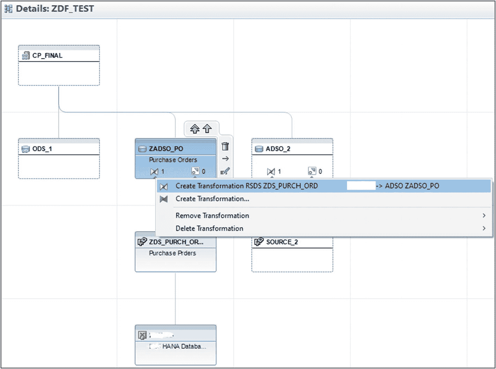

图 1-45 将数据流模型转换为实际对象

如图 1-45 所示，在创建了一个实际的数据源以取代 `SOURCE_1` 对象后，模型已更新。创建数据源 `ZDS_PURCH_ORD` 后，我单击了 `ADSO_1` 对象，并创建了一个名为 `ZADSO_PO` 的实际`数据存储对象`。该 ADSO 的结构继承自底层数据源。在图 1-45 中，我还高亮显示了从模型生成转换的功能。对于`数据传输进程`也是如此。这种建模方法允许您先为流程创建概念，然后将此概念转换为可行的解决方案。这可以节省时间，因为从数据流生成对象比在`项目浏览器`中逐个手动创建要快一些。

## 生成流程链

如果`数据流`对象完全由持久的 BW/4HANA 对象组成，您就可以使用生成流程链的功能。该功能可从数据流工具栏中获得，如图 1-46 所示。

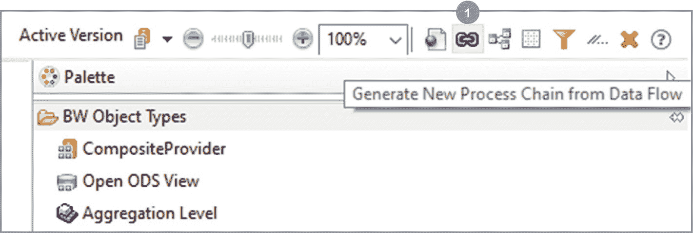

图 1-46 从数据流生成流程链

点击`流程链`按钮时，首先需要提供流程链名称。输入名称后，将打开一个嵌入了`SAP GUI`会话的新`Eclipse`选项卡（参见图 1-47）。

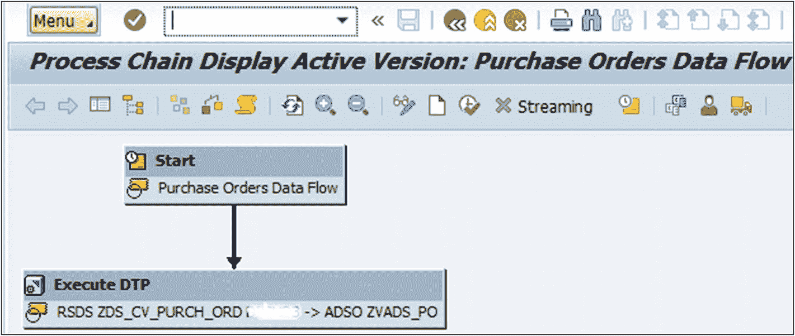

图 1-47 流程链窗口

图 1-47 显示来自数据流模型的`数据传输进程`已自动插入到流程链定义中。如果修改了`数据流`对象，这些更改不会自动反映在流程链中。您需要手动合并这些更改，或从`数据流`对象生成新的流程链。

## 为现有对象生成数据流

也可以为现有的 BW/4HANA 对象生成`数据流`对象。要为特定对象打开`数据流`对象，请转到`项目浏览器`列表，右键单击该对象，然后选择`探索数据流`选项（图 1-48）。

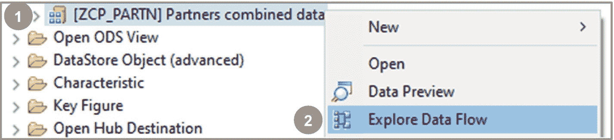

图 1-48 显示现有对象的数据流

默认情况下，为现有对象打开的数据流以折叠视图显示，因此可能并非所有对象和依赖关系都可见。在数据流编辑器中，您可以向下或向上展开数据流以查看其他对象。将鼠标悬停在特定节点上时，您会看到箭头符号，这使您可以缩小数据流范围（图 1-49）。

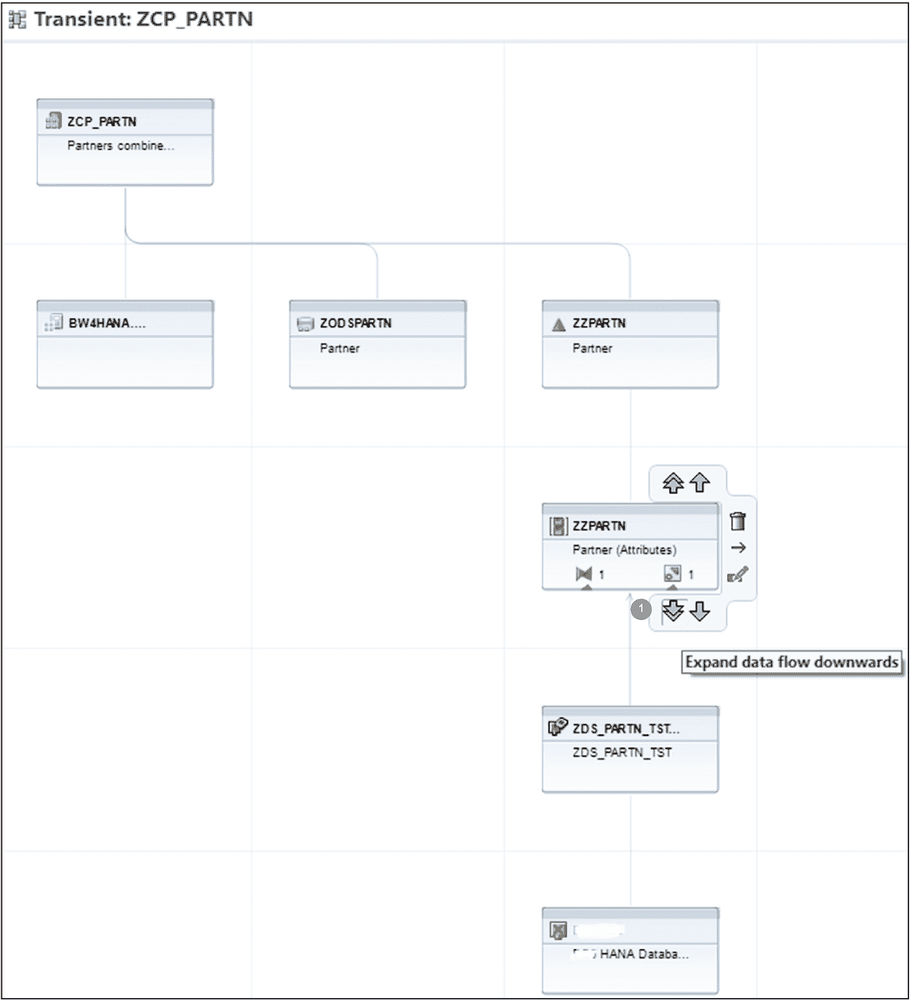

图 1-49 `数据流资源管理器`

图 1-49 显示了名为 `ZCP_PARTN` 的`复合提供者`的数据流。它由三个对象组成：`计算视图`、`开放 ODS 视图`和`信息对象`。展开名为 `ZZPARTN` 的`信息对象`的数据流后，我们还可以看到用于将主数据加载到`信息对象`属性中的`数据源`和`源系统`。值得一提的是，当您双击一个计算视图时，系统会在一个新的`Eclipse`选项卡中打开该计算视图的定义（即使它是 HANA 组件而非 BW/4HANA）。在分析现有数据流时，探索数据流功能非常有用。

## 数据流文档功能

我想强调的最后一个特性是数据流文档功能。此功能可以描述每个`数据流`节点的作用。文档既可以添加到持久节点，也可以添加到概念节点。图 1-50 展示了如何为特定节点添加文档。

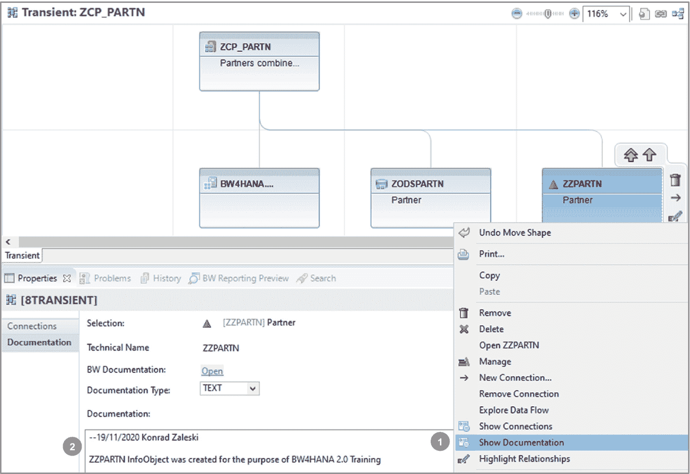

图 1-50 记录数据流

如图 1-50 所示，右键单击特定节点后，您可以选择`显示文档`选项。在`文档`部分，有一个选项可以输入描述特定对象的任何文本。在展示的示例中，我为 `ZZPARTN` `信息对象`节点添加了文档。这可能有助于其他开发人员理解整个流程以及单个对象的作用。

> **注意**：输入的文档仅在特定数据流的上下文中可见。如果您创建了一个新的数据流，则所有节点的文档部分都将为空，即使某些对象可能已经在不同的数据流中被记录。

## 总结

在本章中，我们探讨了 SAP HANA 和 SAP BW/4HANA 中可用的建模对象。对于 SAP HANA 原生环境，描述了以下建模工件：
-   计算视图
-   表函数
-   虚拟表

对于 BW/4HANA，我重点描述了新的建模对象，并强调了现有 SAP BW 对象的新功能。本章介绍了以下 BW/4HANA 对象的特性：
-   信息对象
-   开放 ODS 视图
-   高级 DSO
-   组合提供者
-   查询
-   数据流
