# 通过 BW/4HANA 发布 HANA 对象

在本章中，我将介绍几种不同的场景，这些场景下，HANA 中驻留的数据需要通过 BW/4HANA 报表层进行发布。您将获得一份实用指南，了解如何将 HANA 表和 HANA 计算视图暴露给 BW/4HANA 系统。此外，我还会展示如何将在查询变量层面输入的值直接传递给计算视图和表函数输入参数。

附录中包含一些可用于创建表结构并用示例数据填充的 SQL 脚本。出于演示目的，我将使用这些表，因此如果您想遵循本章描述的场景，可以在您的系统中使用相同的源对象。

## 通过 BW/4HANA 发布 HANA 表

### 案例研究 1

XYZ 公司使用 BW/4HANA 系统作为主要的报表平台。在 BW/4HANA 中创建的报表随后被 Microsoft Office 的 Analysis for Microsoft Excel 和 SAP Analytics Cloud (SAC) 前端工具所消费。

XYZ 公司评估了将外部数据集成到 SAP 报表平台的可能性，以便能够在 Analysis for Microsoft Excel 和 SAC 工具中同时利用 SAP 和非 SAP 数据。在试点阶段，XYZ 公司决定启用一个包含外部数据的单张事务表。名为 `ORDER_HEADER` 的表填充了来自非 SAP 系统的订单相关数据。需求是启用此 HANA 表中的数据，以便在 BW/4HANA 平台上进行报表。最终查询的结构应与源表的结构相同。表 3-1 描述了源表结构的详细信息。

表 3-1. `ORDER_HEADER` 表的结构

| 列名 | 键 | 数据类型 | 描述 |
| --- | --- | --- | --- |
| `ORD_NUMBER` | X | `VARCHAR(10)` | 订单编号 |
| `DOC_DATE` |   | `DATE` | 凭证日期 |
| `REQ_DATE` |   | `DATE` | 要求交货日期 |
| `SHIP_DATE` |   | `DATE` | 发货日期 |
| `DELV_DATE` |   | `DATE` | 交付日期 |
| `STATUS` |   | `VARCHAR(3)` | 订单状态 |
| `CUST_NUMBER` |   | `VARCHAR(10)` | 客户编号 |
| `EMP_NUMBER` |   | `VARCHAR(10)` | 员工编号 |
| `FREE_TEXT` |   | `VARCHAR(5000)` | 备注 |

`ORDER_HEADER` 表包含九列。用于唯一标识每条记录的主键是 `ORD_NUMBER` 列，包含订单编号。其余列包含订单抬头信息，例如状态、凭证日期或客户编号。

> **注意**
> 如果您想在自己的 SAP HANA 系统中重新创建 `ORDER_HEADER` 表结构并用数据填充，请参考本书附录。

在此场景中，我将遵循第 2 章图 2-3 中示出的建模概念。图 3-1 展示了我为满足案例研究 1 要求所遵循的详细方法。

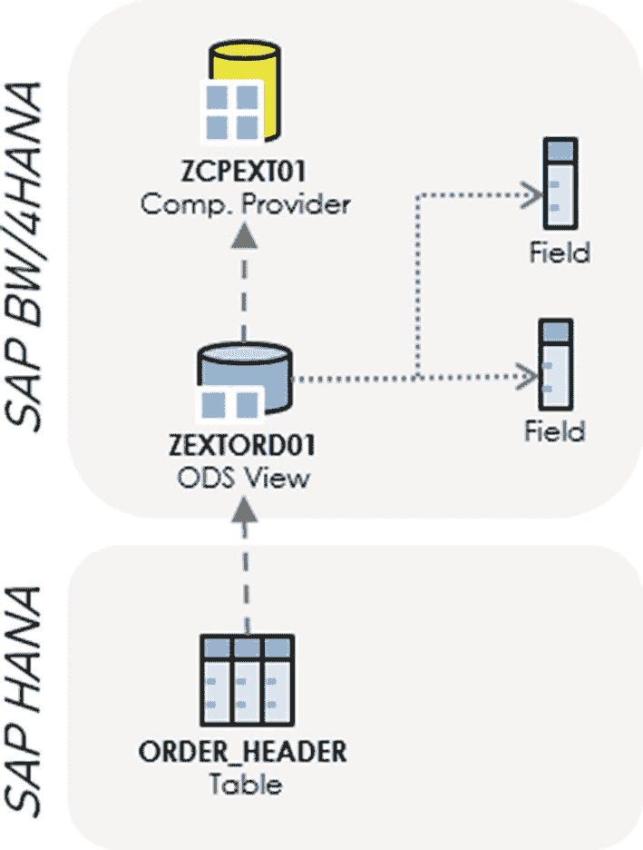
图 3-1. 通过 BW/4HANA 发布 HANA 表（案例研究 1）

从 BW/4HANA 端来看，表 `ORDER_HEADER` 将由开放式 ODS 视图对象消费。在该开放式 ODS 视图之上，我将创建一个 `CompositeProvider` 对象（如图 3-1 所示）。创建完建模对象后，我将通过查询对象消费该 `CompositeProvider`。

### 创建源系统

为了满足案例研究 1 的要求，我们不需要在 HANA 层面创建任何额外的对象。从 HANA 获取数据的唯一前提条件是在 BW/4HANA 系统中使用 SAP HANA 的本地数据库模式连接类型创建一个专用的源系统对象。该源系统应指向存储目标表的模式。请参考图 3-2。

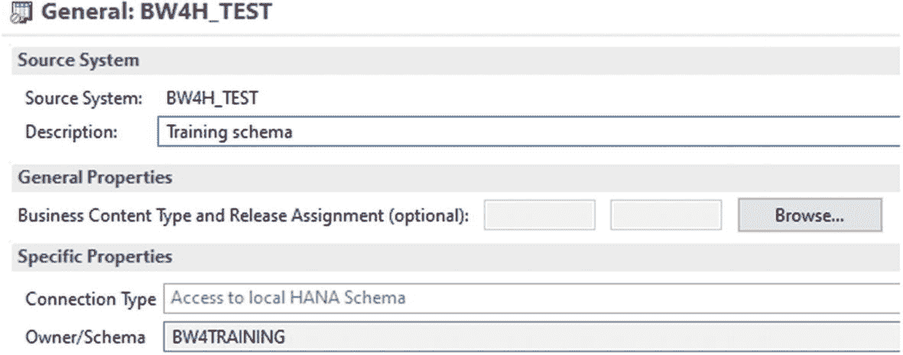
图 3-2. `BW4TRAINING` HANA 模式的源系统

如图 3-2 所示，`BW4H_TEST` 源系统使用本地 HANA 模式作为连接类型，并指向 `BW4TRAINING` 模式。需要此源系统对象才能访问存储在 `BW4TRAINING` 模式中的 HANA 表，并通过开放式 ODS 视图对象对其进行消费。

### 为订单抬头数据创建开放 ODS 视图对象

位于 HANA 数据库中的表可以被 BW/4HANA 中的开放 ODS 视图直接使用。要创建一个新的开放 ODS 视图对象，请转到目标信息区域并选择 新建 ➤ 开放 ODS 视图（图 3-3）。

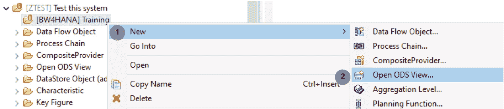
图 3-3. 为 `ORDER_HEADER` 表创建新的开放 ODS 视图

如图 3-3 所示，该开放 ODS 视图将在 BW/4HANA 信息区域下创建。在下一步中，系统将要求您提供开放 ODS 视图对象的详细信息，例如技术名称、描述和语义。图 3-4 显示了开放 ODS 视图对象的初始属性。

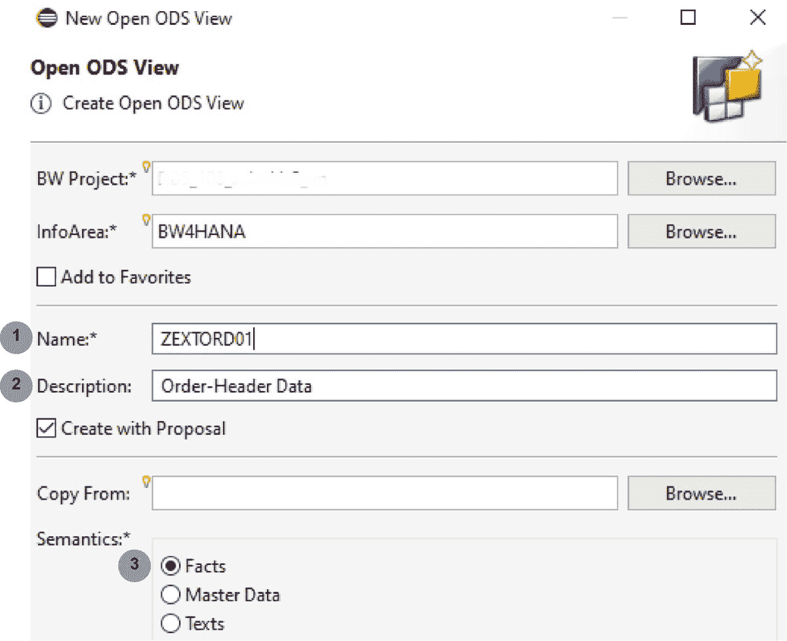
图 3-4. 为 `ORDER_HEADER` 表创建的开放 ODS 视图的属性

开放 ODS 视图的技术名称长度必须在 3 到 28 个字符之间。在此示例中，技术名称设置为 `ZEXTORD01`，描述为“订单抬头数据”。由于源表包含事务性数据，我选择了“事实（Facts）”作为语义类型（图 3-4）。提供开放 ODS 视图定义后，我需要指定正确的“源类型”设置，如图 3-5 所示。

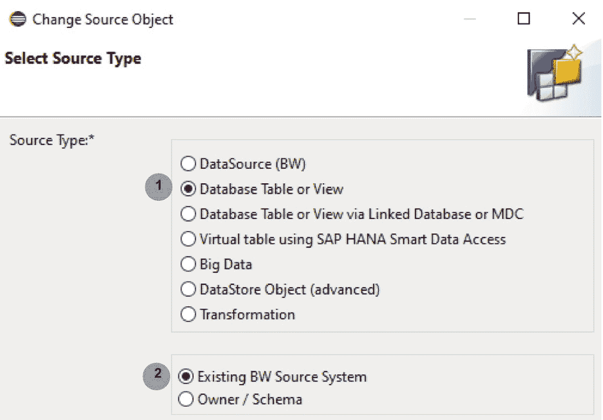
图 3-5. 为 `ORDER_HEADER` 表创建的开放 ODS 视图的“源类型”设置

由于我将从 HANA 表中获取数据，因此在“源类型”设置中选择了“数据库表或视图”。我将使用现有的 `BW4H_TEST` 源系统（见图 3-2）；因此，我选择了“现有 BW 源系统”选项。如果源系统尚未创建，您可以选择“所有者/模式”选项。通过此步骤，您将能够指定目标模式，并直接从向导中创建源系统。

> **注**：要能够使用任何 HANA 模式中的表，您需要向 `SAPABAP1` 技术用户授予模式访问权限。否则，该模式在 BW/4HANA 中将不可见。

运行以下 SQL 脚本以向 `SAPABAP1` 用户授予模式访问权限：

```sql
GRANT SELECT ON SCHEMA "<schema name>" TO SAPABAP1
```

要完成开放 ODS 视图对象的创建，您需要指定目标表。提供所有信息后，系统将打开开放 ODS 视图编辑器的“常规”选项卡（见图 3-6）。

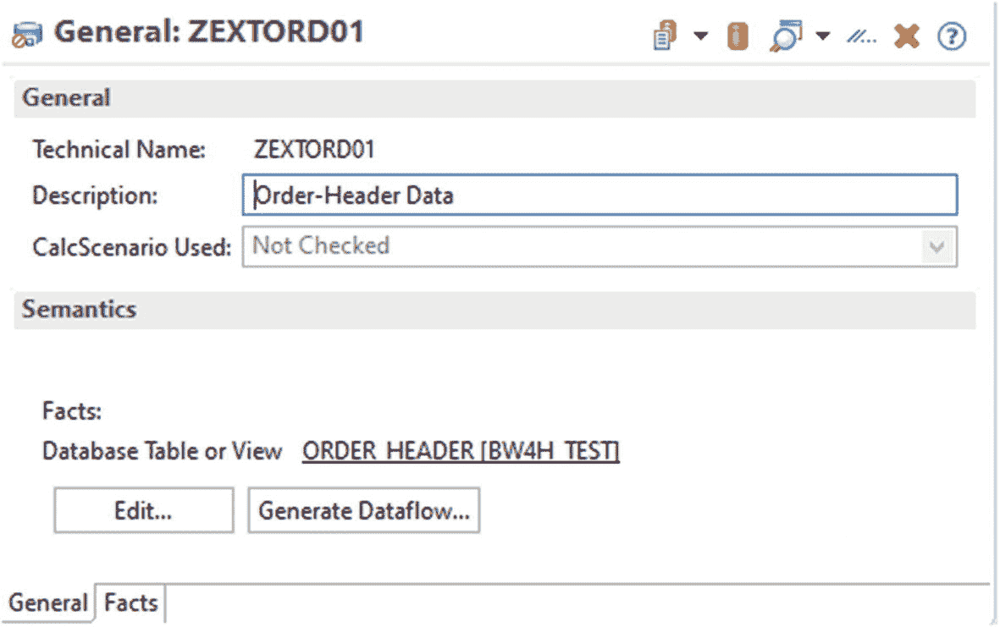
图 3-6. 为 `ORDER_HEADER` 表创建的开放 ODS 视图的“常规”选项卡

在“常规”选项卡上，您可以找到开放 ODS 视图对象的概览。开放 ODS 视图的实际结构在“事实”选项卡上定义。在此选项卡上，我需要定义输出字段及其属性。图 3-7 展示了 `ZEXTORD01` 开放 ODS 视图对象的输出结构。

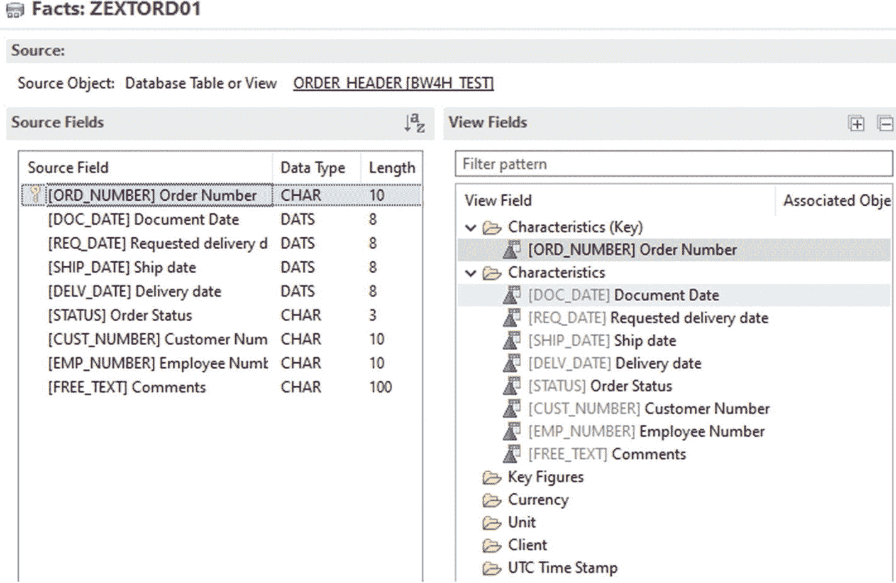
图 3-7. 为 `ORDER_HEADER` 表创建的开放 ODS 视图的“事实”选项卡

在“事实”选项卡上，有两个“字段”区域。左侧是“源字段”区域。在此区域中，您将找到源 `ORDER_HEADER` 表中所有可用的字段。键符号表示该列是表的主键。您可能会注意到，源表的 SQL 数据类型已转换为 BW/4HANA 数据类型（例如，`DATE` 转换为 `DATS`，`VARCHAR` 转换为 `CHAR`）。表 3-2 显示了 SQL 数据类型如何转换为 BW 数据类型。

表 3-2. SQL 数据类型与 BW 数据类型之间的映射

| HANA SQL | BW/4HANA |
| --- | --- |
| `DATE` | `DATS` |
| `TIME` | `TIMS` |
| `SECONDDATE` | `NUMC` |
| `TIMESTAMP` | `NUMC` |

### 创建订单抬头数据的 CompositeProvider

如表 3-2 所示，并非所有 SQL 数据类型都能在开放 ODS 视图对象中得到支持。长度超过 1,333 个字符的大对象（例如 `BLOB` 类型或长度超过 1,333 个字符的 `VARCHAR`）不能在 BW/4HANA 对象中使用。

| TINYINT | INT1 |
| --- | --- |
| SMALLINT | INT2 |
| INTEGER | INT4 |
| BIGINT | INT8 |
| SMALLDECIMAL | FLTP |
| DECIMAL | DEC |
| REAL | FLTP |
| DOUBLE | FLTP |
| BOOLEAN | CHAR |
| VARCHAR | CHAR |
| NVARCHAR | CHAR |
| ALPHANUM | CHAR |
| SHORTTEXT | CHAR |
| VARBINARY | RAW |
| BLOB | *不适用* |
| CLOB | SSTR |
| NCLOB | SSTR |
| TEXT | SSTR |
| ST_GEOMETRY | CHAR |
| ST_POINT | CHAR |

在面板的右侧（图 3-7）有一个“视图字段”区域。在此区域中，您定义开放 ODS 视图的实际输出结构。默认情况下，系统会创建一个结构建议，并将字段分配到特定的组中。这是因为在创建开放 ODS 视图时选中了“通过建议创建”设置（图 3-4）。如果需要，您可以通过删除某些字段或将其重新分配到不同的组来手动调整输出结构。在我的场景中，`ORD_NUMBER` 列被分配到了“特征（关键值）”组，其余字段则归入了“特征目录”组。由于这是目标结构且无需调整，我将继续激活 `ZEXTORD01` 开放 ODS 视图对象。

> 注：开放 ODS 视图的唯一字段名是自动生成的，并遵循以下模式：`2F<开放 ODS 视图名称>-<字段名称>`。“系统级唯一名称”设置不可修改。

`Open ODS View` 对象可以直接被查询使用；然而，如第 1 章所述，作为一种良好实践，最好先创建一个 `CompositeProvider`。这样一来，将来你可以通过组合其他提供程序或执行额外计算来轻松增强逻辑层。请按照图 3-8 所示的路径创建一个新的 `CompositeProvider`。

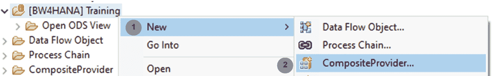

**图 3-8.** 为 `ZEXTORD01` `Open ODS View` 创建新的 `CompositeProvider`

提供 `CompositeProvider` 的技术名称和描述后，我们可以指定默认节点和源提供程序。在我们的案例中，我们将使用 `ZEXTORD01` `Open ODS View` 作为 `PartProvider` 对象（图 3-9）。

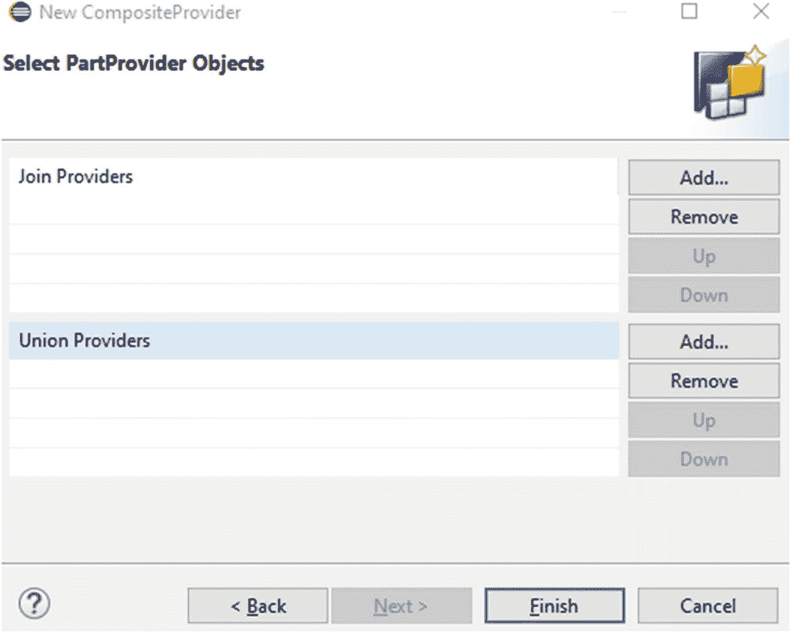

**图 3-9.** 选择 `PartProviders` 并为 `ZCPEXT01` `CompositeProvider` 定义默认节点

`Join Providers` 部分要求你至少提供两个 `PartProviders`。当我们只想使用单个 `PartProvider` 时，可以使用 `Union Providers` 部分，因此我们可以将 `ZEXTORD01` `Open ODS View` 添加到该部分。或者，我们也可以直接进入 `CompositeProvider` 编辑器而不提供 `InfoProviders` 信息。我跳过了提供提供程序信息的步骤，直接单击了 `Finish` 按钮。

我对 `CompositeProvider` 使用了默认设置，因此在 `General` 选项卡上我没有做任何更改，直接切换到了 `Scenario` 选项卡。由于我没有指定任何提供程序，`Scenario` 选项卡仅显示一个默认节点，即 `Union`。要添加 `ZCPEXT01` `Open ODS View`，请单击 `Add` 按钮，如图 3-10 所示。

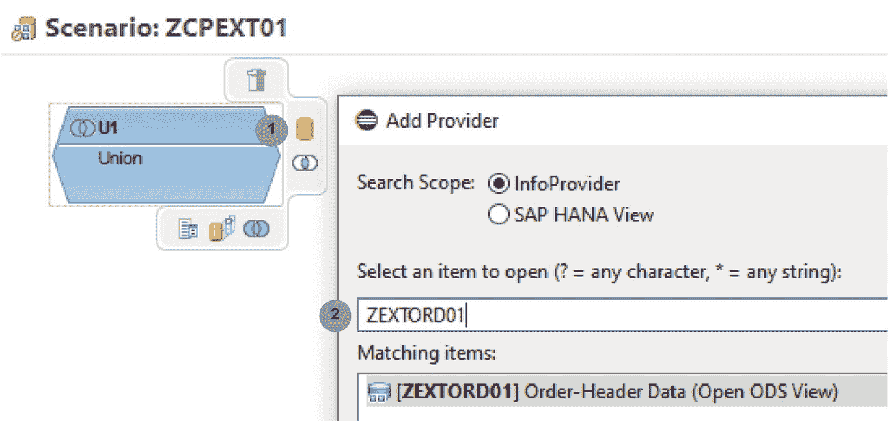

**图 3-10.** 将 `ZEXTORD01` `Open ODS View` 添加到 `ZCPEXT01` `CompositeProvider`

在 `Union` 节点上单击 `Add` 按钮后，将打开 `Add Provider` 窗口。有两个 `Search Scope` 选项：`InfoProvider` 和 `SAP HANA View`。由于我们正在寻找 `Open ODS View`，因此应为 `Search Scope` 设置选择 `InfoProvider`。然后在搜索对话框中，输入 `InfoProvider` 对象的名称。如图 3-10 所示，我输入了 `Open ODS View` 的技术名称，然后选择了目标对象。当我们向 `CompositeProvider` 添加源 `InfoProvider` 对象时，我们将能够基于可用的源字段来定义 `CompositeProvider` 结构。在我们的场景中，我们需要简单地将所有字段从源添加到目标。这可以通过选择所有字段（单击第一个字段，然后按住 `Shift` 键并选择最后一个字段）并将它们拖到 `Target` 部分来完成。或者，我们可以右键单击 `Open ODS View` 图标并选择 `Create Assignments` 选项，如图 3-11 所示。

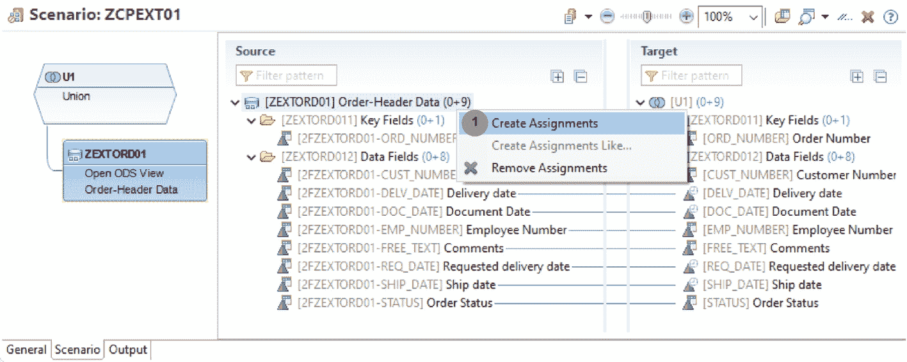

**图 3-11.** 定义 `ZCPEXT01` `CompositeProvider` 的结构

使用 `Create Assignments` 选项时，所有字段将自动添加到 `CompositeProvider` 的输出中。名称和描述也将根据源字段自动填充。

> **注意**
>
> 系统会自动按照以下模式为 `CompositeProviders` 生成唯一的字段名称：`4Z<CompositeProvider Name>-<Field Name>`。`System-Wide Unique Name` 设置不可修改。

如图 3-11 所示，有九个字段被添加到了 `ZCPEXT01` `CompositeProvider` 的 `Target` 部分。定义好 `CompositeProvider` 所需的输出结构后，请将其激活。

> **重要事项**
>
> 当激活基于 `Open ODS View` 之上的 `CompositeProvider` 时，你可能会遇到与 `CalcIndex` 相关的问题。要修复此激活错误，你需要运行 ABAP 程序，该程序会为 `Open ODS View` 创建一个列视图。

如前所述，对于给定的场景，激活 `CompositeProvider` 可能会返回一个 `CalcIndex` 错误。错误描述如下所示：

```
'XXX::SAPABAP1:0BW:BIA:ZEXTORD01:EXTRACTION (t -1)'"
无法激活对象 'ZCPEXT01'
为 ZCPEXT01 创建列视图失败
EC:2048"column store error: fail to create scenario: [2007] Index does not exist;Failed to get
```

要解决此问题，你需要转到 `SAP GUI` 并运行 `SE38` `tcode`。然后运行程序 `RSDDB_LOGINDEX_CREATE`（图 3-12）。

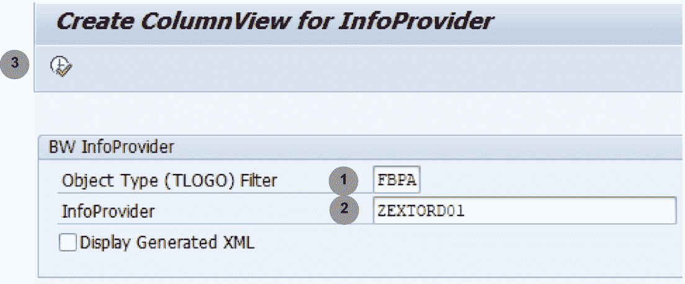

**图 3-12.** 使用 `RSDDB_LOGINDEX_CREATE` 程序生成 `ColumnView`

在该程序中，将 `FBPA` (1) 设置为对象类型，并提供你的 `InfoProvider` 的名称 (2)。运行程序 (3) 并且 `Column View` 成功激活后，返回到 `CompositeProvider` 并再次尝试激活它。该错误应该不会再出现。

### 创建订单抬头数据的查询

## 通过 BW/4HANA 发布 HANA 视图

### 案例研究 1 的最终步骤

满足案例研究 1 中所述需求的最后一步是创建一个查询，用户将在前端工具中使用该查询来访问外部 `ORDER_HEADER` 表中的数据。该查询将基于 `CompositeProvider` `ZCPEXT01` 创建。请按照图 3-13 中的步骤在 `CompositeProvider` 上创建一个新查询。

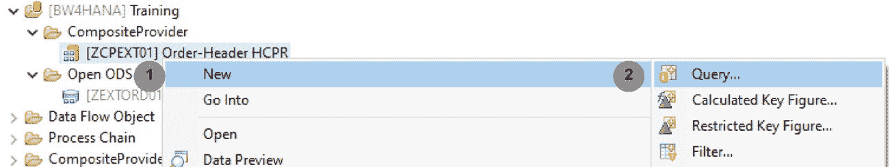

**图 3-13.** 在 `ZCPEXT01` `CompositeProvider` 上创建新查询

创建新查询时，系统将要求输入技术名称和描述。然后在查询编辑器的 `Sheet Definition` 选项卡上，我们应该指定报表的输出结构。图 3-14 展示了 `ZCPEXT01_Q01` 查询的输出结构。

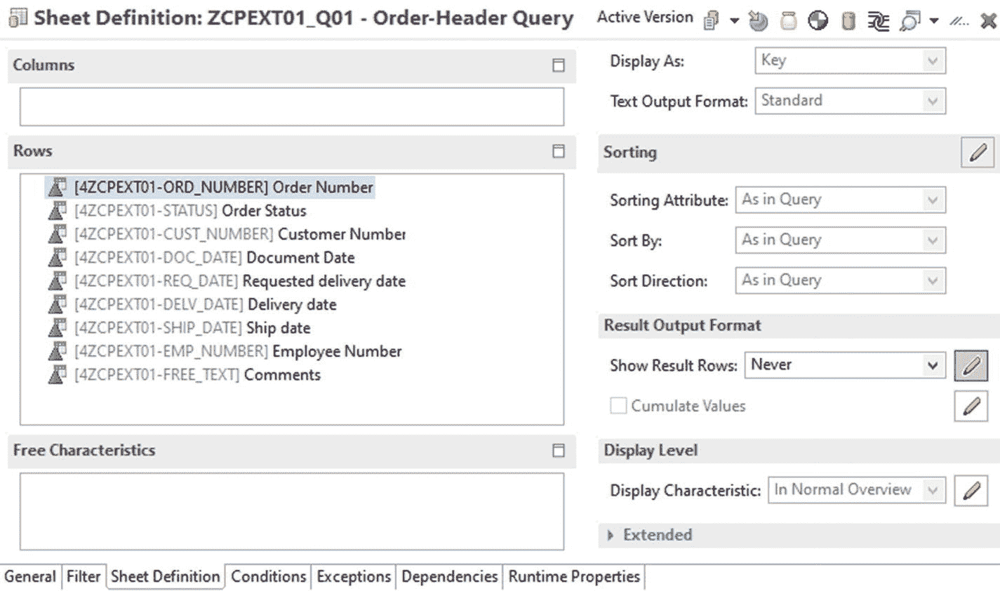

**图 3-14.** `ZCPEXT01_Q01` 查询的定义

可以通过右键单击 `Sheet Definition` 选项卡上可用的空白区域（`Columns`、`Rows` 或 `Free Characteristics`）来将底层 `CompositeProvider` 中可用的字段添加到查询的输出中。如图 3-14 所示，所有 `CompositeProvider` 字段都已添加到查询的 `Rows` 部分。这意味着在前端工具中运行查询时，所有字段将默认添加到报表的输出中。到此为止，无需其他设置，因此我们可以直接保存查询。为了预览查询的输出，我将使用 `Analysis for Microsoft Excel` 工具。图 3-15 展示了 `ZCPEXT01_Q01` 查询的最终输出。

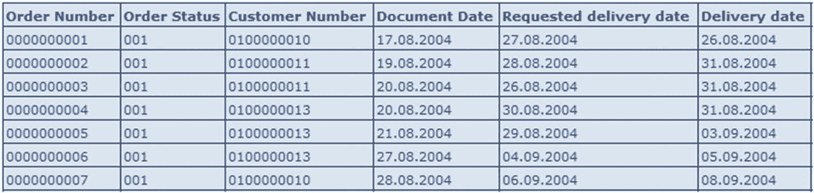

**图 3-15.** `Analysis for Microsoft Excel` 中 `ZCPEXT01_Q01` 查询的输出

图 3-15 展示了 `ZCPEXT01_Q01` 查询中可用的前六个特性的内容。最终报表的结构与源表的结构一致；因此，案例研究 1 中规定的需求已得到满足。如果场景要求使用源虚拟表而不是持久表，也可以采用相同的方法。

### 案例研究 2

向业务用户提供查询 `ZCPEXT01_Q01` 后，他们验证了输出结果并提出了两个额外要求。

**要求 1：** 第一个要求是添加一列，用于显示订单状态的文本。要获取状态名称，需要使用额外的 `ORDER_STATUS` 表。此维度表有助于根据给定的订单状态 ID 查找状态描述。在表 3-3 中，您将找到 `ORDER_STATUS` 表结构的详细信息。

**表 3-3. `ORDER_STATUS` 表的结构**

| 列名 | 键 | 数据类型 | 描述 |
| --- | --- | --- | --- |
| `STATUS_ID` | X | `VARCHAR(3)` | 状态 ID |
| `STATUS_DESC` |   | `VARCHAR(30)` | 状态名称 |
| `LANGU` |   | `VARCHAR(2)` | 语言 |

`ORDER_STATUS` 表由三列组成，其中 `STATUS_ID` 是主键。

**要求 2：** 一位业务用户请求在报表中添加一个新列，用于计算交货日期与请求交货日期之间的天数差。

### 为订单头数据创建计算视图

根据案例研究 2 的要求 1，我们需要合并两个 HANA 表。这可以通过利用计算视图的功能来实现。我将为本案例研究遵循的通用方法在第 2 章的图 2-5 中进行了说明。与图 2-5 不同，计算视图将仅从持久化 HANA 表中查询数据（将不使用虚拟表）。图 3-16 显示了我将用于满足案例研究 2 要求的对象。

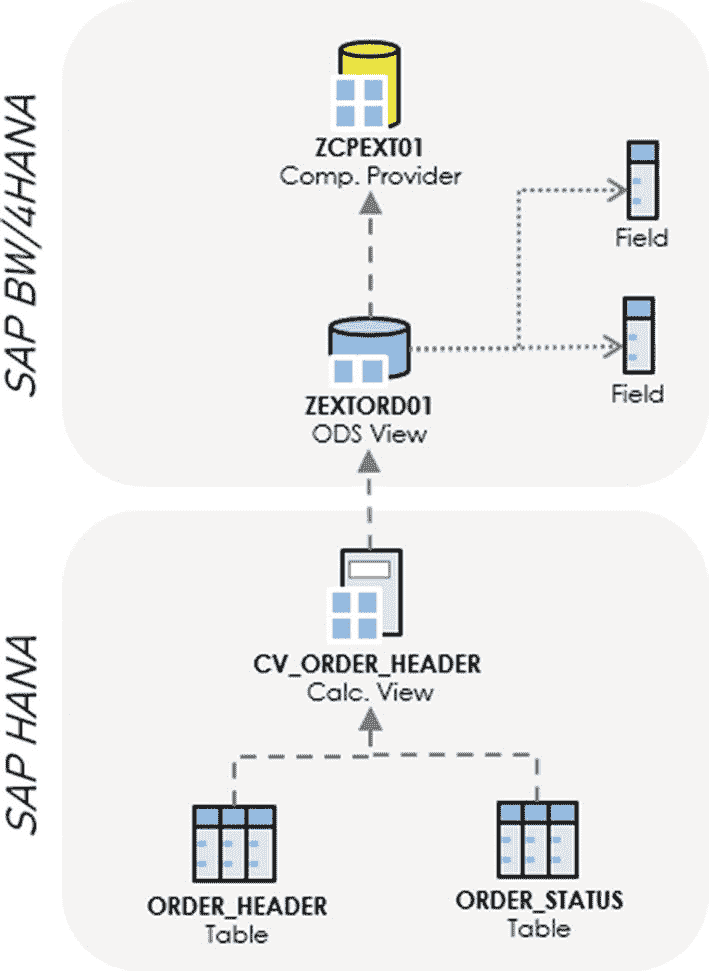

**图 3-16.** 通过 BW/4HANA 发布 HANA 视图（案例研究 2）

两个 HANA 表将在计算视图级别进行连接。然后，通过更改底层数据源并添加新字段来更新现有的开放 ODS 视图对象。

为了连接 `ORDER_HEADER` 和 `ORDER_STATUS` 表，我创建了 `CV_ORDER_HEADER` 计算视图（见图 3-17）。

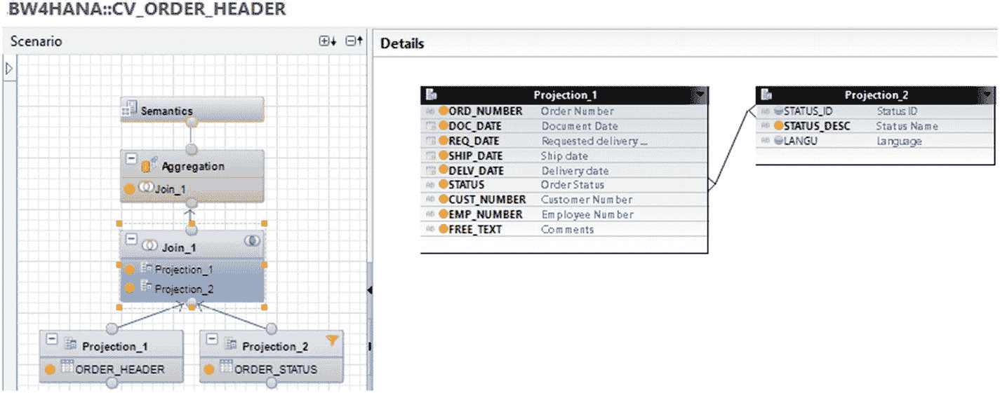

**图 3-17.** `CV_ORDER_HEADER` 计算视图定义

如图 3-17 所示，两个投影节点指向所需的 HANA 表。它们通过连接节点进行链接。连接基于 `STATUS`（`ORDER_HEADER` 表）和 `STATUS_ID` 列（`ORDER_STATUS` 表）执行。来自 `Projection_1` 的所有字段都映射到输出，而来自 `Projection_2` 的仅选择 `STATUS_DESC` 列。在 `Projection_2` 节点上，您可能会注意到显示的过滤器图标。这是因为为了仅显示英文状态描述，对语言列设置了固定过滤器（`LANGU = 'E'`）。

第二个要求是添加一列用于计算请求交货日期与实际交货日期之间的差值。在连接节点中，我使用以下 SQL 语法创建了一个计算列：

```sql
CASE WHEN "STATUS_DESC" = 'Delivered'
THEN  days_between("REQ_DATE", "DELV_DATE") END
```

此公式计算所有订单状态值为“已交货”的记录中请求交货日期 (`REQ_DATE`) 与交货日期 (`DELV_DATE`) 之间的天数。上述 SQL 公式在 `CM_DELV_DATE_DIFF` 计算列的表达式编辑器中使用（图 3-18）。

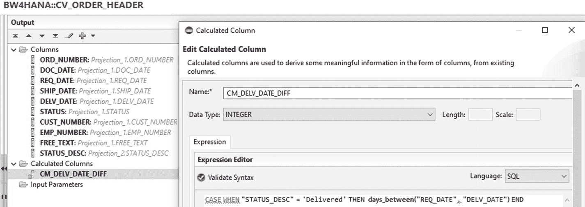

**图 3-18.** `CM_DELV_DATE_DIFF` 计算列定义

计算列 `CM_DELV_DATE_DIFF` 的数据类型为 `INTEGER`。表达式编辑器的语言设置为 SQL，因为公式是用 SQL 编写的。提供表达式后，值得通过单击“验证语法”按钮检查语法是否有任何错误。如果公式正确，点击此按钮后，您应该会看到一条“有效表达式”消息。

> **注意**：表达式编辑器无法识别所有 SQL 函数；因此，即使语法有效，它也可能将其突出显示为错误。这指的是表达式编辑器函数列表中不可用的 SQL 函数。另请注意，并非所有 SQL 函数都可以在图形化视图中使用。

### 更改订单头开放 ODS 视图的源对象

通过使用开放 ODS 视图功能，对于 `ZEXTORD01`，我们现在可以轻松地将 `ORDER_HEADER` 表替换为 `CV_ORDER_HEADER` 计算视图。为此，我将打开 `ZEXTORD01` 开放 ODS 视图，在“常规”选项卡上单击“编辑”按钮以选择新的源对象。然后我需要选择源系统，该源系统指向 `_SYS_BIC` 模式（这是存储计算视图的数据库列视图的位置）。选择源系统后，键入计算视图名称，选择正确的条目，然后单击“完成”（图 3-19）。

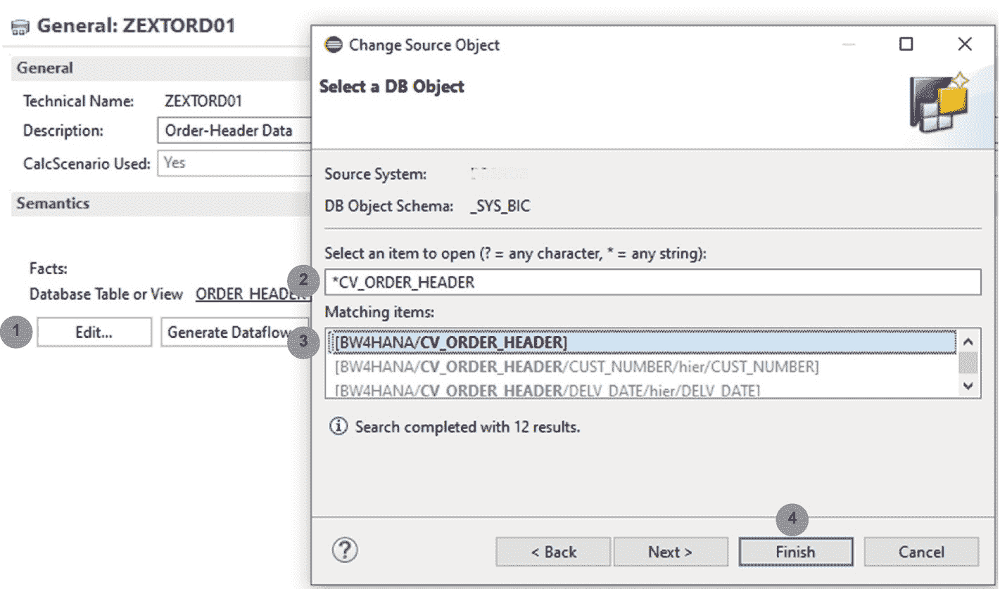

**图 3-19.** 更改 `ZEXTORD01` 开放 ODS 视图的源对象

一旦源对象被替换，“常规”选项卡的“语义”部分应更新为新的对象名称。在“事实”选项卡中，尚未添加到输出的字段将以灰色突出显示，如图 3-20 所示。

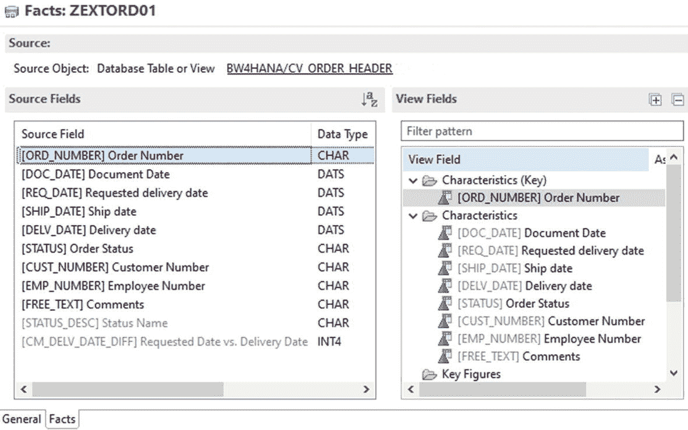

**图 3-20.** `CV_ORDER_HEADER` 视图的开放 ODS 视图，“事实”选项卡

在“事实”选项卡上，我需要添加用户请求的两个新字段：状态名称和请求日期与交货日期（天数）。状态名称是一个属性；因此，它应放在“特征”文件夹下，而请求日期与交货日期（天数）是一个度量，因此应将其拖到“关键值”文件夹下。定义了开放 ODS 视图的目标结构后，我可以激活该开放 ODS 视图。

### 更新订单头数据的 CompositeProvider

还有两个对象需要结构更新：`ZCPEXT01` CompositeProvider 对象和 `ZCPEXT01_Q01` 查询对象。由于我向 `ZEXTORD01` 开放 ODS 视图添加了两个新字段，它们应该已经在 `ZCPEXT01` CompositeProvider 的“源”部分可用（图 3-21）。

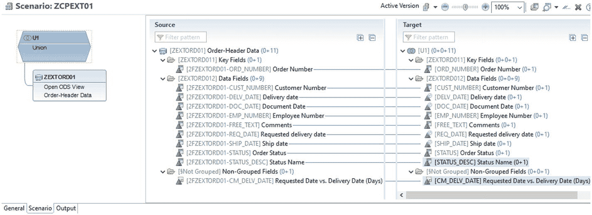

`图 3-21`. 向 `ZCPEXT01` CompositeProvider 结构添加新字段

如图 3-21 所示，新的 ODS 字段（状态名称和请求日期与交货日期（天数））在“源”部分可用。要将它们添加到最终结构中，请将它们从“源”部分拖放到“目标”部分。然后激活 CompositeProvider。

> **注意**：如果在激活 CompositeProvider 时看到“列视图”错误，请为基础开放 ODS 视图再次运行 `RSDDB_LOGINDEX_CREATE` 程序以创建列视图（参见图 3-12）。

### 更新订单抬头数据的查询

案例研究 2 的最后一步是在 `ZCPEXT01_Q01` 查询中包含新字段。图 3-22 展示了 `ZCPEXT01_Q01` 查询的最终定义。

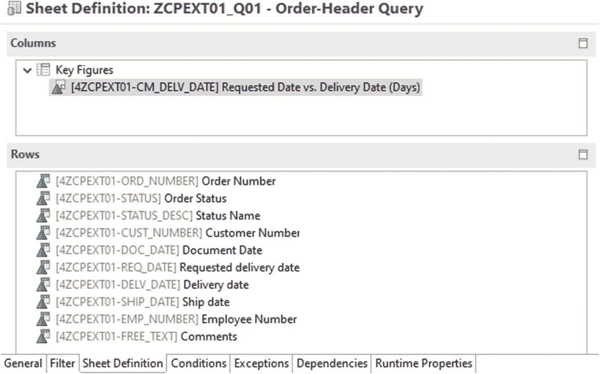

`图 3-22`. 向 `ZCPEXT01_Q01` 查询定义中添加新字段

`状态名称` 特性被添加到“行”区域，而`请求日期与交付日期之差（天）`关键值被放置在“列”区域。运行查询后，默认情况下所有字段都会显示在输出中。用户可以根据需要调整报表结构。图 3-23 显示了 `ZCPEXT01_Q01` 查询更新后的输出。

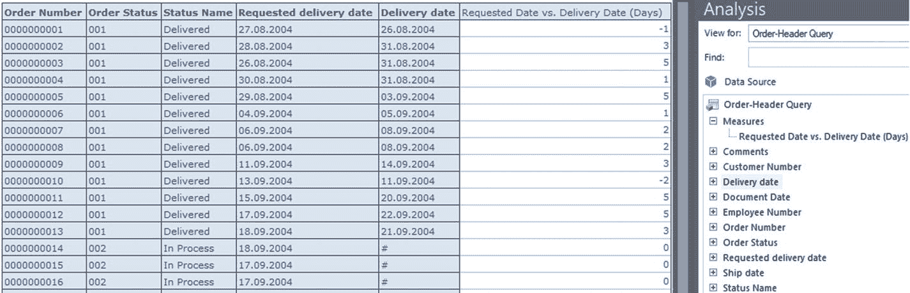

`图 3-23`. 在 `Analysis for Microsoft Excel` 中 `ZCPEXT01_Q01` 查询的新字段

`Analysis for Microsoft Excel` 设计面板（如图 3-23 右侧所示）列出了在查询级别定义的所有可用字段。左侧是实际的输出。出于演示目的，我将输出限制为五个特性和一个关键值。如您所见，现在用户可以通过查看`状态名称`列中的值来了解订单状态的描述性描述。此外，一个新的关键值提供了有关请求交付日期与实际交付日期之间差异的信息。借助这些信息，业务用户可以轻松识别交付严重延迟的订单，以及那些按时交付的订单。

### 将输入参数从查询传递到计算视图

**案例研究 3**

业务用户要求在运行报表之前能够选择状态名称的显示语言。打开报表时，应提示用户选择一个`语言变量`值。根据输入的值，报表输出中的`状态名称`列应以相应的语言显示文本。

#### 为订单抬头计算视图创建输入参数

满足案例研究 3 要求的最直接方法是将`语言`字段添加到查询的输出结构中，然后在该字段之上创建一个变量。对于给定的场景，这种方法就足够了，因为底层的计算视图很简单，并且不处理大量数据和涉及多个表的复杂逻辑；因此，性能不会受到影响。然而，可能存在源计算视图复杂得多并且需要处理对非常大的表的操作的情况。在这种情况下，HANA 引擎可能无法将筛选条件下推到视图的数据基础层。这可能会严重影响性能。

为了确保在选择屏幕上输入的值能够被下推到表级别，我将在计算视图级别创建一个输入参数，然后将其映射到查询变量。现在，让我们打开 `CV_ORDER_HEADER` 计算视图，并选择指向 `ORDER_STATUS` 表的 `Projection` 节点。要创建一个新的输入参数，请转到“输出”部分，右键单击`输入参数`文件夹，然后选择**新建**（图 3-24）。

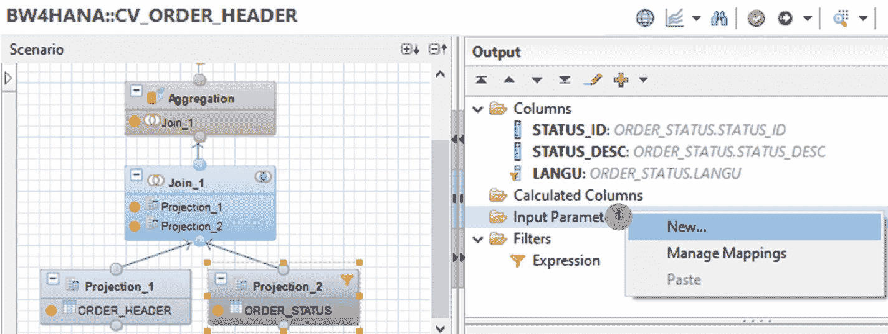

`图 3-24`. 向 `CV_ORDER_HEADER` 计算视图添加一个`语言`参数

添加新的输入参数时，系统将打开**新输入参数**窗口。我们可以在此处配置参数的属性。图 3-25 显示了`语言`输入参数的属性。

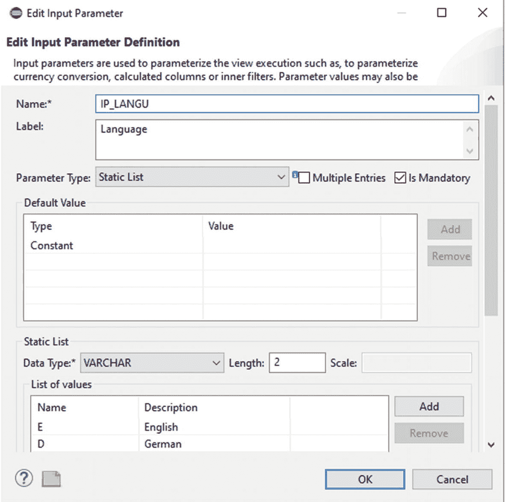

`图 3-25`. 向 `CV_ORDER_HEADER` 计算视图添加一个`语言`参数

如图 3-25 所示，该输入参数的技术名称设置为 `IP_LANGU`。对于`参数类型`，我选择了`静态列表`选项。这意味着对于`参数值`的帮助，我需要定义一个固定值的列表。此列表在**值列表**部分中指定。在给定的示例中，我在列表中输入了两个值：`E`代表英语，`D`代表德语。`是否必填`复选框表示需要提供输入参数的值才能运行报表。数据类型设置为长度为 `2` 的 `VARCHAR`。此类型对应于 `语言` 列的源数据类型。现在我们需要将输入参数与 `LANGU` 列筛选器链接起来。右键单击 `LANGU` 列，然后选择**编辑筛选器**或**应用筛选器**（取决于之前是否在该列上应用了筛选器）。不要使用固定值筛选 `LANGU` 列，而是将筛选器值类型更改为`输入参数`。然后选择 `IP_LANGU` 参数作为筛选器值（图 3-26）。

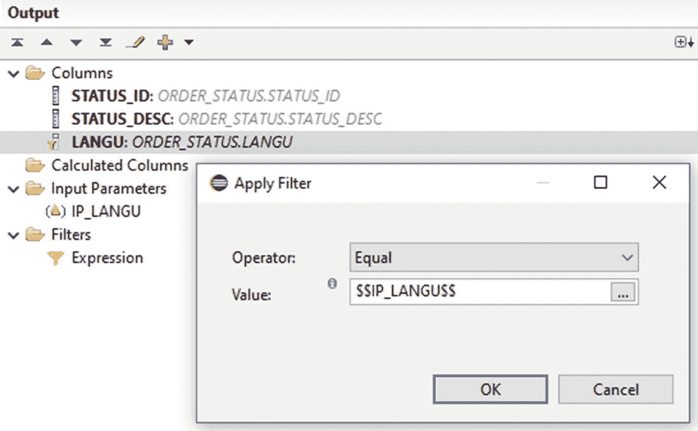

`图 3-26`. 在 `CV_ORDER_HEADER` 计算视图中将 `IP_LANGU` 参数应用为列筛选器

`IP_LANGU` 是一个单值输入参数，因此在筛选 `LANGU` 列时，我们应该使用`等于`值作为筛选运算符。要验证输入参数，请激活您的视图并执行计算视图。预览视图时，系统应提示您进入一个参数屏幕。视图的输出应根据为输入参数选择的语言显示`状态名称`文本值。

> **注意：** Open ODS 视图不支持带有输入参数的计算视图。向计算视图添加必填输入参数后，它将无法再被 Open ODS 视图使用。这意味着先前创建的 BW/4HANA 对象（Open ODS 视图、CompositeProvider 和查询）在尝试预览数据时将抛出错误。

#### 为带有输入参数的订单抬头数据创建 CompositeProvider

如果输入参数按预期工作，我们现在可以切换到 SAP BW 建模视角。首先我将创建一个新的 `CompositeProvider`，它将直接从 `CV_ORDER_HEADER` 计算视图获取数据。图 3-27 展示了新创建的 `ZCPEXT02` `CompositeProvider` 的定义。

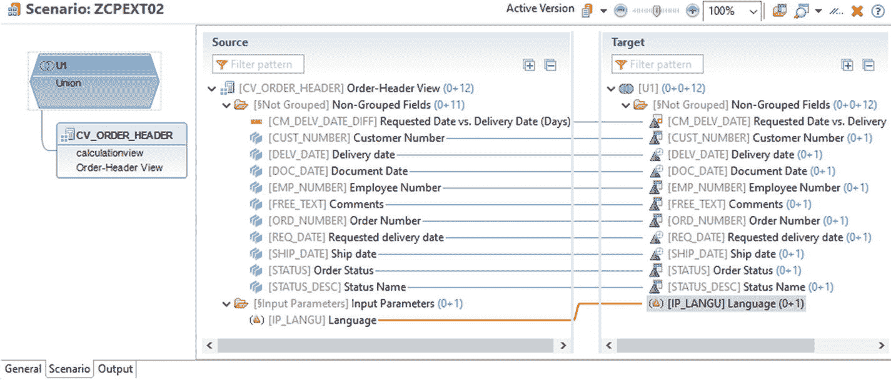

`图 3-27`. 定义 `ZCPEXT02` `CompositeProvider` 的结构

源字段和目标字段之间的映射看起来与 `CompositeProvider` `ZCPEXT01` 中的映射几乎相同（如图 3-21 所示）。您可能会注意到，`ZCPEXT02` `CompositeProvider` 结构中多了一个字段。这个字段代表在 `CV_ORDER_HEADER` 计算视图中创建的 HANA 输入参数 (`IP_LANGU`)。此`输入参数`字段稍后可用作查询级别变量的引用。当 `CompositeProvider` 激活后，我们可以在其之上创建一个新的查询 (`ZCPEXT02_Q01`)。

#### 创建包含输入参数的订单抬头数据查询

查询 `ZCPEXT02_Q01` 的输出结构（在“工作表定义”选项卡中）将与上一场景中的结构相同（参见图 3-22）。计算视图的输入参数与查询变量之间的映射关系将在查询的“过滤器”选项卡中定义。

**注意：** 不应将输入参数字段添加到“工作表定义”选项卡中的任何部分，因为在运行查询时，您会遇到错误。输入参数字段不允许用于导航；它们应仅用于筛选。

首先，我将语言输入参数添加到“过滤器：固定值”部分。为此，右键单击“过滤器：固定值”区域，然后选择“添加特性”选项。接着浏览并选择输入参数名称，点击“确定”按钮（图 3-28）。

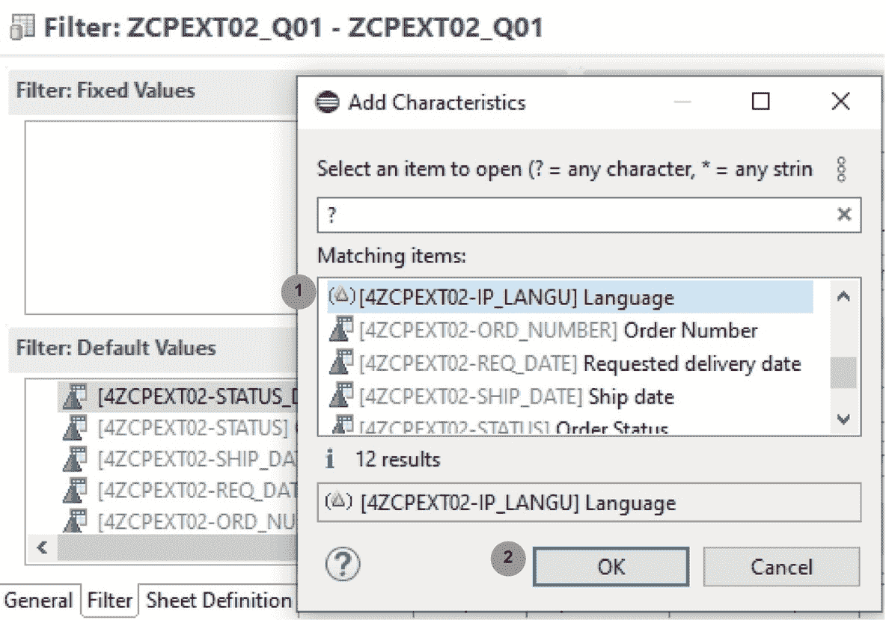

`图 3-28`. 将输入参数字段添加到 `ZCPEXT02_Q01` 查询的过滤器部分

将输入参数添加到过滤器部分后，我们需要创建一个语言查询变量。在此之前，先将输入参数的技术名称复制到剪贴板（在我的示例中是`4ZCPEXT02-IP_LANGU`）。然后进入项目资源管理器，选择“新建” ➤ “变量”（参见图 3-29）。

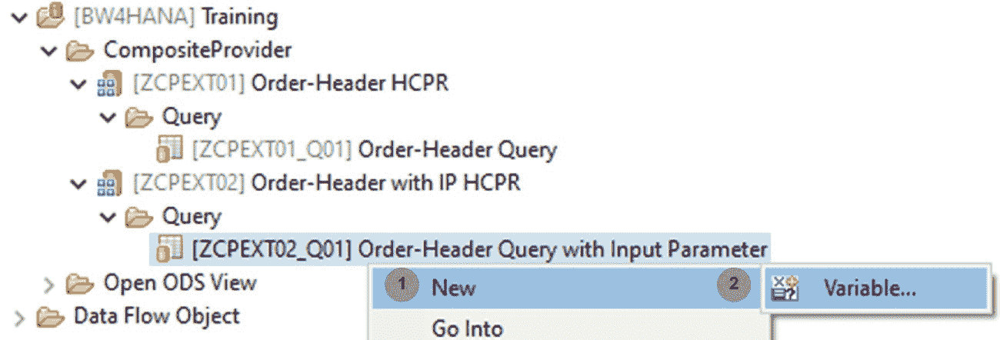

*图 3-29. 添加新的查询变量*

创建新变量时，系统会打开“新建变量编辑器”窗口。您需要在此处提供变量的定义（图 3-30）。

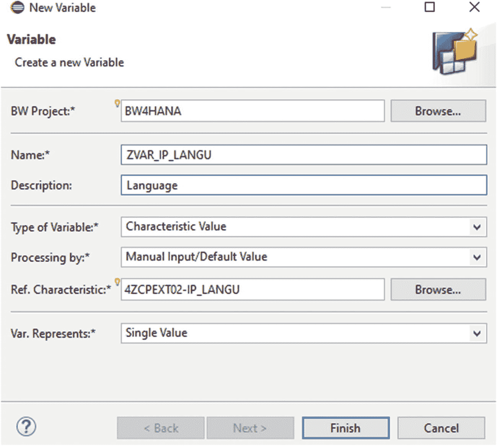

*图 3-30. 创建 `ZVAR_IP_LANGU` 查询变量*

现在应将我们复制到剪贴板的输入参数字段的技术名称粘贴到“参照特性”字段。“浏览”选项仅提供搜索信息对象的功能；因此，当使用基于字段的方法时，我们需要手动输入字段技术名称。变量属性应与HANA输入参数的设置相匹配，因此在我们这个案例中，需要确保变量代表“单值”类型。验证了常规变量属性后，点击“完成”按钮关闭向导，然后进行变量的详细设置（图 3-31）。

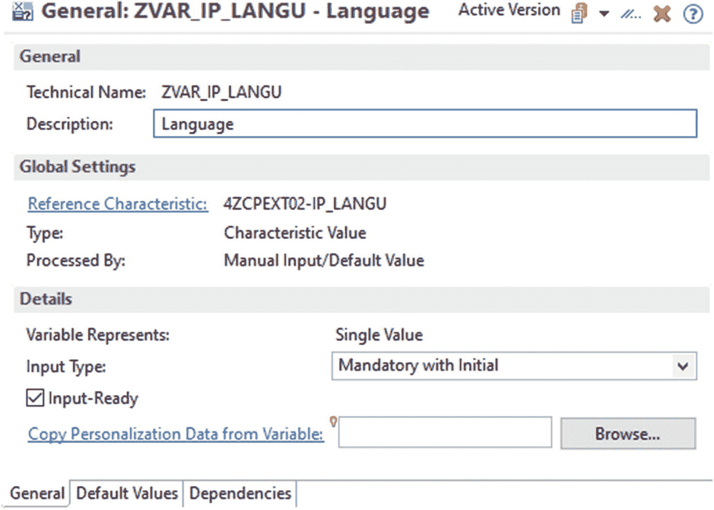

*图 3-31. 定义 `ZVAR_IP_LANGU` 变量的设置*

计算视图输入参数是必填类型，因此查询变量的输入类型也应采用相同设置。此外，在“默认值”选项卡上，我们可以为语言变量设置默认值。配置完成后，保存变量并返回查询过滤器定义。现在我们可以将计算视图参数映射到查询变量。右键单击输入参数的技术名称，然后选择“限制”选项（图 3-32）。

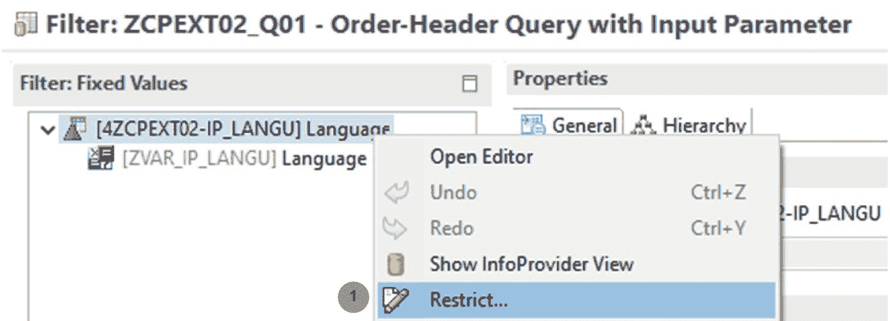

*图 3-32. 将 `4ZCPEXT02-IP_LANGU` 输入参数字段映射到查询变量*

在过滤器编辑器中，选择合适的变量（在我这个场景中是`ZVAR_IP_LANGU`）并将其添加到“过滤器定义”部分。确认变量选择后，您将在“过滤器：固定值”部分看到该变量（如图 3-32 所示）。现在我们可以保存查询并运行它以检查结果。在Analysis for Microsoft Excel中打开`ZCPEXT02_Q01`查询时，会显示选择屏幕（图 3-33）。

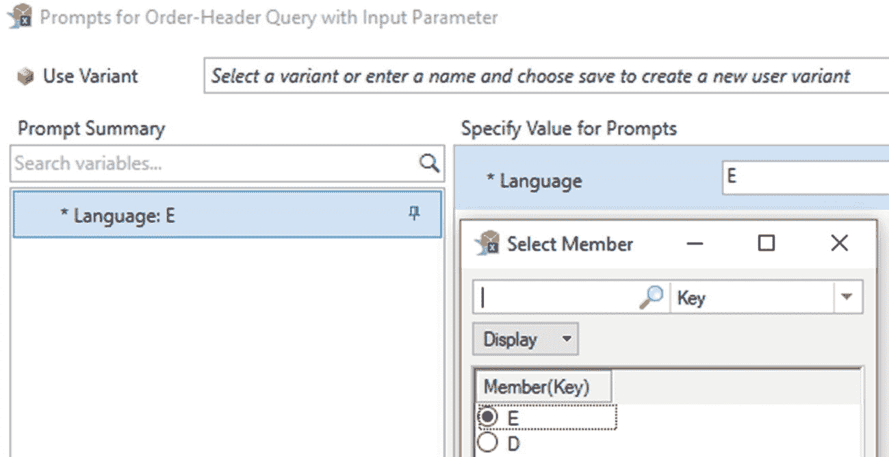

*图 3-33. Analysis for Microsoft Excel 提示输入 `ZCPEXT02_Q01` 查询参数*

我为语言变量（`ZVAR_IP_LANGU`）设置了默认值`E`；因此，打开报表时，`E`值已经输入。打开“选择成员”窗口时，我们可以看到在计算视图级别为`IP_LANGU`输入参数指定的静态列表中的两个值。根据所选择的语言值，用户将看到“状态名称”列的文本是英文还是德文。案例研究 3 中的业务需求已得到满足。

## 将输入参数从查询传递到表函数

### 案例研究 4

业务用户意识到，目前对交货日期与请求交货日期之间差值的计算不够精确。目前的计算方式包含了周末和公共节假日的天数。需求是修正该计算，排除所有非工作日。此外，用户要求能够将工厂日历作为输入参数提供。现在，根据提供的日历ID，计算交货日期与请求交货日期的差值时，应仅包含工作日。日历变量的默认值应设置为US。

要计算两个日期之间的工作日数，我们可以使用`WORKDAYS_BETWEEN` SQL函数。遗憾的是，图形化计算视图不支持此函数，因此我们无法直接调整现有的计算。为了使用`WORKDAYS_BETWEEN`函数，我们首先需要创建一个表函数。针对给定场景，我将介绍两种方法。

第一种方法是，将整个计算视图（`CV_ORDER_HEADER`）的逻辑转换为SQL脚本。所有连接和计算都需要手动转换为SQL代码，并包含在表函数定义中（图 3-34）。

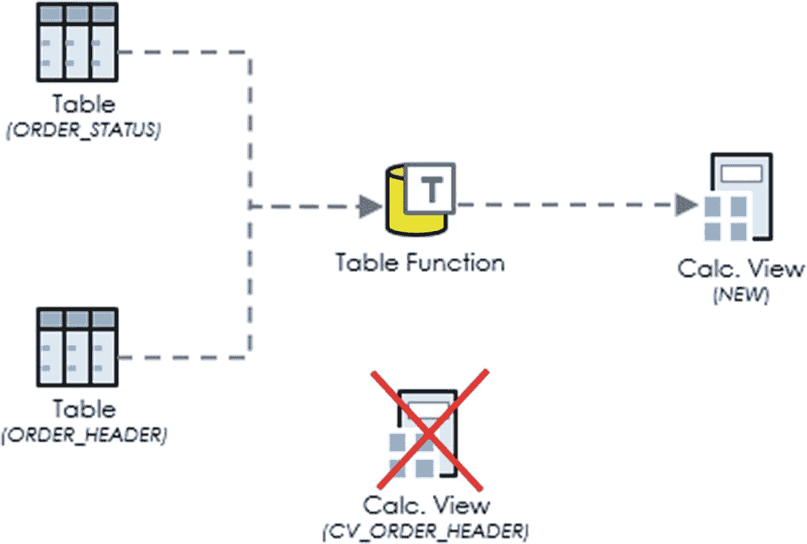

*图 3-34. 用表函数替换现有的计算视图*

如图 3-34 所示，表函数直接使用源表。对于所考虑的场景，将逻辑从图形化视图转换为SQL脚本很容易。只需连接两个表；因此，这种方法可能更可取。此外，不再需要现有的计算视图，可以将其删除。因此，HANA原生侧只需维护两个对象：表函数和计算视图。

> **注意：** `CompositeProvider`无法直接使用表函数，因此需要创建一个计算视图作为`CompositeProvider`和表函数之间的中间层。

第二种方法是，利用现有的计算视图（`CV_ORDER_HEADER`）作为表函数SQL脚本的数据源。在这种情况下，我们无需为所有连接和计算编写SQL代码，只需在SQL脚本的`FROM`子句中直接使用当前的计算视图即可。图 3-35 说明了第二种方法。

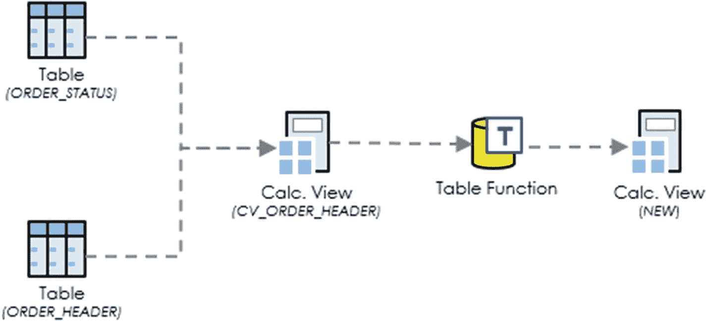

*图 3-35. 在表函数中利用现有的计算视图*

尽管第二种方法实现起来稍快一些，但从维护角度来看，我认为第一种方法更好。在图 3-35 描述的方法中，有三个HANA建模对象。另一方面，如果底层的计算视图很复杂，包含数十个表和计算，那么第二种方法可能更可取。

尽管对于给定的场景，第一种方法更合适，但我将演示如何使用第二种方法（图 3-35）来满足案例研究 4 的需求。这是因为通过这种方法，我还能展示如何将输入参数值从表函数传递到底层的计算视图。

### 准备订单头数据的SQL查询

要开始处理表函数，让我们切换到SAP开发透视图。第一步，我们需要在`CV_ORDER_HEADER`计算视图之上准备`SELECT`语句。我们无需手动从头编写SQL代码，而是可以自动从计算视图生成`SELECT`语句，并将其作为进一步增强的参考。在存储库浏览器树中，找到要用作参考的目标计算视图，右键单击它，然后选择“生成Select SQL”选项，如图 3-36 所示。

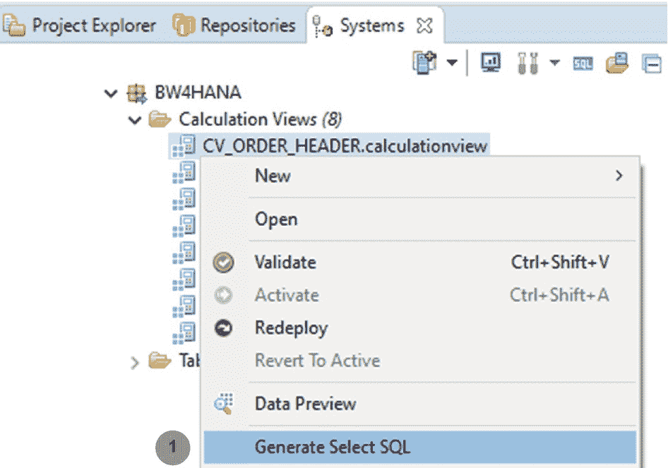

*图 3-36. 从计算视图生成 SELECT SQL 代码*

从`CV_ORDER_HEADER`生成`SELECT` SQL代码后，Eclipse将打开一个新的SQL控制台选项卡，其中包含生成的`SELECT`语句。从`CV_ORDER_HEADER`生成的脚本具有以下语法：

```sql
SELECT
"ORD_NUMBER",
"DOC_DATE",
"REQ_DATE",
"SHIP_DATE",
"DELV_DATE",
"STATUS",
"CUST_NUMBER",
"EMP_NUMBER",
"FREE_TEXT",
"STATUS_DESC",
sum("CM_DELV_DATE_DIFF") AS "CM_DELV_DATE_DIFF"
FROM "_SYS_BIC"."BW/4HANA/CV_ORDER_HEADER"('PLACEHOLDER' = ('$$IP_LANGU$$',''))
GROUP BY "ORD_NUMBER",
"DOC_DATE",
"REQ_DATE",
"SHIP_DATE",
"DELV_DATE",
"STATUS",
"CUST_NUMBER",
"EMP_NUMBER",
"FREE_TEXT",
"STATUS_DESC"
```

你可能注意到，生成的代码包含语言输入参数的占位符，在创建表函数时也需要维护该参数。此外，为了能够将值从表函数输入参数传递到图形化计算视图参数，我们需要应用特定的语法，我将在稍后解释。

现在，让我们专注于调整SQL查询，以满足案例研究 4 的需求。为了能够在SQL控制台中预览生成查询的结果，我们需要为`IP_LANGU`输入参数传递一个有效值。我暂时将占位符值固定为`E`。占位符的语法现在如下所示：

```sql
('PLACEHOLDER' = ('$$IP_LANGU$$','E'))
```

现在我想创建一个新的计算结果，用于计算交货日期和请求交货日期之间的工作日数。如前所述，我将使用`WORKDAYS_BETWEEN`函数。

# 使用 `WORKDAYS_BETWEEN` 函数计算工作日

**注意：** 要使用 `WORKDAYS_BETWEEN` 函数，`TFACS` 表必须在任何 HANA 数据库模式中可用。`TFACS` 是一个标准的 SAP 表，其中包含每个年份和日历类型的非工作日（包括周末和公共节假日）信息。

`WORKDAYS_BETWEEN` 函数的语法如下所示：

```sql
WORKDAYS_BETWEEN(<calendar_id>, <start_date>, <end_date>, <schema_name>)
```

以下是语法元素的含义：

- `<calendar_id>`：指定工厂日历的 ID，该日历将作为参考，用于从计算中排除周末和公共节假日。根据需求（案例研究 4），此值应根据用户输入动态定义。
- `<start_date>`：表示计算工作日差值的开始日期。
- `<end_date>`：表示计算工作日差值的结束日期。
- `<schema_name>`：指定存储 `TFACS` 表的模式名称。

为了在 SQL 控制台中测试该函数，我暂时将 `<calendar_id>` 的值设置为 `US`。对于 `<start_date>`，我将使用“请求交货日期”列，对于 `<end_date>`，我将使用“交货日期”。在我的 HANA 系统中，`TFACS` 表存储在 `SAPABAP1` 模式中；因此，在 `<schema_name>` 的位置，我输入 `SAPABAP1` 值。计算交货日期和请求交货日期之间天数的语法如下所示：

```sql
WORKDAYS_BETWEEN('US',"REQ_DATE","DELV_DATE",'SAPABAP1')
```

此函数后续将进行调整，以管理工厂日历参数的动态输入。在图 3-37 中，您可以看到上一步计算的结果（`CM_DELV_DATE_DIFF_WD` 列）。

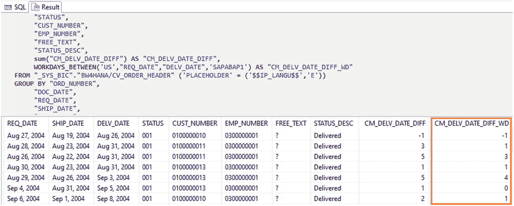
图 3-37 使用 `WORKDAYS_BETWEEN` 计算的 SQL 查询结果

图 3-37 显示了在 `CV_ORDER_HEADER` 视图上执行 SQL 查询的结果。除了直接从视图派生的列之外，还有一个别名为 `CM_DELV_DATE_DIFF_WD` 的计算列。该计算列使用 `WORKDAYS_BETWEEN` 函数来计算交货日期与请求交货日期之间的差值。当您将新计算的结果（`CM_DELV_DATE_DIFF_WD`）与从视图派生的计算结果（`CM_DELV_DATE_DIFF`）进行比较时，您会注意到前者的值在大多数情况下低于后者。列 `CM_DELV_DATE_DIFF_WD` 基于 `WORKDAYS_BETWEEN` 函数计算结果，而列 `CM_DELV_DATE_DIFF` 基于 `DAYS_BETWEEN` 函数计算天数。这意味着新的计算排除了非工作日，因此，如果两个日期之间存在任何公共假日或周末，这些天数将不会计入总天数。这就是为什么对于一些订单条目，`CM_DELV_DATE_DIFF_WD` 列显示的数字比 `CM_DELV_DATE_DIFF` 列更低。

## 为订单抬头数据创建表函数

在验证查询并检查其结果后，我们可以开始创建一个新的表函数。请遵循第 1 章“表函数”一节中描述的步骤打开表函数编辑器。我将表函数定义划分为图 3-38 中突出显示的三个部分。数字表示创建表函数定义每个部分的顺序。

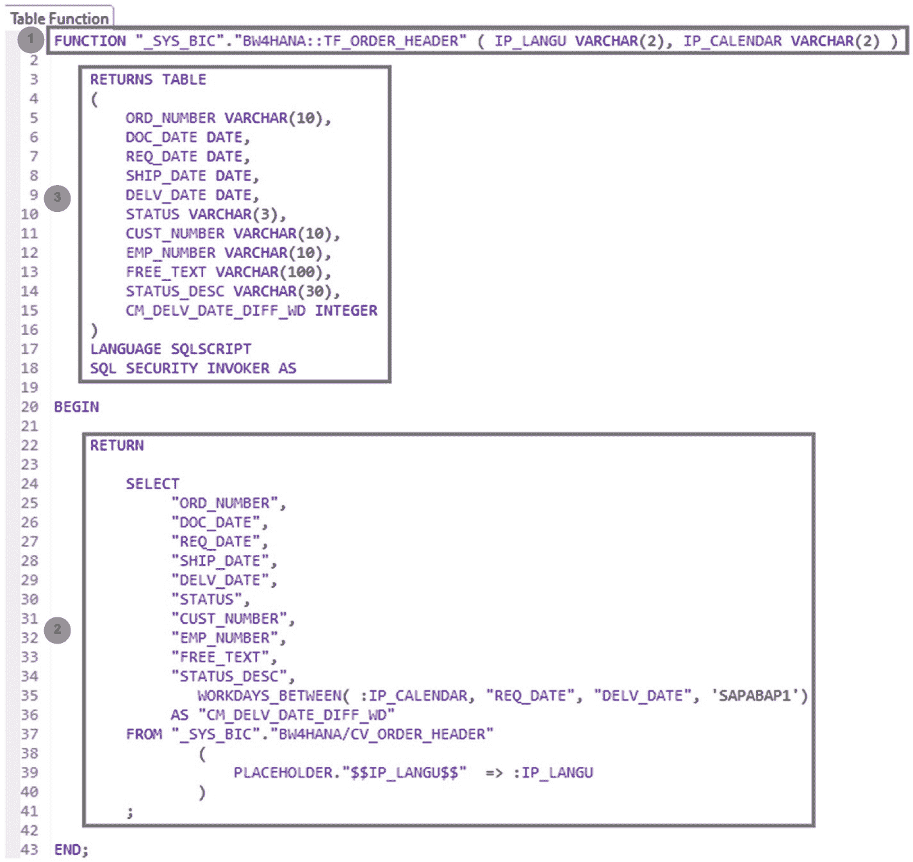
图 3-38 `TF_ORDER_HEADER` 表函数定义

1.  在代码的第一部分，我指定了表函数的目标模式名称（`_SYS_BIC`）并定义了两个输入参数。第一个参数（`IP_LANGU`）将用于将语言值传递给 `CV_ORDER_HEADER` 计算视图输入参数。`IP_CALENDAR` 是用户要求的一个新参数，用于确定计算交货日期和请求交货日期之间差值时所参考的日历类型。

```sql
FUNCTION "_SYS_BIC"."BW/4HANA::TF_ORDER_HEADER" ( IP_LANGU VARCHAR(2), IP_CALENDAR VARCHAR(2) )
```

2.  实际查询被 `BEGIN` 和 `END` 操作符包围。我在 SQL 控制台（图 3-37）中定义的 `SELECT` 查询被复制到了该表函数定义中。对于 `WORKDAYS_BETWEEN` 函数，之前固定的美国日历 ID 值现在已被替换为动态的 `IP_CALENDAR` 输入参数。

```sql
WORKDAYS_BETWEEN(:IP_CALENDAR, "REQ_DATE", "DELV_DATE", 'SAPABAP1')
```

此外，在应用表函数语言输入参数和计算视图输入参数之间的映射时，需要修改占位符的语法以使此映射正常工作。以下是将表函数输入参数值传递给计算视图输入参数的有效语法：

```sql
( PLACEHOLDER."$$IP_LANGU$$"  => :IP_LANGU )
```

> **注意**
>
> 在 SQL 中，表函数输入参数使用冒号调用（即 `:IP_LANGU`），而计算视图输入参数的占位符则由双引号和双美元符号包围（即 `"$$IP_LANGU$$"`）。

最终的 `SELECT` 查询如下所示：

3.  我总是在准备好最终的 `SELECT` 查询后才定义此部分。这是因为在此部分中，您需要为最终的 `SELECT` 查询中列出的每一列提供数据类型。此外，还需要保持列的顺序。正如我在第 1 章中提到的，这部分很容易出错；因此，根据源列类型定义数据类型非常重要。在这里，我们可以在图形编辑器中打开源计算视图定义，检查每个输出列的数据类型，并在表函数定义中使用相同的类型。另一种方法是通过对 `_SYS_BI`.`BIMC_PROPERTIES` 元数据表运行 SQL 查询来获取列数据类型。以下查询返回 `CV_ORDER_HEADER` 视图中所有可用输出列的数据类型：

```sql
SELECT COLUMN_NAME, COLUMN_SQL_TYPE
FROM "_SYS_BI"."BIMC_PROPERTIES"
WHERE CUBE_NAME = 'CV_ORDER_HEADER'
AND DIMENSION_TYPE IS NOT NULL
```

上述查询将为您提供列及其数据类型的列表。图 3-39 显示了上述语句的输出。

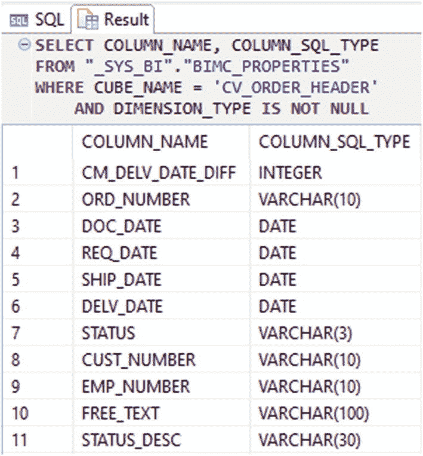
图 3-39 `CV_ORDER_HEADER` 计算视图属性的查询输出

然后，您可以将此列表复制到表函数输出定义中。这样您就能确保所有数据类型与源对象结构一致。以下代码定义了 `TF_ORDER_HEADER` 表函数的输出结构：

```sql
RETURNS TABLE
(
ORD_NUMBER VARCHAR(10),
DOC_DATE DATE,
REQ_DATE DATE,
SHIP_DATE DATE,
DELV_DATE DATE,
STATUS VARCHAR(3),
CUST_NUMBER VARCHAR(10),
EMP_NUMBER VARCHAR(10),
FREE_TEXT VARCHAR(100),
STATUS_DESC VARCHAR(30),
CM_DELV_DATE_DIFF_WD INTEGER
)
LANGUAGE SQLSCRIPT
SQL SECURITY INVOKER AS
```

在激活该表函数之前，请将输出结构与 `SELECT` 语句中列出的列进行比较，确保输出列的数量一致，输出列名称相同，并且列的顺序保持不变。成功激活后，您可以查询该 TF 来检查它是否返回了所需的输出。运行 `SELECT` 语句时，请记得提供输入参数值（除非在 TF 定义中定义了默认输入参数值）。以下代码从 `TF_ORDER_HEADER` 表函数中查询数据：

```sql
SELECT * FROM "_SYS_BIC"."BW/4HANA::TF_ORDER_HEADER" ( 'E', 'US' )
```

图 3-40 显示了此查询的输出。

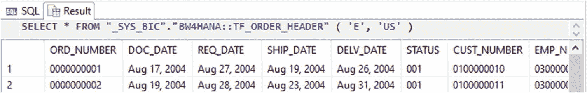
图 3-40 `TF_ORDER_HEADER` 表函数的查询输出

如图 3-40 所示，如果我们想向表函数传递输入参数值，需要在括号内以逗号分隔的列表形式指定值。请注意，这些输入参数是单值类型，因此您不能为每个参数传递多个值。不过，也可以维护多值输入参数，但这需要在表函数内进行额外的编码。

# 使用表函数和计算视图创建 BW/4HANA 报表

```sql
SELECT
"ORD_NUMBER",
"DOC_DATE",
"REQ_DATE",
"SHIP_DATE",
"DELV_DATE",
"STATUS",
"CUST_NUMBER",
"EMP_NUMBER",
"FREE_TEXT",
"STATUS_DESC",
WORKDAYS_BETWEEN( :IP_CALENDAR, "REQ_DATE", "DELV_DATE", 'SAPABAP1')
AS "CM_DELV_DATE_DIFF_WD"
FROM "_SYS_BIC"."BW/4HANA/CV_ORDER_HEADER"
(
PLACEHOLDER."$$IP_LANGU$$"  => :IP_LANGU
)
```

## 在表函数之上创建计算视图

接下来，我们需要在`TF_ORDER_HEADER`表函数之上创建一个计算视图。我创建了一个名为`CV_ORDER_HEADER_TF`的CUBE类型新计算视图。在此步骤中，重点是正确管理输入参数映射。将表函数添加为计算视图的数据源后，我们可以在语义节点中管理此映射。要将表函数输入参数映射到最终计算视图的目标参数，请点击语义节点，然后转到“参数/变量”选项卡。之后，点击输入参数“管理映射”按钮旁的箭头符号，并选择“数据源”选项（图 3-41）。

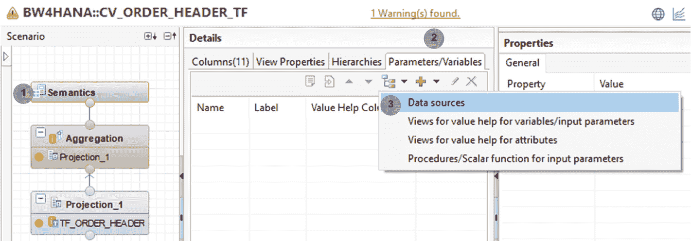

图 3-41. 打开输入参数映射窗口

“数据源”按钮会打开一个新窗口，用于管理源与目标之间的参数映射。这里我们有一个选项，可以根据底层表函数中可用的参数自动创建输入参数。通过点击“按名称自动映射”按钮（图 3-42），所有输入参数将被自动重新创建并映射到源参数。图 3-42展示了`TF_ORDER_HEADER`表函数与`CV_ORDER_HEADER_TF`计算视图之间的参数映射。

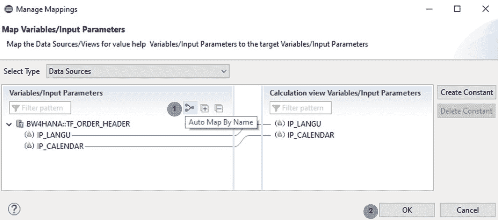

图 3-42. 管理`CV_ORDER_HEADER_TF`计算视图的输入参数映射

“按名称自动映射”功能会创建与源对象中技术名称相同的输入参数。此外，源与目标之间的映射会被自动管理。如果需要，我们可以随后调整所创建参数的属性。定义好映射和计算视图输出结构之后，就可以进行激活了。之后，值得测试一下新创建视图的输入参数。数据预览应该会显示一个提示，包含两个输入参数（`IP_LANGU`和`IP_CALENDAR`）。`CM_DELV_DATE_DIFF_WD`和`STATUS_DESC`列的结果应根据输入值的变化而改变。

## 更新订单标题复合提供者的源计算视图

下一步，我们需要更新 BW/4HANA 对象。如果我们希望保持现有报表的当前形式，可以创建一个新的复合提供者和查询，但在我们的场景中，我们想要更新现有的 BW 对象。这意味着对于`ZCPEXT02`复合提供者，我们需要将源`CV_ORDER_HEADER`计算视图替换为新创建的`CV_ORDER_HEADER_TF`视图。

要调整`ZCPEXT02`复合提供者的源视图，请打开该对象并切换到“场景”选项卡。然后悬停在现有的计算视图上，并点击“替换”按钮（图 3-43）。

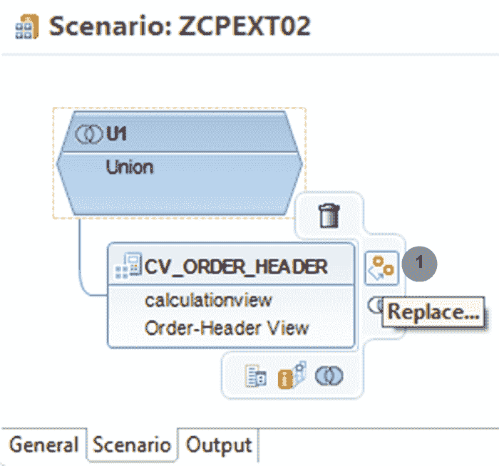

图 3-43. 替换`ZCPEXT02`复合提供者的源视图

当点击“替换”按钮时，系统将打开用于搜索替换对象的窗口。选择新的目标视图（`CV_ORDER_HEADER_TF`）后，系统会将之前的视图替换为新视图。对于具有相同技术名称的列和输入参数，源与目标之间的映射将保持不变。其余的映射需要手动管理。图 3-44显示了`ZCPEXT02`复合提供者更新后的目标结构和映射。

视图的替换导致目标部分中的`CM_DELV_DATE`字段丢失了分配。这是因为从`CV_ORDER_HEADER_TF`派生的度量具有不同的技术名称（`CM_DELV_DATE_DIFF_WD`），所以我们需要手动创建缺失的分配。输入参数（`IP_CALENDAR`）也应该被拖拽到复合提供者结构的目标部分，因为我们希望将其用作新查询变量的参考。`ZCPEXT02`复合提供者的最终结构应如图 3-44所示。

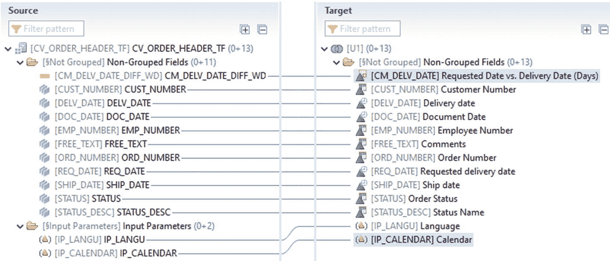

图 3-44. 更新`ZCPEXT02`复合提供者的结构

## 使用新的输入参数更新订单标题数据的查询

完成案例研究 4 任务的最后一步是更新`ZCPEXT02_Q01`查询。对于新映射的`IP_CALENDAR`参数，我们需要执行与`IP_LANGU`输入参数相同的步骤（图 3-27到 3-32中展示的步骤）。`ZCPEXT02_Q01`查询的最终过滤器定义应如图 3-45所示。

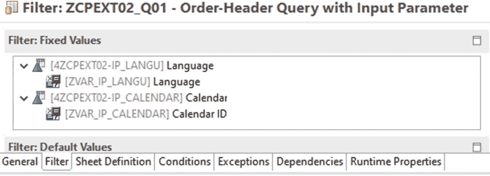

图 3-45. 将`4ZCPEXT02-IP_CALENDAR`输入参数字段映射到查询变量

现在，我们可以在前端工具中运行报表，根据案例研究 4 中描述的需求来测试查询。当在 Analysis for Microsoft Excel 中打开查询时，我们现在应该会看到两个变量提示，如图 3-46所示。

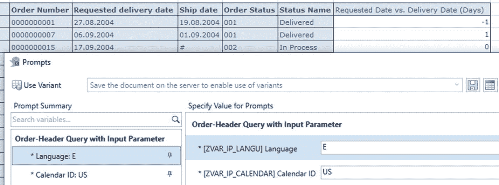

图 3-46. `ZCPEXT02_Q01`查询的更新后 Analysis for Microsoft Excel 提示

“状态名称”和“请求日期 vs. 交货日期（天）”列将根据在“语言”和“日历 ID”变量选择屏幕上输入的值返回输出。这意味着案例研究 4 中的需求现已成功完成。

## 总结

在本章中，我描述了需要将 HANA 表中的数据暴露给 BW/4HANA 层的场景。通过利用基于字段的建模和虚拟化，我们能够创建 BW/4HANA 报表，而无需将数据加载到 BW/4HANA 建模对象中，也无需创建任何单个信息对象。

在案例研究 1 中，我展示了如何轻松地将数据从 HANA 表预置到 BW/4HANA 查询中。在此场景中，我们使用了两个 BW/4HANA 建模对象：开放 ODS 视图和复合提供者。

案例研究 2 要求我们在创建最终输出之前合并两个 HANA 表。为了实现这一点，我们引入了一个额外的 HANA 建模对象，称为计算视图。这帮助我们连接这两个表，以便在将其带入 BW/4HANA 层之前，以所需的形式创建一个数据集。

在案例研究 3 中，我演示了如何将值从查询变量传递到计算视图输入参数。我们了解到，带有输入参数的计算视图应由复合提供者直接使用（在此场景中需要跳过开放 ODS 视图层）。

最后一个场景帮助我们理解了表函数的用法。通过完成案例研究 4 的需求，我们学习了如何在表函数中使用计算视图。此外，我们还通过示例了解了如何在计算视图和表函数之间双向传递输入参数值。最终，你还学习了如何将查询变量值传递到表函数的 SQL 代码中。