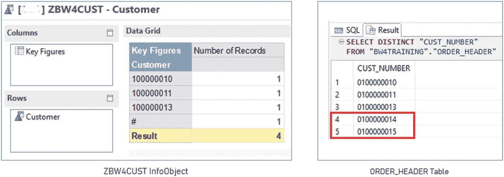
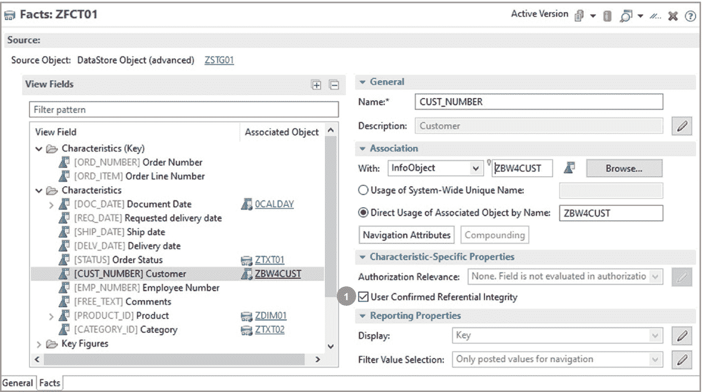
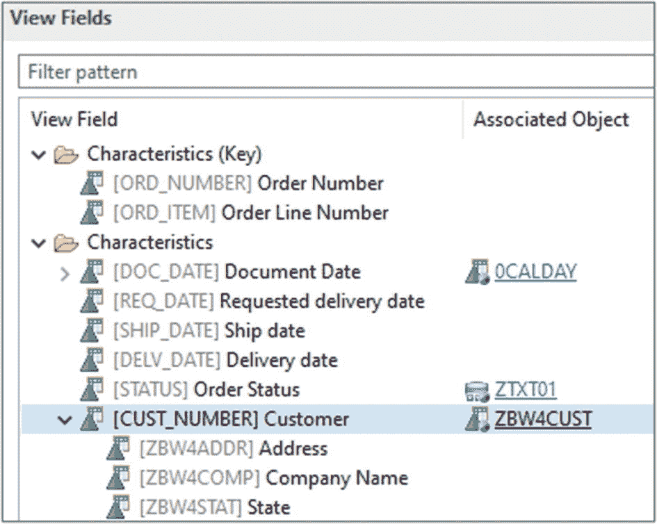
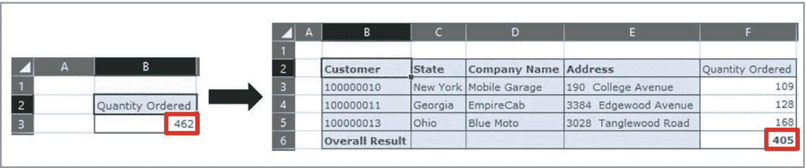
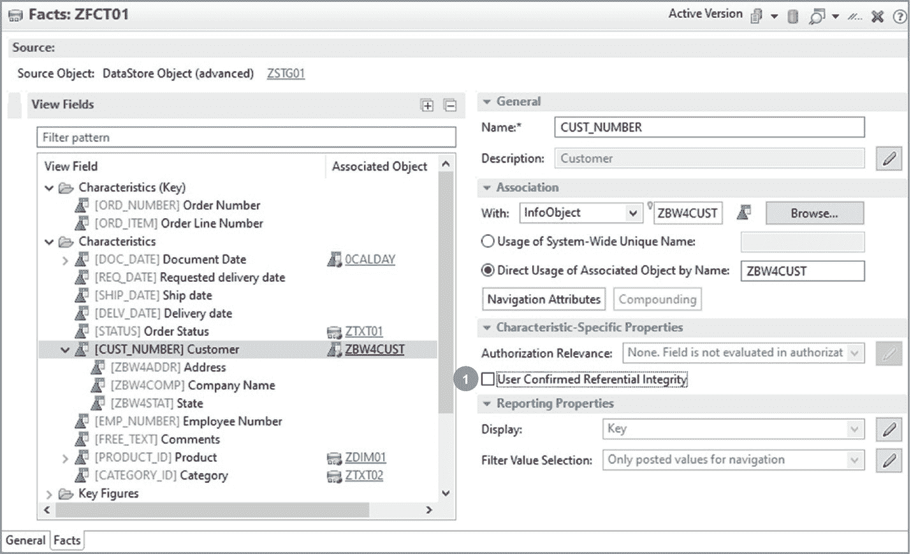
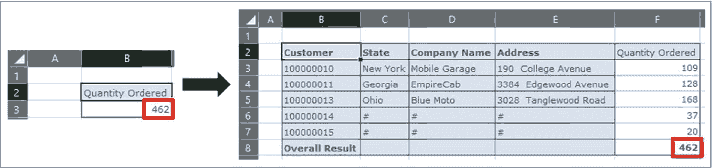
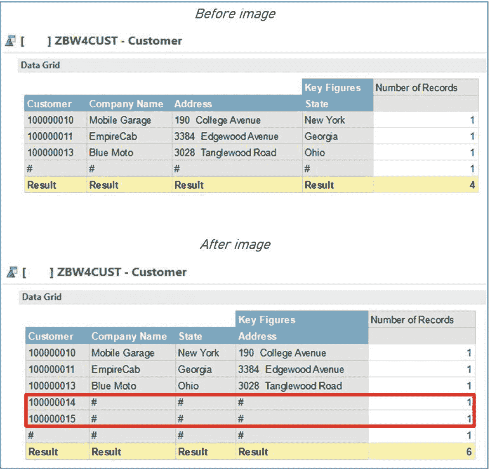
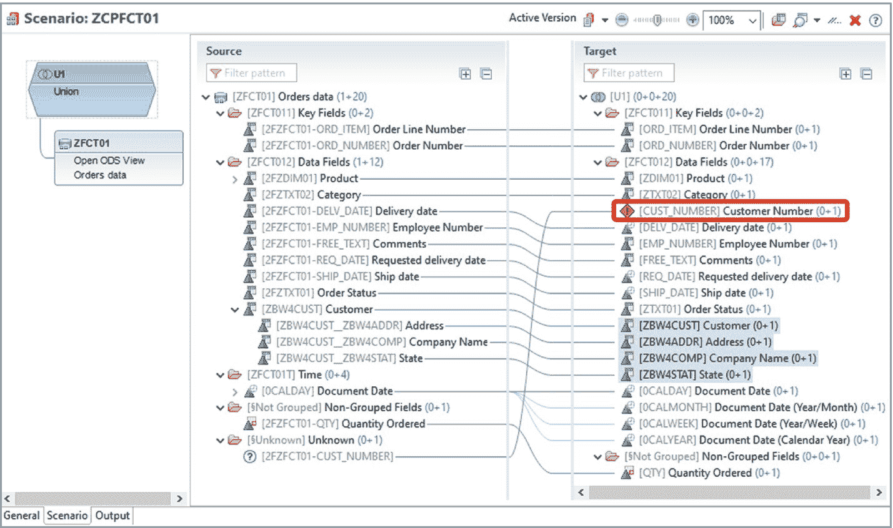
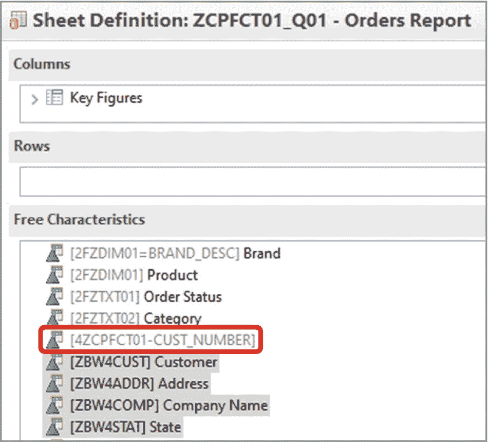
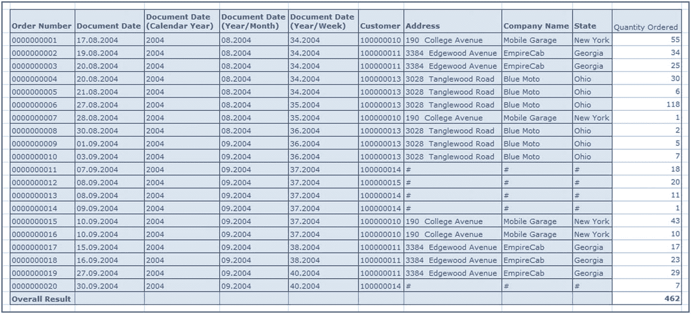

# 使用 ZBW4CUST 信息对象定义关联

既然你已经掌握了如何应用关联，你可能会认为为字段分配另一个信息对象是小菜一碟。这在一定程度上是对的；然而，针对第二个需求，我们需要考虑额外的限制条件。

在文档日期字段与 `0CALDAY` 信息对象之间应用关联时，我们无需担心这些对象之间的数据一致性。这是因为文档日期列的 `DATE` 数据类型已经约束了该列可能包含的值（仅限日期）。正因如此，我们避免了文档日期列包含 `0CALDAY` 信息对象中不可用值的情况。对于客户字段，情况则有所不同。客户数据在外部数据源中维护；因此，我们无法确保 ID 始终与 `ZBW4CUST` 信息对象主数据匹配。如场景所述，`ORDER_HEADER` 表包含两个不属于 `ZBW4CUST` 信息对象主数据的客户编号。请参见客户主数据值与 `ORDER_HEADER` 表中客户唯一值的对比，如图 5-11 所示。

图 5-11. ZBW4CUST 信息对象与 ORDER_HEADER 表之间的客户编号对比

如图 5-11 所示，信息对象 `ZBW4CUST` 包含三个客户值，而在 `ORDER_HEADER` 表中有五个客户编号。高亮的客户编号（`0100000014` 和 `0100000015`）不属于 `ZBW4CUST` 主数据。要检查这种不一致性如何影响数据模型，让我们在 `CUST_NUMBER` 字段与 `ZBW4CUST` 信息对象之间应用一个关联（图 5-12）。

图 5-12. ZFCT01 开放 ODS 视图中客户字段的关联

要为 `CUST_NUMBER` 字段应用关联，请遵循与 `0CALDAY` 信息对象相同的步骤（图 5-3）。这次你应选择 `ZBW4CUST` 信息对象作为参考（图 5-10）。此外，你可能会注意到选项 (1) 用户确认参照完整性已被选中（图 5-12）。如果你选择此选项，在查询运行时，系统将在字段 `CUST_NUMBER` 与 `ZBW4CUST` 信息对象的技术表之间执行参照连接。结果，查询将仅返回两个表中都存在的条目。

应用关联后，我们现在可以利用导航属性。按照图 5-4 所示的步骤启用 `ZBW4CUST` 信息对象的导航属性。图 5-13 显示了为 `ZFCT01` 开放 ODS 视图启用的导航属性。

图 5-13. ZFCT01 开放 ODS 视图中的 ZBW4CUST 导航属性

现在，让我们在 Analysis for Microsoft Excel 中打开 `ZFCT01` 开放 ODS 视图，检查关联是否按预期工作。

## 参照完整性设置的重要性

在 Analysis for Microsoft Excel 中打开 `ZCPFCT01` 开放 ODS 视图的预览时，默认情况下只显示合计。对于该开放 ODS 视图，订购数量的合计值为 462（图 5-14）。

图 5-14. ZBW4CUST 属性在 Analysis for Microsoft Excel 中针对 ZCPFCT01 的显示（选中参照完整性选项）

在图 5-14 的右侧，你可以看到拉取所有客户相关属性后的显示。乍一看，一切似乎按预期工作，客户相关信息正确显示。然而，你可能会注意到，一旦将客户信息添加到输出中，订购数量的合计值不再是 462，而是 405。你可能还会意识到，在底层的 `ORDER_HEADER` 表中有五个客户可用，而报告输出只显示三个。这种行为是由我们在将 `ZBW4CUST` 信息对象关联到 `CUST_NUMBER` 字段时选择的“用户确认参照完整性”选项引起的（图 5-12）。使用此选项后，每次将关联的信息对象或其导航属性添加到输出时，都会执行参照连接，并过滤掉所有不属于关联信息对象主数据的记录。这可能会给用户带来困惑，因为根据添加到输出的字段不同，我们可能会看到不同的结果。这意味着，只有在我们知道参照完整性得到保证的情况下，才应使用“用户确认参照完整性”属性（图 5-12）。换句话说，我们需要确保关联信息对象的主数据将涵盖来自源表的所有值。

由于在我们的场景中，来自外部 `ORDER_HEADER` 表的客户值并未完全被客户主数据覆盖，现在让我们取消选中“用户确认参照完整性”属性，并重新激活开放 ODS 视图（图 5-15）。

图 5-15. 在 ZFCT01 开放 ODS 视图中取消选中客户字段的参照完整性选项

激活开放 ODS 视图后，我们可以通过在 Analysis for Microsoft Excel 中运行来再次检查输出（图 5-16）。

图 5-16. ZBW4CUST 属性在 Analysis for Microsoft Excel 中针对 ZCPFCT01 的显示（未选中参照完整性选项）

如图 5-16 所示，更改参照完整性选项后，客户编号 `0100000014` 和 `0100000015` 现已可用。由于这两个客户的主数据未在 `ZBW4CUST` 信息对象中维护，因此属性州、公司名称和地址为空。此外，订购数量的值现在保持一致。

> **注意：** 使用“用户确认参照完整性”属性时，你应该意识到，在查询运行时，未在关联信息对象主数据中找到的所有值都将被插入到该信息对象的主数据表中。

## 排版后的内容

如上所述，取消选中 `User Confirmed Referential Integrity` 选项时需要格外小心，因为这可能会影响关联 `InfoObject` 的主数据表。每次对有关联的对象运行预览时，系统都会传播关联 `InfoObjects` 主数据表中不存在的值。为了直观地说明这一点，我们来检查一下 `ZBW4CUST` 主数据表的变更前后情况。

图 5-17 展示了在我们取消选中 `Referential Integrity` 选项并运行 `ZCPFCT01` 开放 ODS 视图（图 5-15）后，`ZBW4CUST` 主数据表内容的变化。

**图 5-17.** 执行 `ZCPFCT01` 开放 ODS 视图前后，`ZBW4CUST` 主数据表的对比

图中高亮显示的新条目（`0100000014` 和 `0100000015`）是在开放 ODS 视图运行时填充到该 `InfoObject` 中的。这意味着，每当底层 `ORDER_HEADER` 表中出现新的客户值，一旦对开放 ODS 视图执行预览，这些值就会被添加到 `ZBW4CUST` InfoObject 的主数据中。请记住这一点，在将字段与 `InfoObjects` 关联时必须谨慎，因为你可能无意中传播了不需要的主数据值。如果要避免这种情况，可以创建一个现有 `InfoObject` 的副本，并使用它来代替主 `InfoObject`。这就是为什么在某些场景下，你可能会更倾向于使用 `Referential Integrity` 设置来确保主数据不会混乱。

由于订单数据的开放 ODS 视图（`ZCPFCT01`）已用新字段更新，我们现在需要将这些变更整合到 `CompositeProvider` 和查询中。首先，我们应该更新 `CompositeProvider` 对象（图 5-18）。

**图 5-18.** 将 `ZBW4CUST` 导航属性添加到 `ZCPFCT01` CompositeProvider 的输出中

要显示导航属性，我们应该使用图 5-6 中所示的选项来启用它们。因此，我们将能够使用客户属性并将其映射到输出。如图 5-18 所示，我们还需要删除 `CUST_NUMBER` 字段的映射，因为客户的技术名称现在继承自 `InfoObject` `ZBW4CUST`。成功激活 `CompositeProvider` 后，最后一步是更新最终的查询。

由于我们从底层 `CompositeProvider` 中删除了 `CUST_NUMBER` 字段，因此也需要将其从查询中删除。然后，我们可以添加新的客户相关字段并保存查询（图 5-19）。

**图 5-19.** 将 `ZBW4CUST` 导航属性添加到 `ZCPFCT01_Q01` 查询的输出中

图 5-20 中显示的最终查询包含了用户要求的所有附加字段。用户提出的增强需求现已实现。

**图 5-20.** 在 Analysis for Microsoft Excel 中展示的 `ZCPFCT01_Q01` 查询的输出

## 总结

本章演示了如何在基于外部源创建的模型中使用 `InfoObjects`。我们解释了如何在字段与 `InfoObjects` 之间建立关联。我们了解到，关联既可以在开放 ODS 视图级别应用，也可以在 `CompositeProvider` 级别应用。

混合数据模型的最大优势在于，我们可以利用现有的主数据对象及其功能，例如层级结构、导航属性和文本。另一方面，需要强调的是，混合数据模型仅在外部属性与 SAP 数据类型和主数据内容一致时才能使用。否则，外部字段与 `InfoObjects` 之间的关联可能会产生错误结果或在报表时导致错误。

最后，我们了解了 `Referential Integrity` 属性的影响。示例解释了正确使用此设置的重要性，并强调了为什么应谨慎使用。

