# 场景

为了创建一份全面报告，提供公司所有订单的详细信息，业务用户要求实施一个新的数据模型。该数据模型需要包含 SAP 及非 SAP 的信息，以便为订单数据模型提供 360 度全方位视图。以下是该模型中应考虑的两个主要 SAP 对象：

- `ZMATID（物料 ID）`：这是一个覆盖 SAP 物料主数据的信息对象。`物料 ID` 信息对象包含以下三个属性：
    - `0CREATEDON（创建日期）`：物料的创建日期
    - `0NETPRICE（净价）`：物料的净价
    - `0LOC_CURRENCY（当地货币）`：以当地货币表示的净价
    图 6-1 展示了 `ZMATID` 物料信息对象的内容和属性。
    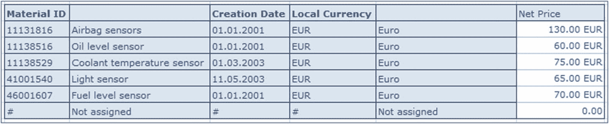
    图 6-1. 物料 ID 信息对象的内容
- `ZADS01（SAP 订单数据）`：存储 SAP 订单数据的高级数据存储对象（Advanced DSO）。它包含以下字段：
    - `ZORDID（订单 ID）`：订单编号
    - `ZORDITM（订单项目）`：订单项目编号
    - `ZMATID（物料 ID）`：物料主数据
    - `ZSTORID（存储地点）`：物料的存储地点
    - `ZBW4CUST（客户）`：客户编号
    - `0DOC_DATE（单据日期）`：单据日期
    - `0SHIP_DATE（发货日期）`：订单的发货日期
    - `0ORDER_QUAN（采购订单数量）`：订购数量
    - `0PO_UNIT（订单单位）`：订购数量的单位
    图 6-2 展示了 `ZADS01`（SAP 订单数据）ADSO 的内容。
    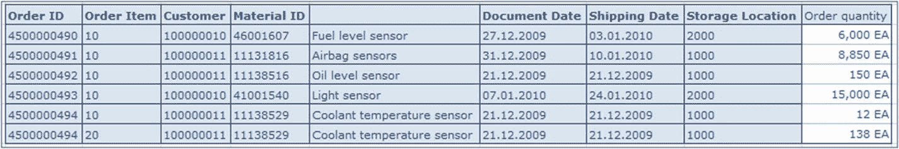
    图 6-2. SAP 订单 ADSO 的内容

你可能还记得，在外部订单数据模型中，我们还可以区分包含订单交易数据的表（`ORDERS_HEADER` 和 `ORDER_DETAILS` 表）以及产品主数据表（`PRODUCTS` 表）。图 6-3 展示了满足业务需求的总体方法。

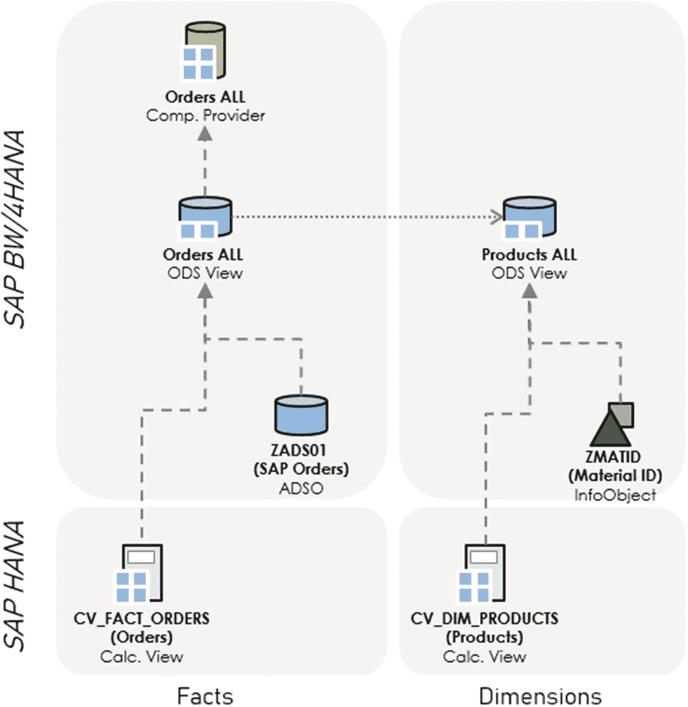
图 6-3. 集成 SAP 和非 SAP 订单数据模型的高级架构

如图 6-3 所示，对于非 SAP 数据，我们将利用两个计算视图。对于订单，我们将使用 `CV_FACT_ORDERS` 视图，该视图合并了 `ORDERS_HEADER` 和 `ORDERS_DETAILS` 外部表（请参考第 4 章中的图 4-14）。来自外部系统的物料信息将从 `CV_DIM_PRODUCTS` 视图中获取（请参考第 4 章中的图 4-4）。SAP 相关数据将从 ADSO `ZADS01`（SAP 订单）和信息对象 `ZMATID`（SAP 物料）中检索。我们的目标是组合这些对象，为订单交易数据创建一个单一的事实型开放 ODS 视图对象，并为物料创建一个单一的主数据开放 ODS 视图。

## 将产品主数据集成到单个计算视图中

为了合并 SAP 和非 SAP 的物料主数据，我们将使用 HANA 层。图 6-3 展示了集成两个模型的高级架构，而图 6-4 是该架构的扩展，展示了将物料/产品主数据合并到单个维度中的详细方法。

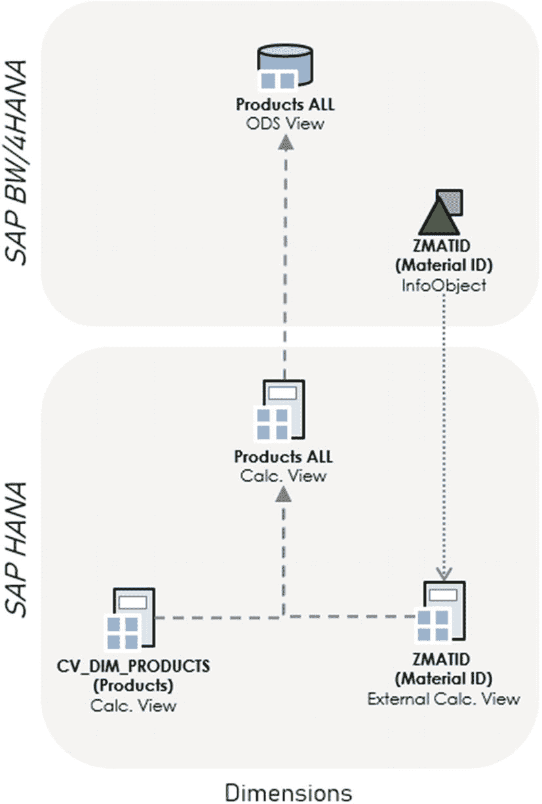
图 6-4. 集成 SAP 和非 SAP 产品主数据的架构

在上一章中，我们为 `PRODUCTS` 表创建了计算视图（请参考图 4-4），现在我们将重用它。此外，我们需要将 SAP 物料主数据引入 HANA 层。这可以通过使用从信息对象生成外部 SAP HANA 视图的功能来实现。

**注**：除了使用外部计算视图，我们也可以直接查询信息对象的技术表。然而，外部计算视图默认提供了所有相关信息。

现在，让我们打开 `ZMATID` 信息对象的属性并生成一个外部计算视图（见图 6-5）。

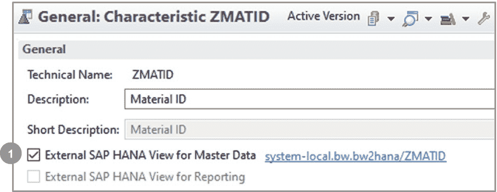
图 6-5. 为 `ZMATID` 信息对象生成外部 SAP HANA 视图

通过选中 `外部 SAP HANA 主数据视图` 复选框并激活该信息对象，系统将自动生成结构与信息对象结构对应的计算视图。如图 6-5 所示，系统会提供所生成视图的位置信息。你可以点击超链接打开外部计算视图的定义。

生成的计算视图包含信息对象的所有属性以及文本列（图 6-6）。正如第一章所述，要查询该计算视图的数据，你需要拥有为该视图同时生成的角色授权。关于授权的更多详细信息，请参考第 1 章。

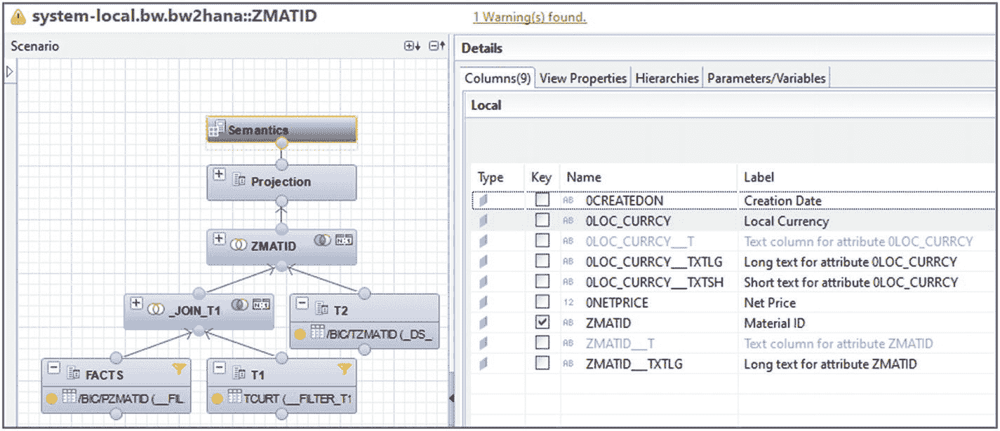
图 6-6. `ZMATID` 信息对象的外部 SAP HANA 视图定义

当对该计算视图运行预览时，你将看到物料（`ZMATID`）信息对象的内容数据（见图 6-7）。

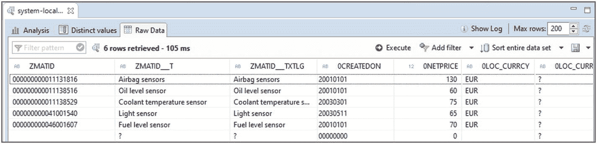
图 6-7. `ZMATID` 信息对象的外部 SAP HANA 视图输出

为了正确地组合不同的主数据对象，我们首先应进行分析以检查它们在结构和数据类型上的差异。基于此分析，我们应确定以下内容：

- 如何将源字段映射到目标字段？
- 输出字段的目标数据类型应该是什么？
- 源对象中的哪些字段不匹配或缺失？

表 6-1 比较了 `CV_DIM_PRODUCTS` 和 `ZMATID` 计算视图的字段和数据类型。

表 6-1. 物料与产品结构对比（SAP vs. 非 SAP）

| 列名 | 键 | 数据类型 | | 属性名 | 键 | 数据类型 |
|---|---|---|---|---|---|---|
| `PRODUCT_ID` | **X** | `VARCHAR(10)` | ↔︎ | `ZMATID` | **X** | `NVACHAR(18)` |
| `CATEGORY_ID` | **X** | `VARCHAR(5)` | ↔︎ | **不适用** |
| `PRODUCT_DESC` | | `VARCHAR(200)` | ↔︎ | `ZMATID___TXTLG` | | `NVARCHAR(60)` |
| `BRAND_DESC` | | `VARCHAR(200)` | ↔︎ | **不适用** |
| `PRICE` | | `DECIMAL(10,2)` | ↔︎ | `0NETPRICE` | | `DECIMAL(17,2)` |
| `CURRENCY` | | `VARCHAR(3)` | ↔︎ | `0LOC_CURRCY` | | `NVARCHAR(5)` |
| **不适用** | ↔︎ | `0CREATEDON` | | `NVARCHAR(8)` |

如表 6-1 所示，有四个包含相同信息的公共字段：产品编号、产品描述、价格和货币。其余三个字段（类别、品牌和创建日期）不公共，因此仅适用于 SAP 或非 SAP 物料。另一个难点在于，非 SAP 维度具有基于`PRODUCT_ID`（产品 ID）和`CATEGORY_ID`（类别 ID）的组合键，而 SAP 主数据对象键仅包含`ZMATID`（物料 ID）字段。

下一步，我们需要指定合并后的产品主数据视图对象的目标结构。最终的主数据视图对象不仅应包含公共字段，还应包含仅在一个数据源中可用的字段。对于公共字段，选择能够覆盖两个数据源值的数据类型很重要。如果未设置正确的数据类型，某些值可能会错误显示（即被截断），或者视图在激活期间会返回错误。基于表 6-1，我们可以轻松为每个输出字段定义目标数据类型。如果考虑两个数据源中公共的字段，则应始终选择长度更大的数据类型，以确保值不会被截断。表 6-2 列出了合并后产品计算视图的目标结构和数据类型。

**表 6-2.** 合并产品计算视图的目标数据类型

| `CV_DIM_PRODUCTS_ALL`（全部产品） |
|---|
| 列名 | 键 | 数据类型 |
|---|---|---|
| `PRODUCT_ID` | **X** | `NVACHAR(18)` |

| `CATEGORY_ID` | `X` | `NVARCHAR(5)` |
| `PRODUCT_DESC` | | `NVARCHAR(200)` |
| `BRAND_DESC` | | `NVARCHAR(200)` |
| `NET_PRICE` | | `DECIMAL(17,2)` |
| `CURRENCY` | | `NVARCHAR(5)` |
| `CREATED_ON` | | `NVARCHAR(8)` |

## 创建合并计算视图

确定了视图的目标结构后，我们现在可以开始创建合并计算视图。首先，我们需要切换到 `SAP HANA 模型器` 透视图。然后，在目标包中，我们应该创建一个 `DIMENSION` 类型的新计算视图。由于我们将从两个计算视图中查询数据，因此需要通过从编辑器调色板拖放来添加两个投影节点。然后，作为投影的数据源，我们应该为 SAP 主数据选择 `ZMATID` 计算视图，为非 SAP 数据选择 `CV_DIM_PRODUCTS` 计算视图（图 6-8）。

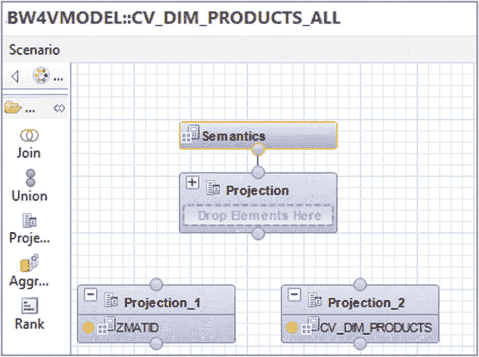

**图 6-8.** 向 `CV_DIM_PRODUCTS_ALL` 计算视图添加数据源

### 配置投影节点

对于每个投影节点，我们应该选择用于映射的字段。根据表 6-1，对于 `ZMATID` 计算视图，我们将使用五个字段，这些字段应被选中（图 6-9）。

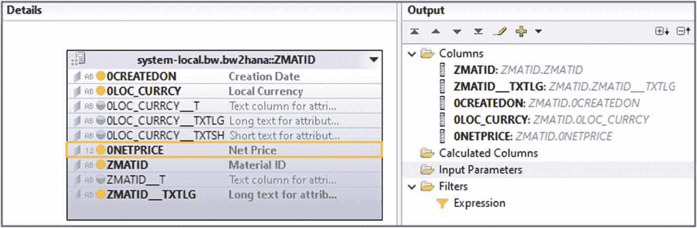

**图 6-9.** 在 `CV_DIM_PRODUCTS_ALL` 计算视图的投影节点输出中添加 `ZMATID` 字段

对于从 `CV_DIM_PRODUCTS` 计算视图查询数据的投影，我们将把所有可用字段添加到该节点的输出中（图 6-10）。

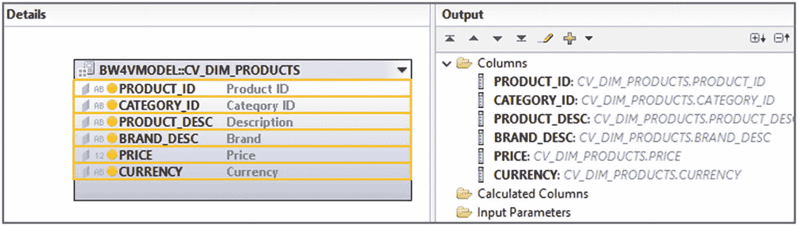

**图 6-10.** 在 `CV_DIM_PRODUCTS_ALL` 计算视图的投影节点输出中添加 `CV_DIM_PRODUCTS` 字段

### 添加与配置联合节点

接下来，我们需要将两个投影节点的数据合并到单个数据集中。为此，我们将使用联合节点。从调色板添加联合节点后，我们需要创建一个目标结构，用于映射来自底层投影的字段。我们将使用表 6-2 作为创建目标结构和在联合节点中分配正确数据类型的参考。图 6-11 介绍了定义联合节点目标结构的步骤。

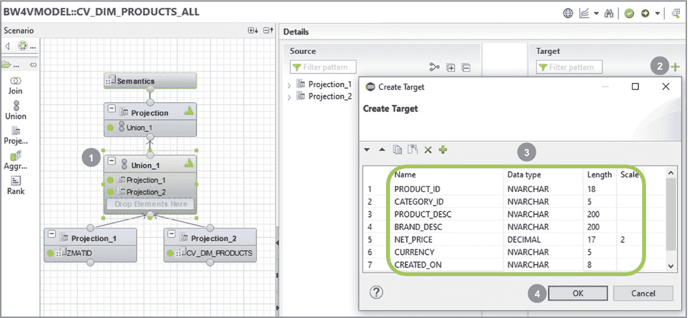

**图 6-11.** 在 `CV_DIM_PRODUCTS_ALL` 计算视图中定义联合节点的目标结构

要添加联合节点，您可以将联合图标从调色板拖到编辑器视图（1）。要定义联合的目标结构，请选择联合节点并单击 *创建目标* 按钮（2）。然后定义目标字段并分配适当的数据类型（3）。由于我们在创建视图之前已经分析了目标结构，现在我们可以根据表 6-2 轻松定义所有字段及其属性。结构定义完成后，我们可以通过单击 *确定* 按钮（4）来确认。通过此活动，我们创建了合并产品维度的目标结构。现在，我们需要将来自底层投影的字段映射到目标结构。图 6-12 显示了联合节点的目标映射。

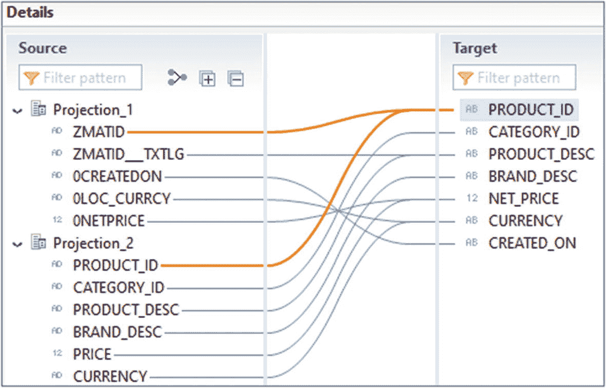

**图 6-12.** 在 `CV_DIM_PRODUCTS_ALL` 计算视图中定义联合节点的字段映射

要正确地将源字段映射到目标字段，我们可以参考表 6-1。要将源字段映射到目标字段，只需拖放它们即可。

> **重要**
>
> 定义关联时，应始终从与目标字段具有相同数据类型的源字段开始映射。否则，系统将继承第一个映射的字段的数据类型，并覆盖我们的初始设置。

如上所述，我们应该始终从具有“主导”数据类型的字段开始映射。例如，对于 `PRODUCT_ID` 目标字段，我们应该首先映射来自 `Projection_1` 的 `ZMATID` 字段，然后映射来自 `Projection_2` 的 `PRODUCT_ID` 字段。如果我们首先映射来自 `Projection_2` 的 `PRODUCT_ID`，则目标 `PRODUCT_ID` 将继承该字段的数据类型，即 `VARCHAR(10)`，而不是 `VARCHAR(18)`。

还请记住，并非所有目标字段都将有两个数据源的赋值。像 `CATEGORY_ID`、`BRAND_DESC` 和 `CREATED_ON` 这样的字段将只有一个来自数据源的赋值。除了来自两个数据源的字段之外，最好再有一个字段来帮助标识特定记录的源系统。为此，我们可以在目标结构中添加 `SOURCE` 字段。然后，通过右键单击该字段，我们可以指定映射（图 6-13）。

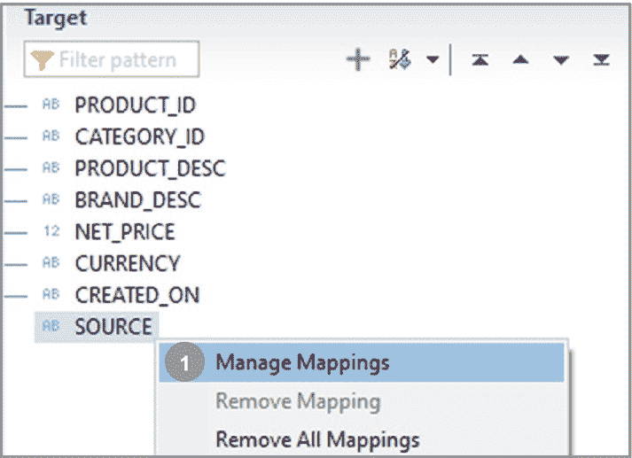

**图 6-13.** 在 `CV_DIM_PRODUCTS_ALL` 计算视图的联合节点中添加 `SOURCE` 字段

选择“管理映射（`Manage Mappings`）”选项后，会弹出用于定义映射的窗口。在此，我们可以为基础数据源定义常量值。

如图 6-14 所示，管理映射时，我们可以为连接到联合节点的每个投影指定常量值。对于指向 `ZMATID` 数据的 `Projection_1`，我们可以指定 `SAP` 作为常量值。`Projection_2` 从外部产品维度查询数据，因此我为它分配了 `EXT` 作为常量值。向输出结构中添加此类列非常有用，因为它允许用户轻松识别或过滤仅来自特定系统的记录（但这并非强制要求）。

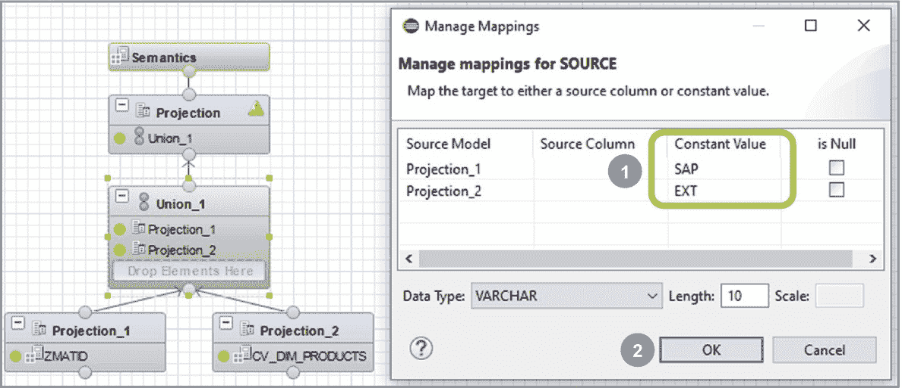

**图 6-14.** 在 `CV_DIM_PRODUCTS_ALL` 计算视图中管理“数据源”字段的映射

我们也可以使用管理映射功能来分配常量值，以防某些投影节点未维护映射。默认情况下，如果底层节点没有映射，则输出列会为此数据显示 `NULL`。在我们的场景中，`CATEGORY_ID` 列就是这种情况。由于 `CATEGORY_ID` 将成为目标产品维度主键的一部分，我们需要确保其中不会出现 `NULL` 值。为此，我们应该用该字段的常量值替换 `NULL`。要应用固定值，请右键单击 `CATEGORY_ID` 字段，然后选择“管理映射”选项，打开用于定义映射的窗口（图 6-15）。

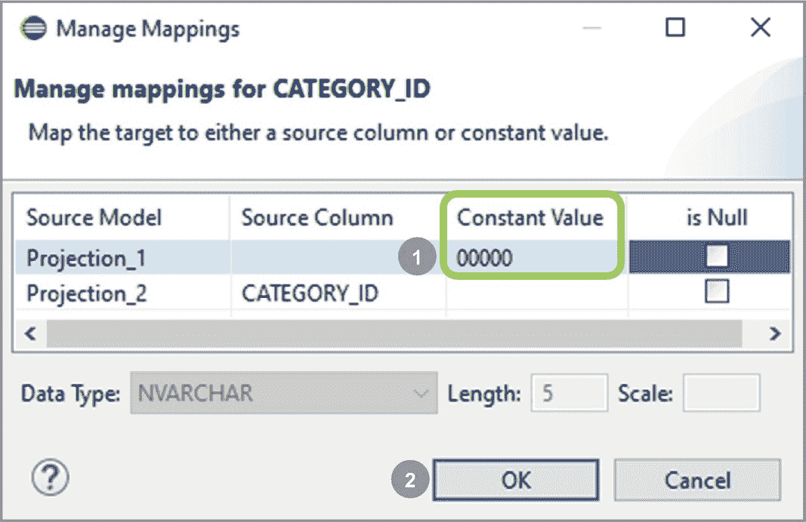

**图 6-15.** 在 `CV_DIM_PRODUCTS_ALL` 计算视图中管理 `CATEGORY_ID` 字段的映射

如图 6-15 所示，对于目标 `CATEGORY_ID` 字段，我为来自 `Projection_1`（SAP 物料）的数据分配了值 `00000`。应用映射后，对于 SAP 物料主数据，`CATEGORY_ID` 值将始终显示 `00000`，而不是 `NULL`。对于外部数据，类别值将从 `Projection_2` 节点填充。

### 定义输出与激活

一旦我们在联合节点级别配置了最终结构，就可以转到最终的投影节点，将所有字段添加到视图的输出中（图 6-16）。

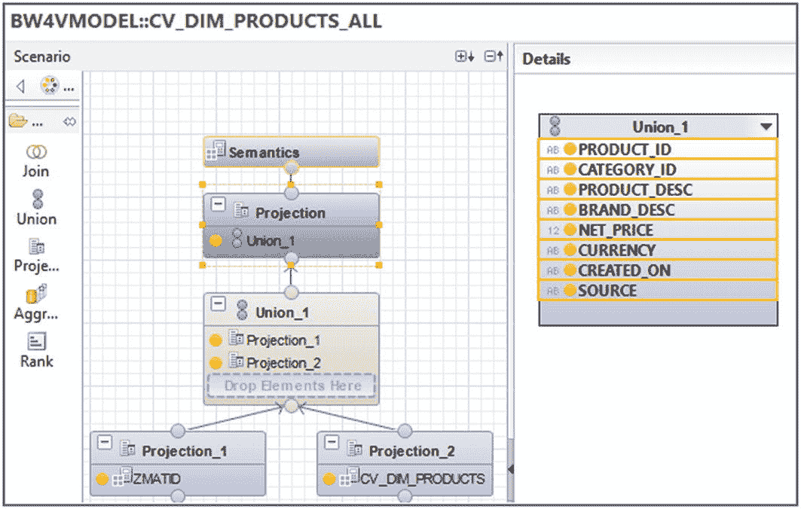

**图 6-16.** 向 `CV_DIM_PRODUCTS_ALL` 计算视图的输出中添加字段

定义完 `CV_DIM_PRODUCTS_ALL` 的最终输出后，我们可以激活该视图。然后运行数据预览以验证内容（图 6-17）。

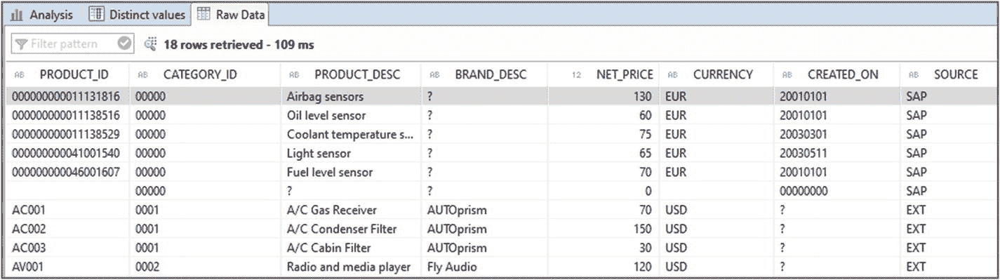

**图 6-17.** `CV_DIM_PRODUCTS_ALL` 计算视图的数据预览

数据预览返回了产品主数据的合并视图。`SOURCE`列清晰地帮助我们识别特定记录集的来源系统。您还可以注意到，`BRAND_DESC`和`CREATED_ON`列针对特定数据集显示问号。问号代表`NULL`值，表示没有可用数据。这是因为这两个列只分配了一个数据源，对于另一个数据源，数据不可用。尽管`CATEGORY_ID`仅从非 SAP 源检索信息，但我们使用“管理映射”功能为 SAP 物料主数据分配了常量值`00000`（图 6-15）；因此，没有显示`NULL`值。

## 为产品创建合并主数据开放 ODS 视图

在上一节中，我们将 SAP 和非 SAP 的产品主数据整合到了单个计算视图中。根据我们的架构设计（图 6-4），现在应在此视图（`CV_DIM_PRODUCTS_ALL`）之上创建 BW/4 主数据对象。让我们创建名为`Product`的合并主数据开放 ODS 视图对象。

图 6-18 显示了产品合并主数据开放 ODS 视图的初始设置。代表键字段设置为`PRODUCT_ID`列（1）。此外，列`CATEGORY_ID`也是主键的一部分，因此它被添加到特征（键）部分（2）。`BRAND_DESC`、`CREATED_ON`和`SOURCE`是属性，它们被添加到特征部分（3）。`NET_PRICE`是一个度量，因此它被分配到关键指标文件夹（4），而`CURRENCY`列有一个专门的货币部分（5）。`PRODUCT_DESC`字段包含产品描述，它被添加到长文本部分（6）。

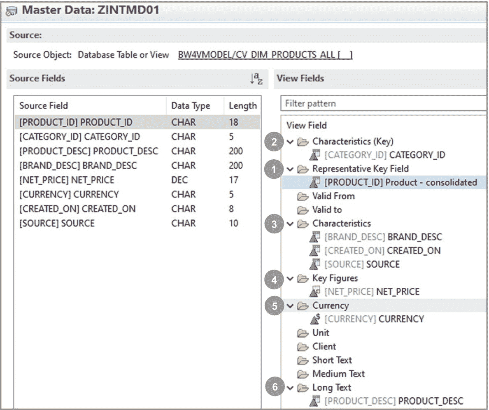

图 6-18.
`Product`——合并的（`ZINTMD01`）开放 ODS 视图对象的初始输出结构

配置完合并产品维度的初始结构后，我们应进行额外调整。图 6-19 显示了集成产品维度的最终结构。

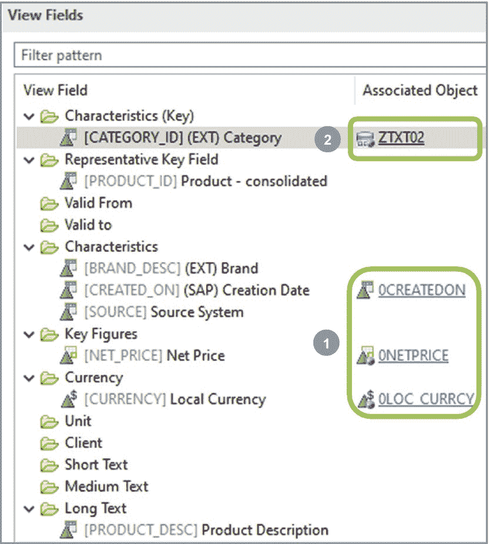

图 6-19.
`Product`——合并的（`ZINTMD01`）开放 ODS 视图的最终输出结构

首先，我们可以识别可以应用关联的字段。字段`CREATED_ON`、`NET_PRICE`和`CURRENCY`可以分别与`0CREATEDON`、`0NETPRICE`和`0LOC_CURRCY`信息对象关联（1）。请记住，当您分配`0LOC_CURRCY`信息对象时，需要确保外部表始终返回 SAP 特定的货币值。

**重要提示**

如果您创建了具有复合键的主数据开放 ODS 视图，即将字段分配到特征（键）部分，则这些字段中的每一个都需要设置关联。此外，在应用关联时，需要选择`按名称直接使用关联对象`选项。

正如为分配到特征（键）部分的字段所提到的，我们需要应用直接关联。否则，我们将无法使用该开放 ODS 视图进行关联，而这在我们的场景中是必需的。话虽如此，我们需要为`CATEGORY_ID`配置关联。在前面的章节中，我们为类别创建了文本`ZTXT02`开放 ODS 视图对象（图 4-7）。我可以使用此对象在`CATEGORY_ID`字段和`ZTXT02`开放 ODS 视图对象之间应用直接关联（2）。

最后，我们应该对字段描述进行调整。对于仅适用于特定系统的字段，最好在标题中包含此类信息。这就是为什么在字段描述中，我为`CATEGORY_ID`和`BRAND_DESC`添加了`EXT`前缀（代表外部），并为`CREATED_ON`字段添加了`SAP`前缀。得益于此，在前端工具中，很容易识别与其中之一系统相关的所有字段。为了检查我们的合并产品维度的最终结果，我将在 Analysis for Microsoft Excel 工具中打开`ZINTMD01`开放 ODS 视图对象的预览。

图 6‑20 展示了合并后的产品维度的输出结果。SAP 和非 SAP 主数据现已整合到单一数据集中。`Source System` 列有助于立即识别或筛选来自 SAP 或外部系统的产品。列标题指示了该列是仅用于外部系统（列标题中的 `EXT` 前缀）、SAP 系统（列标题中的 `SAP` 前缀），还是来自两个系统的数据（列标题中无前缀）。

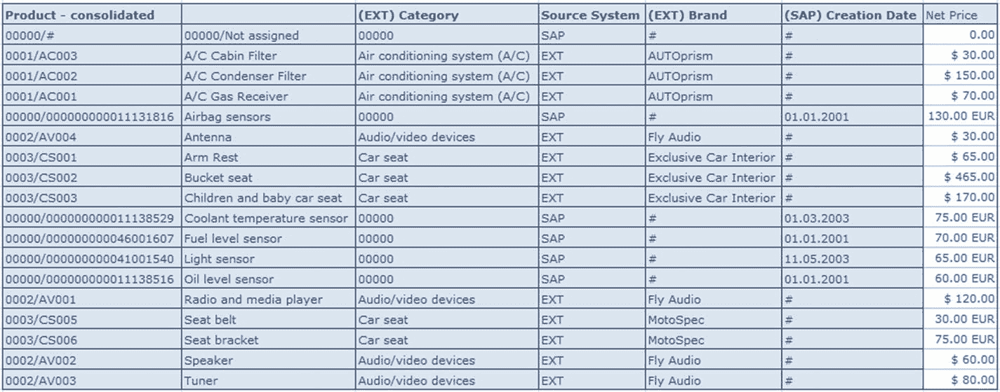

图 6‑20. 适用于 Microsoft Excel 的 Analysis 中 `ZINTMD01` 对象的最终输出

## 将订单事实数据集成到单个计算视图中

对于事实数据，我们将采用与主数据集成相同的方法。这意味着事务数据的集成也将在 HANA 层实现。图 6‑21 展示了将 SAP 和非 SAP 事实数据集成到单个数据集中的详细方法。

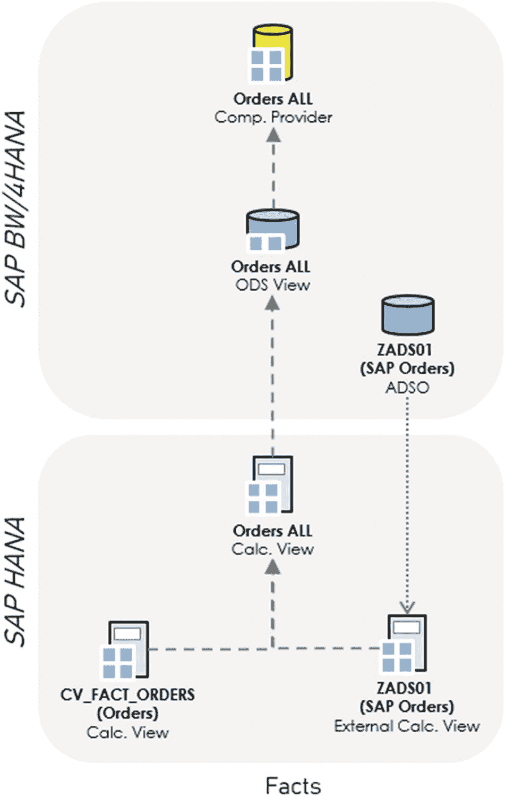

图 6‑21. 集成 SAP 和非 SAP 订单事实数据的架构

图 6‑21 所示的架构与我们为产品主数据实现的架构类似。主要区别在于，对于事实数据，我们将从 ADSO 生成外部计算视图。对于订单数据，我们将利用第 4 章中创建的事务型 `CV_FACT_ORDERS` 计算视图（参见图 4‑14）。

要从 `ZADS01` ADSO 生成计算视图，请在 ADSO 属性中选择 `External Calculation View` 选项（图 6‑22）。

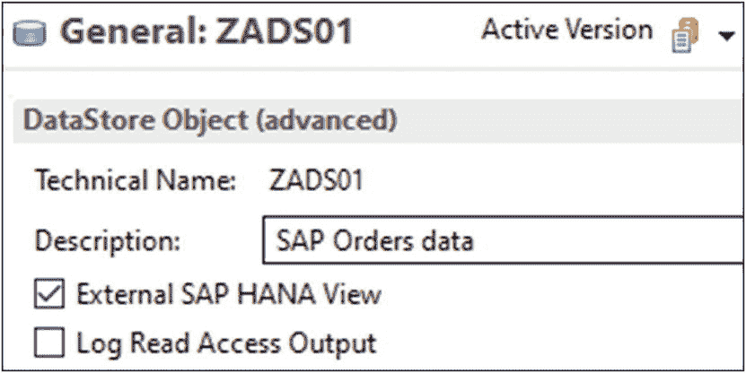

图 6‑22. 为 `ZADS01` ADSO 生成外部 SAP HANA 视图

激活 ADSO 对象后，系统将生成一个与 ADSO 技术名称同名的计算视图。默认情况下，生成的计算视图将位于为 InfoObject 生成的同一位置（`system-local.bw.bw2hana` HANA 包中）。

如图 6‑23 所示，生成的计算视图包含来自原始 ADSO 的字段。如果权限维护得当，运行数据预览后，我们将能够看到该视图的内容。

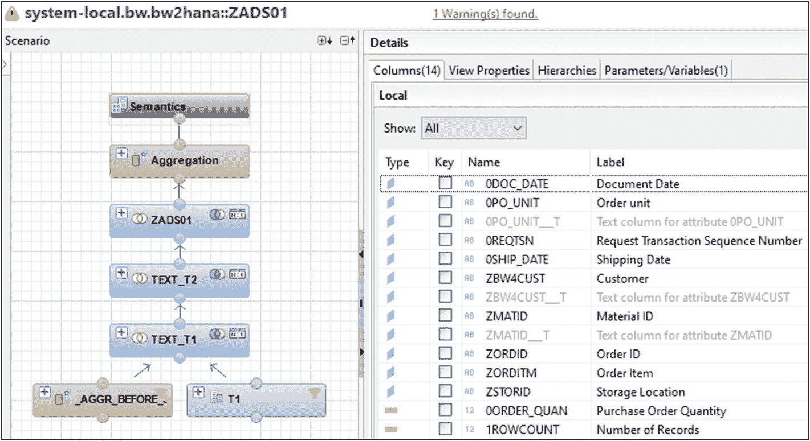

图 6‑23. 为 `ZADS01` ADSO 定义的外部 SAP HANA 视图

如图 6‑24 所示，该视图的输出对应于源 ADSO 的内容（参考图 6‑2）。下一步，我们需要分析如何合并 SAP 和非 SAP 订单数据。

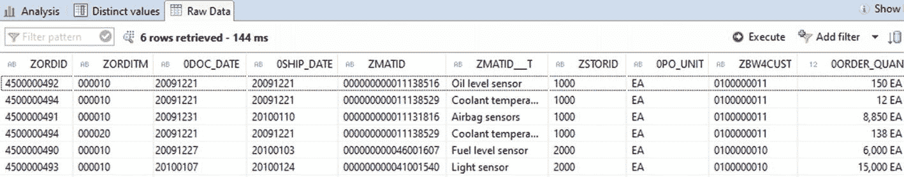

图 6‑24. 为 `ZADS01` ADSO 定义的外部 SAP HANA 视图的输出

为了开始分析，让我们比较一下事务型视图的结构。表 6‑3 比较了 `CV_FACT_ORDERS` 和 `ZADS01` 计算视图的字段和数据类型。

表 6‑3. 订单结构比较（SAP 与非 SAP）

| `CV_FACT_ORDERS` (订单) | | `ZADS01` (SAP 订单) |
| --- | --- | --- |
| 列名 | 键 | 数据类型 | | 属性名 | 键 | 数据类型 |
| --- | --- | --- | --- | --- | --- | --- |
| `ORD_NUMBER` | `X` | `VARCHAR(10)` | ↔︎ | `ZORDID` | `X` | `NVARCHAR(10)` |
| `ORD_ITEM` | `X` | `VARCHAR(3)` | ↔︎ | `ZORDITM` | `X` | `NVARCHAR(6)` |
| `DOC_DATE` | | `DATE` | ↔︎ | `0DOC_DATE` | | `NVARCHAR(8)` |
| `REQ_DATE` | | `DATE` | ↔︎ | 无 |
| `SHIP_DATE` | | `DATE` | ↔︎ | `0SHIP_DATE` | | `NVARCHAR(8)` |
| `DELV_DATE` | | `DATE` | ↔︎ | **无** |
| `STATUS` | | `VARCHAR(3)` | ↔︎ | **无** |
| `CUST_NUMBER` | | `VARCHAR(10)` | ↔︎ | `ZBW4CUST` | | `NVARCHAR(10)` |
| `EMP_NUMBER` | | `VARCHAR(10)` | ↔︎ | **无** |

# 6. 合并事务性数据

基于比较，我们应确定合并数据集的目标结构和数据类型。对于公共字段，需要指定能同时支持源列类型的数据类型。仅存在于单个源中的字段的数据类型可以直接从源列继承。表 6-4 展示了合并后的 `Orders` 视图的目标结构和数据类型。

## 表 6-4. 合并订单计算视图的目标数据类型

| `CV_FACT_ORDERS_ALL` (Orders ALL) |
| :--- |
| 列名 | 键 | 数据类型 |
| --- | --- | --- |
| `ORDER_ID` | `X` | `NVACHAR(10)` |
| `ORDER_ITEM` | `X` | `NVARCHAR(6)` |
| `DOC_DATE` |  | `DATE` |
| `REQ_DATE` |  | `DATE` |
| `SHIP_DATE` |  | `DATE` |
| `DELV_DATE` |  | `DATE` |
| `STATUS` |  | `VARCHAR(3)` |
| `CUST_NUMBER` |  | `NVARCHAR(10)` |
| `EMP_NUMBER` |  | `VARCHAR(10)` |
| `FREE_TEXT` |  | `VARCHAR(100)` |
| `PRODUCT_ID` |  | `NVACHAR(18)` |
| `CATEGORY_ID` |  | `NVARCHAR(5)` |
| `QUANTITY` |  | `DECIMAL(17,2)` |
| `UNIT` |  | `NVARCHAR(3)` |
| `STOR_LOC` |  | `NVARCHAR(4)` |

## 创建合并计算视图

基于表 6-4，我们现在可以实现合并后 `Orders` 数据的计算视图。首先，创建一个新的 `CUBE` 类型计算视图。然后，添加两个投影节点（用于检索 SAP 和非 SAP 的 `Orders` 数据）和一个联合节点，用于将 `Orders` 数据合并到单个数据集中。作为定义联合节点输出结构的参考，我们可以使用表 6-4。图 6-25 展示了事务性 `CV_FACT_ORDERS_ALL` 计算视图中联合节点的目标结构。

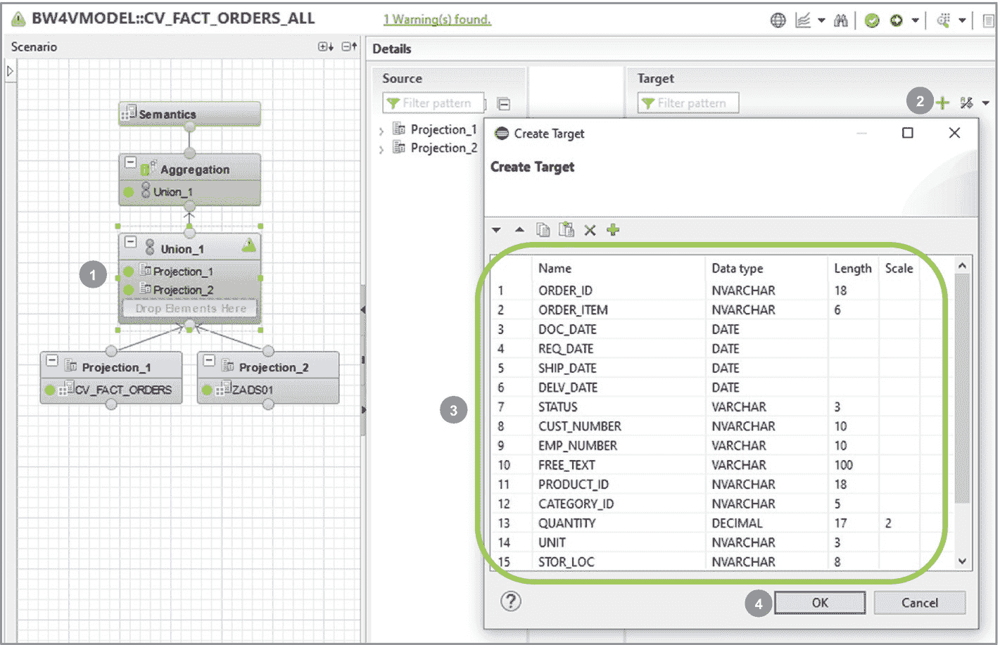

### 图 6-25. 在 `CV_FACT_ORDERS_ALL` 计算视图中定义联合节点的目标结构

如图 6-25 所示，`Projection_1` 从 `CV_FACT_ORDERS` 计算视图检索数据，而 `Projection_2` 使用 `ZADS01` 计算视图作为源。它们都链接到联合节点。在屏幕右侧，可以看到根据表 6-4 中的字段定义创建的联合节点目标结构。创建结构后，我们应该以表 6-3 为参考来定义映射（如图 6-26 所示）。

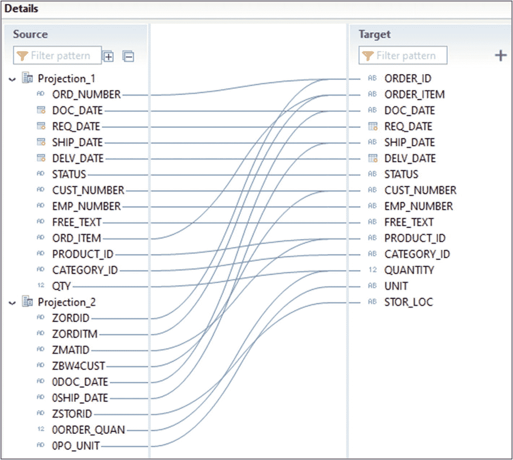

### 图 6-26. 在 `CV_FACT_ORDERS` 计算视图中为联合节点定义字段映射

定义映射时，请确保对于每个目标字段，首先映射数据类型与目标字段相同的字段。这是因为系统将从第一个映射的列继承数据类型。

## 解决数据类型不匹配问题

在联合节点级别应用映射后，您可以将所有字段添加到最终聚合节点的输出中，并验证模型。显然，系统会返回一个错误，如图 6-27 所示。

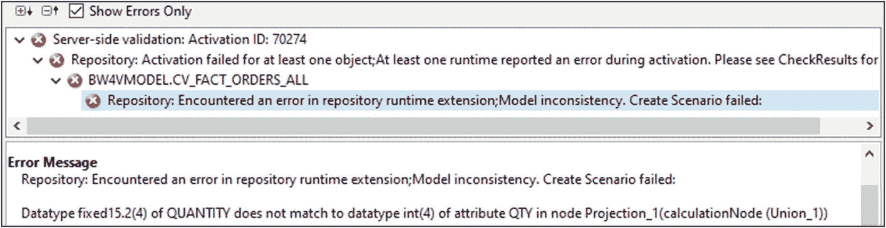

### 图 6-27. 数据类型不匹配的错误消息

每当系统无法将源数据类型隐式转换为目标数据类型时，就会出现类似图 6-27 所示的错误消息。您可能会注意到，当将 `NVARCHAR(8)` 类型的 `0DOC_DATE` 映射到 `DATE` 类型的目标列 `DOC_DATE` 时，系统能够隐式转换数据类型。然而，对于 `QTY` 列，系统无法自动将 `INTEGER` 数据类型转换为目标 `DECIMAL` 数据类型。要解决此问题，我们应创建一个计算列来显式地将 `INTEGER` 类型转换为 `DECIMAL` 数据类型。

### 创建计算列

要创建计算列，请单击 `Projection_1` 节点，在“输出”部分右键单击“计算列”文件夹，然后选择“新建”。

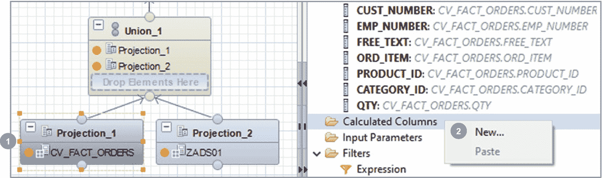

### 图 6-28. 在 `CV_FACT_ORDERS_ALL` 计算视图中为 `Quantity` 字段创建计算列

选择“新建”选项后，系统将打开计算列编辑器。您可以在此处指定要转换的列和目标数据类型。

创建计算列时，首先需要提供其名称（1）。该名称应唯一，意味着不应存在任何同名列。在本例中，我将其命名为 `CA_QTY`（图 6-29）。然后，您需要提供目标列的数据类型（2），此处为 `DECIMAL(17,2)`。要将列转换为 `DECIMAL`，我们无需应用任何转换函数，只需提供要转换的列的名称（3）。我们可以单击“验证语法”按钮以确保表达式有效，然后继续单击“确定”按钮（4）。

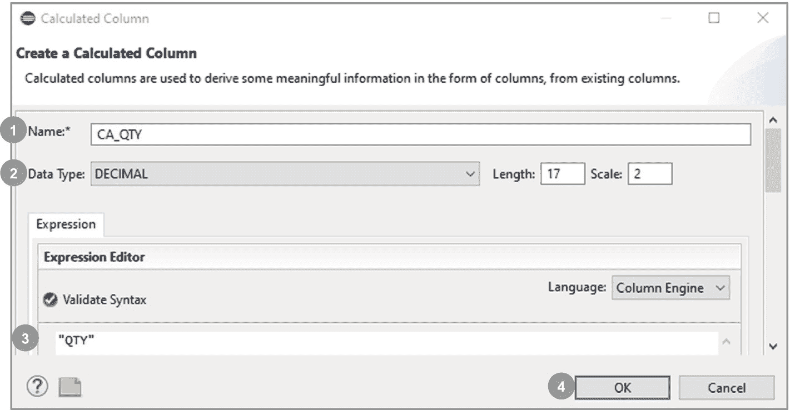

### 图 6-29. 在 `CV_FACT_ORDERS_ALL` 计算视图中指定 `CA_QTY` 计算列的定义

## 调整联合节点映射

创建计算列后，我们应该调整联合节点中的映射。我们可以通过右键单击目标列并选择“管理映射”选项来更改映射（见图 6-30）。

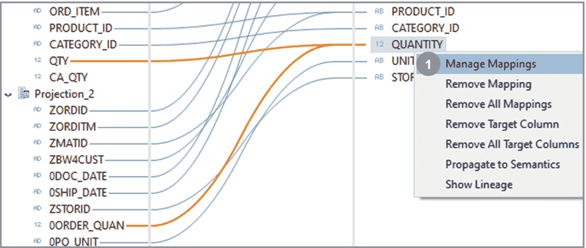

### 图 6-30. 打开 `CV_FACT_ORDERS_ALL` 计算视图中 `Quantity` 列的“管理映射”窗口

选择“管理映射”选项后，将打开新窗口（图 6-31）。

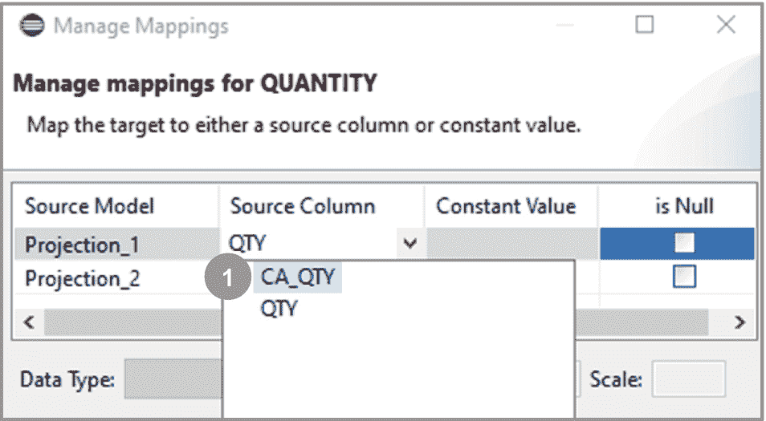

### 图 6-31. `CV_FACT_ORDERS_ALL` 计算视图中 `Quantity` 列的映射管理

在“管理映射”窗口中，我们可以用新创建的 `CA_QTY` 计算列替换 `QTY` 列（图 6-31）。确认映射后，您可以验证该视图，错误应该不再出现。

## 其他映射调整

我们还需要调整另外两个映射。首先，我们需要确保事务数据对于 `PRODUCT_ID` 和 `CATEGORY_ID` 的组合具有相同的值，这两个字段是合并后的产品维度的主键。基于这些关键字段值，我们稍后将与产品 Open ODS 视图对象建立关联；因此，我们需要确保键值匹配。这就是为什么我们需要用 `00000` 值替换 `CATEGORY_ID` 字段中的 `NULL` 值，正如我们在产品计算视图中所做的那样（遵循图 6-15 所示的相同配置）。

第二个调整可应用于 `UNIT` 列。对于非 SAP 数据，该列同样未进行维护，但由于在我们的场景中，订单数量始终指向物料个数，因此我们可以将 `EA`（个）作为常量值进行分配（图 6-32）。

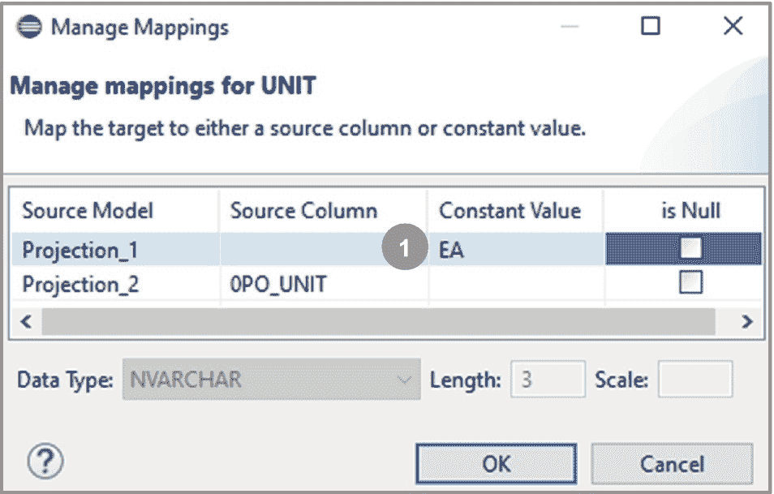

### 图 6-32. 在 `CV_FACT_ORDERS_ALL` 计算视图中管理 `UNIT` 列的映射

## 完成与验证

通过确保所有记录的单位值有效，我们就能在开放 ODS 视图层将 `UNIT` 列作为订单数量关键指标的单位元素使用。这样一来，用户在报表中就能看到带单位的关键指标值。完成所有调整后，我们可以激活计算视图并运行数据预览。

数据预览（图 6-33）返回了订单事务数据的合并视图。现在我们可以基于合并后的数据集构建事实开放 ODS 视图对象。

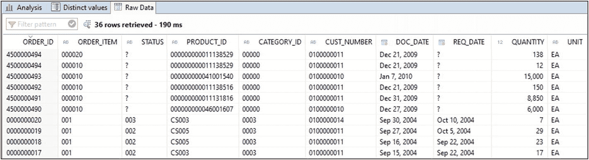
图 6-33. `CV_FACT_ORDERS_ALL`计算视图的数据预览

## 为订单创建合并事实开放 ODS 视图

在订单数据的合并计算视图（`CV_FACT_ORDERS_ALL`）之上，我们将创建一个事实开放 ODS 视图对象。这需要遵循与主数据开放 ODS 视图相同的步骤，现在开始为订单创建事实开放 ODS 视图。

图 6-34 展示了订单合并非开放事实 ODS 视图的初始设置。订单数据的主键由`ORDER_ID`和`ORDER_ITEM`列组成，因此它们被添加到`特征（键）`区域（1）。底层计算视图包含一个度量，即`QUANTITY`，该度量被添加到`关键指标`区域（2）。`UNIT`列放入专用的`单位`文件夹（3）。剩余字段分配到`特征`区域（4）。

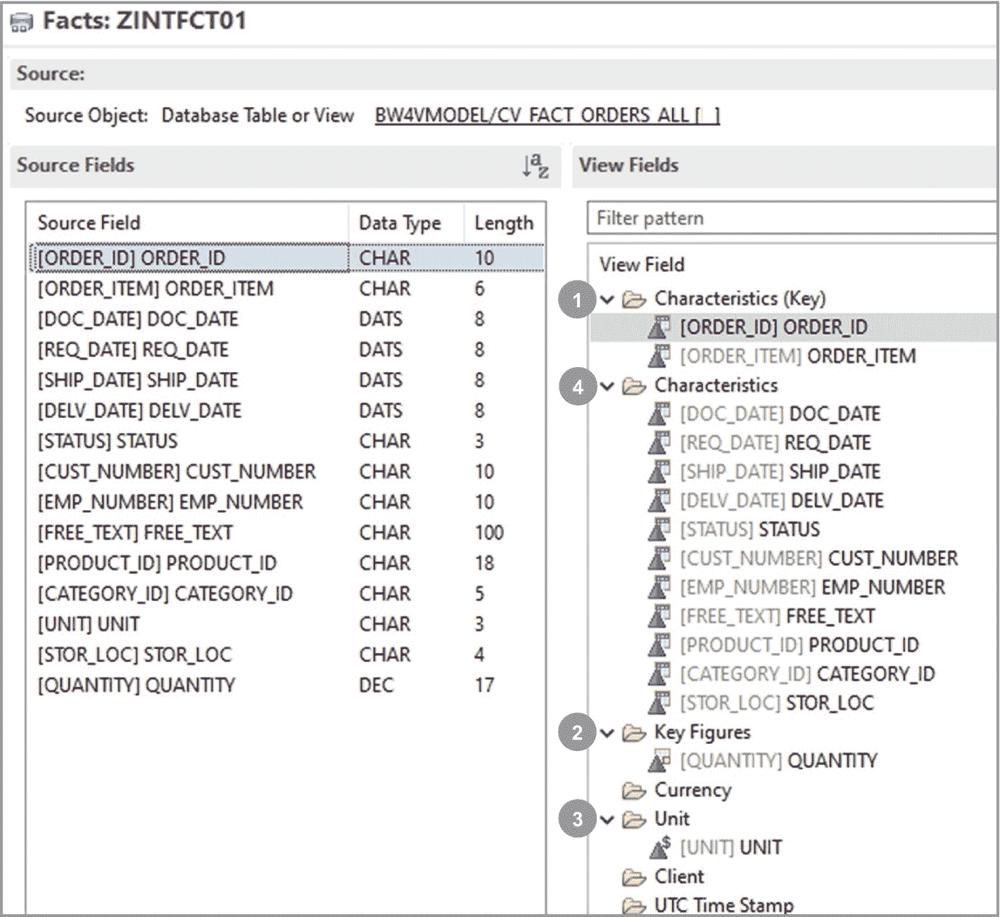
图 6-34. 合并订单（`ZINTFCT01`）开放 ODS 视图的初始输出结构

在字段初步分配到各个文件夹之后，我们现在可以实施额外的增强。我们的目标是通过与主数据对象建立关联来构建星型模式模型。我们数据模型中的主要主数据对象是上一节创建的产品（`ZINTMD01`）维度。现在让我们在订单事务数据与产品维度之间建立关联（图 6-35）。

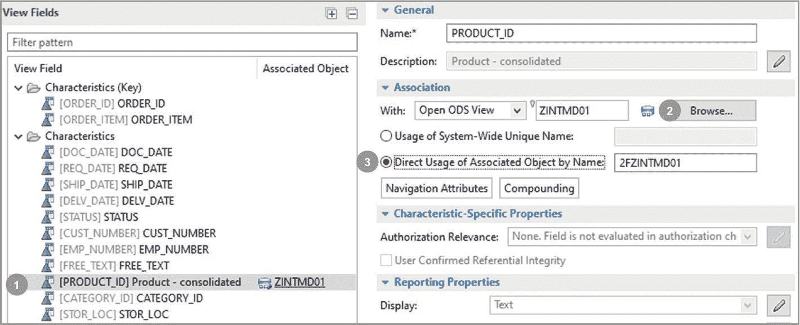
图 6-35. `ZINTFCT01`开放 ODS 视图对象中产品字段的关联

`PRODUCT_ID`字段被设置为`ZINTMD01`产品（全部）维度的代表性关键字段。要与`ZINTMD01`建立关联，我们应从`ZINTFCT01`开放 ODS 视图的视图字段部分选择`PRODUCT_ID`字段（1）。然后需要点击产品（`ZINTMD01`）维度的浏览按钮（2），并设置直接关联选项（3）。如您所知，产品维度由基于`PRODUCT_ID`和`CATEGORY_ID`的复合键组成。要正确分配产品维度，我们需要在关联中使用这两列。如上一节所述，复合键应始终包含关联。这就是为什么在定义产品维度时，我们将`ZTXT02`开放 ODS 视图分配给`CATEGORY_ID`（图 6-19）。为了完成与产品维度的关联，我们首先需要将`ZTXT02`开放 ODS 视图分配给`CATEGORY_ID`字段（图 6-36）。

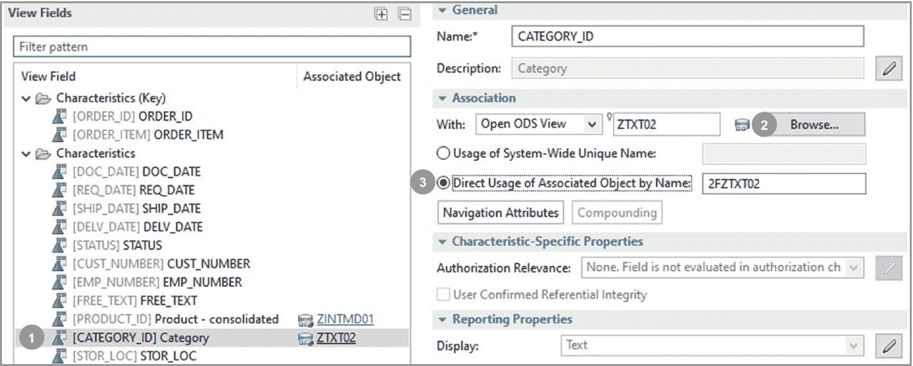
图 6-36. `ZINTFCT01`开放 ODS 视图对象中类别字段的关联

一旦我们为`CATEGORY_ID`字段建立了关联，就可以完成与产品（`ZINTMD01`）维度的关联（参见图 6-37）。

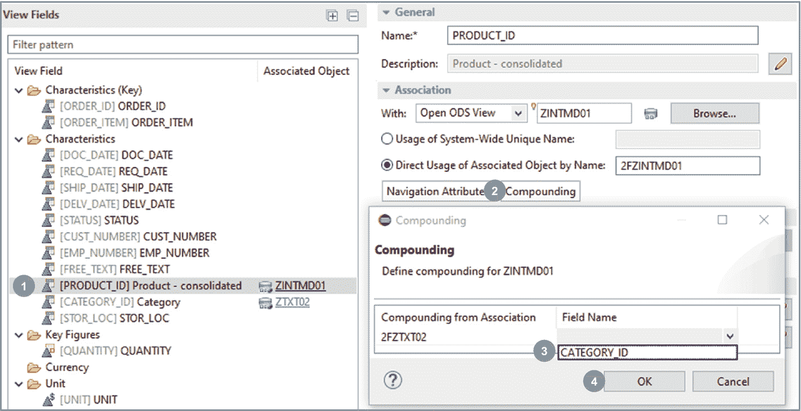
图 6-37. 在`ZINTFCT01`开放 ODS 视图对象中定义产品字段的复合

要完成与产品维度的关联，选择`PRODUCT_ID`字段（1）并点击`复合`按钮（2）。在`复合`窗口中，我们可以指定复合的目标字段。在下拉列表中，我们只会看到一个可用列（3）。如果不在`CATEGORY_ID`字段和`ZTXT02`开放 ODS 视图对象之间建立关联，下拉列表将是空的，我们也就无法应用关联。配置完关联后，我们可以启用产品维度的导航属性（图 6-38）。

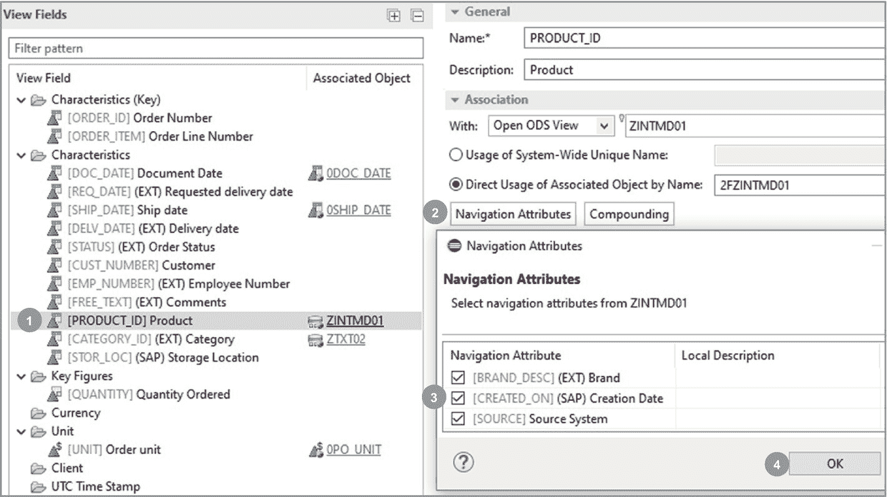
图 6-38. 为 ZINTFCT01 Open ODS 视图对象选择导航属性

要启用产品导航属性，请选中`PRODUCT_ID`列（1），然后在“属性”部分点击`导航属性`按钮（2）。在`导航属性`窗口中，选择相应属性（3），并通过点击`确定`按钮（4）来确认操作。

### 配置最终结构与关联

为了完成`ZINTFCT01` Open ODS 视图对象的配置，我们应该调整描述，使其对最终用户有意义。此外，我们可以为其他一些字段应用关联，如图 6-39 所示。

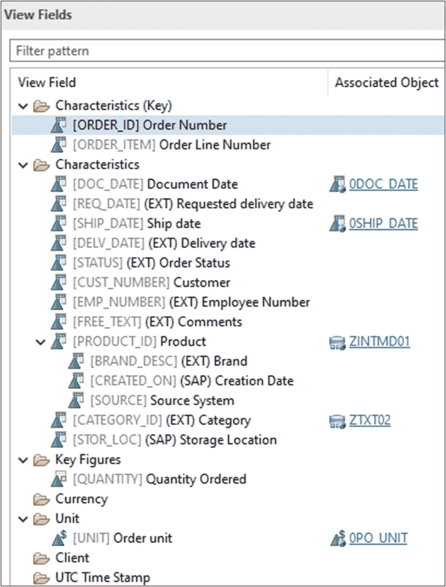
图 6-39. 订单（`ZINTFCT01`）Open ODS 视图的最终输出结构

如图 6-39 所示，所有字段的描述都已调整。末尾的“EXT”和“SAP”描述前缀使我们能够轻松识别该字段是仅特定于外部数据源，还是仅特定于 SAP 数据。字段`DOC_DATE`、`SHIP_DATE`和`UNIT`已分别与标准的 SAP 信息对象`0DOC_DATE`、`0SHIP_DATE`和`0PO_UNIT`关联。

### 为度量设置单位

将要执行的最后一项增强是为“已订购数量”关键值设置单位属性（图 6-40）。

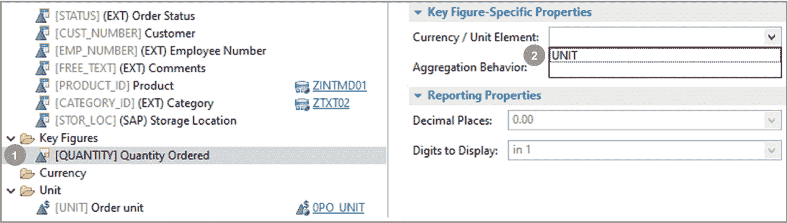
图 6-40. 在 ZINTFCT01 Open ODS 视图对象中为“已订购数量”字段分配单位元素

打开`QUANTITY`字段的属性时（1），我们可以为度量指定单位元素（2）。从下拉列表中，我们将能够选择已分配给`单位`部分的字段。如果该部分没有字段，则下拉列表将为空。激活`ZINTFCT01` Open ODS 视图对象后，我们可以验证结果（图 6-41）。

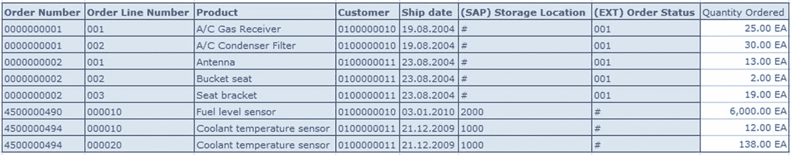
图 6-41. 在 Microsoft Excel 分析工具中 `ZINTFCT01` 对象的最终输出

如图 6-41 所示，SAP 和非 SAP 订单现已合并到一个数据集中。得益于与产品维度的正确关联，用户能够看到产品名称而非编号。列标题中的前缀有助于我们理解该列是特定于 SAP 还是非 SAP。“已订购数量”度量显示带有计量单位的数量值。

## 为合并后的 Open ODS 视图创建复合提供者

为了利用订单数据模型的导航属性，我们将在订单 ALL（`ZINTFCT01`）Open ODS 视图对象之上创建一个最终的 `CompositeProvider` 对象。图 6-42 展示了订单（`ZCPINTFCT01`）`CompositeProvider` 对象的结构。

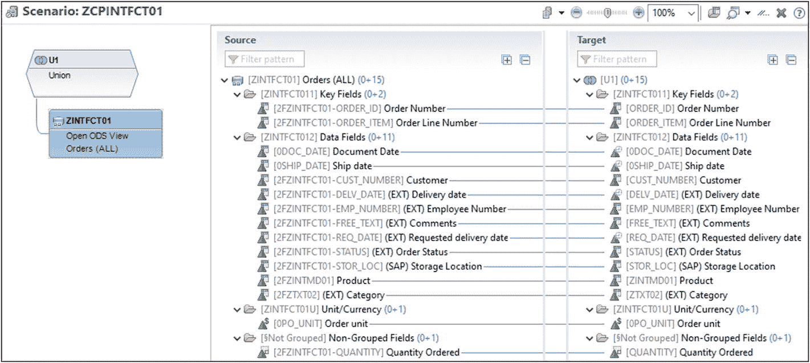
图 6-42. 定义 `ZCPINTFCT01` `CompositeProvider` 对象的结构

### 映射与导航属性

`ZCPINTFCT01` `CompositeProvider` 对象的数据源来自上一节创建的订单（ALL）Open ODS 视图对象。所有字段都已从源映射到目标。要显示可用的导航属性，请在`源`部分右键单击 Open ODS 视图图标，然后选择`显示未分配的导航属性`（图 6-43）。

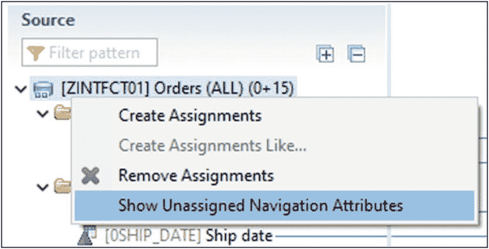
图 6-43. `ZCPINTFCT01` `CompositeProvider` 对象的“显示未分配的导航属性”菜单项

选择图 6-43 所示的选项后，我们将能够将产品属性添加到 `CompositeProvider` 对象的输出中。或者，我们也可以直接从 `CompositeProvider` 对象的“输出”选项卡中启用导航属性（参见图 4-23 作为参考）。图 6-44 展示了包含产品导航属性的 `ZCPINTFCT01` `CompositeProvider` 对象的最终映射。

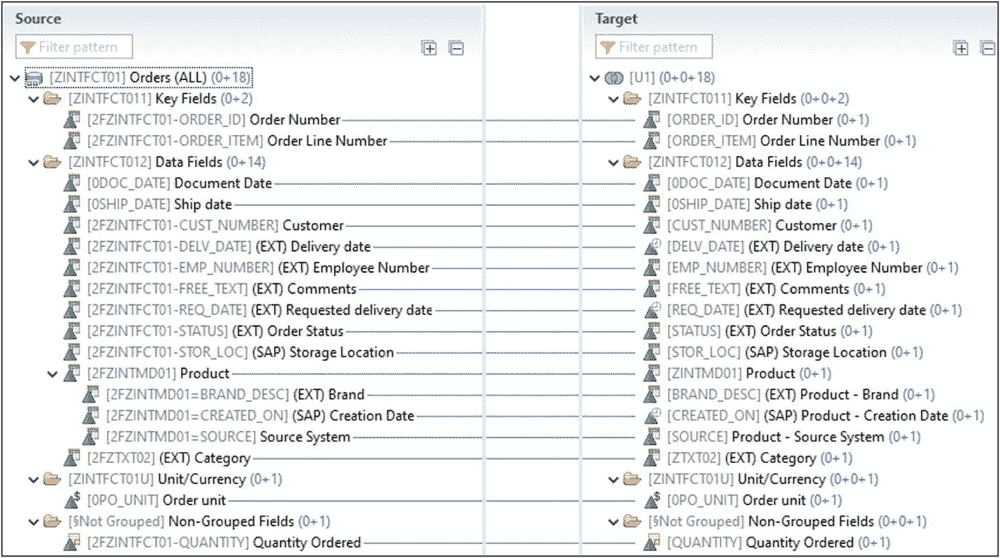
图 6-44. `ZCPINTFCT01` `CompositeProvider` 对象的最终结构

图 6-44 展示了 `ZCPINTFCT01` `CompositeProvider` 对象的目标映射。对于导航属性描述，最好包含关于该列检索自哪个源对象的信息。这就是调整产品导航属性描述的原因；例如，`(EXT) Brand` 被更改为 `(EXT) Product – Brand`。这将帮助最终用户识别此信息来自产品维度的主数据，而非事务数据。激活 `CompositeProvider` 对象后，我们可以创建最终查询（图 6-45）。

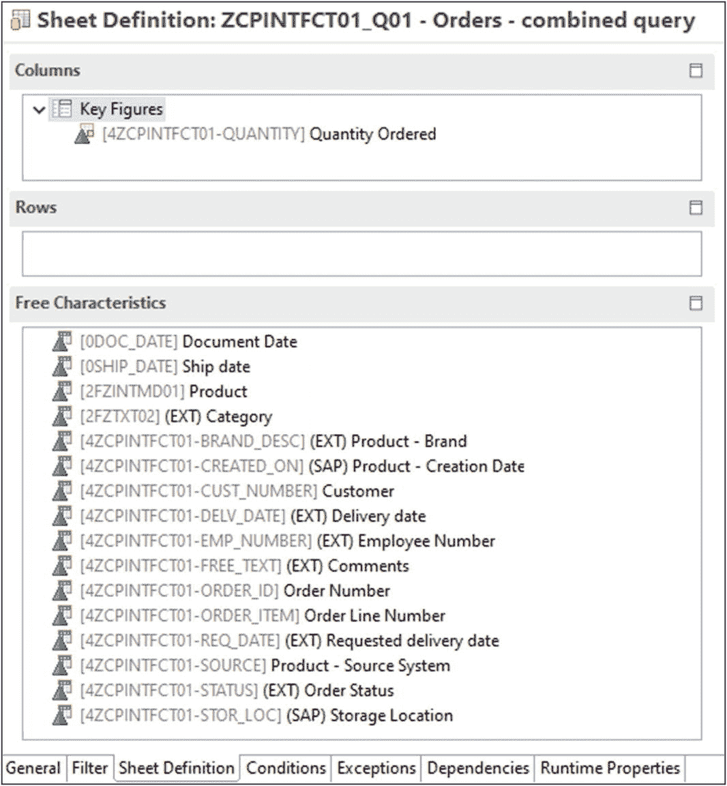

图 6-45. `ZCPINTFCT01_Q01` 查询的定义

在最终查询中，我们定义了报表的目标结构。“已订购数量”度量已添加到`列`部分。所有属性都已添加到`自由特征`部分（图 6-45）。最后，为了验证报表，我们将在 Microsoft Excel 分析工具中打开它。

首先，当我们打开报表时，可以看到由于我们为描述添加了前缀，字段已被排序（图 6-46）。最终用户可以轻松识别与一个或另一个数据源相关的字段。两个数据源共有的字段显示在列表底部，不带前缀。为了验证报表的内容，我们可以将选定的字段添加到交叉表的输出中（图 6-47）。

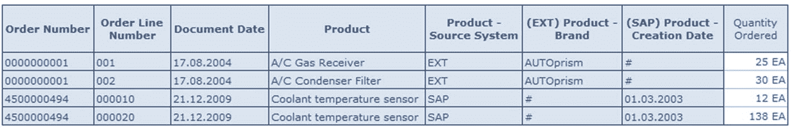

图 6-47. `ZCPINTFCT01_Q01` 查询在 Microsoft Excel 分析工具中的输出

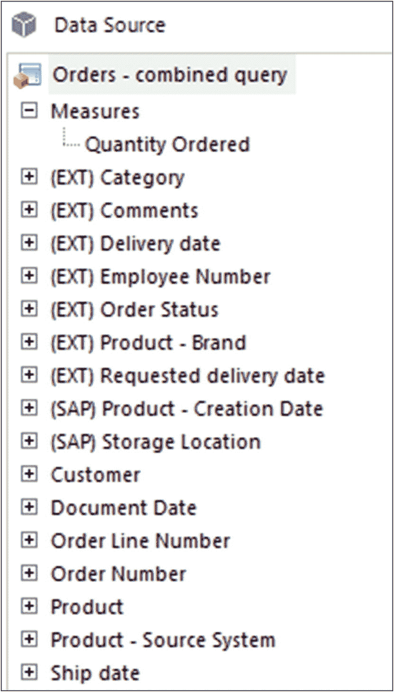

图 6-46. `ZCPINTFCT01_Q01` 查询在 Microsoft Excel 分析工具中的字段显示列表

图 6-47 展示了 `ZCPINTFCT01_Q01` 针对选定字段的输出结果。仅特定于特定数据源的字段在其标题名称中包含源系统前缀。这告诉我们，对于给定列，数据将仅对该特定系统可用。如果值不可用，将显示井号（`#`）符号。此外，“产品 - 源系统”列有助于识别或过滤来自特定源系统的产品。此报表使我们能够对公司内的所有订单进行详细分析，无论订单是来自 SAP 还是外部系统。

## 总结

在本章中，我们展示了如何将 SAP 和非 SAP 数据整合到一个单一的集成星型模式数据模型中。我们利用 SAP HANA 平台构建了一个虚拟层，用于合并事务数据和主数据集。在完成整个场景后，您还应该注意到，在实际实施解决方案之前，良好的技术分析起着多么重要的作用。

在 BW/4HANA 平台上集成多个系统可以为业务用户带来许多新的见解，并使我们能够实现全球报告解决方案，同时确保从单一系统维护适当的安全模型。

与传统的旧版 BW 系统相比，最新版本的 SAP BW/4HANA 平台引入的新特性和灵活性显著简化了外部数据的集成。