# 2. 建模概念

在本章中，我将描述 SAP BW/4HANA 引入的新建模方法。这个新的 SAP 商务仓库应用程序不仅显著增强了传统 SAP BW 的能力，而且从根本上革新了建模方法。这些知识将是理解新的数据仓库功能、自底向上建模方法以及虚拟数据建模概念的关键。

## SAP BW/4HANA 建模概念概述

凭借新的功能和工件，BW/4HANA 实现了基于分层可扩展架构++（LSA++）的现代化架构。这种新架构更精简、更简单，并且实施速度更快。此外，它支持虚拟化方法，这意味着它可能也更经济高效。

LSA++是传统 LSA 的扩展，传统 LSA 适用于 SAP BW 系统。除了减少建模对象的数量外，LSA++还定义了构建数据仓库的全新标准。图 2-1 展示了 LSA 和 LSA++方法之间的差异。

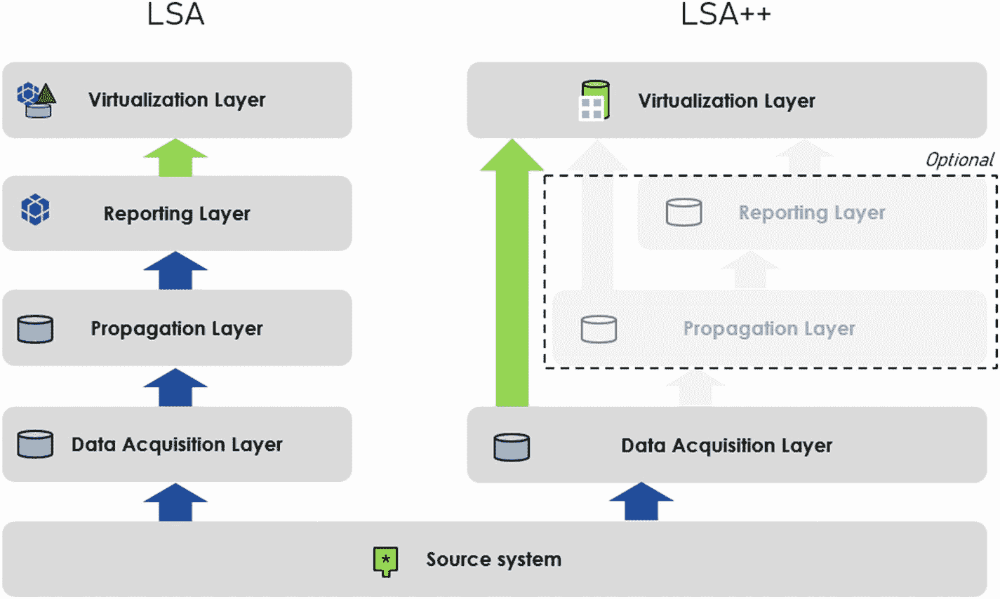

*图 2-1. LSA 与 LSA++的差异*

如图 2-1 所示，传统的 LSA 基于多个层。在每个层上，数据都被物理存储，这使得 LSA 架构具有高度的数据冗余。由于需要创建大量对象，维护此类架构既复杂又不灵活。缺乏灵活性、高维护量和开发工作量都显著增加了数据仓库的成本。高度的数据冗余和自上而下的建模方法都导致了单体架构，这种架构无法作为敏捷软件开发方法的一部分使用。

SAP BW/4HANA 环境引入了新的、现代化的 LSA++架构，该架构高度关注虚拟对象。如图 2-1 所示，无需创建多个暂存层并将数据从一个层复制到另一个层。现在可以直接在数据采集层之上构建虚拟数据集市。如果需要一个以上的暂存层，`CompositeProvider`可以跨层虚拟地组合数据。另一个虚拟化能力是在物理上驻留在不同数据库中的虚拟表之上创建报表。这意味着无需将外部数据加载到 SAP 数据库即可进行报表生成（当然，对于非常大的数据集，这可能会导致性能问题）。

`ADSO`支持的持久层可以使用`InfoObject`定义，也可以使用基于字段的建模来定义，后者可以显著加速开发。得益于此方法，开发人员可以快速创建持久层，并在需要时，稍后通过在`CompositeProvider`级别关联主数据对象来丰富模型。

SAP BW/4HANA 和新 LSA++架构提供了更大的灵活性，并显著减少了维护、数据存储和开发时间。在本章中，我将介绍 SAP BW/4HANA 2.0 中可用的一般建模概念。

> **注意**
>
> 本章描述的建模概念将重点介绍 BW/4HANA 2.0 的功能和特性。请注意，对于所有场景，并没有单一的推荐架构。也不可能涵盖所有可能的方法；因此，我将展示我认为常见的方法。对这些概念的讨论将在本书后续章节中通过示例进行说明。

## 传统数据模型

传统的 BW 建模遵循自上而下的方法，在创建任何模型之前，需要为每一个输出字段创建一个`InfoObject`。图 2-2 展示了在 BW/4HANA 中创建经典 EDW 的高级方法。

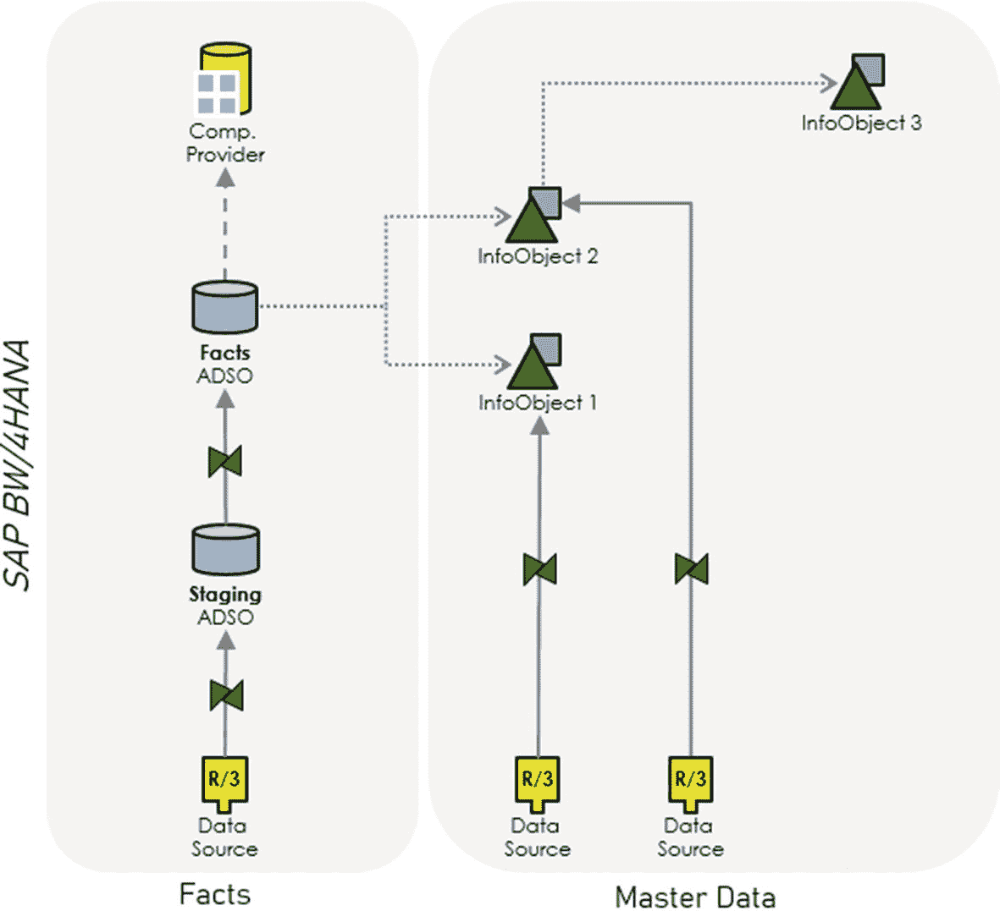

*图 2-2. BW/4HANA 经典建模概念*

图 2-2 展示了一个经典 BW 建模方法的简化场景。该图也可作为比较经典方法与新敏捷建模概念的参考。

在经典建模方法中，在创建事务性`ADSO`之前，我们需要首先定义属性、关键指标和主数据`InfoObject`。在图 2-2 中，您可能会注意到`InfoObject 2`和`InfoObject 3`之间的链接。这是因为主数据`InfoObject`由属性和导航属性组成。在我们能够实现数据模型的草稿版本之前，我们需要首先以`InfoObject`的形式创建所有基本构建块。如图 2-2 所示，事实`ADSO`完全基于`InfoObject`建模。图中的实线表示来自数据源的数据被加载到目标对象中。在`ADSO`之上是一个`CompositeProvider`，它允许我们组合来自多个提供者的数据。虽然我们可以直接在`ADSO`上创建 BW 查询对象，但最好还是利用`CompositeProvider`，它提供了额外的功能，并允许我们包含其他`InfoProvider`。

经典的 BW/4HANA 方法导致开发周期长和维护工作量大。尽管有其缺点，但从我的角度来看，经典方法仍然是实现 SAP 数据的企业数据仓库的基本方式。在这种方法中，数据模型依赖于稳定且可重用的结构。数据持久性确保了高性能的解决方案。除了适配 SAP 业务内容，我们还可以利用预定义的数据模型。我们可以使用它们来快速启动交付 EDW 解决方案，并将其作为进一步开发的指南。

在本节的下一部分，我将描述一些新的建模概念。

> **注意**
>
> 请注意，在接下来的新建模概念的讨论中，HANA 物理表和虚拟表可以以相同的方式使用（尽管有时图中只展示一种表类型）。

### 虚拟数据供应

我要介绍的第一个概念是基于 SAP HANA 工件进行报表。可能存在这样一种场景：我们只想在 BW/4HANA 系统中启用 SAP HANA 物理表或虚拟表的结构和内容。在图 2-3 中，你可以看到直接从 HANA 表进行数据供应的概念。

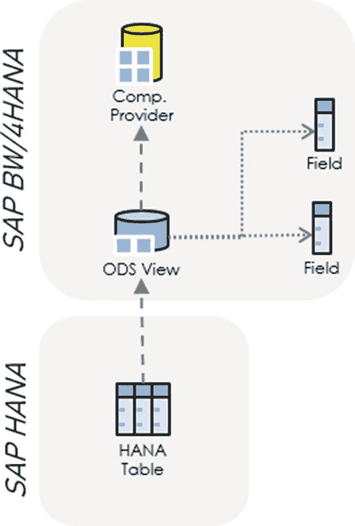

图 2-3. BW/4HANA 表数据供应概念

图 2-3 所示的概念展示了我们如何通过 BW/4HANA 层暴露 HANA 表。在这种方法中，`Open ODS View` 对象作为 `CompositeProvider` 和 HANA 表之间的虚拟 BW/4HANA 对象。它们可以被 `CompositeProvider` 消费，以提供来自底层 HANA 表的数据，而无需任何数据持久化。此概念利用了基于字段的方法，因此我们无需创建任何 `InfoObject`。所有字段都可以简单地从底层表结构拖拽到 `Open ODS View` 对象的目标结构中。然后，`Open ODS View` 对象可以被 `CompositeProvider` 消费（我们也可以选择直接在 `Open ODS View` 对象之上创建查询）。图中的虚线表示数据流是完全虚拟化的，因此不需要数据加载。此类需求在数据抽取、临时数据分析或原型设计场景中非常常见。

下一个概念与图 2-3 所示类似；然而，这里我们使用一个虚拟表作为源，该虚拟表物理上驻留在 HANA 数据库之外（例如，在 Microsoft SQL 或 Oracle 数据库中）。图 2-4 描述了虚拟表数据供应的概念。

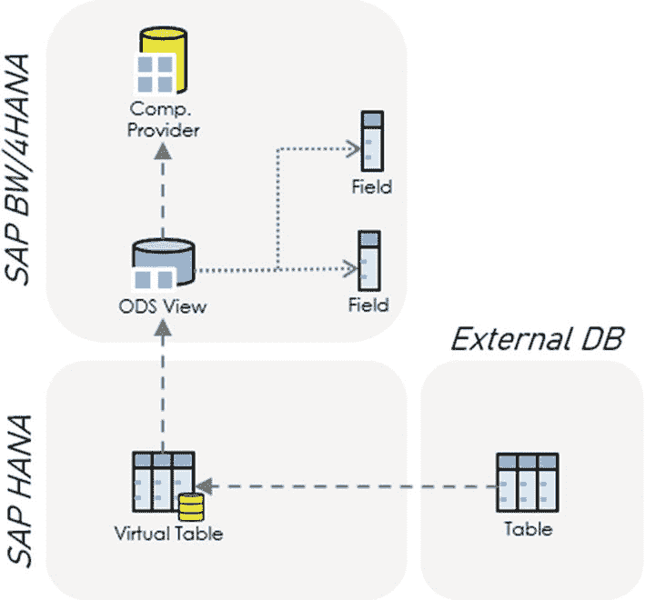

图 2-4. BW/4HANA 虚拟表数据供应概念

使用 `Smart Data Access (SDA)`，我们可以创建一个连接到外部数据库的远程源。一旦配置好远程源，我们将能够在 HANA 系统中创建一个虚拟表，其结构与驻留在外部数据库中的源表相同。`Open ODS View` 对象使我们能够直接从 HANA 表和虚拟表获取数据。在图 2-4 所示的图表中，`Open ODS View` 对象是在虚拟表之上创建的。

在需要对源表应用一些额外的数据处理，或者创建结合了多个表（包括虚拟表和普通表）的数据集时，我们可以利用计算视图的功能（见图 2-5）。

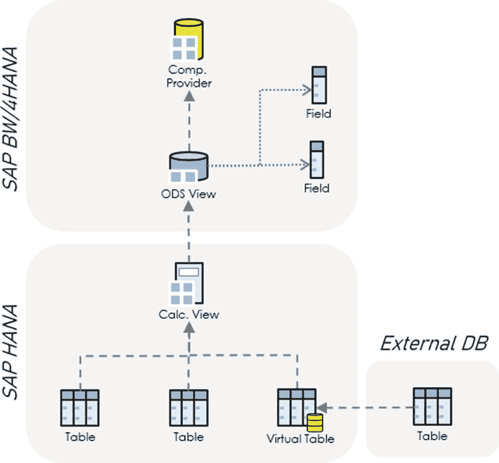

图 2-5. BW/4HANA 计算视图数据供应概念

图 2-5 所示的变体与之前的类似。区别仅在于 SAP HANA 层面，即在三个表之上添加了一个计算视图。该计算视图结合了 HANA 表和虚拟表的数据。BW/4HANA 部分与之前的示例保持一致，这意味着数据通过基于字段的 `Open ODS View` 对象从计算视图传递到 `CompositeProvider` 对象。

> **注意：** 可以直接添加计算视图作为 `CompositeProvider` 的源。但是，在创建 `Open ODS View` 对象时，我们同时也定义了一个可重用的逻辑对象，包含所有属性、结构或与主数据对象的关联。因此，在每次将特定计算视图用作 `CompositeProvider` 对象的源时，我们无需重复应用所有这些设置。

### 基于字段的数据模型

现在让我们考虑一个更复杂的场景：需求是基于 HANA 表的数据在 BW/4HANA 中创建一个星型连接数据模型。图 2-6 展示了一个简化的星型连接数据模型，我将把它作为参考，用于可视化 BW/4HANA 的建模方法。

## 虚拟模型（星型连接）

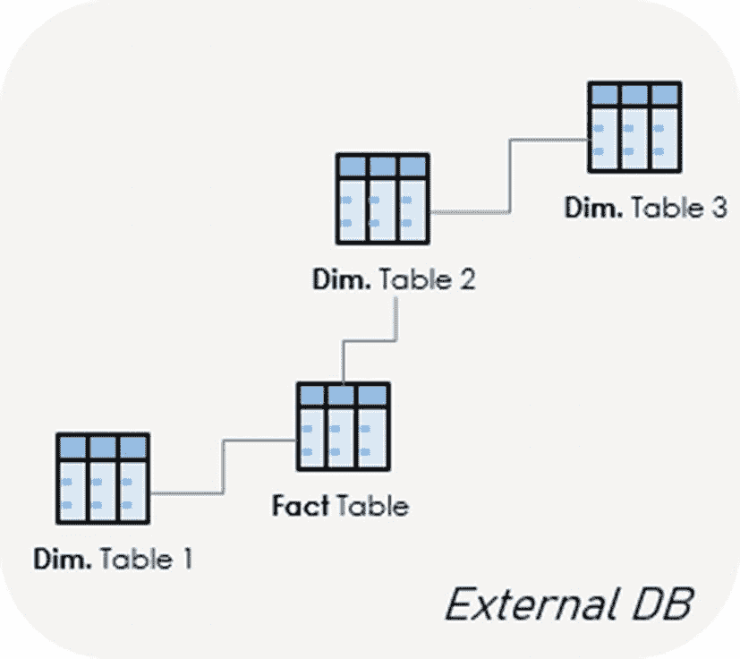

星型连接模式由一个中心事实表和多个以规范化形式连接的维度表组成。为了在 BW/4HANA 中模拟相同的行为，我们可以再次利用 `Open ODS View` 对象。在创建 `Open ODS View` 对象时，我们可以选择指明底层对象的类型。我们可以将语义定义为 `Facts`、`Master Data` 或 `Text`。图 2-7 展示了在 BW/4HANA 中基于 HANA 表实现虚拟模型的方法（参见图 2-6）。

如图 2-7 所示，事实表和维度表的数据流是相似的。对于事实表，会创建一个数据类别为 `CUBE` 的计算视图；而对于维度表，则创建一个类别为 `DIMENSION` 的视图。当利用直接驻留在 HANA 数据库中的物理表时，也可以采用相同的方法。

> **注意：** `Open ODS View` 可以直接消费虚拟表，因此不强制创建计算视图作为中间层。尽管如此，我仍然建议创建计算视图，因为如果将来需要实现额外的格式化、转换数据类型或添加计算列（这些是非常常见的需求），这将为您带来灵活性。

对于 `Open ODS View` 对象，还有两种语义类型被使用：`Facts` 用于事实表，`Master Data` 用于三个维度表。您可能会注意到 `Open ODS View 2` 链接到了 `Open ODS View 3`。这用于可视化表示 `Open ODS View 2` 的字段与 `Open ODS View 3` 主数据存在关联。为了更好地理解这个概念，您可以将它们视为带属性的 `InfoObject`。您创建一个主 `InfoObject` 并指定一个 `InfoObject` 列表作为导航属性。唯一的区别是，我们使用的是 `Open ODS View`，而不是 `InfoObject`。`Facts Open ODS View` 与 `Master Data Open ODS View 1` 和 `2` 之间的虚线也描绘了事实表字段与 `Master Data` 的关联。最终的 `CompositeProvider` 可能仍然包含原始字段；但是，这些字段将与 `Open ODS View` 主数据对象建立关联。这种方法使您能够创建无需数据持久化的星型连接数据模型。

图 2-7 中描述的建模变体是完全虚拟化的，可能不适用于复杂的数据模型或需要处理大量数据量的场景。在虚拟数据模型中，所有操作都是即时执行的，这显然会导致性能下降。此外，虚拟表从外部数据库查询数据，这同样效率不高。

## 开放式 ODS 视图与持久化模型

如果您开发了基于 `Open ODS View` 对象的虚拟数据模型，并且意识到性能不够理想，您可以为选定的 `Open ODS View` 对象（`Facts` 和/或 `Master Data`）自动生成持久化层。图 2-8 展示了基于持久化 `Open ODS View` 的数据模型架构。

开放式 ODS 视图提供了生成数据流的功能。借助源对象与开放式 ODS 视图对象之间的这一功能，系统会自动生成数据源和 ADSO 以及包含 DTP 的转换。当你将图 2-7 与图 2-8 中的架构进行比较时，你会注意到在计算视图与开放式 ODS 视图对象之间多了两个对象。实线表示来自数据源的数据通过转换和 DTP 物理加载到 ADSO 对象中。当然，在从性能优化的角度分析模型时，你可以决定哪些开放式 ODS 视图对象需要物理数据存储。你无需在虚拟模型和持久化模型之间做出选择，但可以有选择地为某些开放式 ODS 视图创建持久化的 ADSO 层。通常，由于高数据量（数百万条记录），性能主要受事务处理表的影响。在这种情况下，你可以为事实表生成 ADSO，同时保持主数据模型为虚拟模型。

## 混合数据模型

下一种建模变体是多种建模对象的组合。正如在 BW/4HANA 中已经提到的，我们不必强制选择单一的数据模型实现方式。BW/4HANA 支持混合建模概念，允许我们在单个数据模型中同时利用信息对象、开放式 ODS 视图对象以及基于字段的方法。当新创建的数据模型中的部分维度与 SAP 主数据一致时，可以采用混合方法。例如，在生产型企业中，工厂命名规范可能在所有系统中都是标准化的。如果是这种情况，那么在 BW/4HANA 中创建新模型时，就没有必要创建和存储相同的主数据；我们可以改用标准的`0PLANT`信息对象。通过采用现有的信息对象，我们可以利用其所有功能，如属性、导航属性、层次结构或授权能力（针对与授权相关的信息对象）。此外，通过尽可能采用现有的信息对象，我们既能确保完整性和一致性，又能避免冗余并减少开发和维护工作量。图 2-9 展示了 BW/4HANA 中的混合建模方法。

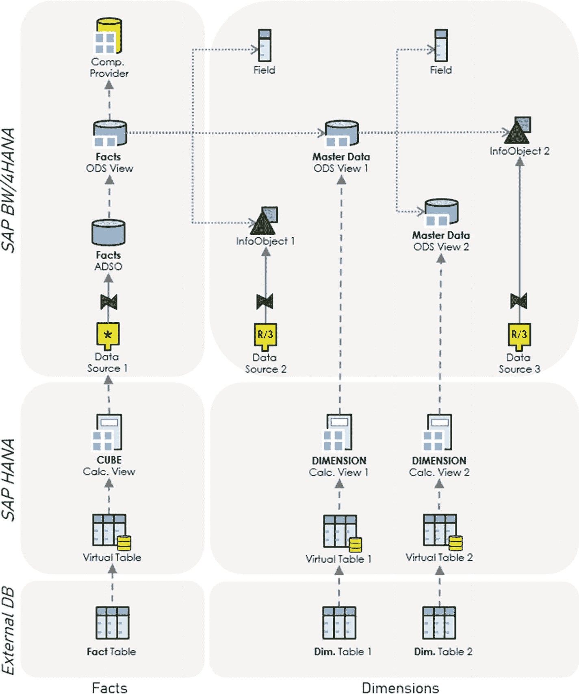

如图 2-9 所示，`Facts`开放式 ODS 视图对象基于三种对象类型建模：信息对象、开放式 ODS 视图和字段。信息对象可用于那些具有与 SAP 模型中相同主数据的维度。一些组织可能正在使用主数据管理系统；因此，多个系统可以共享相同的主数据。如果是这种情况，外部数据模型中的某些维度可以映射到 SAP 信息对象。尽可能为外部模型利用信息对象是很好的做法。这样，我们无需任何开发工作就能提供额外的属性。

图 2-9 中使用的第二个`Facts`开放式 ODS 视图构建块是`Master Data`开放式 ODS 视图。对于主数据，开放式 ODS 视图的方法与前两个模型（图 2-7 和图 2-8）相同。此外，在创建`Master Data`开放式 ODS 视图时，你可以将字段与其他`Master Data`开放式 ODS 视图对象、信息对象或字段进行关联。尽管混合模型为设计架构提供了数十种组合，但在实际实施之前，我建议你详细分析整个数据模型（表、字段和关系）。在此基础上，你可以准备总体方法以及使用每种对象类型的用例。我对混合建模的建议如下：
- 只要适用，就使用信息对象（同时用于`Facts`和`Master Data`开放式 ODS 视图对象）。
- 对于非 SAP 维度，创建`Master Data`开放式 ODS 视图。
- 仅当使用虚拟对象时性能不足，才创建 ADSO。
- 如果信息对象或`Master Data`开放式 ODS 视图关联不适用，则使用基于字段的方法。
- 在设计阶段，定义混合模型的总体架构并遵循该方法（否则，模型可能会变得复杂且难以管理）。

### 虚拟模型实现的混合建模概念

混合建模概念可作为虚拟模型实现的最终架构。但需注意，虽然主数据开放 ODS 视图充当虚拟信息对象，但这并未涵盖其全部功能。一个常见需求是创建层级结构。`开放 ODS 视图`不支持层级，而`信息对象`支持。另一个限制是传递属性功能，该功能同样不适用于`开放 ODS 视图`。在此场景下，若希望保持架构的虚拟性，则可利用“虚拟”`信息对象`。所谓“虚拟”`信息对象`，是指将`访问类型`选项设置为`SAP HANA 视图`的`信息对象`。图 2-10 展示了基于`HANA 视图`的`信息对象`数据模型概念。

第二种混合建模方法是基于字段和基于`信息对象`两种方法的结合。若某个字段没有主数据（例如自由文本字段），则将其保留为原始字段即可。对于主数据模型，我们可以通过将`访问类型`设置为`SAP HANA 视图`来创建“虚拟”`信息对象`。这意味着该`信息对象`将不再使用自身技术表，而是从底层计算视图中获取主数据。将`SAP HANA 视图`设置为`访问类型`时，需要指明源计算视图的路径，并提供`信息对象`属性与计算视图字段之间的映射。在图 2-10 中，`信息对象 1`映射到`计算视图 1`，并包含三个属性：`信息对象 2`、`信息对象 4`和`信息对象 5`。`信息对象 2`也是虚拟的，从`计算视图 2`查询数据。`信息对象 4`是标准 SAP 主数据对象，而`信息对象 5`是仅属性对象。如果性能不足，我们可以通过将维度计算视图的输出加载到新的`信息对象`中，创建持久化主数据模型。这样，我们可以为外部系统创建一个遵循传统`BW/4HANA`模型架构的数据模型（图 2-2）。唯一的区别在于数据源来自外部系统而非 SAP。

采用此架构时，需要意识到我们将失去`开放 ODS 视图`对象和基于字段方法所提供的所有灵活性。`信息对象`无法利用基于字段的建模，这意味着每个属性都必须使用`信息对象`。原则上，在满足以下条件时，应考虑为外部数据模型使用`信息对象`：

- 源数据模型具有稳定且不易变化的结构。

- 在试点阶段，您创建了一个经过测试的基于字段的模型，下一步希望将其转换为遵循经典`BW/4HANA`建模概念的结构化模型。

- 需要利用`开放 ODS 视图`或字段所不具备的功能。在这种情况下，可为这些特定维度使用“虚拟”`信息对象`（例如，当需要层级结构时）。

**最佳实践**

当数据模型完全基于虚拟表时，性能可能不足（基于 HANA 物理表的模型性能更优）。如果源模型包含大型事实表和多个维度表，则需要数据持久化。

图 2-11 展示了使用持久化`信息对象`的混合数据模型架构。

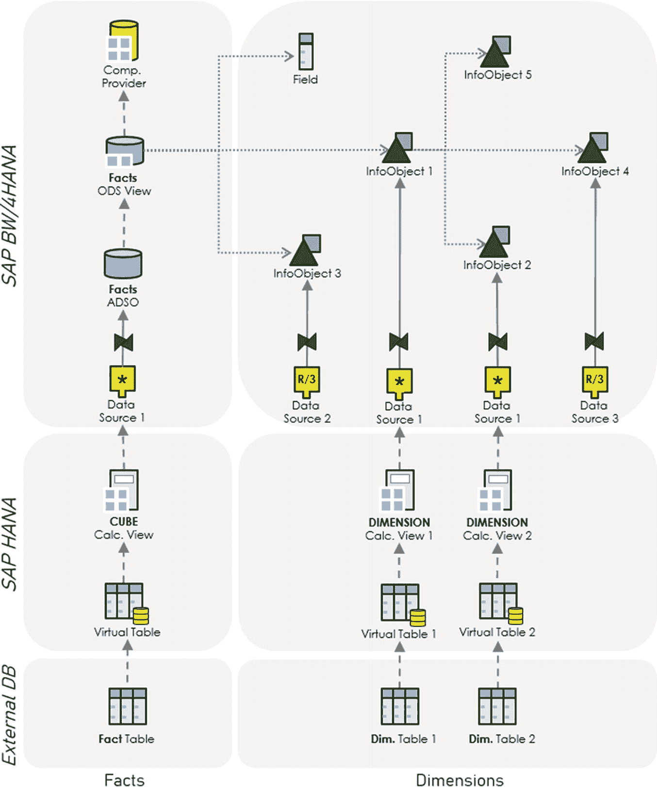

**图 2-11.** 采用持久化`信息对象`的 BW/4HANA 混合数据模型

图 2-11 所示的架构与经典建模概念（图 2-2）类似。区别在于自定义`信息对象`（`信息对象 1`和`信息对象 2`）加载的是来自外部系统而非 SAP 系统的数据。采用这种方法，外部主数据可以充分利用`信息对象`的所有功能，且性能不会受到影响。另一方面，开发和维护的工作量会更高。分析图 2-11 所示架构时，您可能会问：为何不直接将非 SAP 数据加载到现有的 SAP 数据模型结构中，而要创建一个新模型？

您可能正在考虑图 2-12 所示的方法。

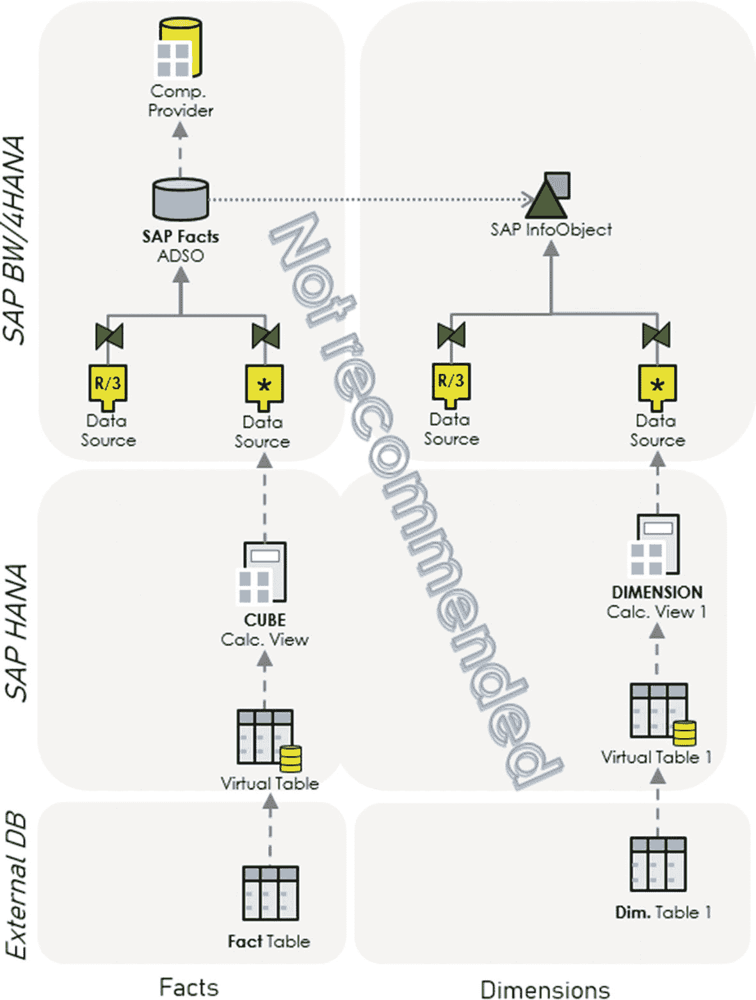

**图 2-12.** 将非 SAP 数据加载到 SAP 数据模型的 BW/4HANA 示意图

将外部数据纳入现有 SAP 数据模型的方法存在以下限制：

- 外部维度和属性的数据类型可能与目标`信息对象`的数据类型不一致，导致无法加载数据。

- 外部维度和属性的数据长度可能与目标`信息对象`的数据长度不一致，导致无法加载数据。

- 由于数据建模方法不同，以及特定于数据库技术的键、关系和数据类型定义不同，几乎不可能将所有非 SAP 维度及其属性纳入 SAP 模型。

- 即使源数据类型与`信息对象`数据类型匹配，底层非 SAP 维度表也可能包含与现有 SAP `信息对象`键相同的主键值。若维护不当，外部数据可能覆盖 SAP 主数据，从而在全球范围内引发大量报表问题。

- 源数据中任何不符合`信息对象`定义的微小偏差都将导致数据加载失败。

- 不应允许所有用户查看非 SAP 数据，因此安全模型可能变得非常复杂。

- 集成过程中，现有全球报表解决方案面临受负面影响的巨大风险。

鉴于上述限制和劣势，可以说没有简单的方法将外部数据集成到现有 SAP 数据仓库中。尽管如此，我们可以创建一个新的数据模型来合并 SAP 和非 SAP 数据。

### 组合数据模型（SAP 与非 SAP 数据）

在需要将 SAP 与非 SAP 数据组合到单一数据模型的场景中，利用虚拟化能力可以避免数据冗余（即避免在两个模型中重复存储相同的 SAP 数据）。考虑到 `BW/4HANA` 提供的所有功能，创建组合模型可采用多种不同方法。图 2-13 展示了将 SAP 和非 SAP 数据集成到单一模型的一种方法。

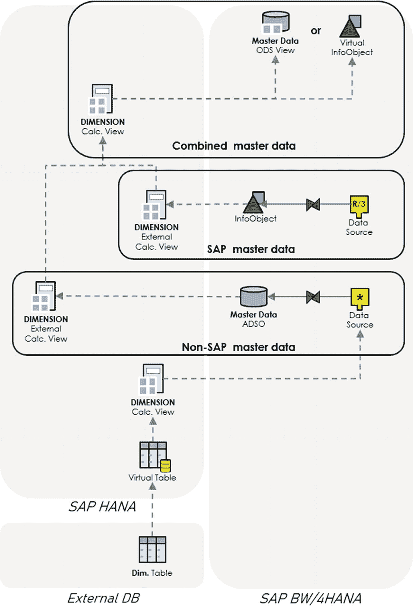

**图 2-13.** `BW/4HANA` 将 SAP 和非 SAP 主数据集成到新模型中

图 2-13 展示了创建主数据对象的架构，该对象融合了来自 SAP 和非 SAP 维度的数据。图中用三个部分分别标明了 SAP、非 SAP 以及组合后的主数据。对于非 SAP 数据，创建了一个 `Master Data ADSO` 作为持久化层。正如您可能已知的，`BW/4HANA` 能够根据建模对象自动生成外部 SAP HANA 视图。本方法即利用了此功能。从 `Master Data ADSO` 生成一个外部计算视图。同样的功能也用于 SAP 主数据，即对于 SAP `InfoObject`，也会生成一个外部计算视图。一旦两个数据集都以外部计算视图的形式在 HANA 平台上可用，我们就可以将它们组合到单一维度视图中。如图 2-13 所示，在两个外部视图之上，创建了一个额外的计算视图。该视图的目的是合并 SAP 和非 SAP 数据。

**注意**

您可以避免为非 SAP 数据创建持久化的主数据 `ADSO`，而是直接将从 `InfoObject` 生成的外部视图与虚拟表结合。然而，这种方法会对数据模型的性能产生负面影响。

当然，在组合 SAP 和非 SAP 数据时，某些属性可能仅适用于 SAP，而另一些则仅适用于非 SAP 源。为了避免用户混淆，如果某个属性值缺失或对于特定记录不可用，最好在数据模型字段中包含用于指示每条记录来源系统的信息。在组合计算视图中，您将能够应用额外的数据操作来尽可能统一两个数据集。此外，在计算视图的联合节点中应用映射之前，很可能需要先将值转换为公共数据类型。一旦组合主数据被恰当塑形，您将能够通过 `master data Open ODS View` 或 `InfoObject of SAP HANA View access type`（具体取决于方法）来消费最终的主数据视图。

遵循集成主数据的方法，我们可以将相同的架构应用于事实数据。图 2-14 展示了将 SAP 和非 SAP 数据集成到新的 `BW/4HANA` 模型中的架构。

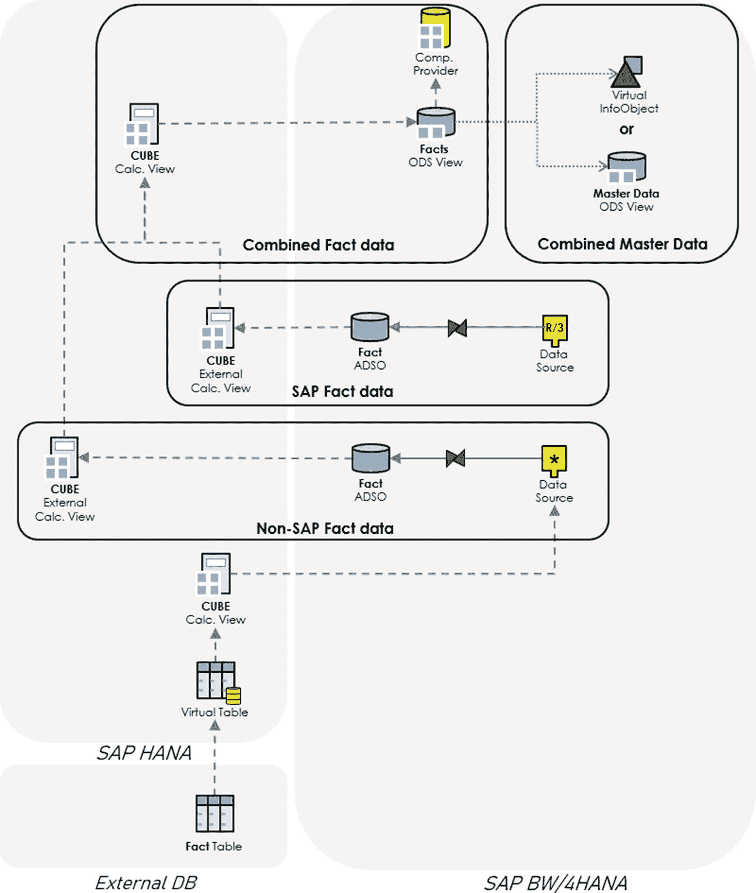

**图 2-14.** `BW/4HANA` 将 SAP 和非 SAP 数据集成到新模型中

集成事实数据的架构遵循与集成主数据相同的方法。区别在于外部计算视图是从事实 `ADSO`（分别针对 SAP 和非 SAP 数据）生成的。从 `ADSO` 生成的外部计算视图通过在其上创建的计算视图内的联合算子进行合并。包含组合事实数据的最终计算视图随后将由 `Facts Open ODS View` 消费。如图 2-14 所示，在 `Open ODS View` 对象中，从底层计算视图派生的字段与组合主数据对象（如图 2-13 所述）关联。根据所选方法，这些字段可以映射到 `Master Data Open ODS Views` 或“虚拟” `InfoObjects`。某些字段也可以不建立任何关联。创建在 `Facts Open ODS View` 之上的 `CompositeProvider` 随后可由最终查询消费。

如您所见，存在许多可能的建模概念，您需要根据需求选择最合适的方法。请记住，本章描述的架构并非唯有的可能变体。还有许多其他架构可以设计。`BW/4HANA` 通过限制对象和层的数量来简化建模，但凭借所有的新特性和功能，它实现了更多可能的建模方法；因此，针对特定场景选择最合适的架构确实具有挑战性。设计正确模型的关键在于深入的需求和数据模型分析、项目交付时间线以及开发人员的经验。

# 摘要

本章阐述了如何利用 BW/4HANA 和 HANA 原生对象，实现从 HANA 物理表和虚拟表消费数据的敏捷数据模型。表 2-1 总结了本章涵盖的每种建模概念的优缺点和用法。

**表 2-1. 建模概念对比**

| | 传统数据模型 | 虚拟数据供应 | 基于字段的数据模型 | 混合数据模型 | 组合数据模型 |
| --- | --- | --- | --- | --- | --- |
| **优点** | • 高水平的数据稳定性、质量和一致性 • 可使用 SAP 业务内容 • 通过安全模型管理访问权限 | • 高灵活性 • 开发工作量非常低 • 易于实施和维护 • 无需创建信息对象 • 不需要数据持久化 | • 高灵活性 • 易于实施和维护 • 无需创建信息对象 • 数据持久化可选 • 可实现授权模型 | • 高灵活性 • 无需创建新的信息对象 • 可在适用处利用现有主数据对象 • 通过安全模型管理访问权限 | • 使用户能够在全局数据（SAP 和非 SAP）上运行数据分析和报表 • 可实现授权模型 |
| **缺点** | • 灵活性低，开发规则严格 • 主要适用于 SAP 数据 • 开发和维护工作量大 • 始终需要数据持久化 | • 无主数据 • 仅提供特定信息片段 • 安全模型不适用（除非维护了对信息对象的关联） | • 开放式 ODS 视图对象不支持所有信息对象功能（例如层次结构） • 复杂数据模型性能较低 | • 如果没有严格的建模指南，混合来自不同区域的多个对象，模型可能变得复杂且难以维护 • 对于复杂数据模型，性能可能不足 | • 组合模型的设计需要详细且耗时的分析 • 实施复杂 • 通过外部 SAP HANA 视图产生大量依赖关系，可能对 SAP 模型产生负面影响 • 维护工作量相当高 |
| **用途** | • SAP 数据模型 | • 简单的数据供应/提取 • 临时分析 • 直接访问虚拟表 | • 非 SAP 数据模型 | • 维度与 SAP 主数据对应的非 SAP 数据模型 | • 将 SAP 和非 SAP 数据集成到单个模型中 |

本章描述的概念让您了解如何将外部表数据供应到 BW/4HANA，如何基于非 SAP 表实现报表和数据模型，以及如何将 SAP 和非 SAP 数据集成到单个数据模型中。在接下来的章节中，您将通过示例学习如何在 BW/4HANA 系统中实施这些概念。

