# 4. 创建基于字段的 BW/4HANA 模型

在第三章 3 中，我们讨论了暴露 HANA 对象（表和视图）的可能性，本章将解释如何使用基于字段的方法实现 BW/4HANA 数据模型。我们已经知道，通过利用 `Open ODS 视图` 对象，我们可以将位于 SAP HANA 数据库模式中的外部数据引入 BW/4HANA 层。在本章中，我们将利用 `Open ODS 视图` 在 BW 中构建一个虚拟星型模式、基于字段的数据模型。我还会解释如何在不修改报表层的情况下，在 `Open ODS 视图` 和源对象之间自动生成一个中间数据存储层。

# 场景

成功实施订单数据的基本数据供应报表（第三章 3）后，项目经理要求在 BW/4HANA 中构建一个星型模式数据模型的概念验证。需求是基于在 SAP HANA 数据库模式中复制的表，在 BW/4HANA 系统中实施该数据模型。在第三章 3 中，已经使用了两个表（`ORDER_HEADER` 和 `ORDER_STATUS`）来构建数据供应报表。该虚拟模型总共应包含五个外部表。其中两个是事实表。

- `Order Header`：包含订单抬头信息，例如状态、订单日期、客户编号和负责员工。

- `Order Details`：该表与 `Order Header` 表关联，包含订单项目级别信息，例如产品 ID 或订购数量。

其余三个表是维度/文本表。

- `Order Status`：这是一个文本表，用于根据状态描述查找状态 ID。它支持两种语言（英语和德语）的描述。

- `Products`：这是一个维度表，包含产品属性的信息。

- `Categories`：这是一个文本表，包含可用产品组及其描述的信息。

图 4-1 展示了在 SAP HANA 数据库中复制的非 SAP 表的逻辑数据模型。

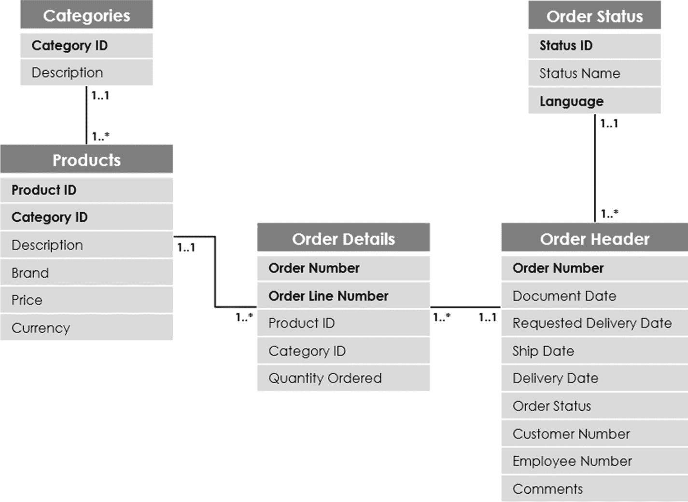

*图 4-1.* 订单的逻辑数据模型

如图 4-1 所示，该数据模型由五个表组成。表之间的连接线定义了它们的关系。在给定的示例中，所有关系都是一对多类型（1..1 – 1..*）。每个实体由一个表头和字段列表组成。加粗的字段表示表的主键。如果你希望跟随演示的活动进行操作，可以在本书的附录中找到重新创建这些表到你本地模式的 SQL 脚本。

在本章接下来的部分，我将向你展示如何使用给定的逻辑模型作为参考（图 4-1），在 BW/4HANA 中实施虚拟数据模型。在这个场景中，我们将遵循图 2-7（在第二章 2 中）提出的基于 `Open ODS 视图` 的建模概念。图 4-2 展示了基于场景描述的需求实施订单数据模型的一般方法。

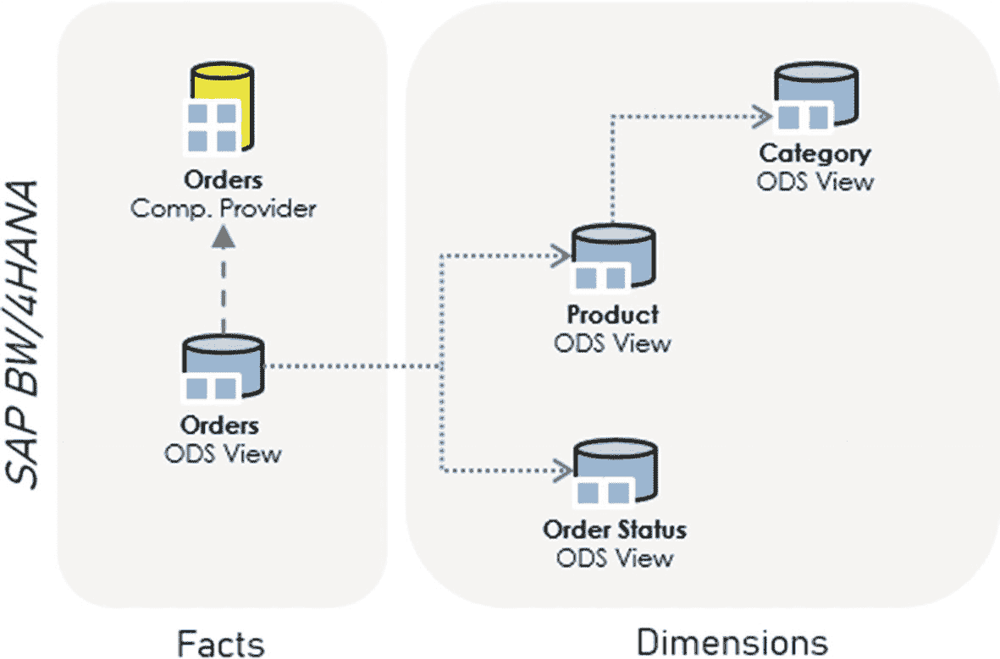

*图 4-2.* 订单的虚拟 BW/4HANA 模型

这里的想法是利用 `Open ODS 视图` 对象构建一个虚拟模型。将有一个事实语义类型的 `Open ODS 视图`（`Orders`）和一个主数据类型（`Product`）的 `Open ODS 视图`。由于 `Order Status` 和 `Category` 表仅包含键和描述，其语义类型将设置为文本。在模型的顶层，我将创建一个 `CompositeProvider`，稍后由查询消费。首先，我将专注于实施主数据/文本对象。

## 创建维度计算视图

我们可以直接在 HANA 表上开始实施 `Open ODS 视图`，但正如我之前提到的，我更喜欢先通过计算视图消费表。这为我们提供了更大的灵活性，以防将来需要应用任何字段转换或额外计算。对于每个维度/文本表，我创建了一个类型为维度的计算视图（图 4-3）。

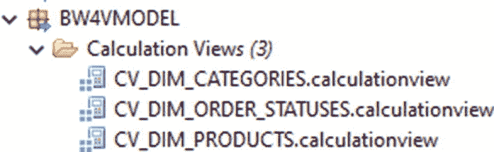

*图 4-3.* 虚拟数据模型的维度计算视图列表

你会在图 4-3 中注意到，我创建了一个名为 `BW4VMODEL` 的新 HANA 包。这有助于保持开发的透明性，并将其与为其他目的而开发的其他 HANA 对象分开。列在 `BW4VMODEL` 包下的计算视图具有维度类型。它们不包含任何连接或计算，只是以与底层表相同的结构提供数据。例如，你可以在图 4-4 中看到 `CV_DIM_PRODUCTS` 计算视图的结构。

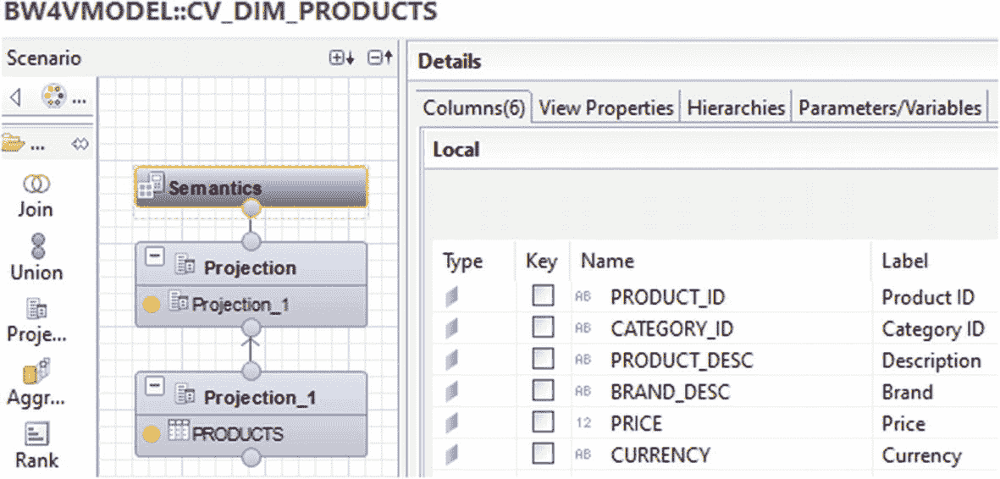

*图 4-4.* `CV_DIM_PRODUCTS` 计算视图定义

其余两个计算视图（用于 Order Status 和 Category 表）遵循相同的方法。它们由一个指向源表的 `Projection` 节点组成，所有字段都从该节点传播到 `Semantics` 节点。以下是作为特定计算视图源的表（表 ➤ 计算视图）：

- `CATEGORIES` ➤ `CV_DIM_CATEGORIES`

- `ORDER_STATUS` ➤ `CV_DIM_ORDER_STATUSES`

- `PRODUCTS` ➤ `CV_DIM_PRODUCTS`

验证并激活这些视图后，我们现在可以切换到 BW 建模视角了。

## 创建文本型开放 ODS 视图

如图 4-2 所示，针对给定的场景，我们将创建两个语义类型设置为“文本”的开放 ODS 视图。它们的作用与传统 EDW 架构中常规信息对象的角色相同。主要区别在于，开放 ODS 视图可以基于字段，并且不存储任何数据。开放 ODS 视图在查询运行时从底层对象（在我们的场景中为 HANA 计算视图）检索数据。

我们首先关注存储在 `ORDER_STATUS` 表中的数据。该表包含订单状态 ID 和订单描述。状态描述支持两种语言：英语和德语。`LANGU` 列标识了该表中每个条目的语言。该列中存储的值 `E` 和 `D` 遵循标准 SAP 语言代码。因此，我们将能够支持以用户语言动态显示文本的功能。

第一个开放 ODS 视图将从 `CV_DIM_ORDER_STATUSES` 计算视图中获取数据。此开放 ODS 视图的语义类型设置为 `Texts`。在开放 ODS 视图编辑器中，我们需要指定正确的输出结构。图 4-5 显示了订单状态（`ZTXT01`）开放 ODS 视图的输出结构。

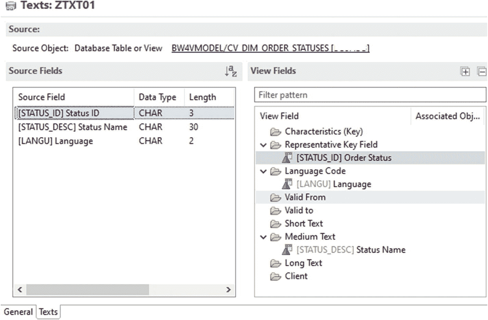

*图 4-5. 订单状态（`ZTXT01`）开放 ODS 视图的输出结构*

在定义开放 ODS 视图的输出结构时，首先需要填写 `Representative Key` 字段，该字段用于唯一标识每条记录。在我们场景中，它是 `STATUS_ID` 列。该表的第二个键是 `LANGU` 列；不过，我们有一个专门用于语言代码的文件夹。

由于订单状态维度将依赖于语言，因此我们需要指定提供语言代码值的列。在我们的场景中，应将 `LANGU` 列放在 `Language Code` 文件夹下，如图 4-5 所示。

应添加到输出结构中的最后一列是实际的描述字段：`STATUS_DESC`。根据源字段长度，应将其分配到适当的“文本相关”文件夹下。表 4-1 根据文本文件夹类型指定了支持的最大字符数。

*表 4-1. 开放 ODS 视图文本类型定义*

| 文本文件夹 | 最大字段长度 |
| --- | --- |
| 短文本 | 20 |
| 中文本 | 40 |
| 长文本 | 5000 |

你也可以将同一个描述字段添加到多个文本文件夹中。这样，例如在显示 `Short Text` 时，将只显示字符串的前 20 个字符。如果源字段长度更长，文本的其余部分将被截断。在我们的场景中，`Status Name` 长度为 30 个字符，因此我将其分配到了 `Medium Text` 文件夹下（图 4-5）。要检查 `ZTXT01` 开放 ODS 视图的输出，让我们在 Analysis for Microsoft Excel 中打开它。图 4-6 显示了订单状态开放 ODS 视图的输出。

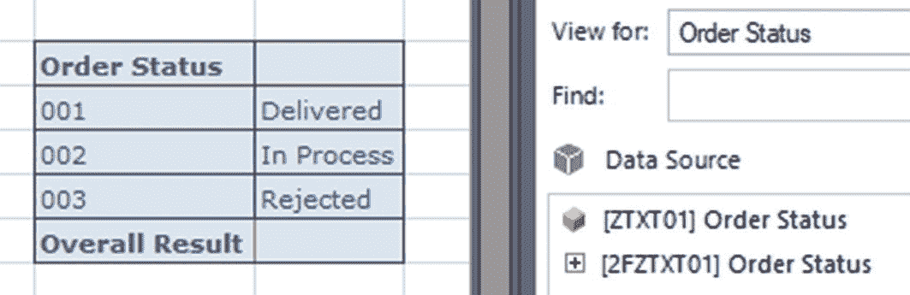

*图 4-6. 在 Analysis for Microsoft Excel 中 `ZTXT01` 的输出*

你可以注意到，尽管底层 `ORDER_STATUS` 表中共有六个条目，但 `ZTXT01` 开放 ODS 视图的输出仅返回了其中三个。这是因为我的 BW 用户的默认语言设置为 `EN`，因此 `LANGU` 列中值为 `DE` 的条目被跳过。如果我在登录 BW/4HANA 系统时将语言更改为 `DE`，描述将以德语返回。

接下来，对于“类别”维度，我们应遵循与订单状态对象相同的步骤。唯一的区别在于 `CATEGORIES` 表不依赖于语言，因此我们不会将任何列分配到 `Language Code` 文件夹。图 4-7 显示了 `ZTXT02` 类别开放 ODS 视图的输出结构。

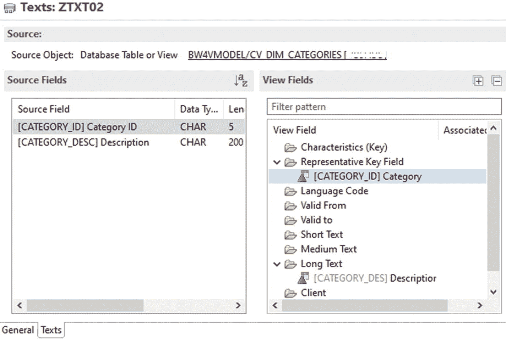

*图 4-7. 类别（`ZTXT02`）开放 ODS 视图的输出结构*

源 `CATEGORIES` 表仅包含键字段和文本字段。`CATEGORY_ID` 列被放在了 `Representative Key Field` 部分，而 `CATEGORY_DESC` 字段被拖到了 `Long Text` 文件夹下。图 4-8 展示了类别开放 ODS 视图的输出。

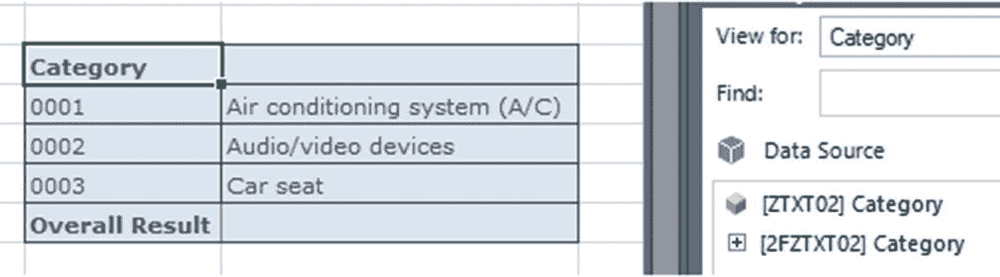

*图 4-8. 在 Analysis for Microsoft Excel 中 ZTXT02 的输出*

如图 4-8 所示，类别开放 ODS 视图的输出与源 `CATEGORIES` 表的内容一致。

## 创建主数据开放 ODS 视图

第三个开放 ODS 视图将基于从`PRODUCTS`表获取数据的`CV_DIM_PRODUCTS`视图。与前两个表不同，`PRODUCTS`表除了键列和文本列之外，还包含品牌和价格等其他属性。因此，在创建产品开放 ODS 视图时，我们应选择主数据作为语义类型。图 4-9 展示了产品开放 ODS 视图的输出结构。

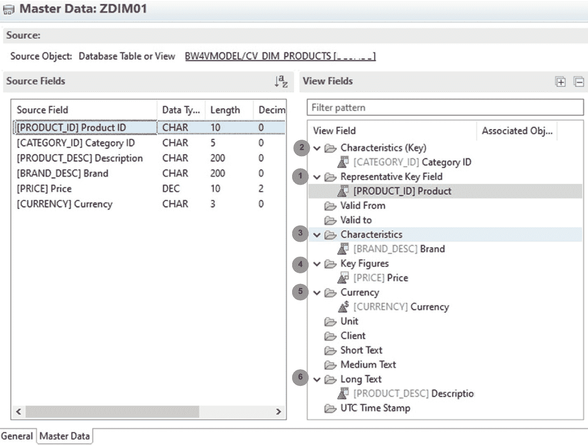

图 4-9. 产品开放 ODS 视图(`ZDIM01`)的初始输出结构

在图 4-9 中，你可以看到来自`CV_DIM_PRODUCTS`计算视图的源字段（源字段部分）是如何分配到多个文件夹（视图字段部分）中的。

- `PRODUCTS`表的主键由两列组成：`PRODUCT_ID`和`CATEGORY_ID`。开放 ODS 视图支持对无法基于单个字段唯一定义的对象进行复合功能。如图 4-9 所示，`PRODUCT_ID`被分配到代表性键字段(1)文件夹。

- 主键中的第二列（`CATEGORY_ID`）已被添加到特性（键）(2)文件夹下。此分配的目的类似于标准信息对象可用的复合功能。

- 在特性(3)文件夹下，你可能会找到`BRAND_DESC`列。属于此部分的列是开放 ODS 视图主数据对象的属性。

- 关键指标(4)部分包含数值数据类型的属性。对于`ZDIM01`开放 ODS 视图，`PRICE`列被添加到了此部分。

- 对于货币和单位相关的列，开放 ODS 视图输出结构中还有一个专用文件夹。在给定场景中，我将`CURRENCY`列分配到了货币(5)文件夹。

**注意**

在开放 ODS 视图中使用来自外部数据的货币或单位时，你需要了解 BW/4HANA 期望所有这些值都维护在中央 SAP 货币和单位表中。标准 SAP 表中不存在的货币/单位值的记录将不被支持。

- 产品描述列（`PRODUCT_DESC`）已被拖拽到长文本(6)文件夹。这是因为`PRODUCT_DESC`列长度为 200 个字符。

图 4-10 展示了产品开放 ODS 视图的初始输出。

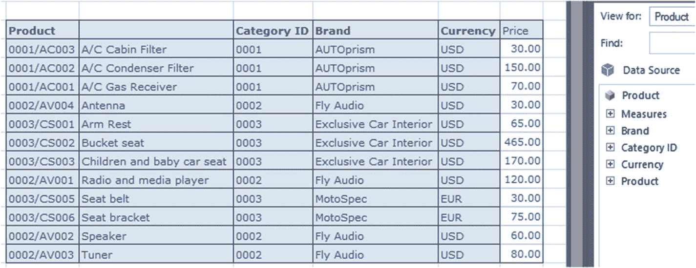

图 4-10. `ZDIM01`在 Microsoft Excel 分析中的初始输出

产品开放 ODS 视图的输出包含源自`CV_DIM_PRODUCTS`计算视图的所有列。值得注意的是，产品字段的键值由产品 ID 和类别 ID 组成（例如，`0001/AC003`）。这是因为我们将`CATEGORY_ID`列添加到了特性（键）部分（见图 4-9）。

我们可以实施两项小的调整，为产品维度提供更多信息。首先，类别字段显示的是 ID 值，因此用户不知道实际的类别值是什么。此外，价格字段显示的数字没有货币代码（货币代码显示为单独的列）。现在让我们切换回 BW 建模工具。如你所记，我们为类别数据创建了`ZTXT02`文本开放 ODS 视图（图 4-7）。该对象包含类别 ID 与类别名称之间的映射关系。现在，我们可以通过在产品开放 ODS 视图输出结构中向该对象应用关联来利用`ZTXT02`开放 ODS 视图。图 4-10 说明了如何定义类别字段与`ZTXT02`开放 ODS 视图之间的关联。

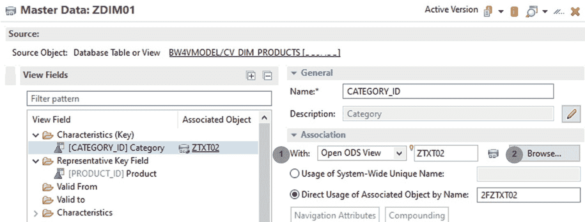

图 4-11. `ZDIM01`开放 ODS 视图中类别字段的关联

要定义字段与开放 ODS 视图对象之间的关联，请从视图字段部分选择目标字段。在右侧窗格中，选择关联类型为开放 ODS 视图。然后浏览要分配给该特定字段的开放 ODS 视图的名称。如果要继承关联对象的技术名称，请选择`按名称直接使用关联对象`选项。在所示示例中（图 4-11），我将`ZTXT02`开放 ODS 视图分配给了`CATEGORY_ID`字段，并选择了按名称使用关联对象的选项。定义关联后，在视图字段部分中，你将在字段名称旁边找到有关关联对象的信息（开放 ODS 视图图标及其技术名称）。

我想应用的第二个调整是为价格字段分配货币。点击`PRICE`字段以显示字段设置部分（图 4-12）。

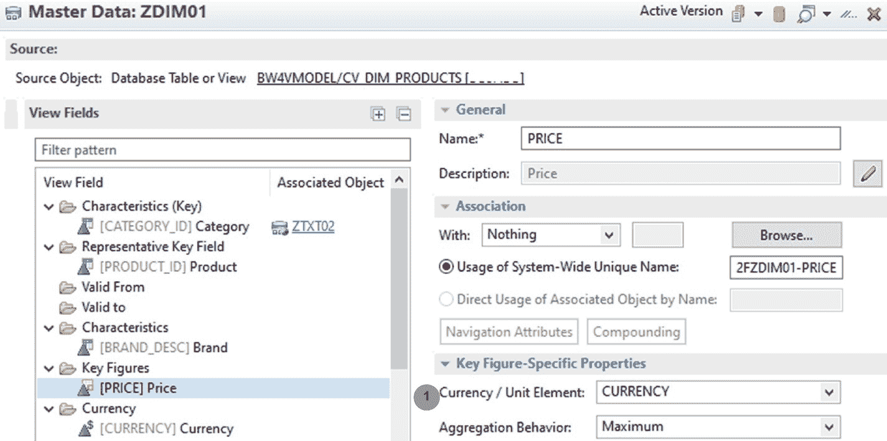

图 4-12. 为`ZDIM01`开放 ODS 视图中的价格字段分配货币元素

当你打开货币/单位元素下拉列表时，列表中会看到货币文件夹下可用的字段。在我的案例中，只有一列（`CURRENCY`）。我将使用该列作为货币元素（图 4-12）。

应用这两项更改后，让我们再次在 Microsoft Excel 分析中执行`ZDIM01`对象以验证输出。图 4-13 展示了更新后的`ZDIM01`对象的输出。

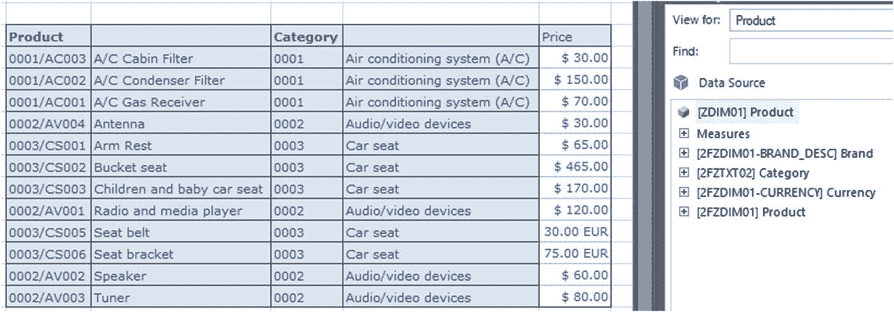

图 4-13. `ZDIM01`在 Microsoft Excel 分析中的最终输出

这次通过为类别字段选择键和文本选项，我们能够同时看到键和文本。所有开放 ODS 视图字段的技术名称都以`2F`字符串开头。默认情况下，技术字段名称的其余部分是通过连接开放 ODS 视图名称和字段名称生成的（例如，`2FZDIM01-BRAND_DESC`）。在我们的示例中，产品和类别字段是例外。

分配给代表性键字段组的字段生成的名称仅包含开放 ODS 视图名称。产品字段被设置为代表性键字段（见图 4-9）；因此，其技术名称显示为`2FZDIM01`（图 4-13）。

类别字段与`ZTXT02`开放 ODS 视图有关联；因此，其名称继承自该对象。如果我们希望保持与其他字段相同的命名约定（`2F<开放 ODS 视图名称>_<字段名称>`），我们应该将选择从`按名称直接使用关联对象`切换为`使用系统级唯一名称`（图 4-11）。

为`ZDIM01`开放 ODS 视图实施的第二项更改涉及价格字段。该调整现在也反映在图 4-13 所示的输出中。你可以看到，价格列中显示的每个值现在都已分配了货币代码。

## 创建事务性计算视图

与维度表类似，我首先在 SAP HANA 层为事务性数据创建一个虚拟层。在我们的数据模型中，事务性数据来自两个表：`ORDER_HEADER` 和 `ORDER_DETAILS`。这两个表都有一个 `Order Number (ORD_NUMBER)` 列，该列将用于将抬头数据和行项目数据链接到一个数据集中。此表将在 CUBE 数据类别的计算视图中进行联接。图 4-14 展示了 `CV_FACT_ORDERS` 视图对象的图形编辑器。

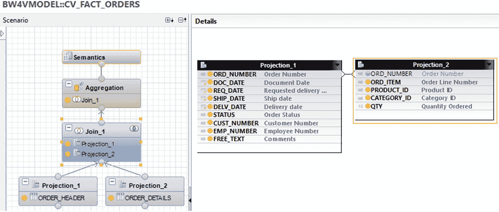

图 4-14. `CV_FACT_ORDERS` 计算视图定义

`CV_FACT_ORDERS` 计算视图从订单抬头表和订单项目表（`Projection_1` 和 `Projection_2`）查询数据。然后，联接节点基于 `ORD_NUMBER` 列将这些表链接到一个数据集中。从 `ORDER_HEADER` 表开始，所有列都会被传播到语义节点。从 `ORDER_DETAILS` 表，除了已从抬头表衍生的 `ORD_NUMBER` 字段外，我们也应选择所有字段。当对 `CV_FACT_ORDERS` 计算视图执行数据预览时，我们应该看到抬头数据和行项目数据已合并成一个数据集。该视图现在将用作事实（Facts）开放 ODS 视图对象的数据源。

## 创建事实开放 ODS 视图

# 使用开放 ODS 视图和 CompositeProvider 进行建模

创建了主数据和文本 BW/4HANA 对象之后，现在我将创建中心星型模式对象。由于我们已经将订单事务性数据合并到一个数据集中，现在可以定义一个新的事实开放 ODS 视图对象。请记住，在定义事务性开放 ODS 视图时，应选择 `Facts` 选项作为语义类型。图 4-15 展示了 `ZFCT01` 开放 ODS 视图的初始设置。

`CV_FACT_ORDERS` 计算视图中可用的源字段分为以下三类：
- `Order Number` 和 `Order Line Number` 是构成订单数据集组合键的字段。它们唯一地定义了每个订单项目记录。主键字段被分配到 `Characteristics (Key)` 类别 (1)。
> **注意**：主键字段也可以分配到“特征”文件夹。但是，如果将来需要将这些数据持久化到 ADSO 中，通过将主键字段分配到 `Characteristics (Key)` 文件夹，我们可以确保这些字段会自动成为所生成 ADSO 的键字段。
- 事务性数据字段被分组到 `Characteristics` 文件夹 (2)。来自 `CV_FACT_ORDERS` 计算视图的大多数字段都已添加到此组中。
- `Quantity Ordered (QTY)` 列是一个累积度量；因此，它已被添加到 `Key Figures` 文件夹 (3)。

现在让我们激活 `ZFCT01` 对象来检查其内容。

在图 4-16 中，您可能会看到 `ZFCT01` 开放 ODS 视图针对某些选定字段的输出。目前，`Order Status`、`Category` 和 `Product` 字段显示为键值，除非用户知道特定 ID 的含义，否则这些值对最终用户可能没有意义。由于我们现在已经准备好订单事务性开放 ODS 视图的初始设置，我们可以通过应用关联来增强这些字段。通过这种方式，某些字段将继承本章前面部分创建的关联文本/主数据开放 ODS 视图的属性。

`CV_FACT_ORDERS` 计算视图将 `Order Status` 和 `Category` 值显示为键。为了在报表中也启用描述，我们可以利用订单状态 (`ZTXT01`) 和类别 (`ZTXT02`) 开放 ODS 视图，并分别对 `STATUS` 和 `CATEGORY` 字段应用关联。按照图 4-11 中为类别字段展示的相同步骤，在 `ZFCT01` 开放 ODS 视图中定义关联。图 4-17 展示了事务性字段与文本开放 ODS 视图对象之间的关联。

图 4-17 中显示的“类别”和“订单状态”字段现在已与文本开放 ODS 视图建立了关联。在上一节中，我们为产品维度创建了一个主数据对象。您还记得，此维度具有一个复合键，由产品 ID 和类别 ID 字段组成。在分配产品 (`ZDIM01`) 开放 ODS 视图时，我们需要牢记这一点。

在 `PRODUCT_ID` 字段与 `ZDIM01` 开放 ODS 视图建立关联后，我们还需要为此开放 ODS 视图定义复合键。通过点击“复合”按钮（图 4-18），我们可以选择用于关联的第二个字段。在给定场景中，应选择 `CATEGORY_ID` 字段作为复合字段。在某些情况下，主数据开放 ODS 视图的复合键可能包含两个以上的字段。此时，在进行关联时，需确保为每个主数据开放 ODS 视图键字段都定义了复合键。

将主数据开放 ODS 视图指定给产品字段后，我们可以选择主数据导航属性。在产品开放 ODS 视图中，我们将 `Brand` 字段定义为特征（图 4-9）。所有定义为开放 ODS 视图特征的字段都可以在后续用作导航属性。这意味着在报表期间，它们可以与所有常规输出字段以相同的方式使用。图 4-19 展示了如何将 `Brand` 字段启用为导航属性。

点击“导航属性”按钮后，我们将看到已关联主数据对象可用的特征列表。通过选中给定属性旁的复选框，可以将其添加为导航属性。在我们的场景中，产品开放 ODS 视图（`ZDIM01`）仅定义了一个特征。选中 `BRAND_DESC` 字段后，您会注意到它被添加到了 `PRODUCT_ID` 字段下的视图字段部分。

由于所有调整均已就位，现在我们来验证 `ZFCT01` 开放 ODS 视图选定字段的输出（图 4-20）。

这次，在 Analysis for Microsoft Excel 中打开订单开放 ODS 视图时（图 4-20），在我们定义了关联的字段中，文本设置为默认显示。另一个优势是，我们现在可以利用产品维度的属性（见图 4-21）。

首先，您可能会注意到有一个新的 `Brand` 字段可用于导航。该字段在 `ZFCT01` 的初始输出中不可用（图 4-16），这是因为我们将其设置为导航属性（图 4-19）。其他产品相关信息（如货币和价格）则显示在产品（`ZDIM01`）字段的属性部分下。与导航属性（`ZDIM01=BRAND_DESC`）不同，显示属性不能用于单独下钻，只能与主特征（此处为产品）一起使用。尽管 `Brand` 字段被设置为导航属性，它也会作为产品属性可见。在图 4-21 的左侧，您可以看到产品显示属性的输出。

## 创建使用开放 ODS 视图的 CompositeProvider

在创建查询之前，我将先创建一个 CompositeProvider，该提供者使用订单数据（`ZFCT01`）开放 ODS 视图。这样，将来我就可以通过使用 CompositeProvider 的联接和/或联合节点来包含其他对象。图 4-22 展示了 `ZCPFCT01` CompositeProvider 的建模方式。

在名为 `ZCPFCT01` 的 CompositeProvider 中，所有源字段都已映射到输出。尽管底层开放 ODS 视图（`ZFCT01`）中已将 `Brand` 字段作为导航属性启用，但默认情况下此处并不可见。如果希望启用导航属性，应转到“输出”选项卡。该选项卡列出了 CompositeProvider 的输出字段，我们可以在此处启用可用的导航属性。

如图 4-23 所示，与主数据/文本开放 ODS 视图的关联继承自所使用的 `ZFCT01` 对象。通过右键单击产品特征，我们可以选择定义要包含在输出中的导航属性。在打开的窗口中，我们将看到可添加为导航属性的字段列表。在我们的场景中，只有一个属性可供选择。选中 `Brand` 字段作为导航属性后，它将显示在主产品特征下（如图 4-23 所示）。由于此设置符合需求，我们可以激活 CompositeProvider。

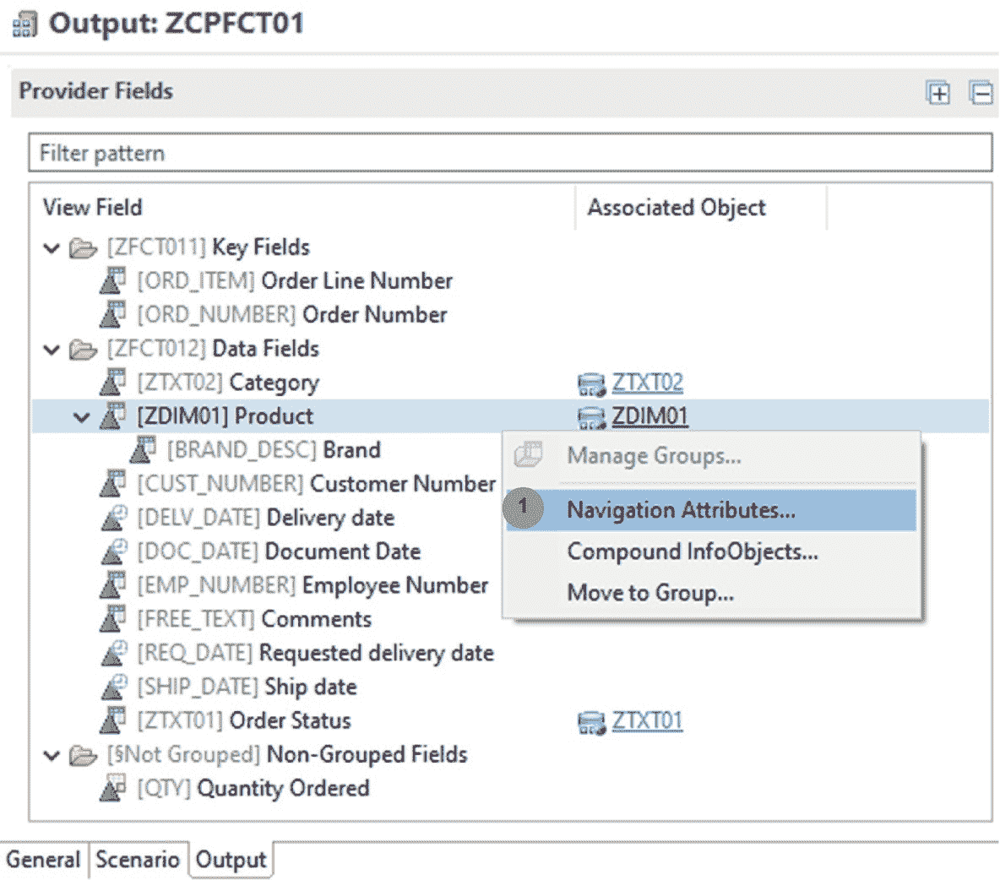
*图 4-23. 为 `ZCPFCT01` CompositeProvider 添加导航属性*

### 注意
如果在激活 CompositeProvider 时遇到“列视图”错误，请再次针对底层开放 ODS 视图运行 `RSDDB_LOGINDEX_CREATE` 程序以创建列视图（参见图 3-12）。

CompositeProvider 成功激活后，您可以在其之上创建最终查询。定义查询结构时（图 4-24），您将能够使用 `ZCPFCT01` CompositeProvider 中的所有字段，包括导航属性。

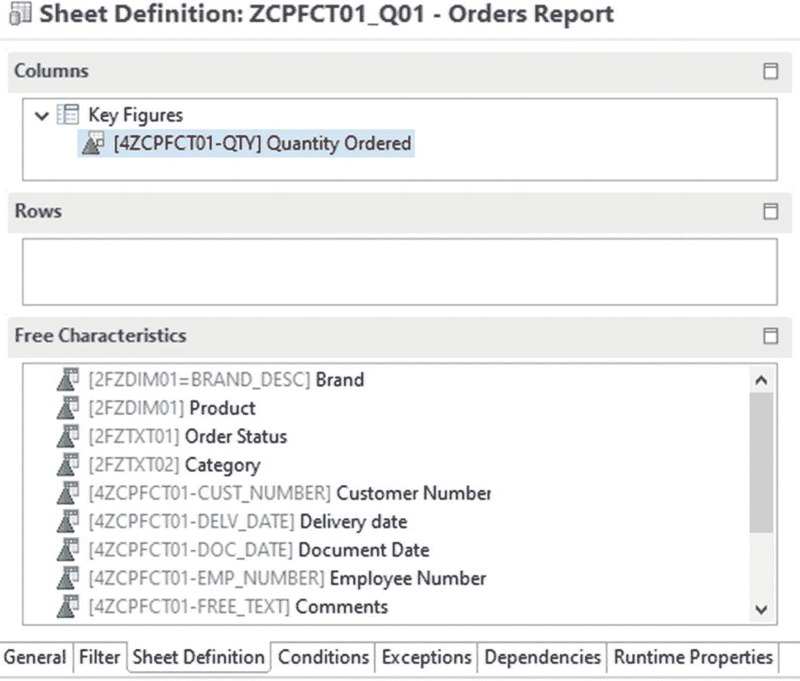
*图 4-24. `ZCPFCT01_Q01` 查询的定义*

在此场景中，我们基于开放 ODS 视图构建了一个虚拟数据模型。由于底层表存储在 HANA 数据库中，我们无需将数据持久化到 BW/4HANA 层。然而，在某些情况下，底层数据模型要复杂得多，需要许多额外的操作和计算。此外，数据并不总是驻留在 HANA 表中，也可以通过智能数据访问从外部数据库进行查询。在这种情况下，我们可能需要创建一个额外的暂存层，以避免查询运行时的性能问题。在下一节中，我将描述如何为现有的开放 ODS 视图对象生成一个中间 BW/4HANA 持久化层。

## 将虚拟模型转换为持久化结构
开放式 ODS 视图提供了将源结构（如远程表）转换为 BW/4HANA 持久化对象的功能。将虚拟模型切换为持久化数据存储的驱动力通常是性能。如果模型完全基于虚拟 HANA 表，查询性能将受到明显影响。此外，当依赖驻留在外部系统上的数据时，确保虚拟模型的稳定性可能是一个挑战。在源系统停机期间，通过 BW 模型公开的外部数据将完全无法访问。为避免这种情况，您可能更倾向于将源数据加载到 BW 对象中，这样，在连接或外部系统出现任何停机时，模型仍能返回上次成功加载请求之前的所有数据。

此外，当您想要将外部表与各种 BW 对象结合使用时，由于复杂操作的数量和数据量，实时运行查询可能需要一些时间。需要支持基于时间的数据快照的场景也无法通过使用虚拟方法来维护。

对于此类场景，开放式 ODS 框架支持从虚拟模型切换到持久化结构的功能。这种方法有助于解决与性能相关的问题。转换可以针对每个开放式 ODS 视图独立进行，因此您可以决定要为哪个开放式 ODS 视图持久化数据。值得一提的是，即使您已经构建了虚拟模型，也可以生成持久化层，而无需重建开放式 ODS 视图以及在其之上已创建的其他对象（例如 `CompositeProviders` 和/或查询）。得益于此，您可以使用迭代方法实施数据模型，从完全虚拟的结构开始，进行第一轮单元测试，之后选择需要生成数据存储以提高性能或捕获数据快照的虚拟对象。

正如第一章所述，开放式 ODS 视图是虚拟建模对象，因此它们不存储任何数据。但是，它们使我们能够生成基于 ADSO 的数据结构，包括传输数据所需的所有必要 BW/4HANA 对象，例如数据源、转换和 DTP 对象。为了演示从虚拟结构到持久化对象的转换，我将使用 `ZFCT01` 开放式 ODS 视图作为参考。图 4-25 描绘了订单开放式 ODS 视图从虚拟数据结构切换到持久化数据结构的概览。

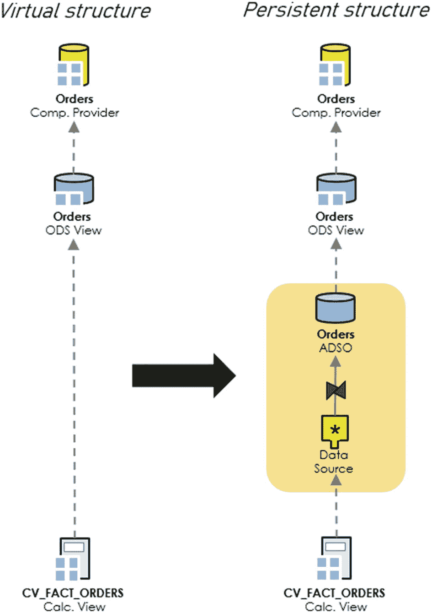
*图 4-25. 将订单开放式 ODS 视图从虚拟结构转换为持久化结构*

如图 4-25 所示，在虚拟方法中，订单数据直接从底层的计算视图中查询。我们的目标是转换当前的数据流以利用持久化结构。

开放式 ODS 视图提供了 `生成数据流` 功能，这使得此转换易于实现。如图 4-25 所示，在 BW/4HANA 端，我们将生成一些额外的对象。这些对象是数据源、转换和 DTP，最后是存储实际数据的高级 DSO。

要开始转换数据流，请打开开放式 ODS 视图对象，并在编辑器的“常规”选项卡中单击 `生成数据流` 按钮（图 4-26）。

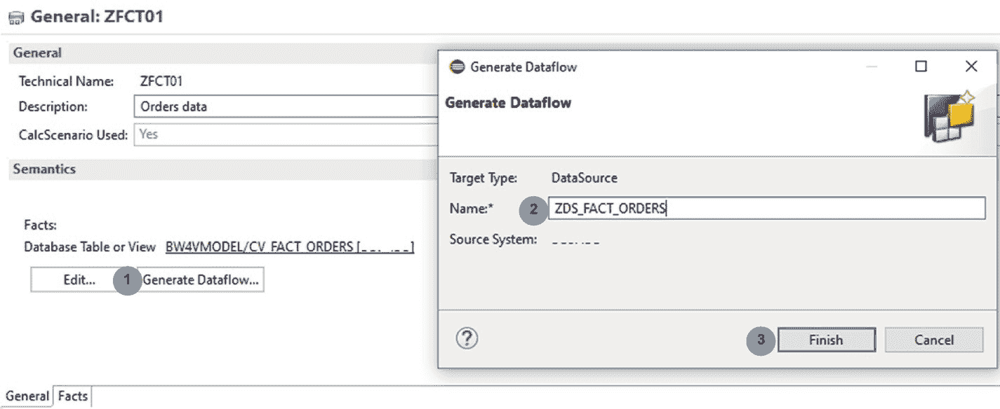
*图 4-26. 为 ZFCT01 开放式 ODS 视图生成数据源*

`生成数据流` 按钮将适用于所有开放式 ODS 视图语义类型（事实、主数据和文本），因此根据您的需求，您也可以为其他开放式 ODS 视图对象生成持久化层。单击此按钮后，Eclipse 将打开一个窗口，用于提供数据源对象的名称。继续操作后，将自动创建具有给定名称的新数据源。您会注意到，在给定的订单数据开放式 ODS 视图的语义部分，新的 `ZDS_FACT_ORDERS` BW 数据源取代了之前的 `CV_FACT_ORDERS` 计算视图（图 4-26）。创建的数据源将从 `CV_FACT_ORDERS` 视图中提取数据，其结构与该计算视图的结构相对应。计算视图字段的数据类型将转换为 SAP BW/4HANA 数据类型（参见图 4-27）。

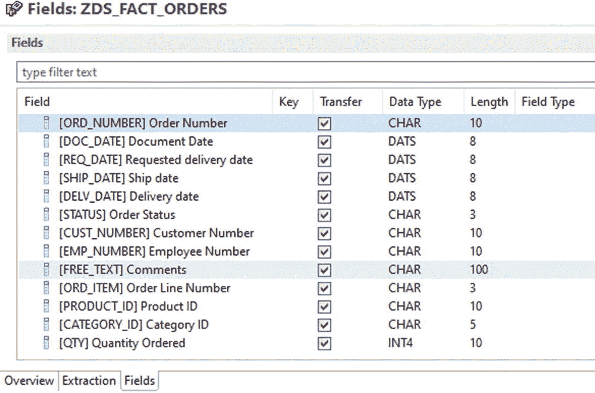
*图 4-27. ZDS_FACT_ORDERS 的输出结构*

现在我们已经创建了一个数据源对象，下一步我将生成一个 ADSO 以及转换和 DTP 对象。ADSO 将作为存储底层计算视图输出的目标对象。再次单击 `生成数据流` 按钮以创建一个 ADSO（图 4-28）。

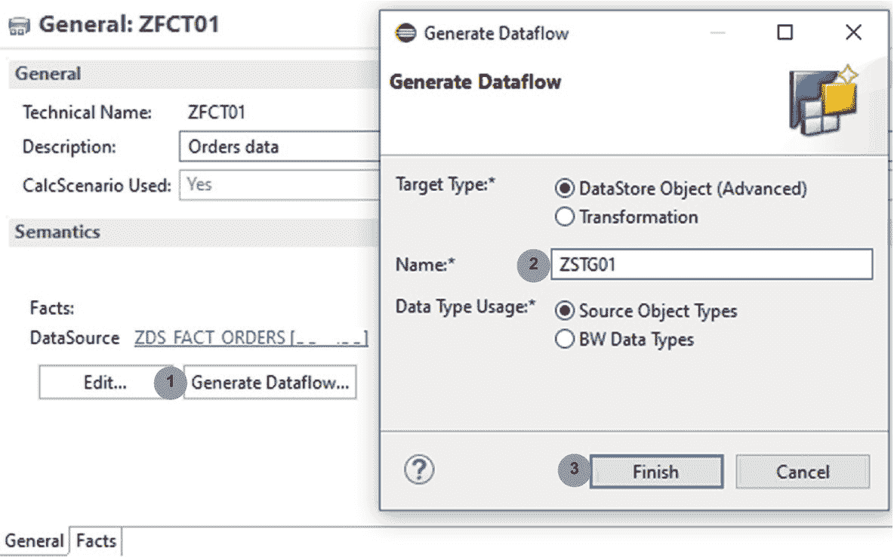
*图 4-28. 为 ZFCT01 开放式 ODS 视图对象生成一个 ADSO*

与上一步类似，单击按钮后，会弹出一个新窗口。这次我们需要提供目标 ADSO 的名称，我们将向其加载订单数据。继续操作后，系统将创建一个新的 ADSO 对象。此对象现在将用作 `ZFCT01` 开放式 ODS 视图的源，取代之前的 `ZDS_FACT_ORDERS` 数据源。您现在可以激活 `ZFCT01` 开放式 ODS 视图。

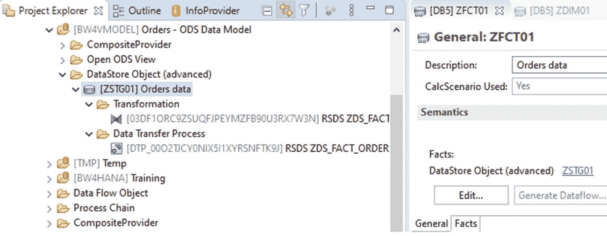
*图 4-29. 为订单数据持久化结构生成的对象概览*

如图 4-29 所示，在项目资源管理器中，您可以看到除了 `ZSTG01` ADSO 对象之外，系统还自动生成了转换和 DTP。默认情况下，系统会创建具有暂存数据存储对象类型并选中 `压缩数据` 选项的 ADSO（有关 ADSO 类型的详细信息，请查看第 1 章）。如果需要，您可以根据要求手动调整 ADSO 设置。生成的 ADSO 的输出结构与底层 `ZDS_FACT_ORDERS` 数据源的结构相对应（图 4-30）。

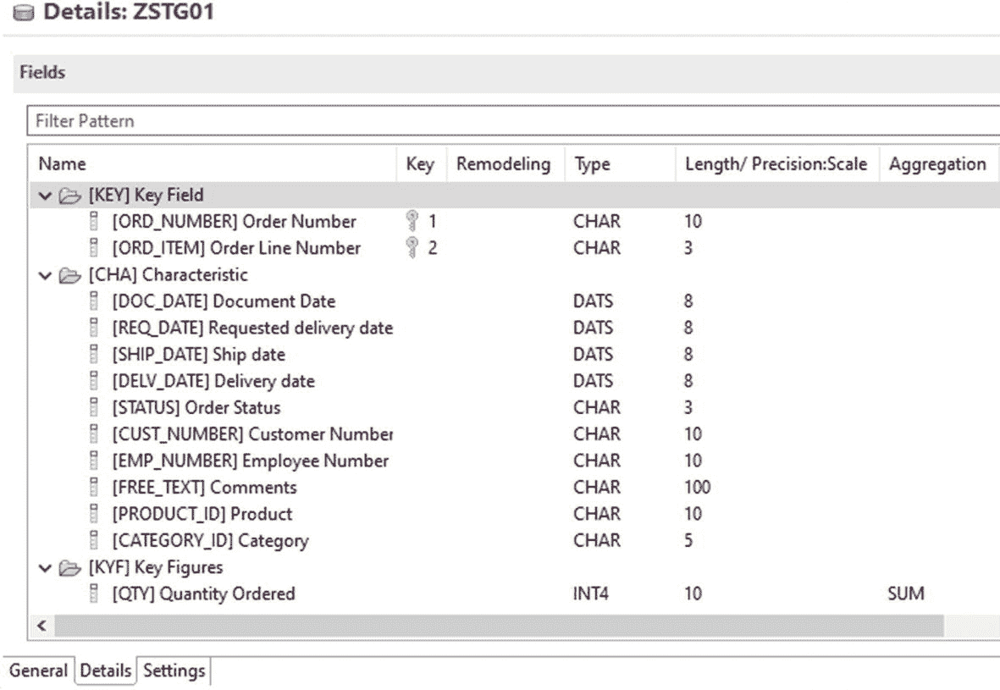
*图 4-30. ZSTG01 ADSO 的输出结构*

在生成 ADSO 时，系统将根据分配给特性（键）文件夹的 `ZFCT01` 开放式 ODS 视图字段，自动识别关键字段（图 4-15）。

完成所有必要的 BW/4HANA 对象生成后，当尝试执行现有的 `ZCPFCT01_Q01` 查询时，最初将找不到可用的数据。要使数据可用，您需要首先通过执行图 4-29 中所示的数据传输过程，将计算视图的输出加载到 ADSO 中。当您将数据加载到 ADSO 时，无需在 `CompositeProvider` 和查询级别应用任何其他更改。

## 总结
在本章中，我介绍了一个场景，其目标是创建一个与源关系数据模型相对应的 BW/4HANA 订单数据模型。我首先在 HANA 端实现了虚拟计算视图层。虽然可以直接在表上构建此类模型，但如果需要对源数据进行额外的数据处理，计算视图层则提供了更高的灵活性。

通过使用这些视图，我得以在 BW/4HANA 系统中实现一个完全虚拟的数据模型。底层源对象的用途决定了我所使用的开放 ODS 视图的类型。为了创建模型，我利用了所有三种可用的开放 ODS 视图类型。这些类型包括：文本、主数据和事实。这个虚拟模型随后被 `CompositeProvider` 和最终的查询对象所使用。

最后，我演示了如何将虚拟模型轻松转换为持久化结构，而不会影响在该模型之上创建的任何对象。这些示例帮助您理解了完全虚拟模型的局限性，以及哪些场景要求我们考虑将虚拟模型转换为持久化结构。

