# 5. 创建混合数据模型

在上一章中，我们创建了一个基于字段的数据模型，该模型是基于开放 ODS 视图对象构建的。接下来，我将引导您完成一个场景，我们将混合使用基于字段的方法和常规信息对象来实现一个混合数据模型。我将重点介绍混合建模方法的优势、局限性以及缺点。

# 场景

订单数据模型的下一项要求是使用附加属性对其进行增强。这一次，业务用户希望能够利用现有 SAP 信息对象的主数据。有两个信息对象需要纳入现有的数据模型：

- `0CALDAY`（日历日）：这是一个标准的 SAP 信息对象，包含与时间相关的属性和层次结构。用户希望能够利用 `0CALDAY` 主数据来处理“单据日期”列，该列当前只显示日期值。

- `ZBW4CUST`（客户）：这是一个自定义的 SAP 信息对象，包含客户信息。`ZBW4CUST` 的主数据不会涵盖外部数据模型中可用的所有客户编号。业务用户希望能够对共同的客户编号使用客户属性。对于那些在 `ZBW4CUST` 对象中不可用的客户，其属性将不予维护，并应保持为空。客户信息对象包含以下三个导航属性：
  - `ZBW4ADDR`（地址）
  - `ZBW4STAT`（州/省）
  - `ZBW4COMP`（公司名称）

图 5-1 展示了客户信息对象的内容和属性。

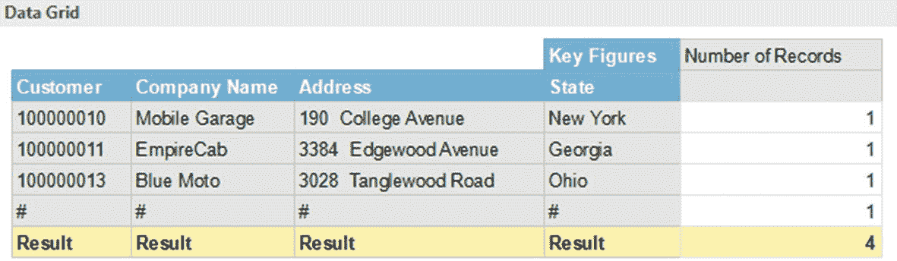
`图 5-1. 客户信息对象的内容`

如图 5-1 所示，客户信息对象的主数据仅包含三个客户编号。外部 `ORDER_HEADER` 表中存在的客户 `0100000014` 和 `0100000015` 不属于此信息对象。

为了实现所需的功能，我将采用混合建模方法。图 5-2 描述了如何扩展现有模型以满足业务需求。

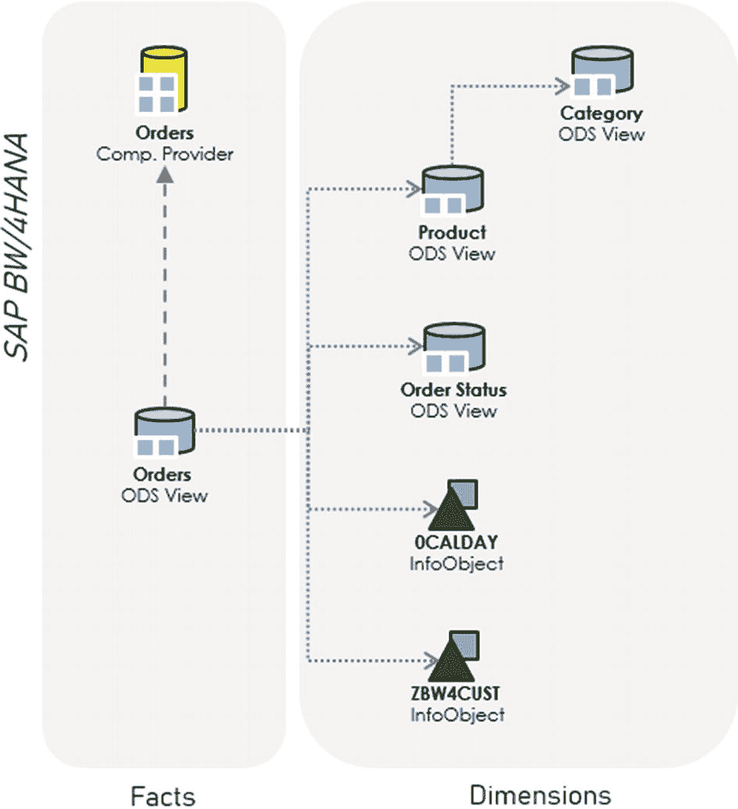
`图 5-2. 订单数据的混合数据模型`

如图 5-2 所示，为了满足业务需求，我们将通过向信息对象应用额外的关联来增强现有的订单数据模型。通过这种方式，我们将能够利用 SAP 信息对象中可用的主数据。

## 使用 `0CALDAY` 信息对象定义关联

第一个业务需求是在现有数据模型中为“单据日期”列包含一个时间维度。用户请求能够为此列添加额外的时间属性，例如日历年份、季度、月份和周。此外，用户还希望能够利用时间层次结构。为此，我们可以将 `0CALDAY` 标准信息对象纳入订单数据模型中。该信息对象已包含所有必需的功能。

在上一章中，我演示了如何使用关联功能将主数据开放 ODS 视图分配给事实开放 ODS 视图的字段。在当前场景中，我们将使用相同的功能，但不再关联主数据开放 ODS 视图，而是使用信息对象。通过此功能，关联信息对象的所有属性都将被继承到输出字段中；因此，用户将获得增强的报告功能。图 5-3 展示了在订单数据（`ZFCT01`）开放 ODS 视图的 `0DOC_DATE` 字段和 `0CALDAY` 信息对象之间应用关联的步骤。

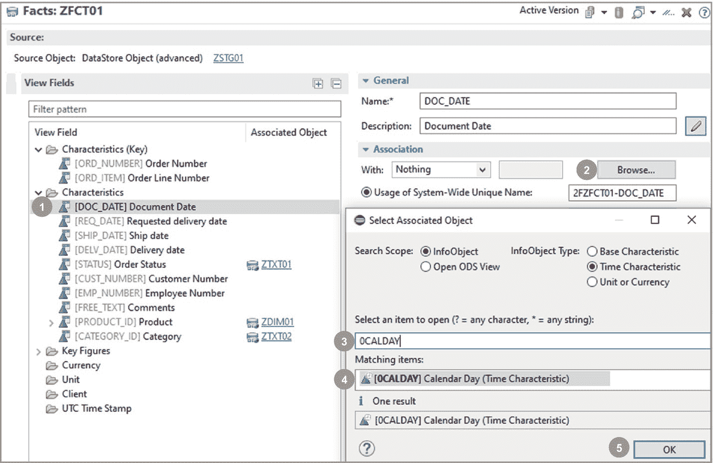
`图 5-3. 在 ZFCT01 开放 ODS 视图对象中为“单据日期”字段建立的关联`

要在输出字段和信息对象之间应用关联，请从“视图字段”部分选择目标字段。在右侧窗格中，单击“浏览 (2)”按钮。这将打开一个窗口，您可以在其中搜索 (3) 要用于关联的目标信息对象。找到目标信息对象后，选中它 (4) 并单击“确定 (5)”。应用关联后，您可以指定要从关联信息对象中启用以供报告使用的导航属性。

如图 5-4 所示，对于 `DOC_DATE` 列，我选择了来自关联的 `0CALDAY` 信息对象的三个导航属性。这些属性是 `0CALMONTH`、`0CALYEAR` 和 `0CALWEEK`。在“本地描述”列中，您可以为导航属性提供自己的描述。这可以帮助您轻松识别引用的字段。

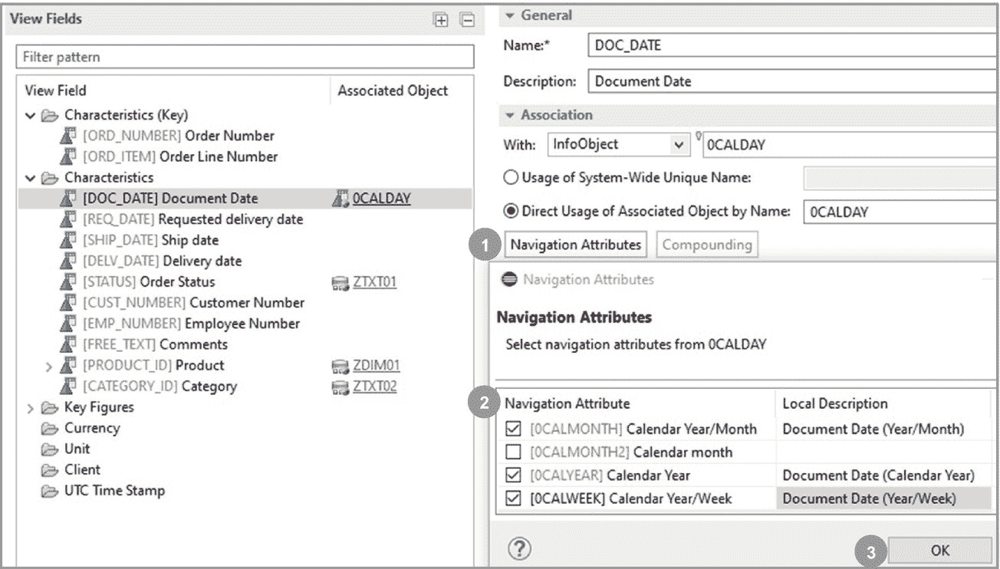
`图 5-4. 为 ZFCT01 开放 ODS 视图对象添加 0CALDAY 导航属性`

图 5-5 展示了“单据日期”列的目标配置。

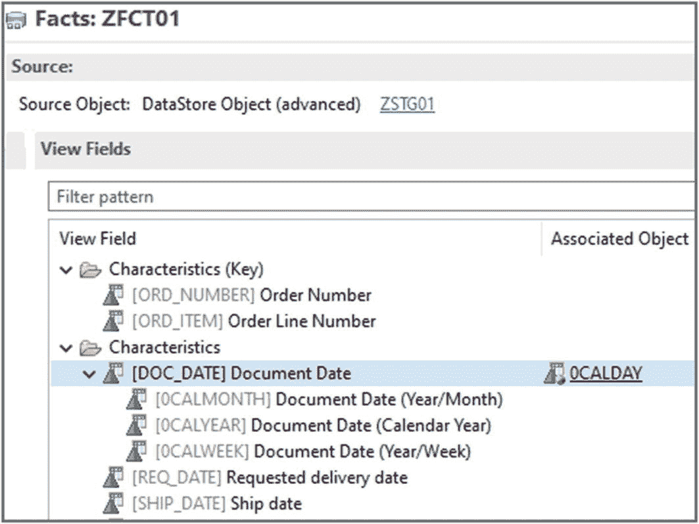
`图 5-5. ZFCT01 开放 ODS 视图对象中的 0CALDAY 导航属性`

“单据日期”列现在多了三个导航属性。

> **注意：** 可选地，字段与信息对象之间的分配可以直接在 `CompositeProvider` 级别上应用。同样，导航属性也可以直接在那里启用。

一旦我们应用了关联，我们就可以转到 `CompositeProvider` 配置。由于对于事实开放 ODS 视图，我对 `DOC_DATE` 字段使用了直接关联，其技术名称已更改，我们需要调整 `ZCPFCT01` `CompositeProvider` 中的映射（除非我们创建了新的 `CompositeProvider`）。此外，我们希望为订单数据向 `CompositeProvider` 的输出结构添加新的导航属性。

如图 5-6 所示，目标区域中的 `Document Date` 列（高亮显示）出现了一条警告。由于该列的技术名称发生了更改，从源到目标的映射已被移除。现在应从目标区域中删除此列，并用 `0CALDAY` 列替换。值得注意的是，默认情况下，你无法看到在 `Open ODS View` 级别为 `Document Date` 列启用的导航属性。要显示它们，请在源区域中右键单击 `Open ODS View` 名称，然后选择 `显示未分配的导航属性`（图 5-6）。

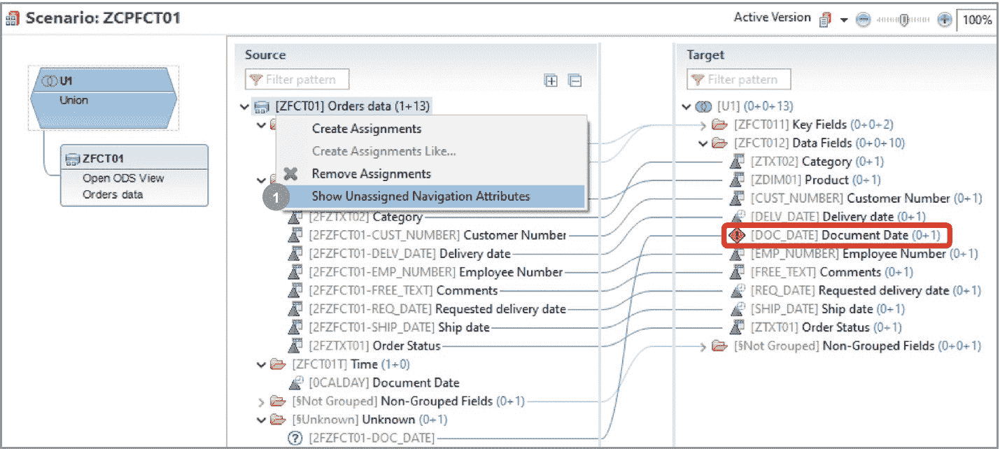
`图 5-6. CompositeProvider 中的“显示未分配的导航属性”菜单项`

显示导航属性后，你便可以从源映射到目标（图 5-7）。

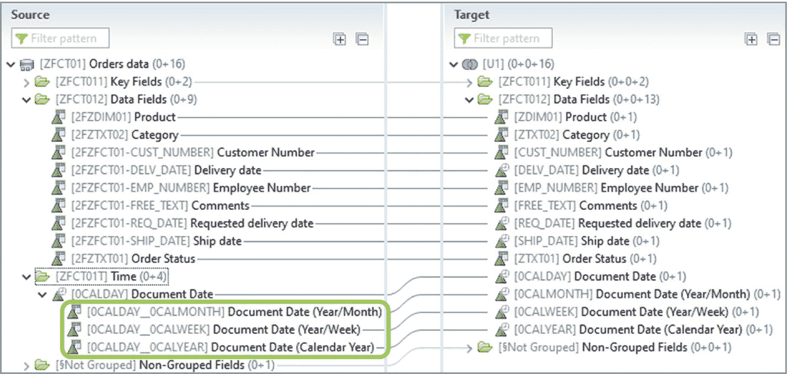
`图 5-7. 将 0CALDAY 导航属性添加到 ZCPFCT01 CompositeProvider 的输出中`

如图 5-7 所示，原有的 `DOC_DATE` 列已从 `CompositeProvider` 结构中删除，并替换为 `0CALDAY` 字段。此外，还包含了 `0CALDAY` 的三个导航属性（`0CALMONTH`、`0CALWEEK` 和 `0CALYEAR`）。完成此任务的最后一步是激活 `CompositeProvider`，并将新字段添加到订单报表（查询 `ZCPFCT01_Q01`）中。

> **注意：** 如果在激活 `CompositeProvider` 期间看到“列视图”错误，请为底层的 Open ODS View 运行 `RSDDB_LOGINDEX_CREATE` 程序以创建列视图（参见图 3-12）。

图 5-8 显示了已添加到查询 `ZCPFCT01_Q01` 中的新字段。

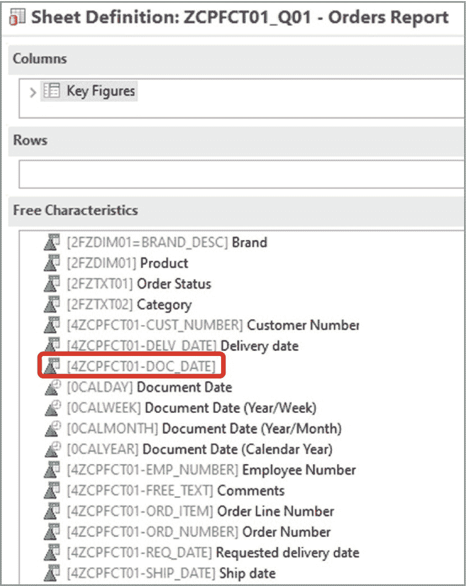
`图 5-8. 将 0CALDAY 导航属性添加到 ZCPFCT01_Q01 查询的输出中`

与我们处理 `ZCPFCT01` `CompositeProvider` 的方式类似，我们首先需要删除已由 `0CALDAY` InfoObject 替换的过时 `DOC_DATE` 列（图 5-8）。然后我们可以添加 `0CALWEEK`、`0CALMONTH` 和 `0CALYEAR` 列并保存查询。现在，当在 Analysis for Microsoft Excel 中运行报表时，我们可以利用新的时间属性以及层次结构。

你可以看到（图 5-9），在订单报表中，用户现在可以使用 `日历年度`、`年/月` 和 `年/周` 列进行导航。此外，他们还可以利用 `0CALDAY` InfoObject 下可用的层次结构。例如，我使用了 `年-季度-月-日` 层次结构来查看 `已订购数量` 的总计，并按年、季度、月和日进行了细分。这为用户在处理报表和仪表板时提供了新的显示、分组和过滤功能。

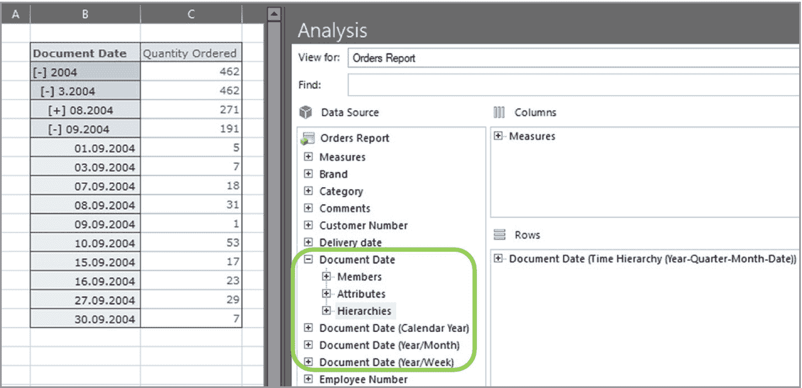
`图 5-9. 在 Analysis for Microsoft Excel 中显示 ZCPFCT01_Q01 的 0CALDAY 属性`

## 字段与 InfoObject 关联的其他方法

在进入下一部分之前，我将展示定义字段与 InfoObject 之间关联的另一种方法。正如我之前提到的，关联也可以直接在 CompositeProvider 级别应用。在下一个示例中，我将 `0CALDAY` InfoObject 分配给 `交货日期` (`DELV_DATE`) 列，这是另一个日期类型的字段。

### 操作步骤与示例

在 CompositeProvider 级别为字段分配 InfoObject 的步骤与为 Open ODS View（图 5-3）演示的步骤相同。添加关联后，你可以通过右键单击该字段并选择 `导航属性` 选项来启用导航属性。

图 5-10 显示了字段 `DELV_DATE` 现在也与 `0CALDAY` InfoObject 建立了关联。此外，你可以看到有一个启用导航属性的选项。选择导航属性后，它们会显示在 `DELV_DATE` 列下方。

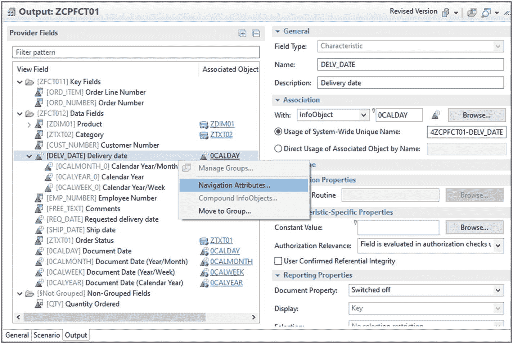

图 5-10. 为 `ZCPFCT01` CompositeProvider 添加 `0CALDAY` 导航属性

### 注意事项

> **注意**
>
> 使用关联功能时，需要记住，对于单个 InfoObject，在 CompositeProvider 内只能为一个字段设置 `按名称直接使用关联对象` 选项。如果需要对特定 InfoObject 的多个列应用关联，则应保留 `使用系统级唯一名称` 选项。

### 实施建议

如果源事实表 Open ODS View 将在多个模型中重复使用，那么最佳实践是建议在该对象中预先应用关联。这样，每次 CompositeProvider 消费它时，所有相关字段都已可用。否则，你需要为每个新的 CompositeProvider 配置关联。此外，如果你直接在 Open ODS View 之上创建查询，这是启用导航属性的唯一方法。

如果源 Open ODS View 不会被任何其他 CompositeProvider 消费，或者你只想为特定模型添加导航属性，那么你可以直接在 CompositeProvider 级别应用关联。

### 总结

从建模的角度来看，这两种方法都是有效的。最终，它们为最终用户提供相同的功能，你应该根据具体场景决定哪种方法最适合。

# 使用 ZBW4CUST 信息对象定义关联

既然你已经掌握了如何应用关联，你可能会认为为字段分配另一个信息对象是小菜一碟。这在一定程度上是对的；然而，针对第二个需求，我们需要考虑额外的限制条件。

在文档日期字段与 `0CALDAY` 信息对象之间应用关联时，我们无需担心这些对象之间的数据一致性。这是因为文档日期列的 `DATE` 数据类型已经约束了该列可能包含的值（仅限日期）。正因如此，我们避免了文档日期列包含 `0CALDAY` 信息对象中不可用值的情况。对于客户字段，情况则有所不同。客户数据在外部数据源中维护；因此，我们无法确保 ID 始终与 `ZBW4CUST` 信息对象主数据匹配。如场景所述，`ORDER_HEADER` 表包含两个不属于 `ZBW4CUST` 信息对象主数据的客户编号。请参见客户主数据值与 `ORDER_HEADER` 表中客户唯一值的对比，如图 5-11 所示。

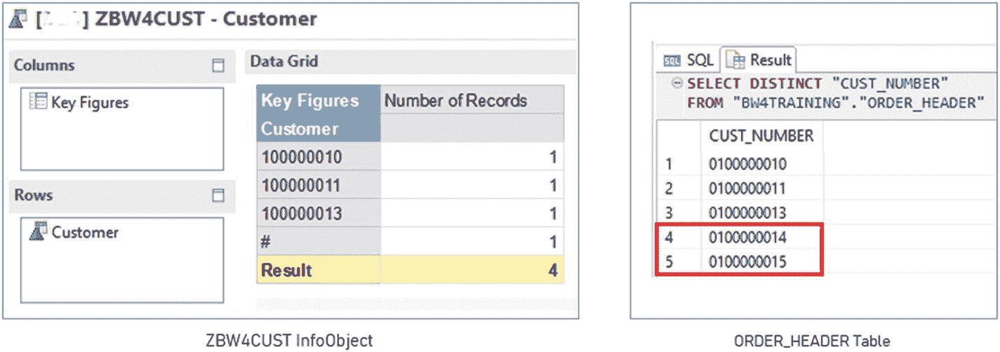

图 5-11. ZBW4CUST 信息对象与 ORDER_HEADER 表之间的客户编号对比

如图 5-11 所示，信息对象 `ZBW4CUST` 包含三个客户值，而在 `ORDER_HEADER` 表中有五个客户编号。高亮的客户编号（`0100000014` 和 `0100000015`）不属于 `ZBW4CUST` 主数据。要检查这种不一致性如何影响数据模型，让我们在 `CUST_NUMBER` 字段与 `ZBW4CUST` 信息对象之间应用一个关联（图 5-12）。

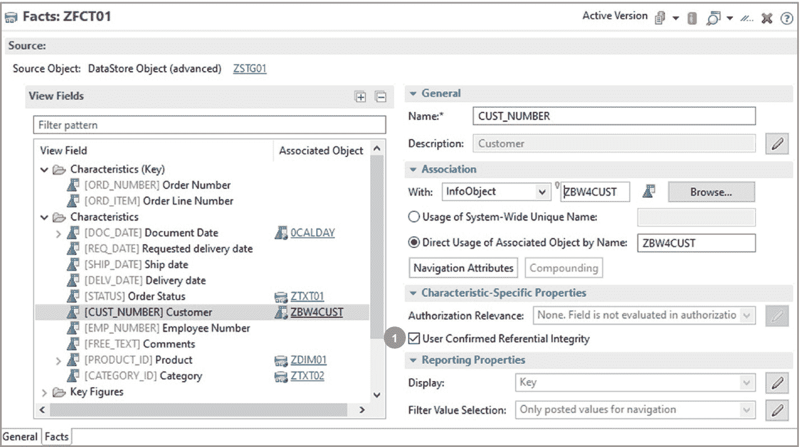

图 5-12. ZFCT01 开放 ODS 视图中客户字段的关联

要为 `CUST_NUMBER` 字段应用关联，请遵循与 `0CALDAY` 信息对象相同的步骤（图 5-3）。这次你应选择 `ZBW4CUST` 信息对象作为参考（图 5-10）。此外，你可能会注意到选项 (1) `用户确认参照完整性`已被选中（图 5-12）。如果你选择此选项，在查询运行时，系统将在字段 `CUST_NUMBER` 与 `ZBW4CUST` 信息对象的技术表之间执行参照连接。结果，查询将仅返回两个表中都存在的条目。

应用关联后，我们现在可以利用导航属性。按照图 5-4 所示的步骤启用 `ZBW4CUST` 信息对象的导航属性。图 5-13 显示了为 `ZFCT01` 开放 ODS 视图启用的导航属性。

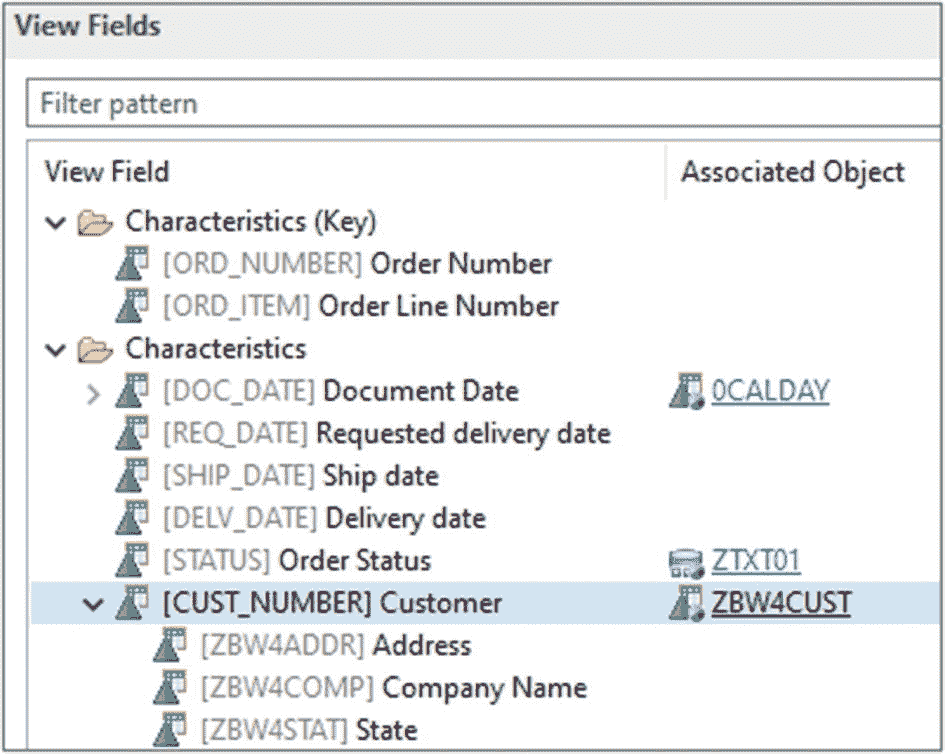

图 5-13. ZFCT01 开放 ODS 视图中的 ZBW4CUST 导航属性

现在，让我们在 Analysis for Microsoft Excel 中打开 `ZFCT01` 开放 ODS 视图，检查关联是否按预期工作。

## 参照完整性设置的重要性

在 Analysis for Microsoft Excel 中打开 `ZCPFCT01` 开放 ODS 视图的预览时，默认情况下只显示合计。对于该开放 ODS 视图，订购数量的合计值为 462（图 5-14）。

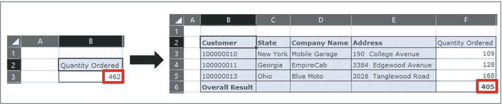

图 5-14. ZBW4CUST 属性在 Analysis for Microsoft Excel 中针对 ZCPFCT01 的显示（选中参照完整性选项）

在图 5-14 的右侧，你可以看到拉取所有客户相关属性后的显示。乍一看，一切似乎按预期工作，客户相关信息正确显示。然而，你可能会注意到，一旦将客户信息添加到输出中，订购数量的合计值不再是 462，而是 405。你可能还会意识到，在底层的 `ORDER_HEADER` 表中有五个客户可用，而报告输出只显示三个。这种行为是由我们在将 `ZBW4CUST` 信息对象关联到 `CUST_NUMBER` 字段时选择的“`用户确认参照完整性`”选项引起的（图 5-12）。使用此选项后，每次将关联的信息对象或其导航属性添加到输出时，都会执行参照连接，并过滤掉所有不属于关联信息对象主数据的记录。这可能会给用户带来困惑，因为根据添加到输出的字段不同，我们可能会看到不同的结果。这意味着，只有在我们知道参照完整性得到保证的情况下，才应使用“`用户确认参照完整性`”属性（图 5-12）。换句话说，我们需要确保关联信息对象的主数据将涵盖来自源表的所有值。

由于在我们的场景中，来自外部 `ORDER_HEADER` 表的客户值并未完全被客户主数据覆盖，现在让我们取消选中“`用户确认参照完整性`”属性，并重新激活开放 ODS 视图（图 5-15）。

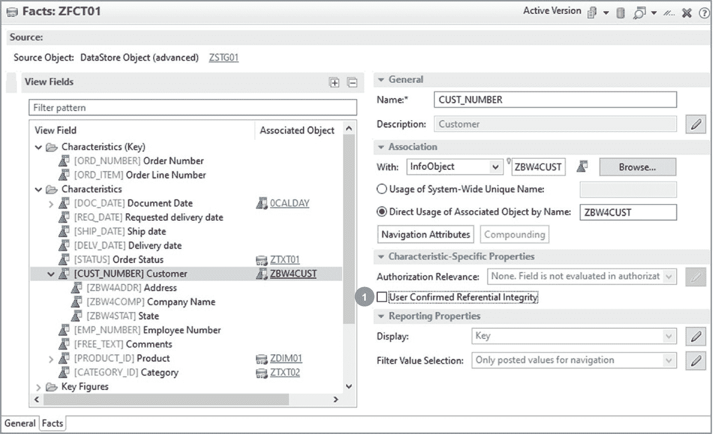

图 5-15. 在 ZFCT01 开放 ODS 视图中取消选中客户字段的参照完整性选项

激活开放 ODS 视图后，我们可以通过在 Analysis for Microsoft Excel 中运行来再次检查输出（图 5-16）。

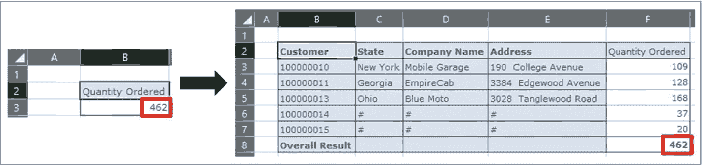

图 5-16. ZBW4CUST 属性在 Analysis for Microsoft Excel 中针对 ZCPFCT01 的显示（未选中参照完整性选项）

如图 5-16 所示，更改参照完整性选项后，客户编号 `0100000014` 和 `0100000015` 现已可用。由于这两个客户的主数据未在 `ZBW4CUST` 信息对象中维护，因此属性州、公司名称和地址为空。此外，订购数量的值现在保持一致。

> **注意：** 使用“`用户确认参照完整性`”属性时，你应该意识到，在查询运行时，未在关联信息对象主数据中找到的所有值都将被插入到该信息对象的主数据表中。

如上所述，取消选中 `用户确认参照完整性` 选项时需要格外小心，因为这可能会影响关联 `InfoObject` 的主数据表。每次对有关联的对象运行预览时，系统都会传播关联 `InfoObjects` 主数据表中不存在的值。为了直观地说明这一点，我们来检查一下 `ZBW4CUST` 主数据表的变更前后情况。

图 5-17 展示了在我们取消选中 `参照完整性` 选项并运行 `ZCPFCT01` 开放 ODS 视图（图 5-15）后，`ZBW4CUST` 主数据表内容的变化。

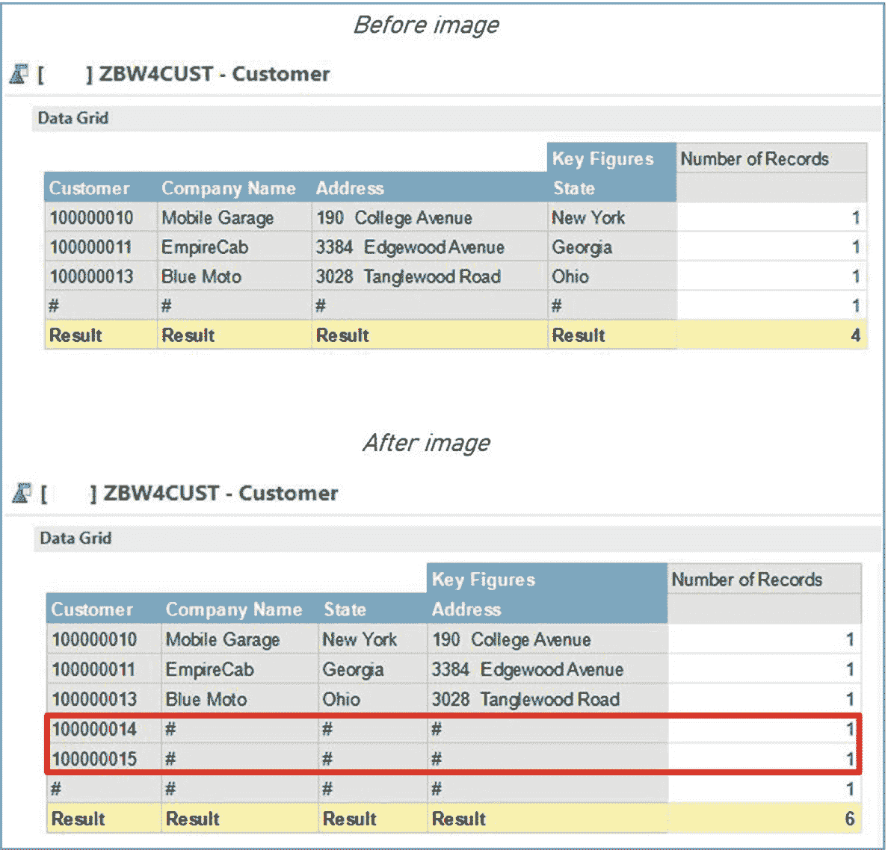

图 5-17. 执行 `ZCPFCT01` 开放 ODS 视图前后，`ZBW4CUST` 主数据表的对比

图中高亮显示的新条目（`0100000014` 和 `0100000015`）是在开放 ODS 视图运行时填充到该 `InfoObject` 中的。这意味着，每当底层 `ORDER_HEADER` 表中出现新的客户值，一旦对开放 ODS 视图执行预览，这些值就会被添加到 `ZBW4CUST` InfoObject 的主数据中。请记住这一点，在将字段与 `InfoObjects` 关联时必须谨慎，因为你可能无意中传播了不需要的主数据值。如果要避免这种情况，可以创建一个现有 `InfoObject` 的副本，并使用它来代替主 `InfoObject`。这就是为什么在某些场景下，你可能会更倾向于使用 `参照完整性` 设置来确保主数据不会混乱。

由于订单数据的开放 ODS 视图（`ZCPFCT01`）已用新字段更新，我们现在需要将这些变更整合到 `CompositeProvider` 和查询中。首先，我们应该更新 `CompositeProvider` 对象（图 5-18）。

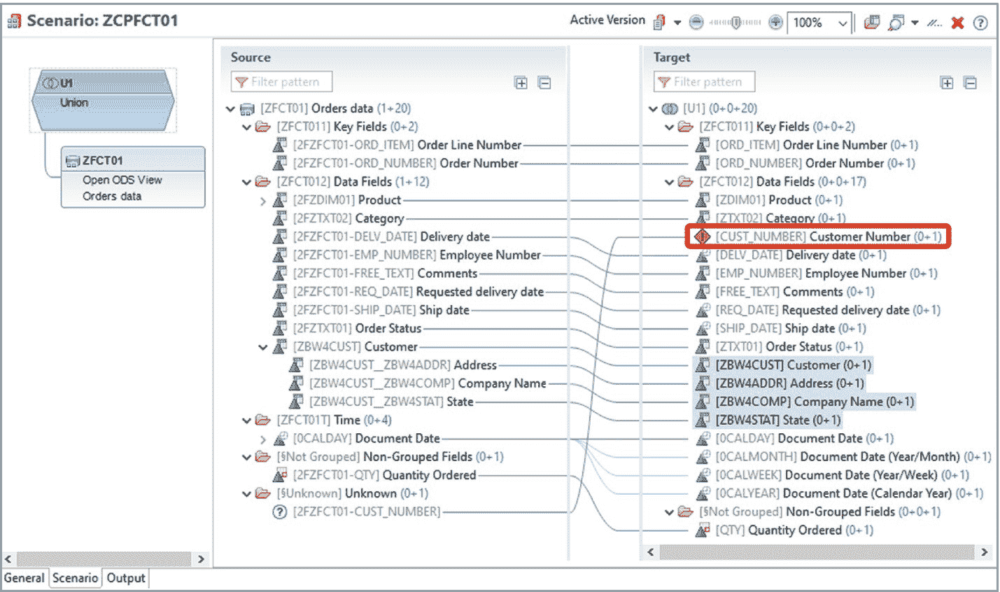

图 5-18. 将 `ZBW4CUST` 导航属性添加到 `ZCPFCT01` CompositeProvider 的输出中

要显示导航属性，我们应该使用图 5-6 中所示的选项来启用它们。因此，我们将能够使用客户属性并将其映射到输出。如图 5-18 所示，我们还需要删除 `CUST_NUMBER` 字段的映射，因为客户的技术名称现在继承自 `InfoObject` `ZBW4CUST`。成功激活 `CompositeProvider` 后，最后一步是更新最终的查询。

由于我们从底层 `CompositeProvider` 中删除了 `CUST_NUMBER` 字段，因此也需要将其从查询中删除。然后，我们可以添加新的客户相关字段并保存查询（图 5-19）。

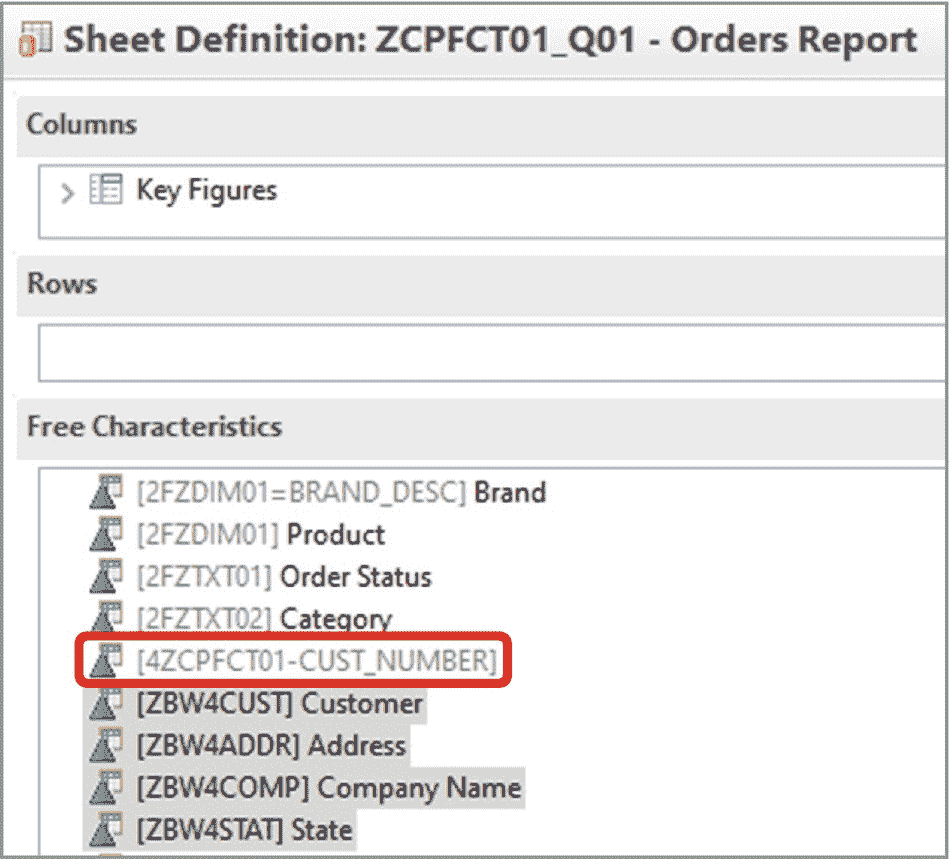

图 5-19. 将 `ZBW4CUST` 导航属性添加到 `ZCPFCT01_Q01` 查询的输出中

图 5-20 中显示的最终查询包含了用户要求的所有附加字段。用户提出的增强需求现已实现。

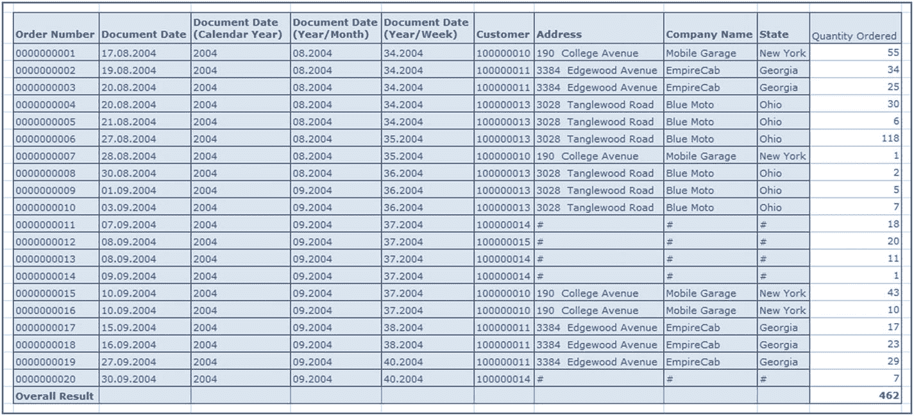

图 5-20. 在 Analysis for Microsoft Excel 中展示的 `ZCPFCT01_Q01` 查询的输出

## 总结

本章演示了如何在基于外部源创建的模型中使用 `InfoObjects`。我们解释了如何在字段与 `InfoObjects` 之间建立关联。我们了解到，关联既可以在开放 ODS 视图级别应用，也可以在 `CompositeProvider` 级别应用。

混合数据模型的最大优势在于，我们可以利用现有的主数据对象及其功能，例如层级结构、导航属性和文本。另一方面，需要强调的是，混合数据模型仅在外部属性与 SAP 数据类型和主数据内容一致时才能使用。否则，外部字段与 `InfoObjects` 之间的关联可能会产生错误结果或在报表时导致错误。

最后，我们了解了 `Referential Integrity` 属性的影响。示例解释了正确使用此设置的重要性，并强调了为什么应谨慎使用。

