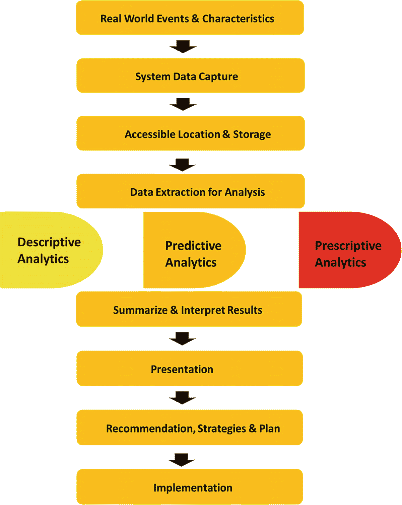
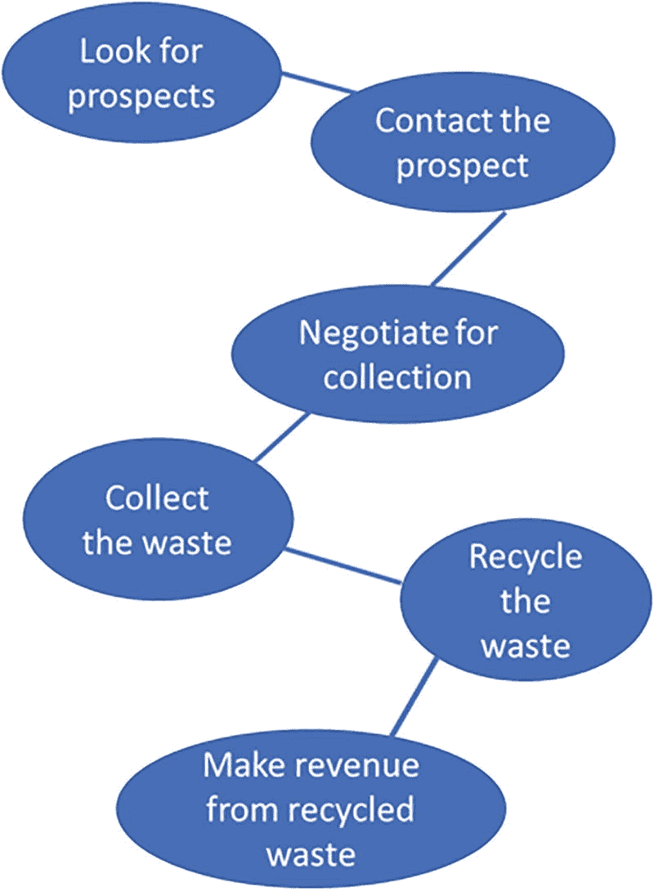
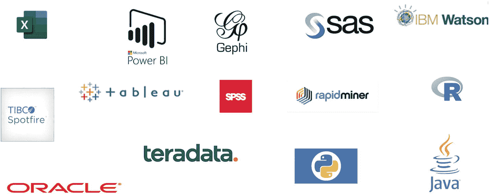
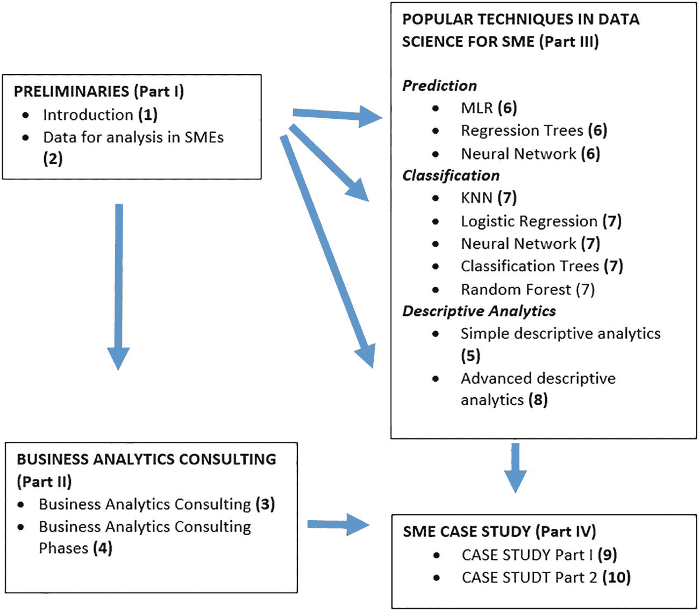
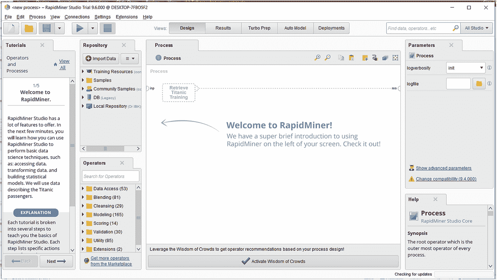
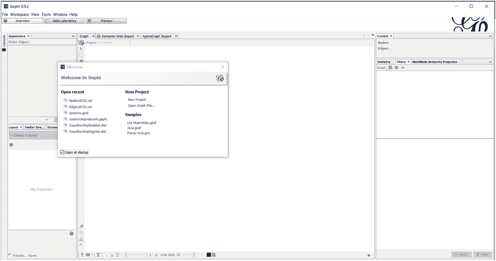

# 1. 引言

在本章中，我们首先对数据科学进行总体介绍，然后将其聚焦于商业数据科学，即通常所说的商业分析。接着，我们将以商业分析旅程的形式，详细解释商业分析所涉及的过程。在这一旅程中，我们将阐明在商业世界中从头到尾执行一个分析项目所需的要素，重点聚焦于小型企业咨询，尽管该流程适用于所有类型的企业，无论规模大小。我们还将描述本书中所指的小型企业，以及在此类环境中开展分析项目的特殊性。在本章结尾，我们将讨论小型企业常见的分析问题类型，以及考虑到小型企业在分析项目上的预算状况，可用于解决这些问题的工具。

## 1.1 数据科学

简单来说，数据科学指的是具备获取数据、从数据中生成理解、处理数据、从数据中提取价值、将数据可视化，并以能够据此做出决策的方式进行呈现的能力。数据科学被描述为从海量数据中提取知识的过程。它是数学、统计学、可视化与人工智能的交汇点。人工智能是机器学习的超集，而机器学习又是深度学习的超集。

## 1.2 商业数据科学

商业数据科学通常被称为商业分析，这也是我们在本书中使用的术语。利用定量数据为决策提供依据的活动和艺术，即为商业分析。多个组织对此术语有不同的解读。在商业分析中，数据可视化与报告被用于理解“发生了什么”以及“正在发生什么”（商业智能）。¹ 商业分析的目标是帮助你聚焦于那些能够提升公司收入、生产力和效率的数据集。⁴

在商业分析中，我们希望研究如何分析来自不同来源的数据，尤其要实时关注企业的关键绩效指标（KPI），并以此支持战略性的商业决策。

比较商业分析与数据科学，我们发现商业分析侧重于从可视化数据中提取有意义的见解以支持决策，而数据科学则更倾向于处理原始数据，并利用算法、统计模型和计算机编程来提取有价值的洞察。在本书中，我们将结合商业分析和数据科学两种视角，并将其统称为商业数据科学。

商业分析的主要应用类型包括：

1.  *财务分析*：可将其特征描述为旨在解决特定业务问题并预测未来财务结果的数据分析。财务分析的目标是利用可信、可验证的信息而非直觉来制定商业战略。它为公司的财务数据提供了广阔的视野，以及理解重要模式并采取行动以提升绩效所需的工具（`www.techtarget.com/searcherp/definition/financial-analytics`）。诸如 McAfee、Deloitte 和 Wiley 等组织正通过财务分析实现成本降低、效率提升等目标。

2.  *员工分析*：员工分析是一种以数据为导向的工作场所管理方法。员工是组织最重要的资产，如果管理得当，将对企业产生积极影响。我们用它来回答诸如以下问题：我们应该雇佣谁？我们应该提拔谁？对公司而言，最好的职业发展路径是什么？协作模式是怎样的？谁是关键的沟通者？我们可以做些什么来加强沟通？等等。通过使用员工分析，谷歌、亚马逊、思科等许多公司能够准确理解如何吸引、留住员工并确保其生产力。

3.  *客户分析*：这是指利用数据来更好地了解客户的构成、需求和满意度。此外，利用相关技术，可以根据客户行为将客户分组，识别总体趋势，并开展定制化的营销和销售活动。⁸ 在银行、保险或金融等领域，客户分析有助于理解客户生命周期价值、流失率等。客户分析在亚马逊、Flipkart 等电子商务网站上被广泛应用。

4.  *运营分析*：“运营分析”一词指的是一种专注于改进当前运营的商业分析。¹¹ 与其他类型的商业分析一样，它也涉及使用各种数据挖掘和数据聚合技术，以便为业务规划获取更透明的数据。⁹ Loom、Bold Penguin 和 Atrium 等公司已应用运营分析，从而解锁了诸如客户成功与销售部门之间的协作，以统一阵线触达客户等成果。

## 1.3 商业分析旅程

商业分析生命周期可被称为信息-行动价值链² 或商业分析旅程。它是将数据及其来源与分析过程及分析结果联系起来的过程。它还包括沟通分析结果，并评估分析项目的目标是否已达成。

信息-行动价值链（商业分析旅程）包含大约九个阶段，如图 1-1 所示。

流程图展示了商业分析的旅程，包含九个阶段。商业分析实施的旅程始于现实世界的事件及其特征。

图 1-1 商业分析旅程

### 现实生活中的事件与描述

分析能够为企业解决的问题，主要源于发现特定业务的需求，尤其是那些可通过分析来解决的需求。值得注意的是，在构建一个能产生成果的成功分析项目之前，你需要对业务领域有深入理解，并掌握该业务的典型成功策略，因为分析建议将被用于改进这一目标。根据所涉业务类型的不同，有多种方法可以发现其特定的分析需求。这些方法包括使用访谈、社交媒体（`文本挖掘`）、焦点小组等。同样重要的是，这些需求应聚焦于具体业务的目标。总体而言，业务分析有助于提升业务流程、降低业务成本、驱动业务战略，并监控与改善业务财务绩效。例如，优步（Uber）在 2018 年初优化了其`客户至上工单助手（COTA）`，利用预测分析提高了响应支持工单的速度与准确性。这是实施业务分析的企业的一个绝佳案例。根据毕马威（KPMG）对新兴基础设施趋势的分析，许多公司现在都采用预测分析来预见维护与运营问题，避免其演变为重大故障。¹²

在业务分析旅程的第一阶段，我们需要理解数据挖掘项目或业务分析项目的目标，特别是要弄清它是为了回答一个问题或多个问题的一次性努力，还是一个持续的过程。此后，我们需要明确要做出的决策，并确定或建议能够帮助决策的分析输出。这将有助于设计一个概念性的分析框架，以生成所需输出。

概念性业务模型用于理解业务领域中的数据以及业务的实际运作方式。它特别有助于理解背景信息在解决分析问题中的重要性，同时也帮助我们理解关键要素之间的关联。由于业务分析是解决问题（即回答疑问），因此在此阶段了解在分析过程中哪些问题是值得提问的至关重要。概念性业务模型将帮助我们做到这一点。

在处理现实世界事件的这一阶段，我们还需要理解究竟有哪些因素会贡献给我们用于分析项目的数据。例如，数据可能来自某人的购买行为，也可能来自产品或服务的使用。事实上，数据可能来自问题领域的任何方面。正如业务分析定义中所指出的，需要将重点放在有助于解决方案的数据上。并非仅仅拥有海量数据，而是要聚焦于解决所提出的问题或疑问所需的数据。以下场景给出了一个真实的中小企业（SME）业务示例，用以诠释分析旅程的这一阶段。

**一个真实的业务问题：** *Alegria Recyclers Ltd（[www.alegriarecyclers.com.ng/](http://www.alegriarecyclers.com.ng/)）是一家处理废料回收的小型企业。Alegria 只有两名正式员工和大约十名临时员工。该公司处理医院废弃物，如 X 光胶片。他们的客户是各类医院和诊所。数据科学家面临的任务是，为定位未来客户制定最佳的可执行策略。*

*该业务的概念性业务模型如图 1-2 所示。它涵盖了业务的大部分活动。作为业务分析顾问，你需要通过首先构建概念性模型来理解你所咨询的业务；这将帮助你了解如何在业务领域捕获现实世界的事件，即所需的数据以及不同类型数据的重要性。它还将帮助你理解如何优化地使用分析结果，以便在分析项目中获得最佳成果。第一步是寻找潜在客户；在此环节，你需要探索过去合作过的客户类型数据，了解描述这些潜在客户的属性是什么，从不同类型客户那里获取何种材料等；所有这些信息，例如，有助于构建聚类模型，从而帮助 Alegria 理解其潜在客户以及更多信息。在概念性模型的第二步中，该步骤涉及 Alegria 如何联系第一步中的潜在客户，你需要存储关于联系时间、地点等信息。对于剩余的每一步，如协商收集废弃物、收集废弃物、回收废弃物以及从废弃物中创收，你都需要提取出可能被捕获的数据属性。这就是你如何利用概念性业务模型全面理解业务领域数据的方法。*

该模型展示了从回收废弃物中创收这一业务理念的可行性。

**图 1-2** Alegria Recyclers Ltd 的概念性业务模型

### 捕获数据

在使用概念性业务模型成功确定构成数据基础的内容以及数据类型后，下一步就是捕获数据，并将其以可用于分析的形式存储起来。数据捕获涉及捕获现实世界现象的物理或数字表示并将其存储到某处的机制。在此阶段，需要确定需要存储或检索的内容（即，如果该数据之前已存储过）。有时，这可能涉及特征选择与表示（这将在第 2.​1 节中解释）。

小型企业在数据捕获方面的特殊性在于，由于大多数此类企业缺乏管理其数据的企业管理系统，因此需要进行大量的数据素养教育；此外，它们尤其不清楚自己的业务需要哪些数据。因此，有必要进行数据完整性宣导，以便从分析项目中获得最佳成果。基于此，捕获数据用于分析的任务具有一定挑战性；大多数数据以可能未做好分析准备的 Excel 表格形式存在。

Microsoft Excel 中有几个数据清理和预处理函数可供使用。此外，可能需要使用更具交互性的数据可视化工具，如 Tableau (`www.tableau.com/`) 和 Power BI (`www.microsoft.com/en-us/download/details.aspx?id=58494`)，以实现捕获和准备数据以供分析的目的。互联网上还有其他免费或收费的工具，可以帮助捕获小型业务流程，从而在后端提供可用数据，无论企业规模多小，都能启动分析流程。

例如，Google Analytics 可以帮助小型企业，尤其是电子商务企业，根据从电子商务平台自动生成的数据制定可执行的策略。这些数据可用于衡量营销活动绩效、投资回报率等 (`analytics.google.com`)。对于已制定正确数据收集和治理程序的企业，数据捕获阶段要容易驾驭得多，因为剩下的工作只是检查数据是否适用于特定的分析目标。

### 可访问的位置与存储

在此阶段，您需要了解所处理数据的来源，然后将它们整合到一个平台上。可能需要从不同的数据库中汇集数据，这些数据库可以是内部的（例如，客户过去的购买记录），也可以是外部的（信用评级、人口普查数据等）。这通常被称为数据仓库或企业数据仓库。目前，有多种新兴技术可以实现这一点，无论是物理的还是虚拟的。

数据可能来自多种来源；我们将在即将到来的第 2.​1 节中了解更多相关信息。在存在企业管理系统或软件的情况下，无论规模多小，业务数据的主要来源都是概念性业务模型中所述的操作数据库或应用程序。企业中还有其他数据来源，例如可扫描条形码、销售点（POS）设备、鼠标点击轨迹、全球定位卫星（GPS）等。互联网也是丰富的外部数据来源，无论是存储在数据库中还是来自社交媒体平台。

### 提取数据用于分析

在准备分析时，需要回答一个好问题：您需要为建模使用多少个变量以及多少数据？根据 Galit 等人（2019 年，第 29 页）的观点，每个预测变量可以有十条记录，而 Delmaster 和 Hancock（2001 年，第 68 页）也建议，对于分类过程，我们至少可以有 `6 × m × p` 条记录，其中 `m` 是结果类别的数量，`p` 是变量的数量。

在提取数据用于分析时，进行数据采样很重要；这很重要，因为它有助于从总体中获得良好的样本比例，因为我们的一些算法无法处理大量数据进行统计分析。因此，从总体中选取良好的样本比例是进行分析并提出多个假设的良好实践。

此外，在准备数据进行分析时，您可能需要探索、清理和预处理数据，验证数据是否处于合理状态，处理缺失数据，并根据您对每个变量的预期，检查属性值是否在合理范围内。在此阶段，您还需要检查异常值，必要时对数据进行标准化，并确保字段定义、计量单位、时间段等的一致性。最后，在此阶段，您需要处理分类变量，并在必要时将其转换为哑变量。

准备数据进行分析的另一个主要步骤是数据可视化，这将在第 2.​5 节中详细解释。可视化有助于处理前面提到的多数数据准备步骤，也可用于变量推导和选择。可视化可以帮助确定适当的分箱大小（如果需要对数值变量进行分箱），并在数据简化过程中合并类别。如果数据收集成本较高，可使用可视化来确定哪些变量和指标实际上是有用的。可视化还有助于我们理解数据结构、清理数据以移除意外的数据缺口或“非法”值。可视化还将有助于识别异常值、发现初始模式，并提出可在分析过程中探索的问题。

在提取数据用于分析时，数据简化有助于消除不需要的变量。除此之外，特征提取方法用于降低数据维度并识别代表数据的大部分成分。数据划分（在第 6 章中）和转换对于准备数据进行分析非常重要。当您需要将诸如收入额之类的变量转换为一个范围（例如 50,000 到 100,000 奈拉）时，会进行数据转换。也存在需要根据现有数据创建新变量的情况，例如，根据客户的购买数据，创建一个 `true` 或 `false` 变量来捕捉客户是否出现。了解每个变量的含义以及是否应将其纳入分析中对我们来说也很重要。

## 数据分析

在此阶段，我们确定要执行的数据挖掘任务。其范围涵盖描述性分析、诊断性分析、预测性分析、规范性分析和认知性分析。有时，您可能需要将这些任务结合起来，或将它们作为相互的先决条件。这里需要重点注意的是，没有一种方法比另一种更重要；一切都取决于业务分析项目的最终目标或目的。

`*描述性分析*`有助于描述当前事物的状态或过去发生的事件。在描述性分析中，我们利用现有信息来更好地理解业务环境，并将这些知识与商业洞察力相结合，以做出更明智的决策。描述性分析使用简单的汇总、交叉表以及简单的统计量（如均值、中位数、标准差和分布，例如直方图）。一些高级的描述性分析包括关联规则或聚类算法。描述性分析能够帮助回答的一个问题示例是：`*什么样的客户在租用我们的设备？*` 有时，我们使用描述性分析来识别两个变量之间的联系；这一研究领域被称为关联规则挖掘。例如，超市可能会收集顾客购买行为的信息。超市可以利用这些信息发现哪些商品通常被一起购买，并据此进行销售。这被称为购物篮分析。此外，聚类可用于识别数据中在某种意义上“相似”的分组和结构，而无需依赖现有的数据结构。

`*预测性分析*`利用我们对过去发生事件的了解来预测未来会发生什么。它使用高级统计方法，例如回归算法，包括线性回归、逻辑回归、基于树的算法、神经网络等。分类和回归任务属于预测性分析范畴。分类涉及将已知结构泛化以应用于新数据。例如，电子邮件程序可能会尝试将一封电子邮件分类为“合法”或“垃圾邮件”。回归则试图确定一个因变量与一系列其他变量之间关系的强度和特征。预测性分析能够帮助回答的一个问题示例是：`*谁过去租用过我们的设备，预测未来谁会租用？*` 预测性分析通常是一个迭代过程，我们会尝试同一算法的多个变体，即在算法中选择不同的变量或设置。最终选择什么通常取决于算法在验证数据上的性能反馈以及它在真实世界数据上的表现。这里需要重点注意的是，机器学习算法依赖于数据，因此在为每个案例研究数据选择最终算法之前，必须遵循这个迭代过程。

`*规范性分析*`通过提供关于我们应该做什么的建议，将分析与决策联系起来。它帮助我们了解应该瞄准哪些客户、应该做出哪些选择，并且通常涉及将数值优化技术与业务规则和财务模型相结合。

还有其他类型的任务，包括诊断性分析和认知性分析。

`*诊断性分析*`利用过去的表现来决定哪些因素影响了特定的趋势。它有助于回答“`*为什么会发生？*`”这个问题，从而在数据和行为模式之间建立清晰的联系。它使数据分析师能够深入分析，以揭示模式、趋势和相关性，并且会使用更复杂的查询。回归分析、异常检测、聚类分析以及其他技术均属于所用方法之列。⁵

`*认知性分析*`：描述性、诊断性、预测性和规范性分析目前正在逐步演变，以包含诸如认知性分析、自动化分析、智能分析等专业领域。⁵ 在认知性分析中，人工智能和机器学习技术与数据分析方法相结合。在业务分析领域，认知性分析解决方案能够帮助公司基于现有知识库做出关键业务决策并得出结论。⁵

选择使用哪种任务或算法，或如何组合它们，取决于数据集的大小；数据中存在的模式类型，即数据是否满足方法的某些基本假设；数据的嘈杂程度；以及最重要的——分析的特定目标。数据挖掘中采用的方法是应用几种不同的方法，然后选择对当前目标最有用的那一种。关于如何评估模型的更全面理解，请查阅 Galit Shmueli 等人（2018 年，第 117 页）。

## 结果汇总与解读

在业务分析旅程的这个阶段，我们解读并汇总从数据分析阶段获得的结果。将业务背景纳入考量至关重要。需要清晰理解业务运作方式，这样才能明白结果所传达的信息。我们使用图表、统计表格等工具来解读分析结果，以便于直观地了解情况。在此过程中，简洁是关键；我们需要将所有已完成的工作归纳为几个关键点，并判断是否成功回答了最初设定的问题。在业务分析中，解读结果时，务必（通过将解读结果与问题场景联系起来）说明公司能从这次分析中获得什么收益。

## 结果呈现

在呈现结果时，您需要清晰理解业务运作方式；然后借助图表或表格，您将能够展示出发生了什么。您还需要用简短的叙述来补充说明这些图形的含义。这里的核心是简洁，无论分析过程有多复杂；在此时，您需要精简细节，将您的所有分析筛选出几个关键点。在这个阶段，您要检查自己是否能够成功地回答分析项目开始时设定的所有问题。有趣的是，有时您甚至可能会发现，您一开始提出的目标或问题就是错误的。请不要忘记，作为一名业务分析师，需要具备扎实的呈现技巧，才能有效传达您的分析结果。根据您用于演示的工具（`Tableau 仪表板`、`Microsoft PowerPoint` 等），您需要熟练掌握其使用方法，并能够利用它进行有效沟通。

### 建议、策略与计划

分析完成后，需要将模型集成到运营系统中，并基于真实记录运行以产生决策或行动，从而部署模型。例如，可将模型应用于某电商企业现有客户的数据，相应的行动可能是“针对最可能流失的客户开展营销活动”。

在提出这些建议并提供战略计划时，需要用分析流程的执行摘要来支撑你的建议，并重点关注拟议计划的商业价值。还需要不断将计划与投资回报率挂钩，尤其要结合分析项目的具体背景。在此阶段，需利用前几个步骤获得的洞察，制定行动计划——从高层战略到具体执行措施。你的战略将涉及根据分析创建若干备选行动方案，并说明每种方案的优缺点，以便利益相关方决定选择哪一个。

### 实施

在实施阶段，分析结果将接受实时检验。实施的性质由你在上一步制定的战略决定。在此阶段，你需要监控在分析旅程第一步中为每个目标设定的成功指标。根据结果是否成功，你可能需要根据分析旅程中获得的经验教训对流程进行迭代。整个流程本质上具有迭代性。此外，实施后还需利用用户反馈迭代分析流程，以获得更好的分析结果和结果解读。此迭代中需要重复哪个阶段，由反馈的性质决定。在某些情况下，可能需要重新审视系统数据采集阶段，甚至数据分析阶段。

## 1.4 中小企业

根据普华永道尼日利亚公司 Uyi Akpata 的一份报告³，中小微企业（微型、小型和中型企业）是经济增长的引擎，在促进发展、创造就业和出口等方面发挥着作用。根据世界银行的数据，中小微企业占全球所有企业的 90%以上，并提供了全球超过 50%的就业岗位。在新兴经济体中，正规中小企业可贡献高达 40%的国民收入（GDP）。

根据尼日利亚工业银行在普华永道³报告中的定义，可使用表 1-1 对中小企业进行界定。

**表 1-1**
中小企业定义

| 企业类别指标 | 微型企业 | 小型企业 | 中型企业 |
| --- | --- | --- | --- |
| 员工人数 | <=10 | >11<=50 | >51<=200 |
| 总资产（奈拉） | <=500 万 | >500 万<=1 亿 | >1 亿<=5 亿 |
| 年营业额（奈拉） | <=2000 万 | <=1 亿 | <=5 亿 |

同一份报告指出，中小企业当前面临的最紧迫问题是获取融资，其次是寻找客户。对于中小企业而言，寻找客户的任务主要通过营销分析、客户关系管理分析等方式完成，这占据了商业分析的绝大部分比重。

## 1.5 小企业中的商业分析

迄今为止，已有部分中小企业从数据科学中受益，例如 Goodvine Group⁸等，但仍有大量潜力有待挖掘。中小企业同样可以通过解决与大型企业相同的挑战来受益于数据科学，这些挑战包括客户获取成本、客户流失、销售预测、物流或市场份额争夺；唯一的区别在于，这需要在资源更少的情况下完成。尽管小企业收集的数据量可能不及大型企业，但数据的多样性和产生速度通常相同。好在只要它们能够快速高效地利用数据，就有能力与同领域的大型竞争对手抗衡。有趣的是，小企业在最大化利用数据科学方面相比大企业的一个优势在于：它们无需庞大的数据科学团队就能从数据中获取价值。

中小企业在应用数据科学提升收入时面临的主要问题包括：

*数据收集量不足*：由于技术进步，小企业可获得海量数据，但缺乏有效收集和组织信息的数据系统。

*数据集成困难*：为了确保分析的完整性和准确性，需要整合来自多个孤立来源的数据；目前这项工作多为手动完成，既耗时又繁琐。

*数据质量与完整性缺失*：垃圾进，垃圾出。如果数据充满错误且无法反映问题的全貌（有时称为非对称数据），就无法从中获得准确的洞察。关于中小企业如何从商业分析中受益、面临的挑战及解决方案的更多细节，可参阅 Coleman 等人（2008 年）的文献⁶。

解决上述部分问题的主要方案是，无论企业规模多小，都要实施数据治理策略。数据治理是一套确保信息被有效且高效地利用，以帮助组织实现其目标的程序、职责、政策、标准和衡量方法⁷。小企业需要认识到，越早建立这套体系，就越能为已经到来的未来做好充分准备。

## 1.6 中小企业分析问题的类型

在本节中，我们尝试强调中小企业可以通过数据分析回答的一些问题类型，以及一些可能有助于探索这些问题的建议技术（表 1-2）。需要注意的是，这些问题是由业务类型和当前分析目标的性质决定的。此外，有时可能需要将多种技术结合使用，或将它们作为彼此的先决条件，如第 9 章和第 10 章的咨询业务问题场景所示。同样重要的是，只有当这些问题被嵌入到第 1.3 节所述的分析过程中时，其答案才能产生所需的价值。

**表 1-2**
中小企业问题与技术

| 问题 | 建议技术 |
| --- | --- |
| • 促销如何影响我的销售？ | 时间序列预测 |
| • 在促销期间是谁购买了我们的产品？或者说我们的客户是谁？• 哪种类型的展示效果更好？• 哪些产品在同时销售，哪些产品在相互抵消？• 我们如何精准定位营销和促销活动，并向客户推荐产品？• 我们如何发现最具影响力的客户/潜在客户？• 我们如何了解员工的效率？• 我们应该库存什么，以及如何摆放它们？ | 关联规则挖掘、网络分析、协同过滤 |
| • 客户在购买什么？• 我们的客户有哪些类型？ | 聚类分析 |
| • 我们的销售额为何下降或减少？ | 描述性/探索性分析 |
| • 我们如何预测销售额？• 我们如何预测折扣对销售额的影响？• 我们如何估算销售活动的利润、预测价格等？• 哪个客户即将购买或会购买下一件商品？• 他们会购买多少次？• 我们的客户中有多少人会留下或离开？• 我们如何留住客户并以正确的方式针对他们？• 我们如何将非盈利客户转变为盈利客户，或将盈利客户转变为更高利润的客户？• 我们应该存储什么或丢弃什么？• 我们何时存储或丢弃？• 能够最大化销售额的正确价格点是多少？• 哪些产品利润最高？• 我们如何增加客户群？ | 分类与预测技术 |

## 1.7 中小企业的分析工具

中小企业可以使用的一些分析工具如图 1-3 所示，尽管还有更多。其中一些工具是开源的，可以免费使用，而另一些则不是。尽管企业倾向于选择免费工具似乎很诱人，但在选定之前，了解这些平台上的可用功能非常重要。在本书中，我们主要使用 `RapidMiner Studio`，但也辅以 `RStudio` 和 `Gephi`，以便对分析过程有一个全面的视角。选择 `RapidMiner Studio` 是为了吸引非编程背景的业务分析受众，而 `Gephi` 用于网络分析，以创建美观且易于解释的网络图。同样需要注意的是，本书中使用的所有工具都是开源的（可在线免费下载）。

一幅插图展示了主题专家使用的十四种分析工具图标。

**图 1-3**
中小企业的一些分析工具

## 1.8 本书路线图

本书分为四个主要部分。图 1-4 展示了本书的整体结构以及本书各主题在其中的位置。章节编号标示在主题旁边。第 1 部分（第 1 章和第 2 章）解释了本书探讨的基本概念，例如数据科学、面向业务的数据科学（业务分析），以及无论是总体上还是专门针对小型企业，执行任何分析项目所需的条件。在这一部分，我们还探讨了与数据相关的问题，以及如何通过实际示例为分析项目管理和准备数据。第 2 部分（第 3 章和第 4 章）侧重于分析咨询，并解释了如何在数据分析咨询领域取得成功。它还详细介绍了业务分析咨询所涉及的各个阶段。第 3 部分（第 5 章至第 8 章）侧重于中小企业常见的数据挖掘技术，并通过一种方法进行阐述，该方法首先以简单的方式解释这些技术的基本概念，然后使用真实的业务问题场景进行实际应用。这部分以实践为导向，基于小型企业遇到的案例研究问题。在本书中，我们将涵盖五个不同的实际业务问题。这些业务问题在第 5 章至第 8 章中讨论。本书使用的技术展示了如何解决这些问题。需要在此说明的是，尽管使用特定问题作为案例研究，但该方法不仅适用于这种情况，还可以用于其他类似的问题场景。选择这些技术是基于它们在实践中的普及程度，它们属于预测（预测数值结果）、分类（预测分类结果）和描述性分析的大类范畴。最后，第 4 部分通过使用一个中小企业案例研究来实践咨询原则，对第 2 部分中已解释的咨询阶段进行建模，并采用第 3 部分中解释的适当技术。尽管每个章节都是独立的，但我们建议您在进入第 3 部分之前先阅读第 1 部分，在进入第 4 部分之前先阅读第 2 部分。

一幅插图展示了本书的组织结构。它由四个块组成，分别标记为第一部分、第二部分、第三部分和第四部分。

**图 1-4**
本书路线图

由于本书以实践为基础，以下是安装指南以及对我们将在实践演示中使用的软件的简要介绍。

### 使用 RapidMiner Studio

`RapidMiner Studio` 是一个全面的开源数据挖掘工具，包含超过 400 个内置数据挖掘操作符以及广泛的可视化工具。它由德国多特蒙德大学的 Ralf Klinkenberg、Ingo Mierswa 和 Simon Fischer 创建。如今，它由一家商业公司以及开源开发者共同维护。它有两个版本：免费的社区版和商业的企业版。`RapidMiner` 的文档和安装指南可在 [`https://docs.rapidminer.com/`](https://docs.rapidminer.com/) 找到。`RapidMiner Studio` 可以直接从 [`https://rapidminer.com/`](https://rapidminer.com/) 下载。图 1-5 是成功下载并安装 `RapidMiner Studio` 后的起始页面。

已安装的 Rapid Miner 软件首页截图。

**图 1-5**
欢迎使用 RapidMiner

面向首次用户的 `RapidMiner Studio` 详细介绍可在 [`https://docs.rapidminer.com/downloads/RapidMiner-v6-user-manual.pdf`](https://docs.rapidminer.com/downloads/RapidMiner-v6-user-manual.pdf) 找到。

### 使用 Gephi

`Gephi` 是一款用于可视化和探索各类图形与网络的开源免费软件。要下载 `Gephi`，请访问 [`https://gephi.org/`](https://gephi.org/)。部分安装指南可在 [`https://gephi.org/users/install/`](https://gephi.org/users/install/) 找到。如果在安装 `Gephi` 时遇到任何问题，请访问 [`www.youtube.com/watch?v=-JU-S5dMDVo`](http://www.youtube.com/watch%253Fv%253D-JU-S5dMDVo)。成功安装 `Gephi` 后，您将看到如图 1-6 所示的界面。有关 `Gephi` 的快速入门介绍，可参阅 [`https://gephi.org/tutorials/gephi-tutorial-quick_start.pdf`](https://gephi.org/tutorials/gephi-tutorial-quick_start.pdf)。

已安装的 `Gephi` 软件首页截图。

图 1-6

`Gephi` 界面

## 1.9 问题

1.  为以下业务场景设计一个概念性商业模式：
    1.  一家小企业打算利用其当前培训参与者的信息来构建一个模型，以预测未来谁会来参加培训。此预测结果将用于目标营销。
    2.  Hadetulah 眼科诊所是一家小型企业，总共约有 20 名员工，在尼日利亚设有约五家分店。他们提供多种与眼科治疗相关的服务，从诊断到眼科治疗设备的销售。尽管他们没有运行核心的企业应用程序，但他们以 Excel 表格的形式捕获财务运营数据，存储诊断结果、转诊医院信息、设备详细信息、租赁或销售信息以及发票。他们的目标是吸引更多客户。

2.  假设您参与了一个旨在提高某航空企业运营效率的分析项目。您的任务是了解该业务的运作方式。为此，您需要提出一个概念模型，详细解释该业务领域中的要素以及它们之间的相互关系。

3.  为一家面条零售小企业创建一个概念性商业模式。该公司打算对其现有客户进行细分，以便能够描述他们，从而实现有效的客户关系管理。

