# 2. 小企业分析数据

在本章中，我们将探讨一般企业及小企业中的各种数据来源。这一点很重要，因为为小企业提供咨询的主要挑战在于缺乏数据或缺乏用于分析的高质量数据。因此，本章将详细阐述用于分析的数据来源，首先解释数据存在的类型或形式，以及如何收集此类数据的一些通用思路。本章概述了数据质量和完整性问题，并涉及数据素养。此外，我们将解释数据分析技术的典型数据准备流程。最后，我们将探讨数据可视化，特别侧重于为第 1.3 节中所述的各种分析任务准备数据。

## 2.1 数据来源

数据可以以不同形式检索；最基本的数据类别是结构化数据、半结构化数据和非结构化数据。¹

*结构化数据*：此类数据具有预定义的顺序，并在存储之前被格式化为特定结构。这种结构被称为写时模式。一个很好的例子是存储在关系数据库管理系统中的数据。

*非结构化数据*：这是指数据以其原始格式存储，直到使用时才进行处理，这称为读时模式。它没有固定的形式或顺序。它可以以多种文件格式存储；例如电子邮件、社交媒体帖子、演示文稿、聊天记录、物联网传感器数据和卫星图像。

*半结构化数据*：这种形式的数据包含概述数据特定特征的元数据³，使其能够比非结构化数据更高效地被操作。以 `XML` 格式存储的数据就是此类数据的一个例子。

在业务中，捕获数据的系统类型包括以下内容：

* 核心企业系统
* 客户与人员系统
* 产品与存在系统
* 技术运营系统
* 外部来源系统

需要注意，有时这些系统的功能会重叠，在某些情况下具体表现如下所述。

*核心企业系统*：这些系统包括帮助管理企业财务运营的系统。它们用于计费和开票、企业资源规划、供应链管理、采购和销售活动、监控生产活动等等。与其他类别相比，它们拥有庞大的数据量，并且通常是在运行的应用中创建、保存和维护的。

*客户与人员系统*：这些系统包括客户服务、营销自动化、活动管理、人力资源系统以及客户关系管理（`CRM`）系统。

*产品与存在系统*：它们有助于存储关于产品管理的信息。这包括产品管理、内容管理、Web 管理和分析。人们在电子商务中进行的许多操作都可以被极其细致地测量。这些包括客户评论、网络日志数据、鼠标点击轨迹、全球定位卫星（`GPS`）数据等。

*技术运营系统*：它们非常具有策略性，有助于监控其他系统的流程，确保其正常运行。它们包括流程监控、告警和故障监控、工单和工作流管理、远程信息处理以及机器数据处理。

*外部来源系统*：这些系统包括在组织外部收集但对分析过程相关的数据。它们包括人口统计和细分数据、来自合作伙伴、供应商和政府机构的数据。

为了提取这些数据进行分析，或将其准备用于次要分析存储（如数据仓库），有多种语言可用，包括但不限于 `SQL`、`Python` 等。有时，当数据无法直接提取时，我们可能需要使用主动数据收集方法或被动数据收集方法来收集数据。

*主动数据收集*：当数据直接从用户处收集时发生，例如，用户在完成在线零售交易时故意分享个人数据。在收集此类数据时，通常需要包含对所收集数据的某些披露声明。主动数据也可以通过在线或离线调查来收集，并且需要遵循特定程序²来实施以实现特定目标。在线平台包括 `Google Forms`、`SurveyMonkey` 等。

### 被动数据收集

*被动数据收集*：当目标对象不参与数据收集时发生。它通过扫描仪或媒体（如广播、电视和社交媒体）收集。其他被动收集数据的方式包括网络和移动平台。网络数据提供了大量关于客户正在查看什么的信息，无论在你的网站还是竞争对手的网站上。例如，对于电子商务网站，我们可以收集客户评论、网络交易数据、客户人口统计数据以及网络日志数据。帮助收集网络数据的公司例子是`Comscore`（[`www.comscore.com/`](http://www.comscore.com/)）。这些公司可以帮助收集数据，从而洞察特定公司在社交媒体上的趋势，了解该公司竞争对手网站上正在发生什么等等。

### 真实商业案例 I

*为小型企业提供咨询需要创造性地从来源分析数据；例如，一个组织不同主题培训的小型企业，旨在利用其当前培训参与者的信息来构建模型，预测哪些潜在客户未来会对培训感兴趣。他们打算向被预测感兴趣的潜在客户推介新的培训包。由于是小型企业，执行此任务的预算极少，因此他们需要知道如何用可用资源精确地瞄准哪些潜在客户。为了获取此任务的外部数据，数据分析师不得不在`Facebook`上投放定向广告，并附上一个`Google Form`链接，用于收集感兴趣潜在客户的详细信息。这是一种创造性地获取外部数据的方式。*

### 真实商业案例 II

*`Hadetulah`眼科诊所是一家小型企业，总共约 20 名员工，在尼日利亚约有五个分支机构。他们提供与眼部治疗相关的多项服务；从诊断到眼科治疗设备的销售。尽管他们没有运行核心的企业应用程序，但他们以 Excel 表格的形式捕获财务运营数据。他们还存储关于转诊医院、设备详情、租赁或销售信息以及发票的信息。对于`Hadetulah`，客户和人员系统以 Excel 表格形式捕获，包括客户姓名、电话、年龄、性别、职业、地址等信息。他们还能够捕获诸如在镜片类型上的花费、为客户服务的员工等信息。* *图* **2-1** *展示了`Hadetulah`光学公司特征表示示例的示意图。从此图中，我们可以看到客户的图片以及表示客户的特征或属性。该图进一步给出了每个属性可能具有的值的示例，并说明了这（不同客户的历史特征集合）将如何作为预测算法的输入，其中属性`amount`是标签。开发模型后，我们现在可以将其用于预测新客户。*

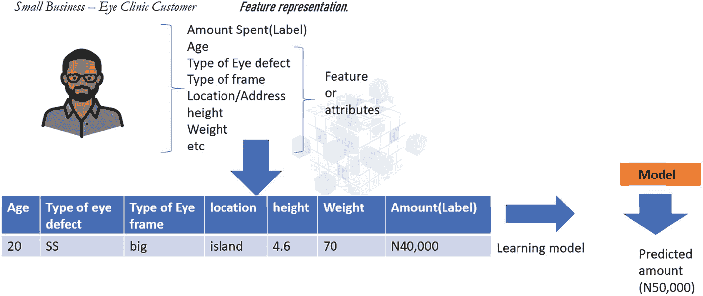

图示展示了一张客户图片，其旁边列出了各种特征，即：`amount`、`age`、`type of eye defect`、`type of frame`、`location`、`height`和`weight`。通过预测金额生成一个学习模型。

**图 2-1**

`Hadetulah`光学的特征表示

### 数据隐私

作为数据分析师，非常重要的是要熟悉数据隐私指南，无知不能成为借口，即使是在数据隐私问题上。为此，已有相关标准来帮助执行数据隐私。专业或商业组织会建立某些道德标准，以制定一套不具有法律约束力的信息处理程序。为了强制执行对某些数据集的特定处理，法律秩序已确立了法律标准。公司或机构也可以建立自己的政策指南或标准。此外，还有良好的判断标准，它指出，即使某事在技术上符合更正式的规则，也应不断思考：“这是一个好主意吗？”以及“可能的后果是什么？”

以下是需要遵循的隐私指南：

- 避免使用完整姓名、婚前姓、母亲娘家姓或昵称。
- 不要包含个人识别号码、国家身份号码、护照号码、驾驶执照、纳税人识别号码或金融账户/信用卡号码。
- 不要包含地址详情，例如居住地址或电子邮件地址。
- 应避免使用个人信息，如图片（特别是面部或其他可识别特征）、指纹、笔迹或其他生物识别数据（例如，视网膜扫描、语音签名、面部几何形状）。
- 不要包含与前述信息相关联或可关联的个人信息（例如，出生证明、出生地、种族、宗教、体重、活动、地理标识、就业信息、健康记录、学术信息、财务详细信息）。

有必要了解你所在国家适用的数据政策；例如，在尼日利亚，我们有**尼日利亚数据隐私法规**。⁴

## 2.2 数据质量与完整性

在计算机领域，常有人说“垃圾进，垃圾出”，即处理后的信息质量不可能优于被处理信息的质量。这一原则在数据分析中同样适用。数据质量指的是数据能够用于其预期目的的程度，以及数据准确反映现实世界的程度。我们需要衡量用于分析的数据质量，这可以通过检查数据是否符合以下标准来实现：

- **完整性**：用于检查我们是否拥有应该拥有的全部信息。我们需要回答诸如：“所有事件都被捕获了吗？”“是否考虑了所有参考数据值？”
- **唯一性**：检查单个事件是否只被记录一次。
- **准确性**：判断数据是否真实地代表了其试图传达的概念。确保数值和字符串值正确，以及时间戳和其他属性正确，是其中的一部分工作。
- **一致性**：检查一致性时，我们想要确保数据格式符合预期。需要确保相同的数据每次都以相同的方式被捕获。
- **合规性/有效性**：数据库中的数据是否符合语法、编码或其他模型要求？数据格式是否正确？代码是否符合预期？是否遵守了命名规范？
- **及时性**：这里，我们想知道数据是否在需要时可用。这也被称为“数据延迟”。
- **来源**：这里，我们想知道能否追溯数据的来源。以及我们对数据真实性和准确性的信心有多大？

根据 2017 年 Kaggle⁵在数据科学竞赛社区对 7376 名受访者进行的一项调查，当要求他们评价工作中遇到的障碍时，发现排名最高的障碍是“脏数据”问题，占受访者总数的 49.4%。

在中小企业环境中，脏数据问题尤为常见。这些情况是指数据充满错误，例如拼写错误、笔误和重复数据。这些问题在识别后可以系统地修复。还有一些情况是数据违反了业务规则；要解决这个问题，可能需要组织内跨部门的协同努力。还有些情况是数据收集方法不当或针对错误的人群收集。这类数据通常源于提出了错误的业务问题；所有这些都可以通过在业务初期建立适当的数据治理程序来克服，或者在发现问题后采取纠正措施。目前，已有算法可用于分析数据中的重复项和其他错误。这里需要强调的是，预防胜于治疗，也就是说，改进数据收集程序、优化表单和记录，并采用更多标准化字段是更可取的方法。此外，要确保数据的来源和历史可见且透明，以便追溯每一个错误。总之，你的数据的完整性、有效性和一致性取决于所使用的各种方法，而每个企业都将根据自身特定需求来开发和定制这些方法。

## 2.3 数据治理

数据治理简单定义为：为确保数据可用、可用、安全且具有完整性而实施的流程。过去，只有大型企业关注数据治理，但由于小企业也开始基于数据做出决策，它们也正在拥抱数据治理。数据治理流程建立在保障数据安全并确保其处理符合所有适用外部法律法规的规则集合之上。数据管理员负责制定和强制执行这些统一的标准和规定。对于小企业而言，实施数据治理可以从以下三个方向入手。首先，指派一个人（如果预算允许，可以指派多人）负责数据治理任务。一个好的经验法则是，一旦你的团队拥有一位全职分析师，就该明确由他负责数据治理。⁹ 其次，负责人制定一份名为数据藏宝图的文档，其中包含数据来源列表（例如，市场、财务、销售 CRM 等）和数据去向列表（例如，数据仓库（如有）或商业智能可视化工具）。（请注意，小企业也指一人企业，因此这第二阶段可能不是以软件应用程序的形式存在，而是体现为手动将数据从`Excel`复制到`Tableau`。）第三件事是记录谁在使用你的数据。最后，需要教育所有员工了解所开发的数据治理模型的重要性，及其注意事项。关于小企业数据治理的更多资源，请参考 Nwabude, Begg, 和 McRobbie (2014).^(6,7) 关于可帮助小企业进行数据治理的工具，请参考 Nwabude(2014) 等人的作品^(8,10)。

## 2.4 数据准备

在检索到分析所需的必要数据后，首先要做的是清理数据。这是必要的，因为基于有缺陷的数据进行分析可能会产生误导，并且使用未经清洗的数据进行分析可能会带来严重的经济后果。过去，许多大型组织因此损失了大量收入，一个著名的例子是摩根大通的交易亏损。¹¹

首先，让我们为变量类型打下一些基础，以便我们理解数据准备流程。获得的数据以变量的形式存在。分类变量具有固定的取值范围，可以是无序的（称为名义变量），其类别如：北美、欧洲和亚洲；或者可以是有序的（称为序数变量），其类别如：高价值和低价值。数值变量是无止境的。它们是连续的（能够在给定范围内取任何实数数值）。数值变量可以是整数，即仅取整数值。另一种变量是日期，根据所使用的分析平台，我们还有其他的变量类型。

在清洗数据时，我们检查数据是否存在格式错误、尾随空格、重复项、空行、同义词和缩写。在清洗数据时，你会问诸如此类的问题：字符变量是否有有效值？数值是否在范围内？是否存在重复的值/行？某些变量的值是否是唯一的？日期是否有效？数据集是否包含你希望预测的属性？如果包含，则无需进行预测。是否存在缺失值？描述中是否存在不一致之处？

在准备和检查你想要使用的数据时，可以使用汇总统计来发现数据中所有变量，了解变量的特征和变量中值的范围，并为分析筛选变量。均值、中位数、标准差、最小值、最大值等都是汇总统计的示例。最小值和最大值可用于检测可能是错误的极值。均值和中位数可以揭示该变量的中心值概念，两者之间的较大偏差也表明存在偏斜。标准差则体现了数据（相对于均值）的分散程度。

### 汇总统计

### 示例 2.1

数据文件`OnlineQuestion1.xlsx`需要经历数据清洗过程。首先，通过汇总统计了解并熟悉数据，处理缺失数据和异常值，最后对数据进行标准化。我们将按顺序逐一处理这些任务。

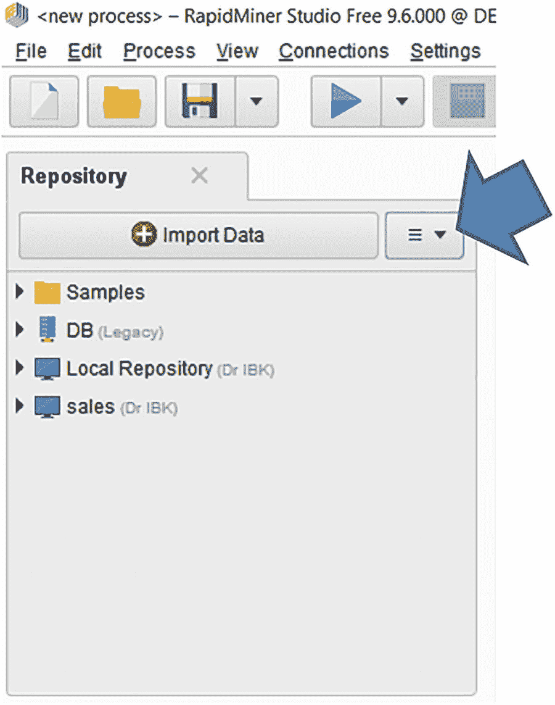

屏幕截图显示了带有导入数据文件夹的资源库选项卡。一个箭头指向下拉箭头。

**图 2-2** 创建资源库

- 创建资源库；点击图 2-2 中`导入数据`旁边的向下箭头。

- 首先要做的是，按照以下步骤为你的项目创建一个资源库：

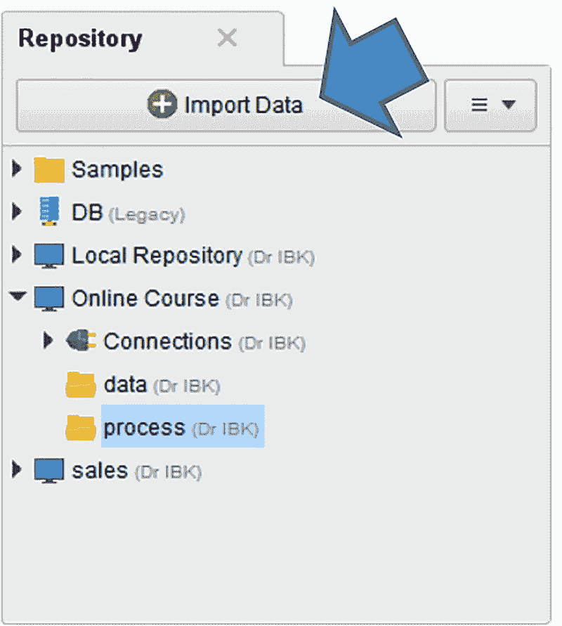

屏幕截图显示了资源库选项卡。一个箭头指向导入选项卡文件夹。

**图 2-3** 导入数据

- 点击`导入数据`（图 2-3）。

- 从你电脑上的任意位置选择你的数据文件（`OnlineQuestion1.xlsx`）。

- 加载待清洗的数据。

- 为你本地的资源库命名为“`OnlineCourse`”。

- 在你的资源库中创建两个文件夹（`data`和`process`）。

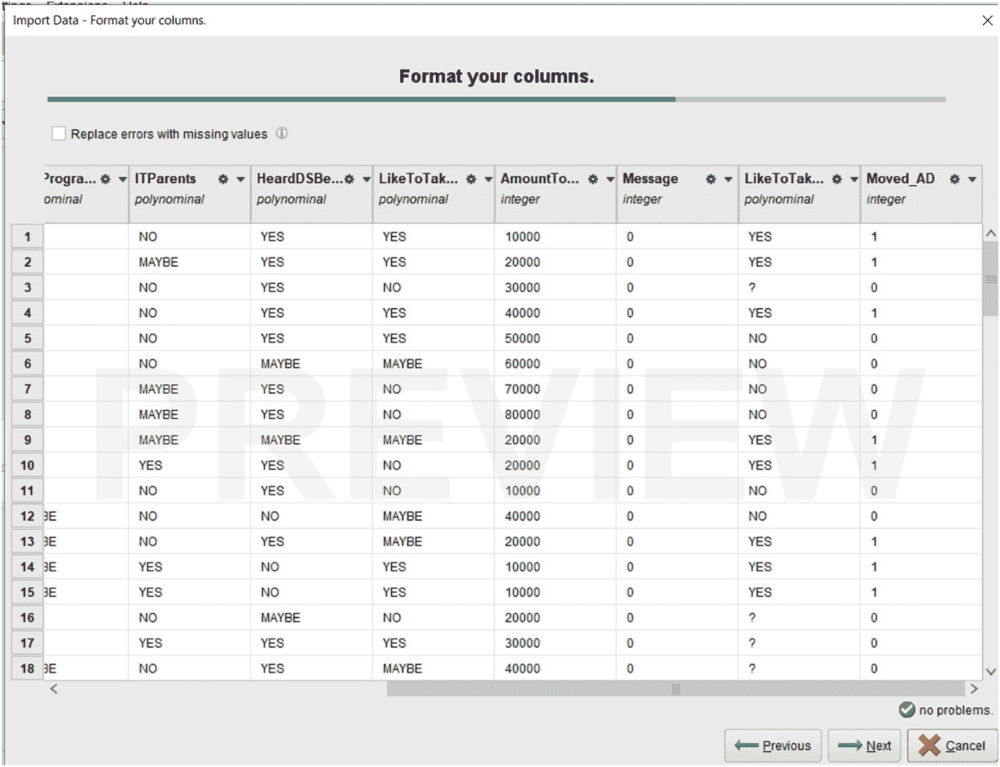

屏幕截图显示了一个包含八列数据的列表。该数据列表的标题是“格式化列”。

**图 2-4** 格式化数据类型

- 格式化你的列（数据类型）。在 RapidMiner 中，数据类型包括多项式（两个以上类别的分类变量）、二项式（两个类别的分类变量）、实数（带小数的数字）、整数（不带小数的数字）、日期时间（日期和时间）、日期以及时间。¹³ 在此阶段（图 2-4），你可以检查所有属性，根据领域知识及分析目的确认其数据类型是否正确。此时你需要回答诸如：*某些变量取值是否唯一？*等问题。可能需要更改类型、更改变量角色、重命名变量或删除变量（可通过点击图 2-4 中属性旁的箭头进行）。为便于演示，我们将`message`和`MOVED_AD`属性改为二项式类型。

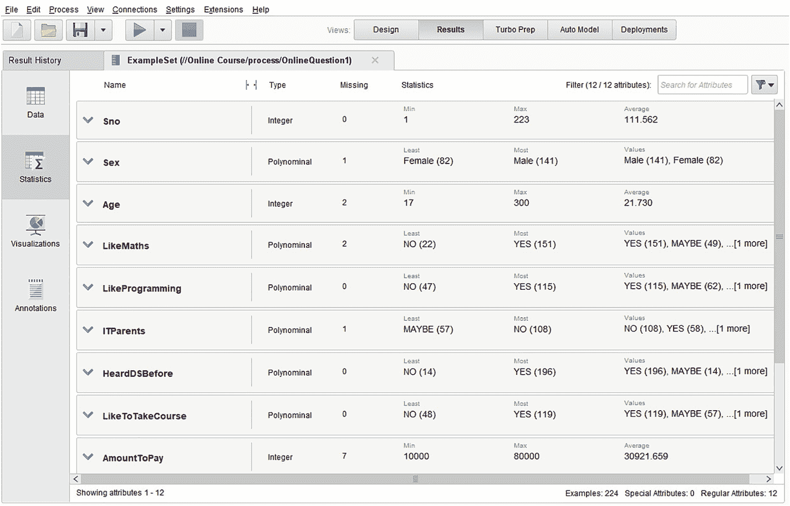

屏幕截图显示了包含六列的统计数据。在结果历史文件夹中，已选中统计选项卡。

**图 2-6** 汇总统计

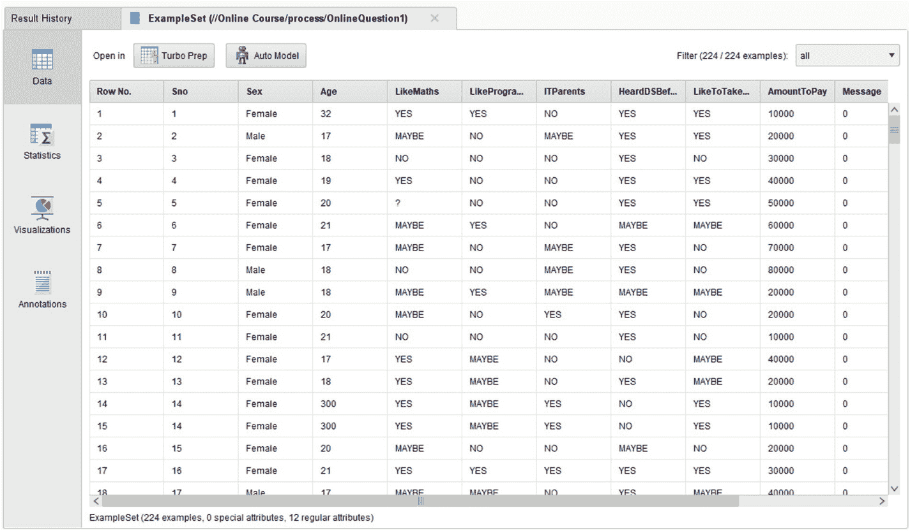

屏幕截图显示了一个示例集选项卡，数据以十一列形式列出。左侧边栏包含数据、统计、可视化及注释等选项卡。其中数据选项卡被选中。

**图 2-5** 加载数据的显示界面

- 在可能出现错误（例如字符变量包含数值数据，反之亦然）的情况下，用缺失值替换错误功能可处理此类问题。在清洗过程的下一步中，我们可以处理缺失数据。

- 要将数据加载/导入资源库，请在你的资源库中选择`data`子文件夹，然后点击`完成`。

- 加载数据的显示界面如图 2-5 所示。在此界面中，你可以点击`统计`查看汇总统计信息（图 2-6）。

- 检查统计数据以解决以下问题：字符变量是否包含有效值？数值是否在合理范围内？可利用`min`和`max`函数检测可能为错误值的极值。是否存在缺失值？检查以下内容：量纲差异、字段定义、计量单位、时间段等。

### 缺失数据

如何处理缺失数据？在许多情况下，你不能简单地丢弃数据，因为你需要足够的数据来进行有意义的分析。此外，可能有多个属性存在不同的缺失值，导致需要删除过多行记录。有时，缺失值本身包含信息。因此，你需要进一步调查，了解发生了什么情况，或者是否仅为输入错误。数据点的缺失甚至可能具有很强的预测能力。处理缺失值的首选方案是替换它们。你可能希望用一些智能估计值来填充数值。第二种处理方法是删除整行或整列。第三种方法是用零、均值、中位数以及多种其他插补方式进行数值插补。另一种方法是，如果数据属性本质上是分类属性，则将缺失值转换为数据中的某一类别。在处理缺失值时，务必尽可能减少失真，并利用领域知识来决定采取何种步骤，这一点至关重要。

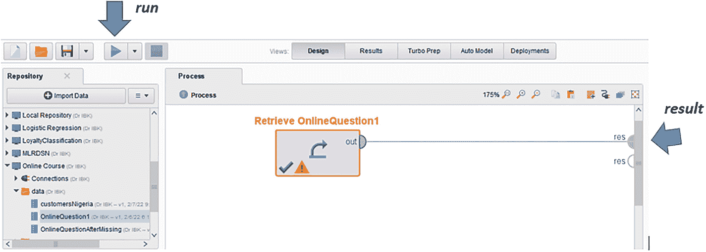

屏幕截图指向菜单栏上名为“运行”的箭头。已选中“过程”选项卡，其中包含“检索 Online Question 1”操作。另一个标记为“结果”的箭头指向“检索 Online Question 1”。

**图 2-7** 在 RapidMiner 中运行第一个过程

- 在图 2-6 中，点击`设计`选项卡，并从资源库中将数据拖拽至设计视图（这是我们向设计视图添加算子或数据的方式）。

- 将数据的输出连接到结果（`res`），如图 2-7 所示。

- 点击`运行`按钮（工具栏上的蓝色三角形，如图 2-7 所示）来运行过程。

- 为了处理缺失数据，我们将从第 7 步停止的地方继续。

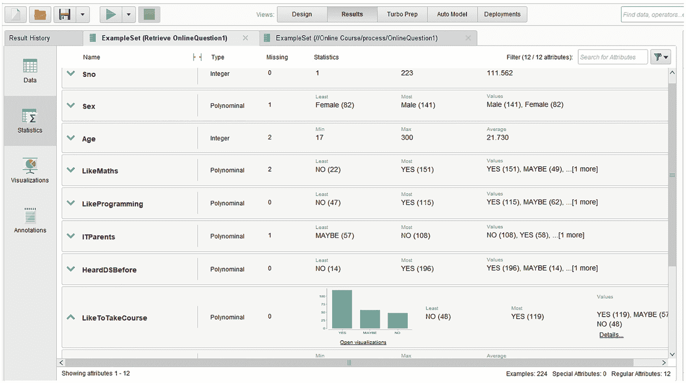

屏幕截图显示了包含六列的统计数据。在结果历史文件夹中，已选中统计选项卡。

**图 2-8a** 再次检查统计信息

- 从点击`统计`（图 2-8a）后的输出中，你会观察到并非所有属性都有缺失值，这时就需要你决定如何处理这些缺失值。

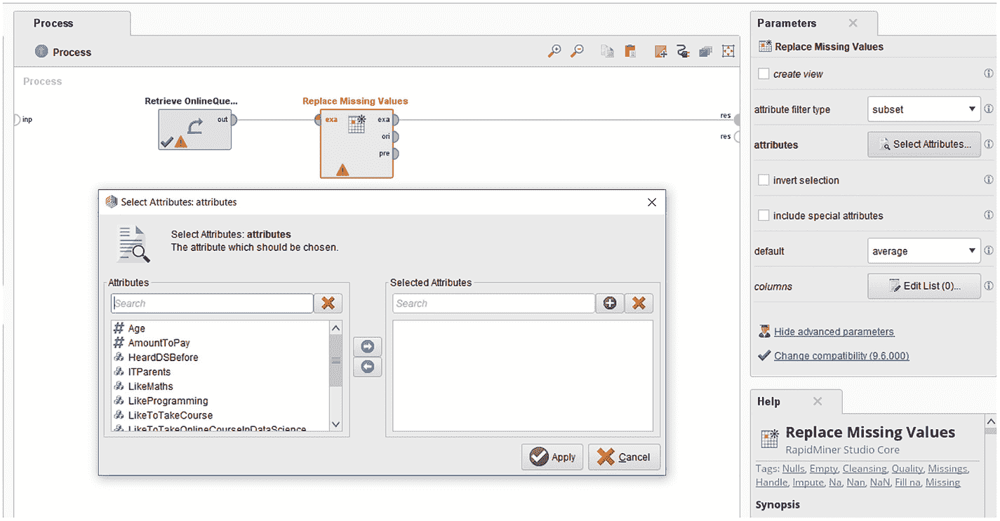

屏幕截图显示了两个选项卡：过程选项卡和参数选项卡。在过程选项卡中，“检索 Online Questions”和“替换缺失值”文件夹指向结果结果。过程选项卡中还显示了“选择属性”窗口。

**图 2-8b** 替换缺失值算子

- 我们不能使用`使用过滤示例`算子来删除缺失值，因为那样会导致丢失超过 50 条记录，所以我们将使用`替换缺失值`算子。
- 在`算子`下，搜索`替换缺失值`算子，将其添加到图 2-7 的设计视图中，并将其连接到`检索 OnlineQuestion1`算子，再连接到输出。
- 此时，需要明确一点：在`替换缺失值`算子的参数设置中，针对不同属性有不同的处理方式。如果你想逐个处理属性，可以先使用`选择属性`算子选中要处理的属性，然后再使用`替换缺失值`算子对该属性进行处理。

## 数据清洗

### 处理缺失值

- 点击`Replace Missing Value`运算符；在参数窗口中，为`attribute filter type`选择一个子集，点击`select attribute`按钮，然后选择具有缺失值的变量（`Age`，`AmountToPay`，`ITParents`，`LikeMaths`，`LikeToTakeOnlineCourseInDataScience`，`Sex`）。每个属性都应基于统计数据进行处理，但在此演示中，我们将为`default`参数设置选择平均值。见图 2-8b。

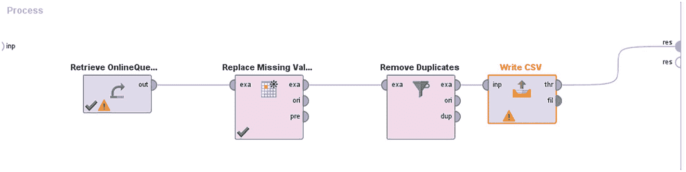

**图 2-9** 写入 CSV 文件

- 运行流程后，当你检查统计数据时，所有缺失值都应被纠正。你也可以点击`Results`按钮，在处理缺失值后检查输出结果。
- 其他数据清洗活动包括检查重复角色，如输出中第 14 行和第 15 行所示。为了解决此问题，将`Remove Duplicates`运算符添加到你的设计中。要将数据保存到 CSV 文件（我们将用于下一阶段的数据准备），将`Write CSV`运算符添加到你的设计中，如图 2-9 所示（创建一个新的 CSV 文件，命名为`OnlineQuestionAfterMissing`，并将其放在桌面上），点击`Write CSV`运算符，选择你之前创建的 CSV 文件，然后运行流程。如果你打开该 CSV 文件，你将看到截至目前已清理的数据。你还可以在输出中注意到重复行已被删除。

### 数据清洗 – 异常值

什么是异常值？异常值是指从总体随机样本中，与其他值存在异常距离的观测值。要检测异常值，我们会检查这些值是否在合理的范围内，这取决于你对每个变量的预期。当存在明显的异常值时，例如，在图 2-10 中，需要对其进行处理。

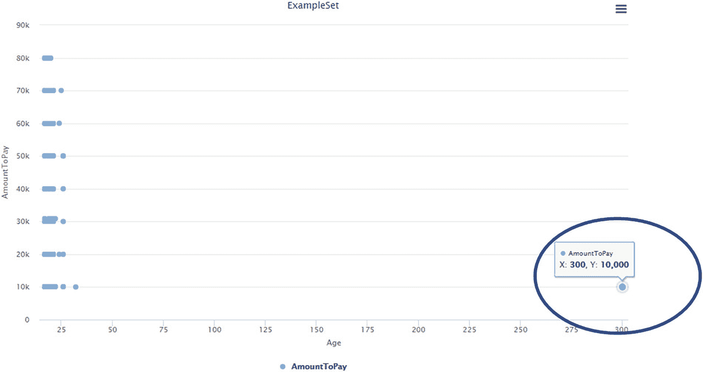

**图 2-10** 异常值

此外，要检测异常值，我们可以检查每个数据点与均值之间的距离。任何距离均值超过三个标准差的观测值都被视为异常值。当变量成对出现时，异常值会落在（散点图的）模式之外。识别异常值的目的通常是引起对需要进一步审查的值的注意，例如，一个病人的体温为 200°F，或者年龄为 300 岁。关于异常值的一些关键问题是：该异常值是错误还是合法数据点？该异常值是否属于目标总体的一部分？答案将有助于决定是否在我们的分析中纳入该异常值。检测异常值的一种方法是按列对记录进行排序，然后审查该列中非常大或非常小的值。你还可以查看每列的最小值和最大值（可以使用 RapidMiner 中的统计功能完成此操作）。箱线图可视化或两个数值变量的散点图也可用于发现异常值。如果异常值是由于错误造成的，则修正它；如果异常值超出目标总体范围，则将其剔除。如果异常值远超其余数据的范围（例如，小数点位错置），它可能会对我们计划采用的一些数据挖掘过程（如聚类中的欧氏距离）产生显著影响。处理异常值的其他方法包括数据变换、使用抗异常值工具（如用中位数代替均值）等。所有这些决策都应由对相关应用领域具有专业知识的领域专家做出。

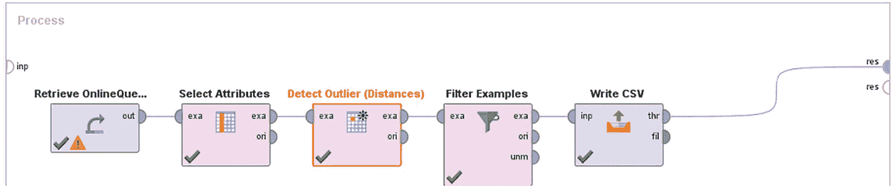

**图 2-11** 过滤异常值的流程

- 我们通过处理异常值来继续我们的实践示例。创建一个新流程，并使用本示例步骤 2 中解释的过程，导入缺失值清洗后得到的数据（`OnlineQuestionAfterMissing.csv`）。在处理异常值之前查看数据时，你可以在设计视图中仅使用该数据运行流程。要通过过滤行来处理异常值，请使用图 2-11 中的流程；点击`Select Attributes`运算符；对于`attribute filter type`，点击`subset`并选择所有属性，以便流程的输出将包含存储的完整数据。请注意，有时你可能希望在应用`detect outliers`运算符之前进行归一化，尤其是在使用欧氏距离时。对于`Detect Outliers`运算符，请注意在参数中，邻居数默认设置为`10`。你可能希望根据你对运算符工作原理的理解来更改此值。与 RapidMiner 中所有其他运算符一样，有必要阅读所有运算符的帮助文档，以了解如何针对你特定的任务最大限度地利用它。`Filter Examples`运算符根据你对其编程的方式，选择保留数据的哪些行以及移除哪些行。你可以设置`filters`参数，即`outlier > 等于 false`；如果这样做，你将观察到，尽管我们预期只移除一行，但更多行被移除了。处理此问题更有效的方法是通过修正而不是删除行来处理异常值。最后，`Write CSV`运算符用于将结果数据保存到名为`OnlineQuestionAfterOutlier.csv`的 CSV 文件中。

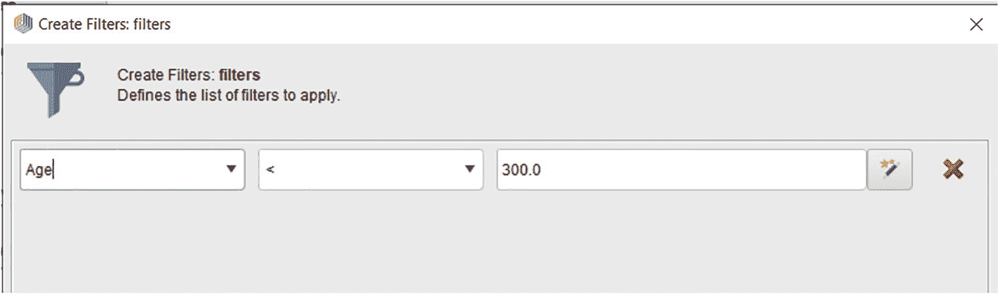

**图 2-12a** 修正异常值

- 不是像步骤 9 那样移除整行，你可以根据特定属性过滤结果。为此，你首先需要通过可视化检测异常值的数量。例如，在这种情况下，我们已经能够检测到有一个异常值，并且我们注意到该值在属性`age`上大于等于`300`。根据此信息处理异常值时，你可以使用与图 2-11 相同的流程，然后对`filter examples`运算符进行设置，如图 2-12a 所示。

## 归一化与分类变量

归一化用于将属性数据缩放到指定范围内。这是一种组织数据的方法，使所有记录和字段中的数据看起来相似。我们进行归一化，是为了在建模或分析过程中，属性不会相互占据不当优势。某些算法需要归一化，例如神经网络；此外，一些聚类算法也需要数据归一化。归一化有几种类型：最小-最大归一化、z-score 归一化等。最小-最大归一化是最常见的归一化数据方法之一。对于每个特征，该特征的最小值被转换为`0`，最大值被转换为`1`，而其他所有值都被转换为介于`0`和`1`之间的小数。

### 处理分类变量

处理有序分类变量（如年龄组、信用等级等）时，请用数字（1, 2, 3, …）为类别进行标记，并将该变量视为连续变量处理。如果分类变量是名义变量，有时则需要将其转换为虚拟变量。例如，若 `occupation` 是一个包含“失业”、“在职”或“退休”类别的分类属性，且某条记录的类别为“失业”，则可将其转换为表 2-1 所示的形式。

**表 2-1**

创建虚拟变量

| - | 表格显示两行三列。三列标题分别为：`occupation unemployed`，`occupation employed`，`occupation retired`。 |

当我们将包含多个类别的分类变量转换为虚拟变量时，可能会产生过多变量。处理这一问题的一种技巧是合并相近或相似的类别，以减少类别数量。合并类别需要同时运用专业知识和常识。通常，观测数量较少的类别是适合与其他类别合并的候选对象。只保留对分析最重要的类别，并将其他类别标记为“其他”。你也可以使用条形图来辅助做出此类决策。¹²

**图 2-12b**

归一化与名义变量转数值型运算符

- 要对经过异常值处理后的数据 `OnlineQuestionAfterOutlier.csv` 进行归一化，可以使用 `Normalize` 运算符；若要转换为虚拟变量，则可以使用 `Nominal to Numerical` 运算符（参见图 2-12b）。对于 `Normalize` 和 `Nominal to Numerical` 这两个运算符，都需要使用 `attribute filter type` 和 `attribute` 参数来选择属性，如图 2-12b 所示。

## 数据可视化

在分析项目中，数据可视化的目的有多种。数据可以用于预测、分类以及无监督学习（也称为高级描述性分析）的可视化。有关数据可视化的详细理解，请参考以下文献：Galit 等人（2019 年）第 3 章或 Thomas Rahlf（2017 年）的著作。

在进行预测的数据可视化时，我们按以下指南探索数据：

- 使用直方图/箱线图来确定是否需要任何转换（绘制结果变量与数值型预测变量的关系图）。例如，如果是直方图，我们检查偏度。这将在第 6 章中介绍。

- 我们还可以通过箱线图、条形图和多面板图来研究目标变量与分类型预测变量之间的关系。

- 使用散点图来研究数值型预测变量之间的关系。这样做时，你是在寻找它们之间可能对你的分析产生正面或负面影响的关系。

- 检查添加了颜色的散点图，以确定是否需要交互项。

## 进行分类的数据可视化

在进行分类的数据可视化时，我们按以下指南探索数据：

- 使用 Y 轴显示结果变量的条形图来研究目标变量与分类型预测变量之间的关系。

- 使用颜色编码的散点图来研究目标变量与两个数值型预测变量之间的关系，并用颜色表示结果。

- 可以使用并排箱线图来研究结果变量与数值型预测变量之间的关系，其中每个数值型变量都与结果变量进行比较。值得注意的是，分离度最高的箱线图代表可能有用的预测项。

## 进行无监督任务的数据可视化

在进行无监督任务的数据可视化时，建议采用以下方法：

- 创建散点图矩阵，以识别观测值之间的成对关系和聚类情况。

- 使用热力图来检查相关性表。

- 使用不同的聚合级别和缩放功能来确定数据中行为不同的区域。

## 2.6 习题

1. 使用名为`OnlineQuestionAfterOutlier.csv`的数据，为所有分类属性创建虚拟变量，并对所有数值型属性进行归一化。

2. 对名为`FarmCo.External.xlsx`的数据执行典型的预测数据预处理；描述你在此过程中采取的步骤、得出的结论以及处理后的数据（目标属性为`Unit Price`）。