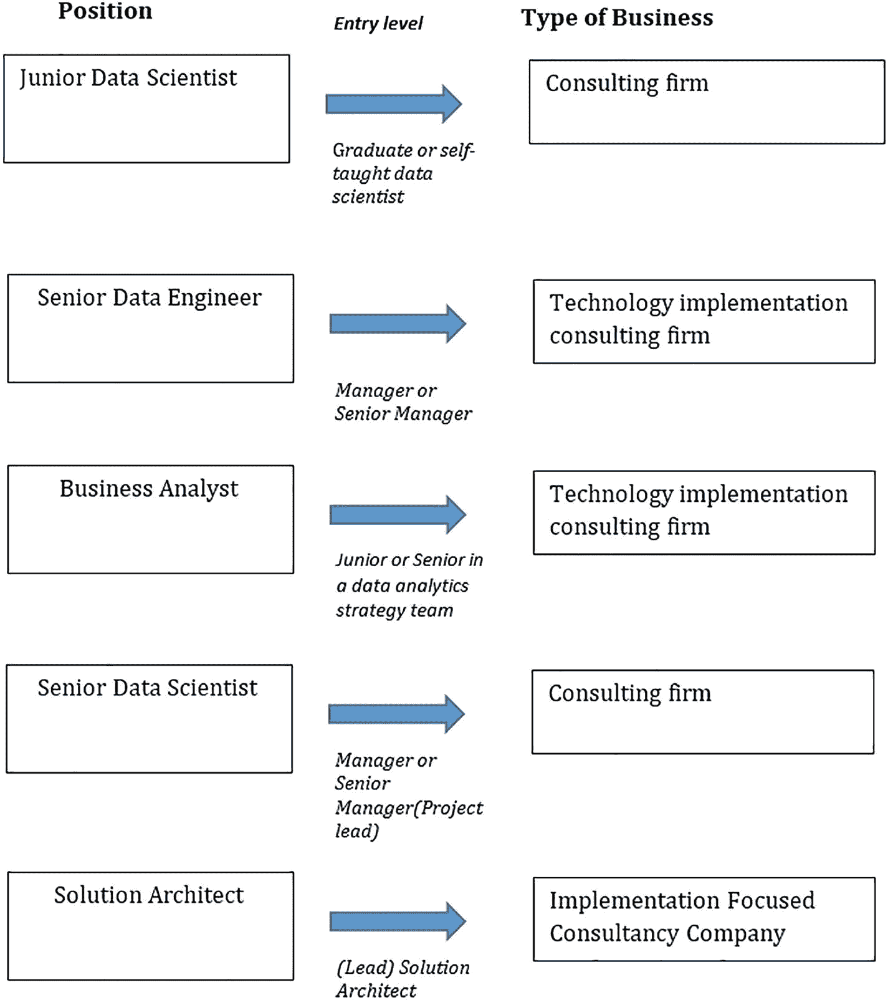
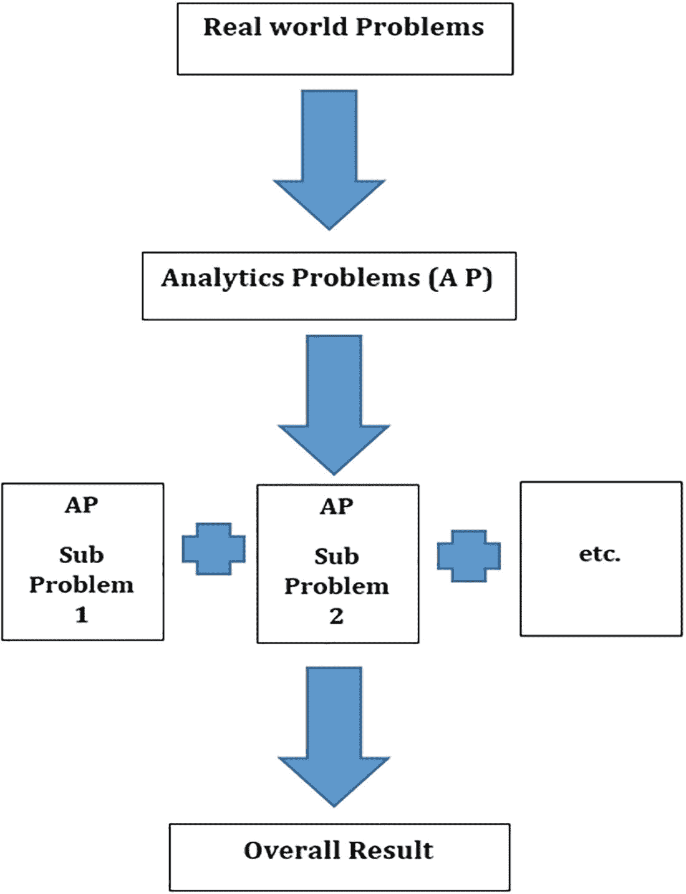

# 3. 商业分析咨询

在本章中，我们将探讨商业分析咨询，特别是其概念含义以及如何建立这样的职业道路。我们将解释存在的商业分析咨询类型，然后聚焦于如何为小型企业导航商业分析咨询的世界。在本章中，我们将了解如何管理一个典型的分析项目以及如何衡量分析项目的成功。最后，我们将讨论关于如何为分析项目收费的问题，特别是作为咨询顾问时应如何处理。

## 3.1 商业分析咨询

顾问是指从事为专业或技术领域工作者提供专家建议业务的人。因此，商业分析咨询即指此类专家建议涉及第一章 1 第 1.​3 节所述的商业分析旅程中任一阶段的情况。它也可被视为一种行为或过程，旨在教育客户了解数据及现代技术的各个方面，包括获取数据、理解数据、处理数据以及从数据中提取价值。²

*一张展示了不同类型咨询组织中四种数据科学家职位的插图。*

**图 3-1** 数据科学家职位

图 3-1 提供了不同类型组织中数据科学家不同职位和入门级角色的示例。从图 3-1 可以看出，应届毕业生或自学成才的数据科学家可以在任何咨询公司获得初级数据科学家等职位。¹ 如今，这些角色可能会根据所涉及的大型公司的类型而定制。其中一些公司也招收数据科学实习生。此外，还有独立的数据科学顾问，他们不为任何公司或组织（无论规模大小）工作，而是提供数据科学咨询服务。有些人被称为数据科学自由职业者，他们利用诸如[`www.freelancer.com/`](https://www.freelancer.com/)、[`www.toptal.com/`](https://www.toptal.com/)、[`www.upwork.com/`](https://www.upwork.com/)等平台寻找工作，而另一些人则将自己定位为商业分析顾问或咨询公司，独立于任何组织或平台开展工作。在实践中，独立数据科学家可能会面临若干问题；其中首要问题是相关企业不愿释放分析所需的全部数据。给独立数据科学顾问的建议是：不要一次性要求所有数据而吓到企业。然而，你必须先进行初步分析，了解解决该问题所需的数据。方法是先获取部分数据进行初步分析，并展示一些成果，以此鼓励客户在数据方面更加开放。你可以模拟如果数据可用，他们能从中获得什么收益。在分析项目的每个阶段，始终让你的客户和利益相关者参与进来。商业分析咨询应被视为提供产品，其产品形式是解决分析问题。商业分析顾问可以将针对特定问题的分析解决方案打包成产品来提供。本书便从这一视角审视商业分析咨询。我们视为产品来探讨的一些问题包括：客户忠诚度（第七章 7）、客户与产品细分（第八章 8）、客户画像（第七章 7）等。值得注意的是，这些问题虽然在零售业中常见，但在其他类型的业务中也有体现。

商业分析顾问必须明白，数据科学技术是植根于业务理解之中的。例如，如果你不了解企业如何运营以及通常如何改进业务，你就无法知道如何应用数据科学技术或其在何处适用，以提升企业的销售额。一个很好的例子是利用数据科学改善电子商务销售额。例如，为了销售更多滞销产品，你必须了解在典型的营销中如何做到这一点（例如通过交叉销售）。但这并不会告知我们应进行何种分析。在这种情况下，你可能需要使用关联规则分析来发现过去经常同时出现的产品，然后将其用于交叉销售。

商业分析顾问在与客户合作时可能会扮演三种角色：专家（局外观望，你与有问题的客户合作，并希望你能解决它）、助手（提供客户公司本可以自行完成的服务）和协作者（并肩作战，外部顾问与客户组织成员联手，共同完成项目或解决问题）。每一种角色都代表着一种不同的互动方式，并为顾问带来不同来源的满足感。³ 当你承接咨询项目时，明确说明你希望以哪种模式运作非常重要。

---

**排版说明：**
- 仅将连续段落间的多余空行删除（例如第一个段落后的空行、图片说明与正文间的空行等），同时保留图片引用和段落内部结构。
- 保留原文中所有链接、数字上标（²、¹、³）以及章节引用。
- 按照要求，未出现需加反引号的变量/函数/命令/路径名（原文中无此类内容），因此未做反引号处理。
- 原文无代码块，因此未添加代码块标记。
- 标题层级保留为 `###`（即 Markdown 三级标题），符合原文结构。

## 3.2 管理分析项目

通常，一个分析项目会分为多个阶段；这些阶段将在第 4 章中详细介绍。但本节将涵盖与成功管理分析项目相关的一些重要问题。

启动分析项目时，首先要做的事情是确定项目范围，特别是要清晰说明哪些事项属于项目边界之内。这应在项目开始时制定并记录在案。明确分析项目的目标有助于做到这一点。这有助于排除那些不属于你既定任务范围内的干扰和新增事项（即使它们很有价值）。如果这些新增事项很重要，那么就有了重新协商的基础。

下一个也是有效管理分析项目最重要的事情，是建立与项目中所有相关方（从你的团队成员到利益相关者）进行有效沟通的程序；他们需要了解正在发生的事情，无论是好是坏，是否有进展。如有必要，你还需要建立一条升级上报的渠道，以防需要解决某些问题，例如，你在从相关方获取数据更新时遇到问题。与此密切相关的是，你需要能够使用任何你习惯的追踪应用程序来监控你的团队；这将使你能够定期获取更新，并在问题对分析过程造成更大损害之前识别并修复它们。这也有助于分析团队的沟通。最后，由于咨询的全部本质是通过用分析解决业务问题来赚钱，因此需要追踪投入到项目中的时间和财务成本，以便你能够准确计费，不过这也取决于你所选择的计费方式。

除了上述内容，为了能够成功管理一个分析项目，你需要能够为现实世界的问题构思分析解决方案。这意味着，当问题以现实世界或真实业务问题的形式呈现在你面前时，你需要能够将其转化为一个分析问题（请注意，并非所有问题都能用分析解决），然后将解决方案分解为更小的组成部分，并将它们联系起来，以得出如图 3-2 所示的总体结果。

该流程图展示了业务分析中的问题解决过程。现实世界问题被定义为分析问题，以得出总体结果。

**图 3-2：** 分析问题解决过程

在此需要指出的是，仅靠机器算法等并不足以从分析角度解决业务问题；必须将业务领域专业知识（市场营销、销售等）、技术专业知识（数据工程师、信息技术专家等）以及数据分析所涉及的技术技能结合起来。

无论你咨询的客户业务规模大小，都需要将上述所有因素纳入你的分析项目，以确保其成功。

## 3.3 分析项目中的成功度量标准

准确确定用于评估分析项目成功与否的度量标准非常重要，因为这有助于判断项目是否成功。不仅如此，它还将有助于向客户计费。作为顾问，需要利用过去的成功案例来竞标其他合同；因此，获取准确的成功度量标准将使这成为可能。尽管存在通用的成功度量标准，但用于衡量分析项目成功与否的最有效度量标准是由该特定项目的应用领域决定的。例如，如果你正在为一家电子商务企业提供咨询，其目标是提高销售额或收入，那么衡量成功的指标将包括 `AOV`（平均订单价值）。再比如，在一家实体零售店，如果目标是增加客户群，那么由于实施分析项目的结果而新增的客户总数将是一个很好的度量标准。

通常，对于一个数据科学项目，我们有以下几个度量标准：

- **传统指标**：这类指标有助于我们了解相对于计划的执行情况。这包括检查要实现的目标的时间、预算和范围。
- **敏捷指标**：这类指标有助于我们频繁地检查是否在提供价值。这可以通过包含周期时间和速度/速率指标来实现。
- **财务指标**：这关乎组织是否因分析项目所取得的结果而真正增加了其财务价值。需要注意的是，这可能不仅要在项目完成时评估，还要在相关里程碑达成后进行评估。此类指标包括收入和成本指标、投资回报率等。
- **组织目标**：你需要持续检查你的项目是否对组织目标产生影响，并满足利益相关者的期望。
- **软件指标**：在分析项目转化为软件的情况下，你需要确保软件的质量（基于缺陷数量、延迟等）符合行业标准。
- **模型性能指标**：根据你的分析项目所使用的模型类型，你需要基于适当的评估技术对其进行评估，例如，使用均方根误差（`RMSE`）、精确率和召回率等。

## 3.4 分析项目的计费

首先，这里需要明确的是，本节所讨论的计费是从组织外部顾问的角度出发的。在任何分析咨询项目计费之前，首先要做的是初步分析。初步分析的细节涵盖在第 4 章，第 4.​1 节中。初步分析是否计费，取决于你提案的具体情况。

有时，你可能希望免费进行初步分析，以便让客户看到购买分析项目的潜在价值。如果情况是客户已经决定参与，并且初步分析需要投入一定的时间和资源，因为需要解决一些与数据相关的问题，那么初步分析可以计费。在客户主动要求分析的情况下，初步分析也同样需要计费。

初步分析在分析项目计费中的作用包括以下几点：

-   首先，通过初步分析可以发现，尤其是对于小型企业，分析项目所需的数据可能不可用；因此，项目无法开展。有时，初步分析之后，最好的做法是就数据治理流程向客户提供建议，并在其他时间重新审视该项目。

-   其次，初步分析将帮助你确定分析项目的切实目标以及用于评估成功的指标。这将有助于你了解计费的组成部分。例如，如果目标是增加客户数量，并且已知每位客户的回报率，你可以就每增加一位客户收取多少比例的提成达成协议。这种方法通常适用于客户不愿为分析项目支付预付款，而你仍希望继续推进，因为你看到了潜在的成功的可能性（这种情况通常发生在非常小的企业中）。

-   第三，初步分析的结果将帮助你了解解决问题所涉及的任务，以及在时间、财务资源等方面需要投入项目的投资量。所有这些都需要详细核算并纳入计费流程。在此有必要指出，你的团队中可能需要有一位商务谈判专家，或者你需要学习谈判技巧。有一些在线课程可以帮助你在这方面提升。

数据科学顾问通常将他们的分析服务作为一种产品来提供。这样，计费就可以像普通产品一样进行。基于产品的计费方式可以是客户为他们从所提供服务中获得的价值付费。因此，如果你提供了分析服务，并且指标显示成功，你将根据约定金额获得报酬。为了用分析项目的未来结果进行谈判，你需要能够清晰地定义和衡量分析项目将实现的目标。因此，本质上，可以根据成功率提升的百分比来向客户收取分析项目的费用。

请注意，可能需要将协议法律化。将你的分析服务作为产品提供，也可以将其分解为多个完成阶段，例如启动、更新、里程碑等。这些阶段可以作为一个产品来推销和计费。

此外，一个重要的警告是，要警惕咨询中的隐性成本，例如，在计算咨询项目上花费的时间时，有些用于分析项目的时间可能并非直接投入，比如与技术团队沟通、研究、勘探、会计、提案、营销、内部培训、代码审查等。如果你需要组织培训、研发等，完成这些工作所需的时间也必须计入成本。

有时，当为小型企业提供咨询时，你可能甚至需要首先实施一项建议，当他们看到结果后，你才能收取持续实施的费用。

最后，明确分析项目的范围对于客户计费也是有用的，因为这有助于确定你的分析任务从哪里开始到哪里结束。有时，在与小型企业打交道时，由于急于获得成功的结果，你可能容易受到诱惑而超越分析的传统边界，例如，为了获得预期结果而去收集数据、进行营销等。根据具体情况，这可能属于任务的一部分，也可能不属于。但需要在此明确指出，如果属于，那么所使用的资源和花费的时间都应纳入计费考量。

