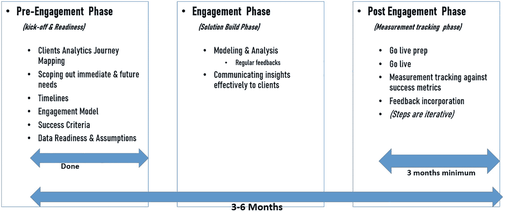
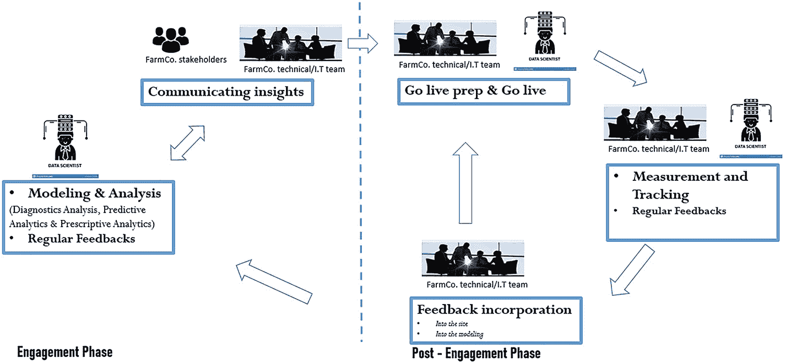

# 4. 商业分析咨询阶段

本章将探讨商业分析咨询所涉及的各个阶段，主要是指在分析服务作为产品（无论是来自企业内部还是外部）提供时的情况。我们将探讨为分析项目指明方向的提案和初步分析阶段。接着，我们来看预参与、参与和参与后阶段所涉及的细节。需要明白的是，这些阶段是以典型或通用的方式呈现的，但在实际实施时，可能需要根据应用场景对其进行修改或定制。

## 4.1 提案与初步分析

在提交提案（这很可能是你与该组织的首次互动）之前，你必须先对组织或领域专家进行调研，收集一些背景信息，以支持你的数据分析提案。在提案中，这些背景信息将帮助你了解并突出你计划为该组织解决的问题。虽然这不是强制要求，但它有助于吸引利益相关者的注意力，并让他们有兴趣投资于该数据分析项目。与中小企业启动数据分析项目的主要障碍在于，利益相关者目前基于现有方法仍能获得一定收入，因此他们认为目前没有投资此类项目的必要或紧迫性。现在，顾问有责任说服他们，让他们了解数据分析所能带来的转型和成就。在不需要此阶段的情况下（即利益相关者已经参与），只需召开一次简短的介绍会议，详细说明分析流程，并引出与业务相关的各类问题。此时，获取利益相关者的反馈、了解他们的想法以及希望通过数据分析项目实现的目标也很有帮助。尽管在某些情况下，利益相关者可能不清楚什么是分析问题，但他们肯定了解组织的需求。在这一阶段，需要具备非常出色的演示技巧，才能使你的提案获得认可。在提案阶段，提出针对特定业务量身定制的问题会有所帮助。顾问在此阶段需要小心谨慎，不要为了获得提案通过而许下虚假承诺，或提议解决那些缺乏数据资源的问题。

在初步分析阶段，你需要查明数据、数据质量和完整性方面有哪些可用资源。此阶段，你将根据用于解决每个问题的数据，来探索已提出的问题。在此阶段结束时，你应该能够根据现有数据，给出关于可实现目标的详细报告。此外，在初步分析阶段，你需要了解组织的运营流程（概念性业务模型），正如第 1 章 1.​3 节“业务分析历程”中所阐述的那样。这将使你能够理解所提议的分析模型的优化方法，以及你的分析结果如何融入组织或业务流程。你还将能够发现何时以及由谁负责实施你的建议等。通过这些，你就能知道在分析项目的沟通阶段需要让哪些人参与。在初步分析之后，你还应该能够在较高的抽象层次上给出数据分析项目预期成果的概念，并就组织的最佳数据实践提供建议。初步分析阶段涉及的任务可总结如下：

- 发现并评估可用于分析的数据（内部和外部）及其质量。
- 强调如何获取可用数据的细节。
- 理解组织数据库，并在必要时策划整合数据以供分析的过程。
- 发现当前数据可实现的分析内容。
- 明确决策目标，并确定有助于在给定数据下使预期决策可行的分析输出。

初步分析阶段的输出包括：

- 关于当前可用和可获取数据的详细发现文档，以及对其可带来哪些益处的抽象说明。
- 关于数据平台升级和整合的建议，尤其面向未来的分析。
- 具体指出数据分析项目的目标、可做出的决策，以及有助于在给定数据下使这些决策可行的分析输出。
- 将要执行的项目，并说明里程碑、可交付成果、成本和预期投资回报率。

在此阶段，你需要明确指出数据分析项目是一个迭代过程，这意味着你可能需要提出建议，这些建议将被实施和评估，并在必要时重复进行。这个初步分析将有助于：

- 了解你的数据能够实现什么。
- 以全新的视角审视你当前的数据管道、数据仓库和分析策略。
- 就数据平台升级提供建议。

在初步分析阶段，你希望了解所有可用的数据，即向领域专家询问字段名称的含义，并寻求关于数据源使用的内部经验知识。甚至可能有必要在此阶段探索所获得的任何数据，以了解其解决问题的可行性，因为遇到你最初发现的数据并非如最初所想那样丰富到足以用于分析的情况并不少见。

请注意，在初步分析期间，你需要能够确定如何避免在不切实际的客户身上浪费时间，并且如果某个项目无论是基于数据资源还是负面的业务环境状况都不会成为成功案例，那么就放弃它。最后，要学会应对炒作和不切实际的期望。数据分析项目的其余部分包含在图 4-1 所示的三个阶段中。正如前面提到的，可以根据单个数据分析项目的性质进行定制和扩展。在本章的剩余部分，我们将逐一讲解每个阶段并进行详细说明。

**图 4-1** 数据分析咨询阶段

如图 4-1 所示，一个典型的数据分析项目包含三个主要阶段。项目的总时长因数据状况和业务领域中的许多其他因素而异，但通常应涵盖平均三到六个月的时间，其中参与后阶段应至少给予三个月。IBM 咨询流程的一个好例子可以在 [`https://365datascience.com/trending/ibm-data-science-consulting/`](https://365datascience.com/trending/ibm-data-science-consulting/) 找到。

## 4.2 准备阶段

在准备阶段，需要运用描述性分析进行详尽的探索性分析，以揭示或发现与预期目标相关的事务状况。此阶段结束时，可能需要根据可行性评估来调整目标。对于每个目标，你需要利用描述性分析突出当前状况、可推导出的结论，以及关于立即实施或未来分析的建议。需要为每个既定目标定义成功标准、数据准备情况和假设条件。这被称为启动与准备阶段。在此阶段，你试图为客户描绘旅程地图，并探究分析工作在这一旅程中能发挥何种重要作用。

从技术层面讲，准备阶段包含以下内容：

*客户分析旅程映射*：在开发出概念性业务模型后，你需要确定概念性业务模型中哪些环节将使用分析解决方案及其用途。这将有助于你了解分析项目的数据需求，特别是特定属性。

*界定近期与未来需求*：为此，你需要明确分析项目的目标，并详细列出当前实际可用且未来需要具备的解决条件。例如，如果需要克隆外部市场，需要哪些外部数据，以及是否有可能获取这些数据？

*时间线*：需要明确说明每个阶段所需的时间，以便所有参与方都能同步跟进。这必须通过清晰地阐明里程碑及其完成时间来实现。

*参与模式*：该模式有助于让所有相关方了解自己在项目中的定位及职责。它还可以包含一个解决方案架构，让客户了解分析项目将如何推进。图 4-2 展示了一个针对电商业务咨询的简单解决方案架构及参与模式示例。

解决方案架构与参与的循环模式。以两列图示：后参与阶段，包括上线准备与上线、测量与跟踪、反馈整合。之后，要么进入上线准备与上线阶段，要么进入建模与分析阶段，再进入沟通洞察阶段。

图 4-2

解决方案架构与参与模式示例

图 4-2 中呈现的解决方案架构与参与模式涵盖了准备阶段和后参与阶段。这是为某个旨在提升在线销售额的特定商业分析项目量身定制的。不同类型的业务可能会根据上下文信息对此进行略有不同的解读。在图 4-2 所示的模型中，我们可以看到一些重要特征：首先，该模型是迭代的，需要根据后续阶段的结果重新审视某些环节。此外，所有对确保分析项目成功负有责任的相关方都必须被纳入进来，他们的意见对项目的成功至关重要。解决方案架构非常重要，因为它有助于展示分析团队解决问题的能力，并帮助利益相关者了解完成工作所需涉及的方面，这对于获取执行项目所需的各种资源尤其有帮助。

*成功标准*：对于每个目标，需要使用描述性分析来呈现与相关成功指标相关的当前状况，正如第 3 章第 3.​3 节所述。为此，你需要详细说明目标实现前后指标值的变化。这些成功标准应与利益相关者沟通，以便他们能根据其领域知识和组织目标提出意见。

*数据准备与假设*：最后，准备阶段应明确说明从现有数据中可以获取什么。这将消除对分析项目可能存在的任何不切实际的期望。在某些情况下，这可能会改变项目方向，或促使做出一些数据决策，例如暂停项目以整理数据等。通过阐明项目成功完成的假设条件，利益相关者能够理解为什么某些事情未能按计划进行。

在准备阶段结束时，需要整理包含该阶段详细内容的文档，并提交给利益相关者。这一点很重要，因为初始分析阶段的结论常常需要进一步的修改和完善。

## 4.3 参与阶段

根据分析项目的类型，例如，我们可能需要提出软件方案、实施建议，或两者兼具，参与阶段就是针对已确定的问题或目标构建解决方案的阶段。

参与阶段通常包括建模与分析、定期反馈，以及向客户有效传达洞察。所述参与阶段的组成部分可能会根据手头项目而增加，但不会减少，因为每个组成部分都决定了项目的成功。

**建模与分析**：首先，确定数据挖掘任务。是描述性分析、预测性分析，还是规范性分析？是所有这些任务的组合，还是各项任务相互补充？有时，预测性和规范性分析在探索阶段会使用描述性技术。这涉及将一般性问题或疑问转化为更具体的统计问题。

根据手头的问题，有多种处理方法；例如，问题可能是异常检测问题（识别异常数据记录），或是关联建模（寻找变量之间的关系）。它甚至可能是聚类（在不使用数据中已知结构的情况下，发现数据中在某种程度上“相似”的群体和结构）、分类（将已知结构推广应用于新数据）、回归（找到使模型与数据误差最小的函数）或汇总（提供数据集更紧凑的表示形式，包括可视化和报告生成）。³

在实践中，你可以从描述性、预测性、规范性、认知性或诊断性分析中进行选择。你也可以先进行描述性分析，然后根据结果使用诊断性分析进一步探究原因，最后使用预测性和规范性分析来解决问题。你甚至可能需要组合其中的部分或全部方法。大多数情况下，描述性和诊断性分析的结果将决定使用何种预测技术。

要使用的数据挖掘技术取决于数据集的大小、数据中存在的模式类型、数据是否满足方法的某些基本假设、数据的噪声程度以及分析的特定目标。因此，应用多种不同方法并选择对当前目标最有效的方法非常重要。重要的是要注意，建模过程是迭代的，需要尝试该技术的几种变体，并使用同一算法的多种变体。最终选择取决于该技术或算法（视情况而定）的性能评估。¹

### 反馈：
在参与阶段，分析团队与利益相关者之间需要持续的反馈，反馈次数可能与事态发展一样多。有时，这种反馈可能会改变行动方案，鼓励领域专家更积极地合作，等等。

### 洞察传达：
洞察将定期进行传达。某些洞察甚至可能导致一些拟议的未来分析发生改变，进而返工整个分析项目。传达洞察需要具备高质量的口头演示技巧，以及以图表形式展示结果并擅长讲故事的技能。在传达洞察时，你应该能够评估你的受众，并判断什么内容适合该受众；有时需要高层次的抽象概括，有时则需要详细说明。需要时，应使用可视化方式呈现结果，最后将你的建议与你所生成的洞察结合起来。

## 4.4 参与后阶段

在传达了分析项目的建议后，下一个阶段是参与后阶段，也称为测量跟踪阶段。该阶段包括上线准备、正式上线、对照成功指标进行测量跟踪，以及反馈整合。参与后阶段的步骤是迭代的。

### 上线准备：
在此阶段，你组织研讨会和培训，以教育那些将要实施建议的人员，以及他们将如何实施这些建议，以便能够实现分析项目的总体目标。有时，可能需要使用演示、传单和视频来传达信息。你还需要考虑变更管理，即驱动组织的人员、流程和系统将如何响应建议所带来的变化，以实现总体目标。例如，如果解决方案涉及技术产品，你还需要处理解决方案如何融入现有系统的收尾工作。

### 正式上线：
在此步骤中，你部署解决方案，实施建议，并监督建议的实施。实施过程需要两到三个月，然后才开始跟踪。

### 对照成功指标进行测量跟踪：
下一步是根据参与前阶段强调的成功指标来跟踪你建议的有效性。根据跟踪指标的结果，此时需要做出一些决策。你可能需要决定是否需要迭代建模过程或调整建议以改善成功指标，或者得出目标已经实现的结论。有时，你可能需要跟踪合规性技术；例如，如果是一个推荐系统推荐了某些产品，你想了解这些产品最终是否被售出。

### 反馈整合：
来自上线、测量和跟踪的反馈将促使采取一些行动来推动项目成功，特别是在改进分析流程方面。

最后，当测量结果显示达到可接受的成功水平时，下一步就是考虑如何将该流程自动化，以避免未来严重依赖手动执行建议。尽管这是可选的，但如果能够负担得起，让一切自主运行比依赖手动流程更高效。

## 4.5 问题

针对以下场景，详细说明一位签订合同的自由职业业务分析师在参与前阶段、参与阶段和参与后阶段的活动细节：

1. 一家纺织零售商，尽管早期取得了成功，但现在开始出现销售额下滑。幸运的是，该零售商拥有一个仪表盘，可以收集现有客户和目标客户的人口统计信息。该零售商的目标是利用这些信息找出需要改进的领域，并确定销售额最高的地方。其中一种方法是根据相关因素对买家进行细分，并为每个群体定制营销策略。

2. 一位健身教练注意到顾客正在流失。其目标是开发并安装一个预测分析模型，该模型能够识别顾客是否可能流失，并迅速提供激励措施，以防他们离开。