# 5. 描述性分析工具

本章重点介绍商业中，尤其是小型企业中，最常用的描述性分析工具。本章将帮助你运用描述性分析工具来了解你的业务，并提出能够提升企业利润的建议。对于小型企业而言，描述性分析有助于中小企业理解可用数据，从而一眼监控业务指标，帮助中小企业主从整体上观察销售趋势和模式，并深入分析产品类别和客户群体。它还能帮助中小企业规划产品策略和定价政策，以最大化预期收入，并从中获取有价值的见解来吸引更多客户。

## 5.1 引言

在商业分析中，描述性分析通过信息将市场与企业联系起来，并提供可执行决策所需的信息。因此，描述性分析可以被视为系统地收集和解释数据以辅助决策者的原则。描述性分析有三种类型：

*   *探索性研究*：用于需要解决模糊问题的情况，例如，进行探索性研究以找出销售额下降的原因。
*   *描述性研究*：用于回答关于认知度的问题，例如，购买我们产品的是哪类人群？
*   *因果研究*：用于问题被明确定义的情况，例如，改变店铺布局后，买家是否会购买更多我们的产品？

本章的其余部分将选取每种常见的描述性分析工具，详细解释其用途，并实际演示如何使用它们。本章用于实际演示的数据集名为 `SuperstoreNigeria.xls`。

`RapidMiner` 可用于多种类型的可视化，但我们在本章中只挑选了最流行和最常见的几种。

## 5.2 条形图

条形图可用于检查分类数据中是否存在意外的结果模式，例如，某些类别的数量可能远多于其他类别。某些类别可能完全缺失，或者类别内分布不均。甚至还可能出现额外的类别，例如，如果出现错误，`性别`被记录为 `"M"` 和 `"F"`，但同时也被记录为 `"m"` 和 `"f"`、`"male"` 和 `"female"`。也可能存在不平衡的实验，导致某些数据缺失或不可用；这些问题都可以通过条形图发现。条形图还有助于在类别过多时发现问题，并帮助我们决定是否以及如何合并它们。最后，它还能揭示错误和缺失值。

**在 RapidMiner 中创建条形图**

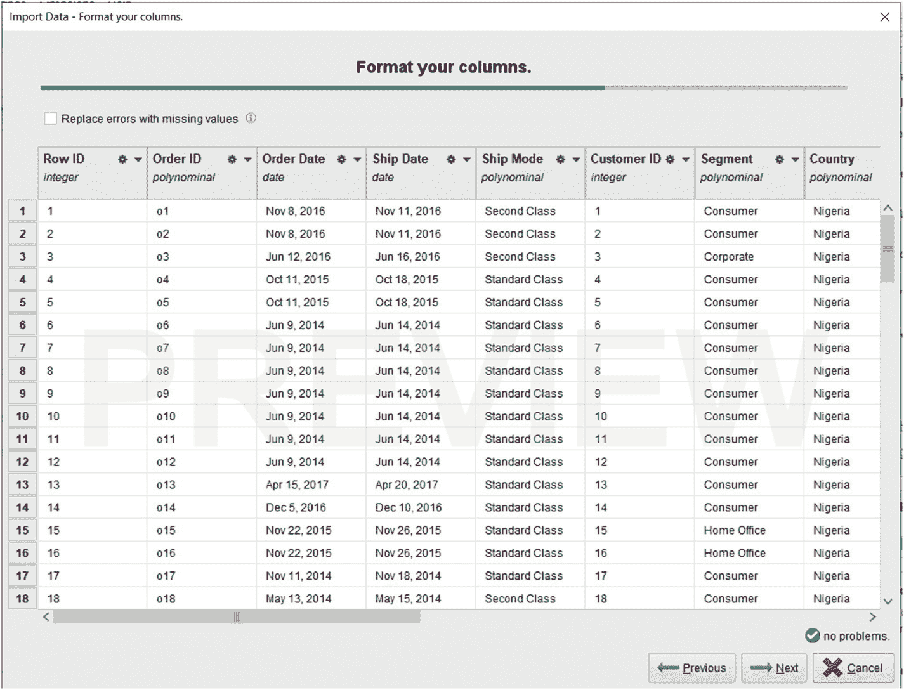

导入的数据列出了行 ID、列 ID、订单日期、发货日期、发货模式、客户 ID、细分市场和国家的数据。

图 5-1 导入数据的截图

1.  您可以创建一个新的存储库或使用现有存储库，并**导入**名为 `SuperstoreNigeria.xls` 的数据（指南请参考第[2]章第 2.​4 节）。
2.  图 5-1 是导入数据在 `RapidMiner` 中的截图。点击**下一步**，并选择您要存放数据的存储库。

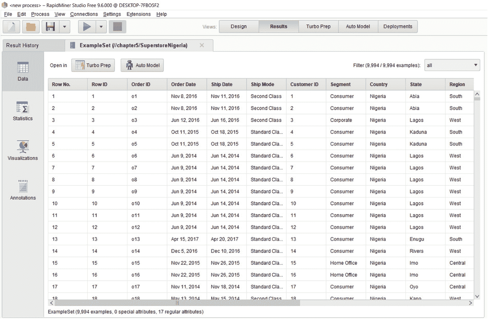

`Rapid Miner Studio` 窗口导入了一个数据表，并显示了一个包含 `数据`、`统计信息`、`可视化`和`注释`选项的导航面板。

图 5-2 导入数据的示例集

1.  在图 5-2 所示的**结果**界面上，您可以点击**数据**、**统计信息**、**可视化**和**注释**，以探索数据的各种特征，具体解释见第[2]章第 2.​4 节。

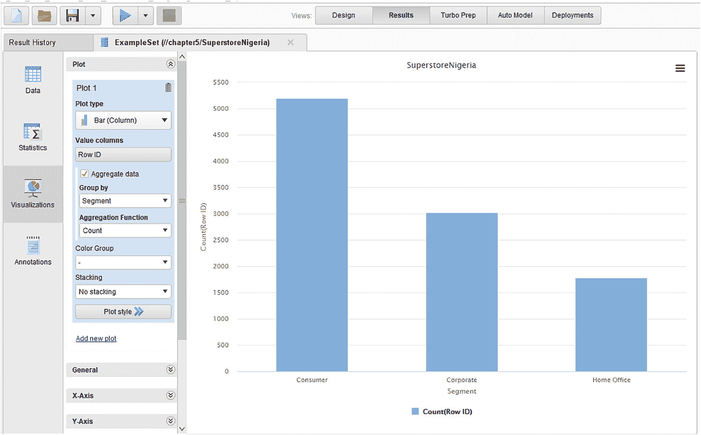

可视化选项卡中的绘图部分列出了绘图类型、值列、分组依据、聚合函数、颜色分组和堆叠。

图 5-3 条形图示例

1.  点击图 5-2 中的**可视化**按钮，然后调整由此产生的界面设置（如图 5-3 所示），即可创建条形图。请注意**绘图类型**、**值列**（y 轴）、**聚合数据**、**分组依据**和**聚合函数**的设置。**绘图类型**设置为 `条形图（列）`。选择 `行 ID` 作为**值列**，以便计算数据中的每一行来创建条形图。勾选**聚合数据**表示我们将使用聚合计算。选择**分组依据**，指明我们要检查的分类变量（`细分市场`）。**聚合函数**则表示我们想要知道在名为 `细分市场`的分类属性中，每个类别存在多少行数据。

## 5.3 直方图

直方图用于将数据分组到区间中，并为每个区间绘制一个条形，以展示经验分布。直方图有助于理解数据的中心位置。直方图是识别数据分布形状的绝佳工具。有时数据会向左或向右偏斜，这时需要进行数据转换。例如，当使用直方图检查数据的预测情况时，你需要确保数据没有以可能影响分析结果的方式向左或向右偏斜。也就是说，数据需要是对称的或几乎对称的。

对数变换法适用于转换右偏数据，但不适用于零值和负值。平方根法适用于转换右偏数据，但不适用于负值。平方变换法适用于转换左偏数据，但不适用于负值。立方根法适用于转换右偏数据以及包含负值的数据，但其对数变换效果不佳。

**在 RapidMiner 中创建直方图**

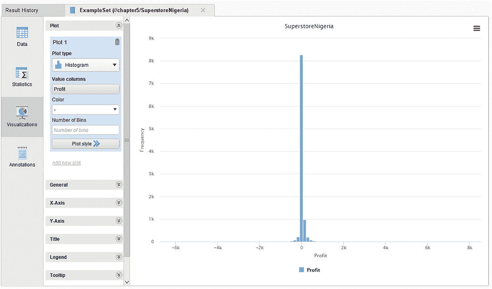

可视化选项卡显示了一个直方图，其中绘图类型选择为 `直方图`，值列选择为 `利润`。

图 5-4 属性“利润”的直方图

1.  按如下方式更改设置，即可创建图 5-4 中的直方图：将**绘图类型**设置为 `直方图`。使用**值列**来选择您希望为其创建直方图的数值型属性。

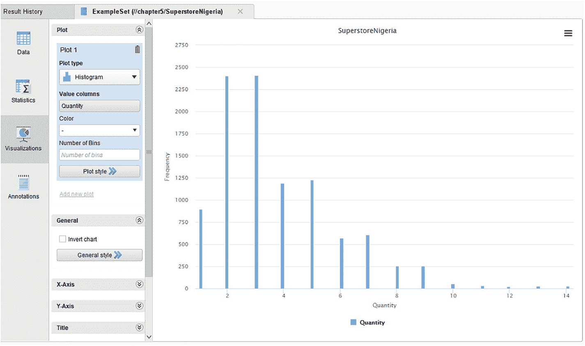

可视化选项卡显示了一个直方图，其中绘图类型选择为 `直方图`，值列选择为 `数量`。

图 5-5 属性“数量”的直方图

1.  图 5-5 是属性“数量”的直方图。
2.  图 5-4 中的直方图相当对称，而图 5-5 中的直方图则略微向右偏斜。对称的直方图意味着数据在将直方图垂直分成两等份的线两侧均匀分布。在直方图上这条线与 x 轴相交的数值即为中位数，它同时等于平均值和众数（对于对称的直方图形状而言）。我们还可以使用直方图来确定大部分数值落在哪个区间范围内。

## 5.4 折线图

折线图用于跟踪短期和长期的变化。当存在较小变化时，折线图比柱状图更适用。折线图也可用于比较多个组在同一时间段内的变化情况。

**在 RapidMiner 中创建折线图**

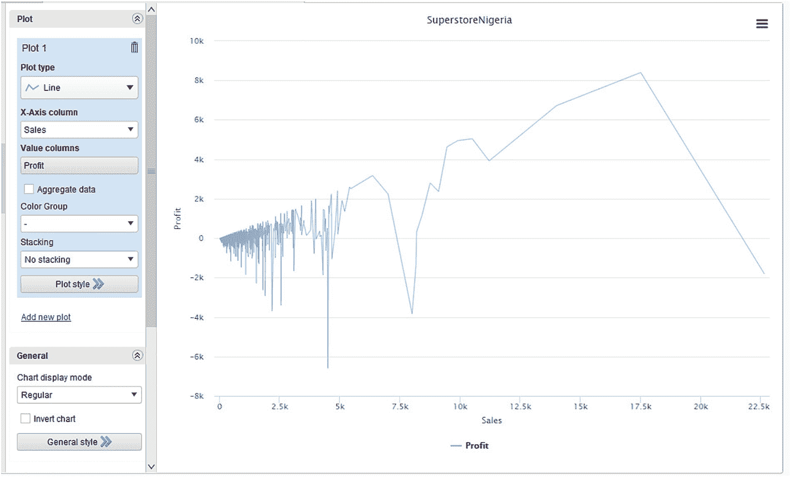

可视化选项卡显示了一个折线图，其中图形类型选择为折线，X 轴和数值列设置为销售额和利润。

图 5-6：折线图示例

1.  通过调整设置创建一个折线图，如图 5-6 所示，以反映 X 轴上的`sales`和 Y 轴上的`profit`。
2.  从图 5-6 中，我们可以看到利润（Y 轴）如何随销售额（X 轴）变化。

## 5.5 箱线图

箱线图是一种基于五数摘要（最小值、第一四分位数（Q1）、中位数、第三四分位数（Q3）和最大值）来标准化显示数据分布的方法。它可以告诉你关于离群值及其数值的信息。它还能告诉你数据是否对称、数据聚集的紧密程度，以及数据是否存在偏斜及其偏斜方向。它也可用于比较子组之间的分布。

**在 RapidMiner 中创建箱线图**

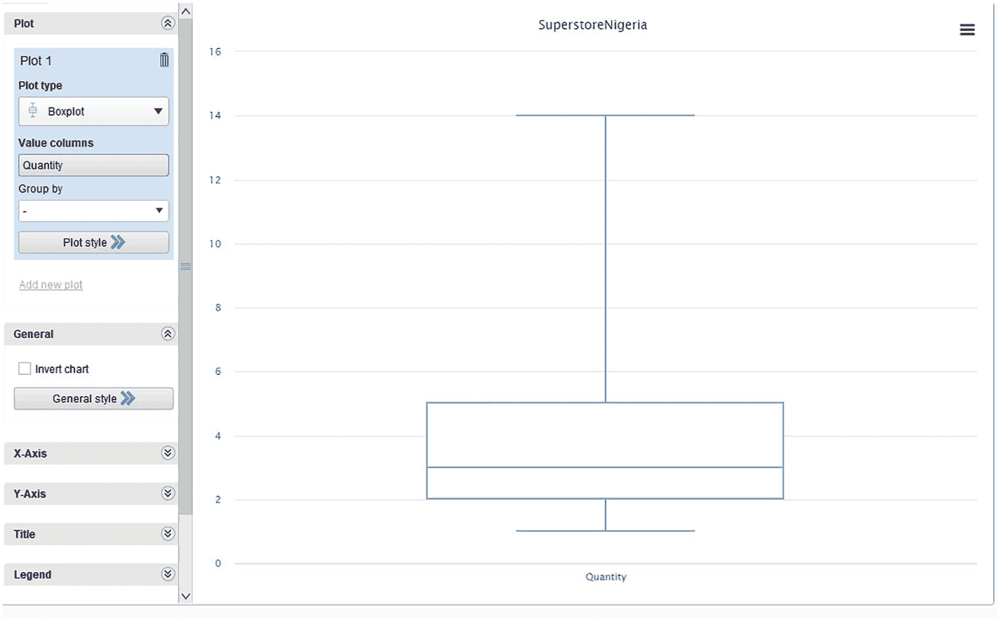

可视化选项卡显示了一个箱线图，其中图形类型选择了箱线图，数值列设置为数量。

图 5-7：箱线图示例

1.  通过调整设置，如图 5-7 所示，为属性“数量”创建一个箱线图。`Plot type`设置为箱线图，而`Value columns`（Y 轴）设置为数量。
2.  从图 5-7 可知，最小数量为 1，第一四分位数（Q1）为 2，中位数为 3，第三四分位数（Q3）为 5，最大值为 14。大部分数量分布在 2 到 5 之间。

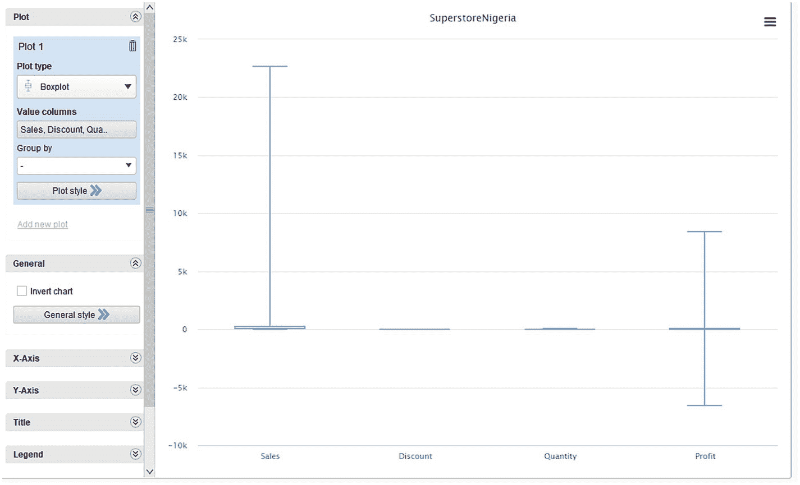

可视化选项卡显示了一个并列箱线图，其中图形类型设置为箱线图。X 轴标签在数值列中指定。

图 5-8：并列箱线图

1.  图 5-8 显示了数据中所有数值属性（销售额、折扣、数量和利润）的并列箱线图。这是通过将所有属性都包含在`Value columns`中获得的。

## 5.6 散点图

散点图有助于发现以下特征：

-   *因果关系（线性和非线性）*：一个变量可能以某种方式直接影响另一个变量。例如，经验更丰富的人往往薪酬更高。通常将因变量放在垂直轴上。
-   *关联性*：变量之间可能存在关联，但不一定是直接的因果关系。孩子们在英语和数学上取得好成绩是因为他们聪明，而不是因为一个科目的能力强是另一个科目能力强的缘由。
-   *离群值或离群值组*：当为两个维度（一个在 X 轴上，另一个在 Y 轴上）创建散点图时，某些个案可能成为离群值，但在单独考虑每个维度时却并非离群值。个子较高的人通常体重更重，但也可能存在中等身高的人，其体重相对于身高来说过重或过轻，从而在人群中显得突出。
-   *簇群*：有时，存在一些与其余数据分离的个案群组。

**在 RapidMiner 中创建散点图**

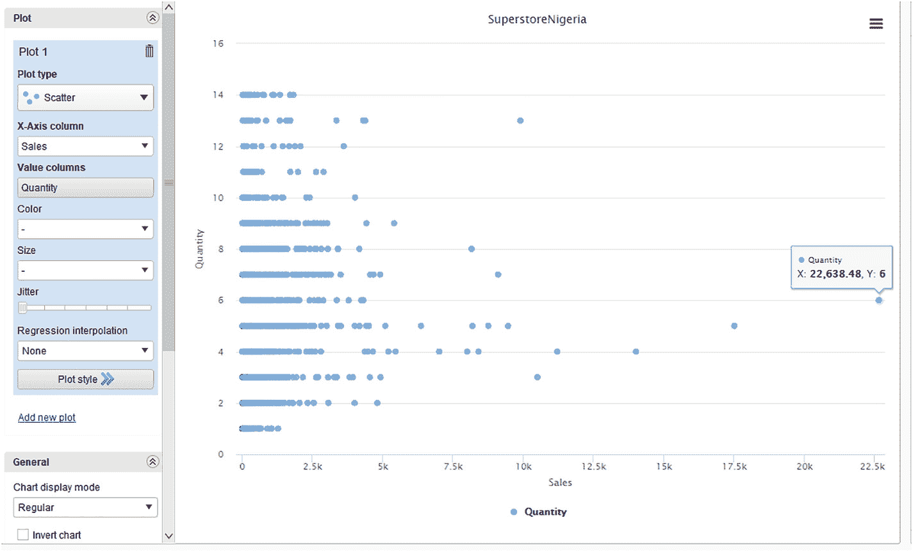

可视化选项卡显示了一个散点图，其中图形类型设置为散点图，X 轴和数值列设置为销售额和数量。

图 5-9：散点图

1.  通过调整设置，如图 5-9 所示，创建一个以销售额为 X 轴、数量为 Y 轴的散点图。`Plot type`设置为散点图。

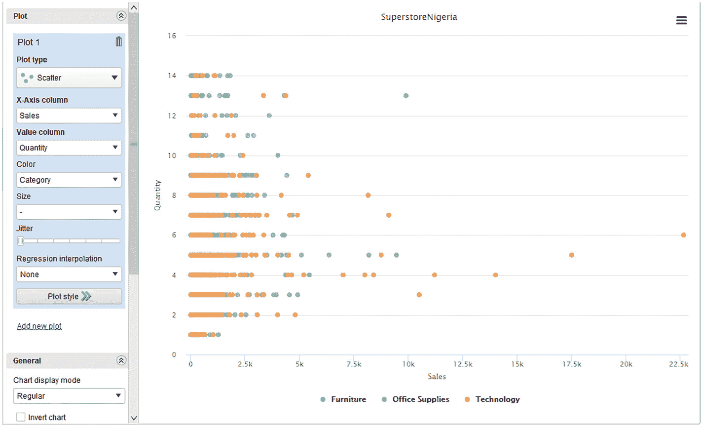

在颜色编码的散点图中，图形类型设置为散点图，X 轴和数值列设置为销售额和数量，颜色设置为类别。

图 5-10：颜色编码散点图示例

1.  可以通过在图 5-9 的设置中添加一个分类变量（`color`）来创建颜色编码的散点图，从而得到图 5-10。颜色编码的散点图有助于使用分类变量（用类别来区分这种关系）进一步解释属性销售额和数量之间的关系。从图 5-10 中，我们可以看到，低数量和低销售额的商品大多属于技术类别。

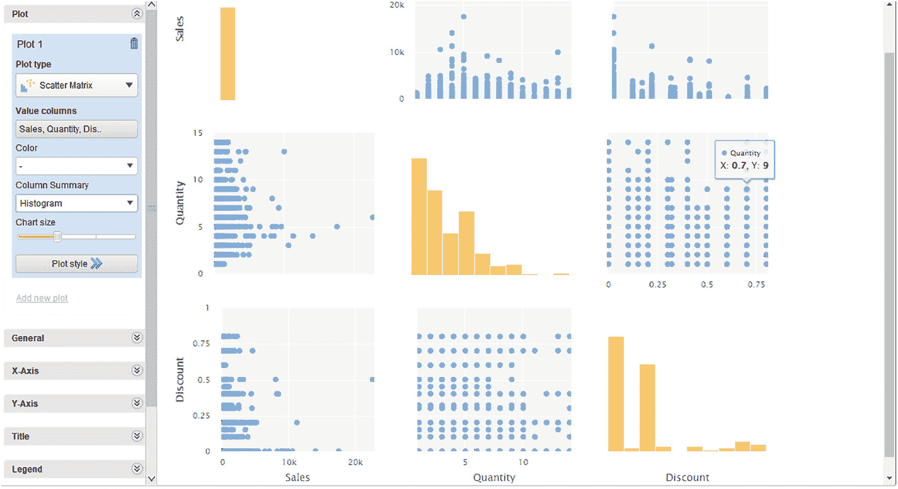

图形类型设置为散点图矩阵，数值列带有 X 轴标签，列摘要设置为直方图，包含六个散点图和三个直方图。

图 5-11：散点图矩阵示例

1.  现在，让我们使用图 5-11 中的设置为数值属性（折扣、数量和销售额）创建一个散点图矩阵。`Plot type`设置为散点图矩阵；`Value columns`设置为销售额、数量和折扣；`Column Summary`设置为直方图。散点图矩阵将有助于一次性比较所有目标属性。

## 5.7 气泡图

气泡图以圆形簇的形式显示数据。它可以用来可视化分类属性的大小。分类属性的每个类别代表一个圆形，而每个类别中的数量则代表这些圆形的大小。

**在 RapidMiner 中创建气泡图**

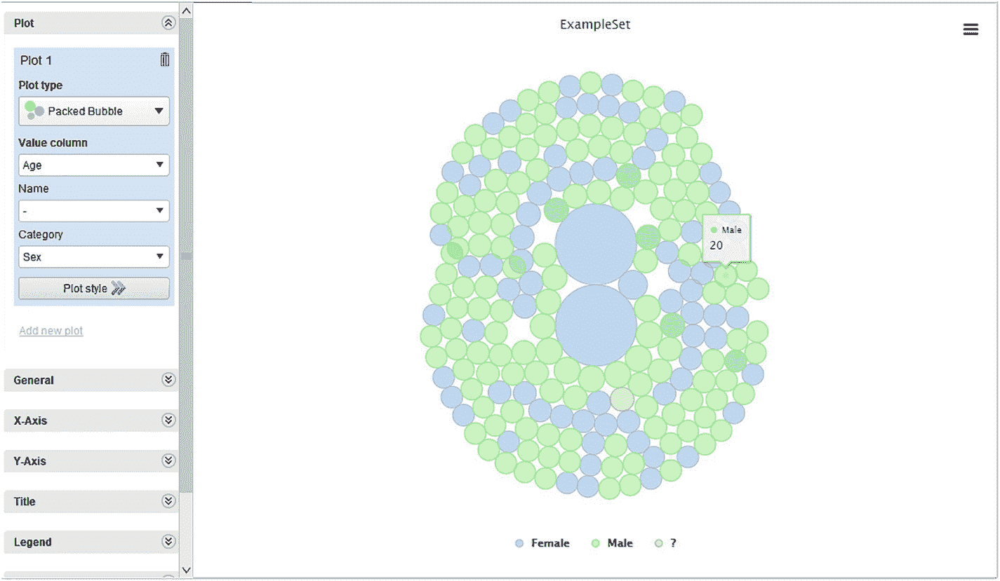

可视化选项卡显示了一个气泡图，其中图形类型设置为气泡图，数值列和类别设置为年龄和性别。

图 5-12：气泡图

1.  要创建气泡图，将使用名为`OnlineQuestion1.xls`的数据。将数据导入到你的存储库中；在设计视图中，将数据连接到结果（`res`），然后运行流程，在出现的界面（即`Results`）上，单击可视化选项卡。（注意，本课程使用的免费版 RapidMiner 的配置不允许对超过 2000 行的数据进行气泡图可视化。）
2.  使用如图 5-12 所示的设置创建气泡图。`Value column`（Y 轴）设置为年龄。`Category`设置为性别（正在调查的分类属性）。

## 树状图

树状图通过嵌套矩形来展示数据，可用于可视化分类属性的规模。分类属性中的每个类别对应一个矩形，而每个类别中的数值则决定了这些矩形的大小。

### 在 RapidMiner 中创建树状图

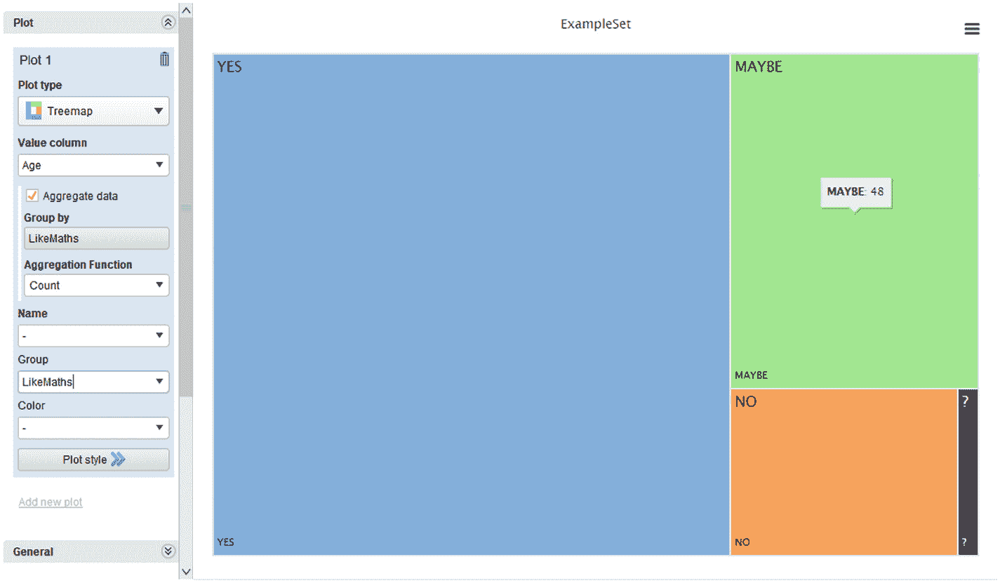

图形类型设置为`树状图`，值列设置为`年龄`，选择聚合数据，`分组依据`设置为`喜欢数学`，聚合函数设置为`计数`。

**图 5-13** — 树状图

1.  要创建树状图，将使用名为 `OnlineQuestion1.xls` 的数据。（请注意，本课程使用的免费 RapidMiner 版本配置不允许可视化超过 2000 行的树状图。）
2.  使用图 5-13 所示的设置创建树状图。**值列**（y 轴）设置为`年龄`，**分组依据**设置为`喜欢数学`（正在研究的分类属性），**聚合函数**设置为`计数`，以显示矩形的大小是如何确定的。
3.  从图 5-13 可以看出，`是`的计数最高，这由最大的蓝色矩形表示。其次是`可能`，以此类推。

## 热图

热图是一种数值数据的图形显示方式，其中使用颜色来表示数值。它们对于可视化相关表格和数据中的缺失值特别有用。为此，信息会在一个二维表格中呈现。一组属性的相关性表格具有相同的行数和列数。如果属性数量很多，则可以使用属性的一个子集。热图使通过颜色代码快速扫描相关性值变得简单快捷。

### 在 RapidMiner 中创建热图

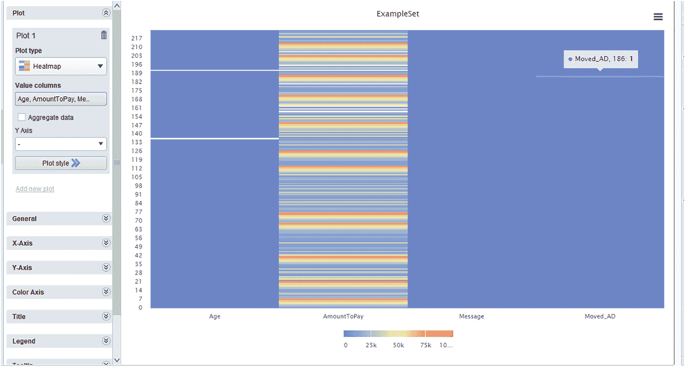

图形类型设置为热图，值列列出`年龄`、`应付金额`、`消息`和`已迁移 _AD`。

**图 5-14** — 缺失数据的热图

1.  为了创建用于可视化缺失数据的热图，例如，我们将使用名为 `OnlineQuestion1.xls` 的数据，并按照图 5-14 所示进行设置。**图形类型**为热图，选择的属性是`年龄`、`应付金额`、`消息`和`已迁移 _AD`。我们将在第 6 章中探讨用于相关性的热图。
2.  在图 5-14 中，根据所选属性，数据中的整行（223 行）都被显示出来。特定属性的缺失数据以白色表示。像这样可视化数据有助于了解有多少数据缺失。例如，很少有包含缺失数据的单元格。

## 地理地图

地图基本上是数据的地理表示。某些类型的推论只有在数据以地理方式可视化时才能最好地实现。

### 在 RapidMiner 中创建地理地图

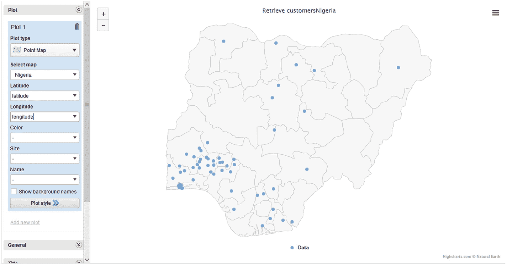

图形类型设置为点地图，选择地图设置为`尼日利亚`，并分别选择`纬度`和`经度`。

**图 5-15** — 定位客户的点地图

1.  为了演示，我们将使用 `customersNigeria.xls` 数据。该数据包含某个特定企业的客户及其位置信息。
2.  要创建地理地图，请将数据导入到您的存储库中；在设计视图中，将数据链接到结果（`res`），然后运行流程，在生成的结果界面（`结果`）上，点击可视化选项卡。
3.  按照图 5-15 所示进行设置。**图形类型**为点地图；**选择地图**为`尼日利亚`。**纬度**是`纬度`，**经度**是`经度`。
4.  从图 5-15 中，我们可以轻松推断出尼日利亚客户的位置集中情况。
5.  还可以探索其他类型的地图，例如用于通过颜色渐变显示与区域（例如国家或州）相关联的数值的等值线图，或用于可视化属于多个不同类别的区域的分类地图⁷。

需要说明的是，出于演示目的，我们仅选择了一些常用工具，并使用最常见的设置进行可视化。根据分析目标，还可以使用其他设置。此外，还有其他更具交互性的可视化工具，例如 Tableau 和 Power BI，值得探索。

## 5.11 一个实际业务问题 I（简单描述性分析）

这是本书中探讨的五个业务问题中的第一个。

**问题场景**：在本问题中，我们以一家电子商务企业作为案例研究。假设我们经营一家在线销售服装的企业。所使用的数据（`SuperstoreNigeria.xls`）包含销售记录。任务是使用描述性分析工具来描述过去发生了什么以及当前的情况。我们的目标是能够利用分析结果来了解业务环境并做出更好的销售决策。数据包含以下属性：`Row ID`、`Order ID`、`Order Date`、`Ship Date`、`Ship Mode`、`Customer ID`、`Segment`、`Country`、`State`、`Postal Code`、`Region`、`Product ID`、`Category`、`Sub-Category`、`Sales`、`Quantity`、`Discount`、`Profit`。在本问题中，我们打算回答以下问题：

1.  每个区域中每个子类别的销售额总和是多少？
2.  从 2014 年到 2017 年，销售额与利润的对比情况如何？
3.  哪些州盈利高，哪些州亏损（使用地理地图）？
4.  折扣、销售额和利润之间有什么关系？
5.  在尼日利亚的哪个类别、子类别和州实现了最高的销售额？

**解决方案**

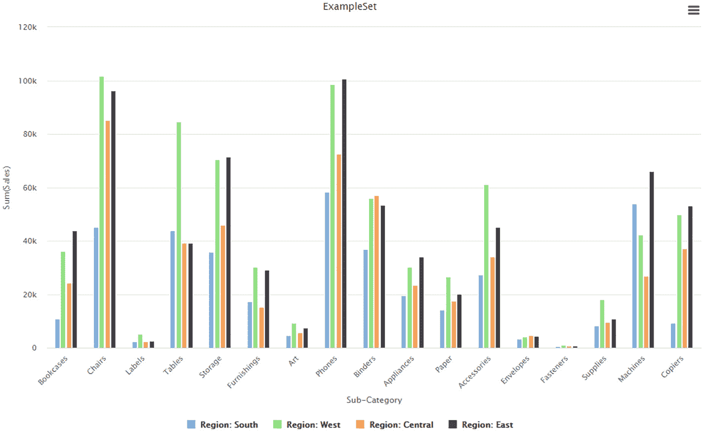

条形图展示了销售额总和与子类别的对比关系。柱状条针对南部、西部、中部和东部区域绘制。

**图 5-16b** 比较区域、销售额和子类别

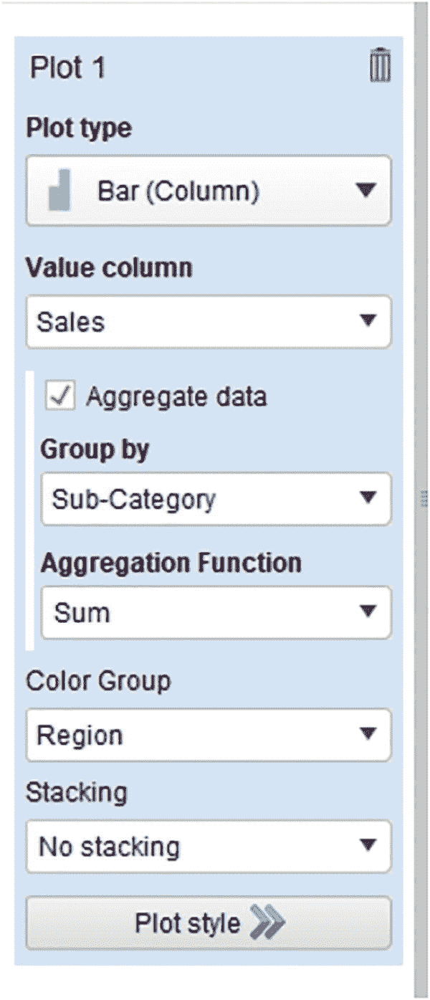

图表类型为条形，数值列为销售额，所选数据为聚合数据，分组依据为子类别，聚合函数为求和，颜色分组依据为区域。

**图 5-16a** 比较区域、销售额和子类别的设置

1.  *每个区域中每个子类别的销售额总和是多少？* 这个问题背后的意图是了解他们产品的哪个特定子类别带来了最高的销售额，以及这种情况发生在哪里（就区域而言）。首先要做的是**导入** `SuperstoreNigeria.xls`，将其拖拽到设计视图，运行流程，然后在**结果**界面中，点击可视化。为了回答这个问题，我们将使用条形图。图 5-16a 展示了回答此问题的设置。从图 5-16b（即条形图可视化）中，我们可以看到东部区域在复印机、机械设备、电话、存储设备和书柜这些类别上的总销售额最高。西部区域在耗材、配件、桌子和椅子这些类别上的总销售额最高。总体而言，西部区域在椅子子类别上拥有最高的销售额。这些信息有助于了解未来应该大量生产哪些产品以及应该针对哪个区域。

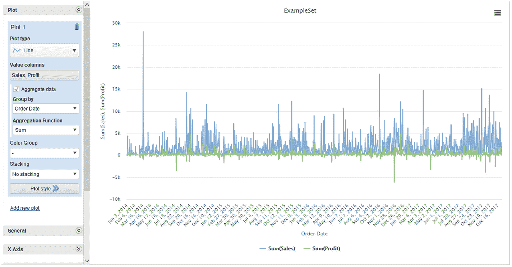

图表类型设置为折线图，数值列设置为销售额和利润，所选数据为聚合数据，分组依据为订单日期，聚合函数为求和。

**图 5-17** 随时间变化的利润与销售额对比

2.  *从 2014 年到 2017 年，销售额与利润的对比情况如何？* 这个问题背后的意图是了解在特定时间段内，销售额是否真的转化为了利润。为了回答这个问题，我们将使用折线图。图 5-17 展示了回答此问题的设置。请注意，回答这个问题时，使用利润和销售额的总和更为合理。图 5-17 中的答案显示，销售额与利润之间没有观察到特定的线性趋势随时间变化。

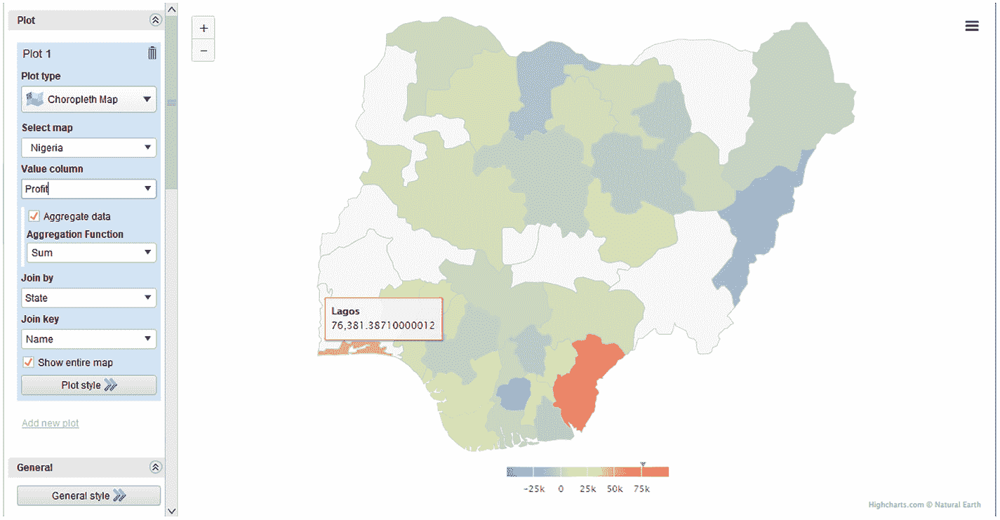

图表类型为等值区域图，数值列为利润，聚合函数为求和，关联依据为州，关联键为名称。已选择显示完整地图。

**图 5-18** 每个区域的利润和亏损

3.  *哪些州盈利高，哪些州亏损？* 这个问题的答案有助于确定应该关注哪个州（例如在市场营销时），以便获得更多利润；并且，例如，如果在一个州亏损并在该州投入了更多的营销资源，那么进一步调查原因可能是明智的。为了回答这个问题，我们将使用地理地图。图 5-18 展示了回答此问题的设置。从图 5-18 中，我们可以看到拉各斯州的总销售额最高。

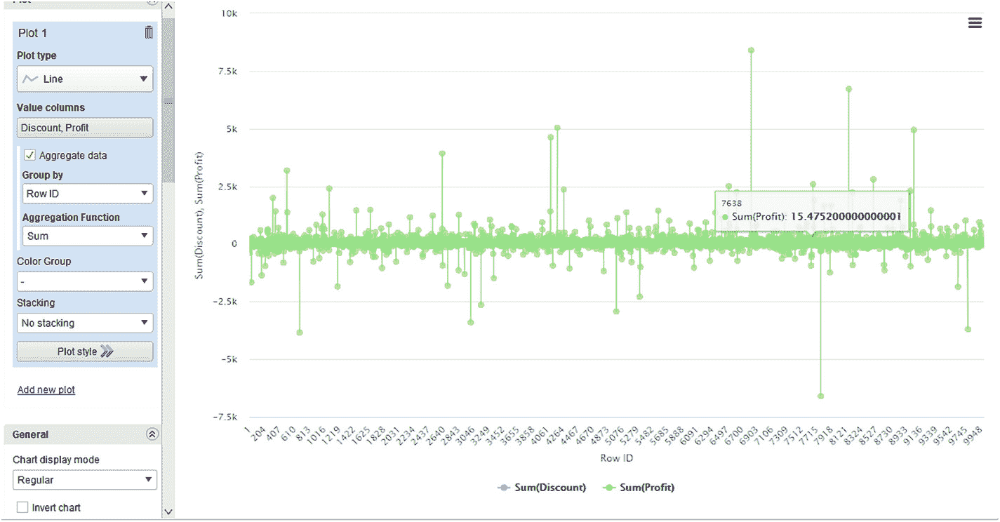

图表类型设置为折线图，数值列设置为折扣和利润，分组依据为行 ID，聚合函数为求和，未选择堆叠。

**图 5-19a** 折扣与利润（使用原始值）

4.  *所给予的折扣与所获得的利润之间有什么关系？* 这个问题背后的意图是了解所提供的折扣是否转化为了所获得的利润，因为折扣背后的整个理念是为了增加销售并为组织最终获得更多利润。使用图 5-19a 中的设置揭示了问题的答案。为了回答这个问题，我们使用每个唯一 `Row ID` 的总折扣和总销售额，以获得结果的整体视图。

不幸的是，由于折扣的值比利润小，它在图表中几乎不可见。我们必须选择对数刻度才能看到折扣，如图 5-19b 所示。从图 5-19b 中，我们看到折扣与利润之间没有观察到线性趋势。

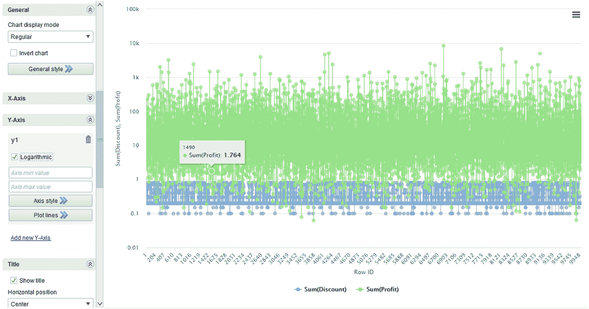

图表显示模式设置为常规，y1 设置为对数，已选择显示标题，水平位置设置为居中。

**图 5-19b** 折扣与利润（使用正常值）

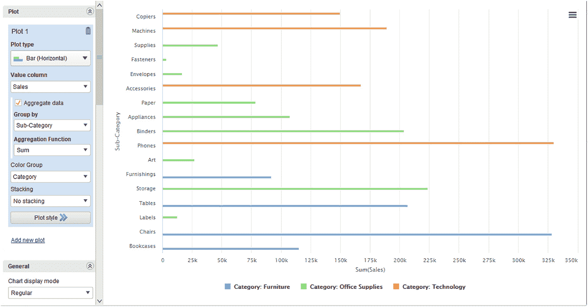

图表类型设置为水平条形图，数值列为销售额，分组依据为子类别，聚合函数为求和，颜色分组依据为类别。

**图 5-20** 类别、子类别和销售额

5.  *在哪个类别或子类别中实现了最高的销售额？* 这个问题背后的意图是了解哪个类别，特别是子类别，带来了最高的销售额。问题的答案在图 5-20 的设置中揭示。带来最高销售额的子类别是电话，它属于技术类别。这个问题的答案有助于揭示最畅销的子类别和类别，而不受区域等因素影响。

## 5.12 习题

1.  本练习是实操业务问题一（第 5.11 节）的延续。目的是利用 `SuperstoreNigeria.xls` 发掘更多见解，回答以下问题。（注意：部分问题可能需要使用如 Tableau 等更交互式的可视化工具。）
    1.  每个子类别的销售额总和是多少？这与利润有何关系？即哪个子类别利润最高，哪个最低？请使用颜色进行标识。
    2.  每个细分市场的销售额总和是多少？这与数量有何关系？即哪个细分市场产量最高，哪个最低？请使用颜色进行标识。
    3.  哪些州获得了最高和最低的折扣？（使用地图。）
    4.  哪些州的利润较高？（使用文字云、树状图和气泡图。）
    5.  哪些州获得了最高和最低的折扣？（使用地图。）
    6.  在尼日利亚的哪个类别、子类别和州，销售额最高？
    7.  在尼日利亚的哪个类别、子类别、地区和州，销售额最高？
    8.  对于名为“家具”的类别，且其配送方式属性为标准级，所获得的总利润和总销售额是多少？请确保输出结果有恰当的标题，即“类别与配送方式的总销售额和总利润”。
    9.  对于使用标准级配送方式的办公用品，其销售总数量和总销售额是多少？
    10. 基于类别和子类别，比较东区与西区的销售额。

2.  你已获得一份名为 `chapter5Assign.xls` 的数据。该数据包含一家尼日利亚面条零售企业的交易数据（*数据为虚构，仅供作业使用*）。假设该企业希望基于描述性分析的结果，获得有效营销活动的建议，而你被聘用为数据科学家，请以仪表盘的形式向管理层展示你的结果。

