# 6. 预测数值型结果

在本章中，我们将探讨用于预测的流行技术，尤其是在零售业务中的应用。解释这些技术的方法是利用它们来解决一个业务问题。要解决的业务问题是零售业务中常见的销售预测问题。本章首先解释预测技术的基本概念；接着，我们探讨如何评估这些技术。之后，我们描述意图解决的业务问题。然后，我们逐一选取各项选定技术，解释所涉及的算法以及如何用它们来解决所描述的问题。使用的预测技术包括多元线性回归、回归树和神经网络。作为本章的结尾，我们比较这三种算法的结果，并针对该问题得出结论。因此，本章提供的分析产品是针对小型零售企业的销售预测问题。

## 6.1 引言

在分析之旅第 1.​3 节中，曾提到分析主要分为三类：描述性分析、预测性分析和规范性分析。在本章中，我们将使用预测性分析来解决小型零售企业的销售预测问题。为了为预测性分析打下良好基础，我们将解释一些基本概念。

机器学习用于研究计算机如何基于数据进行学习或提升性能。在机器学习中，计算机会自动学习识别复杂模式，并基于数据做出智能决策。³

*监督学习*：这是向算法输入数据的过程，其中已知感兴趣的输出变量，算法“学习”如何在输出未知时用新记录预测该值。预测性分析属于监督学习范畴。预测性分析有两种类型：预测分类结果（分类），例如“购买”或“不购买”；以及预测数值型结果（预测），例如股票价格。预测算法的示例包括多元线性回归、回归树（决策树）、逻辑回归、用于回归的 `SVM`（支持向量机）等。分类方法的示例包括朴素贝叶斯、贝叶斯网络、分类树（决策树）、`KNN`、`SVM`（支持向量机）等。在本章中，我们将重点讨论处理数值型结果预测的那类预测性分析。用于预测数值型结果的历史数据是有标签的，意味着数据中所有行都以一个目标属性结尾，该属性正是我们打算预测的属性。在预测数值型或分类结果时，数据需要按比例划分，例如 70% 或 60% 用于训练，30% 或 40% 用于测试。有些算法，如 `KNN`（K-近邻），需要不同的划分方式，因为需要使用一个划分集来确定最佳的 k 值。这将在第 7 章中讨论。

在商业中，预测可用于实现以下目标，例如：

*   根据人口统计信息和先前的活动模式预测客户的信用卡行为
*   利用历史的飞行常客信息预测度假旅行支出
*   利用历史数据、产品和销售信息预测客服人员需求
*   基于历史数据，通过产品交叉销售预测销售额
*   预测折扣对零售额的影响

分类可用于实现以下目标，例如：

*   确定哪些贷款申请人属于高风险或低风险对象。
*   在市场营销中，例如，分类有助于判断客户是否会购买产品。
*   分类在确定客户忠诚度方面非常有价值；特别是，我们可以预测客户是否会流失。

*无监督学习*：这类分析旨在尝试发现数据中的模式，而非预测期望的输出值。聚类属于机器学习的无监督学习方法，此外还有许多其他方法。在这种方法中，原始、无标签且未划分的数据被输入算法，而输出的则是已标签或已分类的数据。

## 6.2 评估预测模型

在本节中，我们将探讨如何评估预测模型，这也是本章的重点。有多种指标可用于评估预测性能。这些指标基于验证集或测试集，其客观性优于训练集。验证数据集不用于选择预测因子或计算模型参数。预测误差（`e`）是指记录 `i` 的结果值与预测结果值之间的差异。^(1,3)

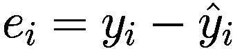

(公式 6.1)

预测准确度的一些数值衡量指标如下：

*   **MAE (平均绝对误差)**：表示绝对误差的平均大小。

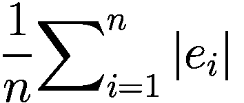

(公式 6.2)

*   **平均误差**：该指标与 MAE 类似，区别在于它保留了误差的符号，允许负误差抵消大小相等的正误差。

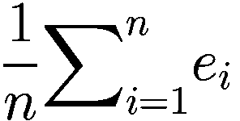

(公式 6.3)

*   **MPE (平均百分比误差)**：这是一个百分比分数，表示预测值与实际值（平均）的偏离程度，并考虑了误差的方向。

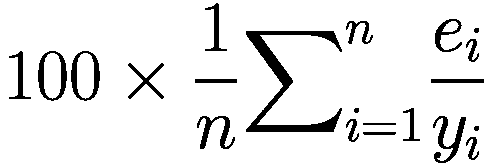

(公式 6.4)

*   **MAPE (平均绝对百分比误差)**：该指标给出一个百分比分数，表示预测值与实际值（平均）的偏离程度。

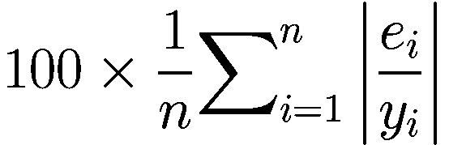

(公式 6.5)

*   **RMSE (均方根误差)**：该指标与线性回归中的估计标准误差相当；但它使用验证数据而非训练数据计算。其单位与结果变量相同。

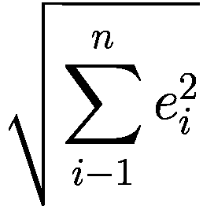

(公式 6.6)

提升图是一种以图形方式展示模型预测性能的方法，尤其是在需要对预测结果进行排序时。（更多解释请参见 Galit 等人（2018），第 5 章。）

## 6.3 实际业务问题二（销售预测）

针对这个实际业务问题，我们将以一家大型丰田汽车经销商公司为例。该公司的业务模式是：如果你打算购买一辆新的丰田汽车，可以选择将旧车卖给公司，然后在你获得的旧车估价基础上加钱购买新车。公司现在希望通过一项促销活动来吸引更多消费者前来出售他们的旧款丰田花冠，并承诺为此类汽车支付高价。公司的目标是将收购的旧车转售以获取利润。因此，业务分析师的工作就是预测公司应以什么价格从顾客那里购买这些旧车，从而确保盈利。由于本书旨在从咨询的角度解决业务问题，我们将尝试以典型的咨询方式来呈现解决方案。为此，我们探索了三种合适且最流行的算法（多元线性回归、回归树和神经网络），并比较结果以得出结论。需要说明的是，这里选择的算法并非进行此实验的唯一途径；我们可以尝试其他方法，特别是在属性组合、算法设置和算法类型方面。最终目标是获得最佳性能，同时避免数据偏差。

此实际业务问题的数据文件名为 `ToyotaCorollaData.xlsx`，它提供了公司过去收购的二手车相关信息。数据描述如下：

| 变量 | 描述 |
| --- | --- |
| `Id` | *唯一标识* |
| `Price` | *报价* |
| `Age` | *车龄（月）* |
| `KM` | *行驶里程（公里）* |
| `Fuel_Type` | *燃油类型（汽油、柴油、压缩天然气）* |
| `HP` | *马力* |
| `Met_Color` | *金属漆颜色* |
| `Automatic` | *是否自动挡（是=1，否=0）* |
| `CC` | *气缸容积（立方厘米）* |
| `Doors` | *车门数量* |
| `Quarterly_Tax` | *季度税费* |
| `Weight` | *重量（千克）* |

无论使用何种预测算法，首要任务都是执行基本的数据预处理，并使用必要的可视化工具探索数据，以便进行预测。将执行以下预处理任务：

1.  统计与缺失值问题
2.  异常值检测
3.  可视化
4.  数据转换
5.  相关性分析

所有这些步骤都已在前 1\-10 点的实际操作演示中以不同方式处理过。

### 实际操作演示

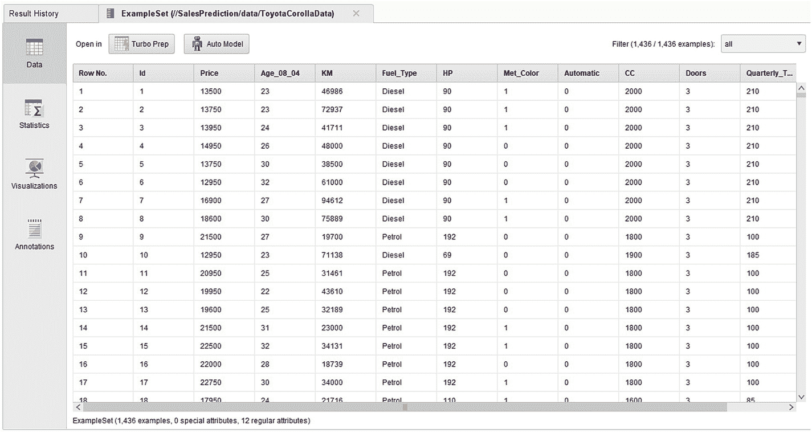

**图 6-1**：加载数据

1.  创建一个名为 `Sales Prediction` 的存储库，在存储库中创建两个文件夹（`data` 和 `process`），导入名为 `ToyotaCorollaData.xlsx` 的数据，并将其保存到存储库的 `data` 文件夹中。
2.  加载 `ToyotaCorollaData.xlsx` 时，在 **格式化您的列**（数据类型）界面上，选择 **用缺失值替换错误**。在同一界面上，您还可以根据需要编辑数据类型；例如，也许某个分类数据被赋予了整数值，您可以将其更改为名义型或多项式型。点击 **下一步** 并 **完成** 数据导入过程。加载数据后的最终界面应类似于图 6-1。

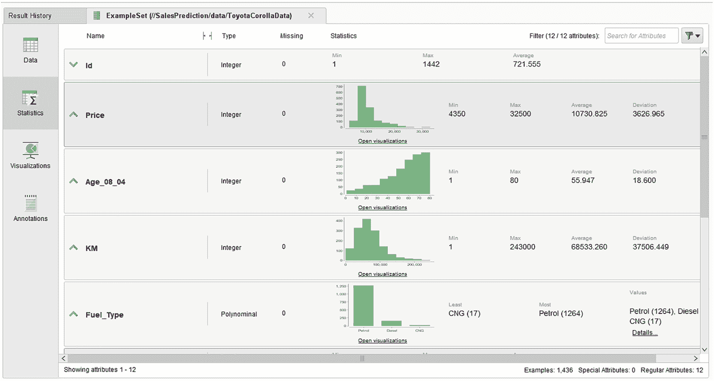

**图 6-2**：汇总统计

1.  要查看数据统计信息并检查缺失值，请点击图 6-1 中的`Statistics`。注意，由于我们使用的数据没有缺失值，因此没有缺失值，但如果存在缺失值，则需要按照第 2.​4 节中介绍的方法进行处理。

2.  `Statistics`界面如图 6-2 所示。通过点击统计信息下的属性，您将看到每个属性的默认统计可视化（直方图）。此时，您需要根据分析目标（参考第 2.​5 节）决定如何处理每个属性。在当前示例中，由于目标是预测，我们将按照第 2.​5 节中的预测可视化指南进行可视化。

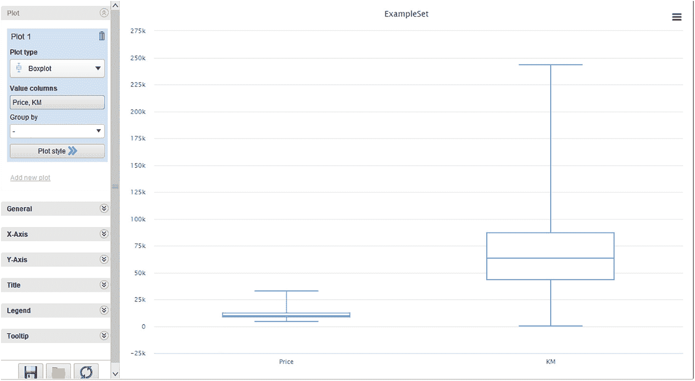

价格和行驶里程的两个箱线图。价格箱线图的范围大致在 12000，另一个从 40000 到 90000。

图 6-3 直方图

1.  使用直方图/箱线图来确定任何必要的转换（将结果变量与数值预测变量进行绘图）。检查图 6-2 中所有变量的直方图，我们会注意到一些数值变量存在左偏或右偏，特别是`price`、`age`和`weight`。接下来要对数据做一些数据变换，例如应用对数函数。出于本示例的目的，我们不会这样做，因为我们仍将针对每个选定的算法使用必要的属性缩减。请注意，您也可以使用`Visualizations`选项卡自行创建直方图。图 6-3 显示了一些数值变量的箱线图，用于判断数据中是否存在异常值等。如果您对所有其他数值属性都执行此操作，您会发现没有变量含有异常值。箱线图可以帮助您研究中位数、第一四分位数、每个变量的分布等。

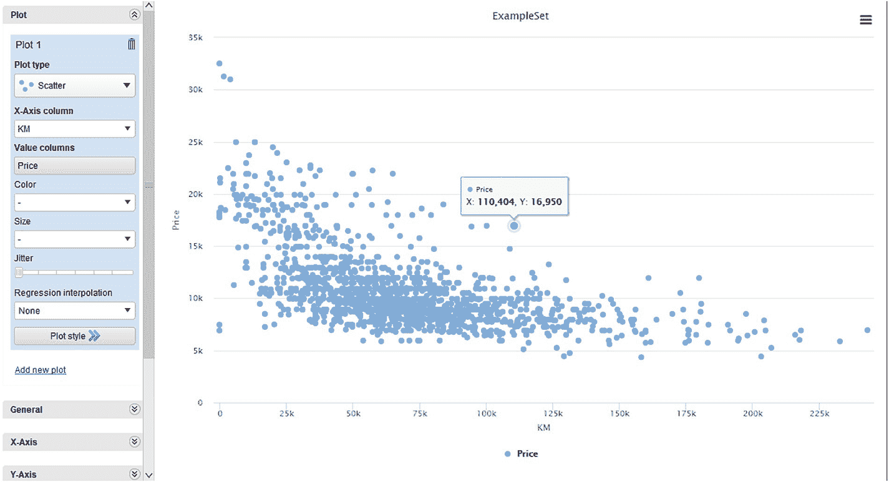

价格示例集的散点图。点聚集在中心。上面有一个点标注着：价格，X 110, 404，Y 16, 950。

图 6-4 散点图

1.  使用散点图来研究数值预测变量之间的关系。这样做时，您需要观察它们之间的关系，这种关系可能对分析产生正面或负面影响。图 6-4 是属性`KM`和`Price`的散点图；这揭示了两个属性之间略微相关。随着价格降低，`KM`在增加。这种关系预计不会对实验产生负面影响，因此我们可以保留这两个变量。但是，例如，如果我们发现这两个变量高度相关，就必须移除一个，因为这可能会影响例如多元线性回归算法。应该对所有数值变量尝试此组合。请注意，`Met_Color`和`Automatic`是分类变量，在加载数据时应该进行转换。

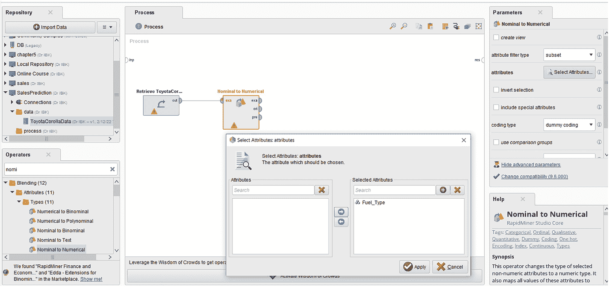

一个流程截图，展示了从`Nominal to Numerical`的流程，`Retrieve Toyota`选项卡指向`Nominal to Numerical`选项卡。`Select Attribute`窗口显示在前景中。

图 6-5 `Nominal to Numerical`

1.  您可以尝试第 2.​5 节中用于预测可视化的其他指南并得出结论。在本实践演示中，我们仅使用前述两个指南。

2.  为完成预测任务，我们需要将分类变量`Fuel_Type`转换为虚拟变量。为此，在设计视图中，按照图 6-5 所示创建流程。可以在`Operators`窗口中搜索`Nominal to Numerical`运算符。

连接到`res`；运行流程以获得图 6-6 中的输出。在图 6-6 中，我们可以看到燃料类型类别转换后的虚拟变量。

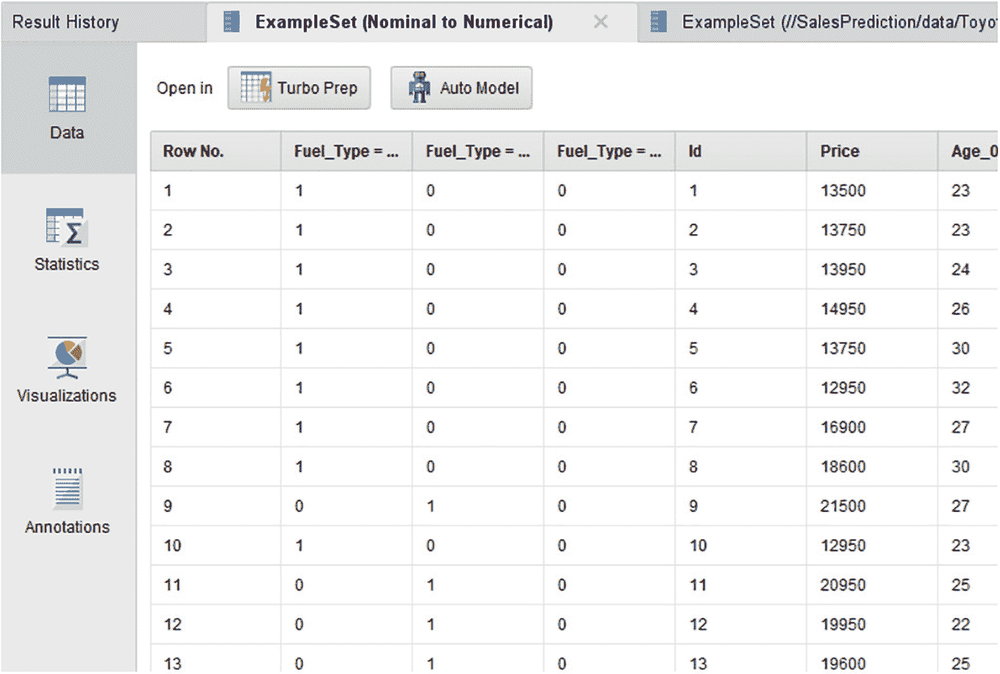

一个示例集的截图，包含 6 行 13 列数据，提供燃料类型、价格和车龄的数据。

图 6-6 `Nominal to Numerical`的输出

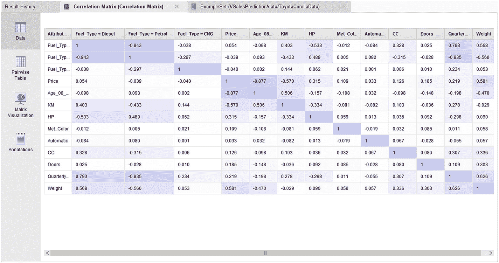

一个示例数据集的截图，包含 13 行和列，呈现燃料类型、价格、车龄、行驶里程、马力、颜色、自动挡等数据。

图 6-8 相关性矩阵结果

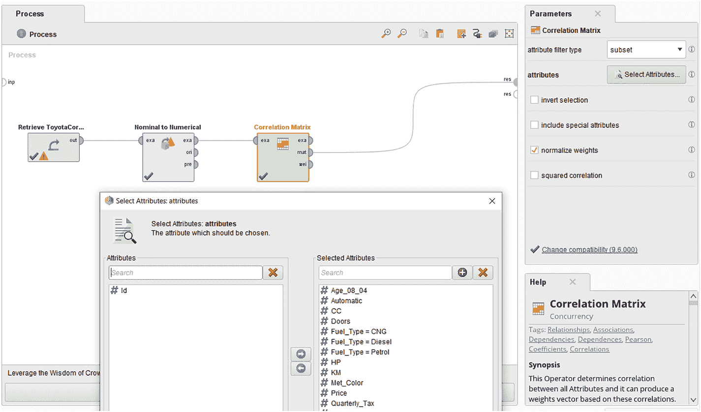

一个流程截图，`Select Attributes`窗口在前方。背景中的步骤是`Retrieve`、`Nominal to Numerical`和`Correlation Matrix`。

图 6-7 相关性矩阵流程

1.  要获取数据的相关性矩阵，请使用图 6-7 中的设置。可以在`Operators`中搜索`Correlation Matrix`。运行流程以获得图 6-8 中的相关性矩阵。请注意，要了解相关性矩阵使用了哪种方法，您需要阅读该运算符的`help`。结果显示在图 6-8 中。

1.  我们可以看到高度相关的属性，例如`Quarterly_Tax`和`Fuel_Type Diesel`。在此阶段，您可以移除高度相关的属性。在本示例中，为了演示算法，我们将保留它们。

## 6.4 多元线性回归

多元线性回归模型说明了因变量与多个自变量（两个或更多）之间的关系。MLR 模型的输出中会体现方差（即`R²`），以及每个自变量的独特贡献。回归方程也被称为回归线。决定系数（通常称为`R²`）提供了自变量（`X`）变异性的比例，并量化了利用这些自变量预测某个特定`Y`的能力。

方程 6.7 代表了回归方程。在该方程中，`x1`, `x2`, ... `xp` 是自变量，`β0`...`βp` 是系数，`ϵ` 是噪声或未解释的因素。`Y` 代表因变量，即我们希望预测的数值属性。数据用于估算系数，同时也用于量化噪声。

(公式 6.7)

如果当前任务是预测一个数值结果，数据同样用于评估模型性能。当使用直方图进行可视化时，如果图形向左或向右偏斜，我们可能需要使用数据转换技术（例如对数形式`log(X)`）来转换自变量。请注意，因变量不必呈正态分布，但要使 MLR 模型有效，模型的残差必须呈正态分布。此外，由于 MLR 对多重共线性敏感，因此不应存在多重共线性，这意味着自变量之间不应高度相关。调整后的`R²`（定义见公式 6.8）是评估 MLR 模型的常用方法。

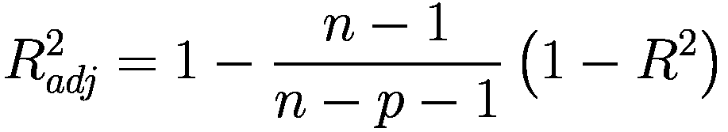

(公式 6.8)

*   `p` 是待预测变量的数量。
*   `R²` 表示模型中可解释变异性的比例（在只有一个预测变量的模型中，这相当于相关系数的平方）。
*   与`R²`类似，较高的`R²_{adj}`值表明拟合优度更高。

与忽略所用预测变量数量的`R²`不同，`R²_{adj}`会对使用的预测变量数量进行惩罚。关于多元线性回归模型的更详细讨论，请参见 Galit 等人 (2018)。³ 验证/测试数据集用于确定 MLR 的预测性能。这些数据集分区不应用于选择预测变量或计算模型参数。

### 线性回归中的变量选择

选择使用的具体形式取决于领域知识、数据可用性和所需的预测能力。在将所有可用变量用于构建模型之前，务必谨慎，因为为未来预测收集完整的预测因子集可能代价高昂或不可行。此外，我们或许能够更可靠地测量较少的预测因子（例如在调查中），而预测因子越多，数据中出现缺失值的可能性就越大。为了限制预测因子的数量，有几种选择。一种技术是利用领域知识来减少预测因子的数量。另一种选择是利用计算能力和统计性能指标。其中一些方法如下：

*   *穷举搜索*：评估所有预测因子子集以及每个子集模型，并使用特定标准来评估模型。
*   *流行的子集选择算法*：此过程通过对所有潜在回归模型的空间进行迭代部分搜索来执行。前向选择、后向消除和逐步回归都属于此类算法。
*   例如，主成分分析在观测子集在同一尺度上测量且高度相关时特别有用。如果变量数量庞大，主成分分析有助于识别少数几个变量，这些变量是原始变量的加权线性组合，并保留了原始集合的大部分信息。它最常用于数值变量。更多信息请查阅 Galit 等人 (2018)。

### 销售预测问题 – MLR

1.  我们要做的第一件事是在`RapidMiner`中创建一个新流程并重新加载数据；我们将其命名为`ToyotaCorollaData2`（我们将排除 ID 列）。这可以在图 6-9 中看到。

    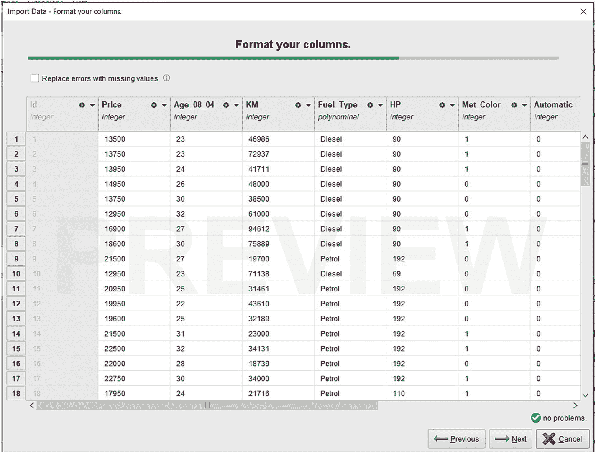
    一个包含 13 行和列的数据集示例截图，展示了燃料类型、价格、车龄、行驶里程、马力、颜色、自动挡等数据。
    **图 6-9** 加载数据

    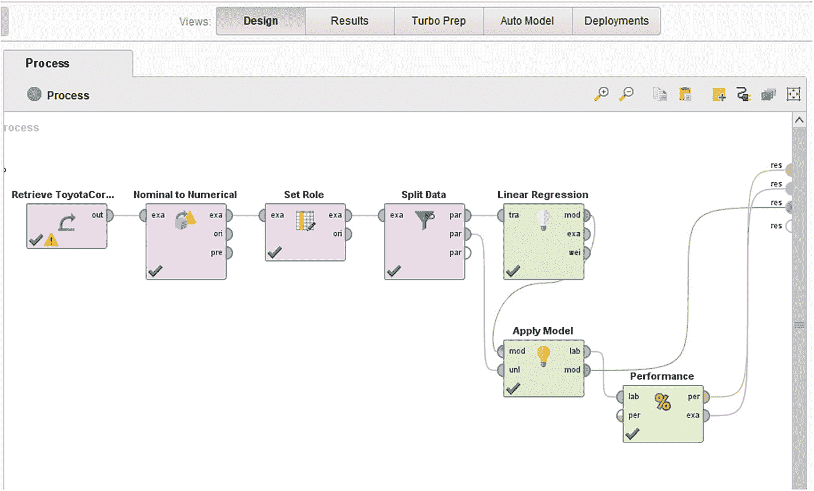
    一个包含七个步骤的流程截图：检索、标称型转数值型、设置角色、拆分数据，接着是线性回归和应用模型，以及性能评估。
    **图 6-10** MLR 整体流程

2.  运行多元线性回归的整体流程如图 6-10 所示。

    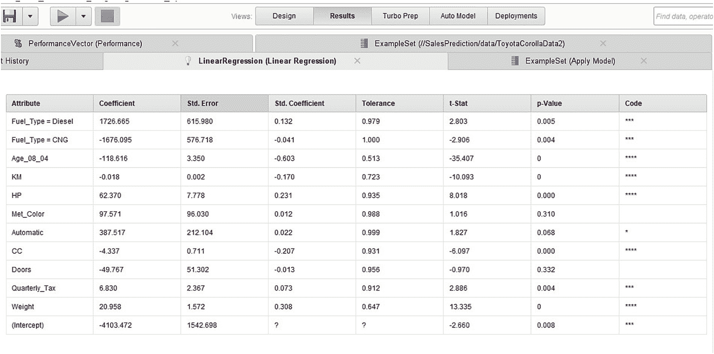
    一个包含 8 行和 12 列的线性回归表，数据涉及燃料类型、车龄、行驶里程、马力、金属色、自动挡、C C 车门等。
    **图 6-11** MLR 模型

3.  首先将数据`ToyotaCorollaData2`拖到设计视图，搜索图 6-10 中的所有算子并将它们正确连接。对于`标称型转数值型`算子，您需要选择`Fuel_Type`属性（将`Fuel_Type`转换为虚拟变量）。点击`设置角色`算子，并将*属性名称*设置为`Price`，*目标角色*设置为标签。点击`拆分数据`算子，对于此数据的分区属性，分别添加两个条目，0.6 和 0.4。这意味着您将数据划分为 60% 用于训练，40% 用于验证。点击`线性回归`算子；特征选择参数虽然可选，但默认是 M5 prime。这是一个专家参数。它指定回归中使用的特征选择方法。可用的选项有：无、M5 prime、贪婪、T 检验和迭代 T 检验（更多信息见`Rapidminer.doc`）。`应用模型`算子无需调整参数；它用于将从`线性回归`算子获得的模型应用于验证数据集。请注意，线性回归模型使用训练数据集来构建模型。对于`性能（回归）`算子的参数，只需保留默认设置，即*均方根误差*。

4.  使用图 6-10 中的设置，我们期望得到三个输出（即三个连接到`res`的链接）。第一个是 MLR 模型（图 6-11），第二个是模型性能结果（图 6-12），第三个是显示验证数据集预测结果的数据表（图 6-13）。

好的，这是根据您的要求排版后的 Markdown 文档。

-   注意，这可以用来编写回归方程，并且 *Fuel_Type* 属性的第三个虚拟变量不再存在。这是因为当我们转换为虚拟变量时，为某些算法创建的其中一个虚拟变量不会用于建模。包含冗余的虚拟变量会导致回归失败，因为该冗余变量将是其他两个变量的完美线性组合。

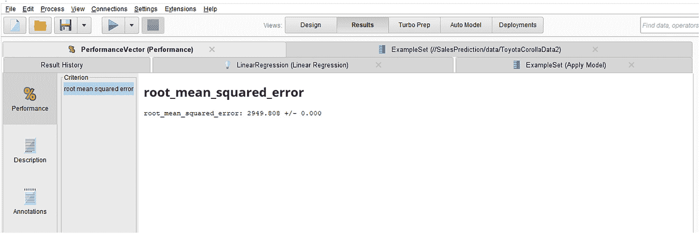

**图 6-12**
MLR 评估

总而言之，就预测性能而言，如果误差与原始价格相比不太大，则该算法被认为表现良好。

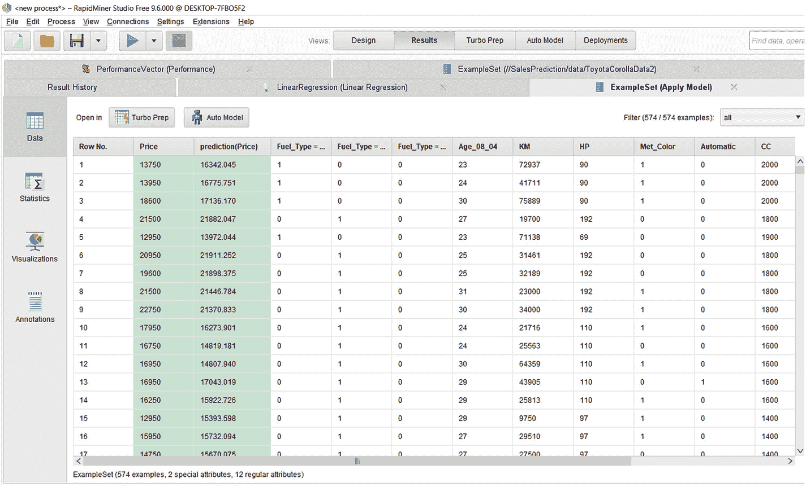

**图 6-13**
生成的数据集

图 6-13 是使用 40% 的验证数据集进行评估的输出，并比较了验证数据集中的预测结果和原始价格。

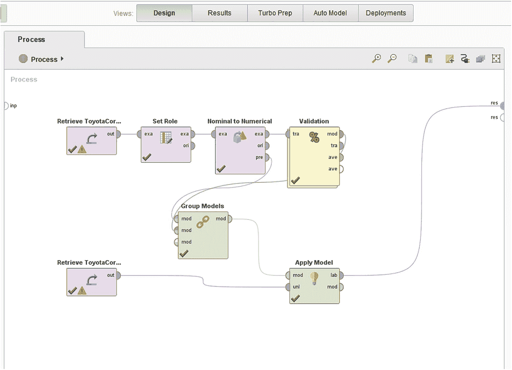

**图 6-13a**
预测新数据的外部流程

1.  一旦我们为预测建立了最优模型，现在就可以使用该模型预测新数据。准备新的数据集，使其不包含结果/目标变量（`ToyotaCorollaNewData.xlsx`）。
2.  首先要做的是将数据（`ToyotaCorollaNewData`）加载到 `SalesPrediction` 仓库的 `data` 文件夹中。导入数据时，请记住排除 `ToyotaCorollaNewData` 数据集的 ID 列。为了预测新记录，我们将使用图 6-13a 和图 6-13b 中的设置。图 6-13a 是主流程。在此流程中，将 `ToyotaCorollaData2` 拖拽到设计视图。`Set Role` 和 `Nominal to Numerical` 运算符保留其在编号 3 中的设置。`Split Validation` 运算符的划分比率参数设置为 0.6，表示 60% 的数据作为训练数据，就像我们之前做的那样。要预测的新数据也包含在图 6-13a 中。
3.  图 6-13b 是内部流程，您可以通过双击 `Split Validation` 运算符来创建。`Linear Regression`、`Apply Model` 和 `Performance (Regression)` 运算符保留默认设置，与之前相同。

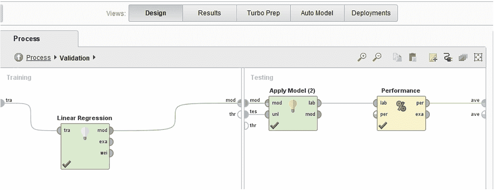

**图 6-13b**
预测新数据的内部流程

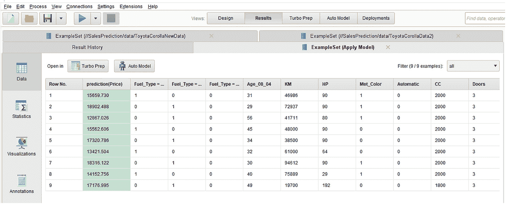

**图 6-14**
生成的数据集

4.  加载的新数据的预测价格如图 6-14 所示。

请注意，我们也可以使用从图 6-11 中的模型获得的回归方程，手动预测新记录。

## 6.5 回归树

决策树分类器家族包括回归树。决策树分类器的数据驱动方法需要大量数据。例如 `ID3`、`C4.5`、`CART`（分类与回归树）等。这类技术使用贪婪（即非回溯）方法，以递归的分治方式自顶向下构建决策树。随着树的创建，训练集被递归地划分为更小的子集。特征在树创建过程中的选择方式以及决策树算法中使用的剪枝过程有所不同。

**决策树分类器中的属性选择度量**

属性选择度量是一种启发式方法，用于挑选将给定的类标记训练元组数据分区 D 分割成单个类的“最佳”分割标准。如果我们将 D 分割成更小的分区，最优的分割要求是每个分区都是纯的。由于属性选择度量决定了给定节点上的元组如何被分割，因此它们也被称为分割规则。属性选择度量为描述相关训练元组的每个属性分配一个分数。对于给定的元组，得分最高的属性被选为分割属性。如果分割属性是连续值的，或者我们仅限于二叉树，我们必须分别确定一个分割点或一个分割子集作为分割标准的一部分。² 三种流行的属性选择度量是：

*   信息增益
*   增益率
*   基尼指数

决策树结构的一个示例如图 6-15 所示。

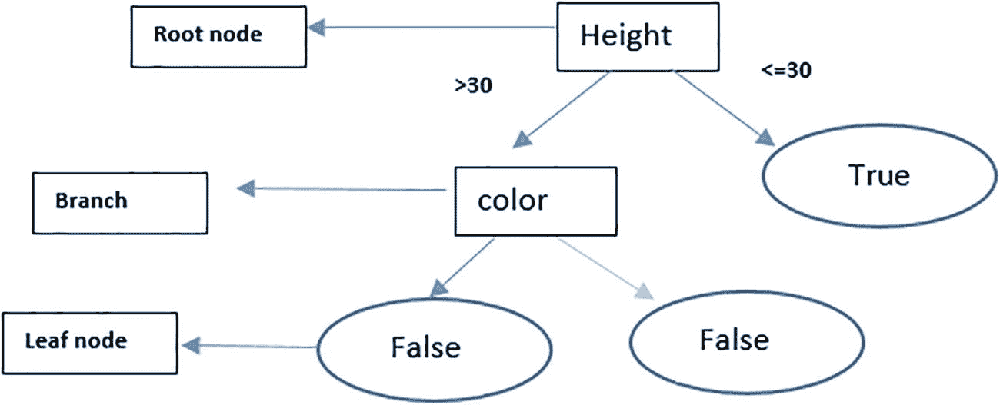

**图 6-15**
决策树示例

*   包含根节点、分支和叶节点。
*   每个内部节点代表对一个属性的测试。
*   每个分支代表测试的结果，每个叶节点代表一个类别。

使用决策树分类器的一些好处包括：它们不需要领域知识，易于理解，并且是白盒模型，这意味着我们可以快速解释决策树模型。这可以通过提取决策树的规则来实现。离群点对决策树算法不是问题，并且它们可以容忍缺失值。

使用决策树时，在训练数据上构建深层树存在过拟合的风险。当最终的分割基于少量记录时，据说就会发生这种情况。过拟合会导致处理新数据时性能不佳。为了避免过拟合，我们可以使用树深度参数、终端节点中的最少记录数以及最小的不纯度减少量，在树开始过拟合数据之前阻止其生长。在我们的数据划分中，我们还可以修剪树或使用交叉验证。

**回归树**

决策树算法可以预测数值型和类别型结果。当预期结果是数值时，使用回归树。使用回归树进行预测时，使用预测变量数据将记录“掉落”到树中，直到到达终端节点。该终端节点中训练记录的平均结果值决定了回归树中该终端节点的值。

**销售预测问题 – 回归树**

使用第 6.2 节中介绍的销售预测问题，以下内容演示了如何使用回归树来解决该问题：

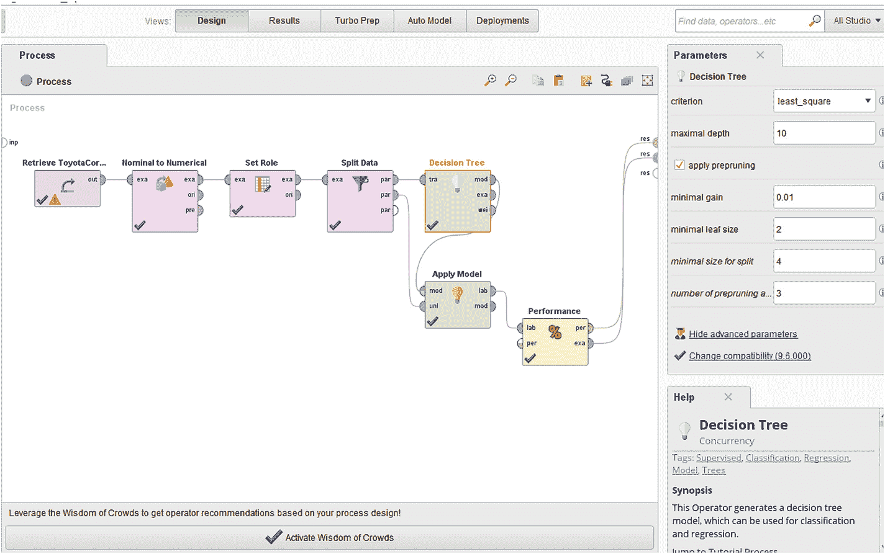

## 回归树过程

一个包含七个步骤的流程截图：检索（Retrieve）、名义到数值（Nominal to Numerical）、设置角色（Set Role）、拆分数据（Split Data）、决策树（Decision Tree）、应用模型（Apply Model）和性能（Performance）。

**图 6-16**  
回归树过程

1. 创建一个新流程，将`ToyotaCorollaData2`数据拖拽到**设计视图**中（请记住，该版本数据中已排除了 ID 列）。运行回归树的整体流程如图 6-16 所示。

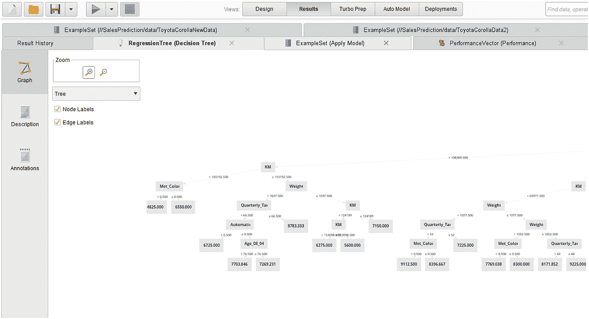

一张回归树决策树截图，其图形选项卡下方包含两个不相交的决策树。

**图 6-16a**  
回归树模型的某些部分

1. 对于`Nominal to Numerical`（名义到数值）运算符，选择`Fuel_Type`属性（将`Fuel_Type`转换为虚拟变量）。点击`Set Role`（设置角色）运算符，将`attribute name`设置为`Price`，将`target role`设置为`label`。点击`Split Data`（拆分数据）运算符，在该数据的`partitions`属性中，分别添加两个条目：`0.6`和`0.4`。点击`Decision Tree`（决策树）运算符，将`criterion`参数设置为`least_square`。请注意，`least_square`是唯一允许数值预测的准则。所有其他参数可根据帮助中的说明进行设置。`Apply Model`（应用模型）运算符无需调整参数；它用于将`Decision Tree`（决策树）运算符获得的模型应用于验证数据集。对于`Performance (Regression)`（性能（回归））运算符的参数，只需保留默认值，即`root mean square error`（均方根误差）。

2. 采用图 6-16 中的设置，我们预期得到三个输出（即三个连接到`res`的链接）。第一个是回归树模型（图 6-16a），第二个是模型性能结果（图 6-16b），第三个是显示验证数据集预测结果的数据表（图 6-16c）。

在数据驱动的方法中，树模型是最透明且易于解释的。树模型通过创建对预测变量的分割，将记录划分为子组。这些分割创建了透明且易于理解的逻辑规则。图 6-16a 模型中的此类示例如下：

*   `IF Age_08_04 >= 32.500`
*   `AND Age_08_04 > 56.500`
*   `AND Age_08_04 > 68.500`
*   `AND KM > 108389.500`
*   `AND KM > 193192.500`
*   `AND MET_Color > 0.500`
*   `THEN Price is 4825.000`

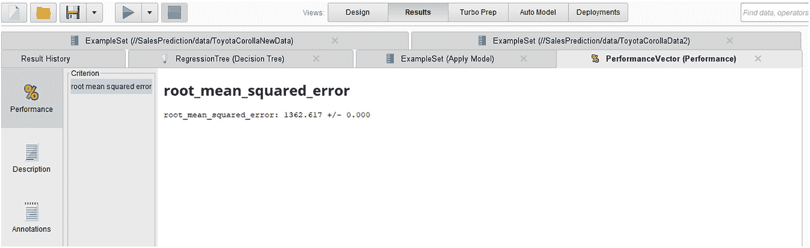

一张性能向量截图，显示均方根误差值为`1362.617 ± 0.000`。

**图 6-16b**  
评估回归树

从图 6-16b 中可以看出，与多元线性回归相比，回归树给出了更好的性能结果。

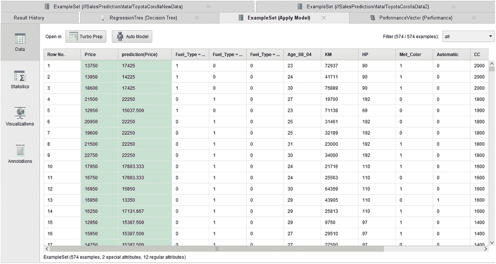

一张示例集表格截图，包含 17 行 12 列，数据包括价格、预测值、燃料类型、车龄、里程、马力、金属色、是否自动挡以及排量。

**图 6-16c**  
结果数据集

图 6-16c 是对 40%验证数据集进行评估的输出，并比较了验证数据集中的预测结果与原始价格。

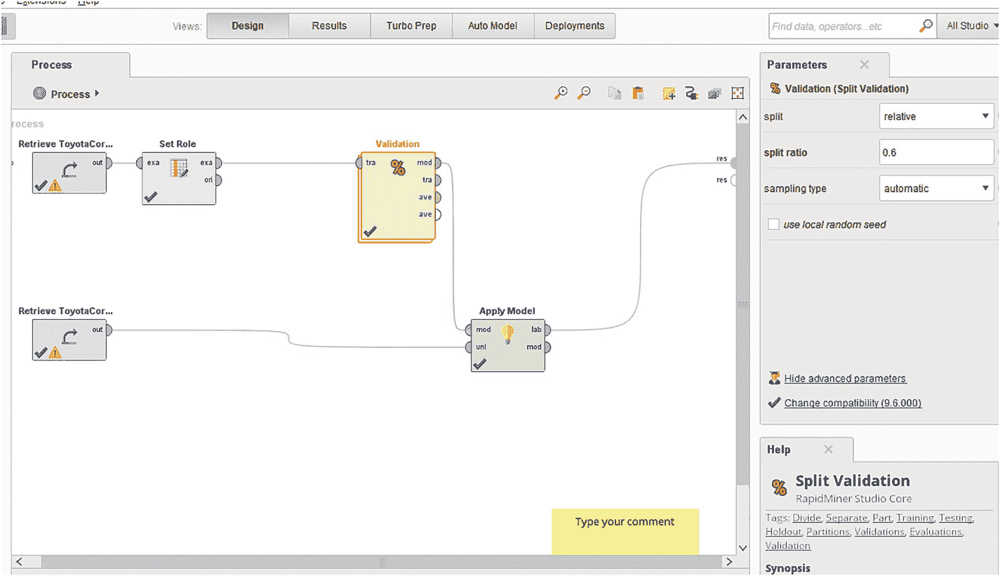

一张流程截图，包含五个步骤：检索（Retrieve）、设置角色（Set Role）、验证（Validation）和应用模型（Apply Model）。下方的一个丰田检索（Retrieve Toyota）步骤也连接到上方的应用模型（Apply Model）步骤。

**图 6-17a**  
回归树主流程

1. 对于回归树，我们将使用图 6-17a（主流程）和图 6-17b（内部流程）中的设置来预测新记录。

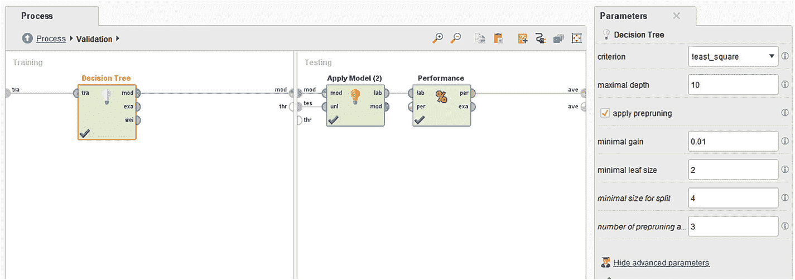

一张流程验证截图，左侧训练（Training）部分有一个决策树步骤。它连接到测试（Testing）部分，进而连接到应用模型 2（Apply model 2）和性能（Performance）。

**图 6-17b**  
回归树内部流程

1. 图 6-17b 是内部流程，您可以通过双击`Split Validation`（拆分验证）运算符来创建。`Decision Tree`（决策树）、`Regression`（回归）、`Apply Model`（应用模型）和`Performance (Regression)`（性能（回归））运算符均保持与之前相同的默认设置。

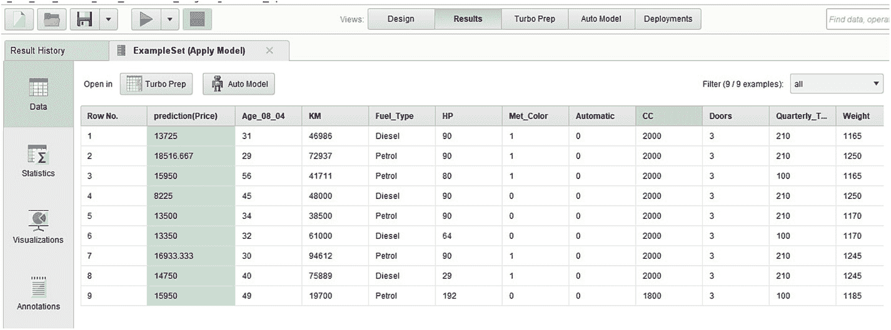

一张示例集截图，包含一个九行十二列的表格。它提供了预测价格、车龄、里程、燃料类型、马力、金属色、是否自动挡、排量、车门数、季度类型和重量等数据。

**图 6-18**  
结果数据集

1. 加载的新数据的预测价格如图 6-18 所示。

## 神经网络（预测）

神经网络是一种通用的数据驱动方法，可用于分类和预测。在可解释性方面，它被称为“黑箱”。神经网络运用了节点和层的原理，以及它们如何连接形成网络结构。神经网络之所以能展现其预测性能，是因为它能捕捉预测变量与目标变量之间非常复杂的关系。它对噪声数据有相当好的容忍度。尽管有这些优势，但神经网络缺乏内置的变量选择机制，并且其适应性在很大程度上依赖于拥有足够的数据进行训练。使用神经网络时，务必警惕那些会导致局部最优而非全局最优的权重。在数据挖掘中，多层前馈网络是神经网络最成功的应用之一。⁴

### 多层前馈网络

前馈网络是一种完全连接、无环路且单向流动的网络。它由三层组成：一个包含接收预测变量值的节点的输入层、一个接收前一层输入的节点层，以及一个输出节点层。每一层节点的输出都会馈送到下一层节点（见图 6-19）。

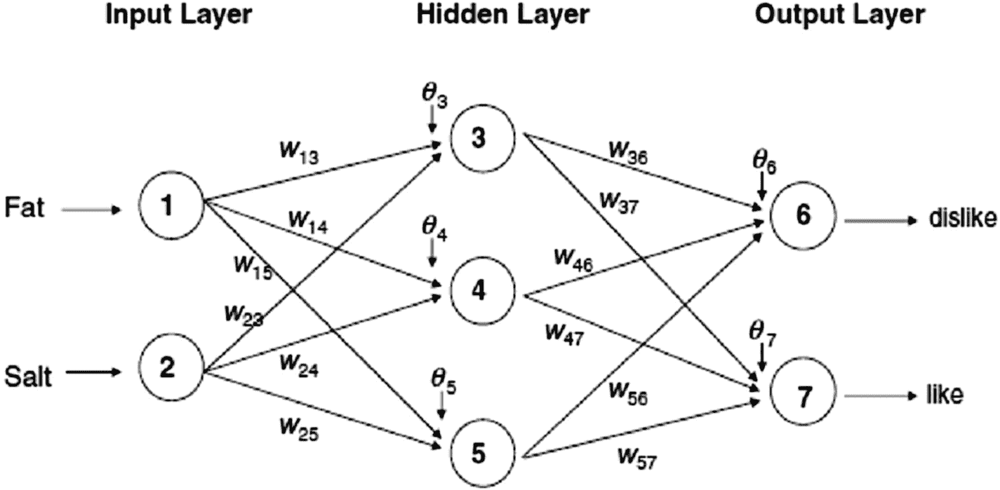

一个多层前馈网络包含三层：输入层、隐藏层和输出层。每一层都与下一层相连。

**图 6-19** 多层前馈网络，Galit 等人 (2018)，第 274 页

图 6-19 展示了一种架构设计，包含两个预测变量、两个隐藏层以及输出层中反映预期结果值的两个节点。

当我们使用神经网络预测数值型结果时，需要将预测值转换回其原始单位；这是因为，为了进行预测，预测变量（数值型）和结果变量都会被归一化（重新缩放至 `[0,1]` 区间）。

在使用神经网络时，我们必须做出以下决策：

-   **网络架构**：这可以通过对各种架构进行试错运行或使用算法来实现。
-   **预测变量的选择**：根据软件的不同，需要选择学习率和动量。学习率的范围是 0 到 1，主要用于避免过拟合。在权重收敛到尽可能最佳位置的过程中，采用动量来保持调整方向。
-   **隐藏层数量**：通常设置为一个（尽管我们总是可以尝试其他数量），因为单个隐藏层通常足以捕捉预测变量之间哪怕是最复杂的交互作用。
-   **隐藏层的大小**：网络捕捉到的预测变量之间关系的复杂程度，由隐藏层中的节点数量决定。一个好的经验法则是从 `p`（预测变量的数量）个节点开始，然后逐步减少或增加，同时测试是否过拟合。
-   **输出数量**：对于具有 `m` 个类别的分类结果，输出节点数应为 `m` 或 `m-1`。对于数值型结果，通常只用一个输出节点。

此外，为避免神经网络过拟合，应限制训练迭代次数，并且不应过度训练数据。我们通过观察验证集或交叉验证集上的性能来确定何时开始下降，而同时训练集性能仍在提升，以此发现过拟合。

### 神经网络的数据预处理

当预测变量和结果变量处于 `[0,1]` 尺度时，神经网络的性能最佳。对于取值区间为 `[a; b]` 的数值变量 `X`，我们通过将 `X` 减去 `a` 并除以 `b - a` 来进行归一化。归一化后的度量值为：

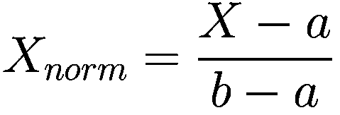

（公式 6.9）

可以使用数据中 `X` 的最小值和最大值来估计 `a` 和 `b`。除了创建哑变量之外，二元变量无需进行调整。如果具有 `m` 个类别的分类变量是有序的，则选择 `[0,1]` 区间内的 `m` 个分数来表示其感知顺序。如果这些类别是无序的，则将它们创建为 `m-1` 个哑变量。请注意，为了获得更好的预测性能，对高度偏斜的预测变量进行变换也很重要。这种情况在商业分析领域的变量（如收入）中很常见。因此，建议先对此类变量取 `log`，然后再缩放到 `[0,1]` 区间。

### 神经网络——评估性能（数值结果）

回归树的预测性能可以通过与其他预测方法（例如线性回归和回归树）相同的方式来检验，即使用像 `RMSE` 这样的汇总度量。

### 销售预测问题——神经网络

使用第 6.2 节中介绍的销售预测问题，以下演示了如何使用神经网络解决该问题：

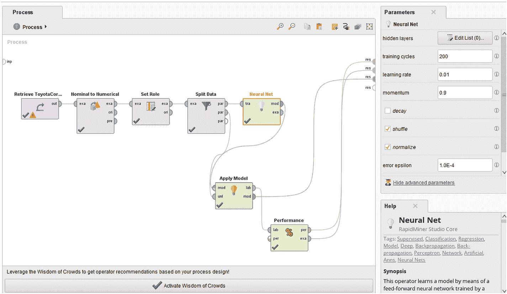

一个流程截图显示了七个步骤：检索丰田数据、标称型转数值型、设置角色、分割数据、神经网络、应用模型和性能。右侧是一个参数选项卡。

**图 6-20** 神经网络流程

1.  创建一个新流程，并将 `ToyotaCorollaData2` 数据拖到**设计视图**中（请记住，此版本的数据中已排除了 ID 列）。运行神经网络的总体流程如图 6-20 所示。

    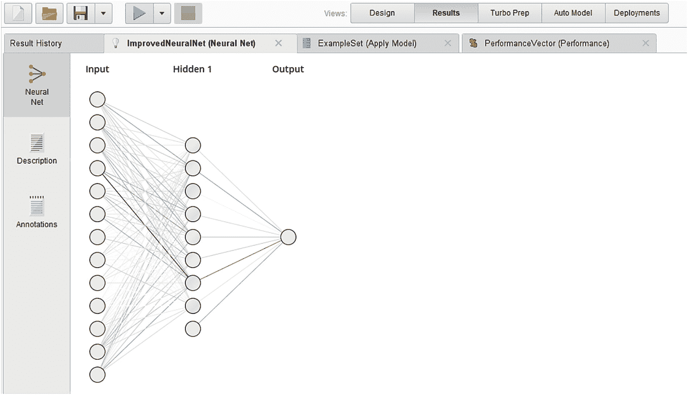

    一个改进的神经网络截图，左侧有 13 个输入，指向中间名为隐藏层 1 的 9 个点，这些点再指向右侧的一个输出。

    **图 6-21a** 神经网络模型

2.  对于**标称型转数值型** 算子，您将选择 `Fuel_Type` 属性（将 `Fuel_Type` 转换为哑变量）。点击**设置角色** 算子，并将**属性名称**设为 `Price`，**目标角色**设为标签。点击**分割数据** 算子，并在该数据的**分区**属性中添加两个条目，分别为 0.6 和 0.4。对于**神经网络** 算子，我们将保留图 6-20 中所示的默认设置。该算子通过一个由反向传播算法（多层感知器）训练的前馈神经网络来学习模型。该算子无法处理多项式属性（有关该算子参数的更多解释，请查看帮助）。请注意，我们没有使用归一化算子；这是由图 6-20 中默认选中的**神经网络** 算子的归一化参数来处理的。**应用模型** 算子无需参数调整；它用于将从**神经网络** 算子获得的模型应用于验证数据集。对于**性能（回归）** 算子的参数，只需保留默认设置，即*均方根误差*。

3.  使用图 6-16 中的设置，我们期望得到三个输出（即三个指向 `res` 的链接）。第一个是神经网络模型（图 6-21a），第二个是模型性能结果（图 6-21b），第三个是显示验证数据集预测结果的数据表（图 6-21c）。

该图展示了输入层、隐藏层和输出层。

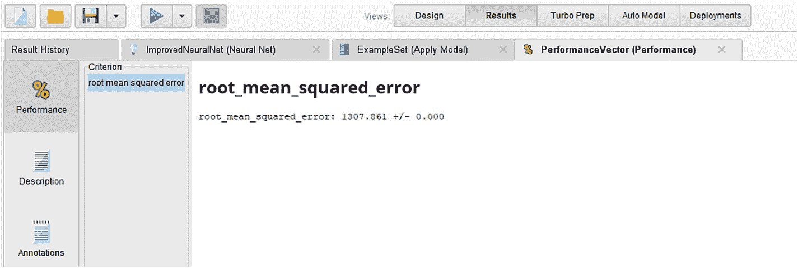

## 性能向量截图的均方根误差为 1307.861，误差范围为 ±0.000。

## 图 6-21b

## 评估神经网络

从图 6-21b 可以看出，针对此问题场景所比较的三个算法中，神经网络得出的结果最佳。

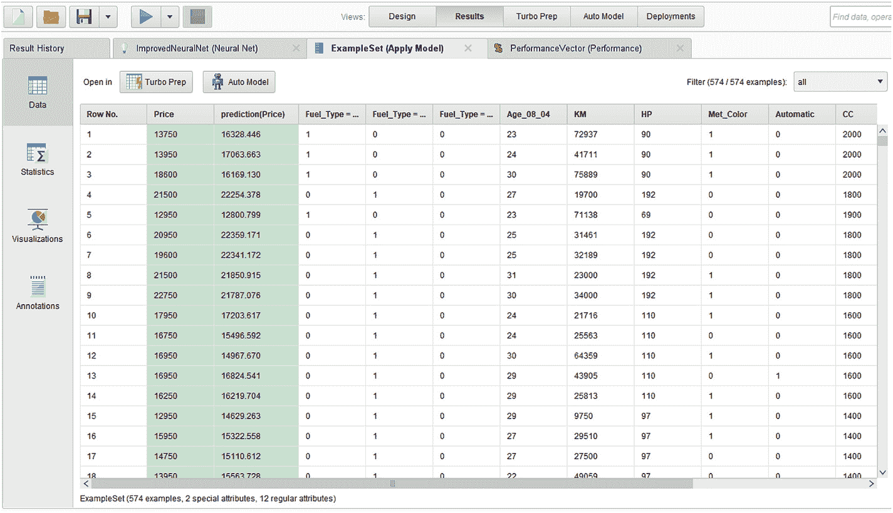

一个示例集截图显示了 18 行 14 列的数据，涉及价格、预测价格、燃料类型、车龄、行驶里程、马力、金属漆颜色、自动挡和排量。

## 图 6-21c

## 结果数据集

图 6-21c 是使用 40% 验证数据集进行评估，并将预测结果与验证数据集中的原始价格进行比较的输出结果。

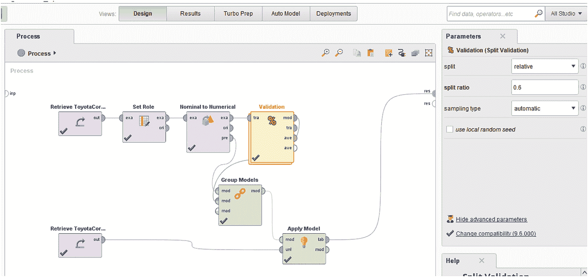

一个流程截图中包含以下步骤：检索丰田、设置角色、名义值转数值、验证、分组模型和应用模型。左下角的“检索丰田”步骤指向“应用模型”步骤。

## 图 6-22a

## 预测新数据（神经网络）

1.  对于神经网络，我们将使用图 6-22a（主流程）和图 6-22b（内部流程）中的设置来预测新记录。

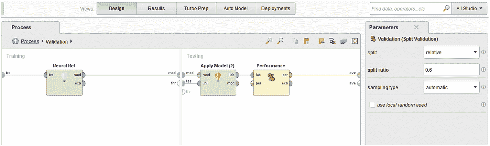

一个流程验证截图左侧有一个神经网络，连接到右侧的“测试”选项卡，指向“应用模型 2”，随后指向“性能”。

## 图 6-22b

## 预测新数据的内部流程

1.  图 6-22b 是您通过双击 `Split Validation`（分割验证）运算符创建的内部流程。`Neural Net`（神经网络）、`Apply Model`（应用模型）和 `Performance (Regression)`（性能（回归））运算符保持与之前一样的默认设置。

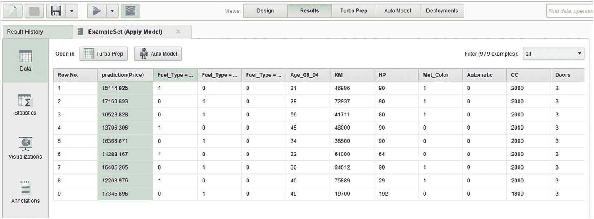

一个示例集截图显示了 9 行 12 列的数据，包含预测价格、燃料类型、车龄、行驶里程、马力、金属漆颜色、自动挡、排量和车门数。

## 图 6-23

## 结果数据集

1.  新加载数据的预测价格如图 6-23 所示。

## 6.7 关于销售预测的结论

在尝试了多种数据属性与算法的组合并检查最佳性能后，需要确定将采用哪个实验来得出结论。在本例中，我们假设已经妥善处理了过拟合等问题，因此会选择能给出最佳预测的算法。从图 6-24 可以看出，误差最低（即 RMSE 值最小）的算法是神经网络。

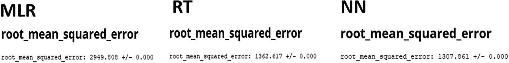

一个截图显示了 MLR（多元线性回归）、RT（回归树）和 NN（神经网络）的均方根误差值。数值分别为 2949.808、1362.617 和 1307.861（±0.000）。

## 图 6-24

## 比较三种算法的结果

在商业应用中，这些模型可以有多种使用方式。例如，可以将其嵌入到一个应用程序中，该程序能够实时呈现丰田卡罗拉（Toyota Corolla）的预测流程，用于辅助针对新客户及其他方面做出决策。

## 6.8 练习题

1.  使用图 6-11 中的 MLR（多元线性回归）模型，写出回归方程，预测具有以下属性值的交易：

`Age_08_04=29`，`KM=50000`，`Fuel_Type=Petrol`，`HP=100`，`Met_Color=0`，`Automatic=1`，`CC=1800`，`Doors=4`，`Quarterly_Tax=80`，`Weight=1170`

2.  为了使用第 6.5 节中的神经网络解决销售问题，请使用直方图探索每个数值变量。对于任何偏态分布的变量，先使用对数变换，然后再进行归一化。再次运行第 6.5 节中的神经网络模型，并将您的结果与第 6.5 节中的结果进行比较。哪个模型的准确率更高？

3.  给定名为 `FoodAgricGroup.xlsx` 的数据样本，针对下列列出的每个算法，创建并评估模型以预测总金额（目标属性）。哪个模型给出的准确率最高？
    1.  神经网络
    2.  多元线性回归
    3.  回归树

请就以下阶段详细展示每个算法所得出的结果：

1.  数据可视化
2.  特征选择
3.  模型开发
4.  模型评估

