# 7. 分类技术

在本章中，尽管存在多种分类技术，但我们将探讨业务领域中用于分类的流行技术。为此，我们将使用第三个商业问题，该问题围绕客户忠诚度展开，并采用神经网络、分类树和随机森林算法。在解决这个问题时，我们特别关注如何为我们的中小企业获取并留住更多客户。我们还将介绍一些其他基于分类的技术，例如 K 近邻和逻辑回归。在运用这些技术解决问题时，我们解释所选算法的基本概念，并以此演示如何将这些解决问题的过程应用于实际的商业场景。

## 7.1 分类模型与评估

数据分析的一个重要环节是对收集到的数据进行分类。分类是一种监督式机器学习方法，它能够推导出适用于此类情况的模型。这种模型被称为分类器，用于预测分类（离散、无序）的类别标签。一个典型的例子是预测顾客是否会离开零售商店。分类模型已广泛应用于商业领域，例如欺诈检测、客户定向营销、员工绩效预测等。分类模型通过两步流程工作：第一步是利用带标签的数据集（训练数据）构建模型；第二步是利用该模型对未来的未知对象进行分类（在验证数据集中，这些对象的标签已知，但通过新开发的模型进行预测）。在此步骤中，我们通过将结果与验证数据集中的原始标签（已知）进行比较来评估模型的准确率。验证数据集必须独立于训练集；否则会导致过拟合。

在分类过程中，当各类别的比例极不平衡时，就会出现欠采样问题；随机采样可能产生过少的稀有类别样本，从而难以获取将其与主导类别区分开来的有效信息。为避免这些挑战，可以采用分层抽样。分层抽样用于从可划分为子部分的数据中进行抽样²。数据被划分为同质的子部分，称为层（`stratum` 的复数形式）。

我们必须对分类器进行评判，因为存在多种类型的分类器和预测方法，而在每种方法内部，通常又有多种可能产生完全不同结果的替代方案。*误分类错误*的概率用于评估分类器的性能。当一条记录被错误分类时，意味着模型将其归入了不属于它的类别。

评估分类器性能的指标如下：¹

准确率和识别率

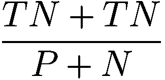

（公式 7.1）

错误率，误分类率

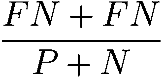

（公式 7.2）

灵敏度，真正率，召回率

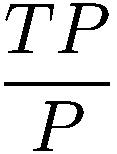

（公式 7.3）

特异度，真负率

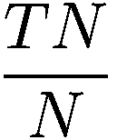

（公式 7.4）

精确率

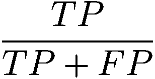

（公式 7.5）

F、F1、F-score，精确率和召回率的调和平均数

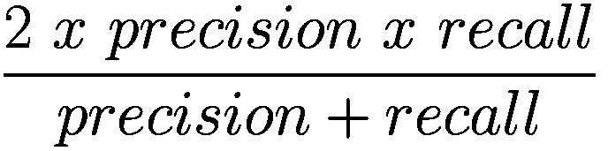

（公式 7.6）

真正例、真负例、假正例、正例样本和负例样本这些术语分别缩写为 `TP`、`TN`、`FP`、`P` 和 `N`。

- **真正例（`TP`）**：是被分类器正确标记的正例元组。
- **真负例（`TN`）**：是被分类器正确分类的负例元组。
- **假正例（`FP`）**：是被错误分类为正例的负例元组。
- **假负例（`FN`）**：是被分类为负例的正例元组。

混淆矩阵用于汇总分类器在给定数据集上产生的正确与错误分类情况，该矩阵通过验证数据集来分析分类器的性能。在表 7-1 中，混淆矩阵展示了 `TP`、`TN`、`FP` 和 `FN`。分类器的性能可以通过混淆矩阵进行评估，这是检验分类器检测不同类别元组效果的有效工具。分类器的 `TP` 和 `TN` 表明其正确分类，而 `FP` 和 `FN` 则分别表明其错误分类。`Fbeta` 度量是 `F` 度量的泛化形式，它增加了一个名为 `beta` 的配置参数。当精确率和召回率都很重要，但需要略微侧重其中一方时（例如，假负例比假正例更重要，或反之），便会使用 `Fbeta`。

**表 7-1** 混淆矩阵

| 实际类别 | 预测类别 | | |
| --- | --- | --- | --- |
| | | 是 | 否 |
| 是 | | `TP` | `FN` |
| 否 | | `FP` | `TN` |

### 分类的倾向性与截断值

一些分类算法首先计算记录属于每个类别的概率。概率的另一个说法是“倾向性”。倾向性常被用作预测类别归属（分类）的第一步，或根据属于目标类别的概率对记录进行排序。为确保所有类别都准确，记录可能会被划归到最可能属于它的类别（概率最大的类别）。当存在大量记录且只关注单个类别时，需专注于该类别，并将属于该类别的倾向性（概率）与分析人员确定的截断值进行比较。如果属于目标类别的概率大于截断值，则该记录被划归到目标类别。在二分类器中，默认的截断值为 0.5。³

## 7.2 实际业务问题 III（客户忠诚度）

客户忠诚度被描述为，即使其他公司（通常称为竞争对手）提供类似的产品或服务，客户仍反复选择某个品牌或公司产品或服务的习惯。忠诚的客户绝不会被竞争对手产品的成本、价格或数量所动摇。他们宁愿为所习惯的同等高质量服务和产品支付更高的价格。星巴克将其 26.5 亿美元的额外收入大部分归功于其奖励计划。客户忠诚度对所有类型的组织都有益，因为它能带来回头客、增加收入、培养品牌影响者和倡导者、使公司从竞争中脱颖而出，并提供诚实且有用的反馈。

在这个第三个实际业务问题中，我们将使用相同的实验条件，比较神经网络、分类树和随机森林的结果。目标是通过一个案例研究来演示如何使用这些算法进行推断，从而为我们的企业获取和留住客户。具体来说，我们将预测银行客户的忠诚度，并以此来了解客户是否会离开银行（即客户的忠诚度如何）。根据预测结果，将采用适当的关係营销方法来鼓励客户留下（如果你预测他们会离开），或者为忠诚的客户加强客户关系管理，例如提供折扣以促进更多销售。需要注意的是，虽然我们这里以银行作为案例研究，但任何其他业务都可以使用合适的数据属性进行同样的操作。

该业务问题的数据文件名为 `Churn_Modelling.csv`，其中包含一家银行客户的数据。数据描述如下：

| • `RowNumber` | *标识信息，需要移除* |
| --- | --- |
| • `CustomerId` | *标识信息，需要移除* |
| • `Surname` | *文本型标识信息，需要移除* |
| • `CreditScore` | *整型* |
| • `Geography` | *分类型 – 表示国家* |
| • `Gender` | *分类型 – 表示性别* |
| • `Age` | *整型* |
| • `Tenure` | *整型* |
| • `Balance` | *实数型* |
| • `NumOfProducts` | *整型* |
| • `HasCrCard` | *整型，但需更改为分类型* |
| • `IsActiveMember` | *整型，但需更改为分类型* |
| • `EstimatedSalary` | *实数型* |
| • `Exited` | *结果变量，但需更改为分类型* |

无论使用哪种分类算法，首先要做的事情都是执行基本的数据预处理，并使用必要的可视化工具探索数据，以便进行分类。

**分类技术的通用数据预处理**

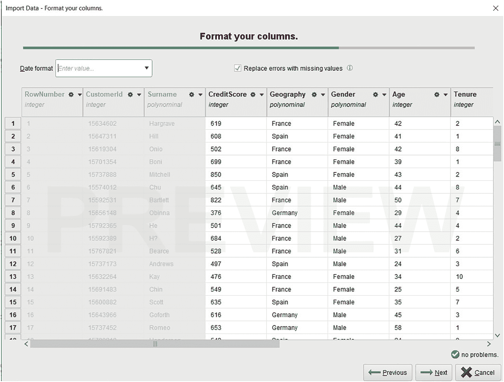

图 7-2 导入数据

1. 创建一个新的**存储库**，并在其中创建两个**子文件夹**（一个用于数据，一个用于流程）。将名为 `Churn_Modelling.csv` 的**数据**导入到数据子文件夹中。导入时，移除 `RowNumber`、`CustomerID` 和 `Surname` 列，并将 `HasCrCard`、`IsActiveMember` 和 `Exited` 转换为分类型属性。同时，在导入数据时将错误替换为缺失值。图 7-2 是导入数据的截图。

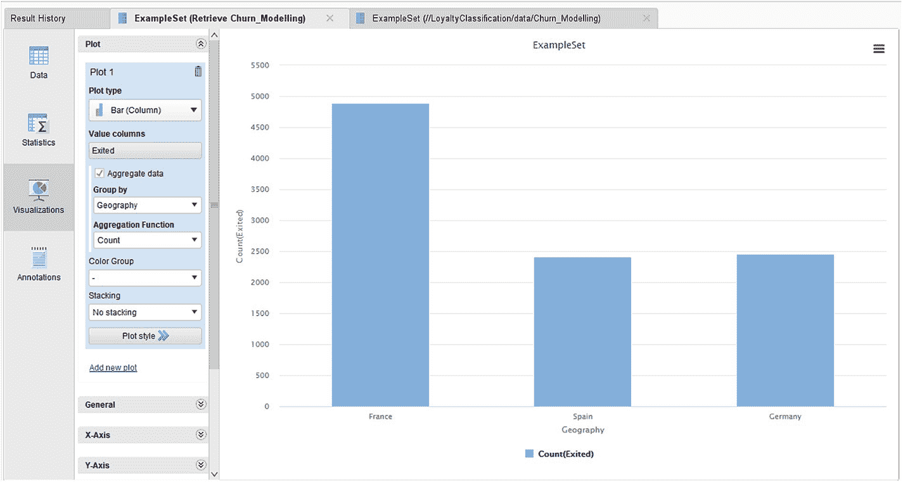

图 7-3 分类型属性和目标变量的柱状图示例

2. 导入数据后，将其拖入设计视图并连接到 **res**。运行流程并查看**统计信息**。从数据的**统计信息**视图中，可以注意到不必要的属性已被移除，所需的属性更改也已生效。此外，没有缺失值。

# 第7章 模型评估与预测

## 3. 研究结果与分类型预测变量

根据可视化指南，特别是关于分类的部分（请参阅第 2 章第 2.5 节），我们将使用柱状图研究结果与分类型预测变量的关系，其中结果变量位于`y`轴上。目标是找出预测变量的类别在结果或目标属性中是否得到了公平的体现。使用图 7-3 中的设置来可视化所有分类型变量与目标属性的关系。我们可以看到，对于所有分类型属性，它们在结果变量中都有公平的体现。

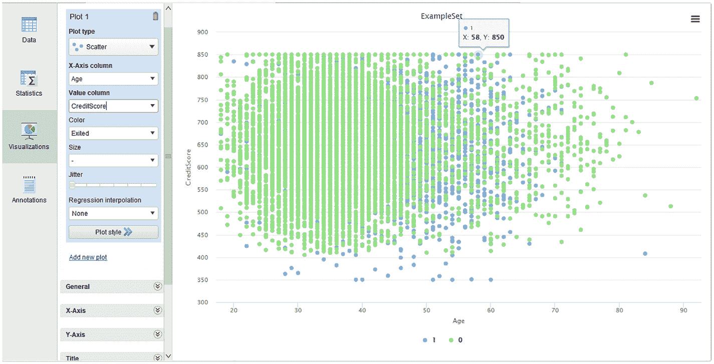

图表类型设置为散点图，x 轴列设置为`Age`，值列设置为`Credit Score`，颜色设置为`Exited`。

图 7-4 用于分类的彩色编码散点图示例

## 4. 研究结果与成对数值预测变量

通过彩色编码散点图研究结果与成对数值预测变量的关系（颜色表示结果）。此处的目的是查看数值预测变量之间是否存在线性关系，并观察结果类别在数值预测变量中的强度。请使用图 7-4 中的设置，对不同的数值属性组合进行此操作。请注意，不存在这样的线性关系。如果存在这种关系，由于多重共线性，必须对其进行处理。

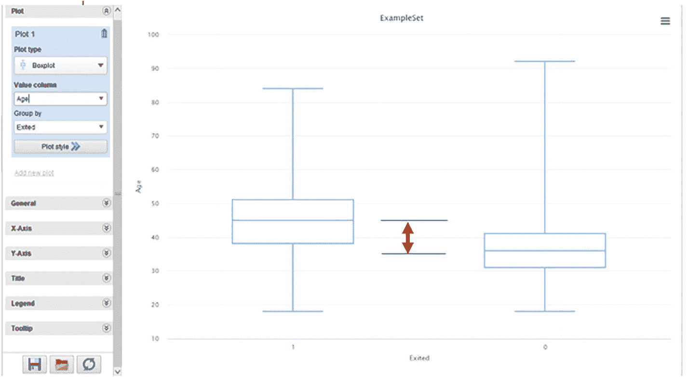

图表类型设置为箱线图，值列设置为`Age`，并选择分组依据选项为`Exited`。

图 7-5 为分类可视化的箱线图示例

## 5. 研究结果与数值预测变量

通过并排箱线图研究结果与数值预测变量的关系：绘制按结果分组的数值变量的箱线图。为每个数值预测变量创建类似的显示。分离度最高的箱线图表示潜在有用的预测变量。请使用图 7-5 中的设置对所有数值属性进行此项研究。请注意，除了`NumOfProducts`和`EstimatedSalary`之外，所有其他数值属性都具有相当好的分离度，如图 7-5 中的红色箭头所示（它们的中位数差异相当大）。在本章的练习 3 中，我们将尝试移除这些属性后的分类过程，但目前仍将它们包括在内。

## 7.3 神经网络

有关神经网络算法的详细信息，请参阅 6.5 节。

**基于神经网络的客户忠诚度分析**

利用 7.2 节中介绍的客户忠诚度问题，下面演示如何使用神经网络来解决该问题：

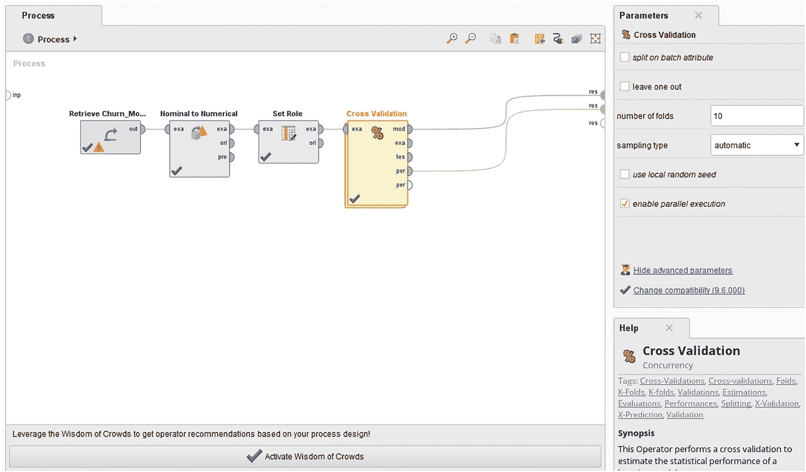

“进程”选项卡显示了参数部分。其中，折叠次数设置为 10，采样类型设置为自动，并勾选了启用并行执行。

图 7-6a

神经网络主流程

1. 创建一个新流程，将已导入的`Churn_Modelling`数据拖拽至设计视图。我们将使用图 7-6a（主流程）和图 7-6b（内部流程）中的设置来开发和评估模型。

在图 7-6a 中，对于`Nominal to Numerical`运算符，您需要选择属性`Gender`、`Geography`、`HasCrCard`和`IsActiveMember`（将它们转换为虚拟变量）。点击`Set Role`运算符，将`attribute name`设置为`Exited`，并将`target role`设置为标签。`Cross Validation`运算符保留默认设置，这意味着我们将使用 10 折交叉验证。

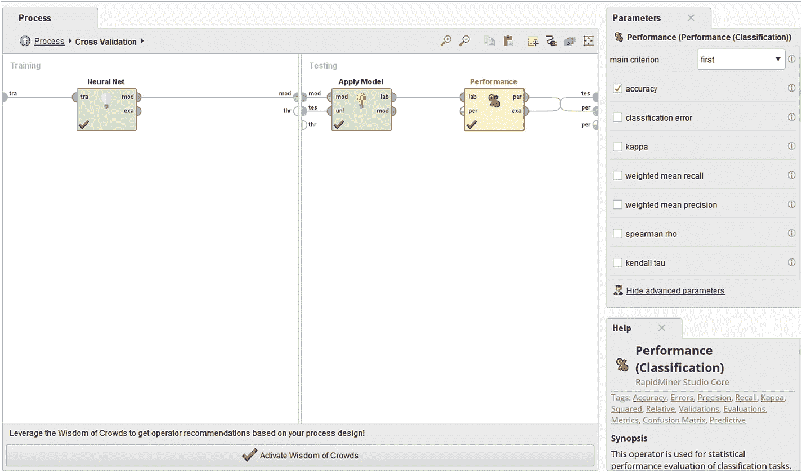

“进程”选项卡显示了参数部分，其中主要标准设置为“first”，并从列出的参数集中勾选了“accuracy”。

图 7-6b

神经网络内部流程

在图 7-6b 中，对于`Neural Net`运算符，我们将点击隐藏层并为其任意命名（例如，“ibk”），然后将其设置为 -1。如果隐藏层大小值设置为 -1，则层大小将根据输入示例集的属性数量计算得出。更多信息请参阅 RapidMiner 文档。所有其他设置保留默认值。`Apply Model`运算符无需调整参数。对于`Performance (Classification)`运算符的参数，只需保留默认值（即准确率）。

对于图 7-6a 和图 7-6b 中的设置，我们预期会得到两个输出结果。图 7-7a 是神经网络模型，图 7-7b 是模型的性能表现。

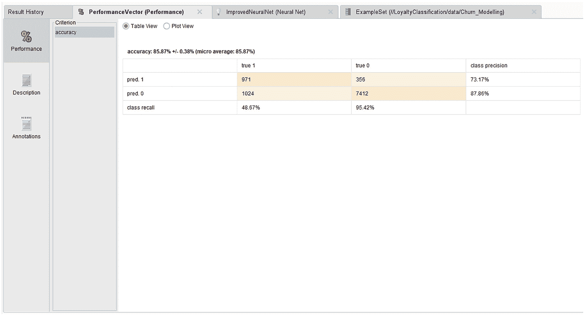

选中了性能选项卡，标准设置为准确率，并选择表格视图。其中列出了 true 1、true 0 和分类精确度列的数据。

图 7-7b

模型的性能结果

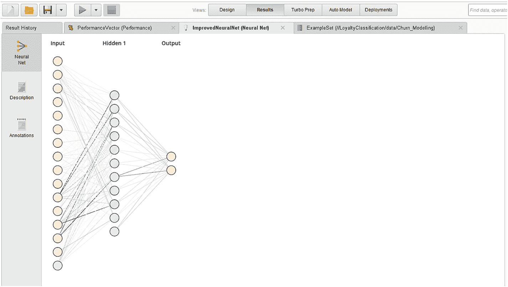

结果选项卡的神经网络部分显示了神经网络模型，该模型以输入层、隐藏层和输出层三列形式呈现。

图 7-7a

神经网络模型

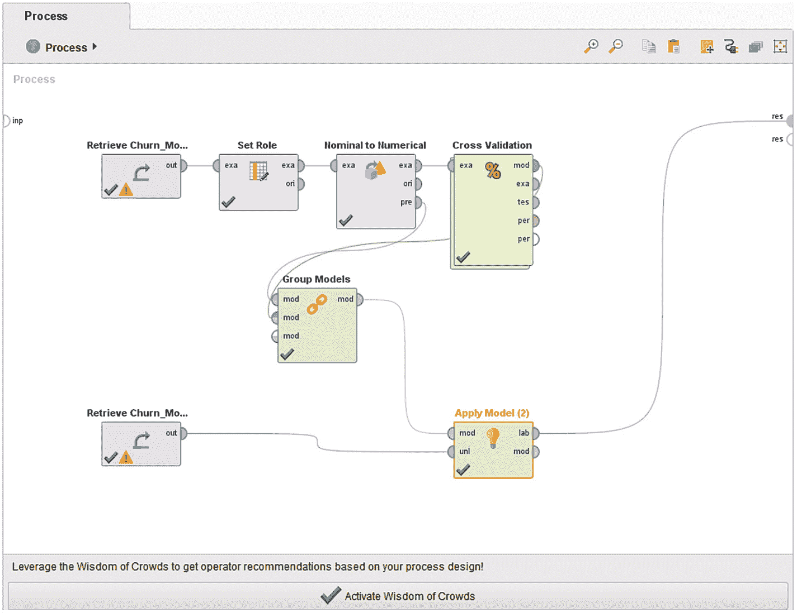

进程选项卡定义了一个流程链，依次为：检索、设置角色、名义值到数值的转换、交叉验证、模型分组、应用模型和检索。

图 7-8

预测新记录或新交易

1. 一旦我们建立了用于预测的最优模型，就可以使用该模型预测新数据。为此，我们将加载已为预测新客户准备好的数据文件`Churn_ModelingNew.xlsx`。该数据已进行预处理，不包含结果变量。同时，在导入数据时，请移除`RowNumber`、`CustomerID`和`Surname`列，并将`HasCrCard`、`IsActiveMember`和`Exited`转换为分类属性。此外，在导入数据时，将错误替换为缺失值。为了预测新记录，我们将修改图 7-6a 中的主流程，得到图 7-8。

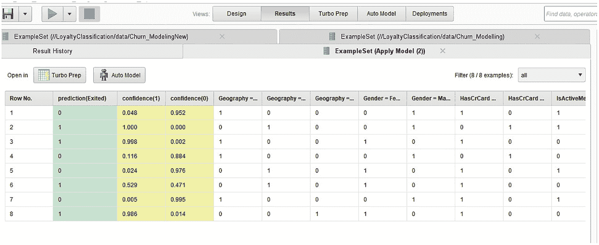

选中结果选项卡，表格中列出了数据，其中预测值、置信度 1 和置信度 0 列被高亮显示。

图 7-9

新预测的输出结果

1. 图 7-9 是对图 7-8 进行修改后的输出结果。它显示了预测新交易的结果，并揭示了预测结果的置信度（倾向性）。从这些置信度结果中，我们可以看到使用了默认阈值 0.5 来将客户分类为`已流失` (1) 或`未流失` (0)。

## 7.4 分类树

关于决策树算法的详细信息，请参考第 6.​4 节。

决策树算法可用于预测数值型和类别型结果。当预测结果为类别型时，称为分类树。分类树利用预测变量信息，将一条记录沿着树“向下”传递，直到到达底部的节点（叶节点）。然后，我们通过汇总树形成过程中属于该叶节点的所有训练数据的“投票”来对其进行分类。获得最多投票的类别将分配给新记录。

**利用分类树分析客户忠诚度**

使用第 7.2 节介绍的客户忠诚度问题，以下演示如何使用分类树来解决该问题：

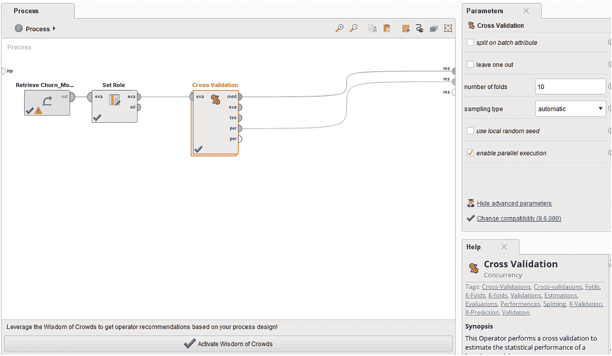

过程选项卡包含一个参数设置区域，其中将折叠次数设为 10，采样类型设为自动，并勾选了启用并行执行。

图 7-10a

决策树主过程

1.  创建一个新过程，并将已导入的`Churn_Modelling`数据拖拽至设计视图。我们将使用图 7-10a（主过程）和图 7-10b（子过程）中的设置来开发和评估模型。

`决策树`操作符用于生成决策树模型，该模型可用于分类和回归。此操作符可处理包含名义属性和数值属性的`示例集`。对于分类，标签`属性`必须为名义型；对于回归，则必须为数值型。在图 7-10a 中，点击`设置角色`操作符，将`属性名称`设置为`Exited`，`目标角色`设置为标签。`交叉验证`操作符保持默认设置，即我们将使用十折交叉验证。

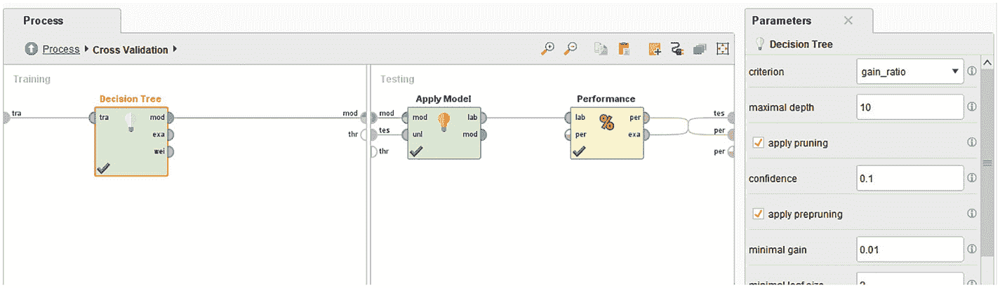

参数设置区域用于设置增益比、最大深度为 10、置信度为 0.1、最小增益为 0.01、后剪枝和前剪枝等标准。

图 7-10b

决策树子过程

在图 7-10b 中，对于`决策树`操作符，我们将标准设置为`gain_ratio`。这表明我们正在预测类别型结果。`应用模型`操作符无需调整参数。对于`性能（分类）`操作符的参数，只需保持默认值即可，即`accuracy`。

对于图 7-10a 和图 7-10b 中的设置，我们期望得到两个输出。图 7-11a 是神经网络模型，图 7-11b 是模型的性能表现。

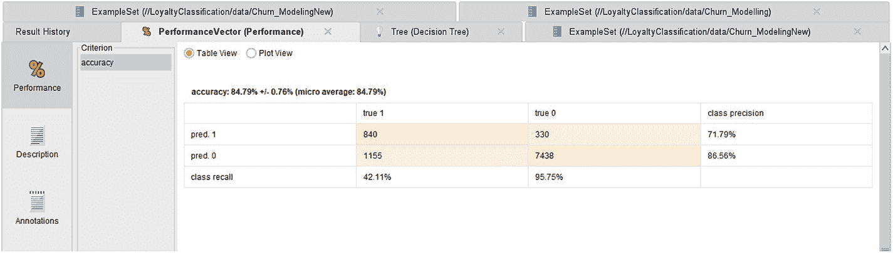

选择了性能选项卡，标准设置为`accuracy`，并勾选了表格视图。`true 1`和`0`对应的`pred 1`和`pred 0`数据被高亮显示。

图 7-11b

决策树模型的性能

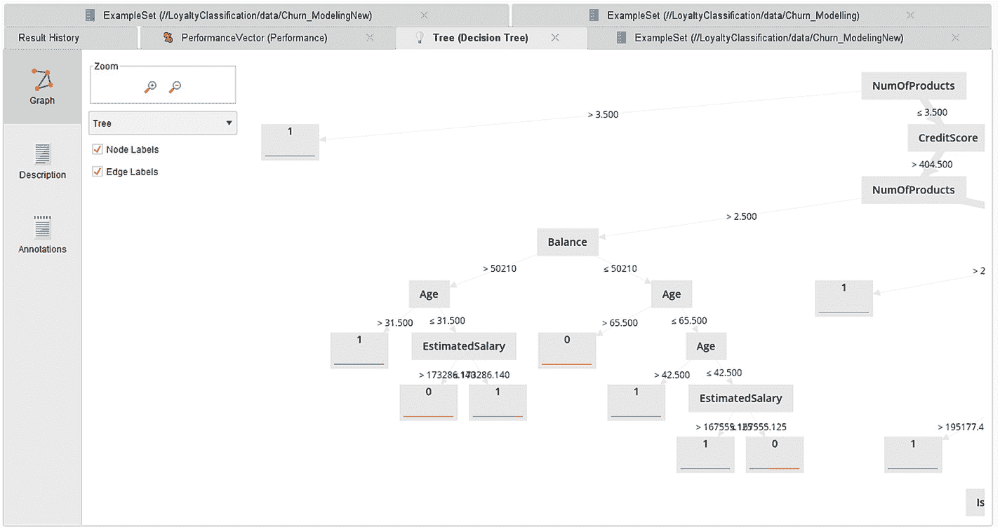

在图形选项卡下展示了一个决策树模型，并且在树部分勾选了显示节点和边标签。

图 7-11a

决策树模型的部分内容

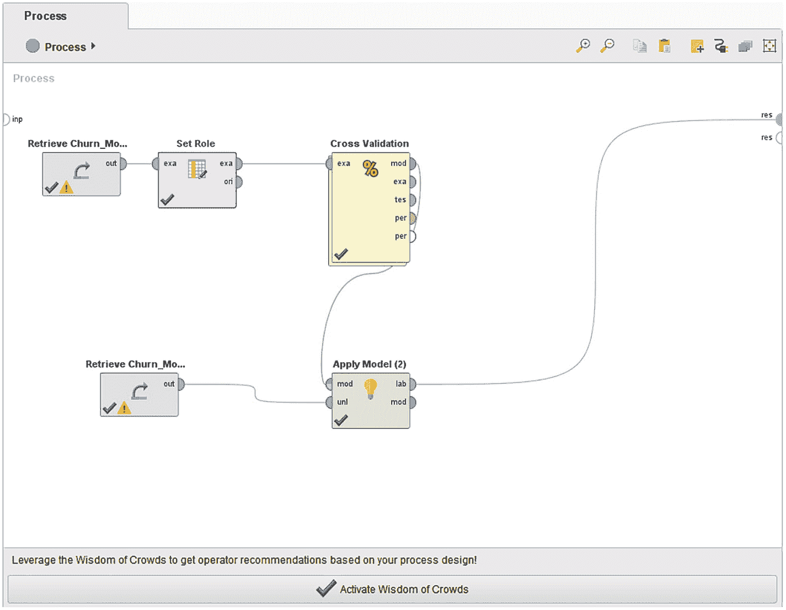

展示了过程流，其连接顺序为：检索、设置角色、交叉验证、应用模型和检索。

图 7-12

预测新记录（决策树）

1.  一旦我们为预测建立了最优模型，就可以使用该模型对新数据进行预测。为此，我们将加载已准备好的、用于预测新客户的数据`Churn_ModelingNew.xlsx`。为了预测新记录，我们将修改图 7-10a 中的主过程，得到图 7-12。

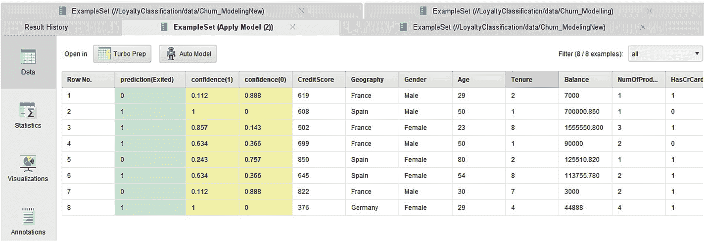

选择了数据选项卡，表格中预测列以及置信度 1 和 0 列的值被高亮显示。

图 7-13

预测的记录（决策树）

1. 图 7-13 是对图 7-12 中修改后的输出结果。它显示了预测新交易的结果。

## 7.5 随机森林与提升树

在不关心决策树规则的可视化和解释的情况下，有几种结合多棵树结果的树扩展方法可以提升性能。随机森林是一种流行的多树方法，由 Breiman 提出。⁵

随机森林采用以下基本步骤：

1. 从数据中抽取多个随机样本，每个样本进行不同的有放回抽样。这种抽样方法称为自举法（`Bootstrap`）。
2. 在每一阶段随机选择预测变量，用每个样本拟合一个分类树（或回归树）（从而产生一个“森林”）。
3. 为了获得更好的预测结果，综合不同树的预测结果和分类结果。分类采用投票法，预测采用平均法。

`提升树`是另一种多树改进方法。它拟合了一系列树，每棵树都重点关注前一棵树中分类错误的记录。其步骤如下：

1. 只使用一棵树。
2. 创建一个样本，使其中被错误分类的记录有更高的被选中概率。
3. 用新样本创建一棵树。
4. 重复上述步骤 1 和 2。
5. 使用加权投票法对记录进行分类，后续的树获得更高的权重。

如果在相同数据上运行提升树，其性能略优于单个剪枝树。就整体准确率而言，提升树在验证数据上表现更优，尤其是在正确分类 1（特殊关注的稀有类别）方面。

### 使用随机森林进行客户忠诚度分析

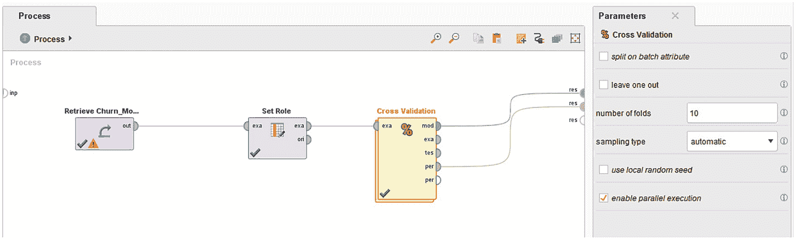

“Process”选项卡的参数部分显示，折数设置为 10，采样类型设置为自动，并勾选了启用并行执行。

**图 7-14a** 随机森林主流程

1. 创建一个新流程，将已导入的`Churn_Modelling.xlsx`数据拖拽到设计视图中。我们将使用图 7-14a（主流程）和图 7-14b（内部流程）中的设置来开发和评估模型。

`Random Forest`运算符生成一个由多棵树组合而成的模型。我们将保留其默认的 100 棵树（如其`Number of Trees`参数所示）。在图 7-14a 中，点击`Set Role`运算符，将`attribute name`设置为`Exited`，将`target role`设置为`label`。`Cross Validation`运算符保留默认设置，意味着我们将使用十折交叉验证。

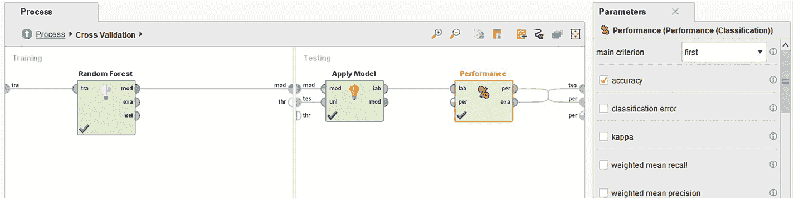

“Process”选项卡的参数部分显示，主标准设置为“first（第一个）”，并勾选了准确率选项。

**图 7-14b** 随机森林内部流程

在图 7-14b 中，对于`Random Forest`运算符，我们保留树的默认数量。`Apply Model`运算符无需调整参数。对于`Performance (Classification)`运算符的参数，只需保留默认设置，即准确率。

`可选`：请注意，随机森林模型可以生成“变量重要性”分数，用于衡量不同预测变量的相对贡献。特定预测变量的重要性分数是通过将该变量在森林中所有树上的基尼指数减少量相加来计算的。（要获得此结果，请在内部流程（即图 7-14b）中右键单击`Random Forest`运算符并在其后设置断点，然后将`wei`连接到`thr`。如果运行流程，您将看到每个属性的重要性强度。）

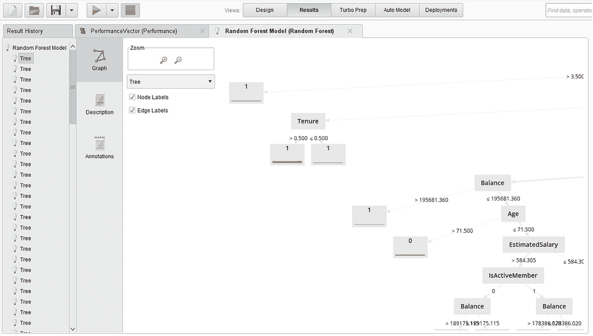

图表选项卡显示森林模型，并勾选了显示节点和边标签。

**图 7-15a** 随机森林模型的部分结构

2. 对于图 7-14a 和图 7-14b 中的设置，我们期望得到两个输出。图 7-15a 是随机森林模型，图 7-15b 是模型的性能。

树的列表如图 7-15a 所示。如果您点击每棵树，您将看到如图 7-15a 所示的树模型。总共有 100 棵不同的树。

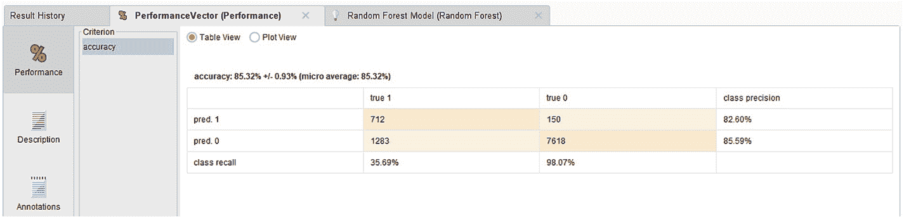

性能选项卡被选中，标准设置为准确率，并勾选了表格视图。真实值为 1 和 0 时，对应预测值 pred 1 和 pred 0 的数值被高亮显示。

**图 7-15b** 随机森林模型的性能

### 使用提升树进行客户忠诚度分析

要运行提升树算法，请使用图 7-14a 和图 7-14b 中随机森林的相同设置，唯一区别是在图 7-14b 中，将`Random Forest`运算符替换为`Gradient Boosted Trees`运算符。得到的模型和性能分别如图 7-16a 和图 7-16b 所示。

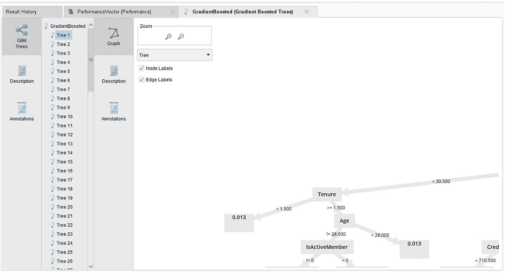

图表选项卡显示提升树模型，并勾选了显示节点和边标签，同时在梯度提升下选择了树一。

**图 7-16a** 提升树的部分结构

树的列表如图 7-16a 所示。如果您点击每棵树，您将看到如图 7-16a 所示的树模型。总共有 100 棵不同的树。

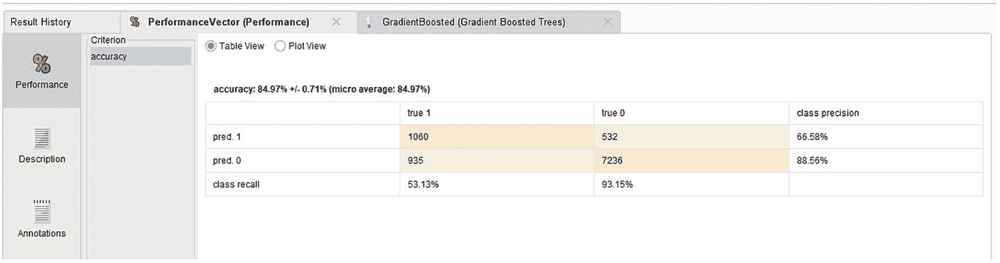

性能选项卡被选中，标准设置为准确率，并勾选了表格视图。真实值为 1 和 0 时，对应预测值 pred 1 和 pred 0 的数值被高亮显示。

**图 7-16b** 提升树模型的性能

在使用了不同的算法来解决这个问题之后，我们现在可以比较它们的准确率，并为这个特定数据选择最佳算法。与预测类似，对于分类问题，也可能需要使用不同的数据和算法设置进行实验以获得更好的准确率。比较图 7-7b、7-11b、7-15b 和 7-16b，我们可以看到最佳算法是神经网络（图 7-7b），其准确率为 85.79%，略高于随机森林。

对于这个问题，目标是预测哪些客户将成为潜在客户中的忠诚客户。利用对新客户的预测结果，我们可以识别这一点，特别是如果我们选择那些具有高倾向性的客户。同时，对于现有客户，我们也可以预测出忠诚客户和即将流失的客户，并采取必要措施。例如，如果目标是瞄准潜在客户，我们可以将潜在客户记录按倾向性从高到低排序（在新预测的数据集中），以便针对那些具有最高倾向性的客户采取行动进行目标营销。

## K-近邻算法

在本节中，我们将探讨 K-近邻（KNN）算法，并通过一个实际案例了解它如何帮助我们获取更多客户。K-近邻算法可用于预测数值型和分类型输出。在本例中，它将用于预测分类型输出。这主要是因为获取更多客户的任务是一个分类任务。

KNN 会在训练数据集中搜索用于分类或预测新记录的相似记录。这些“近邻”通过平均法进行预测或投票法进行分类，从而为新记录产生分类结果或预测值。其方法是搜索训练数据中与待分类记录相似（或具有相似值）的记录。然后，根据这些相关记录所属的类别对待分类记录进行分类。

**我们如何确定这些相似记录（近邻）？**

欧几里得距离是一种广泛使用的距离度量方法。两个记录（`x[1], x[2]……x[p]`）和（`u[1], u[2]……u[p]`）之间的欧几里得距离为

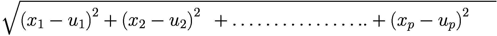

（式 7.7）

- 在计算欧几里得距离之前，大多数情况下，应对预测变量进行归一化，以使每个预测变量的尺度相同。
- 同样值得注意的是，新记录是使用训练数据的均值和标准差进行标准化的，并且在计算这些值时不会包含新记录。
- 与新数据一样，验证数据也被排除在此计算之外。

**KNN 使用以下规则进行分类：**

- 如果 `k = 1`（最简单的情况）
  - 找到最近的记录（最近邻），并将新记录分类为其最近邻所属的类别。
- 如果 `k > 1`
  - 找到距离待分类记录最近的 `k` 个近邻。
  - 使用多数决策规则对记录进行分类，将该记录归类为 `k` 个近邻中多数类别的成员。

在商业领域，KNN 可用于大多数分类场景，并且在可用数据不多时表现良好。

在使用 KNN 算法进行数据预处理时，通过使用较少的属性来减少计算距离的时间至关重要。这是因为与最近邻的预期距离会随着预测变量数量的增加而急剧增加。为了减少属性数量，我们可以应用不同的降维技术。此外，训练集中满足 KNN 要求所需的记录数量会随着预测变量数量的增加呈指数级增长。因此，需要采用诸如为模型选择预测变量子集或使用主成分分析、奇异值分解和因子分析等方法合并预测变量来减少预测变量的数量³。

**选择 K 值**

# KNN算法详解

为避免因训练数据中的噪声而导致过拟合，选择的 `k` 值应大于 1。因为 `K` 值过低会适应数据中的噪声，`K` 值也不应设置过高，否则会阻止算法捕捉数据的局部结构。`k` 值的最佳选择取决于数据的性质。`k` 值的范围应在 1 到 20 之间。为避免平局，我们将使用奇数。`K` 的值由最佳分类性能决定。我们使用训练数据对验证数据中的记录进行分类，然后计算不同 `k` 值下的错误率。在 `RapidMiner` 中，选择 `k` 为一个较小（介于 1 到 14 之间）、正数且为奇数的整数。选择几个 `k` 值，并针对这些 `k` 值迭代运行以下过程，直到获得精度最高的那个值。

此外，在使用 KNN 之前，必须将分类变量转换为二进制虚拟变量，并且与回归等统计模型不同，使用 KNN 时必须创建并使用所有二进制变量。标准化特征也很重要（例如，由于使用欧几里得距离）。

对于 KNN，建议按如下方式进行数据划分：

- `训练`：为不同的 `k` 值开发模型，然后选择最佳的 `k` 值。
- `验证`：用于使用训练数据评估每个 `k` 值的准确率，然后选择最佳的 `k` 值。
- `测试`：选定最佳的 `k` 值后，用于检查最终的准确率。

由于 KNN 可用于预测和分类，因此可以根据具体情况，依据评估预测或分类的方法来对 KNN 模型进行评估。

## 使用 KNN 进行分类的示例

一位相框设计师希望找到一种方法，将拉各斯的客户分类为可能购买家庭尺寸相框的群体和不太可能购买的群体。我们将使用居住在伊巴丹（一个类似城市）的 12 个购买过相框和 12 个没有购买过相框的家庭作为随机样本。

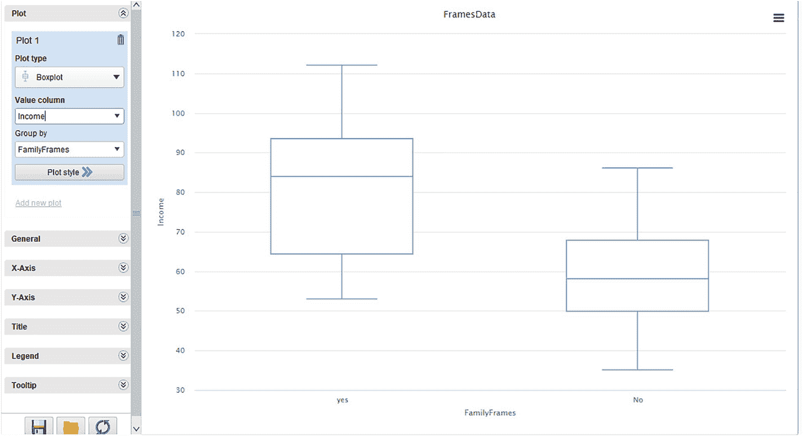

图表类型设置为箱线图，数值列设置为收入，分组依据设置为家庭相框，展示的是并排箱线图。

**图 7-17b** 用于 KNN 可视化的并排箱线图（收入）

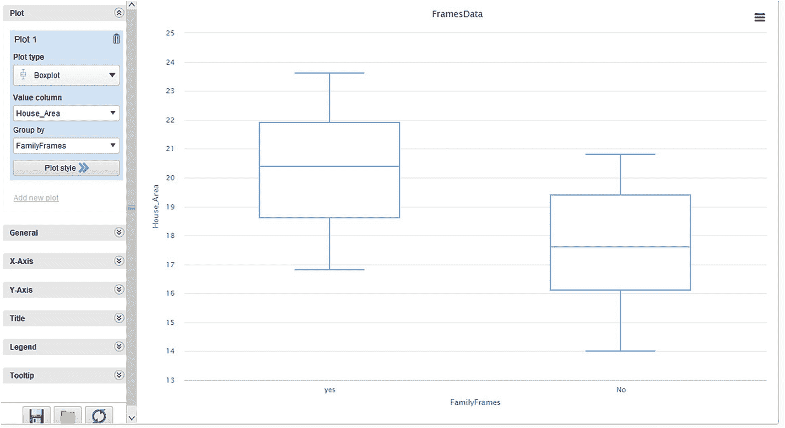

图表类型设置为箱线图，数值列设置为房屋面积，分组依据设置为家庭相框，展示的是并排箱线图。

**图 7-17a** 用于 KNN 可视化的并排箱线图（房屋面积）

1.  本例所使用的数据文件名为 `FramesData.xlsx`。创建一个新的 `仓库` 和两个 `子文件夹`（`data` 和 `process`）。创建一个新流程。导入数据并查看 `统计信息`。从统计信息来看，没有缺失值。
2.  可视化：通过并排箱线图研究结果与数值预测变量之间的关系。分离程度最高的箱线图表明预测变量可能有用。图 7-17a 和 7-17b 在这方面展示了良好的结果。

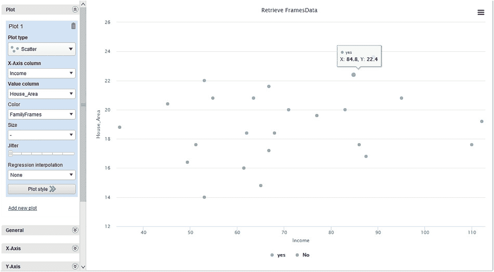

图表类型设置为散点图，x 轴列设置为收入，数值列设置为房屋面积，颜色设置为家庭相框。

**图 7-18** 收入和房屋面积的彩色散点图

1.  为了进行更多的分类可视化，我们将使用图 7-18 中的彩色散点图。

使用图 7-19 中的设置检查相关性，结果显示在图 7-20 中。

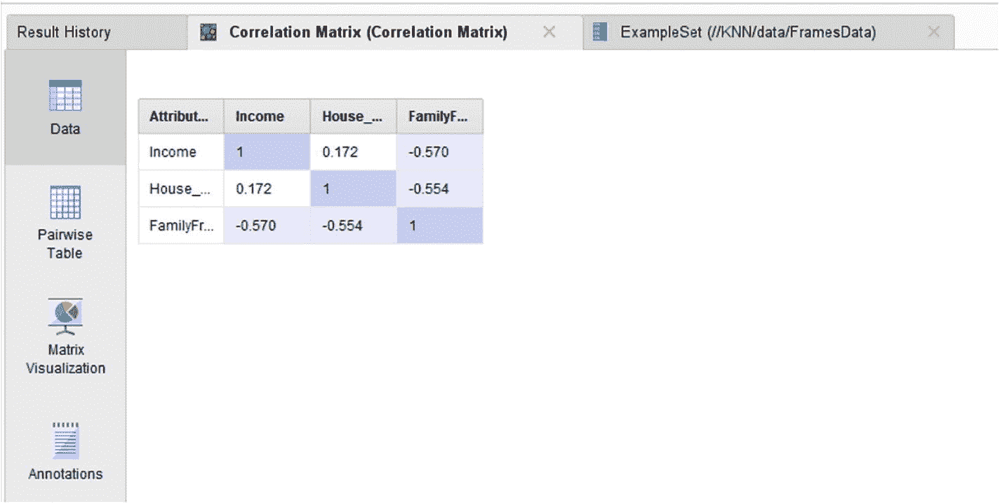

“数据”选项卡显示了一个表格，列出了对应属性的值，其中部分值被高亮显示。

**图 7-20** `FramesData.xlsx` 的相关性矩阵输出

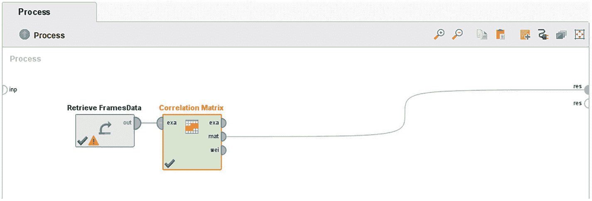

“过程”选项卡显示，检索相框数据后接一个相关性矩阵，其中矩阵连接到结果。

**图 7-19** `FramesData.xlsx` 的相关性矩阵过程

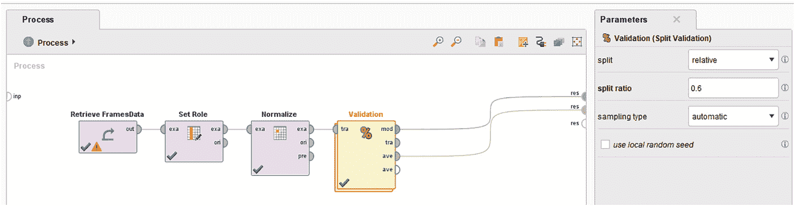

“过程”选项卡的参数部分，拆分方式设置为相对，拆分比率设置为 0.6，采样类型设置为自动。

**图 7-21a** KNN 的主过程

我们将使用图 7-21a（主流程）和图 7-21b（内部流程）中的设置来开发和评估模型。在这个简单的演示中，由于数据量不大，我们将仅分为两个分区，并使用验证数据来确定`k`值，同时为了演示目的，使用训练数据得到的模型进行测试。在实际业务应用中，用于在选定`k`值后测试模型的数据应该是第三个从未使用过的分区。

在图 7-21a 中，点击`Set Role`运算符，并将`attribute name`设置为`FamilyFrames`，将`target role`设置为`label`。在`Split Validation`运算符中，我们将分割比例设置为 0.6。

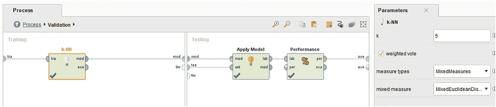

流程选项卡的参数部分设置了`k`值，勾选了加权投票，设置了度量类型，并将混合度量设置为相应的选项。

`图 7-21b KNN 内部流程`

在图 7-21b 中，对于`KNN`运算符，我们将`k`的数量设置为 5（默认值）。（建议运行`KNN`并在`K = 3, 7, 9, 11, 13`等值上评估`KNN`模型，并记录性能（即准确率），以确定最佳的`k`。）所有其他设置保持默认。`Apply Model`运算符无需调整参数。对于`Performance (Classification)`运算符的参数，保持默认即可，即`accuracy`。

对于图 7-21a 和图 7-21b 中的设置，我们期望有两个输出。图 7-22a 是`KNN`模型，图 7-22b 是模型的性能。

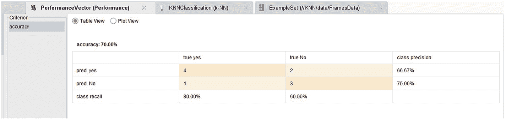

KNN 分类选项卡显示，标准设置为准确率，选择了表格视图，并高亮显示了预测为是和否以及真实为是和否的值。

`图 7-22b 模型的性能`

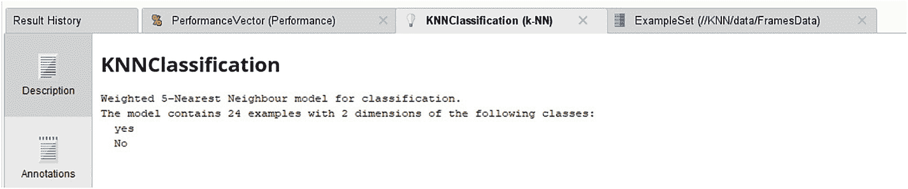

KNN 分类选项卡显示，描述中指出该模型包含 24 个示例，具有以下两个维度：是和否。

`图 7-22a KNN 模型`

一旦我们建立了用于预测的最优模型以及产生该模型的最佳`k`值，我们就可以使用该模型对新数据进行预测。该过程与已解释的分类算法类似。

## 7.7 逻辑回归

逻辑回归基于一个将预测变量与结果联系起来的模型。可以使用少量数据来训练逻辑回归分类器，然后将其应用于大量新记录。当结果变量`Y`是分类变量时，逻辑回归扩展了线性回归的概念。

根据其预测变量的值，逻辑回归可用于将类别未知的新记录分类到某个类别中（称为分类）。它还可用于发现区分不同类别中记录的特征（基于其预测变量轮廓或已知类别的数据中的预测变量），这称为特征分析（profiling）。

当我们需要对客户进行分类（如回头客或非回头客）（分类）、寻找区分客户的特征（特征分析）等时，我们使用逻辑回归。我们可以使用逻辑回归来计算新记录落入某个类别的倾向，然后按倾向从高到低对记录进行排序，以便我们将精力集中在那些倾向最高的记录上。

预测变量`x[1], x[2],......x[p]`可以是分类变量、连续变量，或两者的组合。

`逻辑回归的步骤`

1.  计算属于每个类别的倾向。

2.  使用倾向的截断值将每条记录分类到其中一个类别。该记录被分配到具有最高概率的类别。

与`KNN`一样，二分类器中的默认截断值为 0.5。

`逻辑回归模型`

根据公式 6.7 中的线性回归方程，我们可以将`p`表示为预测变量`(x[1], x[2]……x[p])`的线性函数：

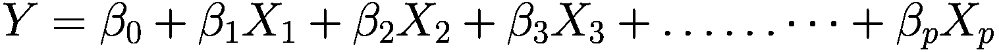

(公式 7.8)

相反，逻辑回归使用预测变量的非线性函数，形式为：

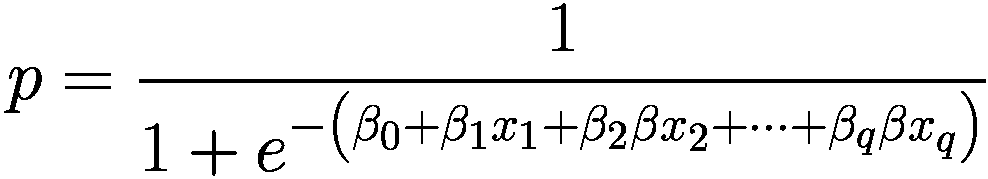

(公式 7.9)

这就是所谓的逻辑响应函数。对于任何值`x[1]...x[q]`，右侧的结果将始终落在[0；1]之间。

`优势比（Odds）`是衡量属于特定类别的指标。属于类别 1 的概率与属于类别 0 的概率之比，被定义为属于类别 1 的优势比。我们也可以进行反向计算。如果我们知道优势比，就可以使用公式 7.9 计算事件的概率。如果我们反向计算概率，会得到以下结果：

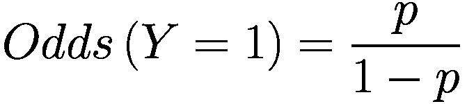

(公式 7.10)

例如，如果获胜的概率为 0.5，则获胜的优势比为 0.5 / 0.5 = 1，即属于类别 1 的概率除以属于类别 0 的概率。我们可以执行反向计算；如果我们知道优势比，可以通过修改公式 7.10 来计算事件的概率。由此得到公式 7.11。

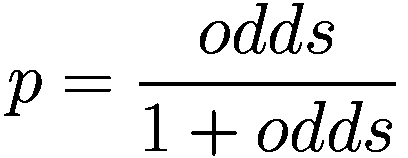

(公式 7.11)

我们可以通过将公式 7.9 代入公式 7.11 来描述优势比与预测变量之间的关系，例如：

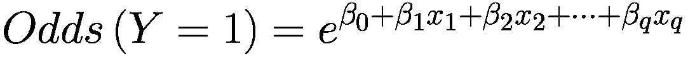

(公式 7.12)

现在，我们可以通过在等式两边取自然对数²，推导出逻辑模型的标准形式。

(`式 7.13`)

更多信息，请参阅 Galit 等人 (2018) 的著作，第 10 章。

### 使用逻辑回归进行分类的示例

此示例使用的数据集名为 `UniversalBank.xlsx`。它包含 5000 名客户的数据。数据包括客户对最近一次个人贷款活动的反应（`personal loan`，个人贷款），以及客户的人口统计信息（`age` 年龄，`income` 收入等）和客户与银行的关系（`mortgage` 抵押贷款，`securities account` 证券账户等）。详情如下：

| • Age | *客户年龄（以整年计算）* |
| • Experience | *专业经验年数* |
| • Income | *客户年收入（千美元）* |
| • Family | *客户家庭人数* |
| • CCAvg | *每月信用卡平均支出（千美元）* |
| • Education | *教育水平。1：本科；2：研究生；3：高级/专业* |
| • Mortgage | *房屋抵押贷款价值（如有，千美元）* |
| • Securities Account | *若客户在银行有证券账户，编码为 1* |
| • CD Account | *若客户在银行有大额定期存单账户，编码为 1* |
| • Online Banking | *若客户使用网上银行服务，编码为 1* |
| • Credit Card | *若客户使用由 Universal Bank 发行的信用卡，编码为 1* |

在这 5000 名客户中，只有 480 名客户（即 9.6%）接受了此前一次营销活动中的个人贷款邀请。目标是建立一个模型，用于识别在未来的邮件营销中最有可能接受贷款邀请的客户。

银行的这个应用场景只是一个选定的例子；其他应用场景，例如在销售活动中，目标是建立一个模型来识别最有可能进行购买的客户。在服务活动中，即向客户提供某种形式服务的企业，目标是建立一个模型，用于识别在未来提案或营销中会接受该服务邀约的客户。

结果变量是 `personal loan`，其中 *yes*（是）被定义为 *success*（成功）（这等价于将接受者的结果变量设置为 1，将非接受者的结果变量设置为 0）。

解决此问题所需的某些数据预处理步骤是，先将属性 *Education*（教育水平）转换为多项式，然后将其转换为虚拟变量，并移除其中一个虚拟变量。目标属性 *Personal loan*（个人贷款）将被转换为二项式。之后，应对数据进行可视化以进行分类，并使用相关性矩阵发现相关属性（在本实践演示中将跳过此步骤，因为它将在本章的练习 4 中进行）。此外，与线性回归类似，在逻辑回归中，我们可以使用自动变量选择启发式方法，例如逐步选择法、向前选择法和向后消除法（更多解释见 ^(4,5,6)）。

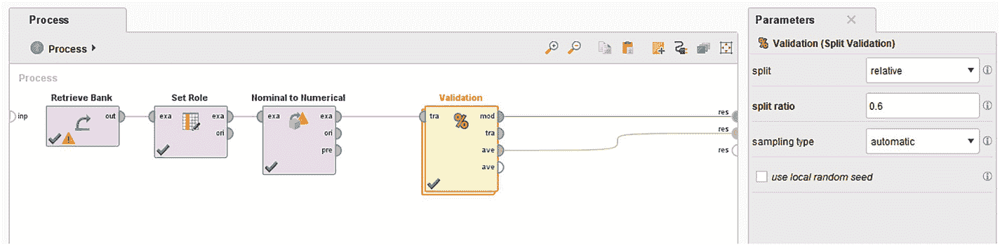

流程选项卡的参数部分，分割类型设置为相对值，分割比例设置为 `0.6`，采样类型设置为自动。

## 主流程（逻辑回归）

1.  创建一个新流程。`导入`名为 `Bank.xlsx` 的数据。排除属性 `ID 列` 和 `邮政编码`。将 `Education`（教育水平）转换为多项式。将 `Personal loan`（个人贷款）转换为二项式。
2.  创建一个新流程，将已导入的 `Bank.xlsx` 数据拖拽到设计视图。将数据连接到 `res`，运行流程，并查看 `统计信息`（注意，没有缺失值，且步骤 1 中完成的所有转换都已处理）。我们将使用图 7-23a（主流程）和图 7-23b（内部流程）中的设置来开发和评估模型。

在 `Figure 7-23a` 中，点击 `Set Role` 算子，并将 `attribute name` 设置为 `Personal loan`，将 `target role` 设置为 `label`。对于 `Nominal to Numerical` 算子，你需要选择 `Education` 属性（转换为虚拟变量）。对于 `Split Validation` 算子，将分割比率设置为 `0.6`。

在 `Figure 7-23b` 中，`Logistic Regression` 算子、`Apply Model` 算子和 `Performance (Classification)` 算子均保留默认设置。`Logistic Regression` 算子是广义线性模型算子的简化版本。⁷ 为了执行逻辑回归，`Family` 参数自动设置为 `binomial`，链接参数设置为 `logit`（更多详情请查阅 RapidMiner 文档）。

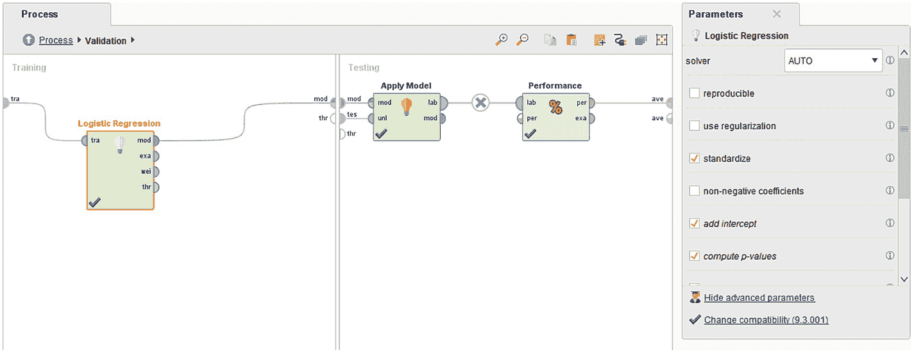

流程选项卡的参数部分，求解器设置为 `auto`，并勾选了标准化、添加截距和计算 p 值选项。

## 内部流程（逻辑回归）

对于 `Figure 7-23a` 和 `Figure 7-23b` 中的设置，我们期望得到两个输出结果。`Figure 7-24a` 是逻辑回归模型，`Figure 7-24b` 是模型的性能表现。

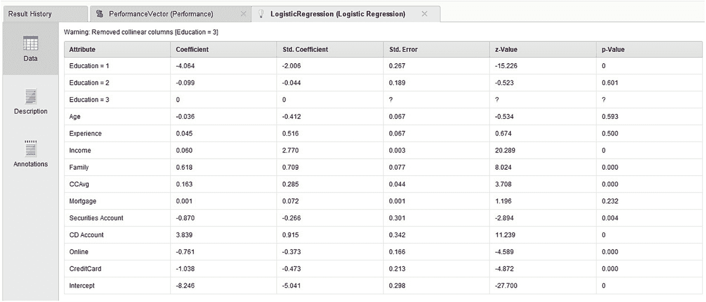

数据选项卡已选中，表格显示一组值列表。表格上方有一条声明：警告，已移除共线列。

## 逻辑回归模型

1.  根据 `Figure 7-24a`，请注意，某些变量可能会根据其 p 值被移除；通常建议使用非常小的 p 值（`0.001` 或更小）。⁸ 此外，由于多重共线性，`Education=3` 已被移除。变量 `CD count` 和 `mortgage` 的正系数表明，拥有定期存款账户和抵押贷款与接受贷款优惠的更高概率相关（它们是由 `1` 表示的虚拟变量）。相比之下，拥有证券、在线服务、信用卡等则与较低的接受率相关。对于连续预测变量，正系数表示该预测变量的较高值与接受贷款优惠的较高概率相关（例如，`income`：高收入客户更倾向于接受优惠）。类似地，负系数表示该预测变量的较高值与接受贷款优惠的较低概率相关（例如，`age`）。

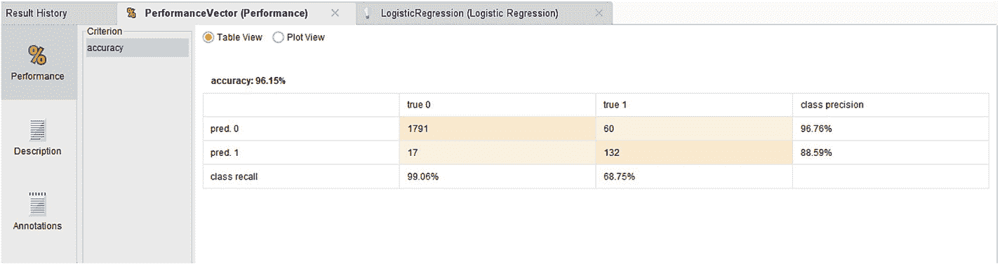

性能选项卡将评估准则设置为准确率，表格视图已选中，并且实际值 `0` 和 `1` 对应的预测值 `0` 和 `1` 被高亮显示。

## 逻辑回归模型的性能

1.  一旦我们建立了用于预测的最优模型，现在就可以使用该模型来预测新数据（`newBank.xlsx`）。

**使用逻辑回归进行客户画像**

逻辑模型（例如，`Figure 7-24a`）可用于提供关于不同属性在分类中所扮演角色的有用信息。如果我们想知道家庭收入增加一个单位将如何影响贷款接受的概率，我们可以使用公式 7.14，并针对单个预测变量或属性进行修改，如公式 7.15 所示。

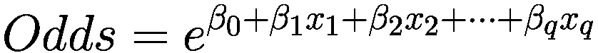

（公式 7.14）

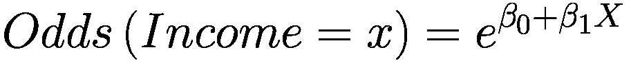

（公式 7.15）

根据 `Figure 7-25` 中的模型，单一预测变量模型的估计系数是 `β0 = -6.127` 和 `β1 = 0.037`。

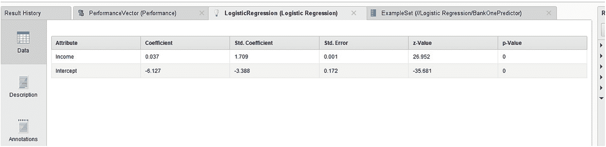

数据选项卡已选中，显示一个表格，其列包含属性、系数、标准系数、标准误差、z 值和 p 值。

## 仅含一个变量（`income`）的逻辑回归模型

收入为零的客户接受贷款的概率比估计为 `e^(-6.127+(0.037)(0)) = 0.00218`。

收入为 `$100K` 的客户接受贷款的概率比为 `e^(-6.127+(0.037)(100)) = 0.0883`。

## 7.8 练习

1.  根据 `Figure 7-24a` 中的模型写出逻辑回归方程。
2.  通过预测新客户，完成使用逻辑回归的分类示例（第 7.7 节）。
3.  重复实际商业问题 III；这一次，移除属性 `NumOfProducts` 和 `EstimatedSalary`，并比较结果。算法的性能是否有改善？
4.  重复实际商业问题 III；这一次，包含相关矩阵并使用它在应用所有三种算法之前移除相关属性。准确性是否提高了？
5.  对于本次练习，我们将使用一个名为 `iandfnetworksolutions` 的商业培训机构的数据科学案例研究。`iandfnetworksolutions` 是一家在线数据分析培训和咨询公司，员工人数少于十人。数据科学家当前的任务是找出最佳的子集（前 `10%` 的潜在客户），以便针对他们开展一对一营销活动，该公司已发现这种方式在这种情况下最为有效。内部数据文件名为 `InternalData.xlsx`；外部数据文件名为 `Prospects.xlsx`。
6.  对于本次练习，我们将使用一家位于尼日利亚的大型面条零售店的案例研究。这家大型商店销售不同种类的面条给那些以更小批量进行零售的小商店。该零售店已成功保存了遍布尼日利亚各地的客户记录，并已整理出潜在客户的数据。数据科学家当前的任务是找出最佳模型，以：
    1.  根据是否应该针对在线销售或线下销售来对潜在客户进行分类（分类问题）。
    2.  找出区分在线和线下客户的因素（客户画像问题）。

数据文件命名为：
    *   内部数据：`NoodleRetailLRInternal.xlsx`
    *   外部数据：`NoodleRetailLRExternal.xlsx`