# 排版后的内容

我们将使用图 7-21a（主流程）和图 7-21b（内部流程）中的设置来开发和评估模型。在这个简单的演示中，由于数据量不大，我们将仅分为两个分区，并使用验证数据来确定`k`值，同时为了演示目的，使用训练数据得到的模型进行测试。在实际业务应用中，用于在选定`k`值后测试模型的数据应该是第三个从未使用过的分区。

在图 7-21a 中，点击`Set Role`运算符，并将`attribute name`设置为`FamilyFrames`，将`target role`设置为`label`。在`Split Validation`运算符中，我们将分割比例设置为 0.6。

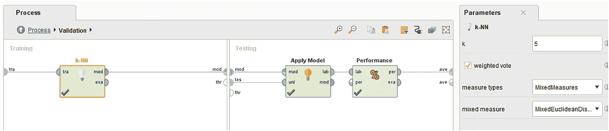

流程选项卡的参数部分设置了`k`值，勾选了加权投票，设置了度量类型，并将混合度量设置为相应的选项。

**图 7-21b KNN 内部流程**

在图 7-21b 中，对于`KNN`运算符，我们将`k`的数量设置为 5（默认值）。（建议运行`KNN`并在`K = 3, 7, 9, 11, 13`等值上评估`KNN`模型，并记录性能（即准确率），以确定最佳的`k`。）所有其他设置保持默认。`Apply Model`运算符无需调整参数。对于`Performance (Classification)`运算符的参数，保持默认即可，即`accuracy`。

对于图 7-21a 和图 7-21b 中的设置，我们期望有两个输出。图 7-22a 是`KNN`模型，图 7-22b 是模型的性能。

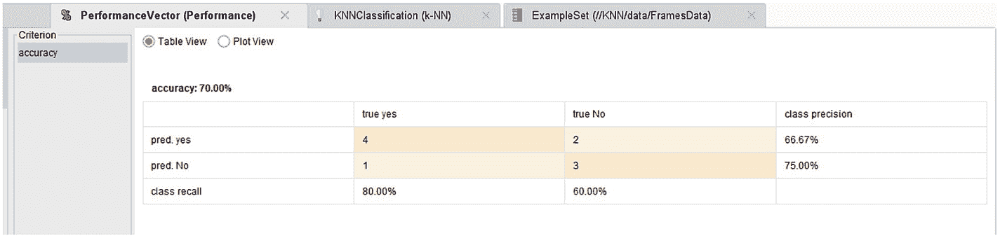

KNN 分类选项卡显示，标准设置为准确率，选择了表格视图，并高亮显示了预测为是和否以及真实为是和否的值。

**图 7-22b 模型的性能**

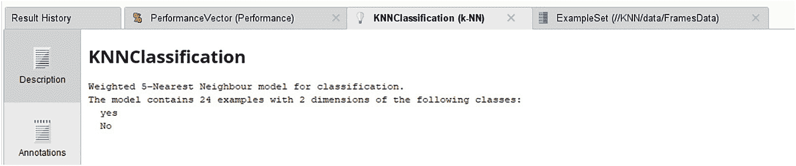

KNN 分类选项卡显示，描述中指出该模型包含 24 个示例，具有以下两个维度：是和否。

**图 7-22a KNN 模型**

一旦我们建立了用于预测的最优模型以及产生该模型的最佳`k`值，我们就可以使用该模型对新数据进行预测。该过程与已解释的分类算法类似。

## 7.7 逻辑回归

逻辑回归基于一个将预测变量与结果联系起来的模型。可以使用少量数据来训练逻辑回归分类器，然后将其应用于大量新记录。当结果变量`Y`是分类变量时，逻辑回归扩展了线性回归的概念。

根据其预测变量的值，逻辑回归可用于将类别未知的新记录分类到某个类别中（称为分类）。它还可用于发现区分不同类别中记录的特征（基于其预测变量轮廓或已知类别的数据中的预测变量），这称为特征分析（profiling）。

当我们需要对客户进行分类（如回头客或非回头客）（分类）、寻找区分客户的特征（特征分析）等时，我们使用逻辑回归。我们可以使用逻辑回归来计算新记录落入某个类别的倾向，然后按倾向从高到低对记录进行排序，以便我们将精力集中在那些倾向最高的记录上。

预测变量`x[1], x[2],......x[p]`可以是分类变量、连续变量，或两者的组合。

**逻辑回归的步骤**

1.  计算属于每个类别的倾向。
2.  使用倾向的截断值将每条记录分类到其中一个类别。该记录被分配到具有最高概率的类别。

与`KNN`一样，二分类器中的默认截断值为 0.5。

**逻辑回归模型**

根据公式 6.7 中的线性回归方程，我们可以将`p`表示为预测变量`(x[1], x[2]……x[p])`的线性函数：

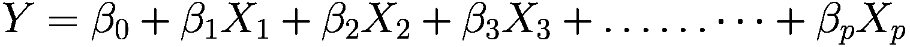

(公式 7.8)

相反，逻辑回归使用预测变量的非线性函数，形式为：

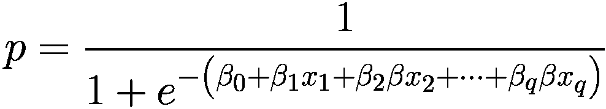

(公式 7.9)

这就是所谓的逻辑响应函数。对于任何值`x[1]...x[q]`，右侧的结果将始终落在[0；1]之间。

**优势比（Odds）** 是衡量属于特定类别的指标。属于类别 1 的概率与属于类别 0 的概率之比，被定义为属于类别 1 的优势比。我们也可以进行反向计算。如果我们知道优势比，就可以使用公式 7.9 计算事件的概率。如果我们反向计算概率，会得到以下结果：

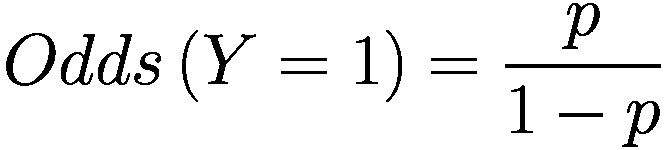

(公式 7.10)

例如，如果获胜的概率为 0.5，则获胜的优势比为 0.5 / 0.5 = 1，即属于类别 1 的概率除以属于类别 0 的概率。我们可以执行反向计算；如果我们知道优势比，可以通过修改公式 7.10 来计算事件的概率。由此得到公式 7.11。

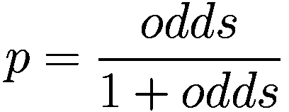

(公式 7.11)

我们可以通过将公式 7.9 代入公式 7.11 来描述优势比与预测变量之间的关系，例如：

(公式 7.12)

现在，我们可以通过在等式两边取自然对数²，推导出逻辑模型的标准形式。

(`式 7.13`)

更多信息，请参阅 Galit 等人 (2018) 的著作，第 10 章。

### 使用逻辑回归进行分类的示例

此示例使用的数据集名为 `UniversalBank.xlsx`。它包含 5000 名客户的数据。数据包括客户对最近一次个人贷款活动的反应（`personal loan`，个人贷款），以及客户的人口统计信息（`age` 年龄，`income` 收入等）和客户与银行的关系（`mortgage` 抵押贷款，`securities account` 证券账户等）。详情如下：

| • Age | *客户年龄（以整年计算）* |
| • Experience | *专业经验年数* |
| • Income | *客户年收入（千美元）* |
| • Family | *客户家庭人数* |
| • CCAvg | *每月信用卡平均支出（千美元）* |
| • Education | *教育水平。1：本科；2：研究生；3：高级/专业* |
| • Mortgage | *房屋抵押贷款价值（如有，千美元）* |
| • Securities Account | *若客户在银行有证券账户，编码为 1* |
| • CD Account | *若客户在银行有大额定期存单账户，编码为 1* |
| • Online Banking | *若客户使用网上银行服务，编码为 1* |
| • Credit Card | *若客户使用由 Universal Bank 发行的信用卡，编码为 1* |

在这 5000 名客户中，只有 480 名客户（即 9.6%）接受了此前一次营销活动中的个人贷款邀请。目标是建立一个模型，用于识别在未来的邮件营销中最有可能接受贷款邀请的客户。

银行的这个应用场景只是一个选定的例子；其他应用场景，例如在销售活动中，目标是建立一个模型来识别最有可能进行购买的客户。在服务活动中，即向客户提供某种形式服务的企业，目标是建立一个模型，用于识别在未来提案或营销中会接受该服务邀约的客户。

结果变量是 `personal loan`，其中 *yes*（是）被定义为 *success*（成功）（这等价于将接受者的结果变量设置为 1，将非接受者的结果变量设置为 0）。

解决此问题所需的某些数据预处理步骤是，先将属性 *Education*（教育水平）转换为多项式，然后将其转换为虚拟变量，并移除其中一个虚拟变量。目标属性 *Personal loan*（个人贷款）将被转换为二项式。之后，应对数据进行可视化以进行分类，并使用相关性矩阵发现相关属性（在本实践演示中将跳过此步骤，因为它将在本章的练习 4 中进行）。此外，与线性回归类似，在逻辑回归中，我们可以使用自动变量选择启发式方法，例如逐步选择法、向前选择法和向后消除法（更多解释见 ^(4,5,6)）。

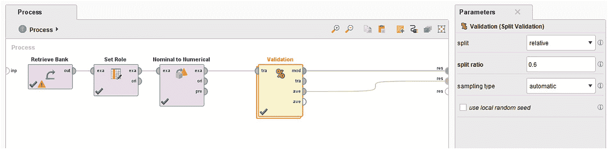

流程选项卡的参数部分，分割类型设置为相对值，分割比例设置为 0.6，采样类型设置为自动。

图 7-23a

主流程（逻辑回归）

1.  创建一个新流程。**导入**名为 `Bank.xlsx` 的数据。排除属性 *ID 列* 和 *邮政编码*。将 *Education*（教育水平）转换为多项式。将 *Personal loan*（个人贷款）转换为二项式。
2.  创建一个新流程，将已导入的 `Bank.xlsx` 数据拖拽到设计视图。将数据连接到 ***res***，运行流程，并查看 ***统计信息***（注意，没有缺失值，且步骤 1 中完成的所有转换都已处理）。我们将使用图 7-23a（主流程）和图 7-23b（内部流程）中的设置来开发和评估模型。

在`Figure 7-23a`中，点击`Set Role`算子，并将`attribute name`设置为`Personal loan`，将`target role`设置为`label`。对于`Nominal to Numerical`算子，你需要选择`Education`属性（转换为虚拟变量）。对于`Split Validation`算子，将分割比率设置为`0.6`。

在`Figure 7-23b`中，`Logistic Regression`算子、`Apply Model`算子和`Performance (Classification)`算子均保留默认设置。`Logistic Regression`算子是广义线性模型算子的简化版本。⁷ 为了执行逻辑回归，Family 参数自动设置为`binomial`，链接参数设置为`logit`（更多详情请查阅 RapidMiner 文档）。

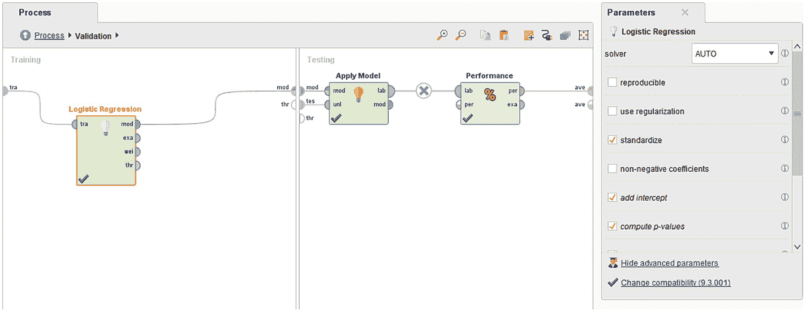

流程选项卡的参数部分，求解器设置为`auto`，并勾选了标准化、添加截距和计算 p 值选项。

Figure 7-23b

内部流程（逻辑回归）

对于`Figure 7-23a`和`Figure 7-23b`中的设置，我们期望得到两个输出结果。`Figure 7-24a`是逻辑回归模型，`Figure 7-24b`是模型的性能表现。

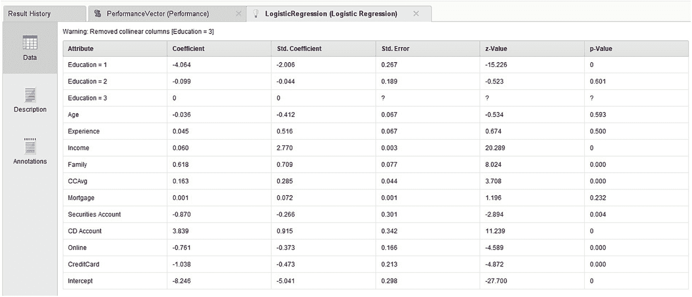

数据选项卡已选中，表格显示一组值列表。表格上方有一条声明：警告，已移除共线列。

Figure 7-24a

逻辑回归模型

1.  根据`Figure 7-24a`，请注意，某些变量可能会根据其 p 值被移除；通常建议使用非常小的 p 值（0.001 或更小）。⁸ 此外，由于多重共线性，`Education=3`已被移除。变量`CD count`和`mortgage`的正系数表明，拥有定期存款账户和抵押贷款与接受贷款优惠的更高概率相关（它们是由 1 表示的虚拟变量）。相比之下，拥有证券、在线服务、信用卡等则与较低的接受率相关。对于连续预测变量，正系数表示该预测变量的较高值与接受贷款优惠的较高概率相关（例如，`income`：高收入客户更倾向于接受优惠）。类似地，负系数表示该预测变量的较高值与接受贷款优惠的较低概率相关（例如，`age`）。

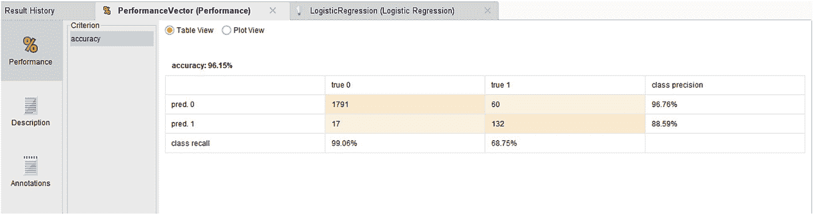

性能选项卡将评估准则设置为准确率，表格视图已选中，并且实际值 0 和 1 对应的预测值 0 和 1 被高亮显示。

Figure 7-24b

逻辑回归模型的性能

1.  一旦我们建立了用于预测的最优模型，现在就可以使用该模型来预测新数据（`newBank.xlsx`）。

**使用逻辑回归进行客户画像**

逻辑模型（例如，`Figure 7-24a`）可用于提供关于不同属性在分类中所扮演角色的有用信息。如果我们想知道家庭收入增加一个单位将如何影响贷款接受的概率，我们可以使用公式 7.14，并针对单个预测变量或属性进行修改，如公式 7.15 所示。

（公式 7.14）

（公式 7.15）

根据`Figure 7-25`中的模型，单一预测变量模型的估计系数是`β0 = -6.127`和`β1 = 0.037`。

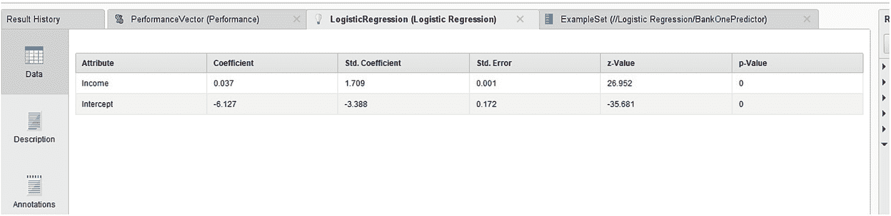

数据选项卡已选中，显示一个表格，其列包含属性、系数、标准系数、标准误差、z 值和 p 值。

Figure 7-25

仅含一个变量（`income`）的逻辑回归模型

收入为零的客户接受贷款的概率比估计为`e^(-6.127+(0.037)(0)) = 0.00218`。

收入为$100K 的客户接受贷款的概率比为`e^(-6.127+(0.037)(100)) = 0.0883`。

## 7.8 练习

1.  根据`Figure 7-24a`中的模型写出逻辑回归方程。

2.  通过预测新客户，完成使用逻辑回归的分类示例（第 7.7 节）。

3.  重复实际商业问题 III；这一次，移除属性`NumOfProducts`和`EstimatedSalary`，并比较结果。算法的性能是否有改善？

4.  重复实际商业问题 III；这一次，包含相关矩阵并使用它在应用所有三种算法之前移除相关属性。准确性是否提高了？

5.  对于本次练习，我们将使用一个名为`iandfnetworksolutions`的商业培训机构的数据科学案例研究。`iandfnetworksolutions`是一家在线数据分析培训和咨询公司，员工人数少于十人。数据科学家当前的任务是找出最佳的子集（前 10%的潜在客户），以便针对他们开展一对一营销活动，该公司已发现这种方式在这种情况下最为有效。内部数据文件名为`InternalData.xlsx`；外部数据文件名为`Prospects.xlsx`。

6.  对于本次练习，我们将使用一家位于尼日利亚的大型面条零售店的案例研究。这家大型商店销售不同种类的面条给那些以更小批量进行零售的小商店。该零售店已成功保存了遍布尼日利亚各地的客户记录，并已整理出潜在客户的数据。数据科学家当前的任务是找出最佳模型，以：
    1.  根据是否应该针对在线销售或线下销售来对潜在客户进行分类（分类问题）。
    2.  找出区分在线和线下客户的因素（客户画像问题）。

数据文件命名为：
    *   *内部数据*：`NoodleRetailLRInternal.xlsx`
    *   *外部数据*：`NoodleRetailLRExternal.xlsx`

