# 8. 高级描述性分析

本章主要关注高级描述性分析技术。在本章中，我们将首先解释聚类（一种无监督学习方法）的概念。然后我们将介绍一种聚类技术，即`k-means`聚类。通过第四个实际商业问题，我们将解释如何使用`k-means`聚类技术来解决一个真实的商业问题。接下来，我们将解释关联规则的示例，最后是网络分析。我们将重点解释这些技术如何用于解决商业相关问题，特别是针对小企业，并以第五个商业问题结束，该问题侧重于使用网络分析来提升员工效率。

## 8.1 聚类分析

聚类是一种无监督机器学习方法，旨在将数据划分为相似的记录组以获取洞察。聚类分析通过计算记录间的距离来形成记录簇。聚类在商业中有多种应用方式，包括根据人口统计和交易历史信息对客户进行分类，然后为每个类别制定营销计划。它还可用于创建客户细分，并赋予其称为“用户画像”的身份标识，从而帮助集中销售精力。此外，在市场竞争结构分析中，它可用于基于竞争相似性度量寻找同类产品群。

目前有两种主流的聚类方法：

1.  **层次方法**：涉及将簇排列成自然层级结构，这类方法极具实用性。这些方法本质上可分为凝聚式或分裂式。

2.  **非层次方法**：`k-means`算法是此类技术的代表。`K`表示算法根据预设的簇数量将记录分配到各簇中。由于其计算成本较低，因此更适合大数据处理。

无论采用层次还是非层次聚类方法，都必须定义两种距离：记录间的距离以及数据集中两个簇之间的距离。此外，这两种方法均可采用一系列度量指标来计算这些距离。

在测量两个记录之间的距离时，需谨记以下几点：

- 距离值不得为负。
- 记录与自身距离应为零（0）。
- 记录`i`与`j`之间的距离必须等于记录`j`与`i`之间的距离。
- 任意两记录间的距离不得超过另外两对距离之和。

用于测量两个数值型记录之间距离的度量包括：

- **欧几里得距离**：该度量要求在计算前对连续测量值进行标准化处理。若测量值高度相关，则建议使用其他距离度量（如统计距离）。异常值会导致欧几里得距离产生偏差。对于欧几里得距离，要么剔除异常值，要么使用更稳健的距离度量如曼哈顿距离。
- **基于相关性的相似度**。
- **统计距离**，也称马氏距离。
- **曼哈顿距离**（“城市街区距离”）。
- **最大坐标距离**。

关于上述距离的更多信息，可参考 Han 等 (2012) 的文献。

对于包含二元分类数据的记录，相似度度量在直观上比距离度量更具吸引力。在此情况下，匹配系数和杰卡德系数是最有用的相似度度量。对于包含分类数据和混合数据（部分连续、部分二元）的记录间距离测量，Gower 提出的相似度系数非常实用。

在测量两个簇之间的距离时，以下定义至关重要：

- **最小距离**：两个簇中最接近的一对记录（每个簇中取一个记录）之间的距离。
- **最大距离**：两个簇中相距最远的两个记录之间的距离。
- **平均距离**：任意两个记录之间的平均距离。
- **质心距离**：质心链接聚类基于质心距离，其中各组由其各变量的均值表示，形成均值向量。这两个向量之间的距离决定了两个簇之间的距离。

理想的簇之间应具有良好分离度；分离度越高，得到的组内均质性越强，因此这些距离度量有助于清晰观察这种分离状态。

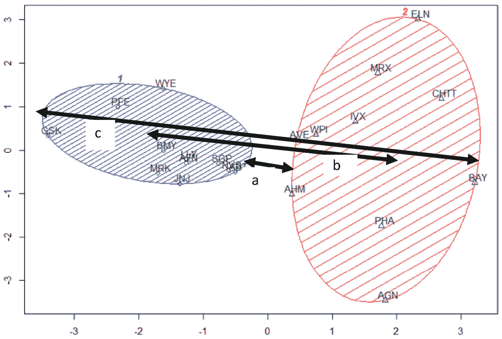

**图 8-1**

两个簇之间多种距离度量的二维示意图：(a) 最小距离，(b) 质心距离，(c) 最大距离

## 8.2 K-Means

`k-means`算法将样本划分为预先定义的`k`个分离良好（无重叠）的簇，目的是使这些簇在采用的度量标准（例如，图 8-1）上具有相似性。记录与其簇质心之间的总距离（或欧几里得距离平方和）是衡量簇内离散度的常用指标。`k-means`算法如图 8-2 所示。

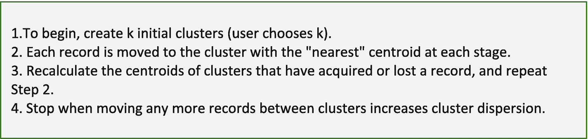

图 8-2

K-means聚类算法

**如何确定 k**

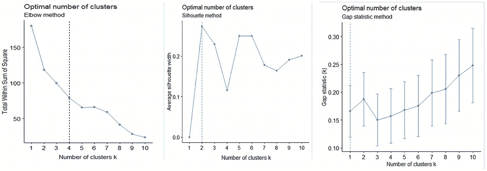

图 8-3

比较三种直接确定最佳`k`值方法的结果

1.  `K`可以通过外部因素确定，例如先验知识、领域知识以及业务环境中呈现的一些约束条件。
2.  你可以尝试不同的`k`值并比较得到的距离。簇内成员间的距离要小，而不同簇之间的距离要大。
3.  也可以通过直接方法确定`k`，这些方法优化某个准则，例如簇内平方和或平均轮廓系数。这些方法包括*间隙统计*法；此外还有超过 30 种其他指标。图 8-3 演示了使用其中三种方法，之后我们进行投票。基于图 8-3，答案介于 4（肘部法）和 2（轮廓系数法）之间；为了做出决定，你必须尝试其他几种指标，获得最高投票数的簇数获胜。

**验证簇**

找到有意义的簇是聚类分析的一个关键目标。以下步骤可以帮助你实现这一目标：

1.  **簇的可解释性**：得到的簇的解释是否合理？探究每个簇的属性以解释这些簇。你可以通过以下方式做到这一点：
    1.  分析聚类分析的结果，为每个簇的度量得出汇总统计量（例如平均值、最小值和最大值）。
    2.  检查簇是否沿着某个从聚类分析中省略的共同特征（变量）分离。
    3.  给簇打标签。在此步骤中，我们将根据对数据的理解为不同的簇命名和标记。
2.  **簇的稳定性**：如果某些输入发生变化，簇的分配是否会受到很大影响？
3.  **簇的分离度**：通过检查簇间变异与簇内变异的比率来确定分离是否合理。这正是我们需要簇间距离的地方。内部有效性度量关注的是簇中包含的信息以及数据点相对于这些簇的排列方式。为了获得良好的聚类效果，一个簇中的所有点彼此靠近是很重要的。同时，簇之间彼此分离、区别明显也很重要。内部有效性所使用的度量包括：
    *   平均质心内距离
    *   簇的密度
    *   基于平方和的项分布
    *   Davies-Bouldin 指数
4.  **簇的数量**：生成的簇的数量必须与分析目标相关。此处使用外部有效性度量将聚类算法创建的簇与先前已知的簇进行比较。要在现实场景中做到这一点，模型开发和测试需要专家的输入，他们将提供簇。用于外部有效性的度量包括：
    *   Rand 指数
    *   调整后的 Rand 指数
    *   Jaccard 指数
    *   Fowlkes-Mallows 指数
5.  此外还有基于密度的方法（例如，相似性度量）。

更多关于簇的内容，请查阅 Han 等人 (2012) 的著作。

**解释簇**

*   我们查看簇质心以确定所生成簇的特征。
*   此外，我们可以查看哪些变量最有效地区分这些簇。
*   我们还可以研究关于簇内离散度的信息。
*   使用簇质心之间的欧几里得距离，我们可以确定各个簇相隔多远。

**为目标营销目的解释簇**

一旦我们对众多客户形象有了清晰的了解，我们就可以针对每个形象的独特偏好定制我们的营销互动，即将新发现的客户形象与最适合每个形象的营销互动联系起来。这些互动应该量身定制，以满足每个特定形象的独特需求、愿望和偏好。

## 8.3 实际商业问题 IV（客户细分）

本实际商业问题的案例研究对象是一家面条零售小企业。`NoodleRetail.xlsx` 是一家面条零售公司的数据，该公司计划对现有客户进行细分，以便能够对其进行描述。目标是细分并描述现有客户，即识别出具有相似特征的客户群，以便未来针对不同细分群体提供不同类型的优惠。为此，聚类过程需要生成的各个细分群体在内部尽可能同质，而在群体间则尽可能异质。

**使用 k-means 进行客户细分**

细分过程遵循以下步骤：

1.  **数据预处理**：由于 `k-means` 无法处理缺失值，我们将首先处理可能存在的缺失值。如果缺失值很少，可以将其排除；如果缺失值很多，则必须进行插补。接着，我们将进行数据可视化以发现异常值。我们将把类别型数据转换为数值型数据（因为 `k-means` 使用距离函数，无法直接处理类别型变量）。如果类别型变量是有序的，我们将用等差数列替换；如果是名义型的，则转换为二进制。之后，我们将对数据进行归一化处理，并应用适当的降维技术。降维非常重要，因为一旦维度超过几十个，距离的解释就不那么直观了，必须避免这种情况。对于本例，我们参考第 2.5 节作为无监督学习数据预处理的指南。
2.  确定 `k` 值。有多种方法可以做到这一点（如前所述），但在此任务中，我们将作为领域专家直接提供要使用的 `k` 值。
3.  使用适当的距离度量（因为我们已经将所有属性转换为数值型，所以选择了数值度量）来执行 `k-means` 聚类，用于计算记录间距离。
4.  验证聚类。为了验证生成的聚类，我们使用*平均质心内距离*。（为了进一步检查聚类的稳定性，你可以随机删除 5% 的数据（即抽取 95% 的记录作为随机样本）并重复分析。是否得到相同的结果？）
5.  为了解释聚类，我们将：
    *   比较聚类质心以描述不同聚类的特征，并尝试为每个聚类赋予一个标签。

# 数据描述

- 使用数据集中的任意或所有变量为每个聚类提供一个合适的名称。
- 你会针对哪些聚类提供优惠？你会向该聚类中的客户提供什么类型的优惠？

面条零售数据包含以下属性：

- `Brand`
- `Country`
- `Customer Id`
- `Gender`
- `Income Class`
- `List Price`
- `Number of Records`
- `Online Order`
- `Owns Car`
- `Product Class`
- `Product Id`
- `Product Size`
- `Purchases`
- `Past 3 Years`
- `State`
- `Transaction Date`
- `Transaction Id`
- `Deceased Indicator`
- `Tenure`

## (a) 数据预处理

创建一个存储库（`Clustering`）；在该存储库中创建两个子文件夹，分别命名为 `data` 和 `process`。将名为 `NoodleRetail.xlsx` 的数据导入到 `data` 子文件夹中。导入时，请确保根据所述原因排除以下属性：

- `Country`（所有值均相同）
- `Number of Records`（所有值均相同）
- `Customer Id`（预处理不需要）
- `Transaction Date`（聚类不需要）
- `Transaction Id`（聚类不需要）
- `Deceased Indicator`（所有值均相同）
- `Product Id`（预处理或聚类不需要）

### 图 8-4 数据统计信息
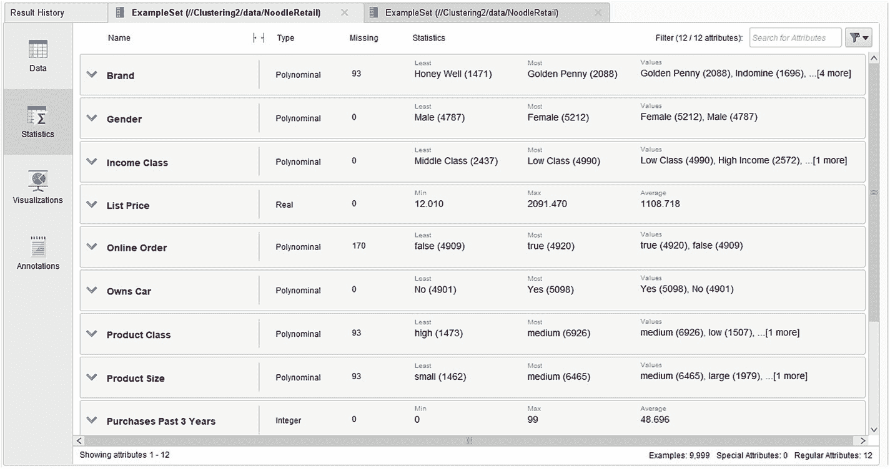

一家面条零售公司数据的统计信息截图，这些数据用于通过聚类来细分和描述公司客户。

以下缺失值在这些统计结果中显而易见，将通过用属性的平均值替换来处理：

- `Brand` – 93
- `Online order` – 170
- `Product class` – 93
- `Product size` – 93
- `Tenure` – 214

创建一个新进程（命名为 `preprocessing1`）。使用图 8-5 中的设置，用平均值替换缺失值。点击 `Replace Missing Values` 运算符，并选择 `Brand`、`Online order`、`Product class`、`Product size` 和 `Tenure`。

### 图 8-5 处理缺失值的流程
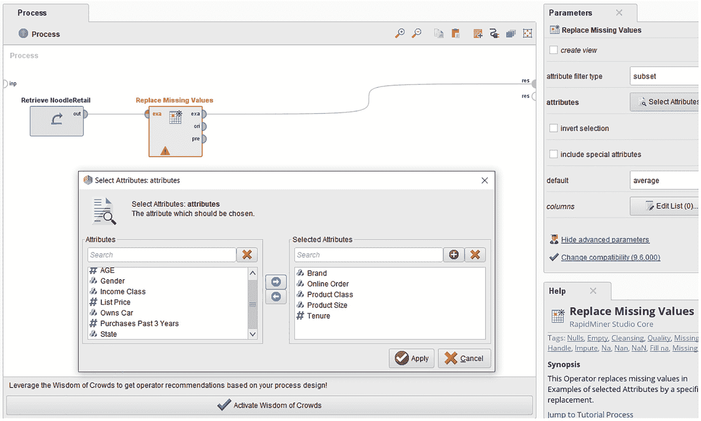

*一张电脑截图展示了在面条零售公司数据统计结果中插入缺失值的过程。*

运行该进程，并使用图 8-6 中的设置可视化结果数据（仅数值属性）以检测异常值。

### 图 8-6 可视化数值属性
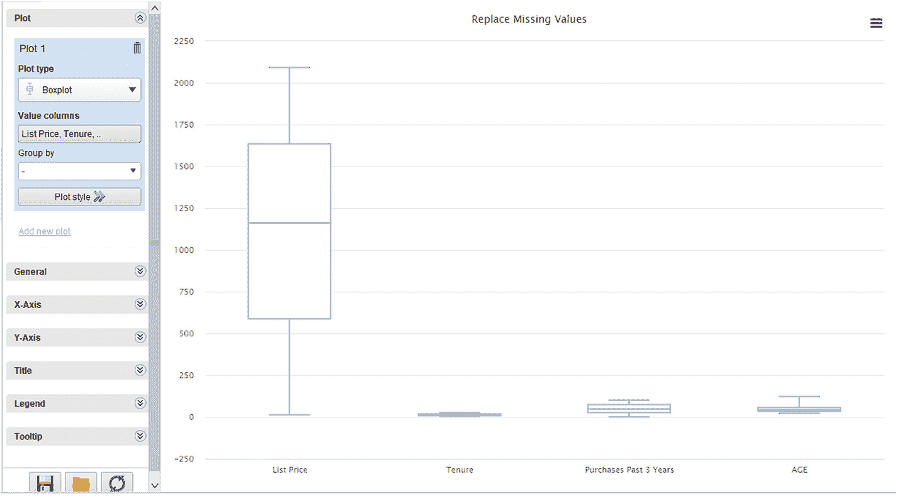

*一张电脑截图显示了数值属性与其值之间的箱线图。图的设置显示在图的左侧。*

无论数值变量是单独可视化还是按照图 8-6 中的设置一起可视化，似乎都没有出现异常值。

图 8-7 是使用散点图检测 `age` 属性异常值的可视化结果；这对于所有数值属性都可以类似操作。

### 图 8-7 数值属性 age 的散点图
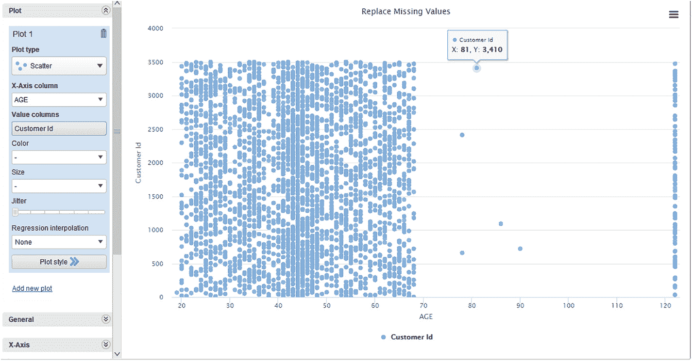

*一张电脑截图显示了客户 ID 与 age 属性之间的散点图，分别位于 Y 轴和 X 轴。设置显示在图的左侧。*

我们来修改图 8-5 中的设置，以得到图 8-8 中的结果，从而通过将所有分类变量转换为数值、进行归一化和执行相关性矩阵来探究是否需要对属性进行缩减。

### 图 8-8 数据的进一步预处理
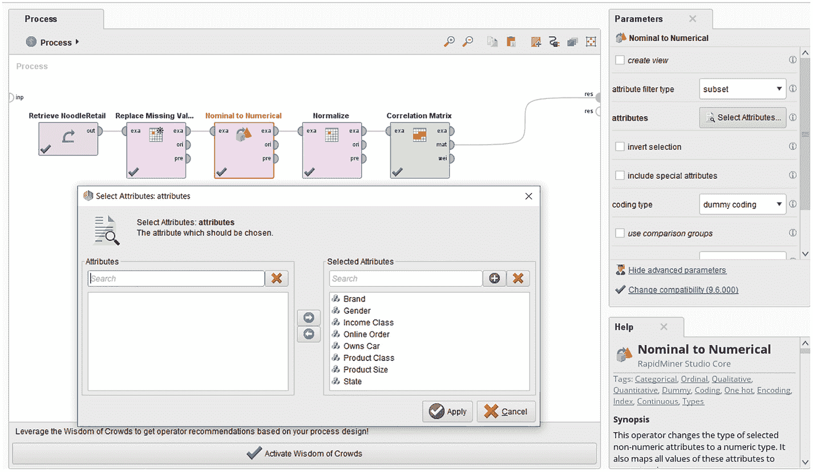

*一张电脑截图展示了将所有分类变量转换为数值并创建相关性矩阵的设置。*

如图 8-8 所示，`Nominal to Numerical` 运算符选择了所有分类属性。点击 `Normalize` 运算符，对于 `attribute filter type` 参数，选择 `all`。将 `Correlation Matrix` 运算符保持默认设置。运行进程，得到图 8-9 中的相关性矩阵；点击同一图中的 `Pairwise Table`，并将相关性值按降序排序，得到图 8-10。

### 图 8-10 相关性矩阵（成对表格）
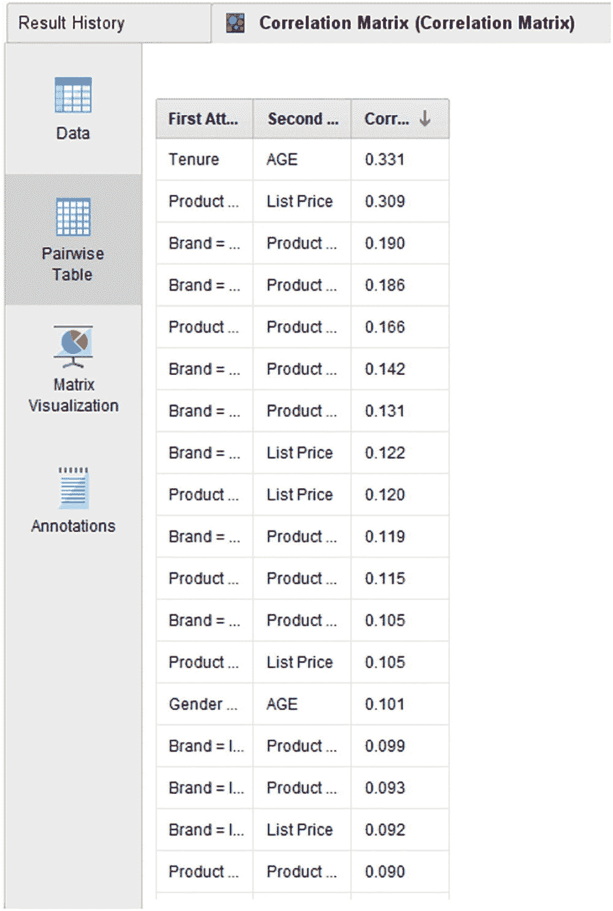

*一张电脑截图显示了点击成对表格选项并按降序排序相关性值后获得的相关性矩阵。*

### 图 8-9 相关性矩阵
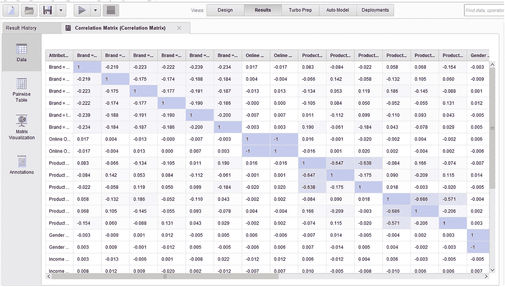

*一张电脑截图显示了带有一些高亮值的相关性矩阵。该矩阵有助于判断是否需要缩减属性。*

从图 8-10 中可以看出，没有强相关的成对变量（最高的成对相关性为 0.331），因此，本演示将使用所有属性。（列表顶部的某些属性可能会在稍后移除，以观察评估时是否能得到更好的聚类分离。）这一决定基于皮尔逊相关性公式，该公式由 `Correlation Matrix` 运算符使用。

皮尔逊相关系数 `R` 是最终得到的结果，其值必须介于 –1 到 +1 之间，即 –1 <= `R` <= +1。

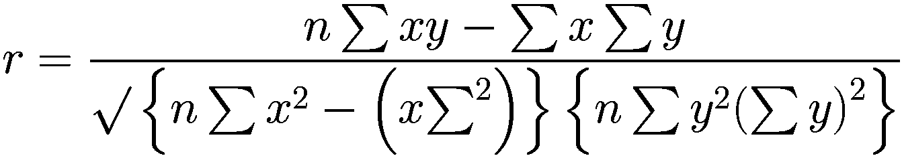

上述公式用于获取 `R` 的值，且 `R` 的值必须落在以下范围内：

- `+1 到 0.7`：表示变量之间的强度呈正向完美相关
- `0.6 到 0.5`：表示变量之间的强度呈一定相关性
- `0.4 到 0.2`：表示变量之间的强度呈弱相关性
- `-1 到 -0.7`：表示变量之间的强度呈负向强相关
- `-0.6 到 -0.5`：表示变量之间的强度呈一定相关性
- `-0.4 到 -0.2`：表示变量之间的强度呈弱相关性
- `0`：表示没有相关性或关系

## (b) 预处理的第二部分

接下来我们进入预处理的第二部分，这部分涉及重新导入数据（因为聚类需要客户 ID）并仅选择那些没有强相关性的属性。该进程的结果将存储在一个 csv 文件中，随后该文件将被重新导入，用于 k-means 聚类。

**重新导入**数据（`NoodleRetail.xlsx`）；这次，将 `customer Id` 的角色更改为 `Id`，如图 8-11 所示。之后，排除属性 `Country`、`Number of Records`、`Transaction Date`、`Transaction Id`、`Deceased Indicator` 和 `Product Id`。在 `RapidMiner` 中将这个新数据命名为 `NoodleRetail2`。

### 图 8-11 为 k-means 聚类导入数据
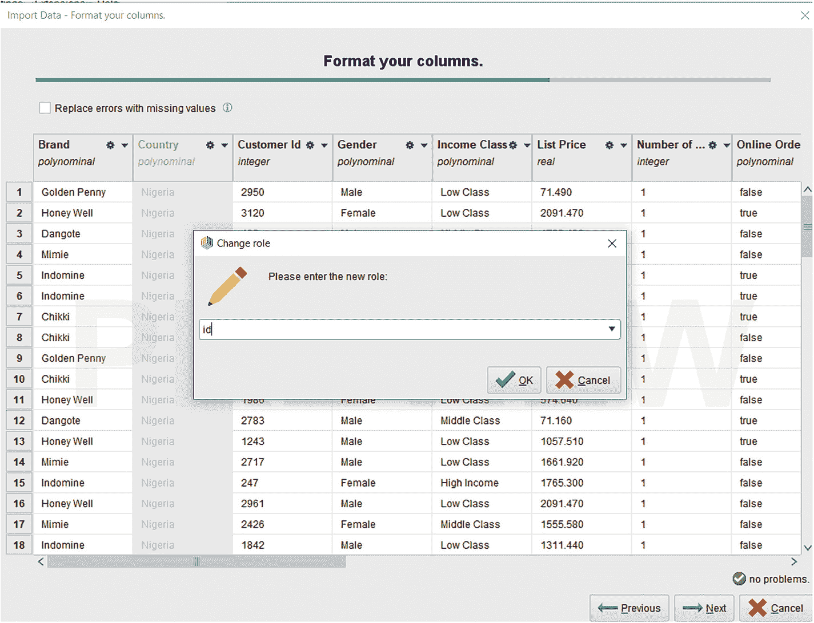

*一张电脑截图展示了通过将 customer Id 的角色更改为 Id 并排除某些特定属性，从现有 Excel 表中重新导入数据的过程。*

创建一个新进程（命名为 `preprocessing2`）。使用图 8-12 中的设置来创建该进程。此进程的目的是仅预处理将要用于聚类的属性。

### 图 8-12 为 k-means 预处理数据
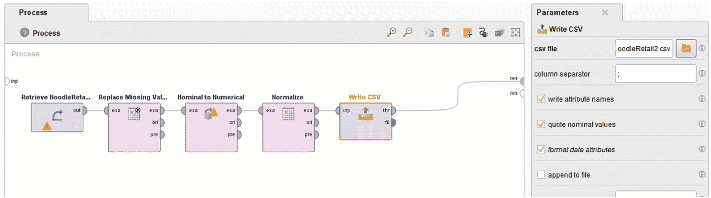

*一张电脑截图展示了创建一个旨在仅预处理用于聚类属性的新进程的设置。*

对于 `Replace Missing Value` 运算符，选择 `Brand`、`Online order`、`Product class`、`Product size` 和 `Tenure`；对于 `Nominal to Numerical` 运算符，选择所有可用的分类数据；对于 `Normalize` 运算符，选择除 `customer Id` 之外的所有数据。对于 `Write CSV` 运算符的 csv 文件参数，选择 `NoodleRetailNormalize.csv`（这是一个您需要自行创建并保存在系统某处的空 csv 文件）。运行进程后，数据将存储在 `NoodleRetailNormalize.csv` 中。

### 图 8-13 执行 k-means 聚类过程
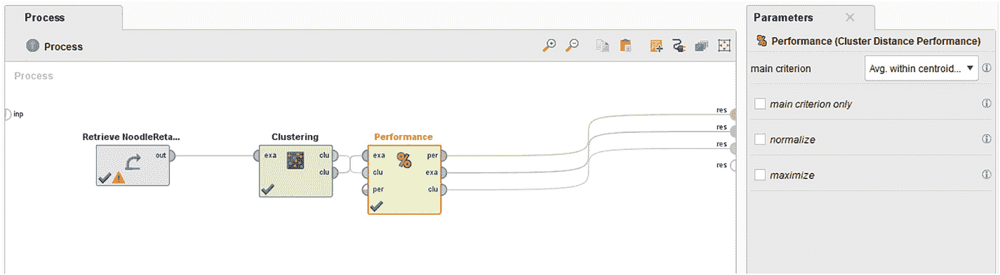

*一张电脑截图显示了执行 k-means 聚类过程的设置。*

# 图 8-13 *k-means 进程*

1.  **确定 `k`**：确定 `k` 有几种方法，但在本演示中，我们将直接提供 `k` 的值（即 2），以代表领域专家的意见。

2.  **执行 k-means 聚类并验证聚类结果**：由于我们已经将所有属性转换为数值型，因此选择了数值指标。**导入** `NoodleRetailNormalize.csv`，并创建一个新进程（命名为 `kmeans`）；使用图 8-13 中的设置来配置此进程（即 k-means 聚类）。对于 `k means` 运算符的 `k` 参数，设置为 2，并保持所有其他参数设置为默认。对于 `Cluster Distance Performance` 运算符，将主标准参数保持为默认值。（更多详细信息，请阅读 `RapidMiner` 文档中这些运算符的帮助内容。）

从图 8-13 中，我们预期会得到三个输出结果，分别如图 8-14a、8-14b 和 8-14c 所示。

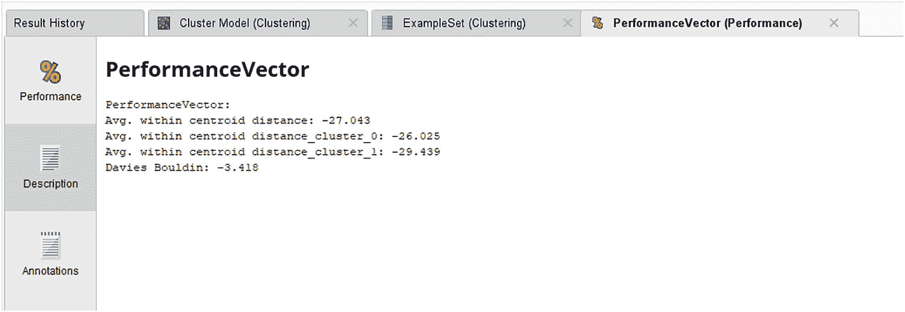

图 8-14a **K 均值模型的性能结果**

图 8-14a 显示的是 K 均值模型的性能，用于了解各聚类的分离效果。根据 RapidMiner 文档，`avg._within_centroid_distance`（平均簇内质心距离）是通过计算质心与某个簇内所有样本点之间距离的平均值得到的。该值越小越好。在比较多个 K 均值模型的结果时，能产生具有最小 Davies-Bouldin 指数聚类集合的模型，被认为是基于该指标的最佳算法。尽管在此示例中我们为 `k` 选择了一个值，但实践中建议在选定 `k` 之前，先尝试多个 `k` 值，并比较其 `avg._within_centroid_distance` 和 Davies-Bouldin 指数。

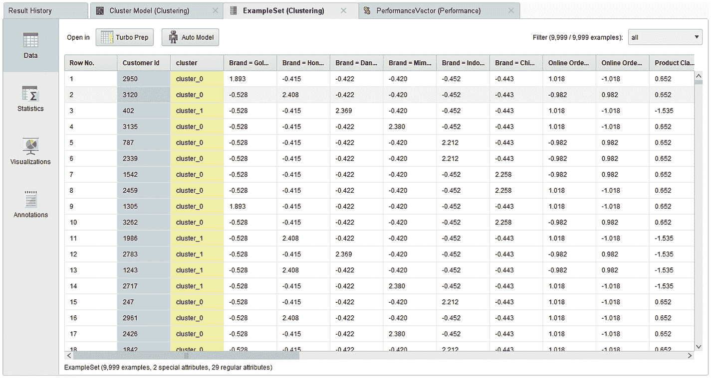

图 8-14b **聚类数据集**

图 8-14b 是已完成聚类数据的输出，它（通过聚类 ID）指明了每个客户所属的聚类。可以进一步将其可视化，以观察客户的分离效果。（`Cluster Model Visualizer` 运算符可以提供帮助，但该功能未包含在 RapidMiner 免费版本中。）

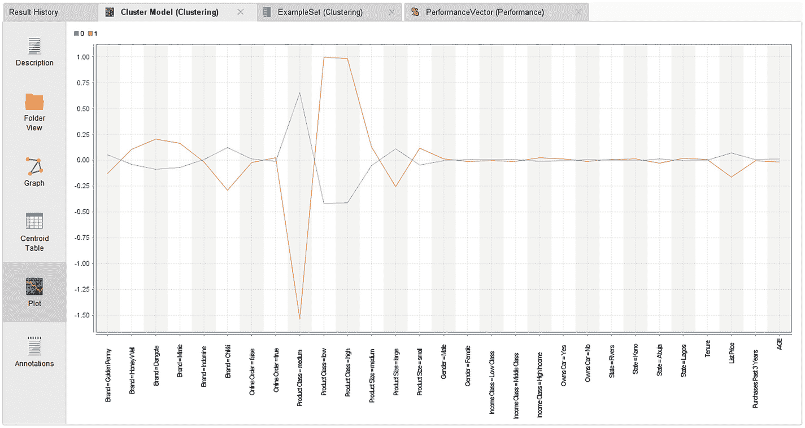

图 8-14c **每个属性的可视化质心值**

图 8-14c 中选中的“绘图”选项卡展示了质心表的图表，这有助于观察哪些属性描述了不同的聚类。

3.  **解读你的结果**：为了描述所得到的聚类特征，我们通过这张折线图（也称为轮廓图）来检查聚类质心。从图 8-14c 中可以看出，对于某些属性，各聚类之间分离程度不高，但仍有一些属性呈现出明显的分离，例如品牌 = Dangote、品牌 = Chikki、产品等级 = 中等、产品等级 = 低等、产品等级 = 高等、产品尺寸 = 大、产品尺寸 = 小以及标价。这些是该 K 均值模型的主要区分属性，可用于描述每个聚类的特征。

为了描述不同聚类的特征，请比较聚类质心（图 8-14c 中的质心表），并尝试为每个聚类赋予一个标签。这个标签可以来自数据集中的任何一个或所有变量。那么这里的问题是：你会针对哪些聚类提供优惠？又会向该聚类中的客户提供何种类型的优惠？

## 8.4 关联分析

关联分析是一种用于在存储交易记录的数据库中发现相关项目组（聚类）的技术。

其目的是找出人们倾向于同时购买哪些物品。一旦发现这种关联，就可以将这些物品放在一起展示，或在交易后提供优惠券，或作为在线购物推荐。为了选择规则的子集，建立关联规则的步骤包括制定规则和评估这些规则的强度。

频繁项集挖掘算法用于构建关联规则。经典算法之一是 Agrawal 等人（1993）提出的 Apriori 算法。该算法的重要步骤如图 8-15 所示。

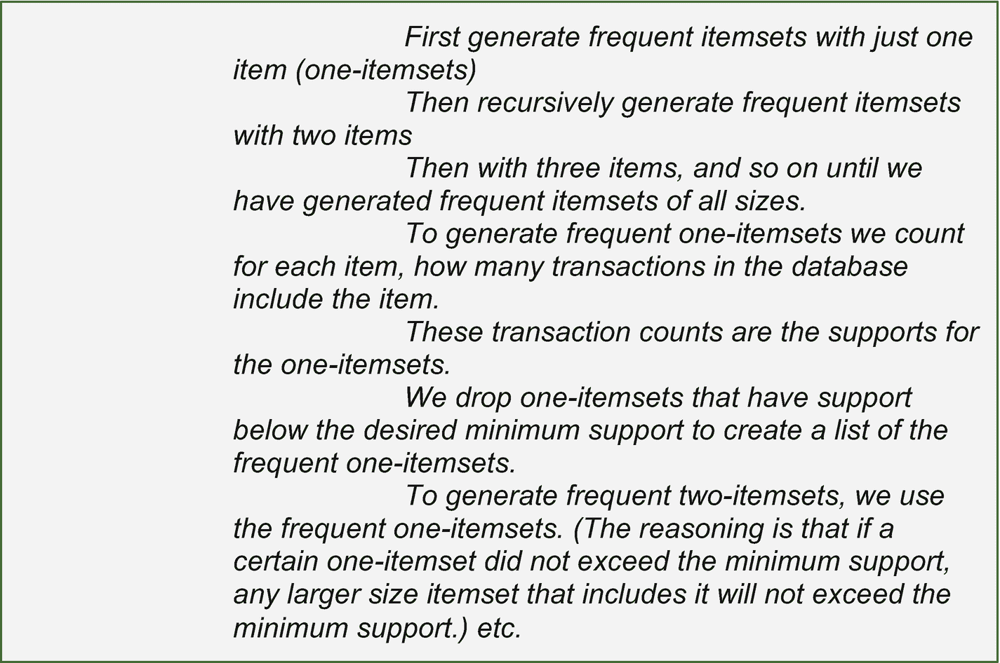

图 8-15 **Agrawal 等人（1993）的 Apriori 算法**

该算法可以生成大量规则，但我们只需要根据前件和后件之间的依赖关系，利用最强的规则来做决策。如果我们有以下规则：

> **如果购买了尿布和饼干，那么在同一次购物中也会购买湿巾。**

*前件：购买了尿布和饼干。*

*后件：在同一次购物中购买了湿巾。*

规则所隐含的关联强度通过以下方式衡量：

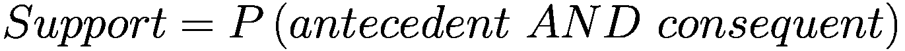

（公式 8.1）

规则的支持度从规模角度反映了规则的总体影响：受影响的交易总数是多少？如果只有少数交易受到影响，那么该规则可能没有太大价值。

（公式 8.2）

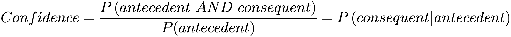

（公式 8.3）

*   置信度值高表明存在强关联规则（对此我们高度确信）。
*   然而，这可能具有欺骗性，因为当前件和/或后件有很强的支持度时，即使它们相互独立，我们也可能对两者都有很高的置信度。
*   置信度告诉我们后件被发现的比率，有助于判断规则在业务或运营环境中的实用性。如果一条规则的置信度很低，导致发现的后件太少，那么在所有包含前件的交易中推广该规则的后件可能得不偿失。

（公式 8.4）

*   我们可以通过将关联规则的置信度与一个基准值进行比较，来更好地评估规则的强度。基准值假设交易中的前件和后件项集是相互独立的。换句话说，如果前件和后件项集是独立的，我们对结果能有怎样的置信度？
*   提升度大于 1.0 意味着前件与后件之间的关系比假设两者独立时预期的关系更显著。提升度越大，关联性越强。
*   提升度是衡量规则发现后件的能力（与随机选择相比）的指标。尽管高效的规则优于低效的规则，但我们还必须考虑支持度：一条高效但支持度低的规则，可能不如一条效率较低但支持度高得多的规则理想。

### 表 8-1：关联分析的数据格式

表 8-1 展示了使用 Apriori 算法进行关联分析时所采用的数据格式示例。每一行代表一个交易事务，每一列代表一个商品品项，总计列表示所有可用的商品品项。关联分析中交易数据的一个典型来源是超市收银台扫描仪收集的数据，其中每条记录列出了顾客单次交易中购买的所有商品。

**表 8-1：用于关联挖掘的数据示例**

| 交易编号 | Crocs | KennethCole | Llbean | Nike | Adidas | Skechers | Fila |
| :------ | :---- | :---------- | :----- | :--- | :----- | :------- | :--- |
| 1       | 0     | 1           | 1      | 1    | 1      | 0        | 1    |
| 2       | 0     | 0           | 1      | 0    | 1      | 0        | 1    |
| 3       | 0     | 1           | 0      | 0    | 1      | 1        | 1    |
| 4       | 0     | 0           | 1      | 1    | 1      | 0        | 1    |
| 5       | 0     | 1           | 0      | 0    | 1      | 0        | 1    |
| 6       | 0     | 0           | 0      | 0    | 1      | 0        | 0    |
| 7       | 0     | 1           | 1      | 1    | 1      | 0        | 1    |
| 8       | 0     | 0           | 1      | 1    | 0      | 0        | 1    |

| 9      | 0     | 0           | 0      | 0    | 1      | 0        | 0    |
| 10     | 1     | 1           | 1      | 1    | 0      | 0        | 0    |
| 11     | 0     | 0           | 1      | 0    | 0      | 0        | 1    |

### 关联分析——中小企业的应用

零售行业广泛运用关联分析，以深入了解顾客通常会一起购买哪些商品。了解特定商品组合是否经常被同时购买，是一种决策类型。关联分析有助于设计商品目录和零售店铺布局，同时还能用于交叉销售、促销活动，以及根据购买习惯识别客户群体。为了在降低库存积压成本的同时增加中小企业的销售额，可以利用关联分析的结果，以正确的商品组合来配置货架。在交叉销售商品方面，关联分析的结果可用于提高每位顾客的平均消费额。中小企业的前端销售人员在这方面的技能水平可能参差不齐，因为他们的经验和观察能力各不相同。关联分析可以帮助小企业深入了解顾客最可能购买哪些类型的商品，从而更好地对员工进行相关领域的培训和指导。

### 关联分析示例

一家鞋类零售商存储了每位顾客的销售数据，并能将其转换为存储在`shoes.xlsx`文件中的事务数据。该鞋类零售商的目的是分析这些鞋类商品购买之间的关联，以便用于销售点展示和指导销售人员促进交叉销售。

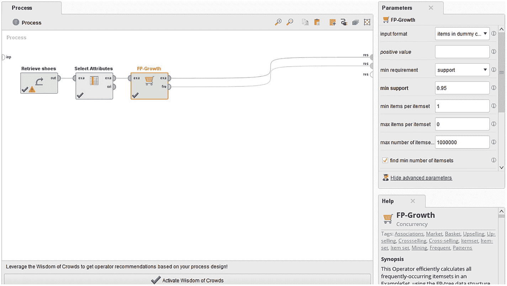
**图 8-16** 创建频繁项集的过程

1.  创建一个新的存储库（命名为 Association）；**导入**名为`shoes.xlsx`的数据。导入时，确保将除交易编号（`Trans.`）之外的所有列转换为二项数据类型。导入数据后，检查**统计信息**，确保没有缺失值。

2.  使用图 8-16 中的设置来创建频繁项集，运行该过程后，结果如图 8-17 所示。

在图 8-16 中，对于**选择属性**运算符，请选择除`Trans.`之外的所有二项属性。对于`FP-Growth`，保留默认设置。有时，根据数据情况，您可能需要降低支持度才能获得结果。`FP-Growth`算法是一种用于计算事务数据库中频繁共同出现商品项的高效算法。

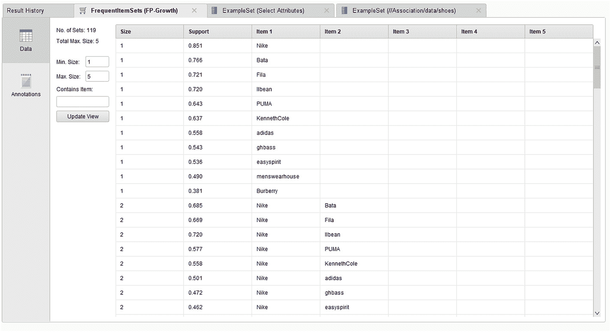
**图 8-17** 创建频繁项集过程的输出

修改图 8-16 中的设置，得到图 8-18，这是生成关联规则的完整设置。目前，在图 8-18 中，我们将**创建关联规则**运算符的参数保留为默认值。但这可以根据数据的性质进行调整。

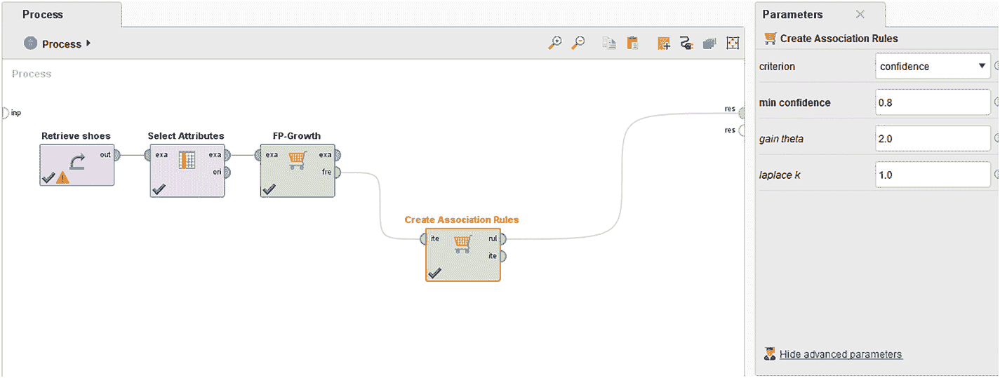
**图 8-18** 创建关联规则的过程

运行图 8-18 的结果如图 8-19 所示。它展示了所生成规则的前提（前件）、结论（后件）、支持度、置信度、提升度等信息。为了选择最佳规则加以应用，我们需要寻找最高的支持度，提升度至少大于 1 且置信度高的规则。

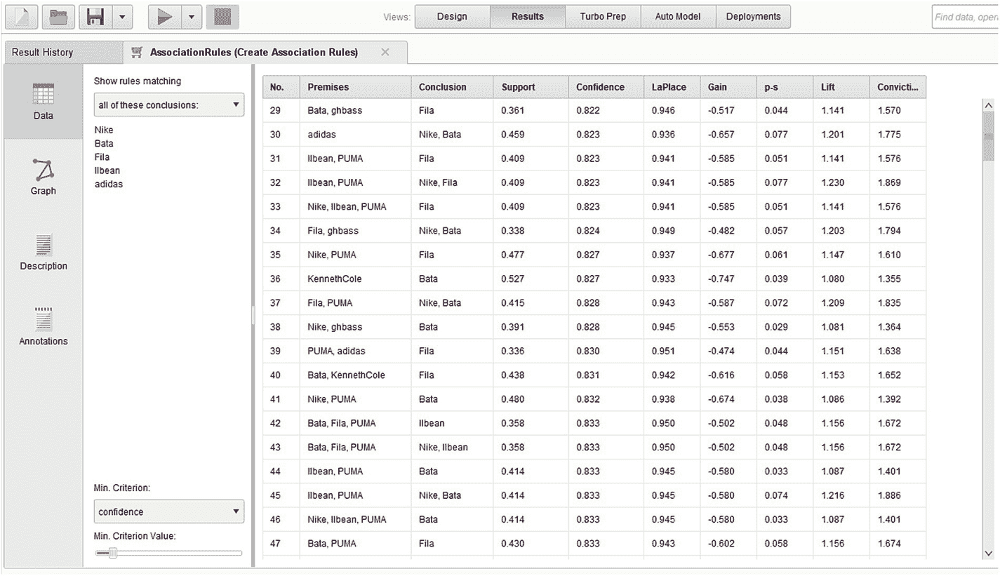
**图 8-19** 得到的关联规则

为了选择最佳规则，按提升度排序，我们得到图 8-20。

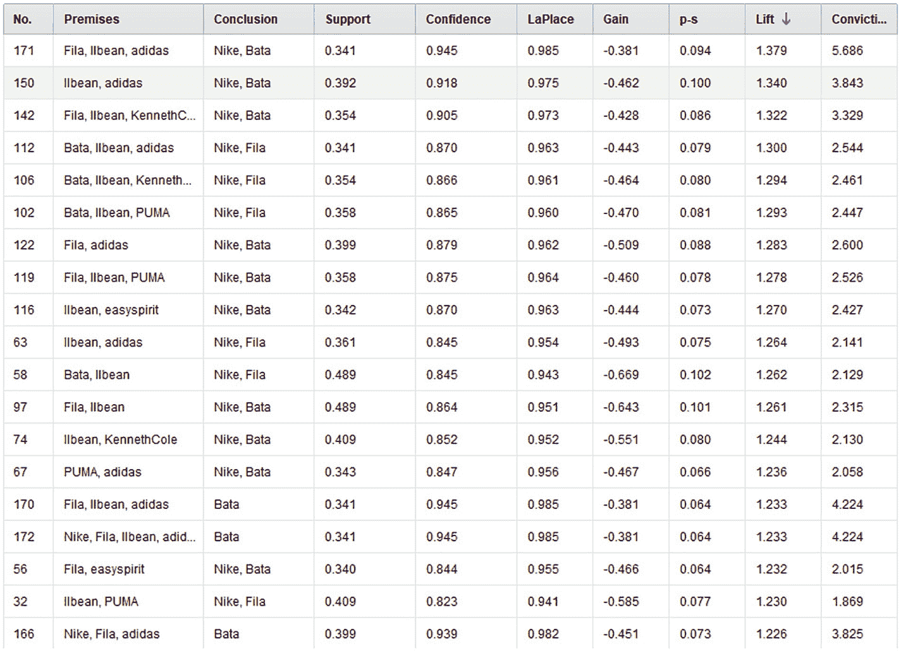
**图 8-20** 按提升度对图 8-19 进行排序

解读图 8-20 中的第一条规则，我们有：
*如果 `Fila`、`Llbean` 和 `Adidas` 被同时购买，那么，有 94.5%的置信度，`Nike` 和 `Bata` 也将被购买。这条规则的提升度为 1.379。*

上述规则可以有多种应用方式，例如，如果顾客正在询问某个特定品牌的鞋子，你可以向顾客介绍一个新品牌。推荐这个新品牌是基于解决品牌关联问题，这能确保顾客也会想要购买这个新品牌。中小企业可以通过多种方式实施此类推断。示例包括通过电子邮件营销、推荐引擎、促销活动等等。

### 8.5 网络分析

网络是一组相互连接（边）的对象（节点）的集合。图 8-21 展示了一个从推文中获取的通信网络示例。

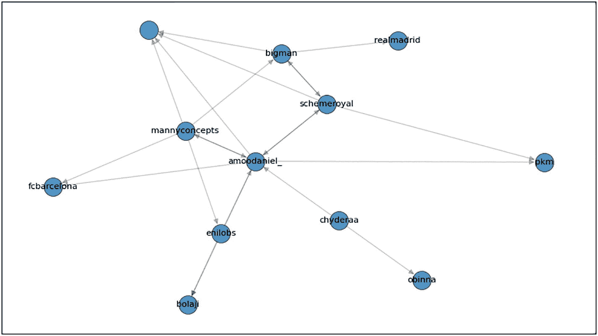
**图 8-21** 社交通信网络示例

网络有多种类型。有从社交互动和人际关系中产生的社交网络，例如社交媒体上的网络、合著者网络等。还有其他类型的网络，如交通和移动网络、信息网络、生物网络等。

网络中的节点指代对象，例如人、部门、交通站点等。边指代对象之间的连接，可能是友谊、婚姻、家庭关系、研究交流等。带权重的边还可以反映连接质量，例如网络中两人之间交换了多少封电子邮件。两点之间的距离可以用地图上边的长度来描述。

网络结构可以是无向（双向）的或有向的。有向网络的一个例子是：`Ibk` 在 `Twitter` 上关注了 `Femi`，但 `Femi` 没有关注 `Ibk`。无向或双向网络的一个例子是：两人共同署名发表了一篇研究论文。

有多种工具和平台可以用来创建和可视化网络；例如 `Gephi`、`networkX`、`Graphviz` 和 `R`（`igraph`）。可以使用这些工具中的任何一种来创建图形布局，但以下指导原则可以使图形更具可读性：

*   每个节点应清晰可辨。
*   对于每个节点，应能确定其度（连接数）。
*   对于每个连接，应能追踪其从源节点到目标节点的路径。
*   能够识别集群和离群点很重要。

**网络度量指标**

*   **度分布**：在网络中，度分布描述了一个节点连接了多少个其他节点。它有助于了解网络中的节点数量及其边的范围。
*   **密度**：它给出了一个图在边（而非节点）方面的整体连通性。它是实际边数与最大可能边数之比。
*   **平均聚类系数**：这也被称为“三元闭包”。聚类系数表示网络中共享连接的节点加入该网络的可能性。
*   **网络直径**：用于描述网络中任意一对节点之间的最大距离。
*   **社区数量**：它给出了网络中节点子集的数量，使得该子集中的每个作者都能与其他每个作者通过路径相连，而子集外的任何作者都无法与该子集中的任何作者通过路径相连。
*   **度中心性**：它试图基于“重要节点拥有大量连接”这一思想来寻找中心性。
*   **接近中心性**：它旨在通过假设“重要节点将接近网络中所有其他节点”来寻找中心性。
*   **介数中心性**：对中心性的探索基于“连接其他节点的节点是重要节点”这一概念。
*   **特征向量**：用以表达“一个节点的邻居越中心，该节点自身就越中心”这一思想。

有关网络度量指标的更多信息，请参阅 Tsvetovat 和 Kouznetsov (2011)。

**网络数据**

网络数据可以是边列表或邻接列表的形式。图 8-22a 和图 8-22b 分别展示了边列表和邻接列表（针对同一数据）。

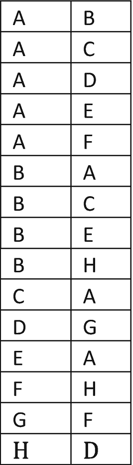
**图 8-22a** 边列表

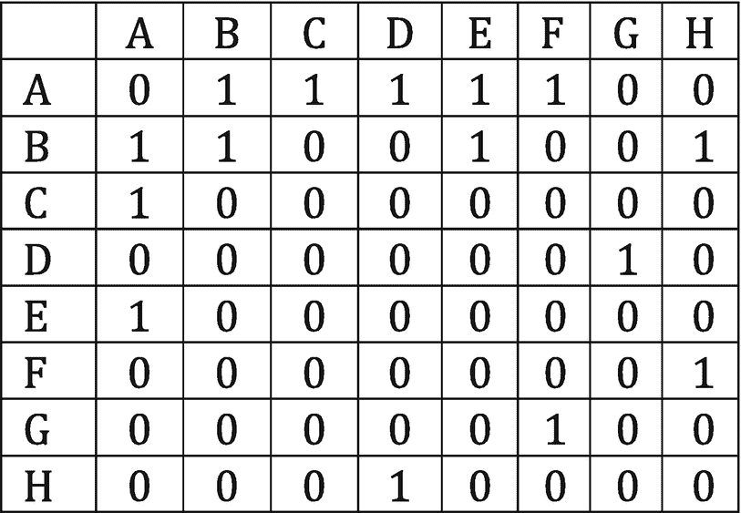
**图 8-22b** 邻接列表

网络分析几乎可以应用于所有感兴趣的领域。在商业中，我们可以用它来回答如下问题：

*   广告是否可能在网络中传播？
*   在这个商业环境中，谁是最具影响力的人？
*   哪些产品与其他产品高度关联？
*   以及其他更多问题。

在本节中，我们将通过两个简单的示例演示如何在 `Gephi` 中创建和定制网络。在 8.6 节中，我们将演示一个真实的业务问题场景，展示网络分析的应用。请注意，这也可以定制来解决若干相关的其他问题。在这些示例中，将使用 `Gephi` 进行实践演示。本书的 1.8 节详细说明了如何设置 `Gephi` 以及熟悉 `Gephi` 环境。

**网络分析 – 示例 1**

# 社交网络分析示例

## 示例 1：Twitter 网络

名为 `dynamic.gexf` 的数据是一个 `Gephi` 文件，包含来自一个通信社交网络（Twitter）用户的推文。这些推文已被转换为 `Gephi` 文件形式的边列表（数据是使用 `netlytics.org` 下载并转换的）。关于如何下载数据并创建包含节点和边的 `Gephi` 文件的完整教程，请访问 [`https://yusufsalman.medium.com/twitter-network-analysis-and-visualisation-with-netlytic-and-gephi-0-9-1-1011b009261`](https://yusufsalman.medium.com/twitter-network-analysis-and-visualisation-with-netlytic-and-gephi-0-9-1-1011b009261)。下载到 Excel 中的数据如图 8-23 所示。

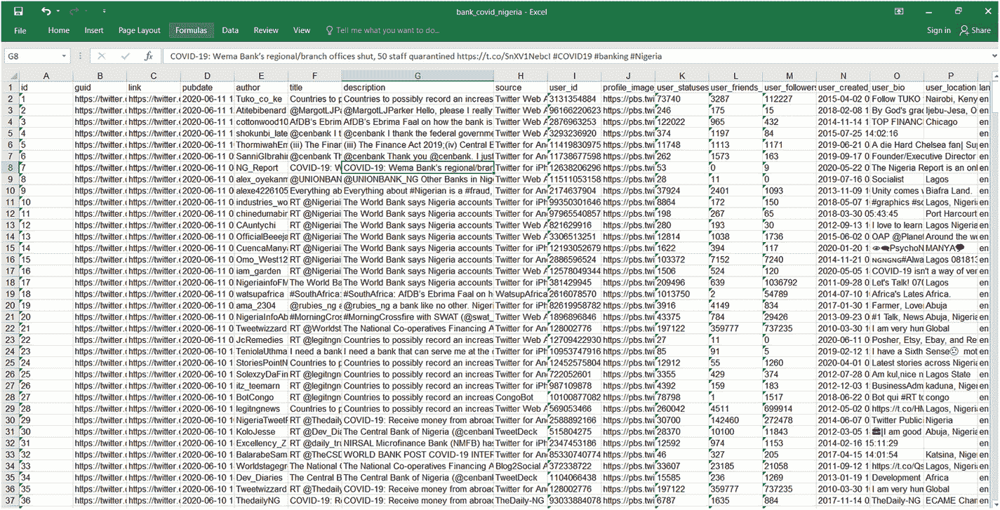

`图 8-23` 以 Excel 格式下载的数据

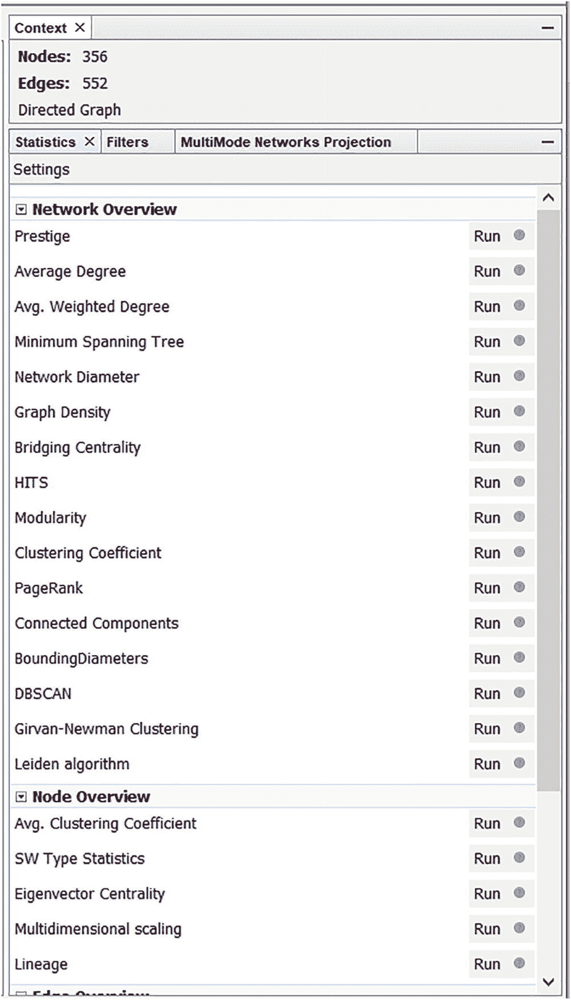

`图 8-27` Gephi 中的统计信息

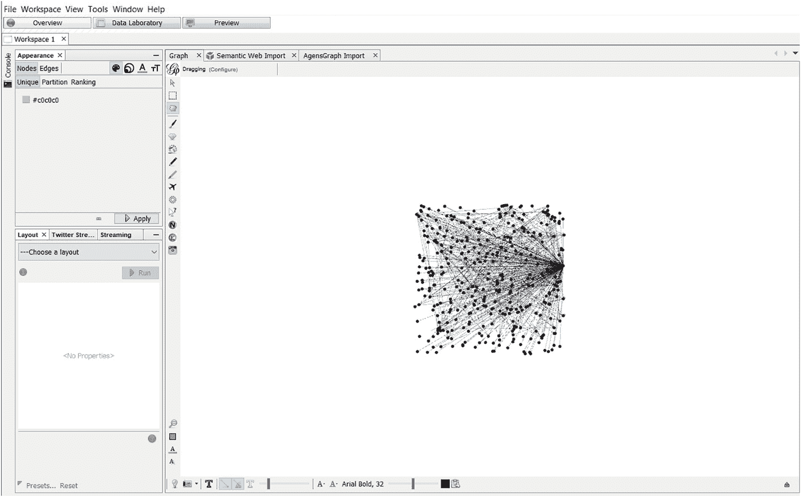

`图 8-26` 已加载的网络

1. 加载 `Gephi` 应用程序，如图 8-24 所示。点击 `打开 Gephi 文件` 并选择 `dynamic.gexf`，即可显示图 8-25 中的界面。

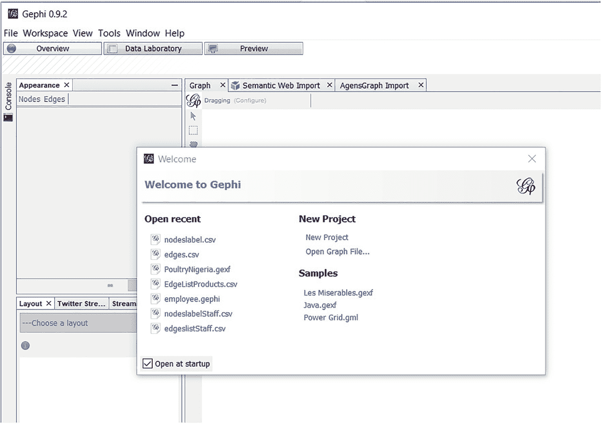

`图 8-24` 加载 `dynamic.gexf` 文件

在图 8-25 中，您可以设置 `图形类型`，此例中为有向图（默认）。该界面还会显示节点和边的数量，以及其他一些详细信息。图 8-25 还会询问您是要在新工作区中打开该文件，还是将其附加到现有工作区。如果您要导入的是包含节点详细描述的节点列表，则会使用“附加”选项；但在此示例中，我们将在新工作区中打开。点击 `确定`。

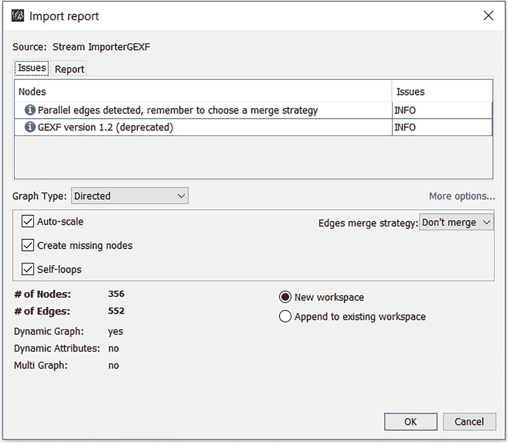

`图 8-25` 导入界面

随后创建的网络如图 8-26 所示。

### 1. 定制网络

在这一步中，我们将定制网络。在此之前，在 `工具` 菜单下，点击 `插件`，并下载所有可用的插件。如有必要，请检查更新并更新您的应用程序。接下来，通过点击 `统计` 选项卡，然后点击每个统计指标旁的 `运行` 按钮（如图 8-27 所示），运行所有必要的统计指标。点击这些统计指标时，会显示其方法和算法的说明。需要运行的统计指标通常由分析目标决定。在此例中，为演示目的我们将运行所有指标。

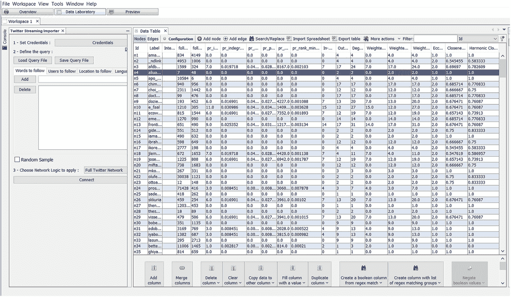

`图 8-28` – 数据实验室

1. 运行完所有统计指标后，点击 `数据实验室`，即可看到图 8-28 所示的界面，该图显示了网络中每个节点的各项 `统计` 结果。我们还可以通过在图 8-28 中点击 `边` 来查看网络中的边。这些结果可以导出到 Excel，用于进行回归或相关性等其他分析。

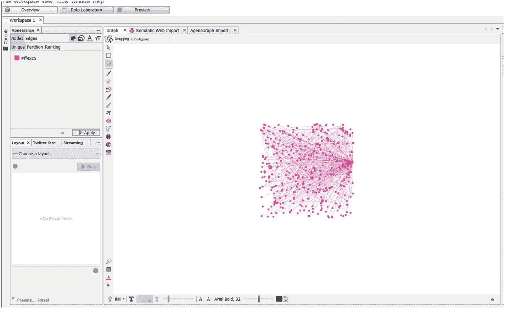

`图 8-29` – 更改节点颜色

1. 点击 `概览` 选项卡以再次显示网络，然后在 `外观` 窗口中，点击并拖动您想要的颜色（如图 8-29 所示），然后点击 `应用`。

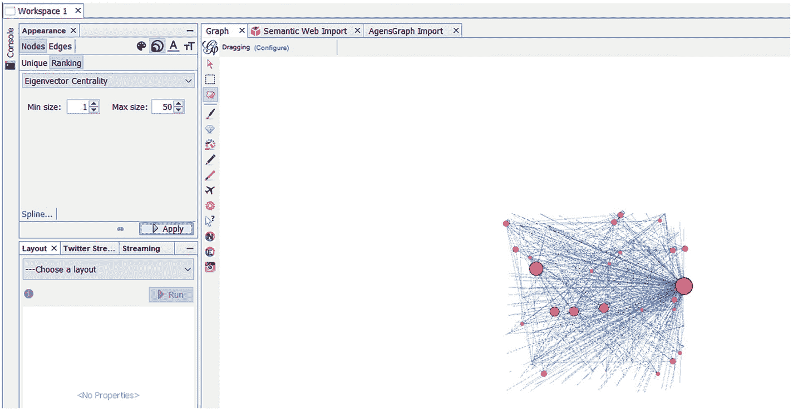

`图 8-31` – 使用 `Fruchterman-Reingold` 布局

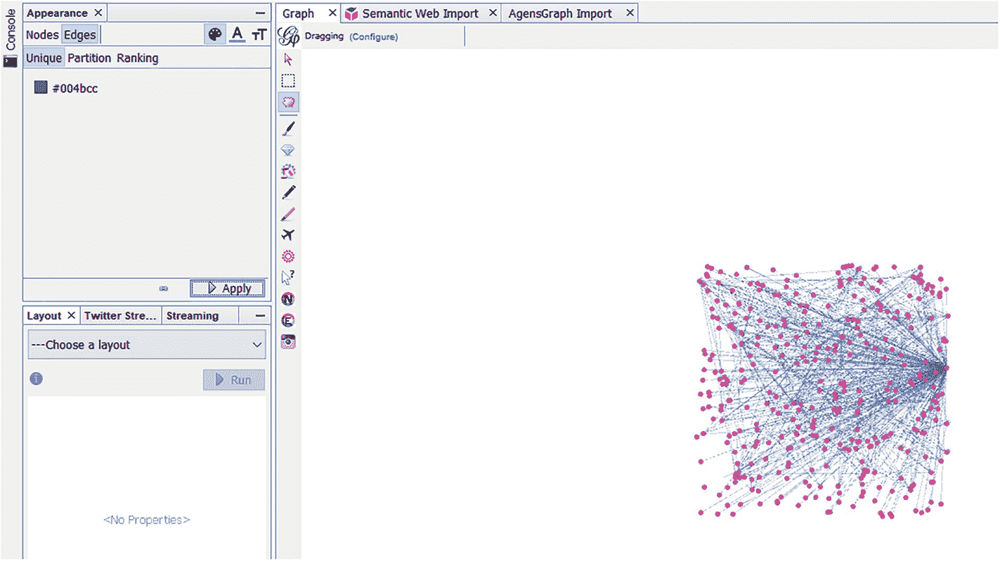

`图 8-30` – 更改边颜色

1. 使用 `外观` 窗口的 `边` 选项卡为边添加颜色（图 8-30），并使用特征向量中心性调整节点的大小（图 8-31）。这可以通过在 `外观` 窗口中选择节点，然后选择大小和排名来实现，如图 8-31 所示。图中单元（节点）的重要性或影响力通过其中心性来衡量。在本演示中，我们选择特征向量中心性。

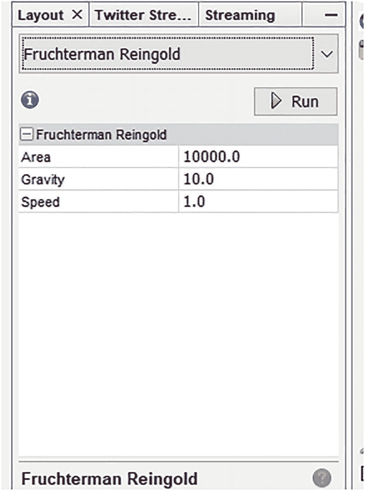

`图 8-32` – `Fruchterman-Reingold` 布局

1. `Gephi` 提供了多种不同的布局来呈现您的图形，以及一些使其外观更佳的插件。对于此示例，我们将使用最流行的布局之一：`Fruchterman-Reingold`。它是一种力导向图算法，可以让我们清晰地看到图形中的连接。图 8-32 显示了运行此布局的设置。

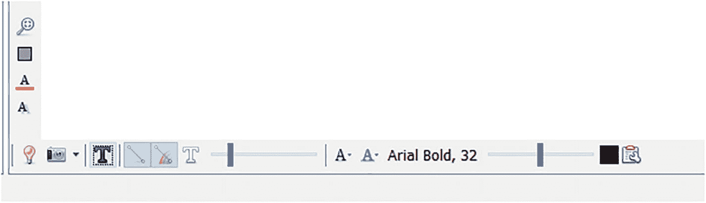

`图 8-34` – 显示标签

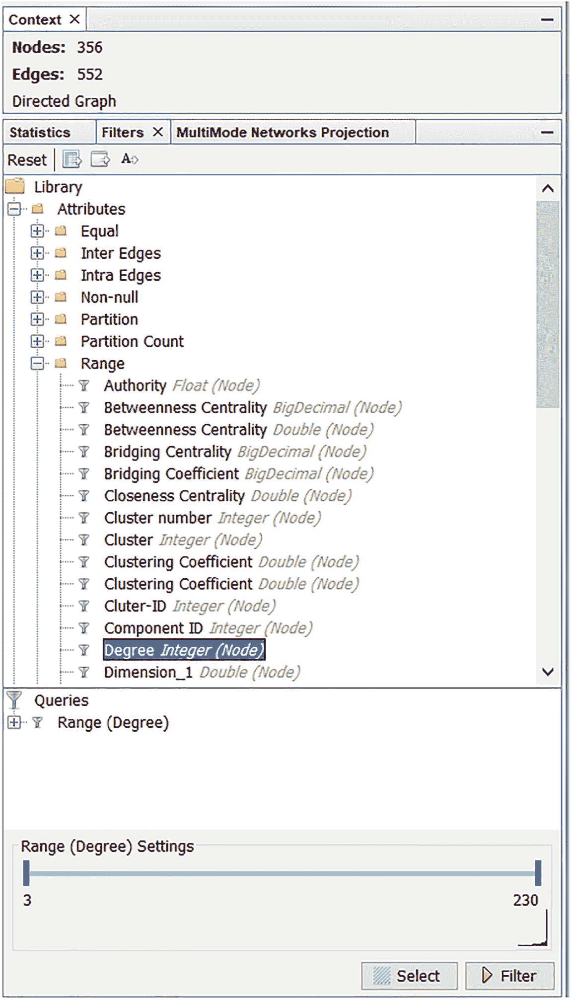

`图 8-33` – 过滤度数

1. 点击图 8-32 中的 `运行`，几秒钟后停止，并消除所有连接数少于三个的节点（使用图 8-33 中的设置）。这将使图形更整洁，并让我们看到更重要的边（同时不影响统计结果）。在窗口右侧，点击 `过滤器` 选项卡，然后点击 `过滤` 下的 `属性` 和 `属性` 下的 `范围`。在 `范围` 下，双击 `度数`。它将出现在 `查询` 中；然后您可以点击图 8-33 中的 `过滤器`。再次运行 `Fruchterman-Reingold`，并通过点击 `显示节点标签`（图 8-34）来添加标签（用户名）。

最终得到的网络如图 8-35 所示。

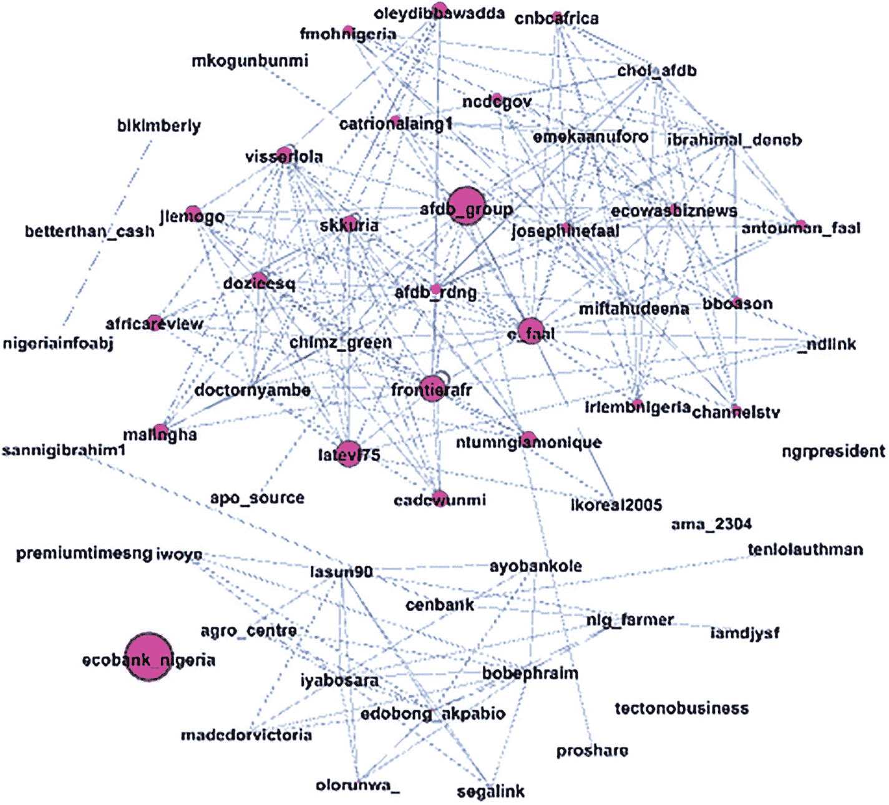

`图 8-35` – 用户网络

就此示例而言，我们将在此处暂停，但还有许多其他设置可用于可视化此网络，以获取各种类型的洞察。此外，`预览` 选项卡可用于更好地可视化网络。从图 8-35 中，我们可以看到节点 `ecobank_nigeria` 具有最高的特征向量中心性，这表明它是中心性最高的节点，因为它的邻居也具有中心性。

---

## 网络分析 – 示例 2

对于第二个示例，我们将创建一个食品和农业企业的产品网络。边列表是根据产品一起被购买时的关联关系创建的。用于创建此网络的数据文件分别命名为 `EdgeListProducts.csv` 和 `NodeListProducts.csv`。

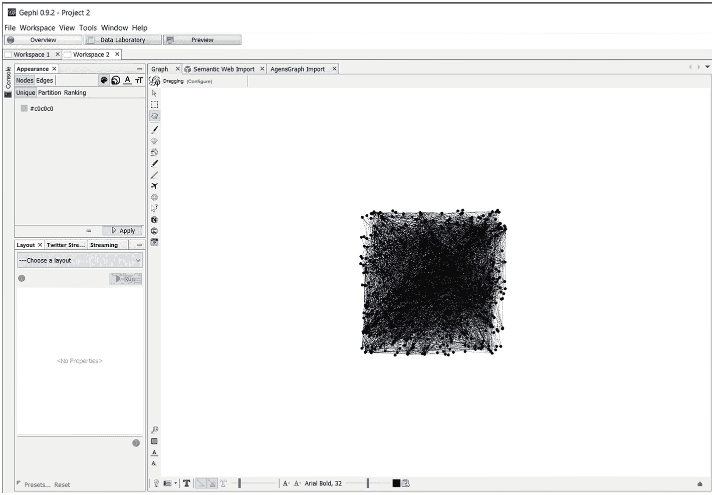

`图 8-36` – 成功加载 `EdgeListProducts.csv`

1. 在 `Gephi` 中打开一个新项目。将数据作为无向图加载到 `Gephi` 中（`文件` ➤ `打开`），并首先加载 `EdgeListProducts.csv`。图 8-36 是边列表成功加载到 `Gephi` 后的界面。

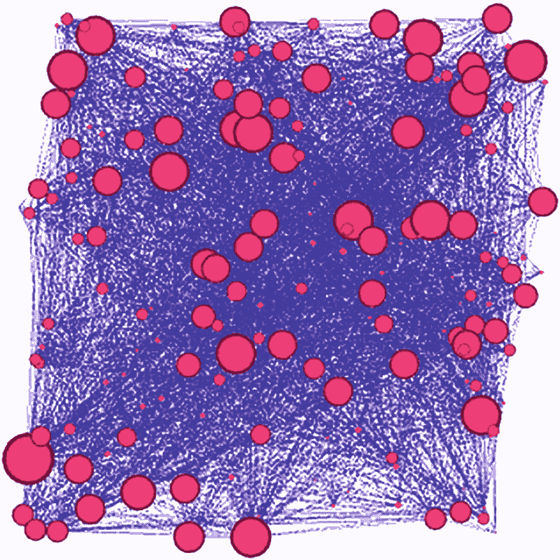

`图 8-37` – 使用 `Fruchterman-Reingold` 布局

1. 通过点击 `文件` ➤ `导入电子表格` 来加载节点列表，选择 `NodeListProducts.csv`，点击 `下一步`，然后点击 `完成`。在生成的结果界面（图 8-37）中，确保将 `图类型` 更改为 `无向`，并选择 `追加到现有工作空间`。
2. 运行所有 `统计`。过滤掉度数不足 12 的节点。
3. 将节点颜色改为粉色，边颜色改为蓝色，并使用 `Fruchterman-Reingold` 调整节点大小（同示例 1 一样）；我们应该能得到图 8-37。

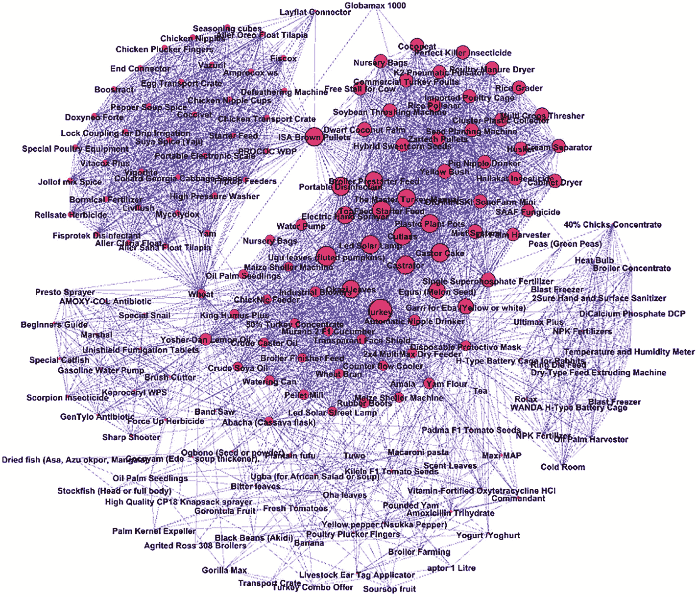

`图 8-38` – 产品网络（`Fruchterman-Reingold`）

1.  运行`Fruchterman-Reingold`布局以查看图 8-38，点击`显示标签`按钮，运行`标签调整`布局，并运行`扩展`布局来调整网络大小，使其更大且标签可读。结果应类似于图 8-38。

图 8-38 中的网络图是使用特征向量中心性对网络节点进行排序的结果。从图 8-38 中，我们能够看到具有高中心性值的节点，因为它们与同样处于中心位置的节点相连。高特征向量值意味着一个节点与具有高特征向量得分的节点相连。

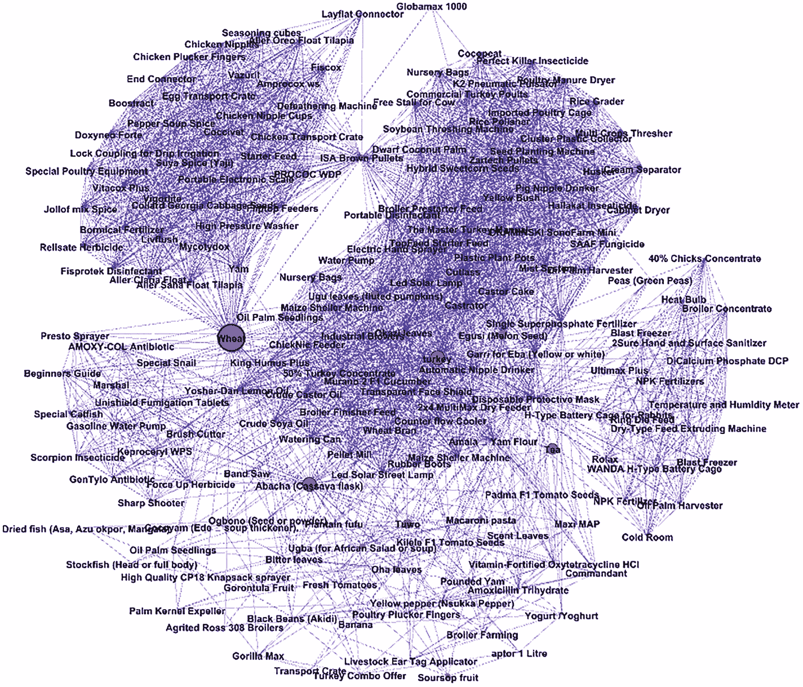

网络图展示了使用介数中心性对网络节点进行排序的结果。

图 8-39 产品网络（介数中心性）

1.  使用`betweenness centrality`，我们得到图 8-39 中的网络。

图 8-39 中的网络图是使用介数中心性对网络节点进行排序的结果。从图 8-39 中，我们能够看到具有高介数中心性的节点在其他节点集群之间形成了桥梁。

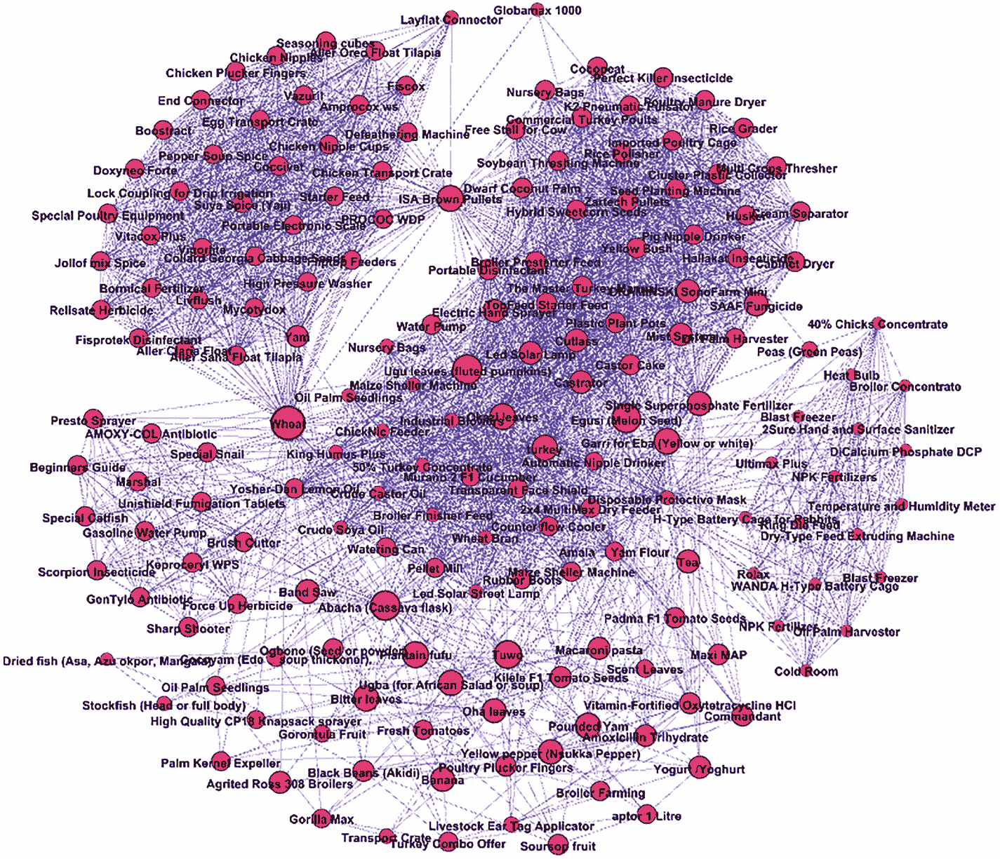

网络图展示了使用紧密度中心性对网络节点进行排序的结果。

图 8-40 产品紧密度中心性网络

1.  使用`closeness centrality`，我们得到图 8-40 中的网络。

图 8-40 中的网络图是使用紧密度中心性对网络节点进行排序的结果。从图 8-38 中，我们能够看到具有高中心性值的节点，因为它们与网络中的其他节点距离很近。关于这些中心性指标在不同领域应用的参考文献，请参阅本章的第 8.8 节。

## 8.6 实践业务问题五（员工效率）

协作网络已被用于人员分析，以减少员工超负荷、提高全球团队的韧性、优化职业发展路径等。以下是协作网络中使用的一些指标：

*   网络规模：连接到某个节点的节点数量。入度（衡量从其他节点连接到本节点的节点数量）和出度（衡量特定节点所连接的节点数量）。这在`Gephi`中通过平均度来捕获。

*   网络强度：强连接和弱连接。入度或出度的强弱程度。这在`Gephi`中可以通过加权度来捕获。

*   网络范围：你连接的不同类型人员的数量。高范围网络能够从多种来源获取信息。这可以通过检查你所属的社区数量来探究。

*   网络密度：衡量所有成员之间以及所有成员与其他所有成员之间的交互程度。这是一个衡量网络成员之间连接紧密程度的整体交互指标。它不针对每个成员进行计算。这在`Gephi`中通过图密度来捕获。

其他指标如第 8.5 节所述。

在此问题场景中，我们将使用网络分析进行人员分析，这是业务分析的主要应用类型之一。我们将特别专注于分析协作网络。在该问题场景中，我们有一个组织，该组织正在寻求提高其员工的效率。尽管可以通过多种方式实现，但我们将探索使用该组织员工的沟通网络，并通过该网络研究绩效表现。

在此问题场景中，网络数据通过调查收集，并分别转换为节点文件（`nodeslabelStaff.csv`）和边列表文件（`edgeslistStaff.csv`）。

在此问题场景中，我们正在寻求生成以下某些或全部洞察的可能性：网络是好是坏，人们在协作方面是否真正在做他们应该做的事情，等等。为此，我们将回答以下问题：协作模式如何变化？协作模式对重要结果有何影响？ 我们可以针对个人、群体或组织进行探索。

为了回答“协作模式如何变化？”这个问题，我们可以使用简单的描述性统计；例如，我们可以选择一个网络规模，在个体之间进行比较，并比较随时间的变化。其结果可用于以下员工管理领域：绩效评估、角色与职责、薪酬与晋升、培训与指导、工作轮换与职业发展以及员工保留。

为了回答“协作模式如何影响我们关心的员工重要成果？”这个问题，首先我们应该认识到，对于个人而言存在不同类型的成果，例如绩效（每季度销售额、成本节约、自我报告的 1-3 分评级、经理报告的 1-3 分评级、奖金）、满意度、承诺、倦怠、离职率等。

在这个实际示例中，我们选择使用网络规模来检验绩效。为此，我们将检查规模与绩效之间的相关性。在我们的案例研究中，绩效数据以每季度销售额（以百万计）来捕获。

**实践演示**

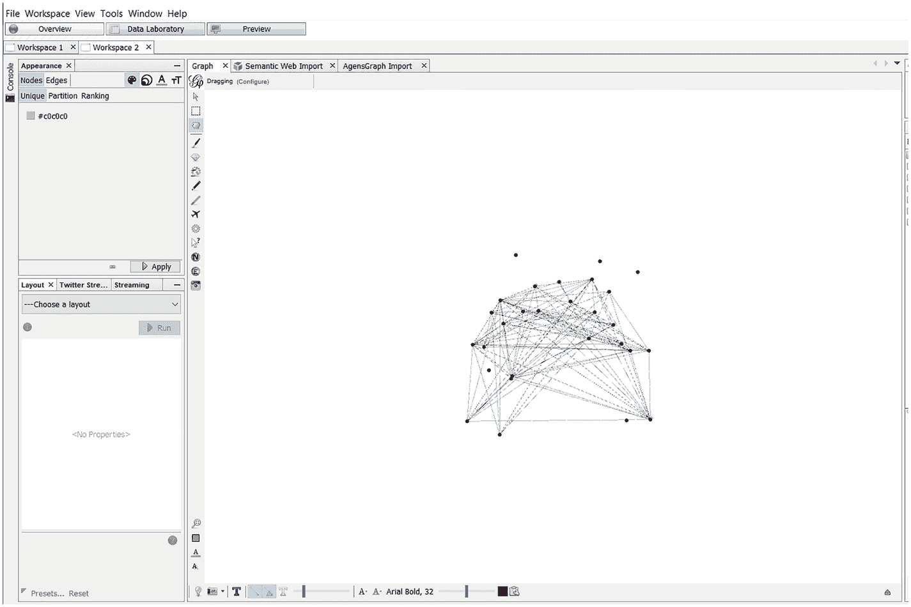

计算机屏幕截图展示了成功将边列表加载到`Gephi`并导入`nodeslabelStaff.csv`文件的结果。

图 8-41 导入`edgeslistStaff.csv`

1.  将`edgeslistStaff.csv`加载到 Gephi 中，并将`图形类型`设置为`无向`。在“文件”菜单下，使用“导入电子表格”导入第二个 CSV 文件（`nodeslabelStaff.csv`）。导入`nodeslabelStaff.csv`时，请确保将其`附加到现有工作区`。图 8-41 显示了此步骤成功完成后的界面。

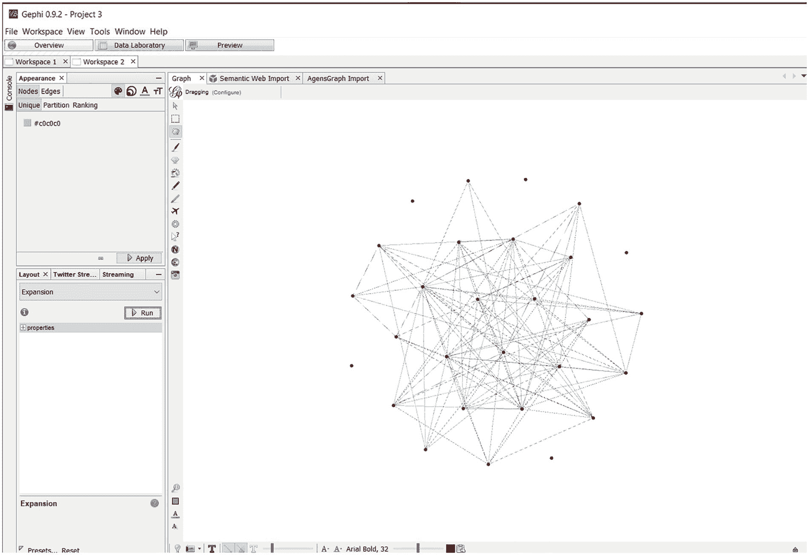

图 8-42 展开网络

2.  运行`Fruchterman-Reingold`算法，然后展开网络，得到图 8-42。

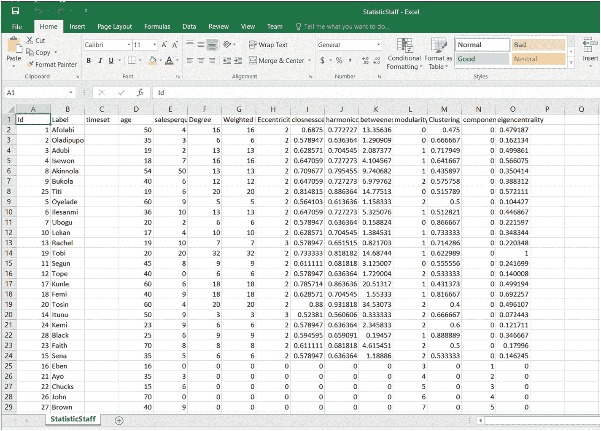

图 8-44 导出到 Excel 的数据

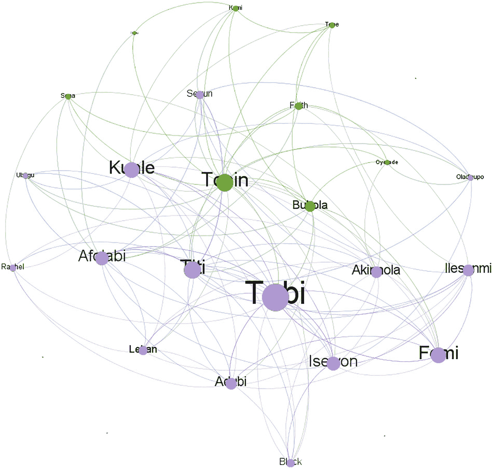

图 8-43 最终的员工沟通网络

3.  运行统计功能（声望、平均度数、平均加权度数、网络直径、图密度、模块化、连通分量、特征向量中心性）。在“外观”窗口中，点击`大小` -> `排名`，并选择属性`degree-min-1`，`max-50`。（你可以尝试多种变化，选择最适合你目的的那一种）。

4.  点击显示节点标签；调整节点大小使其更大。在“外观”、“布局”和“统计”窗口中，你可以探索许多功能，以构建一个美观且吸引人的网络，并传达不同的见解。例如，我们可以通过设置`节点` -> `颜色` -> `分区` -> `模块化`来可视化网络中的聚类。点击“预览”（在预览中显示节点标签）；最终的网络应如图 8-43 所示。

节点的颜色表示每个节点所属的聚类，而节点大小则表示其度数。图 8-43 中的网络图显示，节点 Tobi 在该机构的沟通网络中具有最高的度数；这表明该机构中有很多节点都与 Tobi 进行沟通。其含义是，例如，在这样的机构中，需要确保此类节点不会发生故障。

5.  点击“数据实验室”，将节点表导出为 csv 格式，并在 Excel 中打开以进行进一步分析。图 8-44 展示了在 Excel 中打开的导出数据。

图 8-45 Excel 中的数据分析

6.  使用 Excel 中的相关性分析，将度数（网络规模）与性能进行关联。为此，按住 ALT 键并依次按`t`和`I`，你将看到添加数据分析工具的窗口，如图 8-45 所示。

图 8-46 Excel 中的相关性分析

7.  点击`确定`；在工具栏上点击`数据分析`，选择`相关系数`，然后选择输入区域，并将输出选项设置为`新工作簿`（图 8-46）。

8.  点击`确定`。这将得到度数（`degree`）与`每个季度的销售额`（`salesperquarter`，单位为百万）之间的相关系数值`0.293707089965323`。根据皮尔逊相关系数的解释，这意味着变量之间的相关性虽然为正向，但强度很弱。（假设数据使得相关系数为 +1 到 0.7，那么变量之间的关系则为完美的正向相关，届时我们可以继续研究如何通过提供激励建立联系来增加协作。）

## 8.7 习题

1.  重复实际业务问题 V，使用相同的数据集（`nodeslabelStaff.csv`），这次将中心性度量与性能进行关联。

2.  使用数据集`VegetableTransactions.csv`，执行关联规则分析，并对结果进行评论。使用必要的标准选择最重要的规则，并对所选规则给出适当的解释。

3.  使用名为`Alegra.xlsx`的数据，使用 k-means 聚类算法执行聚类分析。验证、可视化并解释生成的聚类。