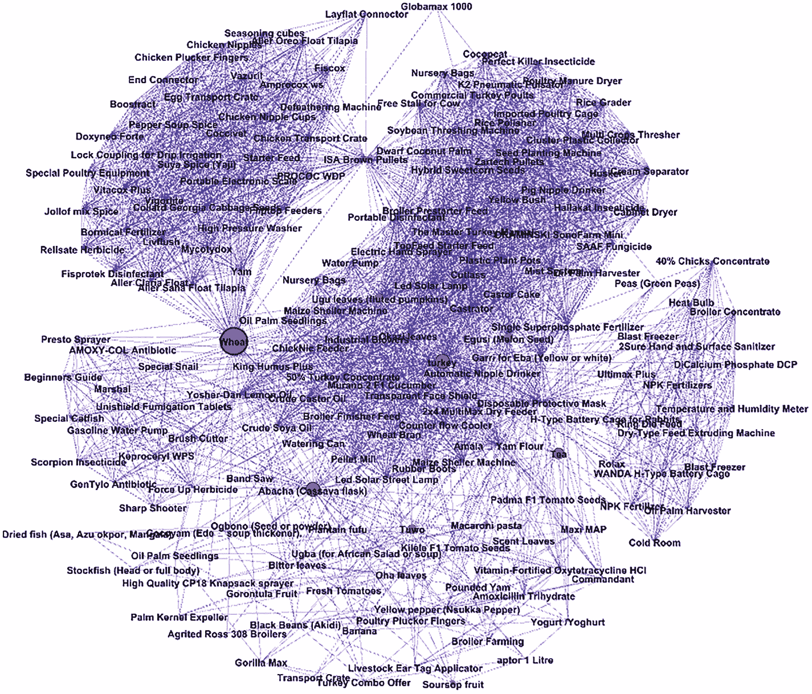
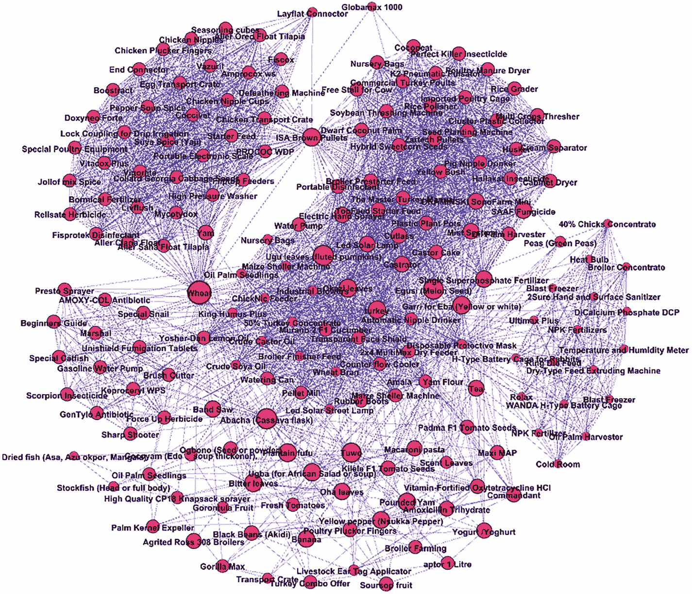
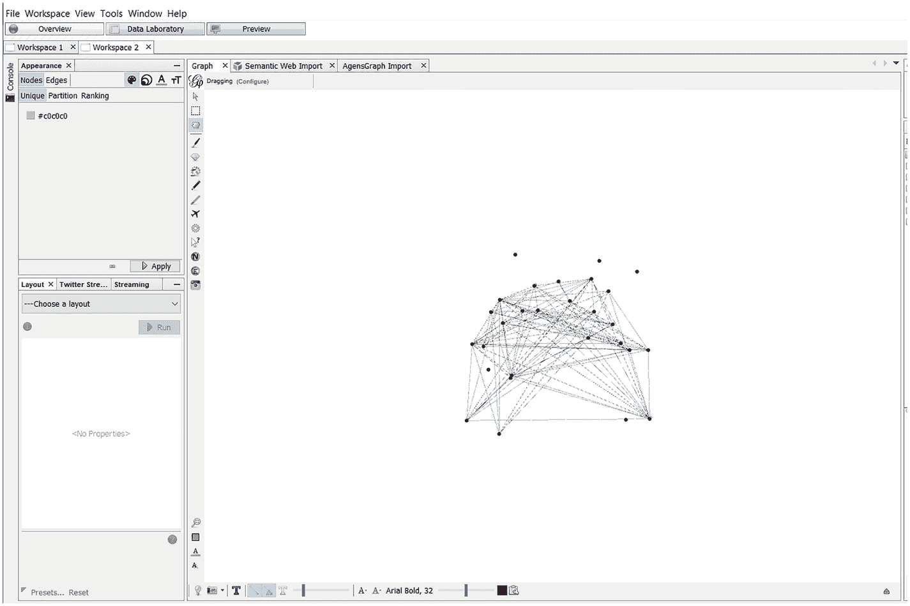
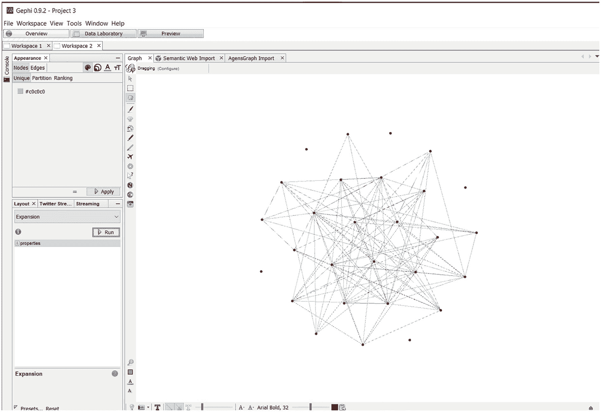
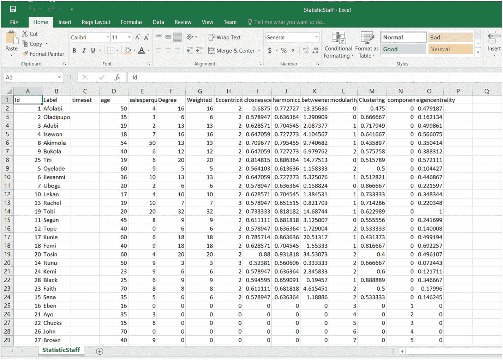
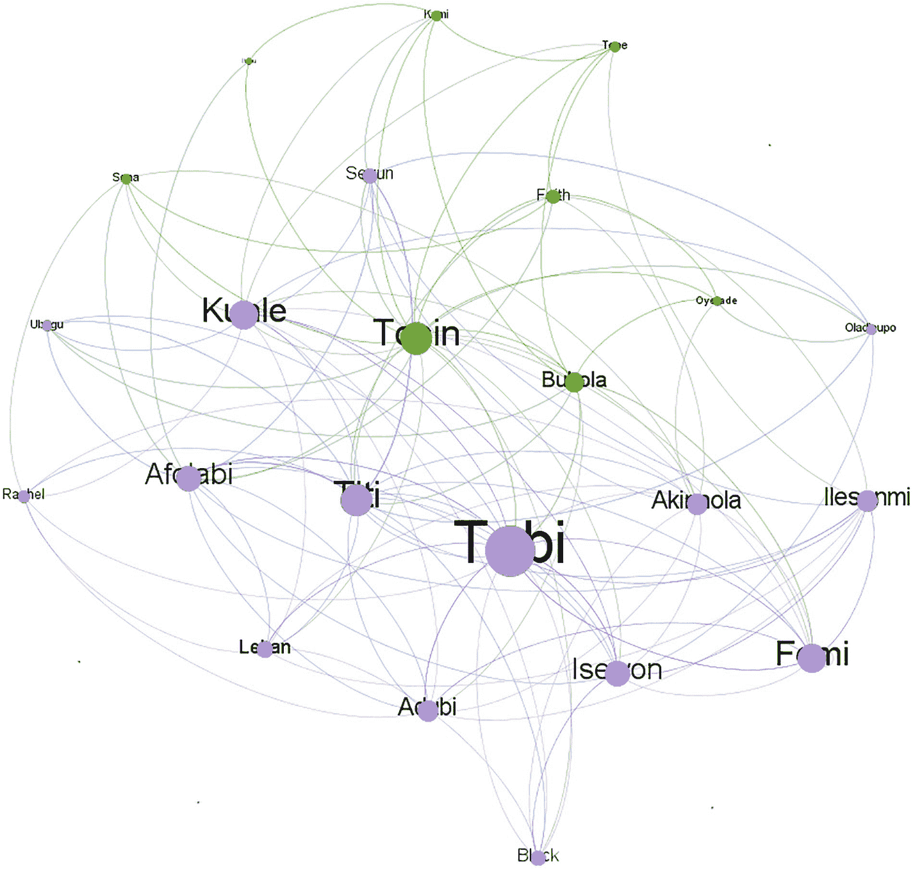
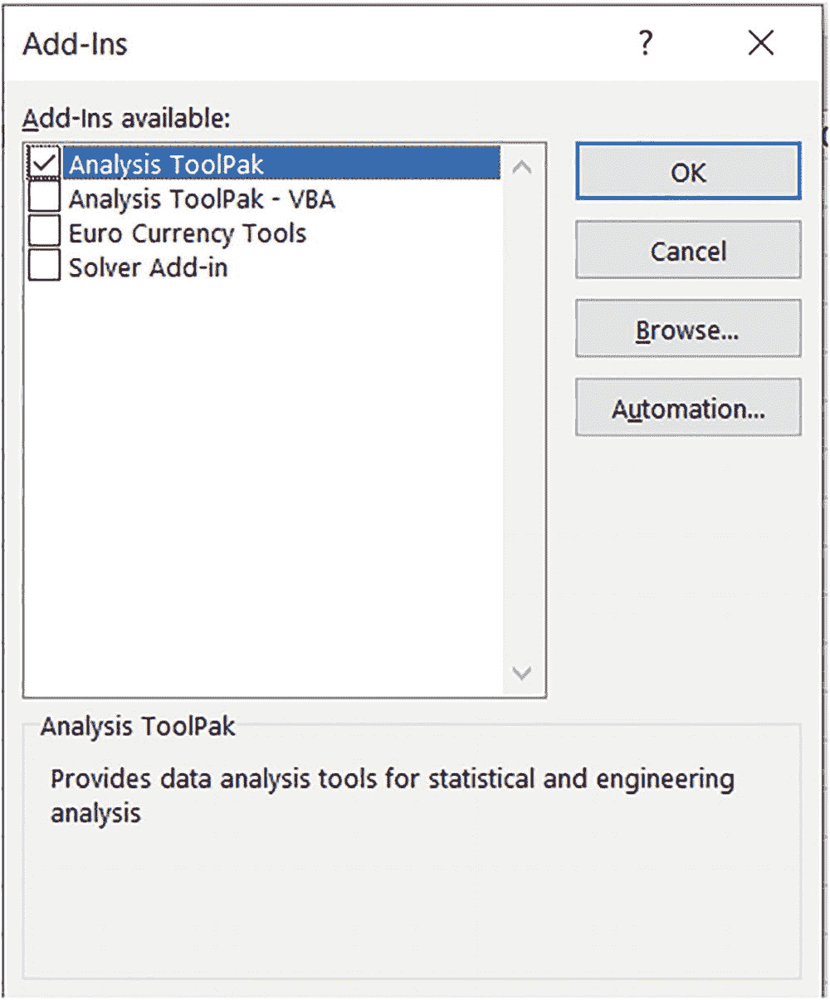
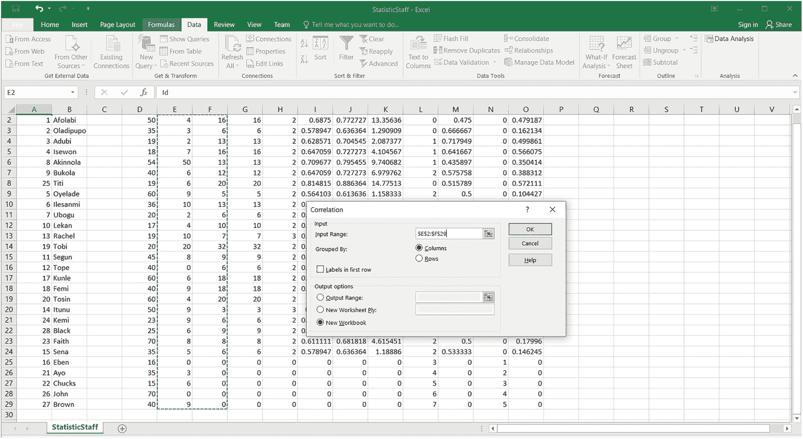

## 文档排版

图 8-38 中的网络图是使用特征向量中心性对网络节点进行排序的结果。从图 8-38 中，我们能够看到具有高中心性值的节点，因为它们与同样处于中心位置的节点相连。高特征向量值意味着一个节点与具有高特征向量得分的节点相连。

网络图展示了使用介数中心性对网络节点进行排序的结果。

图 8-39 产品网络（介数中心性）

1.  使用`betweenness centrality`，我们得到图 8-39 中的网络。

图 8-39 中的网络图是使用介数中心性对网络节点进行排序的结果。从图 8-39 中，我们能够看到具有高介数中心性的节点在其他节点集群之间形成了桥梁。

网络图展示了使用紧密度中心性对网络节点进行排序的结果。

图 8-40 产品紧密度中心性网络

1.  使用`closeness centrality`，我们得到图 8-40 中的网络。

图 8-40 中的网络图是使用紧密度中心性对网络节点进行排序的结果。从图 8-38 中，我们能够看到具有高中心性值的节点，因为它们与网络中的其他节点距离很近。关于这些中心性指标在不同领域应用的参考文献，请参阅本章的第 8.8 节。

## 8.6 实践业务问题五（员工效率）

协作网络已被用于人员分析，以减少员工超负荷、提高全球团队的韧性、优化职业发展路径等。以下是协作网络中使用的一些指标：

*   网络规模：连接到某个节点的节点数量。入度（衡量从其他节点连接到本节点的节点数量）和出度（衡量特定节点所连接的节点数量）。这在`Gephi`中通过平均度来捕获。

*   网络强度：强连接和弱连接。入度或出度的强弱程度。这在`Gephi`中可以通过加权度来捕获。

*   网络范围：你连接的不同类型人员的数量。高范围网络能够从多种来源获取信息。这可以通过检查你所属的社区数量来探究。

*   网络密度：衡量所有成员之间以及所有成员与其他所有成员之间的交互程度。这是一个衡量网络成员之间连接紧密程度的整体交互指标。它不针对每个成员进行计算。这在`Gephi`中通过图密度来捕获。

其他指标如第 8.5 节所述。

在此问题场景中，我们将使用网络分析进行人员分析，这是业务分析的主要应用类型之一。我们将特别专注于分析协作网络。在该问题场景中，我们有一个组织，该组织正在寻求提高其员工的效率。尽管可以通过多种方式实现，但我们将探索使用该组织员工的沟通网络，并通过该网络研究绩效表现。

在此问题场景中，网络数据通过调查收集，并分别转换为节点文件（`nodeslabelStaff.csv`）和边列表文件（`edgeslistStaff.csv`）。

在此问题场景中，我们正在寻求生成以下某些或全部洞察的可能性：网络是好是坏，人们在协作方面是否真正在做他们应该做的事情，等等。为此，我们将回答以下问题：协作模式如何变化？协作模式对重要结果有何影响？ 我们可以针对个人、群体或组织进行探索。

为了回答“协作模式如何变化？”这个问题，我们可以使用简单的描述性统计；例如，我们可以选择一个网络规模，在个体之间进行比较，并比较随时间的变化。其结果可用于以下员工管理领域：绩效评估、角色与职责、薪酬与晋升、培训与指导、工作轮换与职业发展以及员工保留。

为了回答“协作模式如何影响我们关心的员工重要成果？”这个问题，首先我们应该认识到，对于个人而言存在不同类型的成果，例如绩效（每季度销售额、成本节约、自我报告的 1-3 分评级、经理报告的 1-3 分评级、奖金）、满意度、承诺、倦怠、离职率等。

在这个实际示例中，我们选择使用网络规模来检验绩效。为此，我们将检查规模与绩效之间的相关性。在我们的案例研究中，绩效数据以每季度销售额（以百万计）来捕获。

**实践演示**

计算机屏幕截图展示了成功将边列表加载到`Gephi`并导入`nodeslabelStaff.csv`文件的结果。

图 8-41 导入`edgeslistStaff.csv`

1.  将`edgeslistStaff.csv`加载到 Gephi 中，并将`图形类型`设置为`无向`。在“文件”菜单下，使用“导入电子表格”导入第二个 CSV 文件（`nodeslabelStaff.csv`）。导入`nodeslabelStaff.csv`时，请确保将其`附加到现有工作区`。图 8-41 显示了此步骤成功完成后的界面。

图 8-42 展开网络

2.  运行`Fruchterman-Reingold`算法，然后展开网络，得到图 8-42。

图 8-44 导出到 Excel 的数据

图 8-43 最终的员工沟通网络

3.  运行统计功能（声望、平均度数、平均加权度数、网络直径、图密度、模块化、连通分量、特征向量中心性）。在“外观”窗口中，点击`大小` -> `排名`，并选择属性`degree-min-1`，`max-50`。（你可以尝试多种变化，选择最适合你目的的那一种）。

4.  点击显示节点标签；调整节点大小使其更大。在“外观”、“布局”和“统计”窗口中，你可以探索许多功能，以构建一个美观且吸引人的网络，并传达不同的见解。例如，我们可以通过设置`节点` -> `颜色` -> `分区` -> `模块化`来可视化网络中的聚类。点击“预览”（在预览中显示节点标签）；最终的网络应如图 8-43 所示。

节点的颜色表示每个节点所属的聚类，而节点大小则表示其度数。图 8-43 中的网络图显示，节点 Tobi 在该机构的沟通网络中具有最高的度数；这表明该机构中有很多节点都与 Tobi 进行沟通。其含义是，例如，在这样的机构中，需要确保此类节点不会发生故障。

5.  点击“数据实验室”，将节点表导出为 csv 格式，并在 Excel 中打开以进行进一步分析。图 8-44 展示了在 Excel 中打开的导出数据。

图 8-45 Excel 中的数据分析

6.  使用 Excel 中的相关性分析，将度数（网络规模）与性能进行关联。为此，按住 ALT 键并依次按`t`和`I`，你将看到添加数据分析工具的窗口，如图 8-45 所示。

图 8-46 Excel 中的相关性分析

7.  点击`确定`；在工具栏上点击`数据分析`，选择`相关系数`，然后选择输入区域，并将输出选项设置为`新工作簿`（图 8-46）。

8.  点击`确定`。这将得到度数（`degree`）与`每个季度的销售额`（`salesperquarter`，单位为百万）之间的相关系数值`0.293707089965323`。根据皮尔逊相关系数的解释，这意味着变量之间的相关性虽然为正向，但强度很弱。（假设数据使得相关系数为 +1 到 0.7，那么变量之间的关系则为完美的正向相关，届时我们可以继续研究如何通过提供激励建立联系来增加协作。）

## 8.7 习题

1.  重复实际业务问题 V，使用相同的数据集（`nodeslabelStaff.csv`），这次将中心性度量与性能进行关联。

2.  使用数据集`VegetableTransactions.csv`，执行关联规则分析，并对结果进行评论。使用必要的标准选择最重要的规则，并对所选规则给出适当的解释。

3.  使用名为`Alegra.xlsx`的数据，使用 k-means 聚类算法执行聚类分析。验证、可视化并解释生成的聚类。