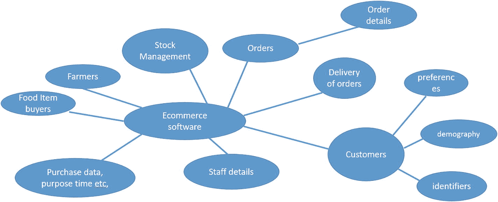
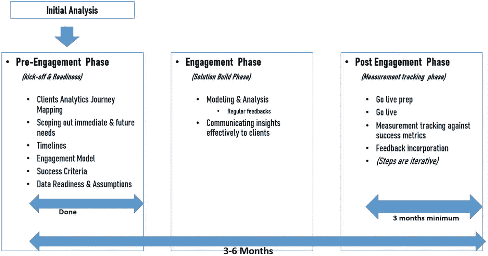
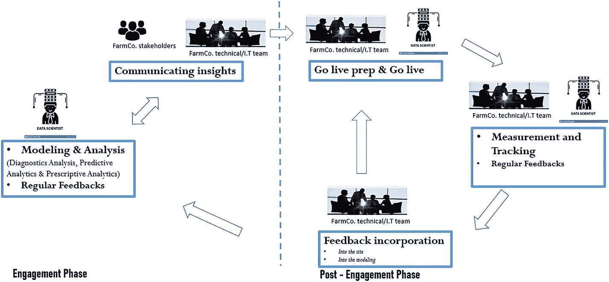
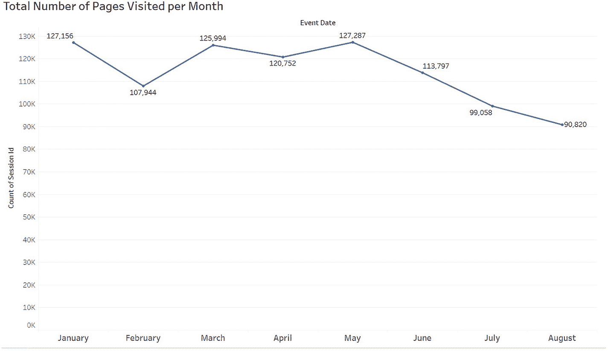
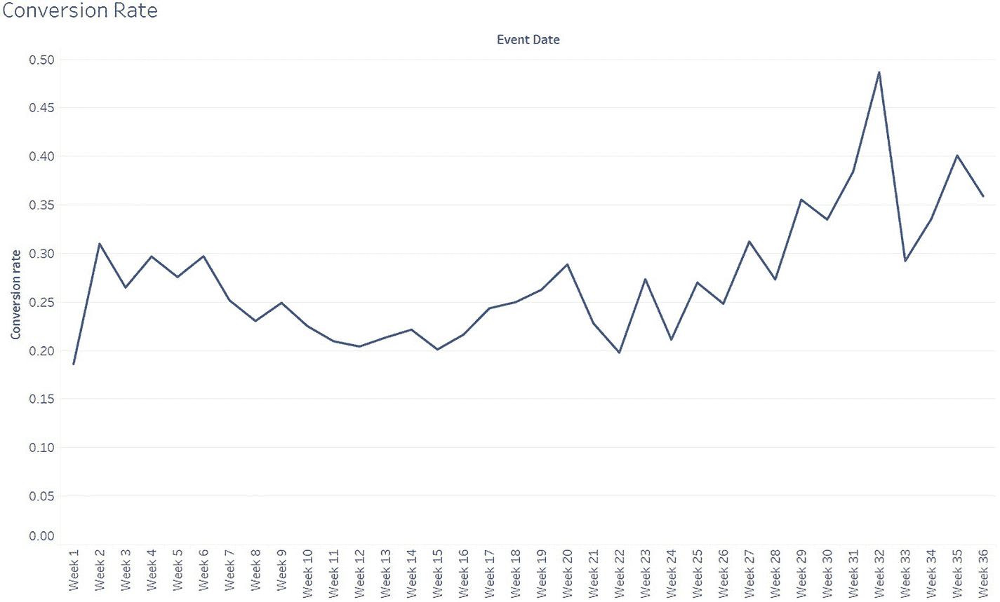
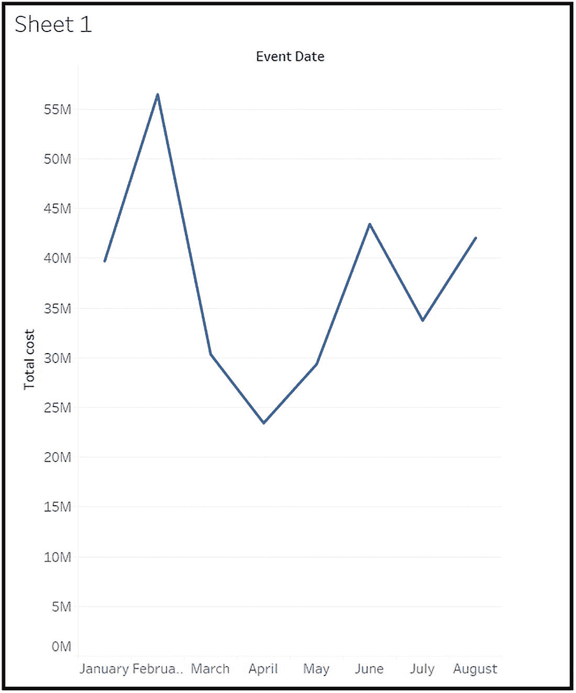
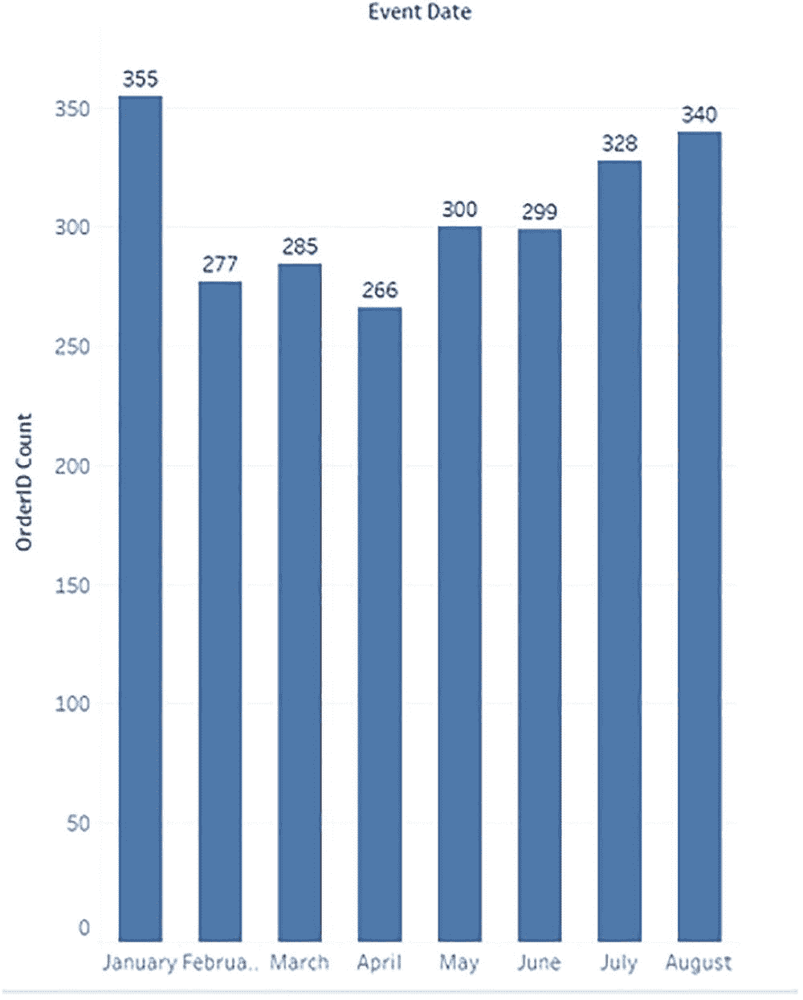

# 9. 案例研究 第一部分

本章是本书主要咨询案例研究的开始部分。我们将解释一个典型的商业分析咨询项目，并创建一个路线图或示例，说明如何进行一个商业分析咨询项目。我们首先通常描述中小型电子商务环境，因为这是我们选定案例研究的业务环境；接着讨论该环境特有的分析数据来源。接下来，我们简要描述将作为案例研究的业务，然后介绍针对该业务咨询所特有的分析路线图。本章以初始分析和预接洽阶段的结果结束，这些结果将构成第 10 章详细分析和实施阶段的基础。

## 9.1 中小企业电子商务

`电子商务`是指通过线上渠道买卖商品和服务。它涉及以任何创业形式直接或间接交易产品或服务，旨在创造财富，从而为最终用户增值，并改善生计手段。

`电子商务`中小企业（`SMEs`）是指利用数字在线服务作为平台，为目标客户创建认知度并推出产品与服务的初创企业。这些活动包括促销推广和营销策略，以促成在线购买、推动销售，并维持重复购买。

以下是在电子商务分析项目中可能希望达成的一些分析目标：

*   捕获、建模和分析与网站交互的用户的行为模式及画像，以推荐有效的营销活动（即提取可支持多项决策的知识，例如针对每个客户群体的营销活动）、定价策略等。

*   了解客户以建立长期关系并提升服务质量。

*   发现消费者情绪以实现有效的客户关系管理。

*   发现具有共同兴趣的用户社区以实现更精准的定位。

*   为公司有效的生产计划、资本投资和扩张决策提供建议。

*   发现有助于提高网站在访客中受欢迎程度的趋势。

*   提供产品交叉销售和布局建议，以增加网站上销售的产品数量，并根据产品推荐重新设计布局。

*   优化销售漏斗，确保尽可能多的人完成购买产品的步骤，即在网站上售出更多产品。此外，发现销售漏斗（电子商务网站）中的薄弱环节，并推荐改进策略。

*   识别最有利可图的客户、最频繁的搜索关键词以及最佳的销售时间线。

*   根据标准的电子商务关键绩效指标（`放弃率`、微观到宏观转化率、平均订单价值（`AOV`）、销售转化率、客户留存率、电子商务流失率等）评估网站，并利用结果提供改善网站销售的建议。

*   发现客户购买模式中的序列或关联趋势，这些趋势有助于推荐向上销售、交叉销售或嵌入推荐系统。

*   开发预测模型，以确定哪些外部客户（至少访问过网站一次但未购买任何东西的客户）具有较高的购买倾向，以便建议对其进行直邮或营销。

*   客户生命周期价值预测等等。

在此类领域可能分析的数据类型包括：

1.  **交易数据**

由于消费者与电子商务企业之间的互动，交易或业务活动数据迅速涌现。这些数据结构化，来自多种来源，包括客户关系项目（例如，公司维护的客户档案、客户投诉频率的增加）和销售交易。总体而言，零售商显然可以从整个价值链中的交易数据中获益匪浅。³

2.  **点击流数据**

点击流数据源于网络和数字广告，以及社交媒体活动，如电子商务企业的推文、博客、Facebook 墙贴等。用户在特定网页内浏览的一系列页面称为点击流，可用于电子商务中的多种分析。点击流跟踪的主要目标是帮助深入了解网站访客的活动。

3.  **语音数据**

语音数据通常通过电话通话、呼叫中心或客户服务获取的信息。根据最新研究，语音数据有助于分析消费者购买行为或定位新客户。

4.  **视频数据**

视频数据是从当前图像捕捉中获取的实时数据。电子商务公司希望结合图像识别工具收集海量数据，而不仅仅是滑动流信息或交易数据。⁴

## 9.2 中小企业案例研究简介

该案例研究的企业是一家名为 `FarmCo` 的食品与农业企业。`FarmCo` 的核心业务是将食品配送至客户家门口，同时也为农民提供其耕作过程所需的必要投入品。本质上，他们致力于连接食品供应商和农产品供应商与有购买需求的人。他们接受线下和线上两种订单，即便是线下订单最终也会录入线上系统，以便全面掌握业务运营情况。公司约有 20 名员工，各司其职；部分员工负责管理线下运营，如物流与供应、库存与采购等，其他员工则负责管理线上运营，包括数字营销和销售管理。`FarmCo` 通过一款电子商务软件进行管理，该软件也是本分析项目的主要数据源。

`FarmCo` 的概念业务模型如图 9-1 所示。该模型有助于理解业务流程的主要部分和布局，并特别指明分析数据将来自何处。

一个模型展示了与 12 个参数相关的电子商务软件的概念业务模型。

**图 9-1** `FarmCo` 的概念业务模型

从图 9-1 可以看出，电子商务软件处于企业运营流程的核心位置；它帮助连接农民与生产所需设备的厂商，也连接食品购买者与食品生产商。该软件还监控可用库存、订单、配送、客户信息以及一定程度的员工信息。该软件与诸如 `Google Analytics` 等其他软件同步，以便能够捕获一些未内置于该软件中的信息或数据。

对于本项目，分析路线图如图 9-2 所示。

该分析路线图展示了从预参与阶段、参与阶段到后参与阶段（历时 3 至 6 个月）的初步分析。

**图 9-2** 分析路线图

通常，整个分析过程耗时三到六个月，但每个项目都有其特殊性，因此时间可能因项目而异。

初步分析阶段将在第 9.3 节中介绍。

在预参与阶段，您需要进行一定程度的分析，以了解从初步分析阶段检索到的数据中能够获得什么信息。基于此结果，您能够为客户呈现一份详细的分析旅程图，以便各方清晰理解其在项目中的角色。此时，您需要明确说明哪些是可实现的，哪些需要留待未来分析项目处理（即改进未来分析的建议）。时间线需附带容差范围进行明确说明，最重要的是，每个既定目标都必须清晰地与成功标准及其衡量方式挂钩。最后，应说明数据就绪程度（即从数据中得出预期建议的可行性），并阐明执行该分析项目所依据的假设。

在参与阶段，我们开发机器学习模型，执行所有必要的分析，并通过充分的沟通（反馈）将洞察传达给相关利益方。^(1,2)

对于后参与阶段，需要培训负责实施分析项目建议的团队。有必要解释如何成功实施分析得出的结果。这一点非常重要，因为它决定了分析项目是否被认定为成功。归根结底，即使工作出色，如果分析项目的洞察未被正确实施，也可能不会取得任何或太大的成功。准备就绪后，我们现在以适用于组织的任何形式实施结果，并留出足够的时间根据预参与阶段设定的成功标准来衡量和跟踪指标。大多数情况下，在后参与阶段期间或之后，可能需要根据反馈反复迭代该流程。

图 9-3 是参与模型，清晰地展示了参与 `FarmCo` 分析项目的所有相关方及其各自扮演的角色。图 9-3 描绘了参与阶段，在此阶段，数据科学家在建模和分析过程中向 `FarmCo` 的利益相关方和技术团队汇报。同时，数据科学家在建模过程中接收来自技术团队的反馈以进行必要的模型修改。在后参与阶段，数据科学家和技术团队共同参与在成功实施后对目标、指标和成功标准的衡量与跟踪。请注意，在图 9-3 中，反馈也流向实施阶段，并且该循环可能根据从建模和衡量阶段获得的结果进行迭代。

图中显示了参与阶段的洞察沟通与反馈整合、上线准备以及后参与阶段的上线。

**图 9-3** `FarmCo` 分析项目的参与模型

## 9.3 初步分析

初步分析涉及以下步骤：

1.  明确决策目标，并确定有助于使预期决策可行的分析输出。

2.  发现可用于实现步骤(1)中分析目标的数据（内部和外部）。

3.  评估步骤(2)中的数据及其对步骤(1)中分析目标的质量。

4.  步骤(3)中的数据能否确定步骤(1)中的分析输出？

在对 `FarmCo` 进行初步分析期间，利益相关方打算（或提出）要解决的目标包括：

1.  接触潜在客户并将其转化为忠实客户。

2.  最大化社交媒体互动，即追踪互动并将其转化为销售。

3.  为公司的有效生产计划、资本投资和扩张决策提供建议。

4.  发现有助于提高网站在访客中受欢迎程度的趋势。

5.  识别畅销商品。

根据初步评估步骤 1 至 4 的结果，在与利益相关方进行多次反馈会议后，目标被修改为：

1.  提高网站销售收入。

2.  增加并维持（客户满意度）网站流量。

请注意，有多项关于数据平台升级的建议，这些升级将有助于直接探索某些预期目标。例如，要接触潜在客户并将其转化为忠实客户，必须有一个系统或程序模块收集潜在客户的一些信息，以便在进行细分建模后能够将其作为触达对象。

## 9.4 分析方法

针对本分析项目需要探索的每个目标，我们将采用第 1.3 节中描述的分析方法。如前所述，根据应用场景的不同，我们可能会先使用描述性分析作为探索性研究的形式，以发现需要在诊断分析阶段回答的问题，然后再进行预测性分析和规范性分析。其他时候，我们可能直接进入其中任何一个阶段。所有这些决策都由分析项目的性质决定。

**目标 1：增加网站流量**

使用描述性分析，我们需要了解网站流量的当前状态。我们希望回答以下问题：

1.  *网站流量是增加还是减少？*

    *   流量为何上下波动？为何没有稳步增长？

    *   他们在三月和五月做了什么特别的事情使得访客数量略有提升？

    *   七月份发生了什么导致网站流量减少？

# 分析项目：流量与销售目标

在开始分析之前，我们需要思考一些核心问题。

### 分析核心问题
*   流量下降是否由于发布内容减少或反向链接丢失等原因？
*   是否可能是服务器故障、节假日等原因？
*   流量来自哪里？能否按流量来源对访问进行细分？
*   将流量细分为新用户和回访客户，他们分别来自哪里？
*   他们采用了哪些营销技巧？哪些是成功的，哪些是不成功的？用数据来回答这些问题将会很有帮助。

## 目标 2：增加网站销售收入

首先要做的，是使用描述性分析来了解与该目标相关的当前状况。具体来说，我们希望探索以下指标：`销售量`、`收入`和`转化率`。这些指标有助于衡量和理解这个问题或目标。我们希望回答以下问题：

*网站的销售量和收入是递增、波动、停滞还是下降？*

描述性分析的结果将在第 9.5 节中针对本分析项目的两个目标进行展示。对于目标一，描述性分析结果显示收入是波动的，而非理想中至少应稳步增长的状态。这就要求后续进行诊断分析，以找出原因。在诊断分析中，我们希望回答以下问题：

*哪些营销活动增加了订单？*

*按订单量计算，营销活动的效果如何？*

*订单来自哪里？*

*哪些类别的产品带来了订单？*

*`AOV（平均订单价值）`是多少？该指标追踪客户在网站上下单时每次的平均消费金额。*

*哪些营销活动增加了收入？*

*按收入计算，营销活动的效果如何？*

*收入是递增的吗？*

*决定转化率的因素是什么？*

*   *客户结账的路径是怎样的？*

*   *导致转化率低的原因是什么？*

*   *为什么访客不购买或不完成结账流程？*

*   *他们的结账流程是怎样的？是否复杂？*

这些问题的答案将在前期介入部分（第 9.5 节）中揭晓。这些答案，连同可用的数据，将共同决定第 10.1 节中描述的预测建模方法。

## 9.5 前期介入

在本节中，我们将给出一些描述性分析输出的示例，以回答前一节中提出的部分问题。同时，在前期介入阶段，需要详细说明用于评估这些目标是否成功的指标。此外，在此阶段，获得描述性分析的结果后，我们需要决定是提出可供实施的建议（即，我们已经发现了一些企业可以用于决策的见解），还是进行进一步分析（即，结果将为介入阶段的建模奠定基础），亦或是为未来的分析做准备（即，需要提供数据建议，以帮助未来的分析工作）。

### 目标 1：增加网站流量

对于这个目标，成功的标准是网站流量，其当前状况如图 9-4 所示。

折线图显示了会话 ID 计数与月份的关系，五月份页面数最多，八月份最少。

图 9-4

当前网站流量

从图 9-4 中，我们可以看到流量上下波动，并且从六月份开始持续下降。此时，我们希望从组织的角度找出是否存在任何原因，例如营销策略的变化、天气、政府问题等。理想情况下，流量应该是稳步增长的。

根据可用数据，可以从多个角度呈现这些描述性分析结果，例如，我们还可以尝试查看访问量最高的前十页面以及这些访问的时间。此外，针对每个营销渠道（`SEO`、`电子邮件营销`、`优惠码`、`社交媒体`等），报告其带来的新访客、回访访客、订单、销售额、转化率、新在线账户和跳出率的总数（即非月度数据）。例如，结果将有助于了解哪个渠道带来了访问量，诊断便可以从此处开始。我们还将能够判断对这些渠道的投资是否与访问结果成正比。

此处给出的建议是，需要进行进一步分析，最好是诊断分析，以便能够为出现的问题找到答案。在本书中，我们将在第 10.1 节中提供此类诊断报告的示例，但需要注意的是，在这方面还有很多可以做的事情并未包含在内。此外，我们还计划通过使用高级描述性分析来建议如何将流量从社交媒体引导至网站，从而直接增加网站访问量。

### 目标 2：增加网站销售收入

对于这个目标，选定的成功标准是订单量、收入和转化率。这些标准的当前状况分别如图 9-5、9-6 和 9-7 所示。

折线图显示，第 32 周的转化率最高，第 1 周的活动日期转化率最低。

图 9-7

当前转化率

折线图显示，二月份的总成本最高，四月份的活动日期总成本最低。

图 9-6

当前收入状况

柱状图显示，一月份活动日期的订单量最高，四月份活动日期的订单量最低。

图 9-5

网站当前订单状态

在图 9-5 中，可以观察到网站订单量略有下降后又逐渐回升。造成这种下降的原因是什么？我们可以给出哪些建议来避免未来再次出现这种情况？

在图 9-6 中，收入上下波动，而非稳定增长。图 9-7 显示，周转化率也呈现出同样的波动趋势。

除了对这些目标进行更深层次诊断分析的建议外，我们还建议在预测性和规范性方法中建立一些模型，以直接增加网站的销售额和收入。这一点在第 10.1 节中也有所涉及。