# 10. 案例研究第二部分

在本章中，我们将通过详细介绍所讨论案例研究的参与阶段，来总结用于说明典型中小企业商业分析咨询的案例研究。参与后阶段被省略，因为建议的实施取决于企业的系统和流程。需要注意的是，咨询步骤可以根据任何企业（尤其是小型企业）进行定制。第 9 章和第 10 章中描述的整个步骤已简化以便理解，但在实际业务应用中，可能需要反复迭代该过程，直到获得满意的结果。这是因为你需要不断吸收利益相关者和领域专家的反馈。

## 10.1 目标 1：增加网站流量

我们首先要明确阐述从第一个目标的参与前阶段总结出的分析流程。为了实现增加网站流量的首要目标，我们将根据现有数据采用两种主要的分析方法。

1.  根据参与前阶段的结果，我们将进行诊断分析，以发现造成当前网站流量特征的原因，并基于结果提出建议。请注意，本节仅展示诊断分析的结果。为此，我们将使用描述性分析。

2.  我们将研究 FarmCo 运营的社交媒体环境，并尝试识别该环境中的一些主要影响者，以便开展营销和引导流量。为此，我们将使用社交网络分析。

**分析结果**

1.  为实现此目标，我们合并了多个数据源，包括营销数据、促销数据以及 FarmCo 的 `Google Analytics` 账户数据。这些数据用于通过描述性分析回答以下问题。

2.  *为什么流量会上下波动？*

    通过与销售和营销团队的访谈，我们发现 5 月和 6 月流量下降的原因是未在 `Facebook` 等平台投放广告，FarmCo 仅依赖自然搜索。3 月份经历的流量增长是由于 2 月中旬的促销活动。

3.  *网站流量的输入是什么？*

    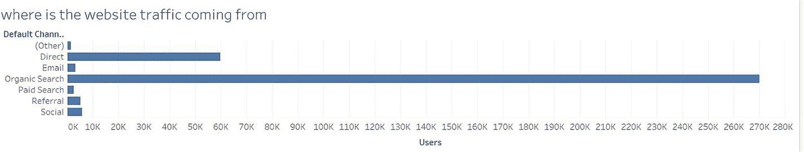

    一个水平条形图显示了默认渠道与用户数的关系。图表绘制了其他、直接、电子邮件、自然搜索、付费搜索、引荐和社交渠道的数值。自然搜索的数值最大。

    图 10-1

    网站流量的输入

    图 10-1 中的结果用于评估这些平台可用的预算，并查看其是否与从这些平台获得的流量结果成正比。

    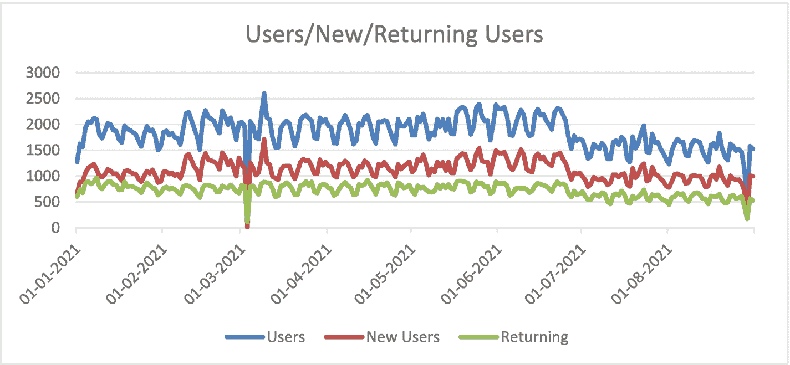

    一个折线图绘制了从 2021 年 1 月 1 日到 2021 年 8 月 1 日期间的用户数与日期关系。用户数、新用户数和回访用户数的曲线分别在 1500 至 2500、500 至 1700 和 500 至 1000 之间波动。所有数据均为近似值。

    图 10-2

    流量类型

4.  *他们获得了什么类型的流量？*

    流量类型的结果（图 10-2）将帮助他们了解谁真正有兴趣访问他们的网站；是新的访客还是回访的访客？这些信息可以通过多种方式得到应用；一个例子是了解在进行营销时如何调整他们的目标受众。

5.  *新客户/回访客户的流量来自哪里？*

    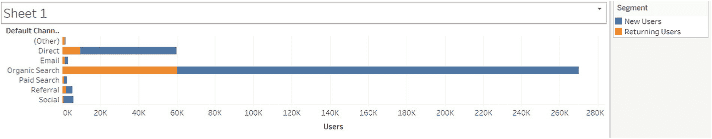

    一个水平条形图显示了流量来源与用户数的关系。图表绘制了其他、直接、电子邮件、自然搜索、付费搜索、引荐和社交渠道的数值。

    图 10-3

    新客户/回访客户的流量来源

    从领域专家那里我们获悉，回访客户更有可能成交，这让我们特别关注回访客户。从图 10-3 中，我们可以看到，尽管数量很小，但电子邮件和引荐似乎拥有最高比例的回访客户。因此，战略选择要么是继续从自然搜索获取大量流量，希望更多人回访，要么是增加来自电子邮件和引荐的客户数量，或者两者并行。

6.  *访问网站的是什么样的人（人口统计信息、兴趣等）？*

    图 10-4a 和 10-4b 中的结果有助于评估营销中使用的目标受众的兴趣和人口统计信息是否与实际访问网站的人一致？由此得出的结论将有助于调整营销所针对的受众。

    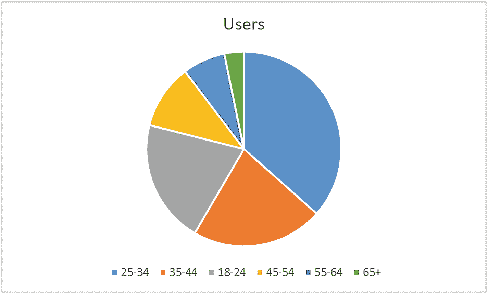

    一个饼图显示了按年龄段划分的访问网站的用户。25 至 34 岁年龄段的用户数量最多，65 岁及以上的用户数量最少。

    图 10-4b

    访客人口统计信息（年龄）

    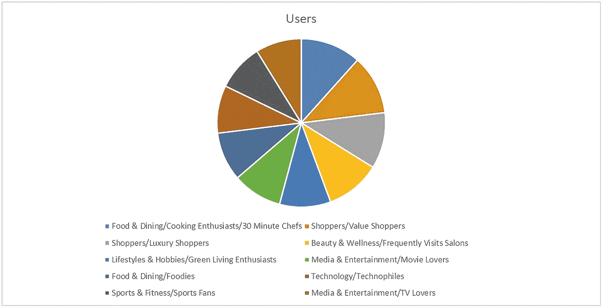

    一个饼图显示了访问网站的不同类型用户。该饼图显示了所有类型的用户分布。

    图 10-4a

    访客人口统计信息（兴趣）

总之，有必要在促销活动的时间安排上采取果断措施。还需要调整营销的目标受众以增加流量。同时我们还发现了一些有价值的营销渠道/活动，可以将预算集中于此以增加流量。

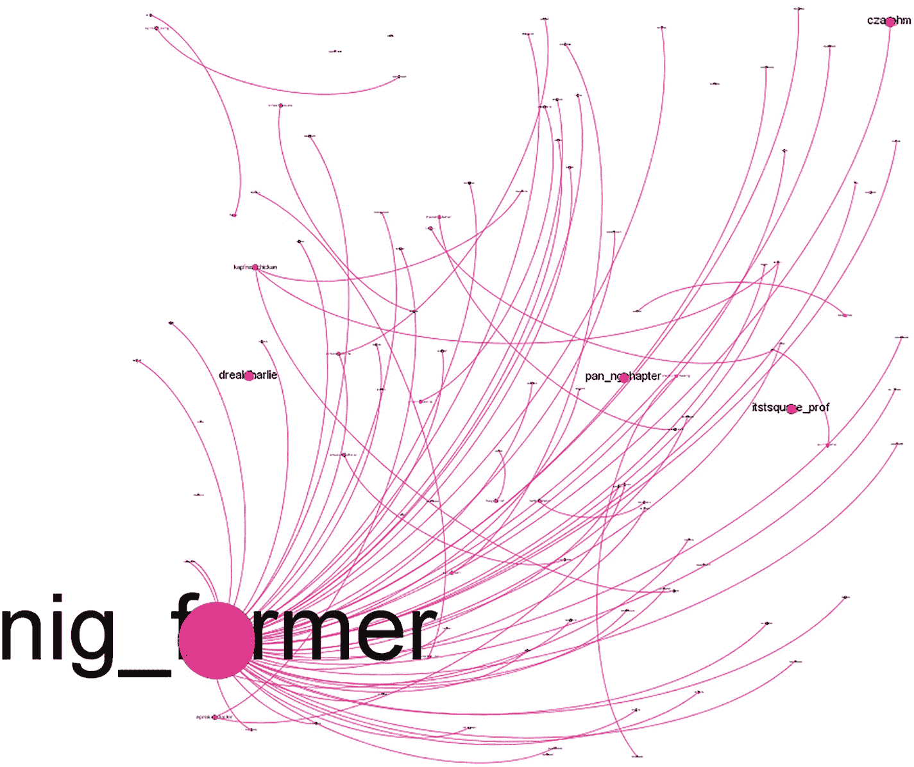

一张图片显示了用户名`nig_farmer`，该用户名连接了许多其他用户名，形成了一个网络。

图 10-5

FarmCo 的可视化网络

1.  为了演示，我们只选取 FarmCo 的一种产品——家禽；对于这种产品，我们使用搜索条件（`poultry`，`Nigeria`）从[netlytic.org](http://netlytic.org)提取推文。我们能够创建在尼日利亚对该产品感兴趣的人的沟通网络。用于此实际演示的数据名为`PoultryNigeria.gephi`。加载数据、运行所有统计信息并对网络进行必要的修饰后（使用了特征向量中心性），生成的网络如图 10-5 所示。

从图 10-5 中，可以看出用户名`nig_farmer`是主要影响者，可用于营销推广的触达。

## 10.2 目标 2：提升网站销售收入

与第一个目标类似，我们首先明确从第二个目标的预接洽阶段得出的分析流程。为了实现第二个目标，我们将根据现有数据采用三种主要的分析方法：

1.  *客户忠诚度干预*：对采样的历史数据应用逻辑回归，构建模型以发现可能流失的客户。该模型将用于预测其网站现有客户的行为（流失或不流失）。随后将进行关联规则挖掘，用于通过电子邮件向那些可能流失的客户推荐产品。在此方法中，流失被定义为从历史数据采样日期起，过去两年内未购买任何商品的客户。

2.  *最近购买时间、购买频率与消费金额细分*：第二种方法，我们将执行 RFM 细分。这是基于典型聚类所需的属性丰富度不足而做出的决定。目的是能够理解和描绘 FarmCo 现有客户的画像，以便更好地进行客户关系管理。

3.  *战略市场目标*：此方法将建模规范分析。规范分析将用于确定针对未来客户的最佳可执行策略。对于这种分析方法，将使用聚类技术，具体来说是 `k-means` 聚类。我们还将在此分析项目中采用反向思考的方法。

### 客户忠诚度干预

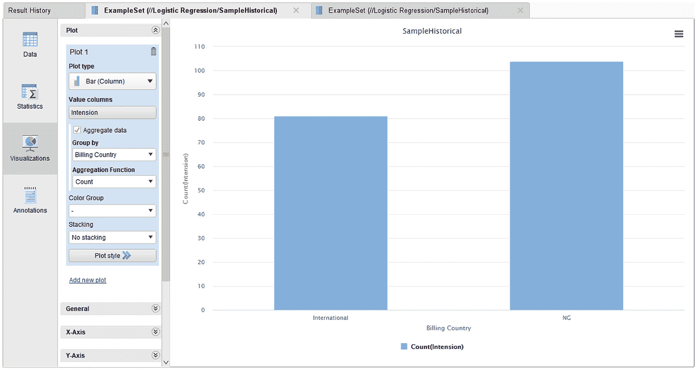

一张截图展示了逻辑回归/样本历史的示例集。一个条形图绘制了国际和 NC 的值。

**图 10-6** 研究目标变量与分类结果的示例

1.  使用条形图研究目标变量与分类结果的关系，y 轴为结果（如图 10-6 所示）。对所有相关属性执行此操作后发现（除了 `Email Status`、`Os Version` 和 `Payment Method`），所有分类属性的类别都相当正常，因为没有属性包含过多类别、类别中存在错误或类别不均衡。如果存在任何这些问题，则需在此阶段处理。

2.  导入名为 `SampleHistorical.xlsx` 的数据，用缺失值替换错误，并排除 `CustomerID`、`Billing State`、`Email Permission`、`Device Brand`、`Shipping Country` 和 `Shipping State`（原因是这些属性要么类别过多，要么只有一个类别）。

3.  检查统计数据以确保没有缺失值。

4.  使用以下指南可视化分类任务的属性：

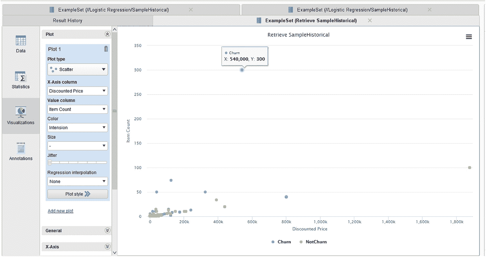

一张截图展示了检索样本历史数据的示例集。一个散点图绘制了流失与非流失客户的商品数量与折扣价格的关系。最高流失点绘制在 (540000, 300) 处。

**图 10-7** 通过颜色编码散点图研究结果变量与成对数值预测变量关系的示例

5.  通过颜色编码散点图研究目标/结果变量与成对数值预测变量的关系（如图 10-7 所示）。对所有相关变量执行此操作后发现，数值预测变量之间没有相关性。这意味着我们可以将所有数值预测变量进入建模阶段。

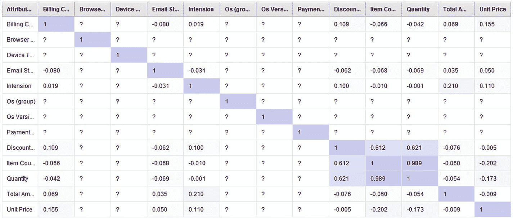

一张截图展示了不同项目的相关分析，包含十四行十四列。

**图 10-8** 相关矩阵

6.  使用相关性分析移除相关属性（图 10-8）。相关性分析结果显示，需要移除 `Item Count` 或 `Quantity`，因为它们高度相关。

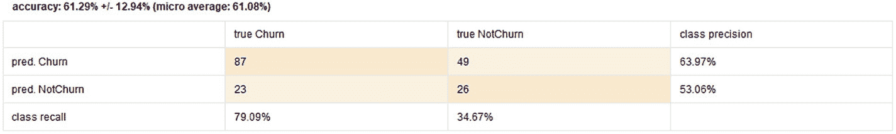

一个表格包含三行三列。列标题为真实流失、真实非流失和类别精确率。行标题为预测流失、预测非流失和类别召回率。

**图 10-10** 逻辑回归模型评估

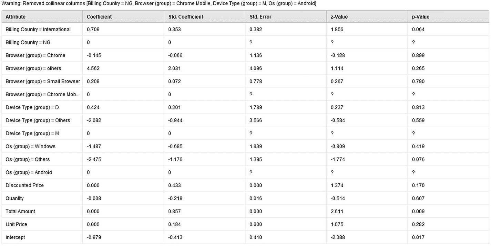

一张截图展示了一个包含六列十八行的表格。列标题：属性、系数、分层系数、分层误差、z 值和 p 值。各个属性的值已给出。

**图 10-9** 逻辑回归模型

7. 使用步骤 3a–c 的结论，您可以创建一个逻辑回归模型，如图 10-9 所示。（注意，由于数据样本较小，最好使用分层交叉验证。）模型的评估结果如图 10-10 所示。该模型的准确率为 61.08%。（注意，在此阶段，如果我们希望获得更高的准确率，还需要尝试其他算法、属性选择技术等，但出于本示例演示的目的，我们继续进行。）

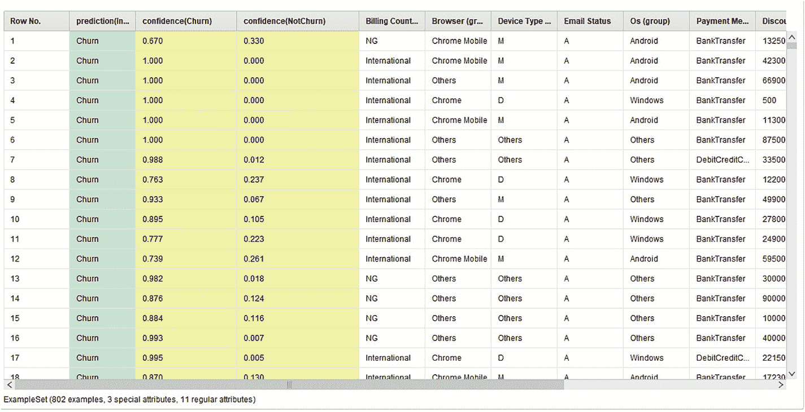

`图 10-11` 预测结果

8. 使用图 10-9 中的模型，我们可以利用名为`FoodAgricGroup.xlsx`的数据预测当前客户的流失意向。请注意，该数据不包含名为`Intention`的属性，因为这正是要预测的内容。预测结果如图 10-11 所示。

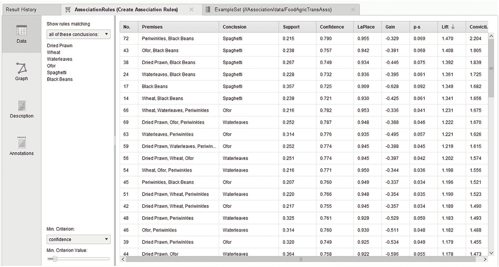

`图 10-12` 关联规则挖掘结果

9. 下一步是使用名为`FoodAgricTransAsso.xlsx`的事务数据执行关联规则，以发现哪些商品常被一起购买。结果如图 10-12 所示。

10. 为了总结这种分析方法，我们将利用图 10-12 中的推论，通过电子邮件营销活动向客户（即图 10-11 中显示的高流失倾向客户）推荐产品。请注意，这只是实施分析结果的一种方法。还可以探索其他创造性的方法，例如在网站上嵌入推荐引擎等等。

### RFM 细分

RFM 细分用于针对特定客户群，发送更贴合其特定行为的沟通信息。RFM 细分是识别需要给予额外关注的客户群体的有用工具。RFM 代表最近购买时间、购买频率和消费金额。RFM 使用数值标尺来生成既简洁又有启发性的高层次客户画像。它易于理解和解读。

- *最近购买时间*：客户上次与品牌进行互动或购买活动有多久了？
- *购买频率*：客户在特定时期内与品牌发生交易或互动的频率如何？
- *货币价值*：也称为“货币价值”，该指标反映客户在特定时间段内在该品牌的消费金额。

`图 10-13a` 是 RFM 细分的一个示例，该图展示了基于 RFM 细分生成的聚类三维可视化。从图 10-13a 可以解读出，部分客户虽然消费金额不高，但频繁访问企业网站，并且近期有过高价值购买行为。

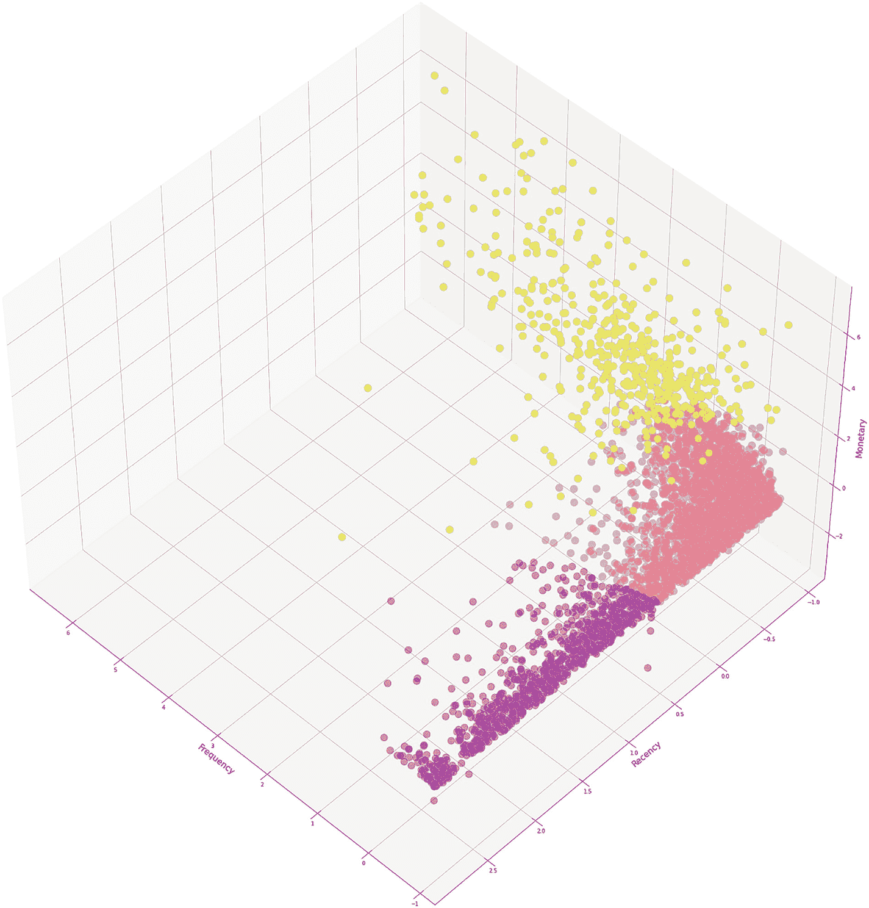

`图 10-13a` RFM 细分三维可视化⁴ ([`https://miro.medium.com/max/1400/1*_uQS11qVzIv4rTNDPM6Rqw.png`](https://miro.medium.com/max/1400/1*_uQS11qVzIv4rTNDPM6Rqw.png))

要使用 RFMT（近度、频率、货币价值、在册时长）方法进行客户细分，必须将电子表格数据转换为 RFMT 数据。以下技巧可供参考：

1. 为每位客户创建唯一标识符。
2. 对于给定的 ID，可从其他字段计算对应客户的 RFMT 值。
    - 同一客户的所有产品支出累计为货币价值（`M`）。
    - 同一客户的购买次数计为频率（`F`）。
    - 从客户最近一次购买到数据抓取日期的时间间隔计算为近度（`R`）。在本场景中，使用天数作为时间单位；若天数跨越数年，也可改用月或年。
    - 第四个变量为购买间隔时间（`T`），衡量连续购物之间的平均时间间隔。若某客户的首次和末次购买日期分别记为`T[1]`和`T[n]`，则该客户的整体购物周期（`L`）可近似为`T[1]`与`T[n]`之间的月数，因此`T`值（以月为单位）可按如下公式计算：

```
T = L / (F − 1) = (T[n] − T[1]) / (F − 1)
```

为计算`T`，仅考虑在给定时期内至少完成两次购买（即`F ≥ 2`）的客户。由此生成的数据文件命名为`*RFMFoodAgric.xlsx*`。

`表 10-1` 各维度的四个层级

| 近度 | 频率 | 货币价值 |
| --- | --- | --- |
| R-层级-1（最近购买） | F-层级-1（最频繁） | M-层级-1（最高消费） |
| R-层级-2 | F-层级-2 | M-层级-2 |
| R-层级-3 | F-层级-3 | M-层级-3 |
| R-层级-4（最久未购） | F-层级-4（仅一次交易） | M-层级-4（最低消费） |

然后，利用步骤 b 中获得的 RFMT 值，将每位客户在每个维度上划分至四个层级之一，如表 10-1 所示。由此生成的数据文件命名为`*FinalRFM.xlsx*`（尽管该数据实际包含约五个层级，而非表 10-1 中的四个）。

利用 RFM 细分的结果，可以根据客户所属的 RFM 细分群体来定位特定客户群。例如，最佳客户群体（出现在 R-层级-1、F-层级-1 和 M-层级-1 中的客户，意味着他们近期交易频繁且消费高于其他客户）。

- **高消费新客户**：位于 1-4-1 和 1-4-2 分组的客户。这些消费者仅交易过一次，但交易时间很近，且消费金额可观。
- **最低消费活跃忠实客户**：该群体由位于 1-1-3 和 1-1-4 分组的客户组成。他们近期交易频繁，但消费最少。
- **流失的最佳客户**：位于 4-1-1、4-1-2、4-2-1 和 4-2-2 分组的客户。他们过去交易频繁且消费较高，但已长时间未进行交易。

`图 10-13b` 频率柱状图

1. 导入名为`*FinalRFM.xlsx*`的数据，检查统计信息，确保无缺失数据。将所有 RFMT 属性的类型更改为多项式。

2. 使用柱状图对数据进行可视化，确保 RFMT 类别具有合理的数据分布。图 10-13b 即为一例。

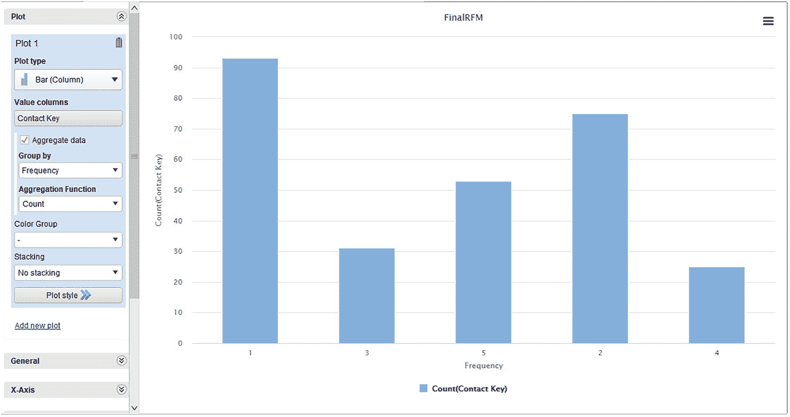

3. `图 10-14` 是当`k`等于 4 时，RFMT 建模的最终聚类可视化结果。

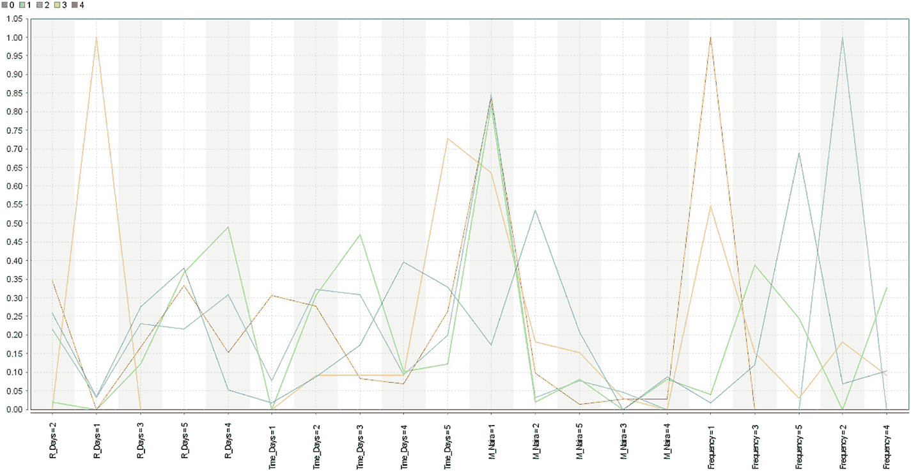

`图 10-14` 发现的聚类

4. 基于发现的聚类以及用于 RFMT 数据的层级，我们可以对聚类进行画像分析。RFM 细分的最后一步是针对每个发现的客户聚类定制沟通策略。

### 战略市场目标

此处的目标是通过规范性分析，在外部数据中确定用于营销的最优聚类。本作业将采用反向思考方法，该方法包含以下步骤：

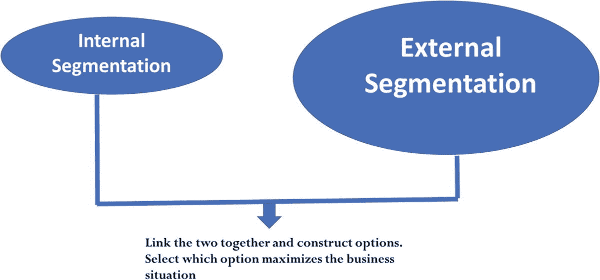

`图 10-15` 高层概念设计

1. **从我们要做的决策开始**：在该项目中，我们需要从以下可用选项中选择一项可执行的客户获取策略。
    - 通过尽可能多地获取客户来扩大客户基础，无论客户类型如何，期望留住他们以实现未来高收入。
    - 由于营销预算有限，仅通过获取少量优质客户来扩大客户基础。
    - 通过获取大量高利润客户来扩大客户基础（最佳情况）。
2. **确定哪些分析输出有助于做出该决策**：我们期望的分析输出是制作一或两张幻灯片，描述步骤 1 中的每个选项，并提供一个基于关键指标（数据中可用）对各选项进行比较的摘要。我们还将解释得出结论的过程。请注意，此过程依赖于内部数据和外部数据具有相同属性。在某些情况下，这可能无法实现，但可以借助第三方提供的外部细分来解决这一问题。
3. **设计能够产生这些输出的分析**：图 10-15 是该方法的顶层概念设计。目的是对内部数据进行细分，同时也对外部数据进行细分。之后，将两者关联起来并构建选项，这将有助于最大化步骤 1 中的业务决策。意图是利用内部数据描述当前客户群的特征以及这些细分群体的历史表现（例如，从客户中获取的总利润）。接着，我们将描述外部客户特征，并据此确定每个细分群体的获取机会。

- 从我们要做的决策开始。
- 确定哪些分析输出有助于做出该决策。
- 设计能够产生这些输出的分析。
- 确定分析所需的数据及其获取方式。
- 执行分析。
- 展示并呈现结果。