# 排版后的文档

在 Figure 10-16 中，我们有一个更详细的概念模式版本，揭示了内部数据和外部数据中提出的聚类。（这只是为了给读者一个预期概念，实际上聚类的知识在初期可能并不像图中这样清晰。）

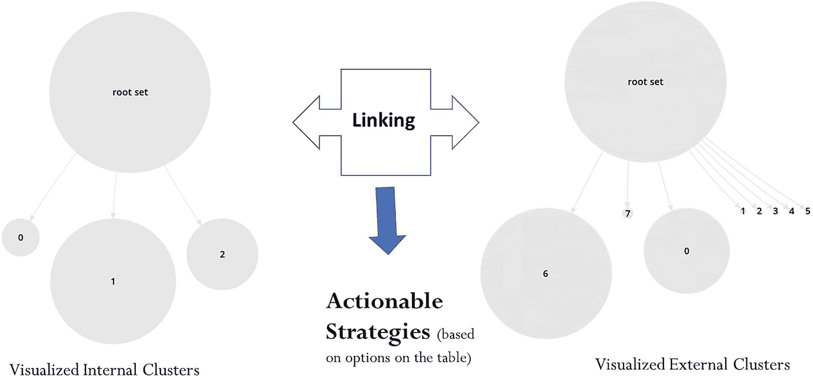

图 10-16 更详细的概念设计

1. **确定分析所需的数据及获取方式**：对于此方法，我们需要使用两组数据。内部数据名为 `FarmCo.Internal.xlsx`，外部数据名为 `FarmCo.External.csv`。

2. **执行分析**：将对内部和外部数据执行以下步骤。
    - **数据预处理**：
        - **缺失值处理**：`k`-means 无法处理缺失值。如果缺失值很少，可以将其排除；如果缺失值很多，则必须进行插补。
        - **数据可视化**将用于发现离群值。将分类变量转换为数值型，因为 `k`-means 使用距离函数，无法直接处理分类变量（如果是序数，则用等差数列替换；如果是名义变量，则转换为二进制）。
        - **数据归一化**将被用来均衡每个维度的权重。
    - **确定 `k` 值**：有几种方法可以做到这一点（如前所述），但我们将指定要使用的 `k` 值。
    - **创建聚类模型**：使用合适的距离度量来计算记录之间的距离（因为我们已将所有属性转换为数值，所以选择了数值度量）。
    - **验证聚类**：为了验证生成的聚类，我们使用**平均质心内距离**。
    - **解释结果**：比较聚类质心以描述不同聚类的特征，并尝试为每个聚类赋予一个标签。

## 内部数据 5a–e

在检查内部数据的缺失值后，我们得到了 Figure 10-17 中的统计结果（向下滚动查看全部）。

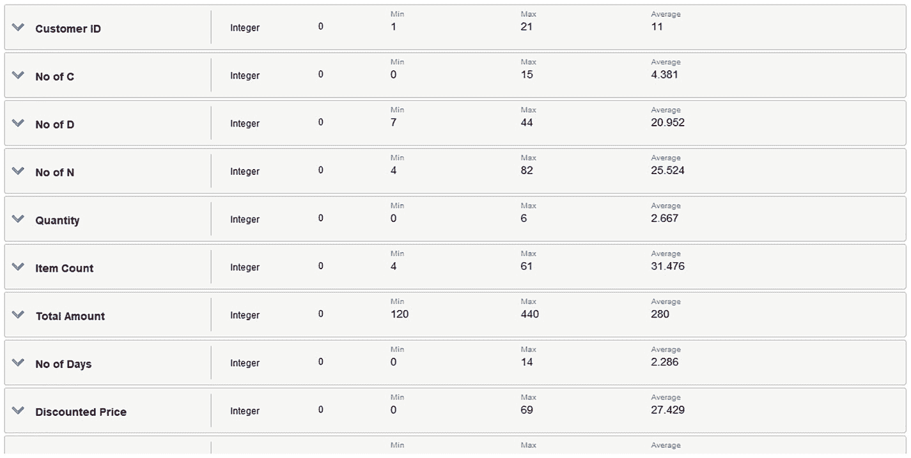

图 10-17 摘要统计

通过检查数值属性的离群值（使用散点图），我们发现所有属性均无离群值。Figure 10-18 是一个示例。

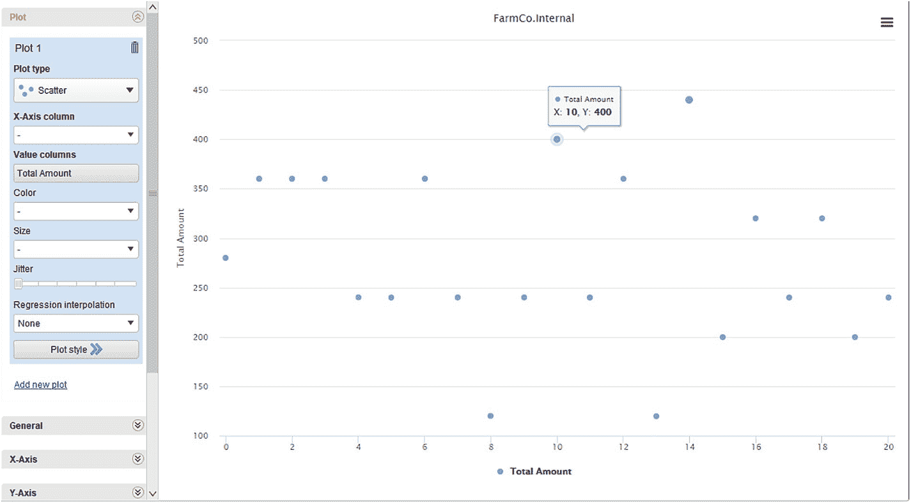

图 10-18 检查数值属性（总金额）

Figure 10-19 是内部数据的相关性矩阵结果；使用欧几里得距离时，高度相关的变量是不利的。Figure 10-20 给出了成对表格（按降序排列）。基于此结果，我们将剔除`Item Count`、`No of C`、`Email Status = P`和`Quantity`，因为它们具有较高的相关值。

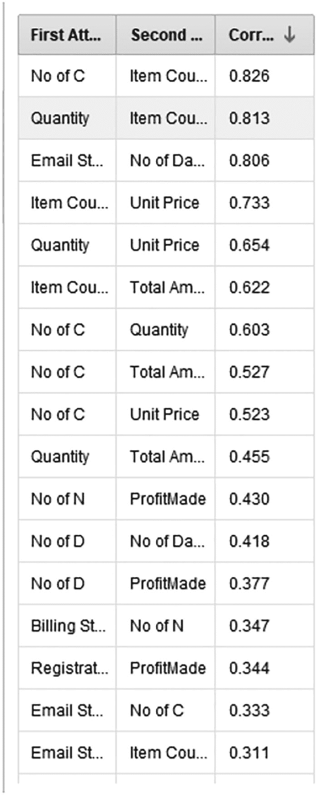

图 10-20 成对相关性

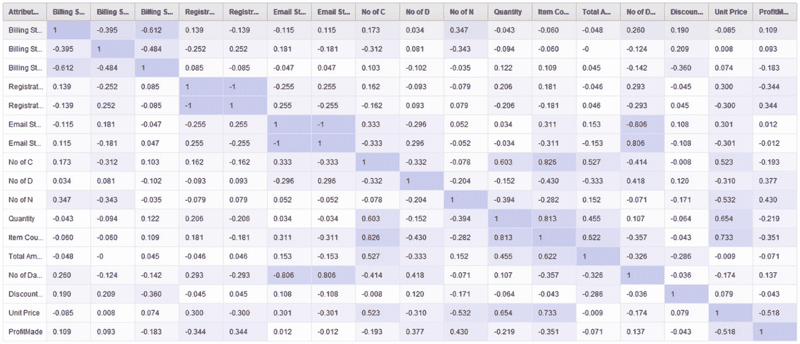

图 10-19 相关性矩阵

为了确定 `k` 值，我们将尝试 `2`、`3`、`4`，并选择分离效果最好的 `k`。重新导入数据，并在导入时将`Customer ID`的角色设为`Id`，以便将每个客户链接到其所属的聚类。Figure 10-21 中的设置将生成 Figure 10-22a（`K=2`）、10-22b（`K=2` 的性能）、10-23a（`K=3`）、10-23b（`K=3` 的性能）、10-24a（`K=4`）和 10-24b（`K=4` 的性能）中的可视化聚类结果。

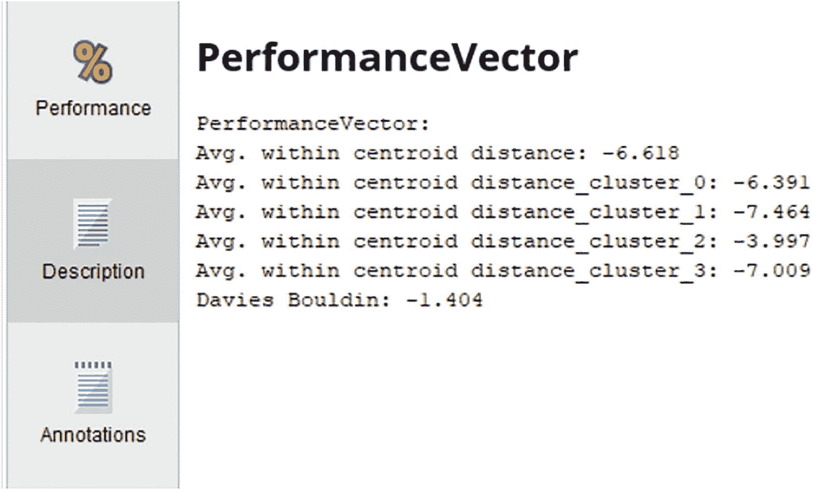

图 10-24b `K=4` 的性能

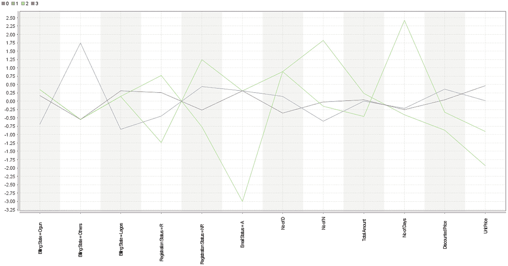

图 10-24a `K=4` 的聚类轮廓

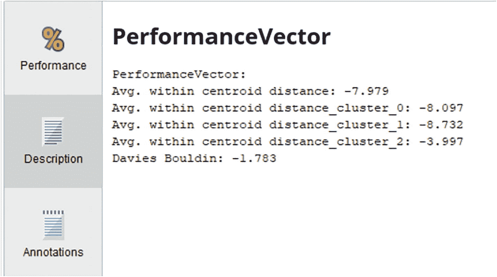

图 10-23b `K=3` 的性能

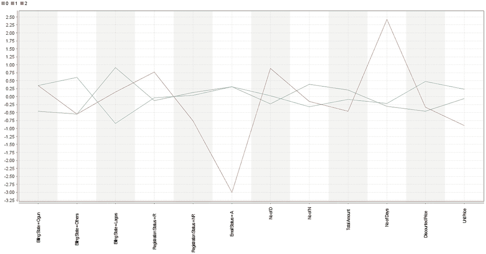

图 10-23a `K=3` 的聚类轮廓

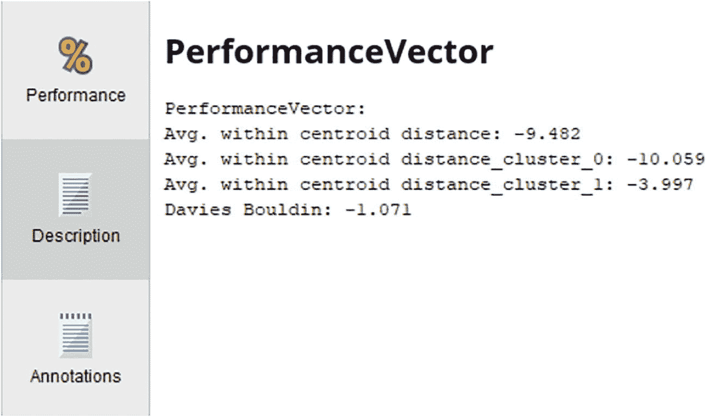

图 10-22b `K=2` 的聚类性能

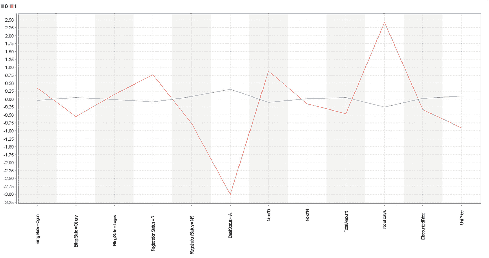

图 10-22a `K=2` 的聚类轮廓

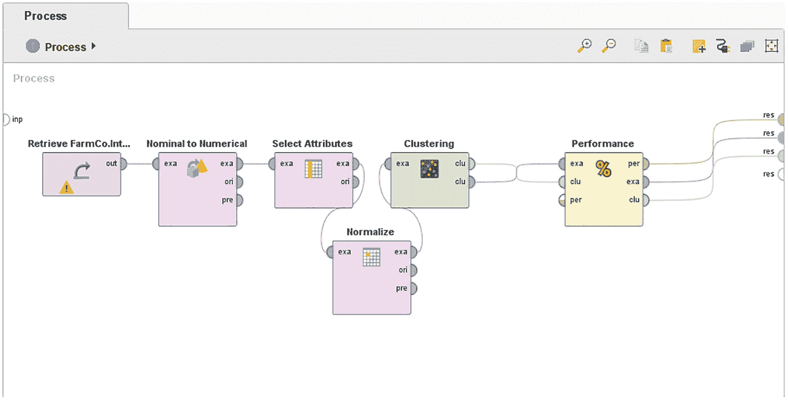

图 10-21 聚类过程（`k-means`）

根据上述结果，我们选择 `K=3`，原因如下：

- **`avg._within_centroid_distance`**：平均簇内距离通过计算质心与簇内所有样本之间距离的平均值得到。该值越小越好。
- **`davies_bouldin`**：产生低簇内距离（高簇内相似性）和高簇间距离（低簇间相似性）的算法将具有较低的 Davies-Bouldin 指数；根据此标准，能够产生具有最小 Davies-Bouldin 指数聚类集合的聚类算法被认为是最佳算法。

在确定内部数据的 `K=3` 后，为了选择适合当前问题（内部数据）的最佳细分结果，我们可以使用已获利润作为指标，然后计算每个细分中所有成员的聚类平均利润。还可以使用其他指标，例如取消率等，具体取决于应用场景。聚类的输出（Figure 10-25）可以与原始 `FarmCo.Internal.xlsx` 关联，以了解每个聚类成员的利润，然后计算每个聚类的平均利润。表 10-2 展示了这一结果。请注意，已获利润不属于聚类的属性，因为它不会出现在外部数据中。

**表 10-2 平均聚类利润**

| 聚类名称 | 平均利润 |
| --- | --- |
| `Cluster_0` | 172,000 |
| `Cluster_1` | 745,555 |
| `Cluster_2` | 175,000 |

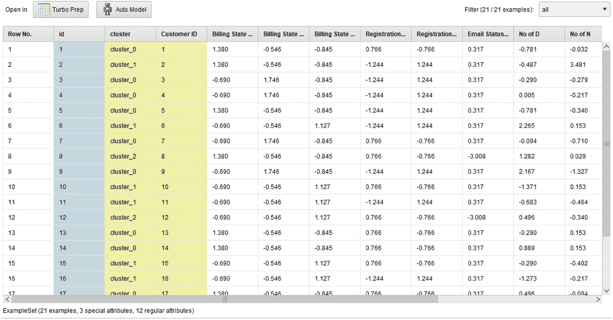

该截图以表格形式展示了包含十二列和十八行的聚类数据集。

**图 10-25** 聚类数据集

接下来，我们将根据图 10-23 得到的聚类结果，尝试解释上述所有聚类的特征如下：

***Cluster_0***

- `Billing State=Lagos` 略低。
- `Billing State=Others` 略高。
- 该聚类没有能够使其脱颖而出的显著属性。

***Cluster_1***

- `Billing State=Lagos` 略高。
- 其他属性特征不显著。

***Cluster_2***

- `Email Status=A` 非常低。
- `No of Days` 非常高。
- 这两个属性很大程度上将该聚类的项与其他项区分开来。

由于 `Cluster_1` 具有最高的平均利润，理想情况下我们希望利用 `Cluster_1` 的特征在外部数据中寻找相似的聚类，然后将其作为目标（按照最佳情况方案的选择），因为它客户数量多且平均利润高。

### 外部数据 5a–e

接下来的步骤将有助于对外部客户进行细分。

导入外部数据（`FarmCo.External`），并在导入时排除以下字段：`Customer ID`、`Shipping State`、`Quantity`、`No of C`、`Item Count`。这是因为它们在内部数据聚类中未被使用。

检查外部数据（`FarmCo.External.csv`）的缺失值后，我们得到图 10-26 中的统计数据。某些属性存在缺失值，稍后将通过 `replace missing value` 运算符处理。

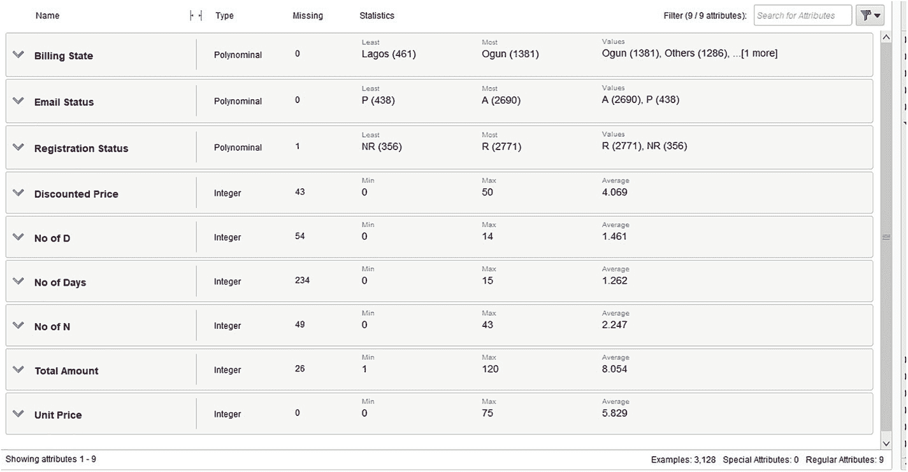

该截图展示了一个表格，包含列标题：名称、类型、缺失值和统计信息。在列标题“名称”下方列出了不同的属性。

**图 10-26** 汇总统计

检查数值属性的异常值（使用散点图），我们发现所有属性均无异常值。图 10-27 是一个示例。

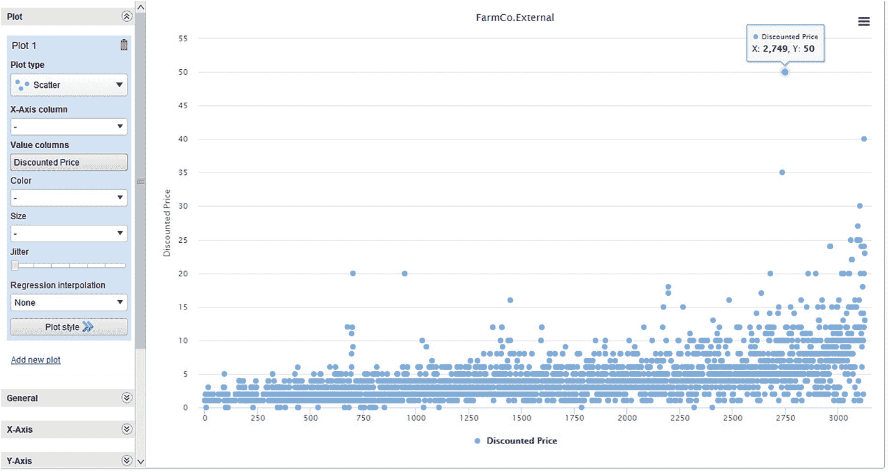

该截图展示了一个散点图，绘制了折扣价与折扣价的关系。X 轴和 Y 轴的值分别为 2,749 和 50。

**图 10-27** 检查数值属性（`Discounted Price`）

我们可以检查外部数据的相关性矩阵（图 10-28）。需要注意，为了能够将两个聚类输出结果关联起来，外部数据细分必须使用与内部数据细分相同的属性。

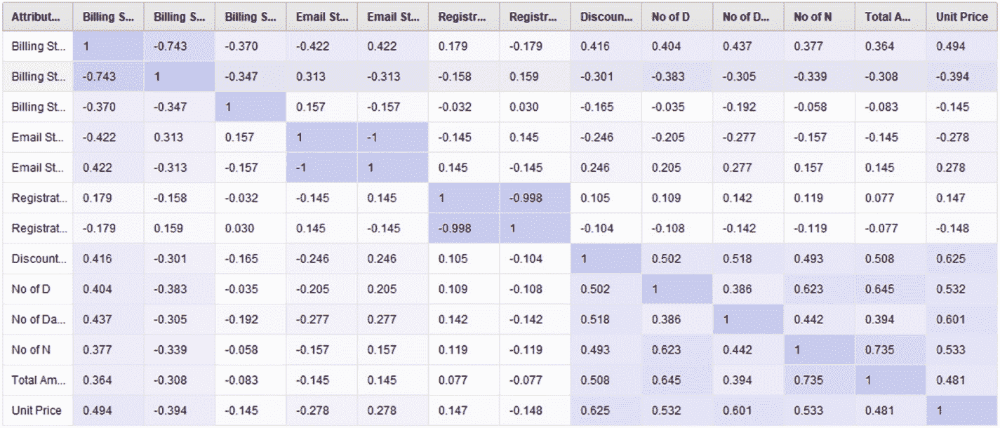

该截图展示了外部数据相关性矩阵的结果。高度相关的变量位于表格的对角线上，并已高亮显示。

**图 10-28** 相关性矩阵（外部数据）

再次导入外部数据，这次将 `Customer ID` 的角色设置为 `Id`。在导入时排除以下字段：`Customer ID`、`Shipping State`、`Quantity`、`No of C`、`Item Count`。图 10-29 中的设置将生成图 10-30a（`K=2`）、10-30b（`K=2` 的性能）、10-31a（`K=3`）、10-31b（`K=3` 的性能）、10-32a（`K=4`）和 10-32b（`K=4` 的性能）中所示的聚类可视化结果。请注意，在选择属性时，请选择用于内部聚类的那些属性。

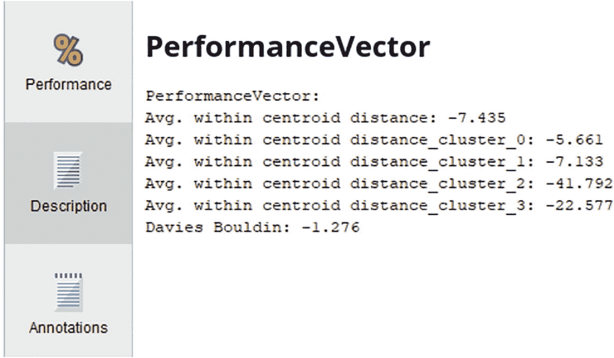

该截图展示了三个选项卡：性能百分比、描述和注释。描述包含七行性能向量的代码。

**图 10-32b** `K=4` 的性能（外部数据）

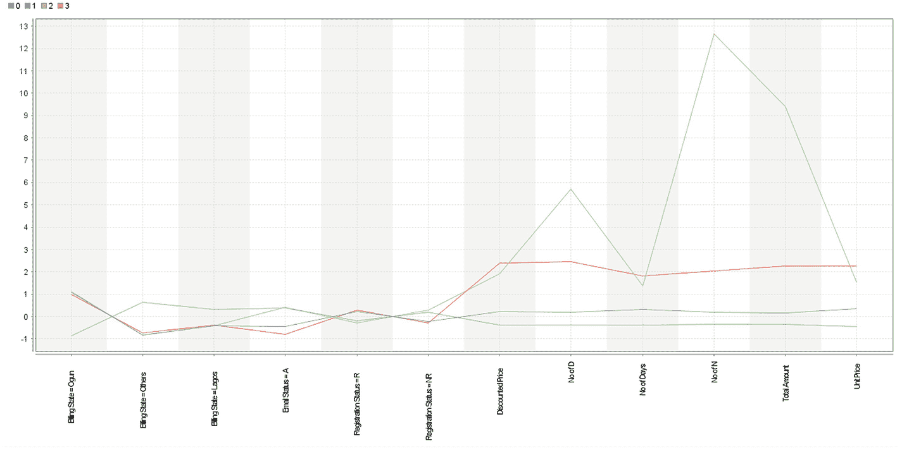

该截图展示了一个折线图，绘制了 0、1、2 和 3 的值。0、1、2 和 3 的线在负 1 和 13 之间波动。

**图 10-32a** `K=4` 的聚类轮廓（外部数据）

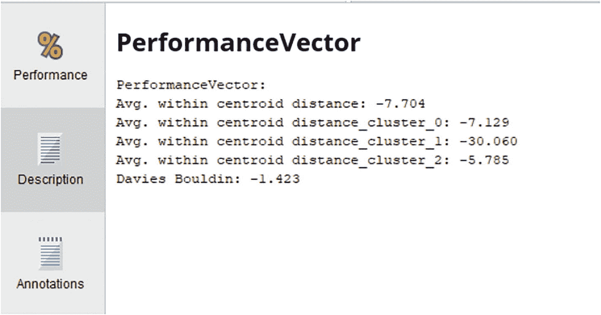

该截图展示了三个选项卡：性能百分比、描述和注释。描述包含六行性能向量的代码。

**图 10-31b** `K=3` 的性能（外部数据）

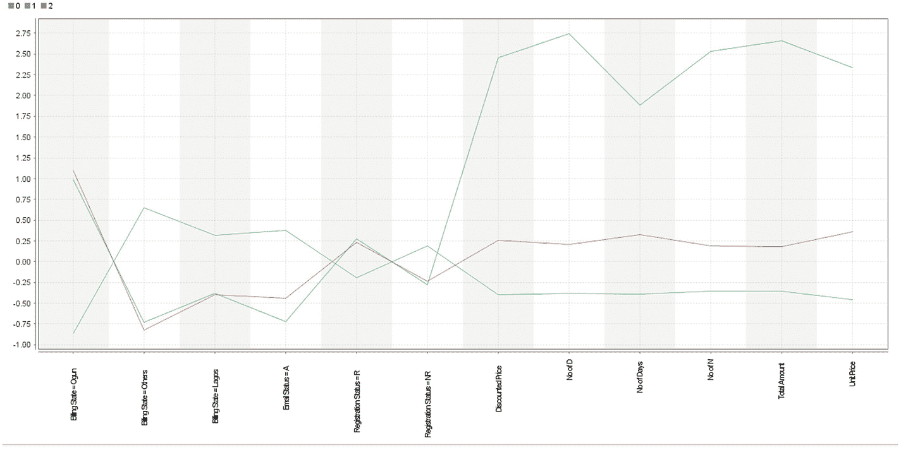

该截图展示了一个折线图，绘制了 0、1 和 2 的值。0、1 和 2 的线在负 1 和 2.75 之间波动。

**图 10-31a** `K=3` 的聚类轮廓（外部数据）

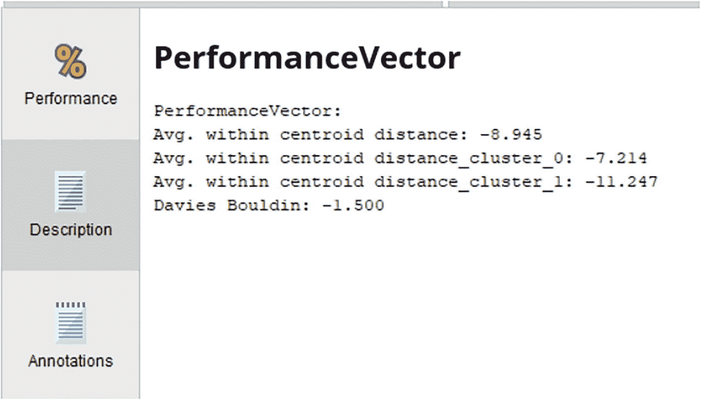

该截图展示了三个选项卡：性能百分比、描述和注释。描述包含五行性能向量的代码。

**图 10-30b** `K=2` 的性能（外部数据）

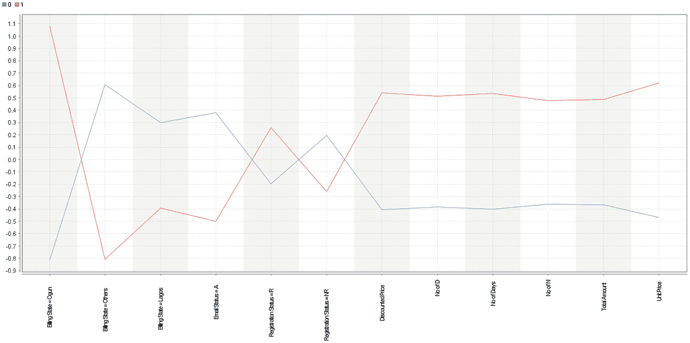

该截图展示了一个折线图，绘制了 0 和 1 的值。0 和 1 的线在负 0.8 和 1.1 之间波动。

**图 10-30a** `K=2` 的聚类轮廓（外部数据）

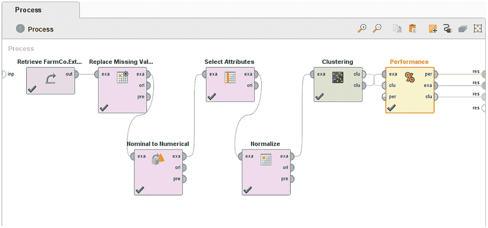

该截图描述了外部数据的聚类过程，涉及以下步骤：检索、替换缺失值、标称型转数值型、选择属性、归一化、聚类和性能评估。

**图 10-29** 对外部数据进行聚类

根据上述结果，我们选择 `K=2`，因为其 `davies_bouldin` 值最小。

这些聚类的特征如下：

***Cluster_0***

- `Billing State=Ogun` 低。
- `Billing State=Others` 略高。
- `Billing State=Lagos` 略高。
- `Email Status=A` 略高。
- `DiscountedPrice` 低。

***Cluster_1***

- `Billing State=Ogun` 非常高。
- `Billing State=Others` 低。
- `Billing State=Lagos` 略低。
- `Email Status=A` 低。
- `DiscountedPrice` 略高。

（注意，可以尝试其他能够提供更好分离度和显著特征的 `k` 值。）

### 关联两个细分过程

因此，在对外部数据进行细分后，我们希望选择与内部数据中 `Cluster_1` 相匹配的聚类。遗憾的是，在本演示中，`Cluster_1`（`Billing State=Lagos` 略高）是唯一显著的特征，其他属性特征并不突出。尽管如此，我们仍然仅使用这个属性来匹配外部数据的特征，从而发现 `Cluster_0` 是具备该特征以及其他特征的聚类。

因此，建议是：如果我们打算针对一个具有高利润潜力和大量成员的聚类，那么外部数据中的 `Cluster_0` 是推荐选择。在其他情况下，如果聚类具有更多区分性特征，那么推荐将更为丰富。

### 展示并呈现结果

根据目标受众，这些结果需要用简单的图表并辅以必要的可视化图表来呈现，以展示最佳方案及其被选择的原因。

## 10.3 问题

1. 使用名为`PoultryNigeria.gephi`的数据，通过`Gephi`得到图 10-5。

2. 使用名为`SampleHistorical.xlsx`的数据，通过并排箱线图进行可视化分类。

3. 使用`RFMFoodAgric.xlsx`和`FinalRFM.xlsx`数据，重复本章中的 RFM 细分（见*客户忠诚干预*一节）。你是否能得到相同的结果？

4. 你将如何向利益相关者展示从问题 3 中得出的结果？
