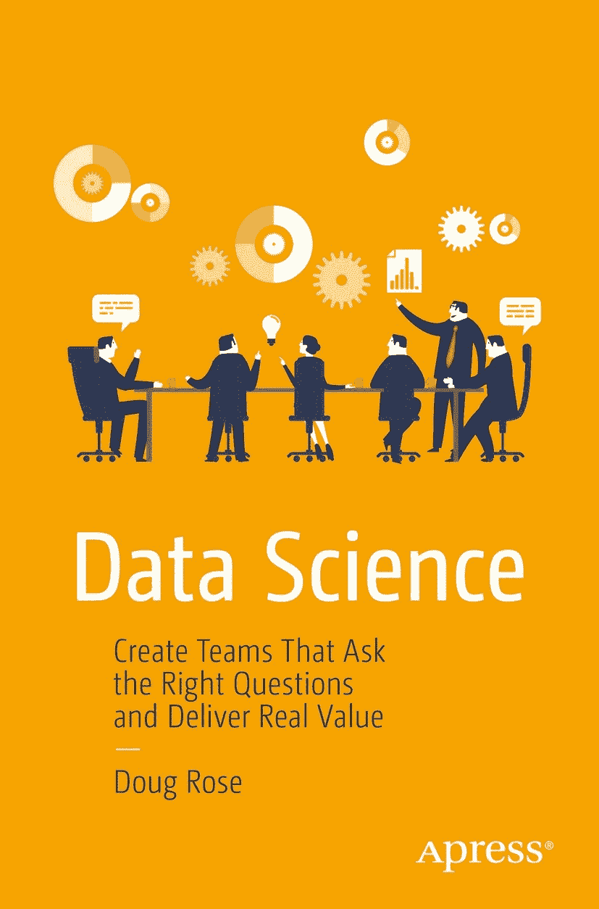

 道格·罗斯

**数据科学**

打造能提出正确问题并交付真正价值的团队

作者在本书中引用的任何源代码或其他补充材料，读者均可从`www.apress.com`获取。关于如何查找本书源代码的详细信息，请访问`www.apress.com/source-code/`。

ISBN 978-1-4842-2252-2 e-ISBN 978-1-4842-2253-9 DOI 10.1007/978-1-4842-2253-9 国会图书馆控制号：2016959479

© 道格·罗斯 2016

本作品受版权保护。出版商保留所有权利，无论是全部还是部分材料，具体包括翻译、重印、重用插图、朗诵、广播、以缩微胶卷或任何其他物理方式复制，以及通过电子改编、计算机软件或现在已知或未来开发的类似或不同方法进行传输或信息存储与检索。

本书中可能出现的商标名称、徽标和图像。对于商标名称、徽标或图像，我们仅在编辑风格中使用，以维护商标所有者的权益，无意侵犯商标权。本书中对商品名称、商标、服务标志及类似术语的使用，即使未明确标识，也不应被视为对这些术语是否受专有权利保护的看法表达。

尽管本书中的建议和信息在出版时被认为是真实准确的，但作者、编辑和出版商均不对可能存在的任何错误或遗漏承担法律责任。出版商对本书内容不作任何明示或暗示的担保。

印刷于无酸纸上

由 Springer Science+Business Media New York 向全球图书市场发行，地址：233 Spring Street, 6th Floor, New York, NY 10013。电话：1-800-SPRINGER，传真：(201) 348-4505，邮箱：orders-ny@springer-sbm.com，或访问 www.springeronline.com。Apress Media, LLC 是加利福尼亚州的有限责任公司，其唯一成员（所有者）为 Springer Science + Business Media Finance Inc (SSBM Finance Inc)。SSBM Finance Inc 是特拉华州的一家公司。

献给耶莱娜和利奥

**Apress 商业：商业信息的公正来源**

Apress 商业类图书提供基本信息和实用建议，每一本都由公认的专家为从业者撰写。商业界各个领域——以及各个技术层次的——忙碌的管理者和专业人士，都会从我们的书中寻找可操作的思路和工具，以解决问题、更新和提升专业技能、让工作更轻松，并抓住机遇。

无论商业领域涉及何种主题——创业、金融、销售、营销、管理、法规、信息技术等等——Apress 始终因提供客观信息和公正建议而备受赞誉，帮助您在日常工作中脱颖而出。我们的作者不带个人偏见；他们明白自己只有一个任务——以简单、简洁且富有深刻洞察的方式，提供满足读者真实需求的最新、准确信息。

在当今时代，无论从新闻媒体、互联网还是书籍中，找到立场公允、真正为您利益着想的信息都越来越难。因此，我们希望您能喜欢这本精心编撰、符合我们质量和公正报道标准的书。

我们始终乐于听取您的反馈或对新书创意的想法。或许您甚至想自己写一本书。无论何种情况，请通过 editorial@apress.com 联系我们，编辑会迅速回复。顺便提一下，在本书末尾，您会找到一份有用的相关书目列表。请访问我们的网站`www.apress.com`注册订阅资讯，并获取未来购书折扣。

> —Apress 商业团队

