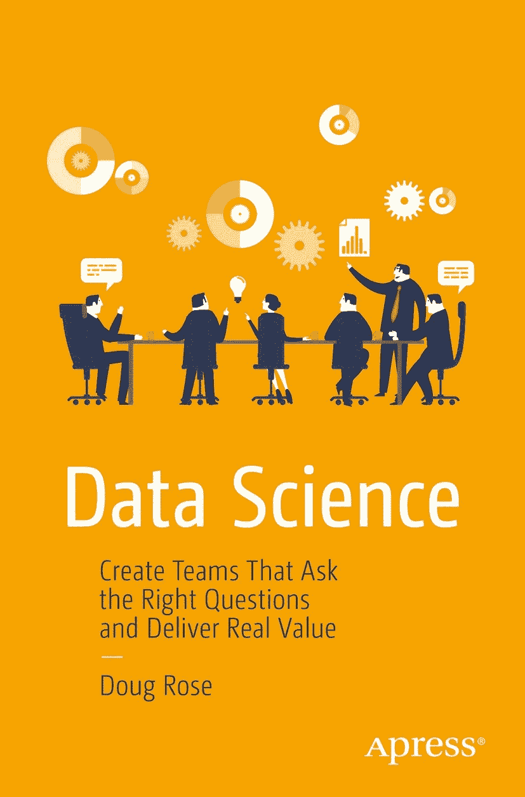

 道格·罗斯

**数据科学**

打造能提出正确问题并交付真正价值的团队

作者在本书中引用的任何源代码或其他补充材料，读者均可从`www.apress.com`获取。关于如何查找本书源代码的详细信息，请访问`www.apress.com/source-code/`。

ISBN 978-1-4842-2252-2 e-ISBN 978-1-4842-2253-9 DOI 10.1007/978-1-4842-2253-9 国会图书馆控制号：2016959479

© 道格·罗斯 2016

本作品受版权保护。出版商保留所有权利，无论是全部还是部分材料，具体包括翻译、重印、重用插图、朗诵、广播、以缩微胶卷或任何其他物理方式复制，以及通过电子改编、计算机软件或现在已知或未来开发的类似或不同方法进行传输或信息存储与检索。

本书中可能出现的商标名称、徽标和图像。对于商标名称、徽标或图像，我们仅在编辑风格中使用，以维护商标所有者的权益，无意侵犯商标权。本书中对商品名称、商标、服务标志及类似术语的使用，即使未明确标识，也不应被视为对这些术语是否受专有权利保护的看法表达。

尽管本书中的建议和信息在出版时被认为是真实准确的，但作者、编辑和出版商均不对可能存在的任何错误或遗漏承担法律责任。出版商对本书内容不作任何明示或暗示的担保。

印刷于无酸纸上

由 Springer Science+Business Media New York 向全球图书市场发行，地址：233 Spring Street, 6th Floor, New York, NY 10013。电话：1-800-SPRINGER，传真：(201) 348-4505，邮箱：orders-ny@springer-sbm.com，或访问 www.springeronline.com。Apress Media, LLC 是加利福尼亚州的有限责任公司，其唯一成员（所有者）为 Springer Science + Business Media Finance Inc (SSBM Finance Inc)。SSBM Finance Inc 是特拉华州的一家公司。

献给耶莱娜和利奥

**Apress 商业：商业信息的公正来源**

Apress 商业类图书提供基本信息和实用建议，每一本都由公认的专家为从业者撰写。商业界各个领域——以及各个技术层次的——忙碌的管理者和专业人士，都会从我们的书中寻找可操作的思路和工具，以解决问题、更新和提升专业技能、让工作更轻松，并抓住机遇。

无论商业领域涉及何种主题——创业、金融、销售、营销、管理、法规、信息技术等等——Apress 始终因提供客观信息和公正建议而备受赞誉，帮助您在日常工作中脱颖而出。我们的作者不带个人偏见；他们明白自己只有一个任务——以简单、简洁且富有深刻洞察的方式，提供满足读者真实需求的最新、准确信息。

在当今时代，无论从新闻媒体、互联网还是书籍中，找到立场公允、真正为您利益着想的信息都越来越难。因此，我们希望您能喜欢这本精心编撰、符合我们质量和公正报道标准的书。

我们始终乐于听取您的反馈或对新书创意的想法。或许您甚至想自己写一本书。无论何种情况，请通过 editorial@apress.com 联系我们，编辑会迅速回复。顺便提一下，在本书末尾，您会找到一份有用的相关书目列表。请访问我们的网站`www.apress.com`注册订阅资讯，并获取未来购书折扣。

> —Apress 商业团队

## 引言

大学毕业后，我的第一份工作是在西北大学的学术计算与网络服务部（ACNS）。那是 1992 年，实验室里混合了最新的各种技术，非常有趣。我还记得我们第一次在史蒂夫·乔布斯的 NeXTcube 上尝试万维网（WWW）的情景。那时距离欧洲出现第一批网络服务器刚过去一年。看着图形缓慢加载到小小的灰色屏幕上，我们颇感失望。我们中没人能理解为什么会有人愿意等待查看一张图片。用像 TurboGopher 这样的文本浏览器，你可以立刻找到想找的东西。为什么要等上十秒钟去点一个写着“点击这里”的按钮呢？

尽管我们做出了悲观的预测，万维网还是起飞了。学生们涌入实验室要求演示。我们获得了梦寐以求的网页空间来制作个人超文本标记语言（HTML）页面。我的页面很简单，是一张小尺寸的扫描图片，上面有我的新电子邮箱地址。我用了信使之神的名字：hermes@merle.acns.nwu.edu。当时，网络上像这样的页面可能不超过几百个。

几年后，我“虚度光阴”，学习了一些我以为只在学术界有用的技能。当一些企业招聘人员打电话来询问我们的员工对网络了解多少时，我们有些措手不及。他们想知道我们是不是“HTML 程序员”。我们中的几个人耸耸肩，听着那串要求。我们了解万维网吗？我们知道如何用 HTML 创建页面吗？我们知道如何使用 TCP/IP 将计算机联网吗？我们每个人都说：“知道，知道，知道。”不知不觉间，我们中的大多数人都被带进了芝加哥的摩天大楼。我们的头衔变成了“网页开发者”，我们脱下了短裤和 T 恤，换上了牛津衬衫和卡其裤。

我的第一份“开发者”工作是在 Spiegel——一家大型女装目录公司。我帮助培训文案撰稿人如何使用 HTML 创建他们的第一个电子商务网站。我记得当时告诉那些文案撰稿人，很快每个人都会学习如何创建 HTML 页面。我们将不再使用 QuarkXPress，而是大量制作 HTML。通往他们网络互联未来的道路是由 HTML 铺就的。他们需要放弃初级工具，了解像微软 FrontPage 这样的高科技替代品。

我警告他们，为了保持与时俱进，他们需要学习新的工具和软件。我解释了手工编写 HTML 的好处。他们需要学习如何从头开始创建 HTML 表格。当我向他们展示如何输入 `<table>`、`<tr>` 和 `<td>` 时，他们耐心地看着。我教他们这些的理由很简单：你需要深入掌握工具才能获得这项技术的益处。文案撰稿人、平面设计师、培训师和管理人员都需要了解 HTML 的基础知识。

但事情并没有那样发展。我们并没有都成为 HTML 程序员。事实上，今天大多数人可能都认不出一个 HTML 页面。然而我们却都充分参与到了万维网背后的愿景中。我们的经理、平面设计师，甚至祖父母辈，都在以使用简单 HTML 永远无法实现的方式分享信息。从某种意义上说，我们没有人成为 HTML 程序员，但我们却都成了网页开发者。我们没有更深入地了解工具；相反，我们更深入地理解了网络的价值。实时分享信息成为可能。点击一下按钮，你就可以将你的想法发布到全世界。在当时，这个概念是难以想象的。这是一种全新的思维模式。

然而，我关于未来将被 HTML 充斥的警告并非完全无用，只是方向有误。我认识到技术是短暂的。软件和工具固然重要，但真正最长久的，是你从这些工具中学到的东西。从某种程度上说，工具是通往更大思维模式的载体。与其专注于工具和技术，我更应该帮助文案撰稿人转变他们的思维模式。实时分享信息意味着什么？这项新技术会带来哪些挑战和机遇？那些真正理解了这一点的人，才能创建出第一批博客、电子商务网站和在线目录。

时间快进到今天。已经过了超过四分之一个世纪，新一代人正被引入摩天大楼。数据科学招聘人员也开始从学术界招募人才。这些年轻的生物学家、统计学家和数学家也接起了电话。“你懂数据科学吗？你会用`R`和`Python`吗？你会创建`Hadoop`集群吗？”他们是这个需要数据科学家的世界里的第一批雇员。再一次，焦点落在了工具和软件上。每个人都必须知道如何使用`R`或`Python`才能参与这个蓬勃发展的领域。未来铺满了复杂的数据可视化。

但结果不会是这样。数据科学的未来不会由数据科学家充斥。相反，会有更多的人借助数据科学工具来提升他们的职业生涯。未来的数据科学家，就是今天的平面设计师、文案撰稿人或管理者。数据科学工具将会变得像你今天使用的网络发布工具一样简单易用。像`Facebook`、`LinkedIn`和`WordPress`这类网络工具在数据科学领域的对应物，可能距离问世只有几年时间。

你今天能做的最长久的事，就是转变你的思维模式，拥抱数据科学的价值。它关乎加深我们对彼此的理解。这项技术让你能够从海量数据中实时获取洞见。你将能够在个体和群体层面上观察人们的行为。这将催生新一代工具，帮助理解人们的动机，并以更有意义的方式与他们沟通。那么，能够实时处理这类数据意味着什么？第一个理解这一点的人，将创造未来一些顶尖的数据科学趋势。

这就是为什么本书采用了一种不同的数据科学研究方法。本书不专注于工具和软件，而是着力于提升你思考这项新技术的方式。它关乎拥抱数据科学思维模式。这样你才能获得长期价值。你可以开始将数据科学的理念应用到你的组织中。成为`R`、`Python`或`Hadoop`方面的专家当然很棒。但请记住，如果你有兴趣成为统计学家、分析师或工程师，这些工具是最好的选择。如果你对这些领域不感兴趣，那么花时间学习它们可能并非最佳选择。你不必知道如何搅拌混凝土才能成为建筑师。数据科学也是如此。你可以在团队中负责业务方面，而不必掌握统计软件。事实上，未来会有更多来自商业、市场和创意领域的人参与到数据科学中。这些团队需要以不同的方式思考他们的工作。什么样的数据可能有价值？什么样的问题能对你的组织有帮助？这些技能才具有超越任何单一工具集的持久价值。

这就是为什么你应该把本书看作包含三个核心概念：

*   第一，你应该在公司内部挖掘人才。你不能通过雇佣数据科学英雄来改变你的组织。从数据科学中获得价值的最佳方式，是将组织的一部分关注点从管理目标转向研究和探索。
*   第二，你应该组建小型敏捷式数据团队，专注于尽早且频繁地交付洞见。
*   最后，只有通过讲述引人入胜的数据故事，你才能对你的组织做出真正的改变。这些故事是传达你关于客户、挑战和行业的洞见的最佳方式。

数据科学中的“科学”很大程度上来源于科学方法。你正在将科学方法应用于你的数据。这是一种获取新知识和新见解的经验主义方法。经验主义方法是指通过观察和实验来获取新知识。当你把脚趾伸进泳池试探水温时，你就在使用经验主义方法。你做了一个小实验，然后对结果做出反应。如果水太冷，你就先晒晒太阳；如果水温暖和，你就可以直接跳进去。

你不必非得是统计学家才能提出有趣的问题或进行小实验。许多不同领域的人都可以为这种探究方法做出贡献。事实上，当你拥有来自不同背景的人时，你往往能得到最好的问题和反馈。

本书将这三个大概念分为五个部分。每个部分都是你具备数据科学思维模式所需的一套技能。

*   第一部分深入探讨数据科学背后的语言和技术。
*   第二部分是关于组建你的数据科学团队。
*   第三部分是关于你的团队如何协作以交付洞见和知识。
*   第四部分是关于数据科学团队应如何思考数据。
*   第五部分帮助你讲述一个有趣的故事。大多数科学家都会告诉你，如果你无法传达你的故事，你的研究成果便意义不大。

第一部分是基础材料，将帮助你在这个领域开展工作。其目的并非将任何人变成统计学家或数据分析师。相反，它让你对数据科学中的一些关键概念有一个基本的了解。这是重要的第一步。回想一下网络的例子，即使有了现代工具，你也需要理解关键概念才能为网络做出贡献。你需要知道“上传”意味着什么。你还需要了解基本的文件格式，比如`GIF`和`JPEG`。这些现在可能看起来很常见，但在互联网刚兴起时并非如此。第一部分旨在让你理解数据科学的关键术语，并能与组织中的数据分析师进行沟通。

第二部分是关于组建你的数据科学团队。许多组织认为他们应该雇佣超级英雄来帮助他们在数据科学领域迈上新台阶。数据科学明星的人才库很小，正因如此，许多人试图“提升技能”使自己成为英雄。这种策略短期可能奏效，但大量数据表明，这些英雄带来的弊大于利。有强有力的证据表明，组织从培养现有人才中获得的回报要大得多。¹ 在这一部分，你将了解到为数据科学团队创建的不同角色，以及这些团队成员如何协作的一些常见做法。