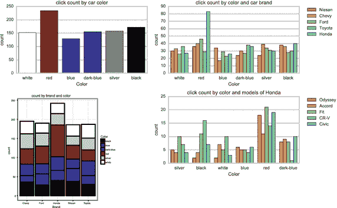
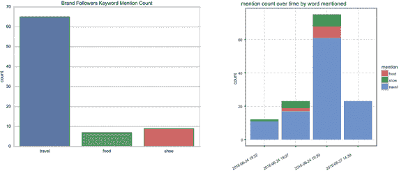
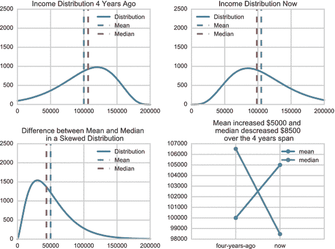
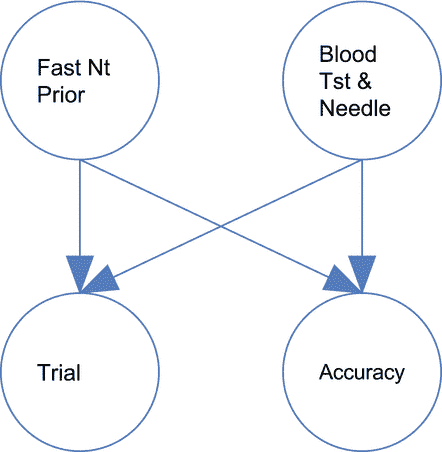
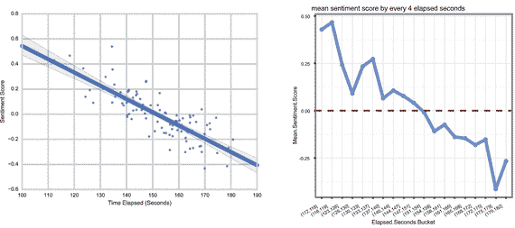
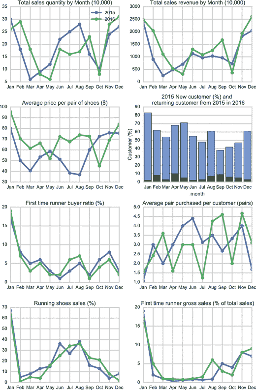

# 第一部分  
## 定义数据科学

在本部分中，我们将为“数据科学”这个术语划定边界。你很容易找到认同数据科学重要性的人，但很难找到超过几个人能对它有一个共同的定义。我们将从介绍数据库以及数据科学如何使用不同的数据类型开始。然后，你将看到如何对这些不同类型的数据应用统计分析。

### 1. 理解数据科学

在本章中，我首先定义什么是数据科学家以及他/她的工作内容。然后，我会介绍用于收集、清洗和分析数据的不同类型的软件和工具。一旦你了解了数据科学中使用的不同软件和工具，我将简要说明关注组织知识的重要性。

#### 定义一门具有多重含义的跨学科实践

那么，什么是数据科学家？数据科学家比其他类型的科学家更难定义。如果你是一名政治学家或气候科学家，你拥有来自成熟学科的学位。“数据科学家”这个词在“数据科学”成为一门定义明确的学科之前就已经被广泛使用了。即便现在，自称为数据科学家的人也来自各种不同的领域。作为一门学科，“数据科学”仍在自我厘清的过程中。这有点像早期的考古学。任何人只要拿起铲子开始挖掘文物，都可以自称为考古学家。如今，你必须经过大学的系统学习并花上数年时间进行研究才能成为一名考古学家。像早期的考古学一样，数据科学仍然更像是一种实践，而非一门学科。

如果你以科学的方式处理你的数据，你就是一名数据科学家。你是否选择自称为数据科学家，很大程度上仍然取决于你自己。当然，有些人比其他人更适合“数据科学家”这个头衔。如果你是一名统计学家或数据分析师，或者你在生物科学领域工作，你或许可以辩称自己一直都是一名数据科学家。最早自称数据科学家的一批人实际上是数学家；另一些人来自系统与信息工程领域，甚至还有人来自商业和金融领域。只要你与数字打交道，并且对数据略知一二，你就可以轻松地自称为数据科学家。

如今，随着对数据科学家需求的增长，将会有更多行动来创建标准化的技能集。你已经可以在伯克利、雪城大学和哥伦比亚大学的新设项目中看到这种趋势。新的学位项目将使公司在招聘时能够依赖一套通用的技能集。但目前情况并非如此。事实上，仍存在一种风险，即任何处理数据并更新了其领英个人资料的人都可能被视作数据科学家。

思考数据科学的最佳方式是关注“科学”而非“数据”。在此语境下，科学运用的是科学方法。你应该进行实验，并采用经验主义的方法观察结果。经验主义是科学家通过实验和问题对数据做出反应，从而获得见解和知识的途径之一。数据科学家每天都应运用这一技能。经验主义方法是知识与实践的结合。你可能在使用经验主义方法，自己却并未意识到。

作为一名教练和培训师，我经常需要出差。这通常意味着我得住进不同的酒店。我总是惊叹于世界上竟有如此多种多样的水龙头和装置。我最常纠结的事情之一就是如何应对酒店淋浴设备的复杂性。过了一段时间，我意识到处理这个问题的最佳方法就是采用经验主义。首先，我必须猜测如何打开淋浴。我先是提出一个经验性问题：如何打开淋浴？然后我进行实验。当我按下某个按钮时，浴缸开始注水。如果我按下另一个按钮，淋浴喷头就出水了。等水出来后，我不得不扭动不同的旋钮，看看能否调节水温。如果我拧动一个旋钮，水变得太烫。如果我拧动另一个，水又变得太冷。于是我不断地提问和重新评估，直到把水温调到舒适为止。我可不想用理论方法。我可能会从理论上推导如何让水温舒适，然后转动一个拨盘就跳进淋浴。问题是，我很有可能会被冻着或烫伤。

数据科学家一直都在使用这种相同的经验主义方法。他们向数据提问，并做出细微调整，看看能否获得洞见。他们转动“旋钮”，提出更有趣的问题。

在本书中，我所关注的数据科学家是指那些运用经验主义方法从数据中获取洞见，并专注于科学方法的人。我们强调的是“数据科学”中的“科学”，而非“数据”。

#### 使用统计学与软件

由于数据科学仍由实践来定义，因此使用通用工具和软件就显得尤为重要。请记住，数据科学家就像早期的考古学家。所以，把软件想象成你用来进行发现所需的刷子和镐。然而，尽量不要过分专注于学习所有工具，因为它们并非你需要了解的全部。使人成为数据科学家的是科学方法，而非工具。数据科学家所需的工具大致分为三类：

*   **存储数据的软件**：这些是电子表格、数据库和键值存储。一些流行的软件包括 `Hadoop`、`Cassandra` 和 `PostgreSQL`。
*   **用于清洗数据的工具**：数据清洗，也称为数据清理，通过修改或修正数据，或删除重复、格式错误、错误或不完整的数据，使数据更易于处理。用于清洗数据的典型工具有文本编辑器、脚本工具以及诸如 `Python` 和 `Scala` 之类的编程语言。
*   **帮助分析数据的统计软件包**：最流行的是开源软件环境 `R`、`IBM SPSS` 预测分析软件以及 `Python` 编程语言。这些软件大多包含数据可视化功能。你需要用它来制作漂亮的图表和图形。

##### 存储数据

首先，我们来看看存储数据所需的工具。你会经常听到一个术语：大数据。大数据听起来像一部 20 世纪 60 年代恐怖片的片名。你仿佛看到一个戴着猫眼镜框的尖叫女人被一团渗出的大数据山吞没。大数据是指那些巨大到无法放入大多数数据管理系统的数据集。有些人将数据科学和大数据混为一谈，因为它们在同一个时期被大肆宣传，并且常常被捆绑在一起。然而，请记住，数据科学是将科学方法应用于数据。这并不假定你的数据必须是“大”的。事实上，有一本好书叫*《数据智慧：用数据科学将信息转化为洞察力》*，作者是约翰·W·福尔曼¹，这本书仅使用电子表格就介绍了数据科学统计学。

尽管如此，数据科学中最活跃的领域之一仍然是围绕大数据的，并且有专门设计用于处理大数据的软件。开源软件包 `Hadoop` 当前最为流行。`Hadoop` 使用分布式文件系统将数据存储在一组服务器上，这组服务器通常被称为 `Hadoop` 集群。该集群还会在服务器上分配任务，以便你也能在服务器上运行应用程序。这意味着你可以在数百甚至数千台服务器上存储 PB 级的数据，并在集群中对数据运行处理进程。在 `Hadoop` 集群上运行的两个最常见的进程是 `MapReduce` 和 `Apache Spark`。`MapReduce` 以批处理方式处理数据，而 `Spark` 可以实时处理数据。

##### 数据清洗

收集到数据后，你很可能需要使用一些工具来清洗数据，使其更可用。通过修改、补充数据，或删除重复、格式错误、不正确或不完整的数据，数据清洗能让后续工作更轻松。想象一下，你正在收集数百万条客户的推文，其中可能包含文本、图片甚至视频。在收集这些数据时，你可以编写一个脚本，将所有传入的推文按类型（文本、图片、视频等）进行分类。这样一来，你就可以分别对每组数据进行分析，并使用不同的参数。如果这种分析工作很频繁，那么最好创建一个小型 Python 应用程序在集群上执行操作，而不是等到推文进来时再用脚本处理。

数据科学家可能花费多达 90% 的时间来调整和清洗数据，使其更可用，因此自动化这一过程对这一步骤至关重要。

##### 数据分析

最后一类工具是用于分析数据的工具。其中最流行的两个是 `R` 和 `Python`。

`R` 是一种统计编程语言和软件环境，它能让你在数据中建立联系和相关性，然后利用 `R` 内置的数据可视化功能呈现出来。这样你就可以为报告提供漂亮的图表。例如，假设你的公司想要一份报告，了解正面反馈与反馈发生在白天还是夜晚之间是否存在关联。获取这类信息的方法之一是：在 Hadoop 集群中捕获 Twitter 数据，然后使用数据清洗技术将推文分类为正面或负面。接着，你可以使用像 `R` 这样的统计软件包来创建正面/负面推文与其发布时间之间的相关性，并打印一份报告，用漂亮的图表展示结果。

请记住，这些都是最流行的工具。如果你是数据科学团队的一员，几乎可以肯定会在讨论中听到至少其中一种工具被提及。还有更多的工具可以自动完成数据收集、清洗和分析工作。

许多组织正在投入大量资金，试图在这个领域抢占一席之地。请记住，要专注于分析本身。数据和工具只是获得更深入见解的载体。在这个不断发展的领域，投资需谨慎。

#### 发现洞见，创造知识

在过去 20 年中，大多数组织通过简化业务流程，专注于提高运营效率，以求更精益、更灵活。他们提出运营类问题，例如：“我们如何能更好地协同工作？”

数据科学则不同；它不是目标驱动的。它具备探索性，并运用科学方法。它关注的不是组织运营得有多好，而是如何获得有用的商业知识。借助数据科学，你会提出不同类型的问题，例如：

*   我们对客户了解多少？
*   我们如何能交付更好的产品？
*   我们为什么比竞争对手更优秀？

这些问题都需要更高层次的组织思维，而大多数组织尚未准备好提出这类问题。他们习惯于设定里程碑和制定预算。他们并没有因保持怀疑或好奇心而获得回报。

想象一下，你在一次商务会议上，有人问了这些问题：我们为什么要这样做？是什么让你认为这会奏效？为什么这是个好主意？很可能，提出这些问题的人会被视为令人厌烦。通常，会有人这样回答：“你没看备忘录吗？”然而，这些正是建立组织知识所需的技能。这些正是你希望从数据科学团队那里得到的问题。但很多组织中的大多数人仍专注于完成任务。像上面提到的那些问题被视为前进的障碍。然而，作为一个组织，正是通过提出有趣的问题才能获得知识。

我曾为一家连接潜在购车者与经销商的网站工作。该网站上有数百个信息标签，用于显示客户是悬停还是点击了链接。所有这些数据都流入一个 Hadoop 集群，每周都有数 TB 的数据。公司还有长达数年的历史数据。他们投入巨资，甚至设立部门专门负责收集和维护这些数据。收集数据很容易。他们使用的软件简单且易于创建。困难的部分在于弄清楚如何处理这些数据。

对于许多刚刚涉足数据科学的组织来说，这似乎是一个共同的挑战。这些组织主要将其视为一个运营挑战。他们关注的是数据的技术层面。收集数据相对便宜且易于理解，因此大家关注收集。它在会议上很容易被接受，每个人都能支持这项工作。他们甚至会创建多个集群或数据湖，将来自整个组织的数据汇集起来。这是容易的部分。组织真正挣扎的是“科学”部分。他们不习惯提出和回答有趣的问题。

想想看，如果你是这家汽车网站的数据科学家，你可以设计哪些实验、提出哪些问题？你可以运行像图 1-1 那样的实验，更改图片的颜色，看看客户是否更有可能点击红色、蓝色或黄色的图片。如果报告显示，如果汽车是红色的，客户点击的可能性提高 2%，组织就可以与汽车经销商分享这一发现以创造新的收入。你可以运行一个实验，通过减少每页显示的汽车数量，来测试网站是否因为页面汽车过多而影响点击。然后，你可以生成一份报告，看看是否在减少显示车辆后，客户点击链接的可能性增加了。

图 1-1. 改变汽车的颜色

注意

了解如何创建这些图表，请访问 [`​ds.​tips/​4H5Ud`](http://ds.tips/4H5Ud)。

这就是数据科学家应该思考的那种实证研究。他们应该调整数据的各种参数，提出有趣的问题，运行快速实验，并制作设计精良的报告。

#### 总结

在本章中，你了解了什么是数据科学家以及他们的工作内容。你还了解了用于收集、清洗和分析数据的不同类型的软件和工具，以及如何发现洞见并创造知识。关键在于提出有趣的问题。在第 2 章中，你将学习一些数据库基础知识。

脚注 1

Foreman, John W. Data Smart: Using Data Science to Transform Information into Insight. John Wiley & Sons, 2013.

### 2. 数据库基础概述

正如你所见，数据科学的核心在于更好地理解你的数据。因此，你需要使用数据库来访问所需数据，以便提出有趣的问题。数据库有许多不同的类型。此外，还有许多专门用于数据库的术语。你需要熟悉数据库世界中使用的的基本概念和术语，以及不同数据库的组织方式。

#### 与关系型数据库建立连接

数据科学家会与多种不同形式的数据打交道，包括传统数据库或旧版电子表格。他们也可能处理图片和视频。作为一名数据科学家，你应该熟悉组织存储数据的常见方式。大多数组织都有各种各样的数据库，其中一些非常现代，而另一些则不那么现代。

理解这些不同技术的最佳方式是从源头开始。即使是最现代的数据库，也常常建立在超过 50 年历史的技术之上。现代数据库真正起步于 20 世纪 60 年代末的阿波罗太空任务。登月火箭需要数百万个零件，美国宇航局（NASA）与 IBM 合作创建了一个信息管理系统，即`IMS`，来组织这些数据。这家太空机构拥有早期的清单，这些清单看起来非常像现代的电子表格，它们是包含一系列列和长长行列表的计算机文件。

可以想象，在一个小型黑白终端上管理一个包含数百万行的表格可能会变得很困难。大约在同一时期，NASA 开始使用第一批关系型数据库。这些数据库将数据分割成多个表组。每个表看起来仍然像电子表格，但只代表数据中更小的一块。

然后，他们在这些表之间建立了关系。与其拥有一个包含百万个零件的长列表，他们可以创建 50 个表，每个表包含 2 万个零件。这就是为什么它们被称为关系型数据库：这种数据库基于彼此之间存在关系的表组。即使是早期的数据库工程师，也努力寻找将数据库表进行分组的高效方法。他们创建了图表来展示表之间的关系，这些图表被称为模式（schema）。模式决定了你的关系型数据库是易于使用，还是管理起来像一场噩梦。

即便是在这些早期数据库中，你也能看到工程师们在创建模式时可能遇到的困境。他们应该围绕最大的零件来创建表吗？也许只为推进器创建一个表，再为燃料箱创建另一个表？这里的问题是，如果你改变了火箭的设计，那么你也必须改变数据库的设计。

也许你可以根据零件的制造商来创建表。这样做的麻烦在于，可能有一家制造商生产数千个零件，而另一家制造商只生产几十个。这至今仍然是一个挑战。关系型数据库需要大量前期设计工作。在开始收集数据之前，你必须对自己的数据形态有相当多的了解。如果判断有误，重新设计数据库将耗费大量精力。

IBM 后来将他们为 NASA 创建的`IMS`商业化。在 20 世纪 70 年代中期，他们开发了结构化查询语言（`SQL`），以帮助客户从系统中提取数据。这种语言至今仍非常流行。`SQL`是一种优雅的语言，可以从多个不同的关系表中提取数据。它重新连接所有这些不同的表，并将数据呈现为仿佛全部存储在一个大型工作表中一样。这种虚拟表通常被称为“视图”（view）。

多年来，关系型数据库增加了许多功能，并催生了关系型数据库管理系统（`RDBMS`）。IBM、微软和甲骨文等公司至今仍在支持并开发关系型数据库管理系统。

> **注**  
> 你可能听到的另一个关系型数据库术语是`CRUD`，它代表创建（create）、读取（read）、更新（update）和删除（delete）。它描述了`RDBMS`的所有功能。有时人们会在前面加上一个`S`表示“搜索”（search），从而使用缩写`SCRUD`。

#### 使用 ETL 将数据加载到数据仓库

本节讨论的术语和概念被数据科学团队广泛使用。尽量不要被这些语言吓到。如果你理解了这些术语和挑战，你就更有可能快速获取所需的数据。

许多数据科学概念都建立在之前关于关系型数据库的工作之上。几十年来，公司一直在捕获并试图分析数据。即使在今天，`RDBMS`仍然是企业数据库的基石，你需要理解`RDBMS`术语才能做好数据科学项目。你很可能遇到`RDBMS`术语的一个场景是处理企业数据仓库（`EDW`）。`EDW`是一种特殊类型的关系型数据库，专注于数据分析。传统数据库针对在线事务处理（`OLTP`）进行了优化，而`EDW`则用于在线分析处理（`OLAP`）。

可以这样理解：典型数据库专注于实时处理数据，而`EDW`则专注于分析已经发生的事情。

假设你有一个销售跑鞋的网站。你聘请了一名工程师来创建数据库。她创建了几十个不同的表和关系，包括客户地址表、鞋子表、运输选项表等等。网络服务器使用`SQL`语句来收集数据。当客户购买一双鞋时，他们的地址数据与鞋子关联，网络服务器向客户提供其运输选项，然后鞋子被发出。你希望这个数据库快速高效，并专注于快速响应。这个数据库记录的是客户正在进行的实时操作。这就是一个`OLTP`数据库。

你还要求你的数据库工程师创建一个脚本，每天将数据上传到你的仓库。你的数据仓库针对分析处理进行了优化。这就是一个专注于生成报告的`OLAP`数据库。

你让一位数据分析师创建一份报告，看看客户的地址与鞋子类型之间是否存在任何关联，如图 2-1 所示。你发现，居住在较温暖地区的人更有可能购买颜色鲜艳的鞋子。你利用这一信息修改了网站，使来自温暖气候地区的客户在页面顶端看到颜色更浅的鞋子。

图 2-1. 按州划分的平均颜色亮度

> **注**  
> 了解如何创建此图表，请访问 [`http://ds.tips/trAp8`](http://ds.tips/trAp8)。

现在假设你的网站大获成功，并被一家销售各类运动服装的公司收购。那家公司为其所有网站建立了一个统一的仓库，他们想要将你网站的数据与他们所有其他网站的数据合并。这时，该公司会执行一个称为`ETL`的操作，它代表提取（extract）、转换（transform）和加载（load）。他们从你的网站提取数据，然后将数据加载到他们的`EDW`中。

当他们提取你的数据时，会尝试采用某种标准格式，以便他们能够将数据转换成适合其数据仓库的形式。他们仓库中的表可能具有不同的模式。例如，数据仓库可能将运输信息放在客户表中，而你的数据库则有独立的运输信息表。数据必须经过转换才能被加载到`EDW`中。数据分析师很可能将大部分时间花在清洗和连接数据上，使其符合要求，最后将转换后的数据加载到仓库中。

上述场景并非唯一需要执行`ETL`的情况。有些公司可能有一个独立于 Hadoop 集群的数据仓库，在这种情况下，他们需要对仓库数据运行`ETL`，以将其移动到 Hadoop 集群中。这时，数据分析师需要转换数据，以便集群能够使用。

许多组织常常将 Hadoop 视为昂贵数据仓库的替代品。他们希望通过将数据存储在廉价的硬件上，而不是昂贵的仓库设备上来节省成本。在这种情况下，公司可能会重写他们的`ETL`流程，以便将数据加载到 Hadoop 集群中，然后逐步淘汰或关闭数据仓库。

#### 用 NoSQL 放下过去

通常，数据科学团队需要一种更灵活的方式来存储数据。请记住，关系型数据库依赖模式（schema）。在将数据放入数据库之前，你需要对数据有充分的了解，这意味着你必须提前规划。你必须知道数据库字段中出现的数据类型（文本、视频、音频或其他），将这些字段组织成表，然后创建表之间的关系。数据库需要一套固定的结构，这样才能创建、读取、更新和删除记录。对于某些极其庞大的数据库，这种开销可能会拖垮你的服务器。

让我们回到你的跑鞋网站。一位顾客找到一双鞋，然后进入结账页面。此时，网站将正在购买的这双鞋与顾客的地址关联起来。这个结账页面需要访问四个不同的数据库表：

*   鞋子表
*   顾客表
*   地址表
*   物流表

这对数据库来说是一大堆工作。数据库工作越吃力，你的网站速度就越慢。

如何加快速度呢？你需要购买更大的服务器、将表拆分到多个服务器上，还是让多个服务器通过网络同步？对于真正的大型网站来说，这些选项可能显得不自然。

现在，想象一个数据库，它将结账页面中的所有内容作为一个事务（transaction）来存储。一个数据库事务是一项要么全做、要么全不做的工作单元，必须完成。它为鞋子、你的顾客、他们的地址和物流一次性创建一个记录。现在，如果数据没有被拆分成表，也不需要查询任何关系，那会怎样？信息直接存入，你就大功告成了。

这就是 NoSQL 背后的理念。NoSQL 最初是作为 Twitter 上的一个话题标签（hashtag）使用的，供那些想要超越关系型数据库的开发者使用。它实际上并不是对 SQL 的攻击。事实上，NoSQL 与 SQL 并没有太大关系。它更多是关于关系型数据库的局限性。通常，一个 NoSQL 数据库应该是非关系型、无模式（schema-less）、对集群友好，并且最好是开源的。

所有这些特性都应该能吸引数据科学团队。非关系型数据库通常更容易更改，使用起来也更简单。你的 Web 应用程序的外观与数据存储方式之间不必存在脱节。你也无需经历创建和拆分现有表这种繁琐的过程，这通常被称为数据库规范化（normalizing your database）。没有模式，你就不用担心事先要了解一切。

回到跑鞋网站。它被一家更大的公司收购了。这家公司想把你的客户加入他们的常客计划。对于关系型数据库来说，这是一个严峻的架构挑战。你应该在客户表中加入常客编号吗？是否需要创建一个全新的表来专门存储常客编号？一个客户可以有多个买家编号吗？两个客户可以共享同一个编号吗？在将客户加入常客计划之前，所有这些都需要理清。你必须重新设计数据库，并弄清楚如何修正缺失的数据。

没有模式，新字段就变得几乎微不足道。你只需将其作为一个事务存储。如果客户有常客编号，它就会出现在事务中。如果客户没有，那么这个字段就不存在。

最后，NoSQL 数据库应该对集群友好。你应该能够将数据存储在几百甚至几千个数据库服务器上。在 NoSQL 中，保存在事务中的记录被称为聚合（aggregate）。这些聚合包含了所有数据：鞋子、顾客、地址和物流信息。这些聚合更容易在多个数据库服务器之间同步。大多数服务器采用集群方式工作。这使得它们可以相互同步，然后向其他集群发送更新。

> **注意**
> “集群”这个词听起来应该很熟悉。这与 Hadoop 处理其数据集的方式相同。事实上，Hadoop 的很多部分都是建立在 HBase 之上的，而 HBase 是一个开源的 NoSQL 数据库。

当你在数据科学团队工作时，几乎肯定会遇到 NoSQL。对于许多组织来说，这是处理大型数据集的首选方式。由于其更简单的设计，开发人员创建能够快速成长为企业级规模的 Web 应用程序也变得更加容易。

#### 大数据问题

如前所述，大数据和数据科学紧密相连，以至于许多组织将它们视为同一回事。请记住，数据科学是运用科学方法提出有趣的问题。这并不意味着你需要大量数据才能提出这些问题。大数据提供了一个丰富的新数据源，让你能够提出那些使用较小数据集无法回答的问题。

大数据实际上并不是一个名词。在最初的 NASA 论文中，它被描述为一个“大数据问题”。你可以用两种方式来理解：是“大数据”问题，还是大“数据问题”。如果你通读整篇论文，似乎他们强调的是问题。重点不在于“大数据”，而在于如何处理所有这些新数据的问题。十年后，麦肯锡的报告中也提到了这一点。在这份报告中，作者将大数据定义为超出常用硬件和软件能力范围的数据。

那么，为什么将大数据视为一个“问题”而非一个名词如此重要呢？这是因为许多启动大数据项目的公司实际上并没有真正的大数据。可能看起来数据量很大，所以显得很大。同时，因为存储和收集起来确实很有挑战，所以看起来像个问题。但这不是一个“大数据问题”。

判断你是否遇到大数据问题的一种方法是，查看你的数据是否属于四类。你可以将这四类记住为四个 V。问问自己这些问题：

*   我的数据量（Volume）大吗？
*   我的数据类型（Variety）广泛吗？
*   数据是以高速度（Velocity）传入的吗？
*   我收集的数据具有真实性（Veracity）吗？

要成为大数据，它必须具备所有这四个属性。

数据量的问题通常很容易回答。如果你每天收集 PB 级别的数据，那么你的数据量可能足够大。当然，这并不总是一个问题。在不久的将来，或许 EB 级别才会被认为是构成问题的足够大的数据量。

数据应该有广泛的信息类型。可以是文本、视频、声音和图片。

关于速度，想想纽约证券交易所。他们每天处理数十亿笔交易。他们以高速度接收着大量数据。股票价格涌入并以毫秒为单位波动。然而，所有数据都是同一类型。通常只是股票代码和价格——大部分是文本。他们收集交易数据，而不是图片、声音或新闻故事。所以他们并没有大数据问题。他们当然收集了很多数据，但他们现有的技术应该完全有能力应对这个挑战。

最后，考虑一下数据的真实性。想象一下，你创建了一个数据库，收集了所有关于你网站的推文和 Facebook 帖子。你收集视频、图片和文本。每天有数 PB 的数据流涌入你的集群。你运行报告，想看看客户对你的产品是持积极态度还是消极态度。仔细查看数据后，你意识到其中并没有一个问题可以判断客户的情绪。所有收集无用数据的努力都白费了，因为那些数据并没有提供任何你需要的信息。

#### 大数据与数据类型

为了提供一个有趣的大数据问题示例，不妨想一想自动驾驶汽车所面临的挑战。你需要收集哪些类型的数据？你需要收集海量的视频、声音、交通报告和 GPS 位置信息——所有这些数据都实时、高速地流入数据库。然后，汽车必须判断哪些数据具有最高的真实性。那个人在路边尖叫是因为一场体育比赛，还是因为有人站在路上？人类驾驶员只有几秒钟的时间来弄清楚这一点。一辆使用大数据的汽车必须即时处理视频、音频和交通坐标，然后决定是停下来还是忽略这个声音。这是一个真正的大数据问题。

> **提示**
> 
> 请记住大数据与数据科学之间的区别。大数据能让你提出更有趣的问题。但这并不意味着所有有趣的问题都需要大数据。专注于科学本身。这样，无论你拥有什么数据，你总能提出最好的问题。

---

#### 本章小结

在本章中，你了解到，由于数据科学围绕有趣的数据展开，你通常需要处理多种类型的数据库。你学习了一些专门用于数据库的术语，以及围绕该技术的一些基本概念和术语。你还了解了数据库的组织方式。在第 3 章中，你将学习如何识别不同的数据类型。

**参考文献**

1.  Cox, Michael, and David Ellsworth. “Application-controlled demand paging for out-of-core visualization.” In *Proceedings of the 8th conference on Visualization’97*, pp. 235-ff. IEEE Computer Society Press, 1997.
2.  Manyika, James, Michael Chui, Brad Brown, Jacques Bughin, Richard Dobbs, Charles Roxburgh, and Angela H. Byers. “Big data: The next frontier for innovation, competition, and productivity.” (2011).

---

### 3. 识别不同的数据类型

当你身处数据科学团队时，你经常会处理许多不同类型的数据。这些不同的类型将成为决定你如何存储数据的关键因素。像`NoSQL`这样的技术为你提供了极大的灵活性来存储不同的数据类型。关系数据库的灵活性较低，但有时更容易使用，并且通常在关系数据库中生成报告也更容易。

当你考虑如何存储数据时，你需要了解不同的数据类型。对于任何存储方式来说都是如此。某些数据库针对特定类型的数据进行了优化。就像你不会想把三明治存放在水罐里一样，你也不应该建立一个关系数据库来存放错误类型的数据。

你的团队应考虑以下三种数据类型：

*   **结构化数据**：遵循特定顺序和特定格式的数据。
*   **半结构化数据**：具有一定结构，但同时具有额外灵活性，可以更改字段名称和创建值的数据。
*   **非结构化数据**：不遵循模式且没有数据模型的数据。

我们将在以下章节中更详细地探讨这些数据类型，然后介绍什么是“大数据垃圾”，并为你提供一些从中筛选的技巧。

#### 保持简单：结构化数据

第一种数据类型在很多方面都是最简单的。它通常被称为结构化数据。结构化数据是遵循特定顺序和特定格式的数据。它就像数据库世界中的砖块和砂浆——廉价、不灵活，并且需要大量前期设计。

结构化数据的一个好例子是典型的办公电子表格。当你用数据填充行时，你必须遵循相当严格的格式和结构。例如，你可能有一个名为`Purchase Date`的列。每个字段都必须遵循严格的指导原则。你不能在一行中填入`Tuesday`，然后在下一行填入`March`。你必须遵循指定的格式；例如，数字月份后跟斜杠、日期和年份（类似于`MM/DD/YYYY`格式）。

这种格式和结构被称为数据模型。结构化数据依赖于这个数据模型。数据模型类似于数据模式，只是模式用于定义整个数据库结构。数据模型定义了单个字段的结构。它定义了你如何确定每个数据字段中的内容。你决定该字段是包含文本、数字、日期还是其他任何内容。

思考一下电子表格的例子，以及如果你忽略数据模型可能会发生什么。如果你在一行的`Purchase Date`字段中输入`Tuesday`，在另一行中输入`March`，当你想要创建一个显示三月份所有购买的报表时会发生什么？你会怎么做？你会使用数字三吗？你会使用单词`March`吗？你肯定不能使用单词`Tuesday`。

如果你进行了这种类型的数据输入，你的电子表格将充满数据垃圾。每当你尝试对数据进行排序或创建报表时，都会出现一堆包含无效数据的行。然后你将不得不返回去清理它们，或者直接从报表中删除它们。这就是为什么许多电子表格应用程序都有格式规则，强制你在输入数据时遵循特定模型。

数据库也是如此。许多数据库会拒绝不遵循模型的数据。通常，用于收集数据的网站（或中间件）会为各个字段设置特定的类型和格式。

关系数据库擅长收集结构化数据，这意味着存在大量的结构化数据。你在网站或通过移动应用访问的许多数据都来自结构化数据。你的银行对账单、航班信息、公交时刻表，甚至你的通讯录都是结构化数据的形式。

但这并不意味着大多数数据都是结构化的。实际上，大多数数据并不遵循特定的格式和结构。事实上，一些更有趣的数据根本不遵循任何结构。像视频、音频和网页这样的数据没有定义好的结构。

作为数据科学团队的一员，你需要将数据类型与收集方法结合起来。如果你使用关系数据库，你主要局限于结构化数据。对于结构化数据，生成报告通常非常直接。你可以使用结构化查询语言（`SQL`）从数据库中提取数据并以标准格式显示。如果你使用`NoSQL`集群，你可以处理所有数据类型，但生成报告会更加困难。这些都是你的团队需要考虑的决策。

#### 共享半结构化数据

当关系数据库中存储着结构化数据时，世界万物似乎都显得条理清晰、井然有序。这就好比把所有香料都装进香料罐里——你清楚每样东西在哪里，也知道确切该去哪里找。然而，很少有应用能始终保持如此简单。

半结构化数据比结构化数据更难定义，因此我们以跑步鞋网站为例进行说明。假设你为这个网站使用了关系数据库，其中包含四张表：鞋子、客户、客户地址以及配送选项。所有结构化数据都符合某个数据模型，日期格式是标准的，邮政编码也是标准的。一切运行顺畅，世界似乎尽在掌控。

接着，你收到了配送承运商的一封邮件。承运商表示，只要直接将信息添加到他们的数据库，就能大幅降低成本。你只需查询他们的数据库，下载某个区域配送代码，然后将其添加到订单中并创建一条新记录。这应该很简单，因为他们的数据库和你的差不多——都是关系数据库中的结构化数据。

问题在于，他们的模式与你的模式不同。你称邮政编码数据为`ZIP Code`，而他们则称之为`postal code`。你并不关心鞋子是寄往公司还是住宅，但他们关心。你也没有指定是房子还是公寓，而他们对不同情况有不同的费率。现在，你需要一种方法，将你的结构化数据与他们的结构化数据进行交换，尽管双方的模式各不相同。

为了解决这个问题，你需要下载承运商的数据及其相关模式。当客户订购一双鞋时，你的数据库会将邮编发送给承运商的数据库，并返回一堆数据，其中包含他们版本的地址，带有他们的字段名和数据模型。记住，他们用`postal code`来表示邮政编码，这也会包含在新数据中。

他们的数据具有结构化数据的一些特征：组织良好、格式标准。文本字段是文本，日期字段是日期。但是，这些数据包含了他们自己的模式。承运商可以使用任何他们想要的字段名。这就是为什么这类数据被称为半结构化数据。

半结构化数据甚至比结构化数据更为常见。它有结构，但这个结构取决于数据来源。你会一直与半结构化数据打交道。电子邮件就是半结构化数据，它具有相当一致的结构（总是有发件人和收件人），但邮件内容可能千变万化，可能只是纯文本，也可能包含图片或附件。

数据科学团队通常处理的半结构化数据比结构化数据更多。大量的电子邮件、网络日志和社交网站内容都可以进行分析。

在谈论处理和交换半结构化数据时，有几个术语非常常见。其中之一是**可扩展标记语言**（`XML`）数据类型，这是一种较旧的、用于信息交换的半结构化数据类型。还有**JavaScript 对象表示法**（`JSON`），这是一种更新式的半结构化数据交换方式，通常是网络服务的首选数据类型。

纳入半结构化数据是提出更有趣问题的好方法。回到跑步鞋的例子，假设你想获取客户对跑步鞋订单的反馈。你可以从一些大型社交媒体网站下载半结构化数据，然后将其与你已有的客户结构化数据相结合。如果客户对他们的鞋子不满意，你可以发送一张道歉优惠券。

这些都是你可以利用结构化和半结构化数据发现的问题。你的团队可以开始调查客户对其购买的满意度。

#### 收集非结构化数据

最主流的数据类型是既非结构化也非半结构化的所有数据：非结构化数据。一些分析师估计，80% 的数据都是非结构化的。仔细想想，这很有道理。思考一下你每天产生的数据：每次你留下语音邮件、上传到 Facebook 的每张照片、你在工作中创建的 OneNote 备忘录或 PowerPoint 演示文稿，甚至你在网上搜索时产生的数据——所有这些都是非结构化的。

那么，所有这些数据有什么共同点呢？这是最大的挑战。答案是：共同点不多。它没有模式（schema-less）。记住，模式是显示数据字段、表和关系的地图。对于非结构化数据，你没有这张地图。此外，非结构化数据的格式取决于文件本身。Microsoft Word 文档可能有一个固定格式，但这个格式只被该应用程序使用，并非所有文本的通用格式。这就是为什么你通常无法在另一个程序中编辑 Microsoft Word 文档。

这也意味着没有固定的数据模型，没有一致的地方可以查找字段名和数据。如果你有十几个文档，你如何找出它们的标题和内容？如果其中一些是 PDF，一些是 Microsoft Word 文档，还有一些是 PowerPoint 演示文稿，该怎么办？每种都有其专有格式，根本找不到一个标有`document title`的字段来查询。

这是像谷歌这样的搜索引擎公司多年来一直致力于解决的挑战。你如何处理没有固定格式、也没有一致数据模型的数据？每次你使用这些搜索引擎时，都能看到他们努力的成果。如果你搜索`cat`这样的词，你会看到文本、视频、图片，甚至音频文件。

处理非结构化数据是数据科学中最有趣的领域之一。像 NoSQL 这样的新型数据库允许你捕获和存储大型文件。将所有数据存储在一个地方要容易得多。所有的音频、视频、图片或文本文件都可以存入一个 NoSQL 集群。

如果你想捕获所有数据，也有一些新工具可用。你可以使用像 Hadoop 这样的大数据技术来进行批处理或实时处理数据。

那么，让我们回到你的跑步鞋网站。业务有了一些增长，现在你加入了新的数据科学团队。你与市场和管理部门合作，提出了第一个有趣的问题：谁是最好的跑步鞋客户？你收集了一些基本的人口统计信息，这些信息在客户数据库中很容易找到。你有他们的电子邮件地址以及他们所在的城市和州。你利用这些信息，开始爬取客户的社交网络帖子。你开始收集所有的非结构化数据。也许你的客户发布了一段完成马拉松的视频，你可以发送一条祝贺推文。

你或许还会决定开始爬取客户好友的帖子。也许你的客户发布了一张他们与一群人一起跑步的图片。你可以利用非结构化数据来识别那些人，并向他们发送特别促销信息。

这类数据项目通常被称为客户的 360° 视图。你试图找出所有能了解他们动机的信息。然后，你可以利用这些信息找到最佳客户并发送促销信息。你也可能会发现，有几位客户推荐了很多朋友，你可以为他们提供特别的激励和折扣。

随着时间的推移，你可以捕获越来越多的客户非结构化数据，这将使你能够提出关于客户更复杂的问题。例如：他们更有可能旅行吗？他们更有竞争意识吗？他们多久去一次餐厅？每一个问题都可以帮助你与客户建立联系并销售更多产品。在收集这些数据时，你可能希望像图 3-1 所示那样，以图表形式展示出来。

**图 3-1.** 品牌关注者关键词提及量

**注意：** 了解如何创建此图表，请访问 [`http://ds.tips/Muj7f`](http://ds.tips/Muj7f)。

非结构化数据是一种与日俱增的资源。想想你今天做了哪些可能让一家公司感兴趣的事情。你是否发推文吐槽通勤路途漫长？也许你需要一双更好的鞋子。你是否抱怨过雨天？你应该买把伞。非结构化数据使公司能够提供这种层次的互动。

#### 筛检大数据垃圾

非结构化数据带来了一系列新的挑战。你遇到的第一个问题就是是否要删除数据。请记住，数据科学团队会对其数据应用科学方法。你希望能够提出有趣的问题。你需要决定是否要对想提出的问题设置任何限制。

保留数据和丢弃数据都有充分的理由。一些数据分析师认为，你永远无法预知自己可能会提出哪些问题，那么为什么要丢弃数据呢？此外，存储海量数据相对便宜——通常每千兆字节只需几美分。与其决定丢弃哪些数据，不如全部保留。有时候，购买新硬盘比花时间参加数据保留会议更划算。

另一些分析师则认为应该丢弃数据。那些大数据集群中可能包含大量垃圾。垃圾越多，就越难找到有趣的结果，因为信息中包含了太多噪音（无意义的数据）。决定保留还是删除数据，是许多数据科学团队仍在探索的难题。

我曾在一家应对这一挑战的公司工作。他们运营着一个连接潜在购车者与汽车经销商的网站。他们创建了一个标签系统，记录客户在其网站上的所有浏览行为。每当客户将鼠标悬停在一张图片上，数据库就会新增一条记录；他们点击的所有链接也都会被收集。这个系统发展出了数千个标签。每个标签都对应着数百万笔交易。公司内部只有少数人理解每个标签捕获的内容，这使得他们很难生成有趣的报告。

他们对非结构化数据也使用了同样的标签系统。他们开始收集广告和 Flash 视频的信息。他们希望将标签、图片和交易关联起来，这样就能看到客户点击的图片以及指示其在页面上位置的标签。所有这些信息都存储在日益增长的 Hadoop 集群中。

团队中有人认为大量数据已经过时了。只有少数人了解这套标签系统，而且广告在不断变化。此外，了解标签系统的人开始重命名标签，导致大量数据变得陈旧。

团队中的其他人则认为，与 Hadoop 集群的存储容量相比，这只是一小部分数据。谁会在乎几 GB 的过时数据呢？不值得为此费心清理。

你也可能会遇到这类挑战。处理时，请记住以下几点：

- 实际上并没有标准答案。你的数据科学团队只需找出最适合他们的方法。
- 如果你决定保留所有数据，那么在生成有趣报告时可能需要付出更多努力。你需要进行更多的过滤，数据中也会存在更多噪音。
- 如果你决定丢弃数据，集群会更干净。但是，你有可能无意中丢弃一些未来会后悔的数据。就像清理你的衣柜一样，你永远不知道那件麂皮领夹克什么时候会重新流行起来。但如果你保留太多夹克，可能会忘记自己有什么。

最重要的是确保你的团队做出决定。你不希望数据政策每几个月就变一次。要么在一开始就决定计划保留所有数据，要么确定要丢弃一些数据。与团队合作，确保每个人都同意这项政策以及哪些数据可以丢弃。如果没有既定政策，你可能会破坏所有数据。如果你不知道丢弃了什么、保留了什么，就很难理解报告的含义。尽早尝试找出最适合团队的办法。

#### 总结

在本章中，你了解到结构化数据是按照特定顺序遵循特定格式的数据。你还了解到半结构化数据是具有一定结构，但字段名称可以灵活更改的数据。最后，还有非结构化数据，即其他所有数据。它是不遵循模式、也没有数据模型的数据。你还了解了大数据垃圾，并掌握了一些筛检技巧。在第 4 章中，你将学习如何将统计分析应用于你的数据。

### 4. 应用统计分析

数据科学团队大部分时间都用于收集和存储数据，然后利用这些数据来提出问题。他们利用统计学和数学创建报告，看能否找到答案。统计学是一个非常有趣的领域。要加入数据科学团队，你需要对该领域的语言有基本的了解。在探索统计分析时，有几个术语你需要熟悉，它们是：

- **描述性统计**：以有意义的方式分析、描述或总结数据，以发现数据中模式的过程。
- **概率**：某件事发生的可能性。
- **相关性**：衡量两个事物之间关联程度的一系列统计关系。通常用 1 到 0 之间的数字来衡量。
- **因果关系**：当一个事件是另一个事件发生的结果时。
- **预测性分析**：将统计分析应用于历史数据，以预测未来。

我们将在以下各节中更详细地介绍每一项。阅读这些章节时，请务必留意更多的统计分析术语。

#### 初识描述性统计

统计是讲述故事的工具，但它们本身并非故事的终点。判断你从故事中获取了多少信息的最佳方法，就是在感觉不对劲时提出质疑。

我儿子曾给我讲过一个与此相关的绝妙笑话，展示了团队如何利用统计来讲述故事。他问：“为什么你从来没见过大象藏在树上？”我耸了耸肩，他回答说：“因为它们太擅长藏身了。”在看报告时，请试着回想这个笑话。人们通常将统计视为具体的数学。谁会质疑二加二等于四呢？事实上，统计更像是讲故事。和任何故事一样，它可以充满事实、虚构和幻想。如果你不知道该往哪里看，一些相当庞然大物（大象）就能被隐藏起来。

你会在政治领域看到这种情况。一位议员可能说：“过去四年里，选民的平均工资上涨了 5000 美元。”人们会鼓掌。挑战者可能说他们不应该鼓掌，并指出“典型的中产阶级家庭现在的收入比四年前少了 10000 美元。”谁说真话了？答案是两人都说了真话。他们只是用统计来讲述不同的故事。一个故事谈论繁荣，另一个则谈论失败。两者都是真实的，然而都没有说出全部真相。你必须找到每个故事中隐藏的“大象”。

在这个案例中，议员们使用的是描述性统计。他们试图在不与每个家庭交谈的情况下，描述所有选民的整体状况。他们正在构建一个关于典型家庭的故事。

一位议员使用了一种叫做**均值**的方法。这是最有用、最流行的描述性统计量之一。你会在平均绩点、体育比分、通勤时间和投资中看到它的应用。在这个例子中，议员将所有家庭的收入相加，然后除以家庭总数。果然，每个家庭大约多赚了 5000 美元。

但是且慢。均值并非描述典型家庭的唯一方式。竞争对手议员有另一种方法。她使用**中位数**家庭收入。中位数描述了处于中间位置的家庭的收入水平。要找到这个数字，你需要将所有家庭从低到高排序，然后从上到下编号。通过将排名一分为二，找到中间的那个数字。处于中间位置的家庭的收入就是中位数收入。

竞争对手议员发现中位数收入减少了 10000 美元。这表明平均家庭收入增加了 5000 美元，但中位数家庭收入却减少了 10000 美元。这是对同一批家庭的两种描述，却讲述了不同的故事，如图 4-1 所示。

图 4-1. 同一批家庭的不同故事

注：查看如何创建这些图表，请访问 [`http://ds.tips/c6Aha`](http://ds.tips/c6Aha)。

当你看到这种情况时，记得要寻找那只“大象”。当中位数和均值之间存在巨大差异时，通常意味着你的数据存在偏斜。在这个案例中，想象一下有几个家庭极其富有。在过去的几年里，他们的收入大幅增长。这贡献了数百万美元的增量。这些家庭会使数据发生偏斜，因为顶端有一大笔钱。这会抬高均值，但不会真正影响中位数。在计算均值时，他们的收入会像其他人一样被加总。在计算中位数时，他们很可能只是排在顶端。处于中间位置的家庭根本不会改变。

你还会在其他方面看到中位数和均值带来的这种挑战。如果房间里站着两个人，他们的平均身高可能略低于六英尺。如果一个篮球运动员走进房间，他们的平均身高可能会增加一英尺。而身高的中位数则会大致保持不变。

在你的数据科学团队中，当你看到用统计讲述的故事时，不要害怕提问。同时，请确保你的报告使用不同的方式来描述数据。描述性统计可以讲述许多不同的故事。

#### 理解概率

概率是统计中另一个让你能够讲述有趣故事的领域。概率是指某件事情发生的可能性。它是对可能结果的度量。如果你抛一枚硬币，概率给出了硬币落在某一面或另一面的可能性。统计方面的概率研究侧重于**概率分布**。如果你掷一个六面骰子，那就意味着有六种可能的结果，任何一个数字出现的可能性都是六分之一。这意味着每次掷骰子，你击中特定数字的概率大约是 17%。概率也可以展示一系列事件。如果你想展示连续两次掷出同一个数字的可能性呢？那就是 17%的 17%，大约为 3%。如果你在玩一个骰子游戏，这是一个相当低的概率。你的数据科学团队肯定会用到概率。它是预测分析的关键部分。它能帮助你判断客户更有可能做出某一种行为而非另一种行为的可能性。

我曾与一家生物技术公司合作，该公司试图利用数据科学来预测某人参与临床试验的可能性。让人们参与临床试验是一件棘手的事情。有一定数量的诊所，公司需要维持诊所的运营——即使它们是空的。如果诊所病人不满，公司就会亏损收入。

他们问了一个有趣的问题：“有哪些因素会阻碍人们参与临床试验？”事实证明，有许多因素可能会降低某人参与的概率。如果人们需要在前一天晚上禁食，他们参与的可能性可能会降低 30%。此外，如果涉及抽血和针头，他们参与的可能性可能会降低 20%。图 4-2 是一个流程图，展示了既往参与经历、检验项目和恐血之间三方面的关系。

图 4-2. 既往参与经历、检验项目和恐血三者之间的关系

注：查看如何创建此图表，请访问 [`http://ds.tips/V2tup`](http://ds.tips/V2tup)。

公司必须在人们参与的概率与结果的准确性之间取得平衡。例如，有一个药物试验，公司可以通过唾液测试或血液测试来检查药物的有效性。血液测试的准确率高出 10%。这很简单；他们应该直接使用血液测试。但是且慢。如果他们用血液测试进行试验，由于害怕针头而决定不参与研究的人，会导致参与者减少 20%。如果他们想要 1000 名参与者，那意味着少了大约 200 人。

这又引出了另一个有趣的问题。如果测试少了 200 人，这是否意味着药物试验的准确性会降低？数据科学团队创建了另一个概率分布。如果药物引起某种反应的概率是 1/500 呢？用 1000 个人进行研究会比只用 800 个人好得多。

数据科学团队必须考虑到这一点。是让更多人参与无需扎针的研究（即使唾液测试准确度较低）更好吗？这引出了更多问题。团队是否应该让参与者多次进行唾液测试，以增加获得准确结果的概率？最终，这便是数据科学团队帮助公司做出的决策。或许，让尽可能多的人参与试验以增加发现药物反应的概率才是最佳方案。然后，他们可以更频繁地进行准确度较低的测试，以提高获得准确结果的概率。这样既能实现参与人数最大化，又能同时提升研究准确度——这一切都归功于概率的力量。

在数据科学团队中运用概率时，有几点需要牢记。首先，概率可能会带你走向意想不到的地方。谁能想到，采用准确度较低的测试方法，反而可能让医疗实践获得更好的结果呢？其次，概率也是提出有趣问题的绝佳载体。如果你的问题只是引出更多问题，请不要气馁。

请记住，数据科学涉及将科学方法应用于你的数据。有时，道路会带你走向未曾预料之处。关键在于，当路径出现急转弯时（这在处理概率时很容易发生），不要半途而废。这些急转弯往往正是通往你最深刻洞见的途径。

#### 寻找相关性

相关性是数据科学中另一个非常有趣的领域。许多公司用它来猜测你会购买哪些产品。它也用于将你与朋友和熟人联系起来。如果你使用像 Netflix 这样的服务，你可能会惊讶于网站能如此准确地猜出你会喜欢什么电影。亚马逊多年来一直利用相关性来推荐书籍。

相关性是一系列统计关系，用于衡量两个事物之间的关联程度。它通常以 1 或 0 来衡量。如果两个事物密切相关，则相关性为 1。如果两个事物毫无关联，则相关性为 0。1 可以表示为正数或负数。-1 通常表示反比关系或反相关性。

正相关的一个例子可能是身高和体重。一个人个子越高，体重可能越重。身高增加，体重也随之增加。还有更直接的例子，比如室外温度越高，买冰淇淋的人就越多。随着温度升高，冰淇淋销量也随之上升。负相关的一个例子可能是汽车和汽油。汽车越重，燃油效率就越低。随着汽车重量增加，油耗里程数下降。它们之间是反比关系。

如果你是一名跑步者，你可能会注意到上坡时跑得更慢。这也是一种负相关。坡度越陡，跑得越慢。随着坡度增加，你的速度下降。

正相关和负相关都是观察两个事物之间关系的绝佳方式。负相关并非坏事，它只是另一种关系类型。

数据科学团队会在数据中寻找相关性。他们会试图微调人与事物之间的任何关系。幸运的是，软件工具可以处理计算相关性背后的大量数学运算。一个常用的公式是相关系数，即 1、0 和 -1，用于指示人与事物之间是否存在统计关系。

在计算相关系数时，你通常不会得到一个完美整齐的整数。相反，你可能会发现相关性是 `.5` 或 `-.75`。这表示相关性的强弱——数值越接近 1 或 -1，关系越强。

一个有趣的数据科学挑战是领英的“可能认识的人”功能。领英希望找到一种方法来判断专业人士之间是否相识。有数据科学团队专门分析领英数据，寻找人脉之间的相关性，然后试图找出他们产生联系的原因。这些联系可能源于他们曾就读的学校、共同从事过的工作，或者共享的群组和兴趣。

这个数据科学团队会寻找正相关和负相关。他们可能在网站上发现你在某家公司工作，并且对某个职位感兴趣。然后他们找到另一位也对同一职位感兴趣且在同一家公司工作过的人。这就足以在你和这个人之间建立相关性；因此，网站可能会建议你与这个人建立联系。

数据科学团队还可以在你的人脉和他人的人脉之间建立相关性。如果你与某人有联系，而那人又与另一个与你技能相似的人有联系，那么你们可能会建立不错的联系。仔细想想，这很有道理。你更有可能认识在同一个办公楼里工作的人。你也更有可能与兴趣和技能相似的人建立联系。随着相似技能数量的增加，你认识那个人的可能性也随之增加。

相关性也能帮助你的团队质疑其假设。你可能会假设，在网站上花钱最多的人也会是你最满意的客户。但事实可能并非如此。事实上，两者之间可能存在负相关。也许花钱最多的人恰恰拥有最不切实际的期望。他们更容易失望，也更可能留下负面反馈，如图 4-3 所示。

图 4-3. 随时间变化的情绪评分

注意：访客在网站上停留的时间越长，情绪评分越低。请访问 [`http://ds.tips/pawR7`](http://ds.tips/pawR7) 查看如何创建此图表。

作为数据科学团队，你将利用相关性来检验你的假设。你可能会寻找策略，让你最满意的客户花更多钱。你也可能寻找方法来管理高消费客户的期望。如果你留心寻找这些相关性，你将发现许多原本可能错过的信息。

##### 理解相关性并不等于因果性

相关性是一个极好的工具——它能帮助你发现那些可能被忽略的关系。但凡事都有另一面。你必须判断这种相关性是否导致了某件事的发生。它是否是引发变化的那个因素？一般来说，相关性并不意味着因果性。一个尚未被考虑的第三方因素可能实际上影响着两个事物之间的关系。对于数据科学团队而言，弄清楚因果关系是一项巨大的挑战。你不想建立那些本不存在的关联。

试想一下。我在美国一个较寒冷的地区长大。当我的父母年事渐高后，他们搬到了南佛罗里达。现在，他们幸福地生活在一个阳光明媚的退休社区。每隔几个月，我的家人就会去佛罗里达探望他们。从统计数据上看，他们的社区是地球上最危险的地方之一。每次我们去探望时，总有人住院，甚至遭遇更糟的情况。他们的社区与死亡或重伤之间存在着很强的相关性。你可能会觉得，正因如此，我绝不会去探望父母。这听起来就像每一款第一人称射击游戏的开场场景。

然而，我们能看透这种相关性背后的本质。我们经常去探望他们，而且感觉非常安全。这是因为相关性并不意味着因果性。真正的原因是这里的居民平均年龄要高得多。在退休社区里，老年人受伤或死亡的概率更高。如果只看这种相关性，你会以为他们生活在战区。你绝想不到他们正平静地在泳池边打着麻将。

想想你的数据科学团队将如何应用这些概念。让我们回到跑鞋网站的例子。假设团队发现一月份的销售额出现了大幅增长。一月和购买新鞋的人数之间存在着很强的相关性。

团队聚在一起试图理解原因。他们提出了一些有趣的问题：人们在一月份会更有钱吗？在最寒冷的几个月里跑步的人更多吗？这些人是初次跑步者吗？他们是新客户吗？他们购买的是哪种类型的鞋子？

团队讨论了这些问题，并决定创建一些报告。报告显示，这些客户中大部分是购买昂贵鞋子的新客户。基于这些报告，团队初步认为，新销售额的原因是新客户在一月份更有钱。也许他们收到了礼品卡。

第二年，团队决定利用这一“因果关系”。他们在十二月推出打折礼品卡，同时向去年的新客户发送促销信息。几个月后，团队查看了数据。他们发现促销活动和折扣并未产生任何影响。购买鞋子的总人数和总数大致相同。更糟糕的是，去年的新客户似乎对新跑鞋毫无兴趣。因此，拥有更多钱并非这种相关性的原因。数据科学团队重新审视了他们最初的问题，并运行了更多报告。他们发现，这两年的所有新增销售额都来自新客户和初次跑步者。为什么在最冷的月份会有大量新客户购买昂贵的跑鞋呢？

团队思考了一下，认为原因可能在于行为模式。他们提出了一个新问题：所有新客户是否都是因为新年决心而试图健身的人？他们回头又创建了报告，如图 4-4 所示。报告显示，这些人都是新客户，他们购买了一双鞋后，在年中就停止访问网站了。这表明他们买了昂贵的鞋子，然后就放弃了。团队猜测，昂贵的鞋子或许曾是他们坚持跑步的动机。第二年，他们决定围绕新年决心开展一项新的促销活动。他们寄出了一封邮件，写道：“你想坚持自己的新年决心吗？”并提供了免费的跑步指南和健身追踪器，作为保持用户兴趣的方式。

**图 4-4.** 2015 年及 2016 年 1 月报告

注意

2015 年和 2016 年的一月，分别创下了销售额（数量和总收入）的最高和第二高纪录。在这两年的一月，每双鞋的平均价格均达到全年最高。公司在 2016 年提供了更多礼品卡折扣，但这并未提振销售额。2015 年回头客和 2016 年新客户的数量是所有年份中最低的。在 2015 年和 2016 年 1 月的买家中，约有 15%到 20%是初次跑步者。他们平均购买了 1 到 1.5 双鞋。当你深入分析初次跑步者的客户行为时，会发现总销售额在 1 月达到峰值。他们中的一些人会在第四季度再次购买，但大约一半的人再也没有回来。请访问[`http://ds.tips/fe2Ax`](http://ds.tips/fe2Ax)了解如何创建此图表。

相关性和因果性是大多数数据科学团队面临的关键挑战。建立虚假关联是一种真正的危险。在统计学中，这被称为伪因果。正如你所见，找到真正的原因能为你带来更大的价值。避免伪因果的最佳方法是遵循科学方法。记住要提出好问题，并对结果保持清醒的头脑。

#### 预测分析中的数据整合技巧

到目前为止，你所接触到的内容都聚焦于过去。你已经了解了如何收集不同类型的数据并进行统计分析。这些统计方法是获得更深层见解的起点。你的数据科学团队将开始建立关联性，并预测特定事件发生的概率。现在，让我们将这些理念加以转化，用来预测未来——这通常被称为预测分析。这个术语与数据科学紧密相关，甚至有时会被混用，但二者并非同一概念。预测分析是数据科学的一个分支。数据科学是将科学方法应用于数据，而预测分析则是将分析结果转化为可执行的行动。

可以这样理解：气象学是一门科学。气象学家研究物理学、风速和大气层。如果你和气象学家一起在户外，他/她会向你解释云层为何呈现特定形态，以及气压如何决定云的移动。这是气象学中的科学层面——关乎对天气的理解和历史趋势的观察。但人们更常接触的气象学并非围绕科学本身，而是天气预报。

天气预报是气象学家团队运用预测分析的典型场景。他们利用历史数据计算概率，并借助概率与相关性来预测天气模式。例如，低压系统与强风暴之间存在相关性：当气压降低时，风暴强度会随之增加。这就是气压与风暴间的正相关关系。

所有这些分析最终汇聚成一个简单问题：明天的天气会怎样？曾经用于理解过去的方法，如今变成了对未来的预测。

当前，人们对预测分析的兴趣与日俱增，因为新工具和新技术能带来更具启发的洞察。以天气预报为例：目前气象服务受限于来自几千个气象站的历史数据。想象一下，如果气象部门发放数百万个低成本信标，人们将其安装在住宅中并连接至无线网络，这些设备会记录气压、温度、视频和音频信息，然后上传至国家级的 Hadoop 集群——这将为科学家提供前所未有的海量信息。

这正是预测分析与数据科学紧密关联的原因。更庞大的数据量让团队能提出更有价值的问题，并开展复杂分析。在上述场景中，团队可以逐栋房屋、逐个街区地观察天气模式，并基于数百万个家庭数据构建复杂的预测模型。

这一原理同样适用于你的团队。以跑鞋网站为例：假设团队收集了数百万条关于跑步的推文，并识别出推特上几位有影响力的跑者。你可以向他们免费寄送跑鞋或提供促销，希望他们能对贵公司发表正面评价；同时也能利用这些数据识别关键跑步赛事。

这些新工具使数据科学团队能够以更宏观的视角审视数据，并实时观测信息浪潮。气象学家可以分析 PB 级数据，跑鞋网站团队也能分析数百万条推文。

许多组织对预测分析的前景兴奋不已，以至于常常没有投入足够时间发展数据科学团队。他们想跳过现有数据的理解阶段，直接进行预测。当你在数据科学团队工作时，务必传达一个理念：预测质量取决于团队对数据的分析深度。

你的团队必须理解过去，才能预测未来。不要轻视分析工作。要对数据提出优质问题，并运用统计工具生成有价值的报告。唯有如此，对未来的预测才更有可能准确。

#### 总结

本章你学习了描述性统计、概率、相关性、因果关系以及预测分析。你还了解了如何在数据科学故事中运用统计方法。在第`5`章，你将学习如何规避数据科学起步阶段的常见陷阱。

### 5. 规避数据科学定义中的陷阱

在本书中，我将在每部分末尾设置"规避陷阱"这一章节，帮助你将这些理念应用到组织中。新理念在多数组织落地时，往往会出现一些波折。你可能不会遇到这些问题，但它们在各组织中都颇为常见。

#### 聚焦能力

数据科学领域的一个关键挑战，我称之为“梦想集群”。这个说法源自电影《梦幻之地》，由凯文·科斯特纳主演，他饰演一个倾尽毕生积蓄在玉米田里建起一座棒球场的人。已故球员的幽灵前来拜访他，敦促他完成球场。“如果你建好了，他们就会来。”幽灵们如是说。

许多组织也陷入了同样的陷阱。它们将精力集中于构建硬件和收集海量数据，投入巨资购买软件以运行在大型数据集群上。它们的梦想是：只要拥有足够的硬件和软件，就能获得宝贵的洞见。（建好了，它们自然就会来。）

细想之下，这似乎很有道理。许多组织在成功交付硬件项目方面经验丰富，这是它们擅长且做了几十年的老本行。硬件是实实在在的——你能看到你得到了什么。而探索则难以量化，其投资回报率很难完美契合项目流程。你只有做完之后才知道是否值得。数据科学是新生事物，在很多组织里，花钱去探索和提问并不容易。

美国国会图书馆曾启动一个著名的项目，要收集 1700 亿条推文。他们想证明自己能驾驭数据科学。他们购买了存储这些推文的硬件，却没有计划用这些数据做什么，也无法授权任何人访问这些数据。他们以为只要建好了，自然就会有人来。不幸的是，这些数据闲置在数百台服务器上，成为了数据收集的一座“纪念碑”。

这或许看起来是个极端的例子，但实则非常普遍。组织往往专注于构建能力。它们设定目标，要在其 `Hadoop` 集群中部署一定数量的节点，并使用一套可视化工具。预算都投入了硬件和软件，留给数据科学团队的资金所剩无几。

我曾在一家试图用大数据集群取代其数据仓库的组织工作。他们习惯于在硬件和软件上花费数百万美元，然后聘请数据仓库专家来维护这笔投资。当他们转向 `Hadoop` 时，也抱有同样的心态。他们启动了一个价值数百万美元的项目，来创建三个独立的集群。全部预算都投入了服务器和软件。

两年后，他们有了三个集群，但只有少数几个人知道如何访问数据。更糟糕的是，这几个人分散在不同的职能部门。他们投资了数百万美元的硬件和软件，却没有数据科学团队来分析数据、获取洞见。项目开始几年后，集群里只有几太字节的数据——大概相当于花几百美元就能买到的硬盘容量。只有几个人访问这些数据，为一两个部门制作了几个简单的报告。

为了避免陷入这个陷阱，需要记住几点。首先，数据科学团队是探索性的。他们审视数据以寻找洞见。数据本身不是产品，从数据中得出的洞见才是。拥有最大的集群并不能获奖。

即使数据科学团队可能大部分时间都在收集数据，但这并不意味着你的全部价值都来自于收集。就像拥有一把主厨刀并不会让你成为主厨一样。拥有大量数据收集能力并不会让你成为一个数据科学团队。关键在于你提出的问题和创造的组织知识。

大多数数据科学团队会使用多种不同的软件工具。（有时他们想用 `R` 而不是 `Python`；将一小部分数据放在像 `MySQL` 这样的关系数据库中可能更容易；他们也可能使用不同的可视化工具。）给你的团队留出灵活探索的空间。通常，数据科学团队使用几种免费工具能取得的成果，远多于一项重大投资。

科学团队应该按需构建工具。一个优秀的数据科学团队可能会有些“杂乱”：他们会使用各种不同的工具和技术来处理和清洗数据。

与其投资硬件和软件，不如投资于培训和专业技能。你数据科学团队最宝贵的部分，是那些提出有趣问题并带来新知识的人。

#### 总结

在本章中，你了解到组织聚焦于能力建设可能是一个错误。公司应更注重员工的培训和专业技能，而非收集数据所需的硬件和软件。在第二部分，你将学习如何组建你的数据科学团队，首先从第 6 章的“完善你的人才”开始。

