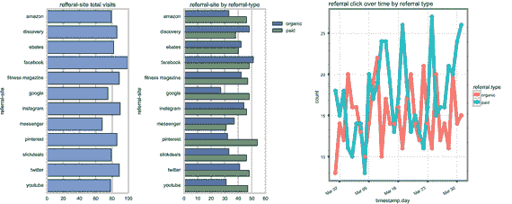
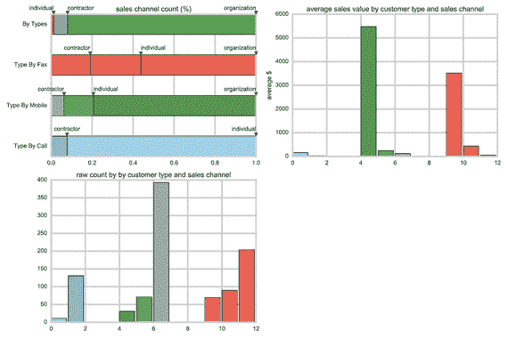
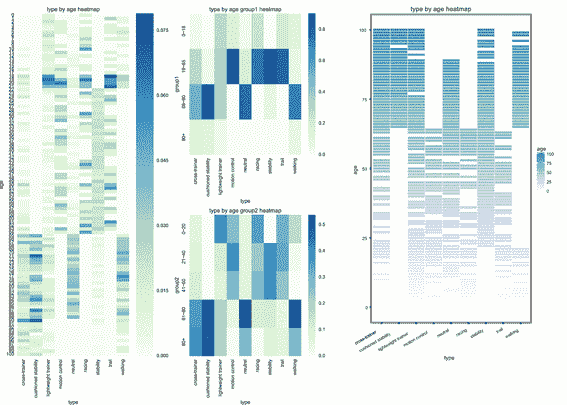
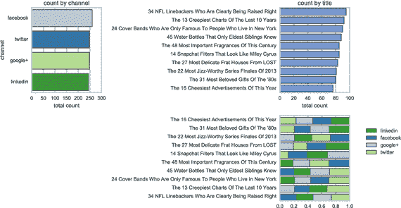
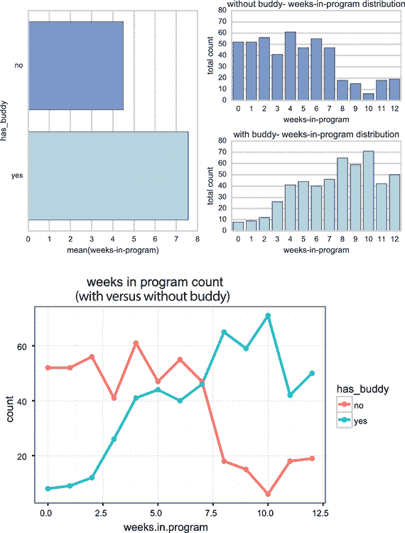
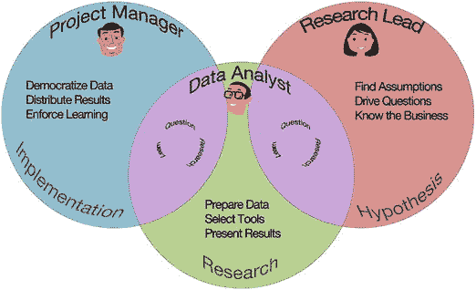
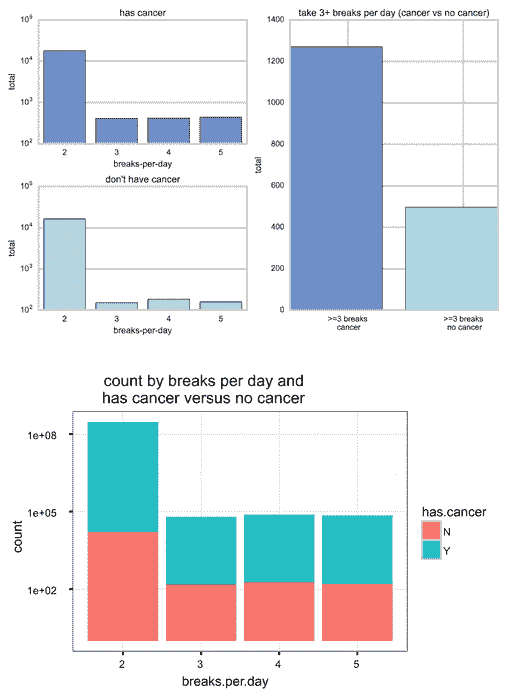
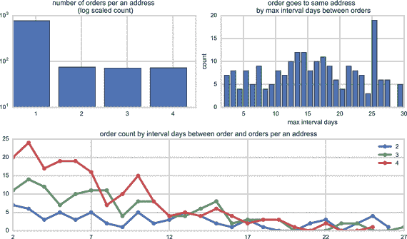
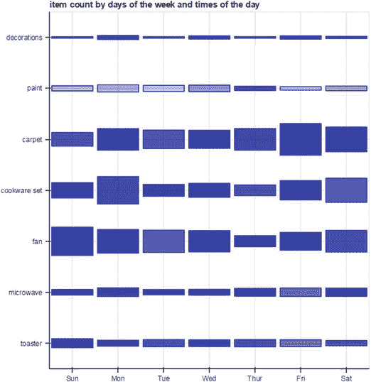

# 第二部分

## 组建你的数据科学团队

是时候组建你的数据科学团队了。在组建之前，你需要了解需要哪些类型的团队成员，如何组建团队，团队成员将从事何种工作，以及如何协同工作。然后，一如既往地，你应该了解如何避免可能遇到的任何陷阱。

# 6. 完善你的人才

我们在第 2 章中定义了数据科学，并阐述了“数据科学家”的含义。在本章中，你将看到如何将这个角色分解为几个团队角色。然后，你将看到这个团队如何协同工作，以建立更强大的数据科学思维。

## 正确看待数据科学家

正如你在第 2 章所学到的，关于数据科学家的角色存在一些混淆。2001 年，威廉·S·克利夫兰发表了《数据科学：拓展统计学技术领域的行动计划》¹。这篇论文首次将统计学和计算机科学领域合并，创造了一个名为“数据科学”的全新创新领域。与此同时，莱奥·布雷曼发表了《统计建模：两种文化》²，描述了统计学家应如何转变思维模式，拥抱更多样化的工具。这两篇论文为数据科学奠定了基础，但它是在统计学领域之上构建的。

2008 年，来自 Facebook 和 LinkedIn 的一些顶级数据专家聚在一起讨论他们日常面临的挑战。他们意识到自己正在做类似的事情。他们将自己的角色视为多种不同学科的交汇点。他们决定将这一角色称为“数据科学家”。

当时的数据科学家只是一系列素质的集合。例如：

*   理解数据
*   掌握统计与数学
*   应用机器学习
*   懂得编程
*   保持好奇心
*   成为出色的沟通者和极客

他们是涉猎多个领域的文艺复兴式热衷者。

问题在于，这组技能很难在一个人身上全部找到。我们每个人基于天赋都倾向于特定领域。我们通常会被自己的天赋所吸引，然后努力精进技艺。统计学家往往会努力成为更优秀的统计学家。业务分析师则会磨练自己的沟通技巧。同时，组织也施加了很大的压力要求专业化。大多数大型组织都划分为不同的职能领域。虽然需要一定的共识，但并非总是需要共同的专业知识。

此外，人们自我评估的能力出了名地差。著名的杜宁-克鲁格研究³发现，那些自认为技能很高的人往往严重高估了自己的专业水平。一位天赋异禀的统计学家可能认为自己也是出色的沟通者，但成为伟大的统计学家并不需要擅长沟通。一位伟大的统计学家即使在做演示时结结巴巴，也完全可以拥有漫长的职业生涯。

这就是为什么大多数组织会将工作划分给团队。团队中的个体各有专长。一个跨职能团队并不会假设每个人都是专家。相反，它鼓励个体相互学习彼此的长处，并弥补彼此的短板。而一个由数据科学家组成的团队可能无法识别这些短板。如果没有人指出盲点，团队就会盲目地摸索前行。

我曾在一家组织工作过，该组织有一个由数据科学家组成的团队正在构建一个集群。业务部门对此有些担忧，因为高层根本不知道这个团队在构建什么——他们很沮丧，因为他们在为自己不理解的东西付费。我参加了几次会议。数据科学家团队演示了一个简单的`mapReduce`任务。业务经理们茫然地盯着屏幕，偶尔瞥一眼他们的智能手机。在外人看来，从哈欠和揉眼睛动作中明显可以看出，这个团队的沟通工作做得很不到位。

会议结束后，我在白板上画了一个矩阵。我列出了以下六项技能：

*   数据
*   开发
*   机器学习
*   统计学
*   数学
*   沟通

我让数据科学家们针对每一项技能，给自己打分（1 到 10 分，1 分最差，10 分最佳），以便我们找出需要改进的地方。我拿着同一张技能列表给一位业务分析师看。我请他对该团队进行评分。

结果如表 6-1 所示。

表 6-1. 数据科学家与业务分析师的评分

| 技能领域 | 数据科学家的评分 | 业务分析师的评分 |
| --- | --- | --- |
| 数据 | 8 | 10 |
| 开发 | 7 | 9 |
| 机器学习 | 6 | 8 |
| 统计学 | 8 | 9 |
| 数学 | 8 | 10 |
| 沟通 | 9 | 6 |

这是一个经典的杜宁-克鲁格效应结果。数据科学家们在自认为水平很高的领域，严重高估了自己的专业能力。这些数据科学家都来自数量领域，他们是统计学家、数学家和数据分析师。他们无法识别自身的盲点。需要一个来自完全不同领域的人来揭示他们面临的挑战。

如果你是一个试图从数据科学中获得价值的大型组织的一员，那么依赖少数几位“超级英雄”数据科学家将是错误的。背景相似的个体往往会拥有相同的盲点。学术研究表明，通常你能从一个背景多样的跨职能团队中获得更出色的见解⁴。

我们多元化的组织结构中蕴含着智慧。拥有营销、商业和管理背景的人值得在数据科学的讨论中占有一席之地。认为具有数量背景的关键人物会提出所有相同的问题和见解是不切实际的。让你的团队保持多样性，你就更有可能取得出色成果。

## 发现不同技能的价值

对数据科学团队的一个风险是过度重视数据科学家。请记住，数据科学家是多学科的。他们应该了解统计学、数学、开发和机器学习——同时还要理解客户并提出有趣的问题。大多数数据科学家来自工程、数学和统计学背景。这意味着他们很可能采用类似的提问方式，并从相似的视角看待数据。

一个毕生致力于数学和统计学的人，不太可能像一位毕生从事市场营销的人那样对客户有深刻洞察。在一个领域是专家，并不意味着在另一个领域也是专家。

许多自称多学科的人通常拥有几项非常扎实的技能，并了解一些其他领域。如果你对很多领域都非常自信，那么你很可能存在巨大的技能缺口。这也意味着，一个只有数据科学家的团队可能会有相似的盲点，并且容易陷入群体思维。

防止这种情况发生的一种方法是让具有其他背景的人加入你的数据科学团队。请记住，优秀的数据科学依赖于有趣的问题。没有理由认为这些有趣的问题只能由分析数据的人提出。

想想你的跑鞋网站。数据分析师应该不难找出哪些网站向商店引荐了客户。假设大多数客户来自 Twitter、Google 和 Facebook。还有相当一部分客户来自其他跑鞋网站。一名优秀的数据分析师可以轻松创建一份报告，列出客户在购买前访问的排名前 50 的网站。弄清楚客户从哪里来是一个很好的分析问题。这涉及收集数据、统计，并以一份漂亮的报告呈现出来，如图 6-1 所示。

图 6-1. 引荐网站总访问次数及引荐类型说明

Facebook、Twitter 和 Instagram 在付费流量和自然流量方面似乎都带来了巨大的流量。Pinterest 带来的流量与其他网站相当，但大约一半的流量来自付费广告。请访问 [`​ds.​tips/​fRa4a`](http://ds.tips/fRa4a) 查看如何创建这些图表。

数据科学团队会进行更深入的研究。团队可能会问，为什么来自 Twitter 的人比来自 Google 的多？人们是否在推特上发布鞋子的照片？如果我们在 Twitter 上投放广告，会有多少额外的人访问网站？对于发布新产品，哪个网站更优？人们看到鞋子图片后是否更有可能访问网站？这些问题与数据本身是分离的。业务分析师、营销专家或项目经理完全有能力提出这些问题。

一项对经济系的研究表明，当来自不同学科的人进行合作时，他们更可能产出更高质量的出版物。意见的多样性有利于提升他们工作的数量和质量。此外，不同背景的人更可能产生分歧。分歧会促使每个人都更加努力。最终，这会使每个人的论证更加有力。如果你团队中的每个人都能随意地就最佳问题达成一致，那么你很可能没有提出足够有趣的问题。

当你创建数据科学团队时，试着吸纳组织中来自不同部门的许多人。你希望组织中的每个人都能思考如何以数据驱动的方式工作。如果你只为团队招聘数据科学家，你很可能让数据科学看起来像一门玄学——一种只有少数高技能人才才能尝试的东西。这会使你的数据科学缺乏创造力，并与组织的其他部分脱节。

在你的数据科学团队中，区分分析与洞察至关重要。数据分析师负责捕获、统计和呈现数据。而获得洞察则困难得多。你需要遵循科学方法，提出有趣的问题并寻找结果。不要让你的团队只产出数据分析。你要让他们更加努力。来自业务方的人很可能会推动团队提出更多有趣的问题。同样，来自营销团队的人也很可能会对你的客户提出有趣的问题。

一些组织已经开始朝这个方向转变。像 LinkedIn 这样的公司创建了数据墙，展示来自数据分析师的不同报告和图表。这些信息墙让组织中各部门的人都能看到数据中是否有有趣的东西。市场营销助理可能会发现一个有趣的故事，或者人力资源部门的实习生可能会想到一个有趣的问题。这是从组织其他部门获取反馈的好方法。

一些组织则更进一步，确保每个数据科学团队都有一名来自市场营销部门和项目管理部门的代表。这确保了你的数据科学团队中既有专门思考客户的人，也有理解如何向组织其他部门交付价值的人。

## 建立数据科学思维

在数据科学团队中，你常会听到一个术语——“数据驱动”。这个词有点微妙。我们都喜欢用数据来驱动决策。如果你决定不吃加油站卖的寿司，这基于真实数据。你利用过往经验，或许再加上一些观察，来做出明智的决定。你的直觉往往是对的——至少对了一半。尽量不要将数据驱动决策视为自身直觉的简单替代品。数据驱动文化是利用数据来增强团队的直觉，而非取而代之。

你的数据科学团队将成为建立更广泛数据科学思维的起点，这种思维与数据有着更紧密的关系。试着将数据驱动型企业视为拥有众多数据科学团队的公司，它们共同强化数据科学思维。这些团队营造了充满疑问和洞见的文化。他们应帮助组织不仅收集数据，更要让数据变得可操作。

一个数据科学团队有三个主要职责领域。这三个领域为你的数据科学团队奠定了基础，有助于组织其他成员接纳这种新思维。它们是：

*   **收集、访问和报告数据（基础工作）：** 这涉及将原始数据处理成其他人都能理解的形式。

## 6. 团队角色与思维

*   **提出好问题：** 这驱动有趣的数据实验，可能源自不一定有技术背景的团队成员。他们可能来自业务、市场或管理部门。他们提出有趣的业务问题，并推动所有人质疑自身的假设。

*   **让数据可操作：** 这将是主要负责了解团队学到了什么以及这些数据如何应用于组织的团队成员的责任。

我曾在一家销售家用五金和建筑材料的零售组织工作。该公司设有多个呼叫中心，因为许多客户倾向于通过电话下单，而非使用移动应用。

这家公司刚开始涉足数据科学，希望数据科学团队能理解这些客户为何偏好电话下单，因为维持呼叫中心成本高昂。此外，通过电话接单出错的可能性也大得多。数据科学团队有三个人：一位懂数据的人、一位业务分析师和一位项目经理。他们三人聚在一起，试图理解这些客户为何偏好电话下单。

业务分析师最先开始提问：这些客户是否有通过手机下单的账户？他们是专业客户还是住宅客户？他们消费金额是多少？

随后，团队创建了数据报告，如图 6-2 所示。数据显示，大多数人都是专业客户，他们经常通过移动设备下单。他们通过呼叫中心下的订单金额远小于通过移动应用下的订单。大约 80% 的交易金额低于 20 美元。业务分析师跟进提问：“为什么我们一些最忠诚的专业客户会打电话订购不到 20 美元的商品？”

**图 6-2.** 销售渠道数据报告

注意：大部分订单由组织客户下单；然而，通过电话下单的大部分订单是由个人客户完成的。个人客户通过电话下单的平均总价值在所有类别中最低。请参阅 [`http://ds.tips/3uprU`](http://ds.tips/3uprU) 了解如何创建这些图表。

在查看数据并与几位客服代表交谈后，他们发现这些客户打电话是因为需要一个小零件来解决一个大问题。当这些专业人士在工地时，客服代表就在查找那个零件。通话的大部分时间都花在描述、识别和加急处理他们所需的关键零件上。

团队尝试了一个实验。他们联系了一些高交易量的专业客户，请他们在需要紧急零件时发送一张图片。他们将其称为“拍照即寄”计划。他们希望这能提高客户满意度，并减少在电话中描述零件所花费的时间。

这个数据科学团队规模虽小，但仍然覆盖了所有三个职责领域。他们收集数据，制作了有趣的报告。业务分析师提出了有趣的问题，并对客户有了深入了解。最后，项目经理组织了一个实验，启动了一个小型试点项目。他们收集了新数据，提出了有趣的问题，并将洞察变成了可操作的行动。

在数据科学团队进行这些实验之前，该组织一直认为这些人是小额消费的住宅客户，他们更习惯打电话而非使用移动应用。他们的直觉只对了一部分。实际上，大多数打电话的人是他们一些最有价值的客户。一个拥有多元化团队的数据科学思维带来了更深刻的洞见。

### 总结

在本章中，你探讨了数据科学团队中的角色。你了解了需要具备哪些技能。你也看到了如何建立数据科学思维。在第 7 章中，你将了解如何组建你的团队。

**脚注**

1. Cleveland, William S. “Data science: an action plan for expanding the technical areas of the field of statistics.” *International statistical review* 69, no. 1 (2001): 21-26.

2. Breiman, Leo. “Statistical modeling: The two cultures (with comments and a rejoinder by the author).” *Statistical Science* 16, no. 3 (2001): 199-231.

3. Kruger, Justin, and David Dunning. “Unskilled and unaware of it: how difficulties in recognizing one’s own incompetence lead to inflated self-assessments.” *Journal of personality and social psychology* 77.6 (1999): 1121.

4. Bosquet, Clément, and Pierre-Philippe Combes. “Do large departments make academics more productive? Agglomeration and peer effects in research.” *Spatial Economics Research Centre Discussion Paper*, no. 133 (2013).

## 7. 组建团队

拥有数据科学思维既是组织挑战，也是文化挑战。这并非雇佣几个数据分析师那么简单。你希望整个组织都能以创造性和有趣的方式思考你的数据。数据分析师会帮助你分析数据，但他们可能并非新洞察的最佳来源。正如第 6 章所述，你应该将数据科学视为一项团队努力——由背景不同的小组成员通过数据实验来创造知识。这就是数据科学中的科学方法。这是一个实证探索过程。你会提出好问题，收集证据，并尝试得出结论。

与其寻找几个什么都能做的人，不如与现有能做大多数事情的人合作。我认为一种行之有效的模式是将数据科学团队分解为三个角色：

*   研究负责人

*   数据分析师

*   项目经理

我在不同的组织中都见过这三个角色。它们的名称可能不同，但目标一致：提出好问题，收集证据，并努力获取洞见。在接下来的几节中，我们将更详细地介绍每个角色，然后讨论他们如何在团队中协作。

### 跟随研究负责人提出好问题

据说阿尔伯特·爱因斯坦曾说过，如果他有 1 小时来解决问题，他会花前 55 分钟寻找正确的问题。问题是发现的关键。这正是它们对数据科学团队至关重要的原因。问题是你获得新见解的最重要驱动力。数据科学中“科学”的关键部分，就是找到正确的问题。

你已经拥有数据。你的组织可能正在收集比你需要的更多的数据。从很多方面来看，你已经收集到了答案。现在你必须提出正确的问题。对大多数组织来说，这并非易事。我们仍在为那些渴望答案的公司工作，因为答案能结束讨论。你开完会就可以开始付诸实践。这就是组织倾向于喜欢专家型人才的原因。他们提供答案。答案是最终的、封闭的；问题则是开放的。此外，一个好问题可能会引出更多问题。

这就是为什么数据科学团队应该依赖一个专注于提问的人。这个人应该了解业务，但他或她也需要跳出业务本身。我听过对这个角色的最佳称谓之一是“研究负责人”。它准确地概括了这个人的主要职责：主导提问并推动研究。

研究负责人应该来自业务方，他/她推动团队提出有趣的问题。他/她应该从与团队合作开始，共同提出问题或识别关键难点。他/她可以把问题放在问题墙上，或者整理到便利贴上。

研究负责人有三个职责领域：

*   识别假设

*   驱动问题

*   了解业务

这三个领域密切相关。作为研究负责人，有时你必须跳出自身经验，像第一次见到一样去审视业务。这需要付出一些努力，你必须致力于保持全新的视角。

一个好的研究负责人能凭直觉敏锐地察觉到何时存在有趣的问题。杰森·斯蒂芬博士¹的经历就是如此。他是一位天体物理学家，也是一位频繁出差的旅行者。有一次，他排着长队等待登机。大多数人认为这是旅行的常态。斯蒂芬博士对飞行业务足够了解，意识到让乘客排长队既低效又成本高昂。他问了一个简单的问题：“有没有更好的登机方式？”他的科学背景帮助他想出了一个解决方案。他设想让乘客并行登机，每隔一排错开入座。这比当前让人们一个接一个排队的登机方法高效得多。（不幸的是，由于种种原因，这种做法尚未实施。）

斯蒂芬博士践行了一名优秀研究负责人的三个行动。他对业务有一定了解：他了解飞行。他能够质疑自己的假设：在他之前，数百万人在登机流程前都未曾多加思考。最后，他提出了一个简单的问题：还有更好的方法吗？

你不必成为科学家就能提出有趣的问题。研究负责人应该对业务有一些概念，但这个人不需要是专家。例如，爱德华·兰德发明宝丽来即时相机，正是源于他三岁女儿的一个问题。²当他们在新墨西哥州度假时，他用传统相机拍了张照片。他的女儿简单地问了一句：“我们为什么必须等照片出来？”他的女儿质疑了一个简单的假设。

这两个问题都开启了有趣的探索之路。斯蒂芬博士找到了一种让乘客登机效率提高多达 30% 的方法，而爱德华·兰德创造了即时相机，这是 20 世纪最具创新性和美感的科技产品之一。

研究负责人这个角色最有用的一个方面，是将提问与数据分离。提出好问题本身并没有技术性。记住，爱德华·兰德的女儿只有三岁。

将驱动问题的人与寻找可能答案的人分开，也大有裨益。这解决了固有的利益冲突。如果你只有一小数据集，你可能会将自己局限于简单的问题——那些你已经能用数据回答的问题。一个好的研究负责人可能会促使你重新思考收集数据的类型。最终，这会更有价值。

### 与数据分析师一起呈现数据

# 数据科学团队的角色与协作

你的团队需要优秀的数据分析师。数据分析师负责理解数据、获取和清洗数据，然后以简单报告的形式呈现数据。他们应与研究负责人协作，查看报告中是否有值得注意的信息。他们还应该推荐统计方法或创建数据可视化。研究负责人和数据分析师将携手合作，构建洞察力。研究负责人专注于提出最佳问题，而数据分析师则致力于提供最佳报告。

围绕不同的数据职位名称存在很多混淆。有统计学家、统计分析员、数据分析师、数据科学家、数据工程师，甚至还有数学家。你甚至可以在这些头衔前任意加上“首席”或“高级”。首席统计师可能比高级数据科学家资历深得多。造成所有这些混淆的原因是这些职位的人做的事情非常相似。他们在某种程度上都在实践从数据中学习的科学；只是他们以非常不同的方式进入这个角色。

统计学已经存在了几百年。这门学科的发展是因为政府需要了解自己的人口和经济数据。它有着悠久而丰富的历史。美国统计协会（ASA）是美国最古老的专业学会之一。

另一方面，数据分析师来自计算机科学领域。他们学习如何从关系型数据库和 NoSQL 数据库中提取意义。他们专注于呈现和发现有趣的数据片段，以支持决策。

数据科学家被视为多学科人才。他们是数据分析师，但同时也会创建软件、处理数学问题、了解业务并提出有趣的问题。作为 Bitly 的前首席科学家，希拉里·梅森提出了一个广为人知的定义。她认为数据科学家是那些还懂数学、软件开发、工程和黑客技术的数据分析师。他们能更进一步。除了制作报告，他们还能开始探索洞察力。

一个数据科学团队会分解通常由一名数据科学家承担的职责。通常，要求一个人同时理解数据、业务并提出有趣的问题，这个要求太高了。一个优秀的数据科学团队需要一名也懂一点软件开发的数据分析师，而大多数数据分析师已经觉得了解软件开发是必要的。许多出色的可视化工具都需要一些软件编码。`Python` 和 `R` 是用于探索和展示数据的两种最流行的语言。（你在第 1 章中已经了解了一些关于这些语言的知识。）

在数据科学团队中，数据分析师有三个主要职责领域：准备数据、选择工具，然后呈现结果。

### 准备数据与选择工具

准备数据与选择工具是相辅相成的。你必须先选择工具才能准备数据。因此，作为数据分析师，大部分时间都花在数据准备上。你需要找出获取数据的最佳方式——无论是通过网络 API、从网页抓取，还是从组织不同部门收集数据——然后对数据进行清洗。清洗数据通过修正各种字段或补充缺失数据（例如，展开缩写或纠正拼写错误）来使其更具实用性。

### 呈现结果

数据分析师的主要挑战之一，是与研究主管协作，共同探索数据，判断是否有异常情况，并创建洞察力分析与报告。有时，丰富的数据反而会导致洞察力的贫乏。如果数据分析师向团队传递了过量的信息，实际上可能会限制每个人对信息的解读能力。

为避免这种情况，数据分析师需要与研究主管紧密合作，在报告中阐释各项权衡。在统计分析中，往往是你*看不到*的那些信息才对理解至关重要。有时这是有意为之；有时则并非如此。

假设研究主管想要查看在跑鞋网站购物的所有男性和女性的汇总数据，并按年龄段细分展示。作为数据分析师，你可能会询问年龄段的分组方式。是按每五年一组还是每十年一组？如果按每五年一组，你将得到 18 或 19 个分组，但这些分组在中间年龄段会出现偏差，因为 18 岁以下或 90 岁以上的跑步者可能较少。

报告也可能因此难以阅读。对于 20 到 40 岁之间的人群，你无法获得所需的粒度。35 岁和 40 岁的人群之间可能存在巨大差异。如果把这个年龄段细分出来，你可能会曲解数据，使得 30 到 40 岁之间的人数看起来更少。这就是为什么数据分析师在呈现数据时保持透明至关重要。某些决策会影响数据故事的呈现。整个团队应努力坦诚地讨论这些决策，并传达一个准确的故事，如图 7-1 所示。

**图 7-1. 热力图注释**

观察最细粒度层级（每个年龄段作为一个单元格）的热力图以及不同年龄段分组的热力图：左侧图显示，轻量训练鞋在 18-21 岁人群中最为流行；而动态控制、竞赛、稳定和越野鞋则在 21-65 岁人群中更受欢迎。然而，由于右侧图所示的年龄段划分不同，这些数据可能传递出截然不同的信息。在右上图中，轻量训练鞋似乎在三个年龄段分组（0-18、19-65、66-90）中同样受欢迎，但如果你观察右下图和原始热力图，会发现它显然只在 18-21 岁人群中更受欢迎。这是因为右上图中第一个分组恰好在最受欢迎的年龄段中间进行了划分。更多关于如何创建这些图表的信息，请访问[`http://ds.tips/m2zAm`](http://ds.tips/m2zAm)。

所有这些决策通常由数据分析师自行裁量。然而，与研究主管共同做出这些决策，有助于整个团队更好地理解数据。

### 与项目经理保持项目正轨

在数据科学团队工作中，最困难的部分之一是将洞察转化为可执行的行动。工作应当像一场持续的科学实验：你获得一点数据，研究主管提出有趣的问题，这些问题催生出更多报告，而报告通常又会引出更多问题。

在这种探索的旋涡中，团队需要专注于收集数据的初衷。同时，还需要有一种机制，向组织其他成员解释这些洞察。不幸的是，这意味着要开很多会，这可能会严重消耗时间。当工作性质是创造性的时候尤其如此。

我曾在一家拥有极具创意的数据科学团队的组织工作过。他们不断提出利用公司海量信用卡数据的新颖有趣方法。最初几个月，数据科学团队基本可以自由探索数据。最终，团队产出了一些非常有趣的洞察。随着他们的洞察越来越引人注目，组织其他部门也愈发好奇。各部门开始邀请团队成员做演示汇报。这些会议让其他团队更加感兴趣，进而导致了更多会议。几个月后，数据科学团队中有些人每周参加会议的时间高达 20 小时。他们从数据科学实践者变成了汇报者。

这些关键人物缺席数据科学团队，拖慢了其他成员的工作进度，以至于他们产出的洞察越来越少。他们花在分析数据上的时间大幅减少。而当初要求开会的那些部门又开始质问，为什么数据科学团队找不到那么多洞察了。

这在许多组织中是一个悖论：你的工作对组织其他人越有趣，你就花越多时间在会议上谈论你的工作，这意味着真正工作的时间就越少。

打破这个循环的最佳方法是拥有一位高效的项目经理。项目经理非常擅长保护数据科学团队，避免其偏离正轨。他们可以通过代表团队参加会议来实现这一点。

数据科学团队中的项目经理主要负责三个领域：数据民主化（使其广泛可用）、分享成果，以及推动组织学习。项目经理扮演着双重角色：既是盾牌，也是推土机。盾牌的作用是保护团队免受过多会议的干扰，从而保持团队的工作效率；推土机的作用则是打破壁垒，获取那些被隐藏的数据。

#### 数据民主化

当你在大型组织工作时，获取所有数据变得越来越困难。项目经理可以帮助打破这些数据孤岛，让整个组织都能受益。例如，假设你的数据科学团队想要访问存储在数据中心某个角落积灰服务器上的数据。当团队尝试访问时，发现这些数据是受限的，仅供特定部门使用。你的项目经理就负责说服该部门，让数据科学团队能够访问这些数据。

#### 分享成果

项目经理同样负责信息的分发。他们是亲自去参加会议并展示团队成果的人。如果其他部门有人想访问团队的数据，项目经理会负责为他们提供访问权限。

数据民主化和成果分发是紧密相关的，这是一条双向通道：一个方向是获取组织数据，另一个方向则是向组织其他成员分享团队的洞察。每一个方向都伴随着一系列会议和挑战。

#### 推动组织学习

项目经理的最后一项职责是推动学习——将洞察转化为可执行的行动。归根结底，团队的绩效仍然取决于组织从中学到了什么。需要有人跟进，将洞察转化为产品或变革。

想象一下，如果那个拥有信用卡数据的组织发现了一些有趣的现象，比如午餐时间交易数据略有增加。项目经理就会将这个洞察转化为可执行的行动。他或她可能会与基础设施部门合作，在这些时段扩容技术，或者与营销部门合作，推出午餐时间促销活动。推动这种学习需要大量时间和会议。一位优秀的项目经理通过承担这一责任，确保团队始终走在正确的轨道上。

### 团队协作

当团队组建完成后，全体成员将共同协作，尝试创建一个能够展示数据趋势的有趣数据模型。你们可能会发现几个不同项目之间存在强相关性，然后一起猜测导致这种相关性的原因。

假设你们的团队供职于一家在线杂志。每篇报道的顶部都有一个链接，方便读者将文章分享到他们的社交网络。团队中的数据分析师根据读者分享最多的文章进行排名，并准备一份报告（如图 7-2 所示）供团队讨论研究结果。研究负责人可能会问：“是什么让这些文章如此受欢迎？它们是被阅读得最广泛还是被分享得最广泛？是否存在某些特定主题让文章更容易被分享？有没有关键短语？”

图 7-2. 按渠道和标题统计的数量及总计

注意

此数据由随机生成的文章标题及各渠道的分享数量构成。从图表中可以看出，尽管这些文章在分享数量上都是热门，但不同渠道的表现可能大相径庭。了解如何创建这些图表，请访问 [`http://ds.tips/spu3E`](http://ds.tips/spu3E)。

团队共同创建一个模型，以展示特定主题与该主题被分享可能性之间的相关性。团队甚至可能自行定义主题分类。研究负责人在这里至关重要，因为她最了解业务。她可能对读者有足够了解，能推测出某些主题类别。她可能是提出关键词的最佳人选，例如“抢先看”、“模糊照片”、“古怪幽默”或“谣言”等暗示科技传闻的词汇。（具有出版背景的人会提出很多有用的建议。）

团队甚至可以创建程序的第一版，尝试根据关键词将文章分类。数据分析师负责生成报告并开发能够识别文章主题的应用。然后，他创建一个数据模型，准确地对分享最多的文章进行分类。（这个人可能对出版不太了解，但他知道如何处理数据。）最后，团队利用预测分析，将该模型应用于未来。现在，你们拥有一个能够准确预测新文章何时会被众多读者分享的应用。

这时，项目经理介入，将这一新洞察转化为可执行的行动。她向其他团队传达结果，并与管理层合作改进组织。她甚至可能与市场部门合作，在那些更可能被读者高度分享的文章上投放利润最高的广告。

数据科学思维模式的一部分，是要认识到为了鼓励创新，你需要研究负责人和数据分析师共同合作，推动新想法。研究负责人必须提出有趣的问题，同时还要促进观点多样性。他们可能希望从组织的其他部门引入人员。

如果你的团队完全由数据科学家组成，很可能会缺乏重要的观点多样性。他们所受的训练和背景过于相似，更容易迅速达成共识，就像单调的齐声合唱。

我曾与一所研究生院合作，他们希望通过分析过往数据来提高毕业率。结果发现，最好的点子来自一位同时也是狂热潜水爱好者的项目经理。他查看了人口统计数据，并建议采用“伙伴系统”来提高完成整个课程的学生人数。这在潜水训练中是普遍做法。没人能预先规划出他的洞察，这完全源于他的生活经验。图 7-3 展示了一个你可以收集的关于伙伴系统的数据示例。

图 7-3. 伙伴系统数据

注意：从左侧图表可以看出，如果学生参加伙伴计划，平均而言，他们在课程中坚持的时间会比没有伙伴的学生长三周。与没有伙伴的学生相比，有伙伴的学生在八周后更有可能继续坚持。了解如何创建此图表，请访问`http://ds.tips/naF7u`。

这种形式的创造性发现比大多数组织意识到的要普遍得多。事实上，专利局的一份报告显示，近一半的发现都源于简单的偶然性。团队原本在解决一个问题，而某人的洞察或经验却将他们引向了一个全新的方向。

注意：我们将在第 8 章更详细地讨论这种工作关系。

### 本章小结

在本章中，你了解到数据科学中最有效的团队模式之一包含以下角色：研究负责人、数据分析师和项目经理。研究负责人有三个职责领域：发现假设、提出问题和了解业务。数据分析师负责准备数据、选择工具并展示结果。最后，项目经理从各部门收集所需数据，然后分享团队成果并推动组织学习。在第 8 章中，你将了解这个团队将如何开始协作。

**脚注**

1.  Steffen, Jason H. “Optimal boarding method for airline passengers.” *Journal of Air Transport Management* 14, no. 3 (2008): 146-150.
2.  Mintzberg, Henry. “The fall and rise of strategic planning.” *Harvard Business Review* 72, no. 1 (1994): 107-114.

## 8. 启动工作

现在你已经组建好团队，需要了解如何开始工作。首先，你需要明确每个团队成员的职责领域，并指出这些职责领域在哪里存在重叠。接下来需要考虑的是如何展示你的数据。数据可视化是一个能写成整本书的专题。我在此仅简要提及，并涵盖你的数据科学团队主要关注的两种报告类型：内部报告和外部报告。

在了解如何呈现报告之后，我将转向解释数据孤岛以及它们如何影响团队收集数据的能力。接着，我会给你一些关于如何实现数据民主化的建议。最后，我将阐述向数据科学团队提供洞察以及获得高管支持的重要性。

### 定义责任领域

数据科学思维模式与大多数组织的运作方式截然不同。即使是那些自称数据驱动的组织，也往往不会利用数据来创造新的洞见。相反，他们使用数据的方式就像醉汉使用路灯杆一样。¹ 他们将其视为支撑，而非照明。

这对你的数据科学团队来说是一个真正的挑战。你的组织可能认为自己是以数据驱动的，但实际上他们只是在用数据来强化已知的信息。任何与这些知识相悖的内容都会被视作不良数据。

你的数据科学团队需要确保利用数据进行探索，这样才能避免团队陷入仅用数据来支撑已知信息的陷阱。事实上，数据科学的一大优势就在于质疑已有知识。这就像马克·吐温那句老话所说：“让我们陷入困境的不是无知，而是那些我们深信不疑却并不正确的东西。”

如果你的组织依赖的是那些没有数据支持的知识，你很可能会遇到麻烦。通常，这些共享的知识是正确的，但一旦出错，就会产生持久的后果。如果你的数据科学团队坚持履行其三个责任领域，就能为组织带来真正的益处。这三个领域分别是：研究、质疑和落实，下面将逐一讨论。

到目前为止，你已经了解了数据科学团队中的三种常见角色：提出有趣问题的研究主管、与研究主管合作产出有趣报告和洞见的数据分析师，以及使这些洞见可操作并可供组织内其他部门使用的项目经理。

现在，是时候将这些角色放到更大的责任领域中去审视，这样你就能了解团队是如何协作的。可以把你的团队想象成拥有不同且相互重叠的责任领域，如图 8-1 所示。

图 8-1. 不同角色之间的重叠

#### 研究

让我们从数据分析师开始探讨维恩图。数据分析师的主要责任领域是研究，这是科学和数据科学的关键部分。数据分析师与研究主管合作，提出有趣的问题，研究这些问题，并通过创造性的报告或图表呈现结果。

数据分析师是团队的基础。他与项目经理和研究主管都紧密合作，只是合作方式不同。可以把他视为与两者都保持着独立的双向关系。他从研究主管那里获得有趣的问题作为输入，然后将结果和洞见输出给项目经理，以便她能够推动学习。

#### 质疑

现在，让我们看看图 8-1 中的下一个圆圈。在右侧，是代表研究主管的圆圈。他们的责任领域是质疑。如果用科学方法的角度来思考，这个人就是提出有趣假设的人。

研究主管在自己和数据分析师之间建立了一个循环。她提出问题并获取反馈。这并非简单地给数据分析师发一封邮件问“你怎么看？”那么简单，而是一个协作过程。研究主管提出问题，数据分析师根据可用数据对这些提问提供反馈。这两个圆圈是重叠的。这是问题与研究之间的直接关系。

#### 落实

图 8-1 中的最后一个圆圈代表项目经理。他的责任领域是落实。他需要确保团队利用数据并使之产生可操作的成果。他要确保团队将他们的洞见传达给组织内的其他部门。

将一个探索性的过程应用于组织知识绝非易事。在数据科学团队中，你往往不清楚哪些最可行的洞见会通向何方。团队可能会在找到一条有趣路径之前，经历 50 次死胡同。

尽管如此，思考这些洞见最终落实后会是什么样子，仍然很重要。

这三个责任领域中的每一个，都是团队需要完成的任务蓝图的一部分。这有助于强化一个理念：你的数据科学团队致力于探索和发现。团队需要遵循数据的指引，即使它与现有知识相悖。

### 呈现报告

数据可视化是数据科学中最有趣的领域之一。它关乎你如何运用图形和图像来展示数据。简单的图形是传达复杂思想的最佳方式之一。在复杂思想与简洁设计之间寻求平衡，确实是一项真正的挑战。

大多数报告都容易走向某个极端。要么有许多漂亮图表却信息量不足，要么信息丰富的图表却丑陋难懂。优秀的可视化是数据分析师的核心职责。话虽如此，分析师应与数据科学团队紧密合作。如果你需要向研究主管解释图表，那么它对其他人来说可能就太复杂了。团队是帮助你让图表更美观、更易读的绝佳试验场。

关于数据可视化有很多优质资源。其中历史最悠久、最受尊敬的著作之一是爱德华·R·塔夫特所著的*《量化信息的视觉呈现》*（第二版）。在这本书中，塔夫特教授提出了“数据-墨水比率”的概念。他指出，你应该推动你的可视化，用最少的墨水传达最多的数据。他将那些无用的视觉效果，例如 3D 阴影或渐变效果，称为“图表垃圾”。

塔夫特教授帮助确立并引领了数据可视化领域的方向。他帮助建立了一种现代的数据呈现方法。

另一种方法是参考科尔·努斯鲍默·克纳夫利克所著的*《用数据讲故事：面向商业专业人士的数据可视化指南》*。在她的书中，她阐述了六条关键经验。她首先指出，数据分析师应该理解自己的受众和背景；选择恰当的展示方式；消除杂乱，集中注意力；并且像设计师一样思考，以讲述引人入胜的故事。这两本书将让你很好地理解创作优质数据可视化的内涵。

**注**：通常，数据分析师的培训中没有任何内容能帮助他们学会创建优秀的可视化。大多数研究生课程仍深深植根于数学和统计学。优秀的数据可视化依赖于美学和设计。这是一项需要后天习得的技能，可能并不容易掌握。

请记住，你的团队是共同探索数据的，这意味着你设计的第一轮报告大部分是为团队成员准备的。研究主管提出有趣的问题，数据分析师创建一份快速粗略的报告来探索可能的答案，然后团队可能会提出一系列全新的问题。这意味着你最初的数据可视化大多是快速的交流——更像是视觉上的闲聊，而非完整的数据报告。

另一方面，还有最终的数据可视化需要传达给组织的其他成员。这些可视化将经过打磨，更简洁，更容易理解。

将你的第一轮可视化看作数据白板，就像大多数组织墙上的白板。它们主要用于快速的可视化，以辅助小型会议和讨论。你的第一份报告应具备那样的可读性。它可能是一个快速简单的聚类图，也可能仅仅是一个简单的线性回归图。

没有人会去拍下白板上的涂鸦并放入高管报告中。它只供团队内部使用。要将数据呈现从白板提升到高管报告，你必须增加清晰度和打磨细节。

如果你是一名数据分析师，请记住要充分利用从团队其他成员那里获得的反馈。数据可视化就像任何设计一样。你不需要是专家也能有自己的看法。你的团队将是判断你图表是否可读和可理解的最佳途径。同时也要记住，你最好的图表将是涌现式设计的产物。从简单的报告开始，并随着时间的推移不断改进，使其更简洁、更易读。每个新版本都应澄清你所掌握的信息。你还可以通过在不增加复杂性的情况下添加信息来改进报告。

如果你经历几次改进的修订，你最终会得到更漂亮的报告。团队其他成员将是你达成这一目标的最佳资源。

## 理解数据孤岛与释放数据

数据科学团队面临的最大挑战之一，是获取组织中的所有数据。这是项目经理的核心职责之一。她会努力获取你组织内部各个角落那些尘封已久的旧数据库服务器的访问权限。

在大型组织中，每个部门都有各自的数据库，并且不共享信息，这种情况并不少见。每个部门都有自己数据分析师、经理和数据库工程师。该部门的人了解自己部门的数据挑战，但对组织的其他部分知之甚少。这通常被称为数据孤岛。“孤岛”这个术语借用于农业。农民通常在又高又空的筒仓建筑中储存季节性谷物。如果你见过筒仓，你就知道它是一种独立的高大建筑。每个筒仓储存自己的谷物，而且通常与其他筒仓没有连接。组织数据也是如此。每个部门都存储着零散的数据，并且不与其他孤岛的数据混合。

数据孤岛的存在有其合理原因。每个部门可能有各自的监管要求或安全措施。一个数据库可能存有密码，另一个可能只是简单的产品列表。很可能密码数据库是加密且安全的，而产品数据库是开放可用的。

孤岛的问题是它们使得组织很难对数据有一个全局视图。我曾为一家试图将其所有数据集中到一个集群中的组织工作过。他们认为自己未能从数据中获得足够的洞察。该组织刚刚经历了一次数据治理转型，想要管控数据的控制方式。

当他们最终接触到这些数据时，他们才意识到有多少数据被锁在无人知晓的孤岛中。多年来，每个部门都创建了自己的流程、模式和安全规程。该组织想从这些数据中获取价值，但它们分布在公司各地不同的服务器上。要求每个人都分享他们的数据，有点像要求他们分享牙刷。项目经理参加了许多会议，进行了非常激烈的讨论。

不幸的是，要成为一个更加数据驱动的组织，打破这些孤岛是必要的。你会希望多个数据科学团队在一个集中的数据集群上工作。你也会希望数据科学团队之外的人能够创建基础报告和图表。

请记住，数据是寻找洞察和创造新组织知识的关键材料。要做到数据驱动，你需要能够自由访问数据。

既然你已经了解了数据孤岛，那么该如何实现数据民主化，让尽可能多的人能够访问数据呢？你需要确保数据不再是高管和分析师之间传递的受保护资源。相反，它需要成为一种全公司范围的资源，可以被每个人操作和理解。

如果你是一名数据科学团队的项目经理，请记住以下几点：

*   不要低估获取数据孤岛访问权限的难度。这需要很长时间，你需要在团队真正需要他们的数据之前就开始着手。

*   创建一个集中的数据集群需要组织变革。如果你没有高层的支持，你可能无法取得太大进展。你可能需要向每个部门推销集中数据集群的想法。大多数部门不会认同你的观点。他们认为如果东西没坏，为什么要花时间修理它？你可能需要引诱他们，向他们解释这样将能创建更复杂的报表或使用更新的可视化工具。

*   你需要提供对你团队报告的访问权限。如果你能展示全公司范围报告和洞察的价值，打破数据孤岛可能会更容易。一段时间后，你将更容易论证共享数据就像任何其他共享资源一样。整体将大于部分之和。

尽最大努力保护数据科学团队免受数据孤岛会议的影响。你希望他们专注于探索和发现。而你则致力于提升他们的使用率和访问权限。

## 在数据科学团队中创建洞察循环

许多组织专注于监控每个团队的里程碑。管理者关注团队的合规性，他们的大部分精力都投入到计划中。他们制定季度预算并密切监控。他们寻找成本或进度偏差。如果发现变化，他们会迅速追查，然后向高管报告。这类组织是为监控和合规而构建的。如果你身处这类组织，请思考一下你的会议。很可能，你正在做的事情是制定计划或演示计划、与其他团队协调、请求增加预算，或者因为进度落后而请求延期。

这种方式并不适合数据科学团队。请记住，你的团队的工作是探索性的。团队成员提出问题、创建理论，然后进行实验。

当然，有些公司习惯于与科学家合作，例如制药或高科技公司。这类公司已经进行实验多年。但对于大多数公司来说，探索性工作是一个新概念。拥有一个创造新知识的数据科学团队似乎并不自然。在这些公司中，你必须特别小心团队的运作方式。存在将业务与技术分离的制度压力，以及确保由合规经理（通常是项目经理或总监）来管理团队的强大推动力。实施这些结构可能会减缓发现的步伐。

我曾为一家组织工作，该组织不允许研究负责人与数据团队紧密合作。他们认为，数据分析师的工作是提出最佳见解，然后业务经理只需在月度演示中查看这些想法即可。

业务经理有自己的预算，与数据团队分开。业务经理对发现洞察不感兴趣。她只确保她的团队不超支。在她的预算中，并没有雇佣一个全职研究负责人的位置。数据科学团队还没来得及开始探索就停止了。

我看到另一家公司试图用项目经理来监控数据科学团队的里程碑。他试图创建不同的方法来衡量团队的进展。他创建了用于提出问题的任务，然后衡量团队完成这些任务的情况。这效果不佳，因为大多数问题只会引出更多问题。当团队的里程碑不断延期时，项目经理并不高兴。他的动力是尽快“完成”这些问题，而这与数据科学团队的需求背道而驰。

当你在数据科学团队中时，请尝试注意这些制度压力。大多数组织都很难接受一个不容易被衡量或控制的数据科学团队。设定目标或创造投资回报率是很困难的。

努力确保你的团队不会被拉入这些合规结构中。相反，要确保团队创建一个反馈循环。每个人都应该一起工作，去质疑、研究和学习。

数据科学团队中的每个人都有自己的关注领域，但他们仍然在紧密的反馈循环中共同工作。例如，当研究负责人和数据分析师探索数据时，项目经理会参与其中，而数据分析师可能会给项目经理一些关于获取另一个团队数据访问权限的好建议。当每个人都参与时，团队总会做得更好。当你探索时，对一个问题投入的关注越多，就越有可能获得伟大的洞察。

另外，请确保你的数据科学团队获得高管级别的支持。没有这一点，你几乎肯定会被拉回常见的控制策略中。这并不容易，但如果你有高管支持，并能在团队内创建紧密的反馈循环，你将更容易取得发现。如果这些组织变革需要很长时间，不要灰心。第一步是理解数据科学的目的，以及它如何适应这些长期存在的组织结构之外。

## 总结

在本章中，你探讨了每个团队成员的责任领域。然后，你看到了这些责任领域在哪些地方重叠。你还学到了一些关于如何呈现数据（数据可视化）的知识，以及内部报告和外部报告之间的区别。接着，你了解了数据孤岛以及它们如何影响你的团队收集数据的能力。然后，你获得了一些关于如何使数据民主化的建议。最后，你学习了为数据科学团队提供透明度的重要性，以及这如何有助于获得高管支持。在第 9 章中，你将了解如何让你的团队像数据科学团队一样思考。

脚注 1

这句话常被认为出自苏格兰小说家兼民俗学家安德鲁·朗（Andrew Lang）。

2

Tufte, Edward R., and P. R. Graves-Morris. The visual display of quantitative information. Vol. 2, no. 9\. Cheshire, CT: Graphics press, 1983.

3

Knaflic, Cole Nussbaumer. Storytelling with Data: A Data Visualization Guide for Business Professionals. John Wiley & Sons, 2015.

### 9. 像数据科学团队一样思考

既然你已经知道如何构建你的团队并划分了责任领域，你如何确保你的数据科学团队像一个团队一样思考？在本章中，我将通过审视一些常见的方法来帮助你让团队保持正轨。首先，我将介绍如何通过提出有趣的问题来避免只报告而不推理。接下来，我将探讨如何为你的整个团队找到正确的心态。最后，你将了解如何理解数据，并获得一些关于如何摆脱团队僵局的技巧。

### 避免无据报告

如果你不熟悉统计学，芝加哥大学前公共政策教授查尔斯·惠伦（Charles Wheelan）所著的《妙趣横生统计学：剥去数据恐惧的外衣》¹是一本绝佳的入门读物。这本书读来妙趣横生，是对统计分析的上佳介绍。书中，他详细讲述了利用报告草率得出结论的危险。

只要你知道该留意什么，就能发现草率结论无处不在。网络新闻网站就是其中之一。惠伦教授设想了一个网站，上面有一则引人注目的标题：“工作中频繁短休者罹患癌症风险显著更高”。听起来相当吓人。根据这项涵盖 36,000 名工人的研究，那些自称每天多次休息十分钟的工人，在未来五年内患癌的可能性高出 41%。而从不短休的工人则健康得多，如图 9-1 所示。

*图 9-1. 频繁短休者更易患癌*

如果只看那些每天休息三次及以上的人，他们患癌概率的确高出约 43%。然而，95.1%的人每天只休息两次。具体图表生成方法可参见`http://ds.tips/Sp4ye`。

一个草率的数据科学团队可能会将此报告给整个组织，公司甚至可能采取极端措施，比如锁上大门以确保“所有人安全”。这看似极端，但实际情况远比想象中普遍。

一个负责任的数据科学团队绝不会从这种报告中得出结论。相反，研究主管会用它来驱动有趣的提问：为什么离开办公桌会如此致命？那些每天休息十分钟的人是谁？从不短休的人为什么健康得多？

研究主管可能需要通过与熟悉这些工人的人交谈来探究这些问题。也许有人能识别出这种行为模式。

如果你曾在办公室工作过，你可能会意识到，那些一天站起来多次、每次十分钟的人，很可能是去外面吸烟。请记住，相关性并不等同于因果性。在这个案例中，问题的根源在于这些工人是频繁吸烟者。他们每十分钟站起来一次只是附带现象，真正危险的是吸烟。

在你的数据科学团队工作中，请记住，防范草率报告的最佳方法是与研究主管合作，提出有趣的问题。要明白，得出结论很容易，而探索和推理才困难——它们将是你获得最深刻见解的源泉。

研究主管和数据分析师之间应保持一种良性的紧张关系。数据分析师寻找数据以得出结论，而研究主管则不断提出更深层的问题。数据分析师提交报告，研究主管则检验报告中的薄弱环节。最终，这将有助于产生更有力的分析。

草率推理的问题远比表面看起来严重。前面的例子只是虚构的网络标题，但现实有时会更危险。20 世纪 90 年代，医生发现服用雌激素补充剂的女性患心脏病的风险降低了三分之一。一项涉及 12.2 万名女性的大规模研究表明，雌激素补充剂与心脏病发作之间存在负相关。许多医生由此得出结论：雌激素具有保护作用，可能有益于女性健康。

到 2001 年，已有 1500 万女性服用雌激素补充剂（即俗称的激素替代疗法）。此时，奇怪的事情发生了。医生开始注意到，接受激素替代疗法的女性中风、心脏病和乳腺癌的风险显著更高。

多年后，医生们开始仔细审视最初的研究发现。许多人得出结论：在最初的研究中，那些看似更健康的女性有外部因素的加持——她们更富有、更注重健康、也更可能获得优质医疗。雌激素并非她们健康状况良好的可能原因。这一数据至今仍存在争议。但公认的一点是，这种草率的分析导致了成千上万女性的死亡。

防范草率推理的最佳方法，便是维持研究主管与数据分析师之间那种创造性的紧张关系。如果你不问对问题，就更容易得出错误结论。

#### 树立正确思维

你已经见识了草率报告的危险。现在，让我们思考如何树立正确的思维。许多组织认为数据科学只是一项分析技能，认为只需一群分析师在房间里报告数字即可。这些数字被视为真理，因为数字不会说谎——但数字确实会说谎。在第 4 章中，你看到了统计数字讲述错误故事的例子：两位政客基于相同数字得出截然不同的结论。研究可能得出虚假结论，人们可能误读数据，其叙事也可能不完整。

你已经知道，提问是防范草率结论的最佳方法。那么，如何提出更好的问题呢？要做到这一点，你需要树立正确的思维。好消息是，过去几年里，这一领域已有大量研究成果。多个学科相互融合，以更好地理解人类的思维模式。计算机工程师将这些知识应用于机器学习和人工智能。

研究发现，分析性思维未必能很好地服务于数据科学。报告和数据只是第一步，下一步是概念性思维——审视数据并将其与自身直觉相结合的能力。概念性思维能帮助团队确定问题的聚焦方向。

有一本关于此主题的趣味书籍叫*《全新思维：右脑思维者将统治未来》*，作者是丹尼尔·平克。书中，他认为我们正处在信息时代的末期，仅仅专注于数字和报告已无太大价值。真正的价值将来自我们创造的知识。他称之为“概念时代”。

数据科学正处在这个概念时代的最前沿。总有一天，分析工具会变得足够简单，让更多人能够接触数据。很快，用户就能使用像`WordPress`或微软`LinkedIn`那样易于上手的数据科学工具。这将使更多人获取到有趣的信息。

目前，数据科学团队既要负责数据本身，也要负责其底层概念——这在很多方面要困难得多。团队必须以分析技能为起点，再运用一整套全新的概念技能。在丹尼尔·平克的书中，他详细阐述了其中几种技能，并将其称为“概念时代的感官”。我将这些感官提炼为三个团队价值观。这些价值观应能帮助你的团队在概念层面思考数据。

##### 讲述故事，而非罗列报告

第一个价值观是：讲述故事，而非罗列报告。你的数据科学团队应致力于讲述数据背后的有趣故事。你应该呈现一个引人入胜的叙事。通常情况下，你的数据会被解读，这意味着可能存在不止一个故事。如果你能构思一个有趣的故事，那么提出问题的难度就会降低。

将数据视为剧本中的角色。思考他们为何选择做这件事而非那件事，然后针对他们的行为提出疑问。

##### 交响胜过细节

第二项价值观是交响胜过细节。参与信息时代的最佳方式之一曾是专业化。这在企业的招聘方式中可见一斑——例如，数据库工程师通常只专精于少数几个平台。而在你的数据科学团队中，需要摆脱这种专业化。你希望团队通过整合多个不同的故事，描绘出更宏大的图景，从而创造出交响乐般的效果。

你在之前的几个例子中已经看到过这一点：从吸烟员工离开工位的行为洞察全局，以及理解客户为何在年初购买跑鞋。这些故事要求你引入多种不同类型的数据，以获得更深刻的理解。

##### 共情胜过确定性

最后一项价值观是共情胜过确定性。了解人们的动机是提出数据相关问题的绝佳方式之一。你的数据科学团队需要理解客户在想什么，以及什么对他们而言是重要的。请记住，数据科学可以分析数百万人的行为。如果你的团队能够理解他们的动机，就能提出更有趣的问题。

请务必牢记，你的数据科学团队必须运用一套全新的技能才能取得成功。要提出好问题，你必须进行概念性思考。尝试将这些团队价值观作为一种提醒，让你铭记数据科学并非简单的报告。你的团队需要使用概念性技能来提出好问题，并创造组织知识。

#### 深入理解“意义建构”

正如你所见，团队拥有正确的心态至关重要。你的团队应该对数据进行概念性思考。这并非易事。请记住，大多数数据分析师出身于数学或统计学领域，而这些领域往往依赖于结构化的指标。

概念性思考通常需要一种叙事风格，这更具创造性和艺术性。许多数据分析师需要依赖自身的能力，而非仅凭所受的训练。一旦每个人都具备了正确的心态，他们就可以开始专注于意义建构。意义建构是数据科学的关键组成部分。

我们都在以某种方式进行意义建构。当你度假归来，面对收件箱里堆积如山的邮件时，你可能会不知所措。你可能会决定创建标有“重要”、“旧邮件”或“通知”的子文件夹，或者你可能会决定按发件人对所有邮件进行排序。

每个人处理数据的方式可能不同。对于团队而言，对数据形成共识就更加困难。每个人都有自己的意义建构技巧。这些看法可能并不重叠。对一个人有意义的事情，在另一个人看来可能像是浪费时间。

意义建构对数据科学团队来说可能是一个巨大的挑战。这些团队试图理解非常庞大的数据集，而信息量可能令人望而生畏。这可能导致团队冻结，即团队因为数据太多而不知从何下手。如果你不在团队中，可能很难察觉到团队何时陷入冻结。

我曾在一家试图理解一个庞大新数据集的公司工作过。该公司原本收集了适度的数据，随后从一家外部公司购买了大型数据集。他们希望将现有数据与这些更大的数据集关联起来，从而更好地了解客户。在另一家公司的帮助下，他们迅速将这些新数据集导入到自己的集群中。问题在于，数据科学团队不知从何开始。他们在意义建构上陷入了困境。他们冻结了，只是制作一些报告来展示他们拥有多少数据。

他们冻结了好几个月。每次开业务会议时，团队只是展示更精美的数据报告——关于数据本身的数据。他们购买了昂贵的可视化工具，并制作了出色的图表。但最终，他们没有提出任何有趣的问题。

如果你身处数据科学团队，请留意你可能正在与意义建构作斗争的迹象。如果每个人都专注于工具，这可能表明你的团队被数据压垮了。警惕那些取代了数据科学的空洞展示。

渡过数据冻结的一种方法是，用数据寻找更多乐趣。你可以提出一些看似没有价值的荒谬问题。尝试提出一些问题，看看某人是个“狗派”还是“猫派”。也许可以试着仅凭某人的购买记录来猜测他的身高。请记住，问题往往会引出更多问题。亲自动手处理数据并与之互动，通常足以让你起步。你们团队的许多发现将来自意外之喜，这意味着你与数据互动得越多，就越有可能发现有趣的东西。

不要害怕摆弄数据（但在团队之外不要这么说）。在团队内部，可以随意抛出问题，直到某个问题引起共鸣。实验和玩耍之间往往只有一线之隔。你越是深入数据，就越能感受到一些有趣问题的存在。

试着理解团队中的每个成员可能以不同的方式处理数据。这是意义建构的关键部分。你应该明确指出这一挑战，并寻找让团队对数据形成共识的方法。识别团队何时陷入冻结也同样重要。许多数据科学团队在创建报告时，会陷入对工具的过度关注而停滞不前。最后，记得要享受乐趣。通过摆弄数据，你可能会获得一些最佳的洞察。

### 本章小结

在本章中，你学到了一些让团队保持正轨的常用方法。这些方法包括如何通过确保团队提出有趣的问题，来防止他们陷入无推理的报告。你还了解了如何培养正确的数据科学心态。团队需要通过概念性思考和学习讲故事来理解数据的意义。在第十章中，你将了解如何在构建数据科学团队时避免陷阱。
脚注 1

Wheelan, Charles. *Naked Statistics: Stripping the Dread from the Data.* WW Norton & Company, 2013.

 2

Shlipak, Michael G., Joel A. Simon, Eric Vittinghoff, Feng Lin, Elizabeth Barrett-Connor, Robert H. Knopp, Robert I. Levy, and Stephen B. Hulley. “Estrogen and progestin, lipoprotein (a), and the risk of recurrent coronary heart disease events after menopause.” *Jama* 283, no. 14 (2000): 1845-1852.

 3

Pink, Daniel H. *A Whole New Mind: Why Right-Brainers Will Rule the Future.* Penguin, 2006.

# 10. 避免构建数据科学团队时的陷阱

在本章中，我们将讨论影响数据科学团队的两个主要陷阱。首先，如果团队过快地达成共识，这将会扼杀发现，并且是团队存在盲点、容易陷入群体思维的迹象。

最后，你如何知道你的团队是在错误的问题上花费了过多时间，或者是在询问错误的事情？这被称为“偏离主题”，我们将为你提供一些避免这种情况的建议。

## 避免过早达成共识

在大多数组织中，人们自然会试图达成共识。不同组织对此有不同的叫法。有些鼓励大家“随大流以求合群”，另一些则使用“社会化”之类的词。数据科学则截然不同。共识可能是一个大问题。你希望团队探索新想法。如果每个人都过早达成共识，那可能意味着大家都存在共同的误解。

请记住，数据科学关乎探索。你正在寻找知识和洞见。没有必要让所有人都意见统一。事实上，你希望团队成员能够自在地就如何解读数据展开争论。数据科学团队应该更像一场尴尬的家庭聚餐，而不是一次安静的乘车之旅。你希望团队能够交谈、探索，甚至互相“找茬”。这种交流方式更有可能发现新想法。

你可以采取以下几种措施来防止团队过快达成共识：

-   意识到共识的危险。认识到在复杂问题上迅速达成一致通常是群体思维的标志。

-   确保团队规模足够小，让每个人都觉得可以放心地提出不同意见。你的团队应该包括研究负责人、几位数据分析师以及项目经理。尽量将团队规模控制在六人以下。较大的团队往往容易压制较安静的声音，而这些声音往往蕴藏着一些最佳见解。

-   确保你的研究负责人从团队外部引入人员。

我们来详细说明最后一点，因为它对于避免快速达成共识至关重要。假设你正在研究一个关于跑鞋网站的趣味问题。你试图观察处于恋爱关系中的人是否更有可能说服伴侣一起跑步。团队正试图弄清楚如何通过网站数据来解答这个问题。研究负责人可能需要邀请一位销售同事来分享一些逸事，或者邀请几位他们认识的、会与伴侣一起跑步的人，聊聊他们是如何开始与伴侣一起跑步的。这些人或许能提供团队原本可能无法获得的一些见解。只需要记住保持团队规模小巧。所以，也许每次会议只增加一两个人。

你的团队还可以尝试的另一件事是，在每次讨论结束时假设自己是错的。这可以简单到问一句：“如果我们在这件事上错了会怎样？”你的团队应该能够回答这个问题。也许他们会意识到自己在这件事上错了，或者在许多其他事情上错了。如果真是这样，那就逐一审视所有那些事情。要注意那些团队对这个问题无言以对的时刻。这是团队可能沦为群体思维牺牲品的警告信号之一。

假设团队决定探讨关于“恋爱跑伴”这个问题。他们认为分析这些数据的最佳方式是，查看是否有共享同一地址的客户，然后比较他们的订单，看看是否有一位客户先于另一位开始下单，如图 10-1 所示。但如果团队错了呢？数据会呈现出什么样子呢？也许室友们更可能一起跑步。他们可能是学生，或者是为了分摊房租。这些可能是不太有力的论据，但仍然应该被考虑进去。正是关于“错了意味着什么”的讨论才最有价值。

图 10-1. 来自共享地址客户的订单

多数地址只有一个订单，且在一个月的时间窗口内，每个地址最多有四个订单。排除只有一个订单的地址后，发往同一地址的订单之间，最大间隔天数平均为 16.5 天。如果我们逐次比较订单间隔天数，大多数人很可能在 15 天内再次下单，并且他们在一个月内下单越多，前 7 天内下的单也越多。了解如何创建此图表，请访问[`http://ds.tips/s5Ere`](http://ds.tips/s5Ere)

如果团队达成共识过快，另一件可以尝试的事情是，找一个可能持不同意见的人来扮演“唱反调”的角色。例如，针对跑鞋网站，你或许可以邀请一位绝不会与恋爱伴侣一起跑步的人。问问她为什么这么认为。也许更常见的是，人们利用那段时间独处。可能跑步者喜欢跑步，因为它是一项单人运动。这类见解真的能为团队的讨论增色不少。

如果你在一家大型组织工作，你可能比自己意识到的更倾向于快速达成共识。大型组织中的一个典型项目需要大量的协调工作。对于这些项目，你需要共识才能推动事情。数据科学团队则有另一套优先事项。当你寻求新知识和新见解时，过快达成共识可能是一个真正的危险。如果你运用本节讨论的技巧，就更有可能让你的团队保持探索精神，并对新想法持开放态度。

## 防止团队偏离方向

正如我们所见，团队存在过快达成共识的风险。但另一方面，你又如何知道团队是否在错误的问题上耗时过多？何时应该放弃一个疑问并转向另一个？这是完全相反的挑战。不同于全员意见一致，他们持续追问错误的方向。最终导致团队不是在探索，而是在漫无目的地游荡。

从许多方面来看，这比达成共识或群体思维要棘手得多。你希望团队感受自由探索的乐趣，同时业务又需要获得有价值的洞见。你不想因过度关注交付而扼杀创新，但团队又必须拿出成果。

我曾为一家大型家装零售商做过项目。他们试图判断顾客是普通住户还是专业装修商，并根据顾客购买记录建立预测数据模型。

研究负责人提出了一些非常有趣的问题：专业人士更可能购买哪些商品？专业人士是否在特定时间段更倾向购物？比如清晨开工前采购？专业人士是否更倾向于大额消费？

这些问题本身都很有价值。数据科学团队邀请了几位外部人士来获取不同视角，他们很好地避免了共识陷阱。团队提出了许多不同的问题，也尝试了多种获取数据的方式。

团队面临的挑战之一在于，零售商错误地认为数据分析师越多效率越高，因此把团队规模扩得很大。最终团队由一位研究负责人、一位项目经理和四位数据分析师组成。

研究负责人提出有趣的问题后，四位数据分析师会分别产出不同报告。问题在于每份报告都定义得非常狭隘——这是数据分析师常出现的状况。多数分析师出身于结构化背景（统计学、数学或软件开发），他们受过训练，面对复杂情况会倾向于拆解成细碎的指标。结果不是被数据淹没，而是淹没在琐碎细节中。

这个团队正是如此。他们每隔几周产出几十份报告，却只得出琐碎且无趣的结论（如图 10-2 所示）。例如：买油漆的人更倾向上午购买，大额消费者更可能购买家电，买地毯的顾客更倾向在周五购买。

**图 10-2.** 按星期几和一天中的时段划分的商品数量

注意：方块越大，表示该商品在每周某天的消费金额越高。深色代表当天较晚时间段的销售，浅色代表较早时间段的销售。对于油漆和装饰品，其总价值与地毯、炊具和风扇相比非常小。油漆大多在上午购买。地毯周五的销售额略高，炊具周一略高。创建此图表的方法参见[`http://ds.tips/y2wRe`](http://ds.tips/y2wRe)。

这些零散数据点本身没问题，但数据分析师完全没有尝试构建故事脉络——专业顾客的动机和挑战究竟是什么？

透过玻璃门的锁孔看问题，正是团队中数据分析师过多时经常出现的状况。他们专注于数十个细小的数据点，却不愿与更宏大的真理角力。如果这种情况不加以纠正，团队就会继续在数据中迷失方向，丧失提出重大问题的兴趣。

研究负责人的核心职责就是通过引导团队提出有趣问题、交付有价值的洞见来避免这种情况。研究负责人在数据科学团队中代表着业务利益。

你希望团队自由探索，但也要防止他们漫无目的。如果团队无法交付洞见，对业务的价值就会大打折扣。这正是保持团队精简且均衡配置的原因——配备一到两名数据分析师、一名研究负责人和一名项目经理。如果数据分析师占比过高，你就可能陷入收集数据却无法获得洞见的危险。

小团队同样能提出重大问题。同时请记住，你要掌握团队产生的知识和洞见。如果觉得团队思考格局不够大，你必须挑战他们去追寻更宏大的故事脉络。

## 本章小结

本章中，你学到了避免数据科学团队两大常见陷阱的技巧：一是过快达成共识，二是漫无目的。团队过快达成共识会扼杀发现，也是团队存在盲点的征兆。而团队漫无目的，则意味着他们在某个问题上耗时过多，或者可能问错了方向。在第四部分中，你将学习数据科学团队如何聚焦于交付价值，首先从第 11 章开始——你会看到数据科学团队的运作方式与多数组织的常规模式有何不同。

