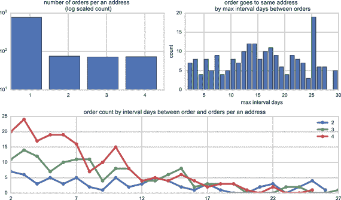
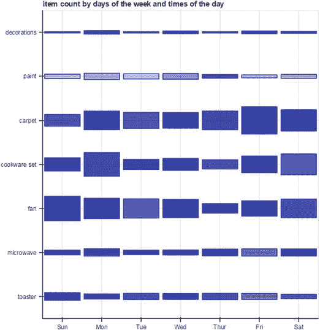
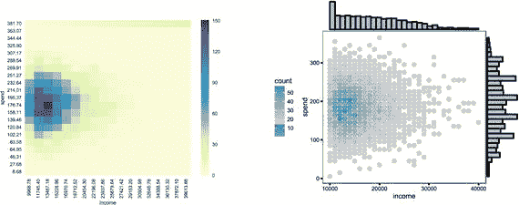
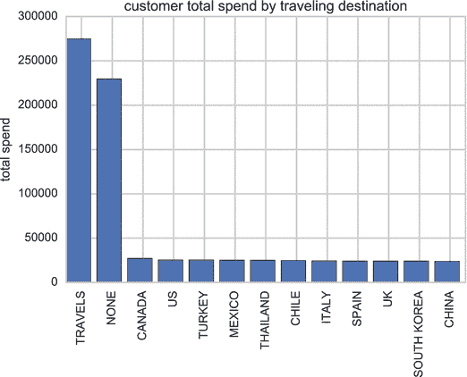

# 10. 避免构建数据科学团队时的陷阱

在本章中，我们将讨论影响数据科学团队的两个主要陷阱。首先，如果团队过快地达成共识，这将会扼杀发现，并且是团队存在盲点、容易陷入群体思维的迹象。

最后，你如何知道你的团队是在错误的问题上花费了过多时间，或者是在询问错误的事情？这被称为“偏离主题”，我们将为你提供一些避免这种情况的建议。

#### 避免过早达成共识

在大多数组织中，人们自然会试图达成共识。不同组织对此有不同的叫法。有些鼓励大家“随大流以求合群”，另一些则使用“社会化”之类的词。数据科学则截然不同。共识可能是一个大问题。你希望团队探索新想法。如果每个人都过早达成共识，那可能意味着大家都存在共同的误解。

请记住，数据科学关乎探索。你正在寻找知识和洞见。没有必要让所有人都意见统一。事实上，你希望团队成员能够自在地就如何解读数据展开争论。数据科学团队应该更像一场尴尬的家庭聚餐，而不是一次安静的乘车之旅。你希望团队能够交谈、探索，甚至互相“找茬”。这种交流方式更有可能发现新想法。

你可以采取以下几种措施来防止团队过快达成共识：

-   意识到共识的危险。认识到在复杂问题上迅速达成一致通常是群体思维的标志。
-   确保团队规模足够小，让每个人都觉得可以放心地提出不同意见。你的团队应该包括研究负责人、几位数据分析师以及项目经理。尽量将团队规模控制在六人以下。较大的团队往往容易压制较安静的声音，而这些声音往往蕴藏着一些最佳见解。
-   确保你的研究负责人从团队外部引入人员。

我们来详细说明最后一点，因为它对于避免快速达成共识至关重要。假设你正在研究一个关于跑鞋网站的趣味问题。你试图观察处于恋爱关系中的人是否更有可能说服伴侣一起跑步。团队正试图弄清楚如何通过网站数据来解答这个问题。研究负责人可能需要邀请一位销售同事来分享一些逸事，或者邀请几位他们认识的、会与伴侣一起跑步的人，聊聊他们是如何开始与伴侣一起跑步的。这些人或许能提供团队原本可能无法获得的一些见解。只需要记住保持团队规模小巧。所以，也许每次会议只增加一两个人。

你的团队还可以尝试的另一件事是，在每次讨论结束时假设自己是错的。这可以简单到问一句：“如果我们在这件事上错了会怎样？”你的团队应该能够回答这个问题。也许他们会意识到自己在这件事上错了，或者在许多其他事情上错了。如果真是这样，那就逐一审视所有那些事情。要注意那些团队对这个问题无言以对的时刻。这是团队可能沦为群体思维牺牲品的警告信号之一。

假设团队决定探讨关于“恋爱跑伴”这个问题。他们认为分析这些数据的最佳方式是，查看是否有共享同一地址的客户，然后比较他们的订单，看看是否有一位客户先于另一位开始下单，如图 10-1 所示。但如果团队错了呢？数据会呈现出什么样子呢？也许室友们更可能一起跑步。他们可能是学生，或者是为了分摊房租。这些可能是不太有力的论据，但仍然应该被考虑进去。正是关于“错了意味着什么”的讨论才最有价值。

图 10-1. 来自共享地址客户的订单

多数地址只有一个订单，且在一个月的时间窗口内，每个地址最多有四个订单。排除只有一个订单的地址后，发往同一地址的订单之间，最大间隔天数平均为 16.5 天。如果我们逐次比较订单间隔天数，大多数人很可能在 15 天内再次下单，并且他们在一个月内下单越多，前 7 天内下的单也越多。了解如何创建此图表，请访问[`http://ds.tips/s5Ere`](http://ds.tips/s5Ere)

如果团队达成共识过快，另一件可以尝试的事情是，找一个可能持不同意见的人来扮演“唱反调”的角色。例如，针对跑鞋网站，你或许可以邀请一位绝不会与恋爱伴侣一起跑步的人。问问她为什么这么认为。也许更常见的是，人们利用那段时间独处。可能跑步者喜欢跑步，因为它是一项单人运动。这类见解真的能为团队的讨论增色不少。

如果你在一家大型组织工作，你可能比自己意识到的更倾向于快速达成共识。大型组织中的一个典型项目需要大量的协调工作。对于这些项目，你需要共识才能推动事情。数据科学团队则有另一套优先事项。当你寻求新知识和新见解时，过快达成共识可能是一个真正的危险。如果你运用本节讨论的技巧，就更有可能让你的团队保持探索精神，并对新想法持开放态度。

#### 防止团队偏离方向

正如我们所见，团队存在过快达成共识的风险。但另一方面，你又如何知道团队是否在错误的问题上耗时过多？何时应该放弃一个疑问并转向另一个？这是完全相反的挑战。不同于全员意见一致，他们持续追问错误的方向。最终导致团队不是在探索，而是在漫无目的地游荡。

从许多方面来看，这比达成共识或群体思维要棘手得多。你希望团队感受自由探索的乐趣，同时业务又需要获得有价值的洞见。你不想因过度关注交付而扼杀创新，但团队又必须拿出成果。

我曾为一家大型家装零售商做过项目。他们试图判断顾客是普通住户还是专业装修商，并根据顾客购买记录建立预测数据模型。

研究负责人提出了一些非常有趣的问题：专业人士更可能购买哪些商品？专业人士是否在特定时间段更倾向购物？比如清晨开工前采购？专业人士是否更倾向于大额消费？

这些问题本身都很有价值。数据科学团队邀请了几位外部人士来获取不同视角，他们很好地避免了共识陷阱。团队提出了许多不同的问题，也尝试了多种获取数据的方式。

团队面临的挑战之一在于，零售商错误地认为数据分析师越多效率越高，因此把团队规模扩得很大。最终团队由一位研究负责人、一位项目经理和四位数据分析师组成。

研究负责人提出有趣的问题后，四位数据分析师会分别产出不同报告。问题在于每份报告都定义得非常狭隘——这是数据分析师常出现的状况。多数分析师出身于结构化背景（统计学、数学或软件开发），他们受过训练，面对复杂情况会倾向于拆解成细碎的指标。结果不是被数据淹没，而是淹没在琐碎细节中。

这个团队正是如此。他们每隔几周产出几十份报告，却只得出琐碎且无趣的结论（如图 10-2 所示）。例如：买油漆的人更倾向上午购买，大额消费者更可能购买家电，买地毯的顾客更倾向在周五购买。

**图 10-2.** 按星期几和一天中的时段划分的商品数量

注意：方块越大，表示该商品在每周某天的消费金额越高。深色代表当天较晚时间段的销售，浅色代表较早时间段的销售。对于油漆和装饰品，其总价值与地毯、炊具和风扇相比非常小。油漆大多在上午购买。地毯周五的销售额略高，炊具周一略高。创建此图表的方法参见[`http://ds.tips/y2wRe`](http://ds.tips/y2wRe)。

这些零散数据点本身没问题，但数据分析师完全没有尝试构建故事脉络——专业顾客的动机和挑战究竟是什么？

透过玻璃门的锁孔看问题，正是团队中数据分析师过多时经常出现的状况。他们专注于数十个细小的数据点，却不愿与更宏大的真理角力。如果这种情况不加以纠正，团队就会继续在数据中迷失方向，丧失提出重大问题的兴趣。

研究负责人的核心职责就是通过引导团队提出有趣问题、交付有价值的洞见来避免这种情况。研究负责人在数据科学团队中代表着业务利益。

你希望团队自由探索，但也要防止他们漫无目的。如果团队无法交付洞见，对业务的价值就会大打折扣。这正是保持团队精简且均衡配置的原因——配备一到两名数据分析师、一名研究负责人和一名项目经理。如果数据分析师占比过高，你就可能陷入收集数据却无法获得洞见的危险。

小团队同样能提出重大问题。同时请记住，你要掌握团队产生的知识和洞见。如果觉得团队思考格局不够大，你必须挑战他们去追寻更宏大的故事脉络。

#### 本章小结

本章中，你学到了避免数据科学团队两大常见陷阱的技巧：一是过快达成共识，二是漫无目的。团队过快达成共识会扼杀发现，也是团队存在盲点的征兆。而团队漫无目的，则意味着他们在某个问题上耗时过多，或者可能问错了方向。在第四部分中，你将学习数据科学团队如何聚焦于交付价值，首先从第 11 章开始——你会看到数据科学团队的运作方式与多数组织的常规模式有何不同。

## 第三部分：数据科学冲刺中的交付

你已经了解了什么是数据科学以及如何组建数据科学团队。现在你会学习如何启动工作。数据科学需要非常独特的思维方式。你将看到企业的典型工作模式，并将其与数据科学团队的工作方式进行对比。接着你将学习如何运用数据科学生命周期，在团队"冲刺"中交付真实的商业价值。

### 11. 全新工作方式

数据科学中的"科学"指的是运用科学方法。这种科学方法是一个发现循环：你的团队提出有趣的问题，然后研究这些问题，接着利用研究成果产生新洞见。团队需要采用经验主义的工作方式——不是依赖计划，而是灵活适应；不是寻找答案，而是追寻有趣的问题。

这与大多数组织的运营方式截然不同。多数组织依赖计划、目标和具体交付物。通常表现为：

1. 投资组合被拆解为更小、可执行的项目。
2. 每个项目可能由多个团队负责。
3. 中央项目管理办公室（PMO）追踪项目成功。
4. PMO 确保各团队按计划完成交付。

而你的数据科学团队需要的是适应性、探索性和创造力，以便能够质疑、探索和反应。这之间存在巨大鸿沟。大多数组织仍然渴望计划、目标和确定性。

要让数据科学团队成功，你必须重新调整组织对你工作的认知方式。必须打破"计划与交付"的思维定式，代之以"探索与发现"的理念。在大多数组织中，这种转变绝非易事。

首先你要做的，是阐明数据科学的独特性。试着将数据科学与典型项目进行对比，展示传统的计划交付模式为何不适用于数据科学团队。重新定义成功标准——说明不能只盯着项目结束时的大规模交付物，而必须通过创造新洞见来展示成功，进而展现组织知识沉淀的价值。

#### 审视典型项目

根据项目管理协会（PMI）的数据，全球约有 1600 多万项目经理。¹ 相比之下，研究公司国际数据公司（IDC）估计，全球约有 1800 多万软件开发人员。² 这意味着几乎每名软件开发人员就对应一名项目经理。对许多开发人员来说，这并不令人意外。

在软件开发领域，项目管理与软件开发似乎密不可分。大多数软件开发人员都精通项目管理语言。他们可能会询问软件需求，或某个新功能是否超出了项目范围。他们甚至可能使用甘特图或其他项目管理计划。这些开发人员已将项目管理内化于心。他们将需求、范围和时间表视为软件开发的一部分。尽管开发方式多种多样，但这些开发人员自然会遵循项目管理实践。

这对于你的数据科学团队来说可能是一个相当大的挑战。如果你的团队成员曾参与过传统软件项目，他们可能会试图应用那些项目管理原则。数据科学团队不处理“项目”。请记住，这些团队是探索性的。这正是数据科学中的“科学”所在。

项目管理是一个确定性的过程。它要求你在开始之前就对交付物有所了解。典型项目要求事先确定规范。它们专注于在既定范围、时间表和预算内进行交付。若对这些约束条件毫无概念，你就无法有效管理这些项目。

典型项目还会交付一个产品或服务。你的项目结束时应该有一个“名词”。也许你正在完成一份报告，或者你的团队交付了一个软件产品。在项目结束时，你必须交付某些成果，这样你才知道项目已经完成。

让我们来看一个典型项目。假设你需要为你的跑鞋网站购买一台新服务器。你有一名项目经理负责这个项目。项目经理做的第一件事就是创建一份项目章程，这是一份简短的一页纸文件，说明项目将完成什么。

如果章程获批，项目经理就会制定一份计划。该计划记录项目的范围、成本和进度。在这个案例中，项目范围是购买一台新服务器。项目经理估算成本，并设定服务器到货的日期。项目在服务器到货时结束。

范围、成本和进度都是相互平衡的约束条件。如果计划发生变化，成本很可能会上升，进度也可能会延长。如果项目经理决定加急运送服务器，成本就会增加，而进度则会缩短。范围、成本和进度在这个“铁三角”中相互平衡。

那么，这和数据科学团队有什么关系呢？简而言之，没有关系。优秀的项目管理是完全不同的学科，它有着不同的目标和流程。这并不意味着数据科学领域会完全不存在项目管理；很有可能有人会驱使你的数据科学团队使用项目管理原则。

有个老笑话：如果你有一把崭新的锤子，那么所有东西看起来都像钉子。大多数组织和项目管理也是如此。项目管理是他们习惯使用的工具。没有他们的“锤子和钉子”，他们花钱就感到不自在。

我曾在一家深度依赖项目管理的组织工作。项目管理办公室是公司里最有权势的部门之一。数据科学团队在几乎所有的会议中都因此举步维艰。利益相关者会询问项目范围，而数据科学团队从未有过令人满意的答案，因为他们正试图创造新知识并寻找洞察。利益相关者还会询问团队计划何时交付这些洞察。同样，团队实际上也无法给出答案。他们不知道自己会发现什么。他们仍在查阅数据。他们无法确定何时能找到最有价值的洞察。这从未让利益相关者感到满意。

如果你在数据科学团队工作，几乎肯定会遇到这类问题。如果只是少数项目经理提出这些问题，那可能算不上太大的挑战。但如果是赞助你项目的人提出这些问题，你可能就遇到了真正的麻烦。

在这种情况下，你能做的最好的事情就是阐明项目管理与数据科学之间的区别。至少，要确保你数据科学团队中的每个人都理解这种区别。尽量避开诸如范围、成本和进度之类的项目管理术语。随着时间的推移，你的听众可能会接受这种不同的方法。

#### 进行数据科学“项目”工作

项目管理在大多数组织中都非常成功。它就像一把闪亮的锤子，帮助敲定了成本和管控了进度。它非常成功，以至于组织在许多工作中都使用项目管理。但这并不意味着项目管理适用于所有这些工作。

数据科学与项目管理截然不同。你的团队可能会探索新的机遇。他们可能正试图让你的数据更容易被组织其他成员访问。也许他们正在寻找更好地了解客户的方法，或者试图检测安全漏洞或欺诈行为。团队甚至可能探索来自传感器或机器的大规模数据集。这些工作并不适合典型的项目管理框架。首先，你不会有一个明确的范围。数据科学项目是探索性的。这正是数据科学中的“科学”所在。

在开始探索之前，你无法对将要发现的内容创建详细的描述。探索的全部意义就在于你不知道会发现什么。你必须能够对你的数据做出反应。如果你想探索并获取新知识，你需要有预料之外情况的准备。总的来说，数据科学旨在寻找新的机会或试图验证当前的假设。它专注于知识探索，并试图提供洞察。

想想生活中那些更具探索性和经验性的事情。你是否曾沿着一条餐馆街浏览过菜单？那是一个经验性的过程。你在探索每一家餐馆并对菜单做出回应。这与你在知名餐厅预订座位非常不同。后者你会计划去的时间和地点，可能还会计划吃什么。

现在，想象一下，当你在探索时，有人要求你承诺吃什么、花多少钱以及什么时候吃完。很可能你无法回答。如果那个人坚持要你回答，你可能会随便跳进第一家餐馆，看一下菜单，然后做出一个估计。从非常现实的意义上说，你不得不停止探索。你不再是在学习，而是在做计划。

这正是项目管理实践应用于数据科学时发生的情况。表 11-1 比较了一个典型的软件项目和一个典型的数据科学项目。

**表 11-1.** 软件项目与数据科学项目对比

| 典型软件项目 | 典型数据科学项目 |
| --- | --- |
| 开发一个新的客户自助门户 | 更好地理解客户的需求和行为 |
| 根据客户反馈创建新软件 | 创建模型以预测客户流失 |
| 安装新的服务器群以提高可扩展性 | 寻找新市场和新机遇 |
| 将遗留代码转换为更新的软件 | 验证关于客户使用的假设 |

我曾为一家坚持对所有工作应用良好项目管理实践的组织工作过。数据科学团队也不例外。该团队试图通过创建知识里程碑和洞察交付物来适应这种做法。最终，这完全行不通。知识里程碑只是最佳的猜测，并且阻碍了团队关注任何有趣的事情。由于时间限制，他们只寻找那些容易证明或接近显而易见的东西。每当我试图提出更有趣的问题时，他们都担心会错过一个里程碑。

如前所述，项目管理实践对大多数组织都是有益的。不幸的是，对于你的数据科学团队来说，这些实践会产生抑制作用。项目管理不鼓励不确定性。它迫使数据科学团队只尝试并验证已经知道的东西。如果他们发现了任何意想不到的事情，那会被视为一个错误（bug），而不是一个特性（feature）。

当你创建里程碑和交付物时，你是在告诉团队，他们有一个固定的时间来验证已知的东西。他们通过不发现新事物来衡量自己的成功。这与你想让你的数据科学团队做的恰恰相反。你不应该把数据科学看作是一个交付产品的项目。

##### 比较项目挑战

传统项目依赖于明确的需求和周密的计划。请记住，一个典型的项目有范围、成本和进度。这实际上与数据科学团队所使用的科学方法并不兼容。没有具体的可交付成果需要管理，你也无法真正平衡这些约束。

相反，数据科学团队是经验性和探索性的。这些项目涉及通过观察来学习。如果你坚持要一个项目计划，你就是在把团队框定在他们已经知道的东西里。很难想象大多数团队在一个定义明确的框框里能找到多少新数据。

如果你想想大多数组织中的会议，它们通常围绕着制定计划和达成目标展开。大多数组织的语言仍然围绕着诸如使命、目标和成果之类的短语。要抽身出来想象一个纯粹探索型的团队是很困难的。对大多数组织来说，这将是一个艰难的转变。

那么，让我们来看一个项目，并将其与数据科学团队进行比较。然后，让我们看看如果应用计划和目标会发生什么。

让我们从一个典型的软件项目开始。你的组织想要开发一个新的客户自助门户。项目章程是创建该门户作为降低成本的一种方式。这个项目会有固定的成本，但组织会在客户服务方面节省资金。该项目的投资回报率很高。计划将所有功能都列在一份需求文档中。开发进度有预估，所有成本都有记录。所有这些都在项目计划中列出。项目经理将在整个项目过程中更新计划，并帮助平衡任何变更。

现在，让我们想象一下数据科学团队。这是一个由四人组成的小团队。有一名研究负责人，两名数据分析师，和一名项目经理。他们的任务是更好地理解客户的需求和行为。组织的领导层认为，如果能够更好地了解客户，他们就能将这种了解转化为未来的收入。

研究负责人首先提出几个问题：

*   我们对客户了解什么？
*   我们对客户有哪些假设？
*   为什么我们的客户选择从我们这里购物，而不是我们的竞争对手？
*   什么可能让我们的客户更多地在我们这里购物？

研究负责人将与数据分析师合作，将这些分解成报告。也许他们可以创建关于客户收入的报告，如图 11-1 所示。他们还可以分析社交媒体平台，并创建一个来自数千名客户反馈的词云，如图 11-2 所示。例如，词云中一些最大的词是“旅行”、“食谱”和“餐厅”。团队可以回过头来问更多问题。为什么我们的客户喜欢旅行？他们要去哪里？

**图 11-1.** 收入与支出 注

x 轴是收入，y 轴是支出。收入较高的人不一定支出更多。收入在 20,000-30,000 美元左右的人似乎支出最高。了解如何创建此图表，请访问 [`http://ds.tips/n6cEc`](http://ds.tips/n6cEc)。

**图 11-2.** 词云 注

了解如何创建此图表，请访问 [`http://ds.tips/k8wRa`](http://ds.tips/k8wRa)。

你可以看到，更多地了解你的客户如何能带来更高的销售额。也许你可以与营销团队合作，在旅游杂志上做广告。也许你可以开始销售与旅行密切相关的产品。

另一方面，你也可能发现整个探索是一条死胡同。也许你的数据分析师制作了一份关于客户旅行地点的报告，如图 11-3 所示。结果发现，你的很多客户确实会出国旅行，但人数尚未多到足以证明推出新产品的合理性。因此，团队决定放弃这个方向，转而探索其他领域。也许接下来，你会尝试挖掘客户最喜欢的餐厅。

**图 11-3.** 客户旅行目的地

注意

旅行客户的总消费额高于不旅行的客户。然而，若比较不同旅行目的地的消费额，每个目的地的总消费额都低于不旅行客户的消费额。请访问 [`http://ds.tips/y8seS`](http://ds.tips/y8seS) 了解如何创建此图表。

这将如何融入传统的项目管理框架？你的项目范围是什么？是了解你的客户，是获取新知识。你如何知道何时算“了解”完毕？这些新知识何时能交付？项目范围之内又包含什么？

所有这些问题恐怕都会让任何项目经理一脸茫然。学习是一个动词，而非名词。如果你不知道自己要寻找什么，就无法衡量你将学到什么。如果你知道自己要寻找什么，那么你并没有真正学到新东西。那进度安排呢？即使团队已经走入死胡同，他们还会继续在这个项目上工作吗？团队何时停止工作？最后，成本又如何？如果你不知道团队要工作多久，你又如何为他们的工作时间做预算？

正如你可能已经注意到的，这个数据科学项目并不符合项目管理框架。你会发现，对于你大多数的数据科学探索（即便不是全部），情况也是如此。

##### 定义成功标准

在 1921 年的一次采访中，托马斯·爱迪生提到，他的助手因他们失败的实验而感到沮丧。³ 这位著名的发明家则很乐观，并向助手保证他们并没有失败。他们总是在学习新东西。一旦学到了什么，他们就会尝试不同的方法。今天，我们知道托马斯·爱迪生是对的，因为他取得了诸多成功。其中一些发明至今仍在使用。也有一些实验被历史遗忘——现在很少有人弹奏他们发明的混凝土钢琴。我们有幸将他的遗产视为一系列成功的实验，却看不到那些占据了他大部分时间的失败实验。失败远远多于成功。

如果爱迪生使用现代项目管理，他可能会遇到一些挑战。他将如何定义他的成功标准？你不能只盯着那些奏效的东西。如果那样做，你需要极大的耐心。他的实验可能要持续数月甚至数年，才能产出看起来像成功的东西。

我们应该像爱迪生看待他的实验那样看待数据科学的成功。只需问一个简单的问题：我们学到了什么新东西吗？你的团队会在数据上进行许多实验，而大多数实验都会失败或走入死胡同。尽量不要将这些视为失败。并非每个实验都能带来洞见。而且，你大多数的洞见可能价值也不大。也许你会发现，你的大部分客户都是宠物主人。这或许有趣，但很可能价值不大。

在很多组织中，这种方法可能具有挑战性。在某些组织中，它甚至可能令人厌烦。当人们问“那个团队在做什么？”或者更糟糕的“那个团队到底是做什么的？”时，你就知道遇到这个问题了。这可能是一个组织性挑战。管理者可能会雇佣一个数据科学团队作为实验，看看他们能搞出什么名堂。这可能会给你的数据科学团队带来更多困难。

你可以采取一些措施来展示一些成功标准：

*   确保你的团队尽可能透明。克制自己，不要脱离组织的其他部分。通常，如果人们不了解你在做什么，他们很快就会质疑你为什么在那里。
*   确保你努力解决的是大问题。你要让团队保持足够的雄心，去处理有趣的问题。如果问题太胆怯，可能很难展示出有趣的结果。
*   尝试通过定期安排的分享会来展示团队正在学习什么。在这些会议中，要涵盖团队正在研究的问题，并提供一些最新的洞见。

我曾为一所大学工作，该大学雇佣了一组“非结构化数据专家”。教务长希望有一个数据科学团队来寻找新的洞见。这个团队在雇佣他们的行政人员附近的办公室工作。大学里其他人都不知道他们在做什么。大多数人甚至没意识到他们的存在。问题在于，这个数据科学团队难以提出任何有趣的问题。大学里的其他人都不会花时间与研究负责人会面。

如果这个团队被安置在更靠近其他教职员工而非行政人员的地方，情况会比现在顺利得多。这将使他们能够从一开始就与所有人合作，提出有趣的问题。他们本可以举办分享会，让人们深入了解这些问题。

如果你是数据科学团队的研究负责人，请努力让问题与组织的其他部分紧密相连。对你发现的东西保持透明。经常演示有趣的洞见。尝试吸引组织的其他部分，让他们理解数据科学的价值。

如果你是数据科学团队的项目经理，请努力确保团队与其他人坐在一起。你最好的灵感来源可能是不时过来串门并提问的人。团队与组织其他部分的联系越紧密，就越容易创造出有趣的问题。

#### 总结

在本章中，你回顾了一个组织中的典型项目。接着，你会发现从事数据科学项目是什么样的体验。然后，你了解了每种项目类型所面临的不同项目挑战。最后，你学会了如何为你的数据科学团队定义成功标准，以及需要向组织其他部分传达什么。在第十二章中，你将了解如何使用数据科学生命周期。

**脚注**

1 项目管理协会。《PMI 项目管理事实手册》；第二版。项目管理协会，2001 年。

2 “2014 年全球软件开发者及 ICT 技能型工作者估算”，2013 年 12 月，访问于 2016 年 8 月 5 日，[`http://www.idc.com/research/viewtoc.jsp?containerId=244709`](http://www.idc.com/research/viewtoc.jsp?containerId=244709) 。

3 “为何如此多的人一事无成？”，作者 B. C. 福布斯，[采访托马斯·爱迪生]，*美国杂志*，第 91 卷，1921 年 1 月。Crowell 出版公司，俄亥俄州斯普林菲尔德。（谷歌图书全文预览从第 10 页开始，引用在第 89 页，第 2 栏）[`http://books.google.com/books?id=CspZAAAAYAAJ&q=%22I+cheerily%22#v=snippet&`](http://books.google.com/books%3Fid=CspZAAAAYAAJ%26q=%22I+cheerily%22#v=snippet%26)

