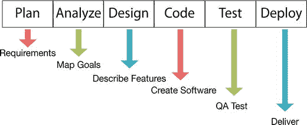
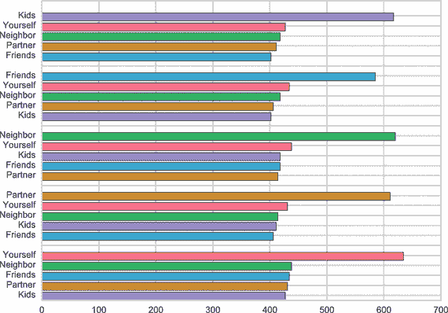
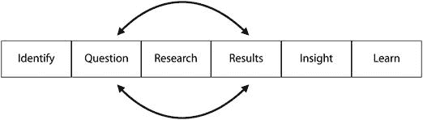
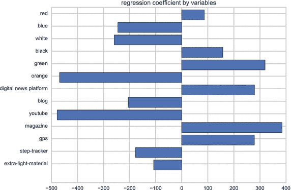
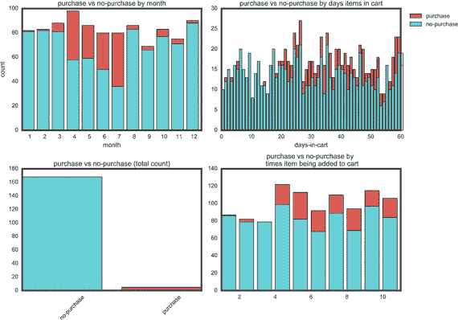
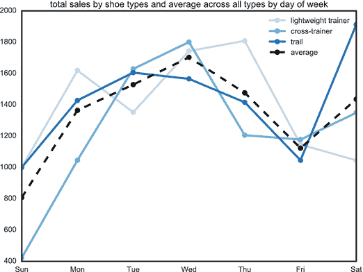
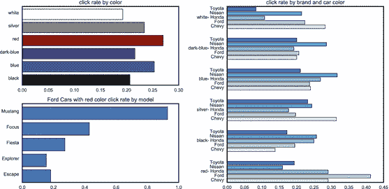
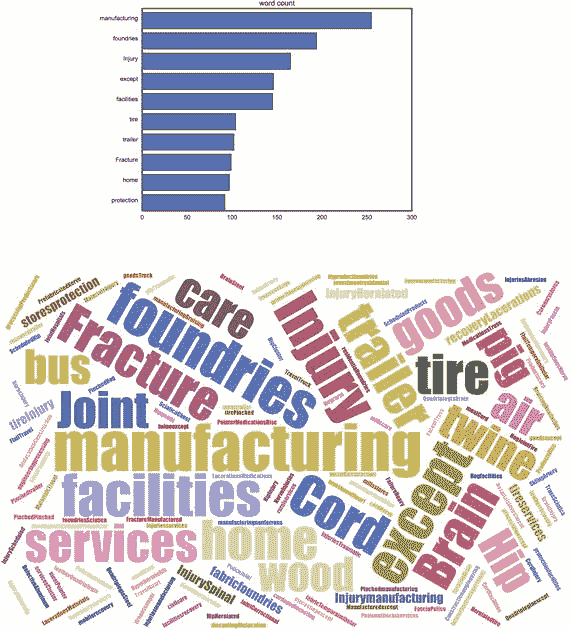

## 第三部分：数据科学冲刺中的交付

你已经了解了什么是数据科学以及如何组建数据科学团队。现在你会学习如何启动工作。数据科学需要非常独特的思维方式。你将看到企业的典型工作模式，并将其与数据科学团队的工作方式进行对比。接着你将学习如何运用数据科学生命周期，在团队“冲刺”中交付真实的商业价值。

### 11. 全新工作方式

数据科学中的“科学”指的是运用科学方法。这种科学方法是一个发现循环：你的团队提出有趣的问题，然后研究这些问题，接着利用研究成果产生新洞见。团队需要采用经验主义的工作方式——不是依赖计划，而是灵活适应；不是寻找答案，而是追寻有趣的问题。

这与大多数组织的运营方式截然不同。多数组织依赖计划、目标和具体交付物。通常表现为：

1.  投资组合被拆解为更小、可执行的项目。
2.  每个项目可能由多个团队负责。
3.  中央项目管理办公室（`PMO`）追踪项目成功。
4.  `PMO` 确保各团队按计划完成交付。

而你的数据科学团队需要的是适应性、探索性和创造力，以便能够质疑、探索和反应。这之间存在巨大鸿沟。大多数组织仍然渴望计划、目标和确定性。

要让数据科学团队成功，你必须重新调整组织对你工作的认知方式。必须打破"计划与交付"的思维定式，代之以"探索与发现"的理念。在大多数组织中，这种转变绝非易事。

首先你要做的，是阐明数据科学的独特性。试着将数据科学与典型项目进行对比，展示传统的计划交付模式为何不适用于数据科学团队。重新定义成功标准——说明不能只盯着项目结束时的大规模交付物，而必须通过创造新洞见来展示成功，进而展现组织知识沉淀的价值。

## 审视典型项目

根据项目管理协会（PMI）的数据，全球约有 1600 多万项目经理。¹ 相比之下，研究公司国际数据公司（IDC）估计，全球约有 1800 多万软件开发人员。² 这意味着几乎每名软件开发人员就对应一名项目经理。对许多开发人员来说，这并不令人意外。

在软件开发领域，项目管理与软件开发似乎密不可分。大多数软件开发人员都精通项目管理语言。他们可能会询问软件需求，或某个新功能是否超出了项目范围。他们甚至可能使用甘特图或其他项目管理计划。这些开发人员已将项目管理内化于心。他们将需求、范围和时间表视为软件开发的一部分。尽管开发方式多种多样，但这些开发人员自然会遵循项目管理实践。

这对于你的数据科学团队来说可能是一个相当大的挑战。如果你的团队成员曾参与过传统软件项目，他们可能会试图应用那些项目管理原则。数据科学团队不处理“项目”。请记住，这些团队是探索性的。这正是数据科学中的“科学”所在。

项目管理是一个确定性的过程。它要求你在开始之前就对交付物有所了解。典型项目要求事先确定规范。它们专注于在既定范围、时间表和预算内进行交付。若对这些约束条件毫无概念，你就无法有效管理这些项目。

典型项目还会交付一个产品或服务。你的项目结束时应该有一个“名词”。也许你正在完成一份报告，或者你的团队交付了一个软件产品。在项目结束时，你必须交付某些成果，这样你才知道项目已经完成。

让我们来看一个典型项目。假设你需要为你的跑鞋网站购买一台新服务器。你有一名项目经理负责这个项目。项目经理做的第一件事就是创建一份项目章程，这是一份简短的一页纸文件，说明项目将完成什么。

如果章程获批，项目经理就会制定一份计划。该计划记录项目的范围、成本和进度。在这个案例中，项目范围是购买一台新服务器。项目经理估算成本，并设定服务器到货的日期。项目在服务器到货时结束。

范围、成本和进度都是相互平衡的约束条件。如果计划发生变化，成本很可能会上升，进度也可能会延长。如果项目经理决定加急运送服务器，成本就会增加，而进度则会缩短。范围、成本和进度在这个“铁三角”中相互平衡。

那么，这和数据科学团队有什么关系呢？简而言之，没有关系。优秀的项目管理是完全不同的学科，它有着不同的目标和流程。这并不意味着数据科学领域会完全不存在项目管理；很有可能有人会驱使你的数据科学团队使用项目管理原则。

有个老笑话：如果你有一把崭新的锤子，那么所有东西看起来都像钉子。大多数组织和项目管理也是如此。项目管理是他们习惯使用的工具。没有他们的“锤子和钉子”，他们花钱就感到不自在。

我曾在一家深度依赖项目管理的组织工作。项目管理办公室是公司里最有权势的部门之一。数据科学团队在几乎所有的会议中都因此举步维艰。利益相关者会询问项目范围，而数据科学团队从未有过令人满意的答案，因为他们正试图创造新知识并寻找洞察。利益相关者还会询问团队计划何时交付这些洞察。同样，团队实际上也无法给出答案。他们不知道自己会发现什么。他们仍在查阅数据。他们无法确定何时能找到最有价值的洞察。这从未让利益相关者感到满意。

如果你在数据科学团队工作，几乎肯定会遇到这类问题。如果只是少数项目经理提出这些问题，那可能算不上太大的挑战。但如果是赞助你项目的人提出这些问题，你可能就遇到了真正的麻烦。

在这种情况下，你能做的最好的事情就是阐明项目管理与数据科学之间的区别。至少，要确保你数据科学团队中的每个人都理解这种区别。尽量避开诸如范围、成本和进度之类的项目管理术语。随着时间的推移，你的听众可能会接受这种不同的方法。

## 进行数据科学“项目”工作

项目管理在大多数组织中都非常成功。它就像一把闪亮的锤子，帮助敲定了成本和管控了进度。它非常成功，以至于组织在许多工作中都使用项目管理。但这并不意味着项目管理适用于所有这些工作。

数据科学与项目管理截然不同。你的团队可能会探索新的机遇。他们可能正试图让你的数据更容易被组织其他成员访问。也许他们正在寻找更好地了解客户的方法，或者试图检测安全漏洞或欺诈行为。团队甚至可能探索来自传感器或机器的大规模数据集。这些工作并不适合典型的项目管理框架。首先，你不会有一个明确的范围。数据科学项目是探索性的。这正是数据科学中的“科学”所在。

在开始探索之前，你无法对将要发现的内容创建详细的描述。探索的全部意义就在于你不知道会发现什么。你必须能够对你的数据做出反应。如果你想探索并获取新知识，你需要有预料之外情况的准备。总的来说，数据科学旨在寻找新的机会或试图验证当前的假设。它专注于知识探索，并试图提供洞察。

想想生活中那些更具探索性和经验性的事情。你是否曾沿着一条餐馆街浏览过菜单？那是一个经验性的过程。你在探索每一家餐馆并对菜单做出回应。这与你在知名餐厅预订座位非常不同。后者你会计划去的时间和地点，可能还会计划吃什么。

现在，想象一下，当你在探索时，有人要求你承诺吃什么、花多少钱以及什么时候吃完。很可能你无法回答。如果那个人坚持要你回答，你可能会随便跳进第一家餐馆，看一下菜单，然后做出一个估计。从非常现实的意义上说，你不得不停止探索。你不再是在学习，而是在做计划。

这正是项目管理实践应用于数据科学时发生的情况。表 11-1 比较了一个典型的软件项目和一个典型的数据科学项目。

**表 11-1.** 软件项目与数据科学项目对比

| 典型软件项目 | 典型数据科学项目 |
| --- | --- |
| 开发一个新的客户自助门户 | 更好地理解客户的需求和行为 |
| 根据客户反馈创建新软件 | 创建模型以预测客户流失 |
| 安装新的服务器群以提高可扩展性 | 寻找新市场和新机遇 |
| 将遗留代码转换为更新的软件 | 验证关于客户使用的假设 |

我曾为一家坚持对所有工作应用良好项目管理实践的组织工作过。数据科学团队也不例外。该团队试图通过创建知识里程碑和洞察交付物来适应这种做法。最终，这完全行不通。知识里程碑只是最佳的猜测，并且阻碍了团队关注任何有趣的事情。由于时间限制，他们只寻找那些容易证明或接近显而易见的东西。每当我试图提出更有趣的问题时，他们都担心会错过一个里程碑。

如前所述，项目管理实践对大多数组织都是有益的。不幸的是，对于你的数据科学团队来说，这些实践会产生抑制作用。项目管理不鼓励不确定性。它迫使数据科学团队只尝试并验证已经知道的东西。如果他们发现了任何意想不到的事情，那会被视为一个错误（bug），而不是一个特性（feature）。

当你创建里程碑和交付物时，你是在告诉团队，他们有一个固定的时间来验证已知的东西。他们通过不发现新事物来衡量自己的成功。这与你想让你的数据科学团队做的恰恰相反。你不应该把数据科学看作是一个交付产品的项目。

### 比较项目挑战

传统项目依赖于明确的需求和周密的计划。请记住，一个典型的项目有范围、成本和进度。这实际上与数据科学团队所使用的科学方法并不兼容。没有具体的可交付成果需要管理，你也无法真正平衡这些约束。

相反，数据科学团队是经验性和探索性的。这些项目涉及通过观察来学习。如果你坚持要一个项目计划，你就是在把团队框定在他们已经知道的东西里。很难想象大多数团队在一个定义明确的框框里能找到多少新数据。

如果你想想大多数组织中的会议，它们通常围绕着制定计划和达成目标展开。大多数组织的语言仍然围绕着诸如使命、目标和成果之类的短语。要抽身出来想象一个纯粹探索型的团队是很困难的。对大多数组织来说，这将是一个艰难的转变。

那么，让我们来看一个项目，并将其与数据科学团队进行比较。然后，让我们看看如果应用计划和目标会发生什么。

让我们从一个典型的软件项目开始。你的组织想要开发一个新的客户自助门户。项目章程是创建该门户作为降低成本的一种方式。这个项目会有固定的成本，但组织会在客户服务方面节省资金。该项目的投资回报率很高。计划将所有功能都列在一份需求文档中。开发进度有预估，所有成本都有记录。所有这些都在项目计划中列出。项目经理将在整个项目过程中更新计划，并帮助平衡任何变更。

现在，让我们想象一下数据科学团队。这是一个由四人组成的小团队。有一名研究负责人，两名数据分析师，和一名项目经理。他们的任务是更好地理解客户的需求和行为。组织的领导层认为，如果能够更好地了解客户，他们就能将这种了解转化为未来的收入。

研究负责人首先提出几个问题：

*   我们对客户了解什么？
*   我们对客户有哪些假设？
*   为什么我们的客户选择从我们这里购物，而不是我们的竞争对手？
*   什么可能让我们的客户更多地在我们这里购物？

研究负责人将与数据分析师合作，将这些分解成报告。也许他们可以创建关于客户收入的报告，如图 11-1 所示。他们还可以分析社交媒体平台，并创建一个来自数千名客户反馈的词云，如图 11-2 所示。例如，词云中一些最大的词是“旅行”、“食谱”和“餐厅”。团队可以回过头来问更多问题。为什么我们的客户喜欢旅行？他们要去哪里？

**图 11-1.** 收入与支出 注

x 轴是收入，y 轴是支出。收入较高的人不一定支出更多。收入在 20,000-30,000 美元左右的人似乎支出最高。了解如何创建此图表，请访问 [`http://ds.tips/n6cEc`](http://ds.tips/n6cEc)。

**图 11-2.** 词云 注

了解如何创建此图表，请访问 [`http://ds.tips/k8wRa`](http://ds.tips/k8wRa)。

你可以看到，更多地了解你的客户如何能带来更高的销售额。也许你可以与营销团队合作，在旅游杂志上做广告。也许你可以开始销售与旅行密切相关的产品。

另一方面，你也可能发现整个探索是一条死胡同。也许你的数据分析师制作了一份关于客户旅行地点的报告，如图 11-3 所示。结果发现，你的很多客户确实会出国旅行，但人数尚未多到足以证明推出新产品的合理性。因此，团队决定放弃这个方向，转而探索其他领域。也许接下来，你会尝试挖掘客户最喜欢的餐厅。

**图 11-3.** 客户旅行目的地

> **注意**
>
> 旅行客户的总消费额高于不旅行的客户。然而，若比较不同旅行目的地的消费额，每个目的地的总消费额都低于不旅行客户的消费额。请访问 [`http://ds.tips/y8seS`](http://ds.tips/y8seS) 了解如何创建此图表。

这将如何融入传统的项目管理框架？你的项目范围是什么？是了解你的客户，是获取新知识。你如何知道何时算“了解”完毕？这些新知识何时能交付？项目范围之内又包含什么？

所有这些问题恐怕都会让任何项目经理一脸茫然。学习是一个动词，而非名词。如果你不知道自己要寻找什么，就无法衡量你将学到什么。如果你知道自己要寻找什么，那么你并没有真正学到新东西。那进度安排呢？即使团队已经走入死胡同，他们还会继续在这个项目上工作吗？团队何时停止工作？最后，成本又如何？如果你不知道团队要工作多久，你又如何为他们的工作时间做预算？

正如你可能已经注意到的，这个数据科学项目并不符合项目管理框架。你会发现，对于你大多数的数据科学探索（即便不是全部），情况也是如此。

### 定义成功标准

在 1921 年的一次采访中，托马斯·爱迪生提到，他的助手因他们失败的实验而感到沮丧。³ 这位著名的发明家则很乐观，并向助手保证他们并没有失败。他们总是在学习新东西。一旦学到了什么，他们就会尝试不同的方法。今天，我们知道托马斯·爱迪生是对的，因为他取得了诸多成功。其中一些发明至今仍在使用。也有一些实验被历史遗忘——现在很少有人弹奏他们发明的混凝土钢琴。我们有幸将他的遗产视为一系列成功的实验，却看不到那些占据了他大部分时间的失败实验。失败远远多于成功。

如果爱迪生使用现代项目管理，他可能会遇到一些挑战。他将如何定义他的成功标准？你不能只盯着那些奏效的东西。如果那样做，你需要极大的耐心。他的实验可能要持续数月甚至数年，才能产出看起来像成功的东西。

我们应该像爱迪生看待他的实验那样看待数据科学的成功。只需问一个简单的问题：我们学到了什么新东西吗？你的团队会在数据上进行许多实验，而大多数实验都会失败或走入死胡同。尽量不要将这些视为失败。并非每个实验都能带来洞见。而且，你大多数的洞见可能价值也不大。也许你会发现，你的大部分客户都是宠物主人。这或许有趣，但很可能价值不大。

在很多组织中，这种方法可能具有挑战性。在某些组织中，它甚至可能令人厌烦。当人们问“那个团队在做什么？”或者更糟糕的“那个团队到底是做什么的？”时，你就知道遇到这个问题了。这可能是一个组织性挑战。管理者可能会雇佣一个数据科学团队作为实验，看看他们能搞出什么名堂。这可能会给你的数据科学团队带来更多困难。

你可以采取一些措施来展示一些成功标准：

-   确保你的团队尽可能透明。克制自己，不要脱离组织的其他部分。通常，如果人们不了解你在做什么，他们很快就会质疑你为什么在那里。

-   确保你努力解决的是大问题。你要让团队保持足够的雄心，去处理有趣的问题。如果问题太胆怯，可能很难展示出有趣的结果。

-   尝试通过定期安排的分享会来展示团队正在学习什么。在这些会议中，要涵盖团队正在研究的问题，并提供一些最新的洞见。

我曾为一所大学工作，该大学雇佣了一组“非结构化数据专家”。教务长希望有一个数据科学团队来寻找新的洞见。这个团队在雇佣他们的行政人员附近的办公室工作。大学里其他人都不知道他们在做什么。大多数人甚至没意识到他们的存在。问题在于，这个数据科学团队难以提出任何有趣的问题。大学里的其他人都不会花时间与研究负责人会面。

如果这个团队被安置在更靠近其他教职员工而非行政人员的地方，情况会比现在顺利得多。这将使他们能够从一开始就与所有人合作，提出有趣的问题。他们本可以举办分享会，让人们深入了解这些问题。

如果你是数据科学团队的研究负责人，请努力让问题与组织的其他部分紧密相连。对你发现的东西保持透明。经常演示有趣的洞见。尝试吸引组织的其他部分，让他们理解数据科学的价值。

如果你是数据科学团队的项目经理，请努力确保团队与其他人坐在一起。你最好的灵感来源可能是不时过来串门并提问的人。团队与组织其他部分的联系越紧密，就越容易创造出有趣的问题。

### 总结

在本章中，你回顾了一个组织中的典型项目。接着，你会发现从事数据科学项目是什么样的体验。然后，你了解了每种项目类型所面临的不同项目挑战。最后，你学会了如何为你的数据科学团队定义成功标准，以及需要向组织其他部分传达什么。在第十二章中，你将了解如何使用数据科学生命周期。

**脚注**

1.  项目管理协会。《PMI 项目管理事实手册》；第二版。项目管理协会，2001 年。
2.  “2014 年全球软件开发者及 ICT 技能型工作者估算”，2013 年 12 月，访问于 2016 年 8 月 5 日，[`http://www.idc.com/research/viewtoc.jsp?containerId=244709`](http://www.idc.com/research/viewtoc.jsp?containerId=244709) 。
3.  “为何如此多的人一事无成？”，作者 B. C. 福布斯，[采访托马斯·爱迪生]，*美国杂志*，第 91 卷，1921 年 1 月。Crowell 出版公司，俄亥俄州斯普林菲尔德。（谷歌图书全文预览从第 10 页开始，引用在第 89 页，第 2 栏）[`http://books.google.com/books?id=CspZAAAAYAAJ&q=%22I+cheerily%22#v=snippet&`](http://books.google.com/books%3Fid=CspZAAAAYAAJ%26q=%22I+cheerily%22#v=snippet%26)

# 12. 使用数据科学生命周期

你数据科学团队中的大多数人对典型的项目生命周期都不会陌生。有软件开发背景的人熟悉软件开发生命周期（`SDLC`）。有数据挖掘经验的人则可能使用过跨行业数据挖掘标准流程（`CRISP-DM`）。

这些生命周期各有其适用场景。它们的问题在于，要求你在开始之前就对所做的事情有充分了解。在软件开发中，你必须有一个清晰的范围。在数据挖掘中，你必须对数据和业务需求有深入了解。

数据科学是经验性的。你并不知道会发现什么。你甚至可能不知道自己在寻找什么。相反，你必须专注于有趣的问题，然后创建一个反馈循环，确保这些问题与业务价值相关联。

尽管如此，生命周期仍然非常有用。它就像一张高层次的地图，有助于让团队保持在正确的轨道上。正因如此，对于一个数据科学团队而言，你需要尝试一种不同的方法。你可以使用数据科学生命周期（`DSLC`）来为团队设定一些方向。

在本章中，你将探讨`SDLC`和`CRISP-DM`，以便理解它们与`DSLC`的不同之处。然后你将学习如何使用`DSLC`，以及如何有效地在`DSLC`的问题间循环。

## 探索 SDLC 与 CRISP-DM

你已经看到让数据科学团队在项目管理框架内工作有多么困难，那么让我们来看看项目管理中常用的两种生命周期。生命周期是你在开发软件或解决问题时采取的一系列步骤。

在大型组织中，你可能会遇到两种生命周期。

第一种是软件开发生命周期（`SDLC`）。这个生命周期有六个阶段，如图 12-1 所示。每个阶段下方列举了该阶段发生的工作示例。

**图 12-1. 软件开发生命周期（`SDLC`）**

这通常被称为瀑布模型，因为每个阶段都必须完成后才能开始下一个阶段：

1.  规划与分析：规划软件并分析需求。
2.  设计与编码：创建基本设计并开始编码。
3.  测试：代码完成后，质量保证人员测试软件。
4.  部署：通过所有测试后，软件被部署供人们使用。

你可能会看到的第二个生命周期是跨行业数据挖掘标准流程（`CRISP-DM`），它用于数据而非软件。其设计比僵化的瀑布模型更为灵活。它也有六个阶段，如图 12-2 所示：

**图 12-2. 跨行业数据挖掘标准流程（`CRISP-DM`）**

1.  商业理解
2.  数据理解
3.  数据准备
4.  建模
5.  评估
6.  部署

这两种生命周期的共同点是，它们都是为“大爆炸式”交付而设计的。你要么在软件的规划与分析阶段投入大量时间，要么在数据的商业理解阶段投入大量时间。目标是在开始工作之前尽可能多地收集信息。然后，在最后一次性“大爆炸”式地交付全部成果。

对于数据科学工作来说，这未必是最佳方法，因为数据科学具有实验性和探索性。想象一个典型的数据科学项目。假设你的数据科学团队正在识别客户在决定转向竞争对手之前的典型行为。这有时被称为客户流失率。你的数据科学团队或许能清晰地陈述其意图：观察客户在流失前做了什么，并创建一个模型来预测客户何时可能流失。

然而，你的团队无法详细规划他们的工作。他们可能会通过分析社交网络数据、公司销售数据，甚至是通过竞争对手推出的异常成功的促销活动来找到最佳模型。关键在于，他们只有在开始探索之后才会知道。

如果你的团队被迫使用`SDLC`或`CRISP-DM`流程，他们将花费太多时间在规划上。他们将无法应用从数据中学到的东西。这是因为他们被迫在开始建模或编码之前就对工作进行规划。像`SDLC`或`CRISP-DM`这样的既定流程要求对每一项工作都了如指掌。如果你犯了错误，在`SDLC`中你需要处理变更请求，而在`CRISP-DM`中则需要重新评估。

如果你希望数据科学团队保持灵活性和探索性，就不能应用标准的生命周期。相反，你应该寻找一种更轻量级的方法来交付见解，这样既能拥有结构，又能保持足够的灵活性以适应新想法。

## 使用 DSLC

现有的流程生命周期并不太适合数据科学。它和软件开发并不足够相似以至于能完全套用`SDLC`，而`CRISP-DM`的数据挖掘流程又有点过于僵化。这并不意味着数据科学团队就应该随心所欲地工作。这些生命周期确实有其价值。其价值之一在于，它能为你提供一个前往目标的高层次地图。当你刚开始组建数据科学团队时，这一点非常有用。你能大致了解前进的方向，从而做到以终为始。

生命周期的危险在于它可能成为工作的主要焦点。你应该将生命周期作为实现更好数据科学的工具，而不是为了遵循流程而遵循流程。一个好的生命周期应该像楼梯扶手。当你上下楼梯时，你会知道它就在那里，但你不必每走一步都紧紧抓住它。过了一段时间，你甚至应该感觉不到它的存在。

对于数据科学项目，你可以使用`DSLC`。这个流程框架轻量且不那么僵化。`DSLC`有六个步骤，如图 12-3 所示，后续章节将详细讨论。

**图 12-3. 数据科学生命周期（`DSLC`）**

这个生命周期大致基于科学方法。

### 识别

作为数据科学团队，首先要识别你故事中的关键角色。最终，你希望能够用数据讲述一个有趣的故事。开始故事的最佳方式是识别关键角色。把它想象成戏剧中的一个场景。谁走进了房间？有主角或主人公吗？有没有一个背景故事有助于解释他或她的行为？

让我们回到跑步鞋网站的例子。你的关键角色是谁？有跑步者。也许跑步者有一个影响其跑步习惯的伴侣。也许你的跑步者的伴侣是医生、博主或教练。每个这些角色都可能成为你数据科学故事的一部分。

### 提问

识别出关键角色后，你可以提出一些有趣的问题。团队的研究负责人可能会先问：“是否有博主影响你的跑步者？” 也许教练在影响跑步者的购买决策方面扮演着重要角色。他们可能会问：“CrossFit 教练是否在推荐我们的产品？” 这些问题是在探索数据时关键的第一步。记住，数据科学是实验性和探索性的。当你从一个好问题开始时，你更有可能获得有趣的研究成果。

### 研究

数据分析师希望与团队紧密合作，尝试找出研究问题的一些策略。团队决定探索跑者与其伙伴之间的关系。此时，研究负责人会询问数据分析师，如何能获取此类信息。

如何通过网站上的数据判断某人是否为跑步搭档？也许可以向同一邮政编码区域的用户发送“寻找跑友”促销活动。数据分析师可以尝试将客户数据与社交网络上的好友信息进行交叉比对。如果数据分析师无法就此问题展开研究，团队可以为未来制定策略，例如网站可以专门为跑步搭档创建一个特别促销活动。

### 结果

确定研究主题后，你需要制作第一批报告。这些结果供团队内部使用，应该做到快速且粗糙。希望你的数据科学团队会经历大量问题和大量报告，其中大部分可能是毫无价值的。它们或许有趣，但还不足以值得深入探索。你不希望数据分析师花费过多时间精雕细琢这些结果。

### 洞察

最后，你的数据科学团队应审视这些结果，看是否能发现任何有价值的洞察，如图 12-4 所示。也许数据表明，你的大多数客户都结伴跑步。这个洞察对营销团队来说可能非常有价值。

**图 12-4. 人们的跑步伙伴**

注意：此图表源自季度调查，调查中客户选择他们与谁一起跑步。每组中的第一个柱状图统计的是他们最常一起跑步的人。其下方的柱状图统计的是调查对象与之跑步的其他类型人群。例如，最常独自跑步的人也会与邻居一起跑；而经常与孩子一起跑步的人，除此之外则更倾向于独自跑步。了解如何创建此图表，请访问[`http://ds.tips/cH6th`](http://ds.tips/cH6th)。

### 学习

最后，你的团队会将一系列洞察整合起来，并尝试创建组织知识。正是在这里，你的团队将讲述客户的故事。你可能需要使用数据可视化来支撑你的故事。这种新知识才是真正为组织其他部门增值的部分。如果你能讲述一个引人入胜的故事，它可能会改变整个组织看待其业务的方式。

## 问题循环

软件和数据挖掘的生命周期缺乏足够的灵活性来应对新信息。这就是为什么你使用`DSLC`（数据科学生命周期）的原因，它更加轻量化。如果你的数据科学团队发现了新东西，他们不应该为了组织获益而费力地与流程抗争。

如前所述，`DSLC`包含六个领域：识别、提问、研究、结果、洞察和学习。概括来说，首先，你要识别参与者，然后提出一些有趣的问题。接着，你的数据科学团队应就如何研究这些问题达成一致。你们将讨论结果，看看是否能发现洞察。然后，你们收集洞察，创作一个故事，并向组织其他部门讲述你们学到了什么。

这六个领域不同于软件开发生命周期，后者的每一步都指向下一步。相反，将中间的三个领域视为一个循环。你的数据科学团队应在问题、研究和结果之间循环（见图 12-5）。

**图 12-5. 问题、研究与结果循环**

# 问题、研究与结果的循环

这个由问题、研究和结果组成的循环，是驱动你们数据科学团队的引擎。团队中的每个角色都专注于其中一个领域。研究负责人专注于提出正确的问题。数据分析师与研究负责人合作，提出正确的研究问题并创建报告。然后，项目经理将这些结果传达给组织的其他部门。

让我们回到跑步鞋网站的示例。每隔几年，就会出现一款爆款跑鞋。你的制造商生产了数百种鞋，但时不时地，有某款鞋的表现会远超其他所有鞋。你找到数据科学团队，请他们为这些顶级鞋款创建一个预测模型，如图 12-6 所示。研究负责人提出了一个有趣的问题：“是什么让一双鞋成为爆款？”她与数据分析师合作，提出了一些有趣的问题：

图 12-6. 各变量的回归系数

- 是鞋子的颜色吗？
- 是某种新技术吗？
- 这款鞋是否在杂志上被重点推荐并受益于网络效应？

注意：以销售额作为`y`变量，颜色、营销渠道和技术作为`x`虚拟变量，我们可以看到，最畅销的产品最有可能包含黑色而非白色，橙色也有帮助。你可以这样解读数据：在其他条件不变的情况下，如果产品在数字新闻平台投放广告，其销售额可能比在博客上投放广告高出 200 美元，而博客广告则会使销售额减少近 200 美元。了解如何创建此图表，请访问`http://ds.tips/wrA3e`。

研究负责人、数据分析师和项目经理在这些问题、研究和结果之间循环。大多数问题和结果可能都是毫无价值的，只有少数可能带来洞察。也许结果表明是由一些关键属性组合而成的洞察。然后，团队将这些信息整合起来，讲述一个故事，这便成了新知识。这个故事就是：预测爆款的最佳方式是媒体热度、新技术与有趣设计的结合。

现在，这家跑鞋公司可以利用这一知识来创造新产品。与其生产数百种鞋子等待爆款出现，公司可以主动提供制造爆款所需的规格和环境。

一些拥有强大数据科学团队的组织已经在使用这种方法。订阅服务`Netflix`就曾用此方法创作了其热门剧集《纸牌屋》。当时他们拥有 3300 万订阅用户。他们的数据科学团队研究了客户观看的内容、节目的评分、观众喜欢的剧情以及受欢迎的演员（凯文·史派西当时非常受欢迎）。`Netflix`判断政治剧非常受欢迎，于是聘请了史派西。接着，他们以受欢迎的英国原版节目为蓝本，对新剧进行建模。他们基于打造热门节目的要素，创建了一个预测模型。他们努力在问题、研究和结果之间循环，然后数据科学团队讲述了客户想看什么的故事。这个故事最终成了一条剧情线，并转化成了一个热门电视节目。[^1]

这个由问题、研究和结果组成的循环，驱动着你的洞察和知识。你的数据科学团队作为更大`DSLC`的一部分，在这些领域间循环。请记住，不要将这个生命周期视为瀑布式流程。相反，将其看作是一开始有几个步骤，然后中间是一个循环，不断产出精彩的故事。

## 摘要

在本章中，你了解了`SDLC`和`CRISP-DM`，从而能够理解它们与`DSLC`的区别。你了解到`SDLC`和`CRISP-DM`都有六个阶段，并探究了这些阶段。你还知道了如何使用`DSLC`来有效地循环产生有价值的见解。在第 13 章中，你将学习如何在冲刺中工作。通过冲刺，你将能够频繁地向利益相关者展示有价值的成果，并建立起组织知识。

[^1]: David Carr，“Giving Viewers What They Want”，《纽约时报》，2014 年 10 月 15 日，`http://www.nytimes.com/2013/02/25/business/media/for-house-of-cards-using-big-data-to-guarantee-its-popularity.html?_r=0`。

# 13. 以冲刺方式工作

保持适应性的一个关键方法是将工作分解成更小的模块，这样你就可以频繁地向利益相关者展示有趣的内容。你的团队可以提出问题并快速获得反馈，以判断数据故事是否有价值，并能否引起组织其他成员的共鸣。如果没有价值，团队可以迅速转向其他问题。如果有价值，团队可以深入挖掘，甚至根据业务反馈提出新的问题。这种反馈循环对于确保团队的工作与业务价值挂钩至关重要。

在本章中，你将了解如何通过`DSLC`冲刺推进工作、创建问题板、聚焦若干会议、分解工作任务，并讲述一个有趣的故事。所有这些技能都将帮助你更有效地推进`DSLC`。

## 在 DSLC 冲刺中迭代

要记住，整个`DSLC`应以快速迭代的方式运行，这一点很重要。`DSLC`的设计初衷并非跨越数周或数月——它足够精简，可以融入两周的工作周期中。每隔两周，团队可以完善他们的工作，产生新的见解，并提出改进后的问题。如果业务方判定当前工作没有价值，团队可以改变方向，尝试新的方法。

既然你已经了解了`DSLC`，你可能会想知道它在实践中是什么样子的。最重要的一点是，`DSLC`的结构不像`SDLC`那样按阶段顺序运行（通常要等前一阶段结束才开始下一阶段）。

`DSLC`的核心是确保你专注于六个领域：识别、提问、调研、结果、见解和学习。整个生命周期应当在一个短期的“冲刺”中完成。你可能听说过“冲刺”这个词，它在敏捷软件开发中被广泛使用，但实际上它起源于产品开发领域。冲刺是一段固定的时间，团队在这段时间内运行一个完整的生命周期。每个冲刺都应贯穿`DSLC`的所有六个领域。

数据科学团队应采用两周冲刺的模式。这个时间长度足以发现见解，同时又足够短暂，能够适应新的想法，如图 13-1 所示。

图 13-1. 两周冲刺

采用冲刺模式的主要优势在于，它缩短了“从概念到现金”的时间。许多组织花费很长时间提出新想法，然后经历漫长的交付过程。这些新概念可能需要数月才能增加价值，并且在原始概念提出之后很久才能为业务带来新的收入。而两周冲刺能够更频繁地创造价值。即使没有产生见解，至少也会产生已完成的问题。

你不希望你的数据科学团队工作周期过长。如果按月或季度来工作，问题与结果之间的时间间隔就会过长。等到你获得任何见解时，数据可能已经发生了变化。

你也不希望团队在任何一个问题上投入过多时间。请记住，绝大多数研究都会走入死胡同。大多数问题都会是无效的。你必须打开很多牡蛎，才能找到珍珠。这就是为什么你需要快速处理这些问题——这样，当你发现有趣的东西时，才能在此基础上继续推进。

我曾与某州的教育部合作，他们试图更好地了解就读公立学校的学生情况。该部门有一个庞大的数据科学团队，团队正试图创建一个模型来更好地预测学生的兴趣。不幸的是，他们试图使用`SDLC`。团队曾尝试以冲刺方式工作，但更倾向于传统的瀑布式开发模式。

这个数据科学团队大部分时间都花在规划上。项目启动时，他们花了几周时间进行头脑风暴会议。如果你参加过头脑风暴会议，就会知道它需要组织得井井有条。否则，会议就会严重超时。而实际情况正是如此。

事实上，几个月过去了，团队才发布了他们的第一份需求文档。这份文档列出了他们想要回答的几个问题，并概述了研究方法。然后，团队展示了他们希望通过研究获得的见解。

这种方法面临诸多挑战。请记住，数据科学是探索性和实验性的。他们只设计了少数几个实验，然后就记录下他们希望学到什么。他们试图证明自己假定为真的东西，由于证明本身成了一种需求，这意味着如果他们最终证明是错误的，项目就宣告失败。

如果这个数据科学团队决定采用冲刺模式，效果会好得多。这能让他们提出更多问题，进行更多实验。与其寄希望于正确，他们可以完全专注于学习新东西。同时，效率也会高得多。在该项目上工作了三个月后，团队唯一能展示的成果就是一张问题列表和几个假设。在这三个月里，他们本可以完成十几次更小的冲刺，并且对数据有更深入的了解，因为他们可以经历更多的问题和实验。

如果你身处数据科学团队，请记住不要被数据压垮。不要制定跨越数月的大计划。相反，要尽量保持事情小而精。一点一点地积累知识，这样你就能适应新的想法，而不是只专注于某一条路径。

## 创建问题板

当你在数据科学团队工作时，研究负责人负责提出有趣的问题。想出好问题并非易事。一个好问题能激发大量新信息，迫使人们重新思考自己的工作。正因如此，大多数组织往往回避好问题。当你遇到一个好问题时，会感到些许焦躁，几乎迫不及待地想要找到最佳答案。这可能会带来更多工作，有时甚至引出更多问题。

即使在今天，大多数组织仍试图专注于改进已知领域。他们认为只要不断优化，就能永远领先于新兴竞争对手。而一个好问题往往会打乱这些精心规划。好问题具有打破可预测性的倾向，能将井然有序的目标体系变成开放式问题。

# 问题板与关键会议

## 问题板

研究负责人的职责就是打破这种有序流程，引入探索与实验。问题板是研究负责人最有效的工具之一。问题板通常是一块贴满便利贴的大白板，常放置于数据科学团队附近。板上应有充足空间展示新问题，角落则放着一小叠便利贴。你或许还想画个大箭头指向那叠便利贴。有些团队会加上“提问”的说明文字。

问题板用于征集问题。研究负责人推动问题征集，但这并不意味着所有问题都由她提出。问题应是她的个人想法、数据科学团队的问题以及组织其他部门提出的开放式问题的结合。

问题板应该开放且具有吸引力。尽可能让它看起来引人注目。你希望任何人都能路过时顺手拿起便利贴，快速写下问题。努力保持轻松有趣的氛围。有些团队甚至将其设计成游戏形式——在问题板旁放一大碗糖果，或张贴“提问有奖”的标识。

> **注意**
> 关于如何组织问题板、以及如何使用不同颜色便利贴区分问题类型，请参见第 16 章。

问题板还有助于组织内所有人理解数据科学团队的宗旨。当数据科学团队进行叙事展示时，人们常常会认出自己的问题，并更愿意在未来继续提问。他们甚至可能鼓励同事也来提问。

问题永远不会嫌多。研究负责人与团队其他成员共同确定最有趣想法的优先级。如果能让组织成员使用问题板，它就会变得像三维搜索空间——你能观察到人们提问的模式。问题板本身也成了另一个数据源。

我曾供职的组织在数据科学团队角落放置了一块问题板。起初它只是引起了人们的好奇，大家路过时会像看公告板一样阅读上面的内容。团队巧妙地将它放在饮水机旁。一段时间后，板上出现了几个新问题。虽然大多很无厘头且没有价值，但研究负责人仍用问题板来传达数据科学团队的工作进展。团队在板上张贴问题，并持续进行汇报展示。

那年夏天，组织迎来了一批新的学生实习生。第一个月里，学生们试图了解业务。作为学生，他们更习惯提问。问题板逐渐被他们的便利贴填满。其中一些问题非常直观——他们以全新视角审视业务。这些问题如此简洁且逻辑清晰，以至于数据科学团队将其列为最高优先级。这些问题帮助团队以有趣的新方式探索业务。

如果你是研究负责人，请务必善用问题板。这是获取有趣新问题的简单方法，同时也能向组织其他成员传达你的工作进展。

## 聚焦关键会议

数据科学团队通常希望以两周为一个冲刺周期开展工作。团队任务繁重，因此需要结构化安排以保持效率。请记住，每个冲刺周期中你都需要经历`DSLC`的所有阶段。为了保持这样的工作节奏，团队需要固定的工作时间，不能参加太多开放式会议。他们必须精确安排每一小时。

每个会议都需要设定时间盒。时间盒顾名思义：团队在会议前商定的固定时长。假设团队会议设定为一小时时间盒，那么在该时间盒结束时做出的任何决定都将维持到该冲刺周期结束。时间盒会议绝不可改期或追加会议——它们准时开始，准时结束。

在大多数组织中，会议本身并非坏事。它们是提出问题和强化文化的有效方式。但会议的挑战在于它们会给每周工作增加大量不可预测性。你的数据科学团队需要可预测的日程安排，以便承诺完成一定量的探索与发现工作。你希望团队以可持续的节奏工作。

数据科学团队在每个冲刺周期应召开以下五个会议：

*   `研究规划`
*   `问题分解`
*   `可视化设计`
*   `叙事分享会`
*   `团队改进`

这五个会议协同运作，共同交付`DSLC`的所有环节，如图 13-2 所示。每个会议都有时间限制。

*图 13-2. DSLC 的五个会议*

### `研究规划`

团队应以`研究规划`会议开始每个冲刺周期。有些团队选择从周三开始冲刺，这使他们能在周二下午举行`叙事分享会`。相比周五，周二更容易吸引人们参加此类会议。`研究规划`会议中，团队将决定下一个冲刺周期最感兴趣的探索问题。该会议通常限时两小时。会上，研究负责人和数据分析师共同制定当周的研究议程。

分析师通常需要处理大量数据才能生成有价值的报告。研究负责人和数据分析师将合作创建最小可行报告。或许不必清洗所有数据就能开始实验和探索。数据分析师和研究负责人之间应存在良性张力——研究负责人倾向于制作快速粗略的简易报告，而数据分析师则希望清洗大型数据集并攻克更复杂的问题。这个会议旨在帮助团队成员达成折衷策略：要准备数据并生成有趣报告，最少需要完成多少工作？

### `问题分解`

在每个冲刺周期中，团队至少需要召开两次时长为一小时的“问题分解”会议。在这些会议中，整个数据科学团队将尝试提出有价值的问题，并将其张贴在问题板上。同时，他们也会将问题板上的新便利贴取下，评估这些问题是否具有探讨价值。

此外，他们还会寻找问题主题：

- 是否存在共性问题？
- 是否有大问题可以拆解成更小、更易处理的问题？
- 是否有人对团队的某个问题做出了回应？

团队将共同协作，尝试为下一个冲刺周期筛选出一些更有价值的问题，并确定其优先级。

### `可视化设计`

第三次会议是可视化设计会议。这场会议通常被限定在一小时之内。在此期间，研究负责人与数据分析师将共同创建一份有意思的可视化方案。这通常只是一个粗略草稿，供数据分析师在后续的故事讲述环节中使用。

### `故事讲述环节`

第四次会议是时长一小时的故事讲述环节。此时，数据科学团队会展示一个关于他们在该冲刺周期中所学到的故事。在会议中，他们会展示一些精美的数据可视化成果，讨论问题板上的问题，并围绕这些问题展开故事叙述，或者提出他们自己的见解。

### `改进`

最后，在每个冲刺周期结束时，团队应召开一次两小时的改进会议，评估他们的进展，并讨论团队协作是否顺畅，以及是否需要进行任何调整。

所有这些会议应当相互配合，确保数据科学团队在每个冲刺周期结束后都能交付有价值的洞察。请记住，每个冲刺周期内要做的工作很多，因此务必将这些会议限定时间，以便专注于探索发现。

## 分解你的工作

至此，你已经了解了 `SLC` 和 `DSLC` 的区别，并且知道 `DSLC` 最好以两周为一个冲刺周期来交付，这样就能分解工作并交付有价值的洞察。当你在数据科学团队中时，总会遇到需要清洗的大型数据集以及需要探索的新数据源。事实上，你大部分时间都在准备数据。而当你以冲刺周期工作时，就是迫使团队只做最低限度的准备工作。

只做最低限度的数据准备听起来可能不是什么好事。大多数人希望完成更高质量的工作。但实际上，当你只做最低限度的准备工作时，你是在迫使数据科学团队专注于洞察，而不仅仅是技术能力。你不想让团队花费数周甚至数月仅仅用于搭建数据环境。相反，你希望团队能几乎立即开始探索数据。

你还需要从组织的角度来看待这个问题。大多数组织真正感兴趣的并非数据本身，而是从报告中获得的知识。从组织的角度看，管理数据是成本的一部分，而非收益。这意味着，尽快从数据中提取价值的压力会越来越大。数据科学团队很难花大量时间准备数据，却只在最后交付报告。

在许多方面，这与如今许多组织看待软件的方式相似。起初，大多数组织认为软件开发有些神秘。他们将大部分细节留给高技能的软件工程师。这些工程师会花大量时间规划并准备一次大型发布。而现在，大多数软件开发人员被迫以更小的模块交付有价值的软件。他们花在准备上的时间更少，花在交付上的时间更多。这使得组织能够在团队进展过深之前，先看到软件的价值。

就像早期的软件开发一样，在许多组织中，数据科学仍然有些神秘。团队在如何开展工作方面仍有很大的自由度。然而，用不了多久，管理者就会开始提出更尖锐的问题。目前，大多数数据科学团队还享有花大量时间准备大型数据集的特权。一旦那些管理者开始提问，团队就不得不转而专注于最小可行数据准备工作。

我曾在一家致力于实现清洗大型数据集流程自动化的组织工作过。他们想将这个数据集接入集群中已有的一个更大的数据集。数月来，科学团队只专注于这项任务。他们下载了开源软件工具，并购买了一些商业产品来帮助准备数据。几个月后，他们创建了几个脚本、软件工具和实践方法，自动化了将这些大型数据集迁移到集群中的流程。

迁移完成后，他们与企业数据服务副总裁开了一次会。他们用 PowerPoint 演示了集群消耗了多少数据，并用了好几张幻灯片说明清洗和导入新数据集有多么困难。会议接近尾声时，副总裁问了一个有趣的问题。他只是简单问道：“我们现在知道了哪些以前不知道的事情？” 这个问题在会议室里掷地有声。从沉默中可以清楚地看出，几个月来没有人从这个角度思考过数据。会议室里的每个人都完全专注于技术能力。他们忘记了组织的真正价值。

如果他们改用两周冲刺周期来交付，就能更快地专注于价值。与其构建完整的数据集，他们本可以处理更小的数据子集，立即开始创建报告并探索数据。当你探索数据时，你会对数据价值有更好的感知。如果你只专注于清洗和导入数据，工作就有沦为常规流程的风险。这就好比你把所有时间都花在布置晚宴的餐桌上，却根本没时间准备一顿美味大餐。

## 讲述一个有趣的故事

展示数据和讲述故事之间有着巨大差异。首先，讲故事更具挑战性，因为你需要投入更多精力——既要引入数据和你对业务的了解，还要融入你对世界的认知。

当你用 PPT 展示一个数据图表时，你是在说：“这是我看到的。”而当你讲述一个故事时，你是在说：“这是我所相信的。”这要困难得多，从某种意义上说，也更具个人色彩。这正是讲故事成为一项宝贵技能的原因。

> **注意**
> 关于如何讲述一个有趣的数据故事，请参阅第 19 章。

当你讲故事时，你会同时做几件事。首先，你简化了数据中的复杂性。你还界定了参与创建这些数据的人员角色。

接下来，你会引入自己对组织的了解。这可以来自你的经验或研究。你针对人和数据做出简单的观察，然后将其置于组织的背景中。你不仅利用数据来谈论地点和内容——你还呈现了背后的原因。

你要做的第三件事是让你的数据更令人难忘。大多数研究表明，当你以 PPT 格式呈现内容时，只有很少的信息能被受众接收。那些要点列表可能很容易创建，但同样容易被遗忘。故事能更有效地抓住受众的注意力。如果你能编织一个好的故事，就更有可能让每个人都参与进来。

最后，一个好的故事会包含行动号召。它要么告诉你一些新东西，要么证明你值得继续探索。如果你能讲一个好故事，并把受众纳入探索过程，那么几乎不会有人问：“你们为什么又要做这个？”

让我们回到跑鞋网站的例子。假设你的数据科学团队一直在研究关于提高销售额的问题。你和团队一起将这个问题分解成几个更小的问题。其中一个问题是：“人们会购买他们心愿单上的商品吗？”

研究负责人和数据分析师合作，快速生成一份粗糙的报告，看看有多少心愿单商品被转化为实际购买。然后他们创建了一个时间序列图，观察这些购买行为是上升还是下降。通常，团队会在讲故事会议前一天召开可视化设计会议。在这个会议上，他们会尝试将原始数据和粗糙的报告转化为漂亮的可视化图表，然后利用这个可视化图表来讲述一个有趣的故事。

数据显示，在夏季月份，人们更倾向于将心愿单商品转化为购买行为。这只是原始数据，但并不是一个很有趣的故事。为什么人们在冬天关注鞋子，却要等到夏天才买？数据科学团队决定讲一个故事。他们用了这个标题：“夏日梦想家：为什么冬季购物者会在夏天买鞋？”接着，数据分析师在白板上画出了数据可视化的初稿（图 13-3）。

**图 13-3.** 全年的购买习惯

在左上方，夏季月份（6 月至 9 月）有更多人在购买购物车中的商品，但左下方显示，购物车中的大部分商品并未被购买。在右上方，被购买的商品在购物车中停留超过 20 天，并且被反复加入购物车超过四次。了解如何创建此图表，请访问[`http://ds.tips/truD6`](http://ds.tips/truD6)

请注意，故事已经让数据变得更有趣了。想象一下，如果数据分析师仅使用标题“年度心愿单转化率”，并在 PPT 幻灯片上放一个简单的时间序列图。这样的内容不会激起任何人的兴趣。它既没有背景，也没有行动号召。

第二天，数据科学团队利用他们的“夏日梦想家”可视化图表，向组织中的其他人讲述了一个有趣的故事。故事表明，你们的许多客户在冬天就在考虑跑步，但他们只在夏天才买鞋。这个故事引发了更多问题：人们冬天穿着旧鞋跑步吗？他们只是不跑步吗？他们是不是因为主要在室内跑步，所以不需要新鞋？我们是否应该设计一款专门用于室内跑步的跑鞋？

在讲故事会议中，你很有希望会得到这类问题，然后你可以将它们添加到你的问题板上。如果你能讲一个好故事，组织中的每个人都会想参与你的发现之旅。

### 本章摘要

在本章中，你了解了如何推进 `DSLC` 冲刺工作。`DSLC` 有五个核心会议。在这些会议中，你的团队将使用问题板，分解工作任务，并讲述一个有趣的数据故事。在第 14 章，你将学习如何避免在数据科学冲刺工作中可能遇到的陷阱。

## 避免数据科学冲刺交付中的陷阱

在这一“避免陷阱”章节中，你将找到一些改变公司思维方式的方法。你可以从设想如何在无目标的情况下工作开始。许多组织专注于目标，并设立了强大的合规部门。这些部门确保每个人都达成这些目标。这种专注可能会阻碍你的团队进行探索和发现。数据科学团队需要利用偶然发现，并增加组织的知识储备。他们需要强调探索而非例行工作。

### 改变思维方式

许多公司在组建数据科学团队时，低估了组织变革的难度。这不仅仅是让一群统计学家查看数据那么简单。而是要以不同的方式对待组织的数据。它不再是一种需要被控制的静态资源，相反，它是一个不断变化、不可忽视的洞察源泉。

**注意**

关于如何启动组织变革，请参阅第`[25](http://dx.doi.org/10.1007/978-1-4842-2295-9_25)`章。

改变这种思维模式的一部分，就是要放弃那些过去可能行之有效的策略。如果你想探索，就必须摆脱项目目标和计划好的成果。这些往往是发现的障碍。你必须接受这样一个想法：你不知道数据会导向何方。你甚至可能要依赖简单的偶然发现。

与此同时，你也不能毫无目的或方向地漫游。你需要创造能增加真正价值的组织知识。你必须保持开放和探索精神，同时也要务实，以商业价值为驱动。如果你过于开放，你的团队可能会迷失在数据中。你会探索死胡同，并提出没人感兴趣的问题。这会让利益相关者感到沮丧，并限制你的成功。另一方面，如果你过于专注于目标，你就不会发现许多新的洞察。你将被限制在你已经希望成真的范围内。新发现的空间会很小。

如果你既想保持探索性，又希望以商业价值为驱动，就需要改变你对工作的思考方式。第一步是认真审视一个老伙计：计划好的目标。

### 在没有目标的状态下工作

你的数据科学团队会希望采用 `DSLC` 和冲刺的工作方式，以便每隔几周就能讲述有趣的故事。这些实践能帮助团队探索数据并提出深刻的问题，并应有助于让团队聚焦于探索。尽管如此，对许多团队而言，最大的挑战仍是试图改变组织的思维模式。

正如本章开头所提到的，大多数组织仍然将工作视为一系列的目标与指标。这就是为什么大多数关键角色都聚焦于管理和合规。项目经理确保团队遵循项目计划；主程帮助维护特定的编码标准；质量保证经理推行六西格玛等标准。即使是 `CEO`，也专注于为组织中的其他成员设定明确的目标。所有这些常见角色的核心都是合规。他们确保团队忠于自己的目标。担任这些角色的人通常非常有影响力。他们很可能会试图将这种目标驱动的思维模式应用到你的数据科学团队中。

这对数据科学团队来说是一个真正的挑战，因为他们的工作关乎探索，并使用经验性流程来研究数据并从数据中学习。按照典型的目标来工作很困难。从定义上讲，探索就是关于搜寻和发现陌生的事物。而目标则是关于忠于你既定的意图。

你当然可以将探索和目标结合起来。如果你发现自己在一个新城市，你可能会有一个目标：找到好吃的东西。然后你开始探索该区域，寻找好的小吃摊或餐馆。你有一个找晚餐的目标，但你仍然对新想法持开放态度。问题在于，大多数组织并没有这么灵活。他们倾向于狭隘地定义目标。目标本身成为了首要焦点。团队不会因为发现新事物后改变方向而受到赞扬。一个成功的团队通常有定义明确的目标，并在预期的时间范围内达成目标。这种对目标的关注可能会为探索创造一个非常困难的环境。

让我们回到那个跑鞋网站的例子。假设你的数据科学团队接到了一个目标：创建一份报告，按不同的信用卡细分购买情况。你想看看接受不同的信用卡是否可能增加销量。当团队正在探索数据时，如图 14-1 所示，他们注意到了一些意想不到的事情。看起来鞋类销量和顾客评分之间存在正相关。你可能会认为评分最高的鞋子销量也更高。然而，数据科学团队注意到，任何有评分的鞋子销量都更高。销量最低的鞋子是那些根本没有评分的鞋子。

**图 14-1.** 鞋类销量与顾客评分之间的相关性

假设 0 代表没有评分，其余数字是真实评分。总销售额接近 0 的大多数商品都没有评分。然而，其余数据并未表明更高的评分会带来更高的销量。实际上，原因可能正好相反。因为销量更高，更多实际购买了该商品的人愿意在网站上留下反馈。但在底部的图表中，如果我们忽略那些没有评分的商品，则几乎没有任何相关性。请参阅 `http://ds.tips/8refR` 了解如何创建这些图表。

基于这些数据，团队调整了方向以利用这一新发现。他们创建了一套完全不同的报告，将评分与热销鞋款关联起来。在接下来的故事讲述会上，他们讨论了顾客在认为一款鞋不受欢迎时最不可能购买它。事实上，一个评分很差的鞋子仍然比没有评分的鞋子更有可能卖出。这个新发现是一个完全出乎意料的结果。团队原本的目标是研究新的信用卡数据，然后转而开始研究评分数据。

在一个典型的项目中，这是完全不可接受的。你不希望你的团队设定一个既定目标，然后根据自己的标准改变方向。然而，这正是你希望数据科学团队进行的那种经验性探索。事实上，许多数据科学团队试图远离典型的目标。他们可能持有寻找模式这种开放式的理念。他们可能只是探索数据，看看是否有任何突出之处。他们想看看数据中是否有有趣的东西。这些团队发现，明确定义的目标往往会成为发现的障碍。

当你在数据科学团队时，请记住，你所做的事情与组织中大多数其他团队不同。在数据科学领域，如果你专注于发现，就能从数据中获得最大价值。你应该与你的经理密切合作，沟通这种差异。不要低估试图改变他们期望的挑战。大多数人多年来一直专注于达成目标。一群探索数据、寻找新事物的人，可能并不容易被接受。

### 善用意外发现

你已看到，为数据科学团队设定目标可能很困难。然而，许多组织甚至难以想象没有目标该如何运作。目标无处不在：有职业目标、学习目标，自助类书籍也大谈个人目标。这些目标指导着我们的大部分行为，但它们或许并不像你想象中那么有价值。

在过去几年里，这方面已经出现了一些有趣的研究。这些研究来自一个你可能意想不到的领域：机器学习和人工智能世界。那些试图让计算机展现智能行为的人们发现，我们所知的大部分认知都建立在计划外的发现之上。实际上，我们从漫无目的的探索中学到的东西，比从既定计划中学到的更多。

关于这个主题，最好的书籍之一是肯·斯坦利和乔尔·雷曼合著的《伟大不能被计划：目标的神话》。¹ 肯·斯坦利教授在中央佛罗里达大学领导一个研究人工智能的研究小组。他在书中写道：“目标实际上会成为通往更激动人心成就的障碍，比如那些涉及发现、创造力、发明或创新的成就。”这番话出自一位研究人工智能的顶级计算机科学家之口，并非迪帕克·乔普拉的励志名言。

你应该这样理解：你对目标关注得越多，就越不可能做出有趣的发现。数据科学团队的每个成员都应该对创造性的漫无目的感到舒适。事实上，斯坦利教授指出，团队实际上应该依赖纯粹的意外发现。

“意外发现”这个词出现在一本关于人工智能的书中，听起来有点奇怪。简单来说，意外发现就是某事恰好发生，无法预测或计划。就像你在街上偶遇一位朋友，然后你们决定坐下来一起喝杯咖啡。这是未经安排、未经计划、未知的。

尽管听起来可能有些奇怪，但数据科学团队确实需要依赖一些意外发现。有时，团队成员会在数据中看到他们意料之外的东西。它会看起来有趣或不同寻常。团队跟进这一发现至关重要。你不希望他们为了目标而牺牲发现。

斯坦利教授将这些称为“垫脚石”。这些有趣的事物最终会导向深刻见解。如果你忽视它们，很可能就会错过关键的发现。

让我们回到那个跑鞋网站的例子。数据科学团队的任务是预测该网站在接下来一年中预期的新销售额。在查看数据时，一位分析师发现了一些有趣的现象：过去几周的周日的销售额略有下降，如图`14-2`所示。如果团队完全专注于目标，他们可能会忽略这个有趣的发现，因为很难想象这个微小下降能帮助他们创建一份预测未来销售额的报告。一个专注于发现的数据科学团队则会跟进这个有趣的信息。

图`14-2`. 按鞋类统计的总销售额及按星期几统计的所有类型平均值

注意：平均而言，所有类型的鞋在周日的总销售额都有小幅下降，但不同类型在一周中的不同日子达到峰值。请访问 [`http://ds.tips/tuc2E`](http://ds.tips/tuc2E) 查看如何创建此图表。

它可能不会导向任何结果。事实上，这些小发现中的大多数最终只会是死胡同。然而，其中少数几个将成为通向未来可能极有价值之物的垫脚石。团队探索数据越多，他们就会为未来的问题建立越多的联系。

这些语言在组织中通常不常听到。像`垫脚石`、`意外发现`和`发现`这样的词，听起来更像是你在浪漫喜剧预告片中会用的关键词。然而，这些恰恰是试图学习新奇有趣事物的关键部分。

加拿大哲学家马歇尔·麦克卢汉曾说过：“我不知道是谁发现了水，但肯定不是鱼。” ² 发现的很大一部分在于，能够坦然接受自己不知道信息将引向何方。你必须能够追寻意料之外的事物。通向发现的那些`垫脚石`，只有在你走完路程后才会变得清晰。关键在于，不要仅仅为了忠于目标而忽视那些看起来有趣的东西。

请记住，数据科学就是将科学方法应用于你的数据。科学方法的一个关键部分是进行观察并提出有趣的问题。不要为了短期规划而牺牲你的探索。

## 充实组织知识

你已经了解到，让团队探索数据并寻找有趣关联是一种可预测的发现重大成果的方式。此外，还有`DSLC`框架，它迫使团队每两周讲述有趣的故事，让组织了解团队的工作。组织得到的不是客观规划，而是可预测的交付。为团队提供一个可预测的框架，是让他们专注于构建知识的绝佳方式。这是一种双周一次的分享故事的节奏。如果组织其他成员不喜欢他们的故事，也随时可以鼓励他们转向不同的方向。

`DSLC`、`冲刺`和`探索`三者协同工作，共同交付洞察与学习成果。如果你在数据科学团队工作，应该努力让这三者保持平衡。`DSLC`为团队提供了如何思考交付价值的蓝图。团队应明确角色，并在提问、研究和讨论结果的循环中工作。

`冲刺`为组织提供了一种可预测的节奏。如果没有冲刺，团队可能面临花太多时间准备而非交付的风险。大多数情况下，你的数据分析师都在清洗和准备大型数据集。一个为期两周的冲刺迫使数据分析师以尽可能小的模块进行工作，并鼓励他（她）交付更多小型报告，而非一次大型演示。

最后，组织需要高度重视数据探索。团队应有自由去跟进有趣的发现。组织其他成员仍能了解团队的工作，但工作内容可能会发生变化。它可能基于偶然的发现而转向。

`冲刺`与`探索`之间的平衡有助于保持对话的活力。团队拥有额外的自由，作为回报，组织每周都能获得反馈。如果做得好，数据科学团队将与组织紧密合作，帮助员工和高管了解业务及其客户。这是一种轻量结构化和频繁发现之间的完美平衡。

话虽如此，这种平衡并不容易实现。在某些冲刺中，团队可能无法交付任何有趣的成果。在其他时候，数据集可能显得过于庞大复杂，以至于无法分解到两周的冲刺中完成。

这个`DSLC`框架并非旨在解决这些问题。它只是一种照亮困境的方式。它迫使团队思考小规模问题，从而鼓励组织允许探索活动。

确保你的冲刺始终交付价值的一种方法，是在每次故事分享会结束时提出明确的`行动号召`。你的听众会热衷于充实组织知识。你可以通过清晰地建议他们如何利用这些新数据，来凸显这些知识的价值。

让我们回到你的跑鞋网站。你发现鞋子是否有评分与其销售情况之间存在明确的关联。在你的故事分享会上，你应该设置一个清晰的可视化图表，展示销量与评分之间的关联。新的组织知识是：没有评分的鞋子销量更差。然而，这不应成为你故事的标题。相反，你应该展示组织如何从这些新知识中获取价值。你可以将可视化图表命名为：“增加我们带评分产品的数量应能提高整体销量。”

通过这个标题，你不仅仅是在陈述组织已知的信息。你所做的，是清晰地勾勒出你的团队交付的价值。在一周之内，数据科学团队就提出了一条提高销量的建议。这就是一个`行动号召`。如果你想提高网站的销量，就鼓励顾客为他们的产品打分。这个`行动号召`可以指向组织其他成员，也可以指向团队本身。在故事分享会上，组织可能会建议数据科学团队想出一个关于如何提高产品评分的精彩故事。

当你在数据科学团队工作时，请记住，你的组织会以非常务实的方式看待新知识。务必平衡好`DSLC`、`冲刺`和`探索`，以交付有趣的故事。这些故事应包含新的组织知识，并伴有清晰的`行动号召`。当你的团队有了清晰的`行动号召`时，你更有可能从组织其他成员那里获得有趣的反馈。他们可能会要求你跟进你的故事，或者创建能提供更多指导的新故事。

## 专注于探索而非例行工作

1999 年，两位心理学家进行了一项实验。³ 他们录制了一段六人传球的视频，并给 40 名学生播放。他们让学生数一数球从一个人传到下一个人手中的次数。大多数学生都能数出传球的次数。但他们没有说明的是，一个穿着大猩猩服装的人会走到屏幕中央。大猩猩在中央停了下来，然后走出了镜头。当被问及时，近一半的学生没有注意到大猩猩。事实上，参与者们如此确信它不存在，以至于不得不重放视频。

心理学家发表了他们的研究成果，并将其称为“感知盲视”。这种情况发生在人们过于专注于例行任务时，以至于对有趣的事件视而不见。观看视频的学生们过于专注于数传球次数，以至于没有注意到一个穿着大猩猩服装的人。

这项研究被重复了数十次。一项实验在 CT 扫描图像上放置了一个跳舞的小猩猩图像，以检查放射科医生是否会注意到。⁴ 结果显示 80%的医生没有注意到。即使是知道这项研究的人，发现意料之外事物的可能性也仅仅略有提高。

这表明例行工作往往会关闭我们大脑中用于发现意外事件的部分。许多人在做着复杂的例行工作，却可能对一只大猩猩视而不见。

这对你的数据科学团队来说可能是一个真正的危险。请记住，数据科学的大部分价值在于探索。你希望团队中的每个人都能注意到有趣的事物，然而部分工作又是例行公事。你的数据分析师仍然要花大部分时间来清洗数据。你需要警惕的是，当你的团队过于专注于例行工作时，他们可能会错过一些意料之外的东西。

我曾为一家试图理解客户为何点击某些广告的公司工作。每则广告都展示了一辆汽车的图片。当客户点击汽车时，图像和点击率会被记录到集群中。数据科学团队创建了几个数据可视化图表。他们专注于创建实时成功率和点击率。有很多工具可以帮助他们以有趣的方式展示这些信息。数据科学团队非常忙碌，并且陷入了一种可预测的收集数据的节奏中。

在一次故事分享会上，数据分析师深入点击了一个数据可视化图表，以展示数据中的细节。作为例子，他们展示了一则红色福特野马车广告的结果。不知何故，这则广告的效果非常好，其点击率要高得多。团队中的一位利益相关者打断了演示，并询问为什么这则广告如此成功。数据科学团队此前没有考虑过这个问题。他们过于专注于获取点击率数据，以至于没有真正注意到任何有趣的事情。他们的工作变成了例行公事。他们收集数据、清洗数据，然后上传到集群。他们没有提出多少有趣的问题。就像一只大猩猩走进了他们的数据，而他们却完全没有注意到。

数据科学团队在下一个冲刺阶段解决了这个问题。研究负责人针对那则成功的广告提出了一些有趣的问题。是什么让这则广告更成功？是汽车的品牌吗？是汽车的类型吗？是汽车的颜色吗？为什么网站上的客户更有可能购买这辆汽车？

经过对这些问题的一番探讨，团队讲述了一个有趣的故事。事实证明，汽车颜色对点击率有轻微的影响，如图 14-3 所示。这一点，再加上汽车的品牌和型号，很可能是这则广告更为成功的原因。数据科学团队在接下来的故事分享会上带着行动号召离开了。他们建议将更多的汽车改成红色，这将提高他们的整体广告收入。

在所有颜色中，红色的点击率可能比其他颜色略高。如果按品牌细分，只有福特的红色点击率高于其品牌的平均值。例如，对于日产来说，蓝色是点击率最高的颜色。如果你进一步按红色福特的型号细分，只有野马车的点击率极高；其他型号则相对较低。了解如何创建此图表，请访问 [`http://ds.tips/wr5nU`](http://ds.tips/wr5nU)。

这个团队很幸运，团队之外有一位利益相关者指出了他们数据中的“大猩猩”。大多数团队必须专注于确保他们在提出有趣的问题。

请记住，你的团队交付的是洞察，而不是数据。没有奖项是颁给最干净的数据或最大的集群的。尽管如此，你的团队很容易沉迷于数据科学中这些例行公事的部分。当这种情况发生时，你的团队可能就不会注意到他们数据中的“大猩猩”。

### 将洞察与商业价值联系起来

即使你的团队发现了有趣的东西，你仍然需要将其与实际的商业价值联系起来。将探索与商业价值联系起来并非易事。如果团队知道该往哪里找，那就不叫探索了。在数据科学中，通常你只有在找到洞察之后，才能知道其商业价值。你必须经历整个 `DSLC` 流程，才能交付任何新的知识。

这是采用冲刺（sprint）工作模式的主要好处之一。你会每两周一次，一点一点地交付这些洞察。在每个冲刺中，你都是在已有的认知基础上进行构建。研究负责人可以评估你的洞察，并将其与商业价值联系起来。如果团队走错了方向，他们可以转向更有趣的领域。

我曾为一家致力于改善员工安全的零售商工作。他们创建了一个收集所有非结构化数据的 `Hadoop` 集群。这个集群包含了视频、图像和工伤报告。数据科学团队利用这些数据，生成了整个组织所有工伤事故的词云，然后在他们的故事讲述会上展示了这个词云的简单可视化图表（见图 14-4）。当他们开始讲述故事时，随着团队成员描述常见的工伤，你可以看到会议室里的每个人都揉了揉手或交叉了双腿。会议结束时，数据分析师表示他们将在下一个冲刺中完善分析。他们会创建能讲述更深层次故事的数据可视化图表，并涵盖更具体的工伤情况。

**图 14-4.** 该组织所有工伤事故的词云

> **注意**
>
> 请访问 [`http://ds.tips/waxU8`](http://ds.tips/waxU8) 查看如何创建此图表。

会议室里的一位利益相关者向数据科学团队提出了一个简单的问题：“为什么你们只关注工伤，而不关注导致工伤的设备？” 会议室里的每个人都能同情那些受伤的人。尽管如此，真正的价值在于努力预防未来的工伤。团队本应使用预测分析来判断工作是否过于危险。

这个数据科学团队一直专注于谁受了伤，这是一个需要讲述的艰难故事。然而，对现有员工来说，真正的商业价值在于预防未来的工伤。团队需要转向，去研究员工受伤时正在使用的设备，或者他们遵循的流程。这是一个全新的、需要探索的数据集。

如果团队没有采用冲刺工作模式，他们可能会花费数月甚至更长时间来完善和探索关于工伤的数据。他们会讲述有趣的故事，但可能不是利益相关者想听的那些。相反，在下一个冲刺中，团队专注于危险活动。他们基于之前的数据进行构建，讲述了一个关于危险设备和流程的全新故事。

数据科学团队探索数据时，与商业价值之间缺乏明确联系，这并不罕见。事实上，`Gartner Group` 估计，有 85% 的数据分析团队工作与商业价值脱节。⁵ 其中一部分原因是工作性质决定的。评估你所不了解的东西是困难的。另一部分原因则是要确保与利益相关者建立清晰的联系。你的研究负责人会与业务部门合作，将团队的洞察与真正的价值联系起来。

如前所述，采用冲刺工作模式使团队在发现有趣事物时能够快速调整方向。利益相关者可能不总是知道在哪里找到商业价值。相反，他们更可能告诉你哪些方向行不通。尽管如此，这个反馈循环对于让团队保持在正轨上至关重要。知道哪些路走不通，最终可能会引导你走上正确的道路。

数据科学团队应该从事有趣的工作。这是组织中能够积累真正洞察力的地方之一。然而，团队也无法免受典型的业务压力。如果你的数据科学团队不能产生真正的价值，那么用不了多久，利益相关者就会开始质疑他们的工作。

大多数数据科学团队的工作方式与组织内其他部门大相径庭。如果你不能很快开始显示出成本节约的效果，你可能撑不到真正做出改变的那一天。创造价值的最佳方式是在业务部门和你的数据科学团队之间建立紧密的反馈循环。利益相关者应该知道每个冲刺阶段团队在做什么，并且这些工作应该明确地与他们认为有价值的东西联系起来。

在每次故事讲述会上，试着讲述一个简单的故事，说明团队学到了什么，以及它将如何帮助组织的其他部门。这些会议对于保持团队高效工作并专注于有趣的工作至关重要。

### 本章小结

在本章中，你学习了如何通过设想在没有目标的情况下工作来改变公司的心态。你发现，对目标的执着可能会阻碍团队进行探索和发现。在第四部分，你将学习如何提出好的问题。要提出好的问题，你必须理解批判性思维，你将在第 [15](http://dx.doi.org/10.1007/978-1-4842-2295-9_15) 章中学习这一点。

### 脚注

1. ↑ Kenneth O. Stanley 和 Joel Lehman 著，《为什么伟大无法被计划》（Springer Science Business Media, 2015），第 978-3 页。

2. ↑ 引用自贝尔豪威尔公司总裁 Peter G. Peterson 在 1966 年 11 月 16-17 日于伊利诺伊州芝加哥举行的技术与世界贸易研讨会上的演讲，起始页 83，引用页 91，会议由美国商务部及国家标准与技术研究院、国家标准局出版物（HathiTrust）联合主办，美国政府印刷局，华盛顿特区 [`hdl.handle.net/2027/uc1.b4112688?urlappend=%3Bseq=103`](http://hdl.handle.net/2027/uc1.b4112688?urlappend=%3Bseq=103)

3. ↑ Daniel J. Simons 和 Christopher F. Chabris 著，“我们中间的猩猩：持续性动态事件非注意盲视”，《感知》第 28 卷，第 9 期（1999 年）：第 1059-1074 页。

4. ↑ Trafton Drew、Melissa L-H. Võ 和 Jeremy M. Wolfe 著，“隐形大猩猩再次出击：专家观察者中的持续性非注意盲视”，《心理科学》第 24 卷，第 9 期（2013 年）：第 1848-1853 页。

5. ↑ Ted Friedman 和 Kurt Schlegel 著，“数据与分析领导力：用可信数据赋能员工”，载于《Gartner 商业智能、分析与信息管理峰会》，澳大利亚悉尼，2016 年。

