## 第四部分：提出好的问题

提出好的问题

乔纳斯·索尔克曾说过：“人们认为的发现时刻，实际上是对问题的发现。” 正如你在本书中学到的，数据科学最重要的部分之一就是发现好的问题。在本书的这一部分，你将了解如何做到这一点。要提出好的问题，你必须理解批判性思维（提出关键问题）。接下来，你将了解如何鼓励人们提出有趣的问题，以及在哪里寻找好问题。

### 15. 理解批判性思维

问题对于你的数据科学团队来说是强大且必不可少的。在本章中，你将了解如何驾驭问题的力量。然后，你会学到那些有趣的问题是批判性思维的一部分。你还将了解批判性推理，以及如何像淘金一样找到正确的问题。

#### 善用提问的力量

想象一下，你正在向一群同事做演示。你提出了一个提高公司销售额的策略——这花了你数周时间准备。演示进行到一半，有人打断你，问了一个关于你假设的问题："你是怎么得出这些结果的？" 你会如何回应这个问题？在一些组织里，这会被视为对抗和挑衅。通常，这类问题来自持怀疑态度的主管或持反对意见的人。无论如何，这都打破了演示的正常节奏。

在悉尼·芬克尔斯坦的著作《*为什么聪明的 executives 会失败：以及你能从他们的错误中学到什么*》中，他指出，许多高管对好消息照单全收，从不质疑。他们把提问留给了坏消息或当他们持反对意见时，这意味着大多数组织将提问视为一种反对。当没有人提问时，人们通常会重复同样的错误。他们容易陷入群体思维，并存在盲点。许多公开的失败都可以追溯到那些从未被提出的关键问题。

正如本书反复提到的，大多数组织仍然专注于完成任务。它们有使命宣言，鼓励团队驱动和交付成果，并使用明确界定的目标和激进的时间线工作。很难想象存在一个组织或会议，其中每个人都会提出有趣的问题。在许多组织中，根本没有时间去鼓励这种提问。然而，让你的数据科学团队超脱于这种现实之外至关重要。你的团队需要创造一个对有趣问题持开放态度的环境。你所在组织的其他部分可能生活在一个充满陈述的世界里，但你的团队需要适应一个充满不确定性、论点、问题和推理的世界。

仔细想想，数据科学已经为你提供了许多答案。你会有显示购买趋势的报告，以及数TB的显示产品评级的数据。你的团队需要利用这些答案来提出有趣的问题。创造一个人人都能自在地质疑彼此想法的氛围，是你的责任。

要让你的数据科学团队保持在正轨上，有几件事需要记住。

首先，如果你的数据科学团队是新组建的，那么这个团队很可能并不擅长提出正确的问题。那是因为他们缺乏足够的练习。大多数团队不问问题，是因为好问题会挑战你的思维，并且不容易被搪塞或忽视。它们会迫使团队去解开那些原本已经理解透彻的东西，这比被动聆听要费时费力得多。

回想一下上学时，你的老师很可能快速推进课程内容，因为他们期望你死记硬背事实并阅读专家建议。你举手提问时，很可能问的是相当简单的问题，可能是一些平淡无奇的问题，比如“这个考试会考吗？”没有人会问更大胆的问题，比如“我们为什么要学这门课？”甚至“我们可以学点别的吗？”

在工作中，你可能很少有机会提出有趣的问题。大多数公司仍然根据人们贯彻公司愿景的能力来提拔员工。你需要和同事和睦相处。总是不停地提问，并不是与人相处的上策。你需要为你的数据科学团队改变这种看法。

第二件要记住的事是：提出好问题确实很费劲。大多数人仍然更喜欢做简单的陈述。告诉世界你的想法很容易，但在一个能提出好问题的人面前为自己的想法辩护，就没那么容易了。例如，想想你为自己做的一件有益健康的事。也许是吃某些食物，或是做某些锻炼。现在问问自己，你是怎么知道这是健康的？是因为有人告诉你的，还是因为你自己的感觉？如果是因为有人告诉你的，你又如何知道那个人是正确的？许多专家对于什么是健康的意见不一。哪个专家才是对的？

不用多久你就会意识到，提问会让人筋疲力尽。解构你原本深信不疑的观点需要付出大量努力。现在想象一下在团队环境中这样做。

请记住，提出好问题很难，而且并不总是受欢迎。尽管如此，这对你的数据科学团队至关重要。最好的问题会让你对数据产生新的见解，这将帮助你构建组织知识。

##### 淘金之问

提出有趣的问题是批判性思维的关键组成部分。那么，让我们来问一个有趣的问题：什么是批判性思维？大多数人认为批判性思维是一种批评形式。你评判某件事，并判断它是好是坏、是对是错。那么，这是否意味着如果你不同意某人的观点，你就在运用批判性思维呢？大多数人会说不。

批判性思维不是你评判事物的能力。批判性思维中的“批判性”在于找出那些可能动摇观点根基的关键问题。它关乎你剖析构成公认信念的那些结论的能力。这无关你的判断——而关乎你发现本质问题的能力。

许多组织抱怨他们没有能运用批判性思维的人才。试图找出关键问题并非时时刻刻都能做到。这有点像跑步。大多数人能跑一点，经过一些锻炼后能跑得更多。即使是最好的运动员也无法每天都跑。

想想我们那个跑鞋网站的例子。假设公司发放了客户优惠券，并在年底举办了一场为期一天的促销活动。月底时，数据分析师运行了一份报告，显示销售额增长了10%，如图15-1所示。我们很容易得出这样的结论：更低的价格鼓励了更多人购买鞋子。更高的销售额弥补了折扣带来的损失，促销活动奏效了。更多人买了鞋，公司获得了更高的收入。许多团队会就此止步。

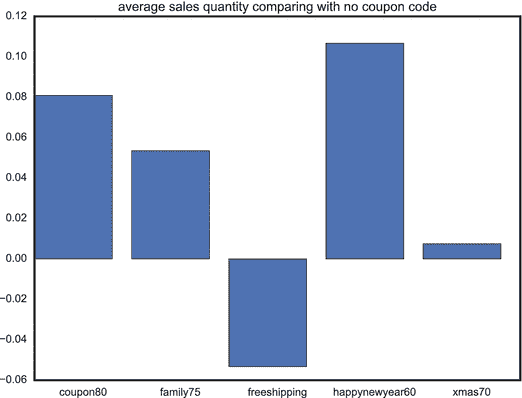

图15-1. 平均销售数量

按商品SKU和优惠券代码（包括无优惠券代码）透视平均销售数量，计算每种优惠券代码的平均销售数量减去无优惠券代码的平均销售数量，就能得出使用每种优惠券代码比不使用优惠券代码平均多卖了多少件。对于折扣最高的优惠券代码（60%），平均比不使用任何优惠券多卖出0.1件。查看如何创建此图表，请访问[`http://ds.tips/6acuV`](http://ds.tips/6acuV)。

这时，你的数据科学团队就应该运用他们的批判性思维了。记住，关键不在于判断好坏；而在于找出关键问题，例如：

- 我们怎么知道收入的增长与促销活动有关？也许不管有没有促销，同样数量的人本来也会买鞋。

- 什么样的数据能显示促销与销售之间存在强关联？

- 促销活动真的有效吗？

每个人都假设促销活动有效。这就是许多公司开展促销活动的原因。但这意味着它们对你的网站也有效吗？这些问题为研究主管开辟了一个全新的探索领域。当你只是简单地接受促销有效时，一切都很简单——它们有效，那么我们就做更多促销。

现在团队已经提出了他们的问题，是时候让研究主管转向另一个方向，提出更关键的问题了，例如：

- 我们如何证明这些促销活动有效？

- 我们应该只分析这次促销活动的收入吗？

- 客户购买的是打折商品吗？

- 是否仅仅是吸引了更多人访问网站的问题？

这种技巧通常被称为“淘金之问”。这源自早期的一种采矿技术，矿工们会在沙子中筛淘寻找金子。沙子就是你们团队提出的所有问题。研究主管与团队合作，找出值得探索的“金块级”问题。这并不容易，因为判断哪些问题是“金块”本身就是一种价值判断。由研究主管来决定这些问题是否有趣。

“淘金之问”的要义在于，尽管你会有大量无关紧要的问题，但那少数几个“金块”问题却能改变你组织的运作方式。每一块金子背后都会有大量的沙子。筛选如此大量的材料需要极大的耐心。

如果你是团队的研究主管，请试着专注于积极倾听每个人的问题。通常，他们的问题会是你自己问题的一个早期版本。不要害怕问大的“为什么”。促销有效这件事对每个人来说可能显而易见。但这并不意味着你应该忽略这个问题。如果你对答案不满意，你可能需要与数据分析师合作创建一些报告。

另外，一定要留意你自己的结论。记住，批判性思维就是要打破这些结论。确保你能够评估团队其他成员所说的话。

这可能是一项非常累人的工作。你不希望因为没花时间提问而被迫接受某个结论。如果你没能提出这些关键问题，请放心地重新安排会议时间。等大家精力更充沛时再聚到一起讨论。

### 聚焦推理

我们许多人都有根深蒂固的信念，这些信念引导我们，并帮助我们理解新事物。在数据科学团队中工作时，这些信念可能会深刻影响你和其他人看待同一份数据的方式。这就是为什么批判性思维的一个关键部分是理解这些信念背后的推理。你不仅要能够描述自己的信念，还需要描述这些信念背后的推理过程。

`推理`是支撑关于数据结论的证据、经验和价值观。在数据科学团队中工作时，理解彼此的推理至关重要。这将有助于团队提出引人深思的问题。

让我们看一个简单的陈述作为例子。“你应该多喝绿茶，因为它对健康有益。”这里的观点是你应该多喝绿茶。推理方式是它对健康有益。当你运用批判性思维时，你会想针对推理提出疑问。为什么它对健康有益？你怎么知道它对健康有益？它对所有人的健康都有益吗？如果你不运用批判性思维，你只会停留在观点层面。你只是接受了“你应该多喝绿茶”这个事实。

现在，让我们回到跑鞋网站的例子。想象设计团队正在研究他们从客户那里收到的一些反馈。网站上的许多图片描绘的是处于巅峰身体状态的跑步者。你的数据科学团队正试图确定改变这些图片是否会影响销量。

你的团队与网页设计师合作进行了一些实验。他们随机将健壮跑步者的图片替换为那些不太健壮、年龄较大的跑步者图片。团队与数据分析师合作创建报告，以查看图片更改后数据之间的差异。报告显示总体销量有所下降，如图15-2所示。

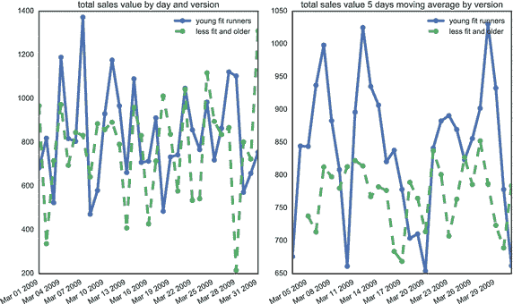

图15-2. 总体销量下降

查看时间序列，你会发现“不太健壮且年龄较大”版本的页面每日总销量略低。如果查看五天移动平均值，“不太健壮且年龄较大”版本在整个月内都更低。如何创建此图表，请参见`http://ds.tips/X3xex`。

现在团队需要讨论这些结果。你的项目经理认为销量下降是因为跑步者受到了图片的激励。他们不想看到反映自己现状的照片。相反，他们希望看到自己渴望成为的那种人的照片。销量下降让鞋子看起来效果不佳。它模糊了“如果你买了这双鞋，你就会变得更健康”这一信息。

数据分析师不同意这种看法，并认为销量下降是因为客户认为这些图片代表的是理想客户。结果，客户就假设这些鞋子是为刚开始跑步的人设计的。

要运用批判性思维，你必须审视每个陈述背后的推理。在这两个例子中，关键词是“因为”和“结果”。这些词暗示推理即将出现。

对于项目经理来说，推理是客户“受激励的不是他们现在的样子，而是他们想成为的样子”。对于数据分析师来说，推理是“客户假设该产品是为刚开始跑步的人设计的”。

现在你有了推理，就可以开始寻找关键问题。客户是否渴望看起来年轻健美？客户真的相信不太健壮的人意味着鞋子是给新跑者准备的吗？你认为谁的论点更有说服力？更重要的是，每个论点的弱点是什么？为什么不太健壮的跑步者会被认为是刚开始跑步的人？你可能会认为恰恰相反。一个年长的跑步者通常已经跑了好多年了。

项目经理的论点也有弱点。客户真的会相信买一双跑鞋就能让他们看起来更年轻吗？这是否意味着使用更年轻、更健壮的跑步者的图片会提高销量？

现在你有了推理和一些关键问题，就可以与研究负责人合作，寻找数据并确定最有趣的问题。购买特定鞋款的客户年龄中位数是多少？可以使用哪些策略来确定他们是否是新跑者？这些问题将帮助你获得关于客户动机的新见解。

`推理`可以是寻找关键问题的第一步。请记住，批判性思维有助于你的团队从其报告中获得更多价值。你可以帮助研究负责人决定什么是有趣的。这些有趣的问题将帮助你的团队获得最佳洞见。

## 检验你的推理

回想一下上一次你听到有人说他/她错了是什么时候。不是关于餐厅或电影的错误，而是关于他/她曾经深信不疑的某个观点。你能想到任何例子吗？如果你想不出来，也没关系。看到有人改变想法，这种情况确实非常罕见。在某些组织中，这会被视为立场摇摆或领导力不佳，总之不是你经常能看到的事。

一位名叫理查德·穆勒的加州大学物理学家，多年来一直在反驳全球气候变化的理论。他协助创立了“伯克利地球”组织。他的许多研究都得到了石油和天然气行业的资助。后来，他自己进行的研究发现了全球气温上升的非常有力的证据。他得出结论：自己错了。人类应该为气候变化负责。穆勒意识到，反对他的事实过于强有力，不容忽视，于是他改变了自己的想法。他并非悄无声息地改变。他在《纽约时报》上发表了一篇长篇署名评论文章 ²，概述了他最初的论点，以及为什么反方论点更为有力。

请记住，质疑他人的想法很容易。困难的是质疑自己的想法。请从两个角度来思考批判性思维：

*   **强势批判性思维**：当你对自己的信念提出批判性问题时。
*   **弱势批判性思维**：当你只寻找批判性问题来攻击他人的信念时。

你可能认识更多采用弱势批判性思维的人。他们对于自己所相信的事情有深思熟虑的论点，并且永远不会质疑自己的信念。如果你提出问题，他们会尽力捍卫自己的立场。但他们不会基于你的问题进一步构建，也不会自己提出新的问题。在你的数据科学团队中，你应该应用强势批判性思维。团队中的每个人都应该质疑自己的想法，提出有趣的问题，并探索自己论点中的薄弱环节。这就是你应该在数据科学团队中应用批判性思维的方式。

试着想象一下这在你的数据科学团队中会是怎样的情景。假设一家跑鞋网站举办了一次促销活动，向每位购买产品的顾客发送了一张优惠券。数据科学团队查看了使用优惠券进行购买的人数。数据显示，8% 的顾客查看了优惠券。在这 8% 的顾客中，大约 5% 的人在优惠券过期前使用了它。数据还显示，在向顾客发送优惠券的当天，收入出现了跃升。见`图 15-3`。

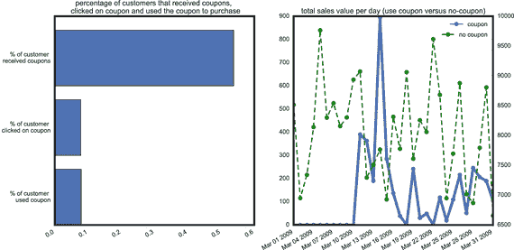

**图 15-3. 使用优惠券进行购买的人数**

左侧的图表显示大约 50% 的顾客收到了优惠券。第二个条形图显示，其中只有 8% 的顾客实际点击了优惠券。这些人中只有 5% 使用了优惠券。右侧的图表显示，在向顾客发送优惠券的当天，销售额出现了飙升。优惠券确实影响了“无优惠券”的销售额，但如果你比较实际数字，由于实际点击并使用优惠券的人并不多，优惠券销售额仅占总销售额的 10%。了解如何创建这些图表，请访问`http://ds.tips/pre6E`。

你的数据科学团队想知道这次促销活动带来了多少收入。那么让我们应用一些强势批判性思维。你可以认为，网站获得的所有新增收入都是这次促销活动的直接结果。

那么这个论点的薄弱环节在哪里？也许一些收到优惠券的顾客最终购买了促销活动之外的产品。他们是否应该被计算在内？也许你应该只计算那些实际使用了优惠券的人。此方法的问题在于，你没有看到促销活动的全部影响。也许，发送一封电子邮件询问顾客为什么有一段时间没有购物，效果会一样好。这可能是一个有趣的实验。

你的数据科学团队应该能够质疑所有这些想法。团队中的某个人可能强烈认为任何新增收入都是促销活动的结果。同一个人也应该理解该方法的弱点，并能够提出有趣的问题，例如：“如果我们用这种方式查看数据，我们是否完全理解了顾客？” 也许，顾客只是需要被提醒一下你的网站。如果你只关注那些实际使用了优惠券的顾客，就更容易将他们分成两组：一组是受到省钱激励的顾客，另一组是仅仅需要提醒的顾客。

当你的团队应用强势批判性思维时，它应该更像是一次开放式的讨论。没有人应该感觉自己像是在为自己辩护。这种方法是你团队提出有趣问题，并最终获得更深入见解的绝佳途径。

### 本章小结

在本章中，你学习了如何利用问题的力量，以及那些有趣的问题正是批判性思维的一部分。你还了解了什么是批判性思维，以及如何淘金千里来找出那些伟大的问题。最后，你探索了如何在提问时运用推理并检验你的推理。在第 16 章中，你将学习如何鼓励人们提问。

**脚注**

1.  西德尼·芬克尔斯坦，《聪明高管为何会失败：以及你能从他们的错误中学到什么》。企鹅出版社，2004 年。
2.  理查德·A·穆勒，“一个气候变化怀疑论者的转变”，《观点专栏》，《纽约时报》，2016 年 1 月 2 日，`http://www.nytimes.com/2012/07/30/opinion/the-conversion-of-a-climate-change-skeptic.html?_r=0`。

## 16. 鼓励提问

在本章中，你将学习鼓励提问的各种方法。你会了解如何主持提问会议。接着，你将探索不同类型的问题，以及如何使用`question board`和`question trees`有效地展示和组织这些问题。最后，你将学习如何发现新的问题，我们将在第 17 章中进一步详细讨论。

### 主持提问会议

提问与学习，是数据科学团队与仅仅观察数据的团队之间的关键区别。请记住，数据科学的核心在于运用科学方法获取洞见。提出好问题，正是这种科学方法的核心。

正如我们在本书中反复讨论的，组织通常将提问视为一种评判，而非学习的方式。作为数据科学团队的领导者，你需要确保你的团队能够提出好问题。做到这一点的最佳方法之一，就是建立一个良好的思想交流环境。

研究主管是负责引导提问的领导者，要确保团队能提出好问题。研究主管还应专注于学习，而非评判。团队中的每个人都应努力做到深度倾听，这是一种更专注地倾听彼此想法的方式，并且能够在不感到被评判的情况下，对这些想法提出异议。

建立这种环境的一个好方法是举办提问会议。在这些会议中，鼓励参与者在发表陈述之前先提问。这有时被称为“提问优先”方法。这些会议的目标是产生尽可能多的问题。会议的重点是让每个人提出问题并倾听。如果你是研究主管，请劝阻任何人不要携带智能手机或笔记本电脑。你希望每个人都专注于倾听。

我曾在一家刚刚开始涉足数据科学的组织工作。当时团队开会，预测有多少人会参加一项医学研究。数据分析师展示了他们过去研究的图表，并表示可以创建一个数据模型来预测谁可能会参与。会议出现了一阵短暂的沉默，然后就结束了。一周后，团队再次聚首。数据分析师提交了一份报告，显示历史数据表明每项研究可能会有一定数量的参与者。

现在，想象一下，如果这次会议是以关注好问题的方式进行的。如果你是研究主管，你可以这样开始会议：“大家都知道我们为什么要开这个会吗？”然后等待回应。一个好的提问领导者不怕短暂的沉默。不要试图自己回答自己的问题。给在座的每个人留出思考答案的时间。

一旦你确信每个人都理解了会议的目的，就提出挑战。你可以这样总结挑战来开场：“我们浪费了很多钱，因为我们不知道谁会来参加我们的医学研究。” 把解决方案留给团队的其他成员。你也可以用一个非常开放的问题来引导，比如：“我们需要更好地预测谁可能会来。” 然后坐下，看看是否有人开始提问。如果几分钟后没人说话，你可以问：“大家都明白为什么这是个挑战吗？”

你希望从团队那里得到的，是类似“是不是有些研究的报名人数会比其他的更多？”这样的问题。这类问题能让你的数据分析师为报告提供更完整、更有趣的数据。

你要避免的是那些会迅速终止对话的简短陈述，例如：“我们应该做研究，看看竞争对手是如何填满他们的医学研究名额的。” 这会让人们无法提出他们最好的想法。记住，正是讨论才为你的团队带来了最大的价值。你希望团队在探索数据时感到自在。

如果你是研究主管，如果团队难以提出高质量的问题，不要太气馁。大多数组织仍然认为，最好是一群“知道事情”的人（或者至少说话听起来像是知道）。他们喜欢用清晰陈述说话的团队。这种“明确性”仍然被认为比“不知道”更有价值。可能要开好几次会议，人们才能自在地提出好问题。在举办了几次提问会议之后，你可能会发现，那些敢于提出尖锐问题的小组，往往能获得更深刻的洞见。

### 识别问题类型

如果你主持了一场有效的提问会议，你很可能会得到许多好问题。这很好。请记住，你希望你的团队像“淘金”一样，筛选过几十个问题后，才找到几个他们想深入探索的问题。就像早期淘金的矿工一样，你要能够从沙子里筛出金子。你需要知道如何区分好问题与那些可以暂时搁置的问题。

做到这一点的一个好方法是考虑不同类型的问题。每种类型都有其优点和挑战。如果你是研究主管，你可以帮助团队识别哪种类型的问题能引出最有趣的洞见。最常见的两种问题类型是开放式问题和封闭式问题。这两类问题又都可以是本质性问题或非本质性问题。有些问题类型比其他类型更容易区分。

# 问题类型与组织方法

你能识别的第一种类型是开放式问题。开放式问题没有固定的答案。想想那个跑鞋网站。你的数据科学团队可以提出一个开放式问题，比如：“谁是我们理想的客户？”开放式问题通常需要更多的讨论。这类问题能让你试图弄清楚彼此的推理过程。例如，团队中可能有人说，理想的客户是购买大量跑鞋的人。另一个人可能会质疑这个推理，提出理想的客户是鼓励其他人购买跑鞋的人，或者是一位博主，或者是一位创办了跑步俱乐部的跑者。

开放式问题通常没有唯一答案。相反，它是用来辩论的。谁的推理最有说服力，通常就能解决这个问题。你的数据科学团队需要寻找关于谁是理想客户的最强论点，然后数据分析师将尝试用数据来支持这个论点。

## 封闭式问题

封闭式问题则通常更具终结性。封闭式问题可能是这样的：“我们跑者的平均年龄是多少？”这类问题通常也会有一些讨论。你的团队可能需要考虑使用平均年龄还是年龄中位数的优势。他们还可能质疑这些信息的价值。从这个问题你还能衍生出哪些其他问题？

如果你是研究主管，要确保团队没有提出太多单一类型的问题。问太多的开放式问题会让每个人都花太多时间在提问上，而没有足够的时间去梳理数据。问太多的封闭式问题则会导致团队花费太多时间在细小的、容易证明的问题上，而忽略了全局。

## 本质性与非本质性问题

一旦你确定了问题是开放式还是封闭式，接下来要弄清楚它是不是一个本质性问题。本质性问题旨在激发团队的深入讨论。这类问题在大多数组织中通常很难提出。它们可以是简单的问题，比如：“人们为什么从我们这里购买跑鞋？”也可以是更复杂的问题，比如：“人们为什么跑步？”

本质性问题通常是开放式的，需要进行辩论。不应该只有一个正确答案。你也可以有封闭式的本质性问题。团队可能会问：“我们是不是应该停止印刷产品目录，只通过网站销售跑鞋？”封闭式的本质性问题比较少见。

你可能已经猜到了，还有许多不同类型的非本质性问题。非本质性问题并非坏事。在你开始提出本质性问题之前，你可能需要先经历许多非本质性问题。一个好的策略是，先提出许多封闭的、非本质性的问题，以此来积累想法，然后再提出更宏大的本质性问题。

假设你想了解人们为什么跑步。你的科研团队可能希望用第一个冲刺阶段来排除非必要问题。我们的客户是否属于跑步俱乐部？大多数客户是长期跑者还是刚刚起步？他们家中是否还有其他跑步的人？这些问题可能有助于你构建一个关于客户为何喜欢跑步的案例。如果你的团队对人们喜欢跑步的原因有扎实的推理，这将帮助你营销产品以满足这些需求。

如果你是团队的研究负责人，请密切关注这些不同类型的问题。它们将帮助你引导讨论，并梳理出最具价值的问题。如果你了解这些不同类型，就更有可能找到能带来最佳洞见的金矿。

## 组织你的问题

如果你是侦探剧的爱好者，你可能见过“案情墙”——侦探在试图拼凑未解之谜的各个碎片时使用它。他或她会把照片和笔记贴在墙上，并尝试连接不同的碎片。这块板子就变成了一个视觉故事。这就是为什么你经常看到侦探坐在地板上盯着板子，试图从数据中的所有小谜题中拼凑出完整的故事。

你的数据科学团队也将面临类似的挑战。他们试图讲述一个故事，但手中只有零散的拼图。你的团队可以使用相同的技巧来创建一块“问题板”——一个让他们可以看到所有问题和数据的地方。这样他们就能讲述一个更宏大的故事。

正如第 13 章所述，创建问题板是展示想法并向团队及整个组织征集问题的绝佳方式。在板的顶部，你应该放置一个简单的标识，例如“问题板”或“提问”。问题板是一种清晰的方式，可以将问题集中沟通并组织起来。

你的数据科学团队应该拥有几十甚至几百个不同的问题。问题板很可能是团队的关键会议点，也是团队成员和利益相关者讨论项目的绝佳场所。

开始时，请将你的问题板放在团队成员办公桌旁或走廊里。开放空间不适合放置问题板。你需要人们站在板子旁边阅读问题。另一个建议是将板子放在人流量大的区域附近。理想地点是饮水机、零食吧或洗手间旁边。它应该是一个能让几位团队成员会面且不打扰他人的地方。

通常，组织问题板的最佳方式是使用不同颜色的便利贴。你需要从上到下组织你的板子。板子顶部的便利贴包含你的核心问题。使用红色或粉色的便利贴来记录这些问题。在它们下方，你可以使用黄色便利贴来记录非核心问题。请记住，这些是涉及较小问题的问题。它们通常是带有正确答案的封闭式问题。最后，你可以使用白色或紫色的便利贴来记录结果。这些是团队发现的、可能有助于解答问题的小数据点。

拥有问题板有五大好处：

- 它为团队提供了一个共享空间，以促进小组讨论。
- 它展示了问题之间是如何相互关联的。
- 它帮助你按类型组织问题。
- 它帮助你讲述故事。问题板显示了团队可能正在努力解决的那些更大的问题。
- 它为组织中的其他人提供了一个参与的地方。你希望团队之外的人能够添加他们自己的问题，并看到你们的进展。

请记住，你希望团队进行深入的讨论。每个人都应该能够质疑彼此的理由。团队应该倾听彼此的问题，并尝试提出自己的问题。他们应该专注于学习，而不是评判自己问题的好坏。

问题板有助于此，因为它为人们提供了一个聚焦讨论的场所。它还能帮助团队站起来，亲身参与，并产生新的想法。

你的许多问题将是相互关联的。通常，你会遇到一些核心问题，它们与几个封闭的、非核心的问题相关联。如果这些问题在物理墙上，你可以用绳子来显示这些联系。如果在白板上，你可以直接画不同颜色的线条。这将帮助你的团队保持组织性，甚至能让他们优先处理最高价值的问题。

正如第 13 章中讨论的，问题板将邀请团队之外的其他人员参与。你可能需要在板子旁边留一沓绿色的便利贴。再留下一支记号笔和一张小纸条，邀请其他人添加他们自己的问题。有时，这些来自团队外部的问题能讲述出最有趣的故事。

### 创建问题树

你的问题板将是传达数据科学故事的关键部分。它应包含团队正在努力解决的问题，也可能包含一些能提示答案的小数据片段。一个好的问题板能鼓励组织中的其他成员参与进来，吸引大家成为你们共同故事的一部分。

问题板面临的挑战之一是如何保持条理清晰。由于它是为小组讨论而设计的，你希望每个人都能共享相同的信息。它不应该包含多个由个人笔记组成的不同分组。如果每个分组只有一个人的想法，那么只有那个人才能理解其含义。

相反，所有的问题都应该使用同一套系统来组织。最好的方法之一是创建问题树。问题树是一组与一个核心问题相关的便利贴。你需要用最引人注目的颜色来书写核心问题，通常是用红色或粉色。

让我们为跑鞋网站设想一个问题板。你的团队提出的一个问题是：“我们的网站能否帮助鼓励非跑步者成为跑步者？”如果你是团队的研究负责人，你希望把这个核心问题写在红色便利贴上，并贴在板子的最顶端。

在这个核心问题下方，你可以开始添加其他问题。它可以是另一个核心问题，比如“是什么促使人们跑步？”也可以是非核心问题，比如“非跑步者会在我们网站上购物吗？”由于这是一个封闭式问题，你可以在黄色问题便利贴旁边贴一张数据小贴纸。内容可能是：“数据显示，我们 65%的顾客在一周内不跑步。”你可以使用如图 16-1 所示的饼图来说明这一点。

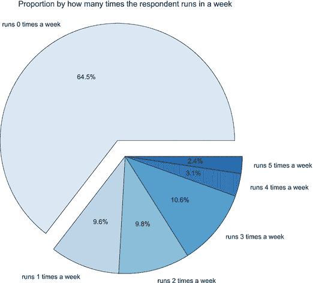

图 16-1. 饼图显示了受访者每周跑步的次数

假设这些生成的数据来自公司对其客户进行的一项调查。调查的问题是：“您平均每周跑步多少次？”查看数据时，你会发现大约 65%的受访者根本不跑步，而 55%的受访者每周跑步一次或更多。查看如何创建此图表，请访问`http://ds.tips/S3eve`。

看到问题树的人应该能够理解团队的思考过程。她应该看到，较低层级的问题分支始于一个开放式的核心问题（“我们的网站能否帮助鼓励非跑步者成为跑步者？”），并看到团队正在解决这个问题。她应该能够顺着思路一直看到不同的分支。

假设“是什么促使人们跑步？”这个问题向自己的方向延伸。在这个问题下面是另一个问题：“他们跑步是为了缓解压力吗？”再往下是另一个问题：“那些有压力的非跑步者能看到跑步的好处吗？”

有了问题树，研究负责人现在就有了一份报告，可以向组织其他成员展示进展。她可以表明数据科学团队正在同时研究几个高价值的问题。不难看出，深入了解如何创造客户可能会增加收入。

问题树帮助研究负责人将团队的工作与实际的商业价值联系起来。一个问题板应该包含几个问题树。在板子的最顶端，应该有几个红色或粉色的核心问题。每个问题都应该像倒置的树一样向下分支成若干其他问题。请务必如前所述使用不同颜色的便利贴（核心问题用红色或粉色，非核心问题用黄色）。有时，开放性问题会分支到不同的问题树上，而封闭式问题则应该用显示数据的小便利贴来结束。

就像任何树木一样，你需要修剪你的问题。这是研究负责人的关键职责之一。她需要确保你的问题能带来实际的商业价值。如果她认为你的问题无法带来洞见，她可能会将它们从问题板上移除，以免数据分析师开始盲目寻找结果。

> **注意**
>
> 研究负责人通常会在团队的问题会议中移除问题。你不希望研究负责人在没有与团队沟通变更的情况下，就把问题从板上移除。

问题树的关键点之一在于，它实际上反映了大多数团队提出新问题的方式。请记住，数据科学是运用科学方法探索数据，这意味着你大部分的数据科学工作将是经验性的。你的团队会提出一些问题，收集数据，然后通过提出一系列问题来对数据做出反应。当你使用问题树时，它反映了团队所学到的东西。同时，它也向组织其他成员展示了你的进展。

### 寻找新问题

有两种方法可以帮助你的团队找到更好的问题。一种是组织中的某人在你的问题板上发布好问题，这些是你的“馈赠问题”。另一种是通过在与数据科学团队的定期会议中努力寻找好问题。

发布在你板子上的馈赠问题很大程度上取决于你的组织。有些组织更倾向于协作，有的则管控更严。如果你的组织更加开放，你可能会被大量问题淹没，需要优先安排讨论。如果组织较为封闭，你可能会连续几周都看不到任何输入。

无论哪种情况，填满问题板的最佳方法就是让它看起来更有吸引力。一个好方法是制作一个简单的标志来征集问题，例如“请为我们的数据科学团队提出任何问题”。另一种方法是将问题板整合到有趣的演示中。

假设有人提出了一个问题：“什么造就了一双完美的跑鞋？”这是一个开放式的核心问题。如果你是研究负责人，你可能希望把这个问题抄写到红色便利贴上，然后把它放在问题树的顶端。在下次演示时，让团队讨论一些有趣的馈赠问题，并讲述一个关于数据所揭示内容的故事。他们想讲述一个关于完美跑鞋的故事。他们可能会谈论颜色、质量和款式的组合，并用简单的数据可视化来支持这些数据。接下来，让公司其他人知道这个好故事从何而来：一个发布在板子上的有趣馈赠问题。这种认可会鼓励其他人参与进来。组织中大多数人都一直在寻找更好的参与方式。如果你能展示出他们的问题很重要，那么填满你的问题板就会容易得多。

来自团队外部的问题是获得洞见的绝佳途径。这些问题通常简单明了，但这往往使它们非常难以讨论。这些简单的问题常常最能挑战我们的假设。正因如此，这些馈赠问题能极大地帮助你的团队专注于商业价值。

不幸的是，你们大多数问题都不是馈赠得来的。相反，它们是与数据科学团队其他成员进行艰难讨论的结果。这些问题来之不易，也难以创造。

如果你是团队的研究负责人，请尽力利用好你的馈赠问题。同时，也要与团队其他成员共同努力，在第 17 章你将看到的六个关键领域中寻找问题。你们拥有的问题越多，团队就越有可能找到关键洞见，并将其与实际的商业价值联系起来。

## 总结

在本章中，你学习了鼓励提问的各种方式以及如何主持提问会议。接着，你了解了不同类型的问题，以及如何利用问题板和问题树来有效展示和组织这些问题。最后，你简要学习了如何发现新问题，这部分内容将在第 17 章中更详细地介绍。

# 17. 寻找问题的方向

让团队提出高质量的问题，往往并非仅仅营造一个合适的环境那么简单。即使是技能娴熟的数据科学团队，通常也需要更多引导。当你与团队会面时，应将提问重点聚焦在六个关键领域。虽然这些领域并非唯一能挖掘出好问题的地方，但它们通常是很好的起点。这些问题主要涉及以下方面：

- 澄清关键术语

- 根除潜在假设

- 发现错误

- 探寻其他原因

- 揭露误导性统计数据

- 强调数据缺失

这六个领域各自具有独特的提问风格。你提出的用于根除假设的问题，与那些针对误导性统计数据的问题大相径庭。每个领域都会引导团队走上不同的探索路径，后续各节将对它们进行更详细的讨论。

这六个领域旨在作为指导。并非你所有的问题都会涵盖这六个方面。相反，你可以这样理解：如果你讨论了这六个领域，那么你一定会至少提出几个问题。这些问题将成为驱动数据科学团队前进的动力。在每个冲刺周期中，你的团队都会致力于处理问题板上的问题，或是对其重新确定优先级。

### 澄清关键术语

乔治·卡林曾开玩笑说，他把一美元放进零钱兑换机，结果什么也没变¹。这不禁让人好奇，他期望的是哪种“变化”。你永远不会知道答案，因为他使用的词语有多重含义。不幸的是，英语中许多词语都是如此。我们使用词语的语境对其含义有很大影响。这就是为什么审视关键词汇和短语是收集有趣问题的最佳方法之一。

数据科学讨论应运用批判性思维。你需要仔细审视彼此的推理，然后对推理提出质疑，以便更好地理解每个人的想法。做到这一点最好的方法之一，就是质疑关键术语和短语。

那么，让我们回到跑鞋网站的例子。假设数据科学团队中有人提出了一个有趣的问题：“人们经常跑步是因为跑步能让他们更快乐吗？”这是一个开放式的本质性问题，意味着它可能没有非此即彼的答案。相反，团队必须提出强有力的论据，并由数据支撑。

数据科学团队应该质疑哪些关键术语和短语呢？想想那些可能存在歧义或有多重含义的词语。这些词语通常是抽象的，并且需要一定程度的解读。在这个例子中，有几个词值得探讨：“经常”和“更快乐”。

想想“经常”这个词。它对你意味着什么？其含义通常因人而异。例如，我妻子喜欢去餐馆。我们尽量每周至少去一次。如果你问我，我会说我们经常去餐馆。如果你问她，她会说我们从来不去餐馆。

你的数据科学团队应该提出问题，以澄清“经常”这个词的含义。你可能想提出一个封闭式问题，比如“我们的平均客户每周跑多少次步？”，然后将这个问题挂在你问题树上先前那个问题的下方。

你还应该探讨“更快乐”这个词。“更快乐”对你来说意味着什么？你的客户跑步是因为他们喜欢跑步吗？也许他们实际上喜欢的是跑完步的感觉，当他们跑完步回到家时最快乐。也许他们不喜欢跑步，但这是他们知道如何缓解压力的唯一方式。从某种意义上说，他们因为跑步而变得更快乐。

这是你可以提出进一步问题的另一个领域。你可以提出一个宽泛的本质性问题，比如“什么能让我们的客户快乐？”。你也可以尝试将“快乐”分解成不同部分。或许可以问这样一个问题：“我们的客户跑步是因为他们觉得不得不跑吗？”你甚至可以进行更具体的提问，比如“我们的客户在跑完步时最快乐吗？”

现在你看到了，针对关键短语和词语的提问如何能迅速产生更多问题。请记住，当你的团队进行提问会议时，研究负责人的职责就是“沙里淘金”。你的数据科学团队提出这些问题，并不意味着他们有义务一定要得出最终成果。研究负责人会倾听这些问题，并从中挑出那些听起来最有趣的“金块”。

围绕这一个问题（人们经常跑步是因为跑步能让他们更快乐吗？），你现在又有了五六个可能更有趣的问题。你的团队正在提出那些可能与商业价值相关的、开放式的本质性问题。

想想那个开放式的本质性问题：“什么能让我们的客户快乐？”这个问题看似简单，几乎微不足道，但如果你的数据科学团队能够获得一些洞见，它就会转化为真正的商业价值。这些洞见就是你的数据科学团队将要交付的“金块”。然而，许多数据科学团队并不去探究这类问题，因为他们觉得这些“关键术语”是显而易见的。请记住，对你显而易见的事情，对其他人未必如此。所以，花时间去问这些问题吧，这样你就能让数据科学团队更高效、更具洞察力。

### 挖掘隐含假设

寻找好问题的另一种方法是寻找隐藏的假设。人们无时无刻不在做出隐藏的假设，这本身并无过错。事实上，你需要这些假设来提高效率。例如，你假定同事工作表现良好；通常，人们也假定你所说的是实话。你总不希望每做一件事都要反复揣测。

你需要警惕的是那些可能导致盲点的假设。这些假设会阻碍你探索有趣的问题，并让你的团队陷入群体思维。这一点在你的数据科学团队中尤为突出，因此，挖掘潜在假设是获取新问题的最佳途径之一。

一般来说，假设具有以下四个特征：

- 它们常常是隐藏的或未被明确表述的。很少有人会以“如果我们假定这是真的……”来开启对话。

- 它们通常被视为理所当然或“常识”。

- 它们对决定你的推理或结论至关重要。你的推理甚至可能完全依赖于这些假设。

- 它们可能具有欺骗性。通常，有缺陷的推理会被某个“常识”假设所掩盖，例如：“糖对身体不好，所以人工甜味剂一定对你有益。”

我曾经为一个组织工作，该组织在分析客户服务数据时发现，有很大比例的电话是客户打来订购产品的。由于维护呼叫中心成本高昂，数据科学团队的任务是设法改变这种行为，希望鼓励客户使用网站或移动应用。

研究负责人首先提出了一些有趣的问题：为什么人们要打电话？我们能做些什么让客户更容易使用网站？如何让更多客户使用我们的移动应用？为什么客户更喜欢与人交谈？

其中一些问题背后潜藏着假设。研究负责人假设人们打电话是因为他们不喜欢网站，而且客户没有安装移动应用。这个推理可能正确，也可能错误。关键在于不要先入为主地认为它是正确的。如果团队不假思索地接受这个推理，就可能错失发现关键洞见的机会。在这个案例中，大多数打电话的人是正在工地工作的专业人士，他们无法使用智能手机或访问网页。

团队可能发现假设的另一个领域，是在尝试预测未来行为时。假设我们的跑鞋网站想利用预测分析来确定哪些鞋最畅销。他们可能发现，过去色彩鲜艳的鞋子销量不错。于是，他们创建了一个模型，预测色彩鲜艳的鞋子会更成功，如图 17-1 所示。

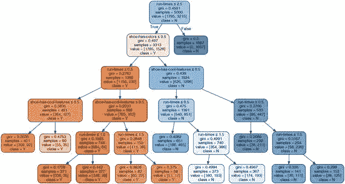

**图 17-1.** 客户如何决定购买哪双鞋

你创建的调查包含以下变量：

1.  每周跑步多少次？

2.  鞋子是否有炫酷功能？

3.  鞋子是否有多种颜色？

4.  受访者是否购买了该鞋子？

第四个特征被用作决策树预测的因变量。了解如何创建此图表，请访问 [`http://ds.tips/fuJE3`](http://ds.tips/fuJE3)。

处理这种假设的一个好方法是先尝试识别推理过程。在这里，推理是：色彩鲜艳的跑鞋过去卖得很好。一旦你掌握了这个推理，就可以开始思考背后的假设。

其中一个假设是，跑鞋之所以成功是因为颜色鲜艳。请记住，相关性并不一定意味着因果关系。也许优质制造商一直在努力让鞋子更鲜艳，这意味着跑步者购买的是恰好颜色鲜艳的高品质跑鞋。只需提出几个审慎的问题，就能凸显出这些假设中的一部分。例如一个简单的问题：“顾客购买跑鞋是因为颜色鲜艳，还是出于其他原因？”

要记住，假设本身并无好坏之分。发现它们是对是错，也并非坏事，甚至无关紧要。关键是要专注于识别它们出现在何处。一个被当作事实接受的假设，可能会引发一连串有缺陷的推理。同时也要注意，假设并不总是一个需要纠正的错误，它更像是一条值得探索的路径。

假设带来的主要挑战在于，如果你不把它们暴露出来，它们往往会不断累积。不知不觉中，你的团队就可能基于一堆站不住脚的假设开展工作。一旦发生这种情况，就很难做出有趣的发现了。

## 发现错误

数据中的错误未必是会造成最大麻烦的那一类。在数据科学团队中，更大的问题在于团队推理中的错误。数据错误可能只是一次挫折，或导致产生一系列虚假报告。而推理错误则可能将整个团队引向完全不同的方向。团队可能会花费数周甚至数月的时间在错误的地方寻找问题，从而阻碍大家提出有价值的疑问。

你已了解，收集好问题就像淘金。在找到有趣的问题之前，你可能会经历好几个糟糕的问题。有些关键措辞和表述需要厘清。同时，也存在一些假设，它们可能将错误的推理与看似正确的结论捆绑在一起。一旦你剥离这些假设并澄清表述，留下的就应是纯粹的推理。从很多方面来看，你实际上是在提出一个更难的问题：“这个推理正确吗？”

总的来说，在质疑他人的推理时，你需要警惕七种危险情况：

1.  **人身攻击**：在数据科学团队中，如果有人声称“你不懂这些数据”，就属于这种情况。这话可能没错，但这并不是建设性地驳回他人问题的方式。
2.  **问题驳回**：你不应因为一个有趣的问题可能引出令人不安的疑问而将其驳回。你不希望数据科学团队说出诸如“提出这个问题会涉及什么组织政治？”这样的话。
3.  **快速共识**：有时也称为“诉诸大众”的推理。它与群体思维密切相关，其错误依据是：如果大家都迅速同意，那么他们一定是对的。
4.  **依赖可疑权威的推理**：你有时会看到这种经典说法：“我在网上看到这张图表，所以它肯定是对的。”
5.  **循环推理（或偷换概念）**：有时会在数据科学团队中见到。你会听到类似“我们是一家数据驱动的公司，所以我们的数据必须是正确的”这样的话。
6.  **稻草人推理**：这是指故意歪曲他人的理由，以此来衬托自己的理由正确。这种情况通常可以通过某人点名批评他人来识别。比如：“如果你接受比尔的论点，认为数据很糟糕，那我们就得从头开始。”
7.  **虚假两难**：这有时会对好问题产生寒蝉效应。它基于“只有两种可能结果”的思维。你可能会听到类似“如果数据是对的，那就意味着我们都是错的”这样的话。

将这七种危险视为指南，以保持你的提问会议富有成效。每一种情况都可能导致团队推理软弱、问题浅薄。

我曾与一个数据科学团队合作，为州教育部开发一个测试应用程序。他们想看看是否能用预测分析来确定哪些学生需要额外帮助。团队拥有海量的测试数据，但在构建有效模型时遇到了困难。

在提问会议上，一名团队成员问道：“这些测试能否很好地评估学生掌握的知识？”另一个人回应说：“这是州立标准，而且我们又不是教育工作者，所以我们应该接受数据是正确的。再说了，如果数据不正确，你就没法使用任何数据了。”

这些言论迅速扼杀了讨论。如果团队当时能深入探讨这些问题，效果会好得多。然而，他们依赖于危险的推理：州立标准可能来自可疑的权威。人身攻击则假设在座无人具备提问的足够知识。最后，还存在一个虚假两难：数据要么全好，要么全坏。

在团队的提问会议上要警惕这些危险。拥有所有答案并不重要。重要的是识别出软弱的推理。你不希望软弱的推理取代有趣的问题。

## 质疑证据

正如我们在本书中反复提到的，寻找有趣问题的最佳方法之一就是寻找假设。我们还探讨了错误推理的危险。当你在寻找好问题时，推理错误可能会产生寒蝉效应。一旦发现推理错误，数据科学团队就可以考虑对那些可能被视为理所当然的事实提出批判性问题。

许多组织在日常工作中依赖广为接受的事实。当你与数据科学团队合作时，这些事实会作为背景存在。关键在于，在提出有趣问题时，确保这些事实并非不可触碰。事实上，你的数据科学团队可能是组织中少数几个对质疑既定事实感兴趣的群体之一。

在数据科学团队中，每当你遇到一个事实，都应该从三个问题开始：

*   我们应该相信它吗？
*   是否有证据支持它？*证据*是你可以用来证明某个更大事实的、已确立的数据。如果有证据，你应该提出第三个问题。
*   证据的质量如何？它是否支持这些事实？

你不应将证据视为证明或反驳事实的工具。相反，应尝试将其视为强证据或弱证据。有强证据表明吃太多糖对健康有害。有弱证据表明蜂蜜比糖更健康。当你审视证据时，你所做的只是判断你是否可以依赖这些事实。在这个具体案例中，你可能想减少糖的摄入，但不想用蜂蜜来替代装糖的罐子。

在数据科学团队工作时，你会看到各种既定事实。每个事实可能都有不同的证据来源，这些来源都能引出有趣的问题。一些最常见的证据类型包括直觉、个人经验、案例、专家意见、类比，甚至研究报告。

当你看到某个事实得到证据支持时，不要将其视为停止的标志。相反，应将其视为一条久未探索、布满灰尘的走廊。那里可能藏着能支持你既定事实的新东西。你也可能会发现根本没有证据，这个事实只是一个未经检验的假设。

我曾为一家公司工作，其数据科学团队正在处理一组信用卡交易数据。该公司将信用卡数据视为向银行客户提供促销活动的一种途径。他们对客户的信用卡消费了解得越多，就越能精准地投放促销活动。

数据科学团队与业务部门的某位同事合作，试图改进模型。团队开始针对某个特定品牌的信用卡进行一项新促销实验。业务部门的利益相关者说，他们不应该用那种特定类型的信用卡进行实验，因为大多数使用该信用卡的客户只将其用于大额消费。数据科学团队问这个人是怎么知道这个事实的。这位利益相关者说她“干这行已经好多年了”，这是她的直觉。

会议结束后，数据科学团队决定测试这位经理的直觉。他们在问题板上创建了新的问题。其中一个问题是：“客户是否只使用这种类型的信用卡进行大额消费？”结果证明，这位经理是对的。有非常强的证据表明，如见图 17-2 所示，这个品牌的信用卡主要用于大额消费。数据科学团队用更坚实的证据支持了经理的直觉，并用交易历史和购买价格为其提供了佐证。

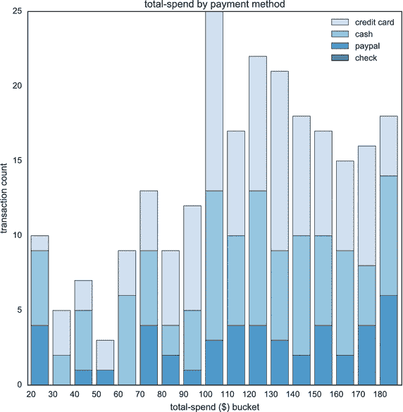
图 17-2. 按支付方式划分的总消费额

查看每个交易金额区间的计数，随着总金额的增加，用信用卡支付的交易也越来越多；第二大类是现金。请访问 [`http://ds.tips/br5wR`](http://ds.tips/br5wR) 了解如何制作此图表。

在问题研讨会上，你还需要评估其他团队成员提供的证据。直觉本身并没有错。通常，直觉可能是伟大发现的起点。然而，并非团队中每个人都有相同的直觉。关于每位团队成员在数据中看到了什么，可能存在分歧。当这种情况发生时，请一起研究彼此的证据。询问为什么一个人的直觉可能比另一个人的更准确。也许他们有更多的经验，或者过去曾参与过类似的项目。

请记住，事实并非总是刻在石碑上，一成不变。随着证据的强弱变化，事实也可能发生改变。当你身处数据科学团队时，不要害怕质疑证据。这往往是新洞察的来源。

## 探寻竞争性原因

说“相关性不等于因果性”很容易，但在实践中看清这一点却并不简单。通常，当你看到因果关系时，没有任何理由去质疑它们之间是如何关联的。有时很难看出“某事发生之后出现的某个结果”与“因某事而导致的某个结果”之间的区别。在工作中和生活中，你都会遇到这种情况。

我和妻子决定不在家里买游戏主机。相反，我们和儿子达成了一个折中方案：我们让祖父母家有一台游戏主机。这样一来，每次我们去拜访时，儿子既能见到祖父母，又能玩他的新游戏。每次我们去之前，都会给儿子买一款新游戏。游戏会在我们出发前寄到。儿子认为，我们买了新游戏，然后立刻飞到了奶奶家，这样他就能玩了。这看起来是一个非常清晰的因果关系。

实际上，游戏机的到来是一个竞争性原因。游戏到了，我们收拾行李出发。但它仍然不是真正的原因。真正的原因是我们有去奶奶家的机票，所以我们才买了新游戏。

这些竞争性原因并不总是容易发现的。需要注意以下三点：

- **原因是否真正说得通：** 世间存在许多竞争性原因。柠檬进口量增加与交通事故减少之间存在关联；冰淇淋销量增加与鲨鱼袭击事件增多之间也存在关联。然而，这些关联根本说不通。柠檬并不会让人们成为更好的司机，鲨鱼也不吃冰淇淋。你遇到的多数竞争性原因不会这么明显。务必要审视原因与结果之间联系的证据。
- **原因是否与其他结果一致：** 你可能会发现跑鞋购买量与天气变暖之间存在关联。这意味着，如果你发现运动短裤购买量与天气变暖之间也存在关联，那么它很可能是一个真正的原因。几个一致的原因会增加你所面对的是一个真正原因的可能性。
- **该事件能否用其他竞争性原因来解释：** 也许跑鞋购买量在天气变暖时增加，是因为夏季跑鞋更便宜。如果你能想出好几个其他的竞争性原因，那么你可能就没有看到真正的原因。

当你身处数据科学团队时，要时刻留意竞争性原因。

我曾与一个州教育部门的数据科学团队合作过。该团队正在开发一个应用程序，以更好地理解学生评估数据。数据显示，当学生使用软件程序进行评估（而非书面评估）时，他们的分数更高，如图 17-3 所示。这使得该软件看起来非常有效。仅仅是使用计算机参加考试这一行为就提高了学生的知识水平。

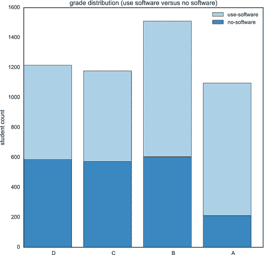
图 17-3. 使用软件与不使用软件的成绩分布

从整体分布来看，大多数学生得了 B，得 A 的学生较少。然而，在不使用软件的情况下，学生得 C 或 D 的概率几乎各占一半；而在得 B，尤其是得 A 的学生中，使用软件的比例更高。请访问 `http://ds.tips/fRa5r` 了解如何制作此图表。

这对该软件来说是极好的营销素材：如果你使用它，你的分数就会提高。但实际上，这根本说不通。数据科学团队并没有盲目接受这个因果关系。为什么从纸质考试转向在线考试会提高学生的学习成绩？为什么随着他们继续使用该软件，他们的进步却没有持续增加？这些数据正是一个竞争性原因的显著特征。

在一次问题研讨会上，研究负责人提出了这个问题。她问道：“为什么我们的学生取得了更高的分数？”数据科学团队试图通过设想竞争性原因来分解这个问题。他们提出了一些有趣的问题：“当他们开始使用该软件时，还发生了其他什么变化？”以及“是否有学生没有取得这种进步？”

结果发现，考试成绩的跃升有一个竞争性原因，而真正的原因有更强有力的证据支持。原来，许多使用该软件的学校都获得了州政府的拨款来改善硬件设备。为了鼓励学校使用新软件，每个教室都配备了十几台新电脑。这些电脑让学生能够更频繁地参加考试，他们因此对试题更加熟悉，考试成绩也随之提高了。

当你身处数据科学团队时，不要害怕质疑因果关系。团队应该准备好提出竞争性原因来解释某些事件。如果这些原因说得通，你就应该调查这种联系。你提出的一些最棒的问题，可能正来自于排除这些竞争性原因并找到真正原因的过程。

## 揭露误导性统计数据

在审视统计数据时，你很可能会发现许多问题。正如你所见，统计数据不能替代事实。统计数据会说谎。事实上，很多统计数据都在撒谎。至少，它们是在讲述自己版本的"真相"。

在提问会议上，你的团队应谨慎仔细地评估统计数据。团队成员应该相互质疑，并对来自团队外部的统计数字保持怀疑。

在第 4 章中，你看到了计算平均值时遇到的挑战（那个政客的例子）。统计上的算术平均数可能给出一个答案，而中位数则可能给出不同的答案。通常，人们会根据自己希望看到的结果而偏好其中一种。然而，还有许多其他方式可以用统计数据说谎。其中一些方式更为隐蔽。你必须仔细聆听才能察觉其中的"障眼法"。

其中一种方法就是"推断性统计"。具体做法是，你先用一则故事建立一种统计联系，然后将这种联系嫁接到另一则故事上。例如，假设有一项研究指出，20%的时间里人们会在开车时发短信，如图 17-4 所示。一家试图推销汽车保险的公司可能会推出这样一则广告："每五个人中就有一个人开车时发短信。请确保你拥有良好的保险。"

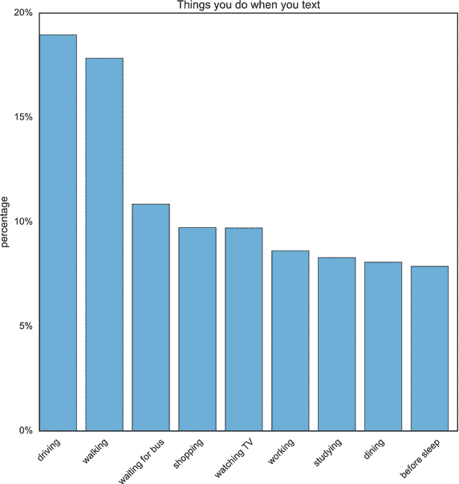
图 17-4. 人们在发短信时同时进行的活动

根据这项研究，人们在开车时发短信的时间占比接近 20%。发短信时第二高的活动是步行。你可以访问 `http://ds.tips/f2asP` 查看如何制作此图表。

注意这里的"障眼法"。一个统计数据讲述了一个关于短信的故事：大约 20%的时间里，人们在开车时发短信。而保险公司的故事则是关于一群人：大约 20%的人正在做某件事。也许开车时发短信的司机很少，但他们发短信的频率很高，这影响了数据。你可能在开车时有 20%的时间在发短信，但这并不意味着 20%的人在开车时发短信。一个普通人可能每天有 5%的时间在吸烟，但这并不意味着 5%的人在吸烟。保险公司试图告诉我们的故事关乎安全。它试图制造一种印象，即每个人都被发短信分散了注意力。它将"发短信"与"驾驶更危险"联系了起来。

让我们回到我们的跑鞋网站。想象一下，数据科学团队中的某个人强烈认为数据显示人们正在与朋友结伴跑步，这支持推出一个新的促销活动。数据分析师提供了一个统计数据，显示 50%的客户将优惠券转发给了朋友，并勾选了"他们是我朋友"的选项。他认为，有多达一半的客户和他们的朋友一起跑步。他相信数据科学团队应该研究一个社交互动更强的网站是否能提升销量。乍一看，这听起来很有道理。但实际上，是你团队中的这个人试图在创建一种"统计推断"。

解决这个问题的最佳方法是将统计数据与故事分开。就跑鞋网站而言，你有两个故事：一个说顾客喜欢他们的朋友省钱，另一个说顾客和朋友一起跑步。当你把它们当作两个独立的故事来思考时，就更容易看出它们之间可能存在脱节。你可能需要向团队中的那个人问几个问题。省钱和与朋友跑步之间有什么联系？有哪些统计数据可以显示有多少客户与朋友一起跑步？这里存在任何联系吗？

统计推断可以成为提出有趣问题的绝佳工具。只有当团队把它们当作事实时，它们才会变得危险。它们可能是有趣事物的影子，但不应该被视为证据。

另一个可能出现误导性统计数据的领域是"可疑的遗漏"。你可能会在度量尺度上看到这一点。想象一下，你数据科学团队中的某个人使用了一个统计数据，称某次促销活动使跑鞋订单增加了 5,000 单，如图 17-5 所示。这听起来可能令人印象深刻。唯一缺少的是度量尺度。你需要问一个关键问题：该网站通常每月有多少订单？如果是 5 万单，那么这很好地证明了你进行了一次成功的促销。如果是 500 万单，那可能就没多大影响。

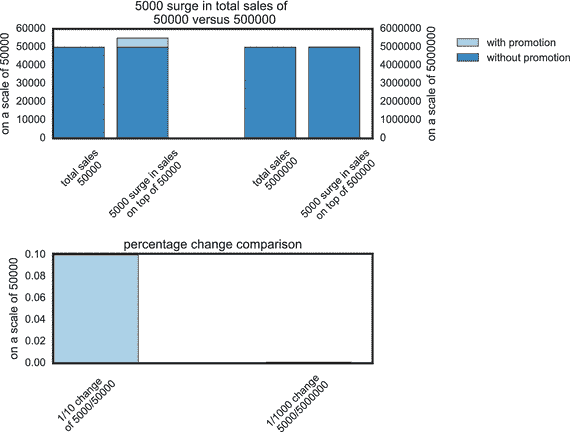
图 17-5. 在 5 万的基础上增加 5,000，与在 500 万的基础上增加 5,000 的对比

在上面的图表中，你几乎注意不到在 500 万基础上出现的这 5,000 单的增长。同样，如果你看一下下方图表中的百分比变化，在 500 万基础上增加 5,000 几乎可以忽略不计。你可以访问 `http://ds.tips/tRab2` 查看如何制作此图表。

你也会在百分比上看到这种情况。也许团队中有人说红色跑鞋的销量增长了 500%，如图 17-6 所示。这相当令人印象深刻，除非当然她是从卖出 2 双红色跑鞋增长到了 12 双。

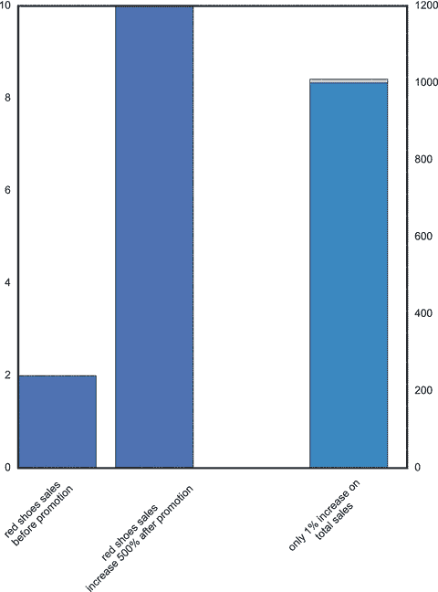
图 17-6. 红色跑鞋销量增长 500%

一次促销活动后，红色跑鞋的销量可能增长了 500%；但是，你应该假设总销量大约是每天 1,000 双，而这个增长只相当于 1%的增幅。你可以访问 `http://ds.tips/5ugEc` 查看如何制作此图表。

当你在数据科学团队工作时，要小心不要将统计数据视为事实。有一些常见的方法可以让统计数据看起来像是在讲述一个有趣的故事。你的团队需要提出关键问题，然后提出更多有趣的问题以获得更深入的见解。

## 高亮缺失数据

提出优质问题的最佳方法之一就是检查缺失的信息。一点点的信息缺失就可能彻底改变故事走向。有时是数据本身不完整，有时则是讲述者因为数据会呈现不同故事而故意略去信息。这种现象在广告中屡见不鲜。

举个常见的广告例子。你可能听过一个流行的说法：每五个牙医中就有四个推荐嚼口香糖的患者选择无糖口香糖。这看起来支持力度相当大。然而，这里就缺失了一些信息。一个恰到好处的问题就能改变整个故事。牙医通常对患者嚼口香糖有什么建议？也许 100%的牙医都告诉患者永远不要嚼口香糖。而在这些患者中，也许有 10%的人坚持认为无法戒掉这个习惯。

那么针对这 10%的人，大多数牙医会说：如果你坚持要嚼口香糖，请确保它是无糖的。你看，这完全是一个不同的故事。没有任何广告商会说：“100%的牙医都说不要嚼口香糖，但如果你非要嚼，请试试无糖的。”

在你的数据科学团队中，你将经常寻找缺失的信息。你需要留意那些重要的信息，因为它们会重塑你的推理。你总是可以要求获取更多信息。真正的问题是，哪些缺失的信息会重塑整个故事。你甚至可能最终讲出一个与原始故事截然不同的版本。

我曾为一个组织工作，该组织试图弄清为什么参与其医学研究的男性多于女性。他们从实验室得到一份报告，显示男性参与医学研究的可能性高出 60%，如图 17-7 所示。数据科学团队的任务是试图找出原因。当数据科学团队查看这份报告时，他们问道：“我们遗漏了什么重要信息？”有几个可能有所帮助的信息点。他们还问道：“他们参与的可能性高出 60%意味着什么？”这是指申请参与的人数男女相等，但被接纳参与研究的男性更多？还是说被接纳的人数男女相等，但实际参与的男性更多？

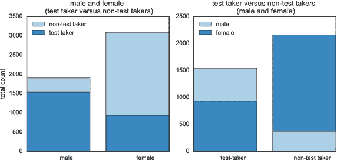
图 17-7. 测试参与者和非测试参与者——男性和女性

你可以从两个角度分析该表格。左侧是按男性和女性划分。大约 80%的男性是测试参与者，而女性只有 30%。右侧是按测试参与者和非测试参与者划分。60%的测试参与者是男性，而在非测试参与者中，男性仅占 15%。了解如何创建此图表请访问 [`http://ds.tips/6Wewr`](http://ds.tips/6Wewr)。

了解这些信息会讲述一个完全不同的故事。其中一个故事是关于更多男性被接纳，另一个故事则是关于更多男性实际到场。

在寻找缺失信息时，你可以尝试几种方法。首先，你应该尝试理解信息可能缺失的原因。可能是由于空间或时间限制。提供信息的人可能对该主题了解不多。或者，此人可能有美化信息的动机。如果属于这些情况，你可能需要投入更多精力来寻找缺失的信息。

另一件需要注意的事情是，当数字周围环绕着比较级形容词时——比如“快 60%”、“大 20%”或“薄 30%”这样的短语。通常，这些短语背后隐藏着重要的缺失信息，你可以据此提出一些有趣的追问，比如比什么快、比什么大、比什么薄？

最后，一个判断信息是否缺失的好方法是尝试从反面思考。为什么男性比女性更多地参与医学研究这件事很重要？让更多女性参与研究有什么好处吗？

事实证明，最后一个问题帮助团队找到了缺失的信息。让更多女性参与的好处在于，年轻女性服用处方药的可能性更大，这使得研究更加全面。他们可以测试更多的药物相互作用。

这个好处正是问题的另一面。女性更难参与，是因为她们可能正在服用研究不允许的处方药。更准确的统计表述应该是：“被允许参与医学研究的人中，有 60%是男性。”这讲述了一个完全不同的故事。

在数据科学团队工作时，请始终保持警惕，积极寻找缺失的信息。那些重要的信息可能就隐藏着你的数据想要告诉你的真实故事。

#### 总结

在本章中，你学到了与数据科学团队会面时应重点关注的六个提问领域。你要重点关注能够实现以下目的的问题：

- 澄清关键术语
- 深挖假设前提
- 发现错误
- 探究其他原因
- 揭露误导性统计
- 高亮缺失数据

你了解到，并非你所有的问题都会涵盖这六个领域，但如果你聚焦于此，你的团队一定会提出至少几个问题。在第十八章中，你将学习如何在试图提出好问题时避免可能出现的陷阱。

### 18. 避免提出好问题时的陷阱

在本章关于避免陷阱的内容中，我将帮助你发现可能导致你在提问时遇到困难的四个原因，以及如何克服它们。

#### 克服问题偏见

问题是获取数据洞察的核心。你已经了解了许多帮助团队提出更好问题的技巧。但除非你对提问感到自如，否则这些技巧不会有太大帮助。你可能在提问时会遇到多种原因造成的困难。以下是数据科学团队中非常常见的四个原因：

- 自我保护
- 时间不足
- 经验不足
- 企业文化不鼓励提问

在接下来的章节中，你将详细了解每一个原因。

##### 自我保护

第一个原因是团队成员有保护自己的天然欲望。没有人愿意显得错误或无知。当你与其他专业人士同处一个团队时，挑战他人的答案尤其困难。提出一个好问题需要勇气。这会让你显得脆弱，尤其是在为一个高度重视答案的组织工作时。

提出好问题需要练习。如果你擅长此道，你会发现许多看似拥有答案的人实际上在问题面前非常脆弱。这既有助于你，也有助于团队其他成员。如果你无法应对简单的问题，那么你的答案很可能并不那么好。

##### 时间不足

第二个常见原因是团队时间不够。正如你所见，提问会让人筋疲力尽。在刚开始时，每次提问会议似乎都变得更长、更复杂。当没有时间提出有趣的问题时，团队干脆就不再提问了，这使得发现新见解变得困难。

许多数据科学团队都落入了这个陷阱。他们过于专注于清洗数据，以至于没有留下任何时间来提出有趣的问题。通常，组织中的其他部门也强化了这一点。做实际的事情被视为真正的工作。许多组织更倾向于一个忙碌的团队，而不是一个高效的团队。当这种情况发生时，每个人都专注于划船，以至于没有人花时间去质疑你的船要驶向何方。

请记住，没有人会因为拥有最干净的数据集而获奖。一个无法产出见解的数据科学团队很难创造商业价值。

##### 经验不足

第三个常见原因是团队单纯缺乏提出好问题的经验。当团队成员来自工程、软件开发或项目管理领域时，这种情况非常普遍。这些成员可能整个职业生涯都在努力成为那个知道答案的人。压抑这种本能并专注于提问可能会很困难。来自科学或学术界的团队成员可能更容易完成这种转变。这就是为什么拥有良好的混合搭配可能会更容易。

当团队刚开始时，他们倾向于提出很多诱导性问题。这些问题包含了某种形式的答案。一个诱导性问题可能是这样的：“我看到更多女性在我们的网站上购买跑鞋。你认为这是因为我们的女性顾客数量增加了吗？”

这类问题并不能真正开启讨论。通常，对方的唯一选择就是同意或反对。一个更好的问题可能是这样的：“为什么女性在我们的网站上购买更多鞋子？”一旦团队的其他成员开始讨论，你就可以提出自己的看法。

##### 企业文化不鼓励提问

第四个常见原因是数据科学团队身处一种不鼓励提问的企业文化中。社会科学家丹尼尔·扬克洛维奇¹指出，大多数美国组织创造了一种行动文化。当这些组织面临问题时，他们的第一反应是冲进去并想出一个解决办法。他们不希望任何人坐在那里问问题。而是要全员上阵。

这种反应在许多组织中效果不错。例如，如果你在客户服务或零售业工作，你可能只需要关注即时修复。但在数据科学中，这种思维方式会导致问题。它会阻碍团队学习任何新东西。

数据科学团队最不想听到的就是一股推动完成某项实际任务的压力。你不希望利益相关者这样说：“等你们把所有数据上传到集群之后，再提问吧。”这暗示他们仍然认为你的团队只是在完成项目，而不是在寻找关键见解。

当你在数据科学团队工作时，要警惕个人和组织对提问的偏见。提问是通往发现的第一步。如果你跳过了这一步，你的团队将很难学到任何新东西。

#### 总结

在本章中，你了解到在提问方面可能遇到问题的四个原因，以及如何克服它们。总结如下，本章详细讨论的四个原因为：

- 自我保护
- 时间不足
- 经验不足
- 企业文化不鼓励提问

在第五部分，你将了解讲故事的基本方面，从第 19 章定义故事开始。

脚注 1

丹尼尔·扬克洛维奇，《对话的魔力：将冲突转化为合作》（西蒙与舒斯特出版社，2001 年）。

