# 12. 使用数据科学生命周期

你数据科学团队中的大多数人对典型的项目生命周期都不会陌生。有软件开发背景的人熟悉软件开发生命周期（`SDLC`）。有数据挖掘经验的人则可能使用过跨行业数据挖掘标准流程（`CRISP-DM`）。

这些生命周期各有其适用场景。它们的问题在于，要求你在开始之前就对所做的事情有充分了解。在软件开发中，你必须有一个清晰的范围。在数据挖掘中，你必须对数据和业务需求有深入了解。

数据科学是经验性的。你并不知道会发现什么。你甚至可能不知道自己在寻找什么。相反，你必须专注于有趣的问题，然后创建一个反馈循环，确保这些问题与业务价值相关联。

尽管如此，生命周期仍然非常有用。它就像一张高层次的地图，有助于让团队保持在正确的轨道上。正因如此，对于一个数据科学团队而言，你需要尝试一种不同的方法。你可以使用数据科学生命周期（`DSLC`）来为团队设定一些方向。

在本章中，你将探讨`SDLC`和`CRISP-DM`，以便理解它们与`DSLC`的不同之处。然后你将学习如何使用`DSLC`，以及如何有效地在`DSLC`的问题间循环。

## 探索 SDLC 与 CRISP-DM

你已经看到让数据科学团队在项目管理框架内工作有多么困难，那么让我们来看看项目管理中常用的两种生命周期。生命周期是你在开发软件或解决问题时采取的一系列步骤。

在大型组织中，你可能会遇到两种生命周期。

第一种是软件开发生命周期（`SDLC`）。这个生命周期有六个阶段，如图 12-1 所示。每个阶段下方列举了该阶段发生的工作示例。

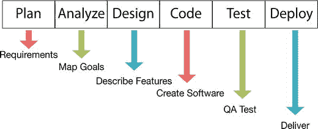

**图 12-1. 软件开发生命周期（`SDLC`）**

这通常被称为瀑布模型，因为每个阶段都必须完成后才能开始下一个阶段：

1.  规划与分析：规划软件并分析需求。
2.  设计与编码：创建基本设计并开始编码。
3.  测试：代码完成后，质量保证人员测试软件。
4.  部署：通过所有测试后，软件被部署供人们使用。

你可能会看到的第二个生命周期是跨行业数据挖掘标准流程（`CRISP-DM`），它用于数据而非软件。其设计比僵化的瀑布模型更为灵活。它也有六个阶段，如图 12-2 所示：

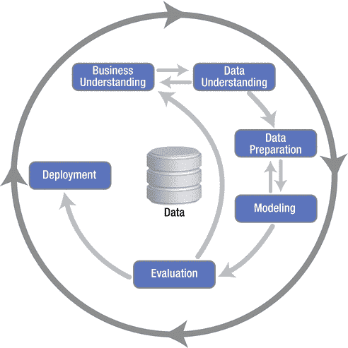

**图 12-2. 跨行业数据挖掘标准流程（`CRISP-DM`）**

1.  商业理解
2.  数据理解
3.  数据准备
4.  建模
5.  评估
6.  部署

这两种生命周期的共同点是，它们都是为“大爆炸式”交付而设计的。你要么在软件的规划与分析阶段投入大量时间，要么在数据的商业理解阶段投入大量时间。目标是在开始工作之前尽可能多地收集信息。然后，在最后一次性“大爆炸”式地交付全部成果。

对于数据科学工作来说，这未必是最佳方法，因为数据科学具有实验性和探索性。想象一个典型的数据科学项目。假设你的数据科学团队正在识别客户在决定转向竞争对手之前的典型行为。这有时被称为客户流失率。你的数据科学团队或许能清晰地陈述其意图：观察客户在流失前做了什么，并创建一个模型来预测客户何时可能流失。

然而，你的团队无法详细规划他们的工作。他们可能会通过分析社交网络数据、公司销售数据，甚至是通过竞争对手推出的异常成功的促销活动来找到最佳模型。关键在于，他们只有在开始探索之后才会知道。

如果你的团队被迫使用`SDLC`或`CRISP-DM`流程，他们将花费太多时间在规划上。他们将无法应用从数据中学到的东西。这是因为他们被迫在开始建模或编码之前就对工作进行规划。像`SDLC`或`CRISP-DM`这样的既定流程要求对每一项工作都了如指掌。如果你犯了错误，在`SDLC`中你需要处理变更请求，而在`CRISP-DM`中则需要重新评估。

如果你希望数据科学团队保持灵活性和探索性，就不能应用标准的生命周期。相反，你应该寻找一种更轻量级的方法来交付见解，这样既能拥有结构，又能保持足够的灵活性以适应新想法。

## 使用 DSLC

现有的流程生命周期并不太适合数据科学。它和软件开发并不足够相似以至于能完全套用`SDLC`，而`CRISP-DM`的数据挖掘流程又有点过于僵化。这并不意味着数据科学团队就应该随心所欲地工作。这些生命周期确实有其价值。其价值之一在于，它能为你提供一个前往目标的高层次地图。当你刚开始组建数据科学团队时，这一点非常有用。你能大致了解前进的方向，从而做到以终为始。

生命周期的危险在于它可能成为工作的主要焦点。你应该将生命周期作为实现更好数据科学的工具，而不是为了遵循流程而遵循流程。一个好的生命周期应该像楼梯扶手。当你上下楼梯时，你会知道它就在那里，但你不必每走一步都紧紧抓住它。过了一段时间，你甚至应该感觉不到它的存在。

对于数据科学项目，你可以使用`DSLC`。这个流程框架轻量且不那么僵化。`DSLC`有六个步骤，如图 12-3 所示，后续章节将详细讨论。

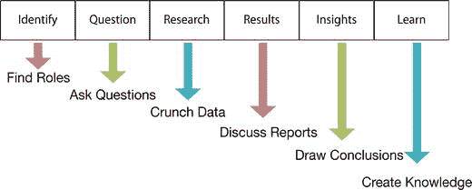

**图 12-3. 数据科学生命周期（`DSLC`）**

这个生命周期大致基于科学方法。

### 识别

作为数据科学团队，首先要识别你故事中的关键角色。最终，你希望能够用数据讲述一个有趣的故事。开始故事的最佳方式是识别关键角色。把它想象成戏剧中的一个场景。谁走进了房间？有主角或主人公吗？有没有一个背景故事有助于解释他或她的行为？

让我们回到跑步鞋网站的例子。你的关键角色是谁？有跑步者。也许跑步者有一个影响其跑步习惯的伴侣。也许你的跑步者的伴侣是医生、博主或教练。每个这些角色都可能成为你数据科学故事的一部分。

### 提问

识别出关键角色后，你可以提出一些有趣的问题。团队的研究负责人可能会先问：“是否有博主影响你的跑步者？” 也许教练在影响跑步者的购买决策方面扮演着重要角色。他们可能会问：“CrossFit 教练是否在推荐我们的产品？” 这些问题是在探索数据时关键的第一步。记住，数据科学是实验性和探索性的。当你从一个好问题开始时，你更有可能获得有趣的研究成果。

### 研究

数据分析师希望与团队紧密合作，尝试找出研究问题的一些策略。团队决定探索跑者与其伙伴之间的关系。此时，研究负责人会询问数据分析师，如何能获取此类信息。

如何通过网站上的数据判断某人是否为跑步搭档？也许可以向同一邮政编码区域的用户发送“寻找跑友”促销活动。数据分析师可以尝试将客户数据与社交网络上的好友信息进行交叉比对。如果数据分析师无法就此问题展开研究，团队可以为未来制定策略，例如网站可以专门为跑步搭档创建一个特别促销活动。

### 结果

确定研究主题后，你需要制作第一批报告。这些结果供团队内部使用，应该做到快速且粗糙。希望你的数据科学团队会经历大量问题和大量报告，其中大部分可能是毫无价值的。它们或许有趣，但还不足以值得深入探索。你不希望数据分析师花费过多时间精雕细琢这些结果。

### 洞察

最后，你的数据科学团队应审视这些结果，看是否能发现任何有价值的洞察，如图 12-4 所示。也许数据表明，你的大多数客户都结伴跑步。这个洞察对营销团队来说可能非常有价值。

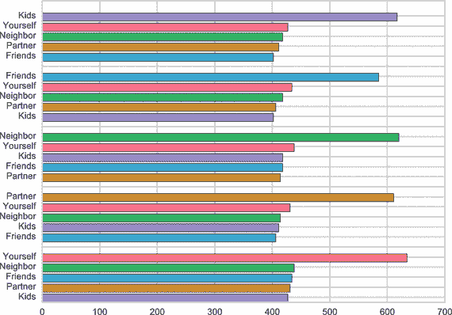

**图 12-4. 人们的跑步伙伴**

注意：此图表源自季度调查，调查中客户选择他们与谁一起跑步。每组中的第一个柱状图统计的是他们最常一起跑步的人。其下方的柱状图统计的是调查对象与之跑步的其他类型人群。例如，最常独自跑步的人也会与邻居一起跑；而经常与孩子一起跑步的人，除此之外则更倾向于独自跑步。了解如何创建此图表，请访问[`http://ds.tips/cH6th`](http://ds.tips/cH6th)。

### 学习

最后，你的团队会将一系列洞察整合起来，并尝试创建组织知识。正是在这里，你的团队将讲述客户的故事。你可能需要使用数据可视化来支撑你的故事。这种新知识才是真正为组织其他部门增值的部分。如果你能讲述一个引人入胜的故事，它可能会改变整个组织看待其业务的方式。

## 问题循环

软件和数据挖掘的生命周期缺乏足够的灵活性来应对新信息。这就是为什么你使用`DSLC`（数据科学生命周期）的原因，它更加轻量化。如果你的数据科学团队发现了新东西，他们不应该为了组织获益而费力地与流程抗争。

如前所述，`DSLC`包含六个领域：识别、提问、研究、结果、洞察和学习。概括来说，首先，你要识别参与者，然后提出一些有趣的问题。接着，你的数据科学团队应就如何研究这些问题达成一致。你们将讨论结果，看看是否能发现洞察。然后，你们收集洞察，创作一个故事，并向组织其他部门讲述你们学到了什么。

这六个领域不同于软件开发生命周期，后者的每一步都指向下一步。相反，将中间的三个领域视为一个循环。你的数据科学团队应在问题、研究和结果之间循环（见图 12-5）。

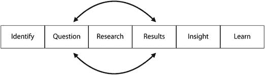

**图 12-5. 问题、研究与结果循环**

# 问题、研究与结果的循环

这个由问题、研究和结果组成的循环，是驱动你们数据科学团队的引擎。团队中的每个角色都专注于其中一个领域。研究负责人专注于提出正确的问题。数据分析师与研究负责人合作，提出正确的研究问题并创建报告。然后，项目经理将这些结果传达给组织的其他部门。

让我们回到跑步鞋网站的示例。每隔几年，就会出现一款爆款跑鞋。你的制造商生产了数百种鞋，但时不时地，有某款鞋的表现会远超其他所有鞋。你找到数据科学团队，请他们为这些顶级鞋款创建一个预测模型，如图 12-6 所示。研究负责人提出了一个有趣的问题：“是什么让一双鞋成为爆款？”她与数据分析师合作，提出了一些有趣的问题：

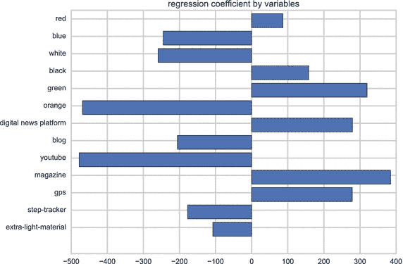

图 12-6. 各变量的回归系数

- 是鞋子的颜色吗？
- 是某种新技术吗？
- 这款鞋是否在杂志上被重点推荐并受益于网络效应？

注意：以销售额作为`y`变量，颜色、营销渠道和技术作为`x`虚拟变量，我们可以看到，最畅销的产品最有可能包含黑色而非白色，橙色也有帮助。你可以这样解读数据：在其他条件不变的情况下，如果产品在数字新闻平台投放广告，其销售额可能比在博客上投放广告高出 200 美元，而博客广告则会使销售额减少近 200 美元。了解如何创建此图表，请访问`http://ds.tips/wrA3e`。

研究负责人、数据分析师和项目经理在这些问题、研究和结果之间循环。大多数问题和结果可能都是毫无价值的，只有少数可能带来洞察。也许结果表明是由一些关键属性组合而成的洞察。然后，团队将这些信息整合起来，讲述一个故事，这便成了新知识。这个故事就是：预测爆款的最佳方式是媒体热度、新技术与有趣设计的结合。

现在，这家跑鞋公司可以利用这一知识来创造新产品。与其生产数百种鞋子等待爆款出现，公司可以主动提供制造爆款所需的规格和环境。

一些拥有强大数据科学团队的组织已经在使用这种方法。订阅服务`Netflix`就曾用此方法创作了其热门剧集《纸牌屋》。当时他们拥有 3300 万订阅用户。他们的数据科学团队研究了客户观看的内容、节目的评分、观众喜欢的剧情以及受欢迎的演员（凯文·史派西当时非常受欢迎）。`Netflix`判断政治剧非常受欢迎，于是聘请了史派西。接着，他们以受欢迎的英国原版节目为蓝本，对新剧进行建模。他们基于打造热门节目的要素，创建了一个预测模型。他们努力在问题、研究和结果之间循环，然后数据科学团队讲述了客户想看什么的故事。这个故事最终成了一条剧情线，并转化成了一个热门电视节目。[^1]

这个由问题、研究和结果组成的循环，驱动着你的洞察和知识。你的数据科学团队作为更大`DSLC`的一部分，在这些领域间循环。请记住，不要将这个生命周期视为瀑布式流程。相反，将其看作是一开始有几个步骤，然后中间是一个循环，不断产出精彩的故事。

## 摘要

在本章中，你了解了`SDLC`和`CRISP-DM`，从而能够理解它们与`DSLC`的区别。你了解到`SDLC`和`CRISP-DM`都有六个阶段，并探究了这些阶段。你还知道了如何使用`DSLC`来有效地循环产生有价值的见解。在第 13 章中，你将学习如何在冲刺中工作。通过冲刺，你将能够频繁地向利益相关者展示有价值的成果，并建立起组织知识。

[^1]: David Carr，“Giving Viewers What They Want”，《纽约时报》，2014 年 10 月 15 日，`http://www.nytimes.com/2013/02/25/business/media/for-house-of-cards-using-big-data-to-guarantee-its-popularity.html?_r=0`。

# 13. 以冲刺方式工作

保持适应性的一个关键方法是将工作分解成更小的模块，这样你就可以频繁地向利益相关者展示有趣的内容。你的团队可以提出问题并快速获得反馈，以判断数据故事是否有价值，并能否引起组织其他成员的共鸣。如果没有价值，团队可以迅速转向其他问题。如果有价值，团队可以深入挖掘，甚至根据业务反馈提出新的问题。这种反馈循环对于确保团队的工作与业务价值挂钩至关重要。

在本章中，你将了解如何通过`DSLC`冲刺推进工作、创建问题板、聚焦若干会议、分解工作任务，并讲述一个有趣的故事。所有这些技能都将帮助你更有效地推进`DSLC`。

## 在 DSLC 冲刺中迭代

要记住，整个`DSLC`应以快速迭代的方式运行，这一点很重要。`DSLC`的设计初衷并非跨越数周或数月——它足够精简，可以融入两周的工作周期中。每隔两周，团队可以完善他们的工作，产生新的见解，并提出改进后的问题。如果业务方判定当前工作没有价值，团队可以改变方向，尝试新的方法。

既然你已经了解了`DSLC`，你可能会想知道它在实践中是什么样子的。最重要的一点是，`DSLC`的结构不像`SDLC`那样按阶段顺序运行（通常要等前一阶段结束才开始下一阶段）。

`DSLC`的核心是确保你专注于六个领域：识别、提问、调研、结果、见解和学习。整个生命周期应当在一个短期的“冲刺”中完成。你可能听说过“冲刺”这个词，它在敏捷软件开发中被广泛使用，但实际上它起源于产品开发领域。冲刺是一段固定的时间，团队在这段时间内运行一个完整的生命周期。每个冲刺都应贯穿`DSLC`的所有六个领域。

数据科学团队应采用两周冲刺的模式。这个时间长度足以发现见解，同时又足够短暂，能够适应新的想法，如图 13-1 所示。

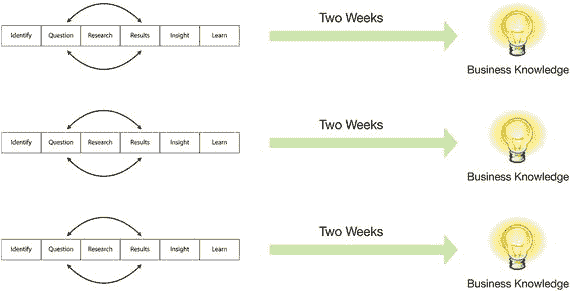

图 13-1. 两周冲刺

采用冲刺模式的主要优势在于，它缩短了“从概念到现金”的时间。许多组织花费很长时间提出新想法，然后经历漫长的交付过程。这些新概念可能需要数月才能增加价值，并且在原始概念提出之后很久才能为业务带来新的收入。而两周冲刺能够更频繁地创造价值。即使没有产生见解，至少也会产生已完成的问题。

你不希望你的数据科学团队工作周期过长。如果按月或季度来工作，问题与结果之间的时间间隔就会过长。等到你获得任何见解时，数据可能已经发生了变化。

你也不希望团队在任何一个问题上投入过多时间。请记住，绝大多数研究都会走入死胡同。大多数问题都会是无效的。你必须打开很多牡蛎，才能找到珍珠。这就是为什么你需要快速处理这些问题——这样，当你发现有趣的东西时，才能在此基础上继续推进。

我曾与某州的教育部合作，他们试图更好地了解就读公立学校的学生情况。该部门有一个庞大的数据科学团队，团队正试图创建一个模型来更好地预测学生的兴趣。不幸的是，他们试图使用`SDLC`。团队曾尝试以冲刺方式工作，但更倾向于传统的瀑布式开发模式。

这个数据科学团队大部分时间都花在规划上。项目启动时，他们花了几周时间进行头脑风暴会议。如果你参加过头脑风暴会议，就会知道它需要组织得井井有条。否则，会议就会严重超时。而实际情况正是如此。

事实上，几个月过去了，团队才发布了他们的第一份需求文档。这份文档列出了他们想要回答的几个问题，并概述了研究方法。然后，团队展示了他们希望通过研究获得的见解。

这种方法面临诸多挑战。请记住，数据科学是探索性和实验性的。他们只设计了少数几个实验，然后就记录下他们希望学到什么。他们试图证明自己假定为真的东西，由于证明本身成了一种需求，这意味着如果他们最终证明是错误的，项目就宣告失败。

如果这个数据科学团队决定采用冲刺模式，效果会好得多。这能让他们提出更多问题，进行更多实验。与其寄希望于正确，他们可以完全专注于学习新东西。同时，效率也会高得多。在该项目上工作了三个月后，团队唯一能展示的成果就是一张问题列表和几个假设。在这三个月里，他们本可以完成十几次更小的冲刺，并且对数据有更深入的了解，因为他们可以经历更多的问题和实验。

如果你身处数据科学团队，请记住不要被数据压垮。不要制定跨越数月的大计划。相反，要尽量保持事情小而精。一点一点地积累知识，这样你就能适应新的想法，而不是只专注于某一条路径。

## 创建问题板

当你在数据科学团队工作时，研究负责人负责提出有趣的问题。想出好问题并非易事。一个好问题能激发大量新信息，迫使人们重新思考自己的工作。正因如此，大多数组织往往回避好问题。当你遇到一个好问题时，会感到些许焦躁，几乎迫不及待地想要找到最佳答案。这可能会带来更多工作，有时甚至引出更多问题。

即使在今天，大多数组织仍试图专注于改进已知领域。他们认为只要不断优化，就能永远领先于新兴竞争对手。而一个好问题往往会打乱这些精心规划。好问题具有打破可预测性的倾向，能将井然有序的目标体系变成开放式问题。

# 问题板与关键会议

## 问题板

研究负责人的职责就是打破这种有序流程，引入探索与实验。问题板是研究负责人最有效的工具之一。问题板通常是一块贴满便利贴的大白板，常放置于数据科学团队附近。板上应有充足空间展示新问题，角落则放着一小叠便利贴。你或许还想画个大箭头指向那叠便利贴。有些团队会加上“提问”的说明文字。

问题板用于征集问题。研究负责人推动问题征集，但这并不意味着所有问题都由她提出。问题应是她的个人想法、数据科学团队的问题以及组织其他部门提出的开放式问题的结合。

问题板应该开放且具有吸引力。尽可能让它看起来引人注目。你希望任何人都能路过时顺手拿起便利贴，快速写下问题。努力保持轻松有趣的氛围。有些团队甚至将其设计成游戏形式——在问题板旁放一大碗糖果，或张贴“提问有奖”的标识。

> **注意**
> 关于如何组织问题板、以及如何使用不同颜色便利贴区分问题类型，请参见第 16 章。

问题板还有助于组织内所有人理解数据科学团队的宗旨。当数据科学团队进行叙事展示时，人们常常会认出自己的问题，并更愿意在未来继续提问。他们甚至可能鼓励同事也来提问。

问题永远不会嫌多。研究负责人与团队其他成员共同确定最有趣想法的优先级。如果能让组织成员使用问题板，它就会变得像三维搜索空间——你能观察到人们提问的模式。问题板本身也成了另一个数据源。

我曾供职的组织在数据科学团队角落放置了一块问题板。起初它只是引起了人们的好奇，大家路过时会像看公告板一样阅读上面的内容。团队巧妙地将它放在饮水机旁。一段时间后，板上出现了几个新问题。虽然大多很无厘头且没有价值，但研究负责人仍用问题板来传达数据科学团队的工作进展。团队在板上张贴问题，并持续进行汇报展示。

那年夏天，组织迎来了一批新的学生实习生。第一个月里，学生们试图了解业务。作为学生，他们更习惯提问。问题板逐渐被他们的便利贴填满。其中一些问题非常直观——他们以全新视角审视业务。这些问题如此简洁且逻辑清晰，以至于数据科学团队将其列为最高优先级。这些问题帮助团队以有趣的新方式探索业务。

如果你是研究负责人，请务必善用问题板。这是获取有趣新问题的简单方法，同时也能向组织其他成员传达你的工作进展。

## 聚焦关键会议

数据科学团队通常希望以两周为一个冲刺周期开展工作。团队任务繁重，因此需要结构化安排以保持效率。请记住，每个冲刺周期中你都需要经历`DSLC`的所有阶段。为了保持这样的工作节奏，团队需要固定的工作时间，不能参加太多开放式会议。他们必须精确安排每一小时。

每个会议都需要设定时间盒。时间盒顾名思义：团队在会议前商定的固定时长。假设团队会议设定为一小时时间盒，那么在该时间盒结束时做出的任何决定都将维持到该冲刺周期结束。时间盒会议绝不可改期或追加会议——它们准时开始，准时结束。

在大多数组织中，会议本身并非坏事。它们是提出问题和强化文化的有效方式。但会议的挑战在于它们会给每周工作增加大量不可预测性。你的数据科学团队需要可预测的日程安排，以便承诺完成一定量的探索与发现工作。你希望团队以可持续的节奏工作。

数据科学团队在每个冲刺周期应召开以下五个会议：

*   `研究规划`
*   `问题分解`
*   `可视化设计`
*   `叙事分享会`
*   `团队改进`

这五个会议协同运作，共同交付`DSLC`的所有环节，如图 13-2 所示。每个会议都有时间限制。

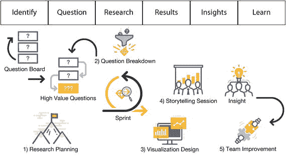
*图 13-2. DSLC 的五个会议*

### `研究规划`

团队应以`研究规划`会议开始每个冲刺周期。有些团队选择从周三开始冲刺，这使他们能在周二下午举行`叙事分享会`。相比周五，周二更容易吸引人们参加此类会议。`研究规划`会议中，团队将决定下一个冲刺周期最感兴趣的探索问题。该会议通常限时两小时。会上，研究负责人和数据分析师共同制定当周的研究议程。

分析师通常需要处理大量数据才能生成有价值的报告。研究负责人和数据分析师将合作创建最小可行报告。或许不必清洗所有数据就能开始实验和探索。数据分析师和研究负责人之间应存在良性张力——研究负责人倾向于制作快速粗略的简易报告，而数据分析师则希望清洗大型数据集并攻克更复杂的问题。这个会议旨在帮助团队成员达成折衷策略：要准备数据并生成有趣报告，最少需要完成多少工作？

### `问题分解`

在每个冲刺周期中，团队至少需要召开两次时长为一小时的“问题分解”会议。在这些会议中，整个数据科学团队将尝试提出有价值的问题，并将其张贴在问题板上。同时，他们也会将问题板上的新便利贴取下，评估这些问题是否具有探讨价值。

此外，他们还会寻找问题主题：

- 是否存在共性问题？
- 是否有大问题可以拆解成更小、更易处理的问题？
- 是否有人对团队的某个问题做出了回应？

团队将共同协作，尝试为下一个冲刺周期筛选出一些更有价值的问题，并确定其优先级。

### `可视化设计`

第三次会议是可视化设计会议。这场会议通常被限定在一小时之内。在此期间，研究负责人与数据分析师将共同创建一份有意思的可视化方案。这通常只是一个粗略草稿，供数据分析师在后续的故事讲述环节中使用。

### `故事讲述环节`

第四次会议是时长一小时的故事讲述环节。此时，数据科学团队会展示一个关于他们在该冲刺周期中所学到的故事。在会议中，他们会展示一些精美的数据可视化成果，讨论问题板上的问题，并围绕这些问题展开故事叙述，或者提出他们自己的见解。

### `改进`

最后，在每个冲刺周期结束时，团队应召开一次两小时的改进会议，评估他们的进展，并讨论团队协作是否顺畅，以及是否需要进行任何调整。

所有这些会议应当相互配合，确保数据科学团队在每个冲刺周期结束后都能交付有价值的洞察。请记住，每个冲刺周期内要做的工作很多，因此务必将这些会议限定时间，以便专注于探索发现。

## 分解你的工作

至此，你已经了解了 `SLC` 和 `DSLC` 的区别，并且知道 `DSLC` 最好以两周为一个冲刺周期来交付，这样就能分解工作并交付有价值的洞察。当你在数据科学团队中时，总会遇到需要清洗的大型数据集以及需要探索的新数据源。事实上，你大部分时间都在准备数据。而当你以冲刺周期工作时，就是迫使团队只做最低限度的准备工作。

只做最低限度的数据准备听起来可能不是什么好事。大多数人希望完成更高质量的工作。但实际上，当你只做最低限度的准备工作时，你是在迫使数据科学团队专注于洞察，而不仅仅是技术能力。你不想让团队花费数周甚至数月仅仅用于搭建数据环境。相反，你希望团队能几乎立即开始探索数据。

你还需要从组织的角度来看待这个问题。大多数组织真正感兴趣的并非数据本身，而是从报告中获得的知识。从组织的角度看，管理数据是成本的一部分，而非收益。这意味着，尽快从数据中提取价值的压力会越来越大。数据科学团队很难花大量时间准备数据，却只在最后交付报告。

在许多方面，这与如今许多组织看待软件的方式相似。起初，大多数组织认为软件开发有些神秘。他们将大部分细节留给高技能的软件工程师。这些工程师会花大量时间规划并准备一次大型发布。而现在，大多数软件开发人员被迫以更小的模块交付有价值的软件。他们花在准备上的时间更少，花在交付上的时间更多。这使得组织能够在团队进展过深之前，先看到软件的价值。

就像早期的软件开发一样，在许多组织中，数据科学仍然有些神秘。团队在如何开展工作方面仍有很大的自由度。然而，用不了多久，管理者就会开始提出更尖锐的问题。目前，大多数数据科学团队还享有花大量时间准备大型数据集的特权。一旦那些管理者开始提问，团队就不得不转而专注于最小可行数据准备工作。

我曾在一家致力于实现清洗大型数据集流程自动化的组织工作过。他们想将这个数据集接入集群中已有的一个更大的数据集。数月来，科学团队只专注于这项任务。他们下载了开源软件工具，并购买了一些商业产品来帮助准备数据。几个月后，他们创建了几个脚本、软件工具和实践方法，自动化了将这些大型数据集迁移到集群中的流程。

迁移完成后，他们与企业数据服务副总裁开了一次会。他们用 PowerPoint 演示了集群消耗了多少数据，并用了好几张幻灯片说明清洗和导入新数据集有多么困难。会议接近尾声时，副总裁问了一个有趣的问题。他只是简单问道：“我们现在知道了哪些以前不知道的事情？” 这个问题在会议室里掷地有声。从沉默中可以清楚地看出，几个月来没有人从这个角度思考过数据。会议室里的每个人都完全专注于技术能力。他们忘记了组织的真正价值。

如果他们改用两周冲刺周期来交付，就能更快地专注于价值。与其构建完整的数据集，他们本可以处理更小的数据子集，立即开始创建报告并探索数据。当你探索数据时，你会对数据价值有更好的感知。如果你只专注于清洗和导入数据，工作就有沦为常规流程的风险。这就好比你把所有时间都花在布置晚宴的餐桌上，却根本没时间准备一顿美味大餐。

## 讲述一个有趣的故事

展示数据和讲述故事之间有着巨大差异。首先，讲故事更具挑战性，因为你需要投入更多精力——既要引入数据和你对业务的了解，还要融入你对世界的认知。

当你用 PPT 展示一个数据图表时，你是在说：“这是我看到的。”而当你讲述一个故事时，你是在说：“这是我所相信的。”这要困难得多，从某种意义上说，也更具个人色彩。这正是讲故事成为一项宝贵技能的原因。

> **注意**
> 关于如何讲述一个有趣的数据故事，请参阅第 19 章。

当你讲故事时，你会同时做几件事。首先，你简化了数据中的复杂性。你还界定了参与创建这些数据的人员角色。

接下来，你会引入自己对组织的了解。这可以来自你的经验或研究。你针对人和数据做出简单的观察，然后将其置于组织的背景中。你不仅利用数据来谈论地点和内容——你还呈现了背后的原因。

你要做的第三件事是让你的数据更令人难忘。大多数研究表明，当你以 PPT 格式呈现内容时，只有很少的信息能被受众接收。那些要点列表可能很容易创建，但同样容易被遗忘。故事能更有效地抓住受众的注意力。如果你能编织一个好的故事，就更有可能让每个人都参与进来。

最后，一个好的故事会包含行动号召。它要么告诉你一些新东西，要么证明你值得继续探索。如果你能讲一个好故事，并把受众纳入探索过程，那么几乎不会有人问：“你们为什么又要做这个？”

让我们回到跑鞋网站的例子。假设你的数据科学团队一直在研究关于提高销售额的问题。你和团队一起将这个问题分解成几个更小的问题。其中一个问题是：“人们会购买他们心愿单上的商品吗？”

研究负责人和数据分析师合作，快速生成一份粗糙的报告，看看有多少心愿单商品被转化为实际购买。然后他们创建了一个时间序列图，观察这些购买行为是上升还是下降。通常，团队会在讲故事会议前一天召开可视化设计会议。在这个会议上，他们会尝试将原始数据和粗糙的报告转化为漂亮的可视化图表，然后利用这个可视化图表来讲述一个有趣的故事。

数据显示，在夏季月份，人们更倾向于将心愿单商品转化为购买行为。这只是原始数据，但并不是一个很有趣的故事。为什么人们在冬天关注鞋子，却要等到夏天才买？数据科学团队决定讲一个故事。他们用了这个标题：“夏日梦想家：为什么冬季购物者会在夏天买鞋？”接着，数据分析师在白板上画出了数据可视化的初稿（图 13-3）。

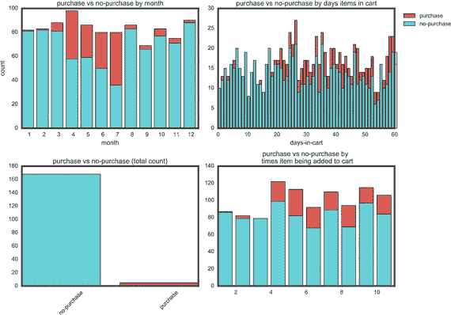

**图 13-3.** 全年的购买习惯

在左上方，夏季月份（6 月至 9 月）有更多人在购买购物车中的商品，但左下方显示，购物车中的大部分商品并未被购买。在右上方，被购买的商品在购物车中停留超过 20 天，并且被反复加入购物车超过四次。了解如何创建此图表，请访问[`http://ds.tips/truD6`](http://ds.tips/truD6)

请注意，故事已经让数据变得更有趣了。想象一下，如果数据分析师仅使用标题“年度心愿单转化率”，并在 PPT 幻灯片上放一个简单的时间序列图。这样的内容不会激起任何人的兴趣。它既没有背景，也没有行动号召。

第二天，数据科学团队利用他们的“夏日梦想家”可视化图表，向组织中的其他人讲述了一个有趣的故事。故事表明，你们的许多客户在冬天就在考虑跑步，但他们只在夏天才买鞋。这个故事引发了更多问题：人们冬天穿着旧鞋跑步吗？他们只是不跑步吗？他们是不是因为主要在室内跑步，所以不需要新鞋？我们是否应该设计一款专门用于室内跑步的跑鞋？

在讲故事会议中，你很有希望会得到这类问题，然后你可以将它们添加到你的问题板上。如果你能讲一个好故事，组织中的每个人都会想参与你的发现之旅。

### 本章摘要

在本章中，你了解了如何推进 `DSLC` 冲刺工作。`DSLC` 有五个核心会议。在这些会议中，你的团队将使用问题板，分解工作任务，并讲述一个有趣的数据故事。在第 14 章，你将学习如何避免在数据科学冲刺工作中可能遇到的陷阱。

## 避免数据科学冲刺交付中的陷阱

在这一“避免陷阱”章节中，你将找到一些改变公司思维方式的方法。你可以从设想如何在无目标的情况下工作开始。许多组织专注于目标，并设立了强大的合规部门。这些部门确保每个人都达成这些目标。这种专注可能会阻碍你的团队进行探索和发现。数据科学团队需要利用偶然发现，并增加组织的知识储备。他们需要强调探索而非例行工作。

### 改变思维方式

许多公司在组建数据科学团队时，低估了组织变革的难度。这不仅仅是让一群统计学家查看数据那么简单。而是要以不同的方式对待组织的数据。它不再是一种需要被控制的静态资源，相反，它是一个不断变化、不可忽视的洞察源泉。

**注意**

关于如何启动组织变革，请参阅第`[25](http://dx.doi.org/10.1007/978-1-4842-2295-9_25)`章。

改变这种思维模式的一部分，就是要放弃那些过去可能行之有效的策略。如果你想探索，就必须摆脱项目目标和计划好的成果。这些往往是发现的障碍。你必须接受这样一个想法：你不知道数据会导向何方。你甚至可能要依赖简单的偶然发现。

与此同时，你也不能毫无目的或方向地漫游。你需要创造能增加真正价值的组织知识。你必须保持开放和探索精神，同时也要务实，以商业价值为驱动。如果你过于开放，你的团队可能会迷失在数据中。你会探索死胡同，并提出没人感兴趣的问题。这会让利益相关者感到沮丧，并限制你的成功。另一方面，如果你过于专注于目标，你就不会发现许多新的洞察。你将被限制在你已经希望成真的范围内。新发现的空间会很小。

如果你既想保持探索性，又希望以商业价值为驱动，就需要改变你对工作的思考方式。第一步是认真审视一个老伙计：计划好的目标。

### 在没有目标的状态下工作

你的数据科学团队会希望采用 `DSLC` 和冲刺的工作方式，以便每隔几周就能讲述有趣的故事。这些实践能帮助团队探索数据并提出深刻的问题，并应有助于让团队聚焦于探索。尽管如此，对许多团队而言，最大的挑战仍是试图改变组织的思维模式。

正如本章开头所提到的，大多数组织仍然将工作视为一系列的目标与指标。这就是为什么大多数关键角色都聚焦于管理和合规。项目经理确保团队遵循项目计划；主程帮助维护特定的编码标准；质量保证经理推行六西格玛等标准。即使是 `CEO`，也专注于为组织中的其他成员设定明确的目标。所有这些常见角色的核心都是合规。他们确保团队忠于自己的目标。担任这些角色的人通常非常有影响力。他们很可能会试图将这种目标驱动的思维模式应用到你的数据科学团队中。

这对数据科学团队来说是一个真正的挑战，因为他们的工作关乎探索，并使用经验性流程来研究数据并从数据中学习。按照典型的目标来工作很困难。从定义上讲，探索就是关于搜寻和发现陌生的事物。而目标则是关于忠于你既定的意图。

你当然可以将探索和目标结合起来。如果你发现自己在一个新城市，你可能会有一个目标：找到好吃的东西。然后你开始探索该区域，寻找好的小吃摊或餐馆。你有一个找晚餐的目标，但你仍然对新想法持开放态度。问题在于，大多数组织并没有这么灵活。他们倾向于狭隘地定义目标。目标本身成为了首要焦点。团队不会因为发现新事物后改变方向而受到赞扬。一个成功的团队通常有定义明确的目标，并在预期的时间范围内达成目标。这种对目标的关注可能会为探索创造一个非常困难的环境。

让我们回到那个跑鞋网站的例子。假设你的数据科学团队接到了一个目标：创建一份报告，按不同的信用卡细分购买情况。你想看看接受不同的信用卡是否可能增加销量。当团队正在探索数据时，如图 14-1 所示，他们注意到了一些意想不到的事情。看起来鞋类销量和顾客评分之间存在正相关。你可能会认为评分最高的鞋子销量也更高。然而，数据科学团队注意到，任何有评分的鞋子销量都更高。销量最低的鞋子是那些根本没有评分的鞋子。

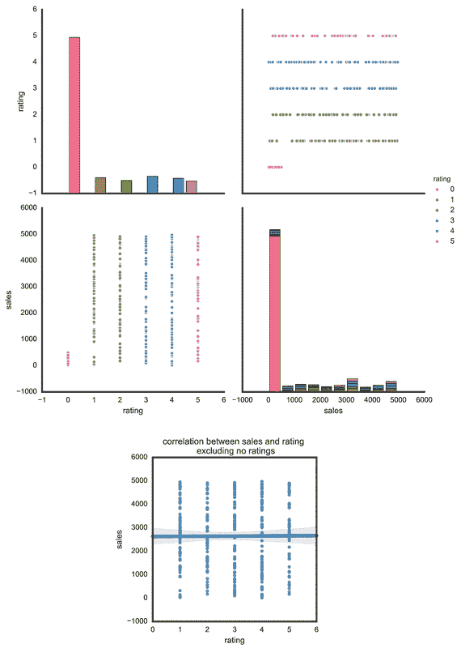

**图 14-1.** 鞋类销量与顾客评分之间的相关性

假设 0 代表没有评分，其余数字是真实评分。总销售额接近 0 的大多数商品都没有评分。然而，其余数据并未表明更高的评分会带来更高的销量。实际上，原因可能正好相反。因为销量更高，更多实际购买了该商品的人愿意在网站上留下反馈。但在底部的图表中，如果我们忽略那些没有评分的商品，则几乎没有任何相关性。请参阅 `http://ds.tips/8refR` 了解如何创建这些图表。

基于这些数据，团队调整了方向以利用这一新发现。他们创建了一套完全不同的报告，将评分与热销鞋款关联起来。在接下来的故事讲述会上，他们讨论了顾客在认为一款鞋不受欢迎时最不可能购买它。事实上，一个评分很差的鞋子仍然比没有评分的鞋子更有可能卖出。这个新发现是一个完全出乎意料的结果。团队原本的目标是研究新的信用卡数据，然后转而开始研究评分数据。

在一个典型的项目中，这是完全不可接受的。你不希望你的团队设定一个既定目标，然后根据自己的标准改变方向。然而，这正是你希望数据科学团队进行的那种经验性探索。事实上，许多数据科学团队试图远离典型的目标。他们可能持有寻找模式这种开放式的理念。他们可能只是探索数据，看看是否有任何突出之处。他们想看看数据中是否有有趣的东西。这些团队发现，明确定义的目标往往会成为发现的障碍。

当你在数据科学团队时，请记住，你所做的事情与组织中大多数其他团队不同。在数据科学领域，如果你专注于发现，就能从数据中获得最大价值。你应该与你的经理密切合作，沟通这种差异。不要低估试图改变他们期望的挑战。大多数人多年来一直专注于达成目标。一群探索数据、寻找新事物的人，可能并不容易被接受。

### 善用意外发现

你已看到，为数据科学团队设定目标可能很困难。然而，许多组织甚至难以想象没有目标该如何运作。目标无处不在：有职业目标、学习目标，自助类书籍也大谈个人目标。这些目标指导着我们的大部分行为，但它们或许并不像你想象中那么有价值。

在过去几年里，这方面已经出现了一些有趣的研究。这些研究来自一个你可能意想不到的领域：机器学习和人工智能世界。那些试图让计算机展现智能行为的人们发现，我们所知的大部分认知都建立在计划外的发现之上。实际上，我们从漫无目的的探索中学到的东西，比从既定计划中学到的更多。

关于这个主题，最好的书籍之一是肯·斯坦利和乔尔·雷曼合著的《伟大不能被计划：目标的神话》。¹ 肯·斯坦利教授在中央佛罗里达大学领导一个研究人工智能的研究小组。他在书中写道：“目标实际上会成为通往更激动人心成就的障碍，比如那些涉及发现、创造力、发明或创新的成就。”这番话出自一位研究人工智能的顶级计算机科学家之口，并非迪帕克·乔普拉的励志名言。

你应该这样理解：你对目标关注得越多，就越不可能做出有趣的发现。数据科学团队的每个成员都应该对创造性的漫无目的感到舒适。事实上，斯坦利教授指出，团队实际上应该依赖纯粹的意外发现。

“意外发现”这个词出现在一本关于人工智能的书中，听起来有点奇怪。简单来说，意外发现就是某事恰好发生，无法预测或计划。就像你在街上偶遇一位朋友，然后你们决定坐下来一起喝杯咖啡。这是未经安排、未经计划、未知的。

尽管听起来可能有些奇怪，但数据科学团队确实需要依赖一些意外发现。有时，团队成员会在数据中看到他们意料之外的东西。它会看起来有趣或不同寻常。团队跟进这一发现至关重要。你不希望他们为了目标而牺牲发现。

斯坦利教授将这些称为“垫脚石”。这些有趣的事物最终会导向深刻见解。如果你忽视它们，很可能就会错过关键的发现。

让我们回到那个跑鞋网站的例子。数据科学团队的任务是预测该网站在接下来一年中预期的新销售额。在查看数据时，一位分析师发现了一些有趣的现象：过去几周的周日的销售额略有下降，如图`14-2`所示。如果团队完全专注于目标，他们可能会忽略这个有趣的发现，因为很难想象这个微小下降能帮助他们创建一份预测未来销售额的报告。一个专注于发现的数据科学团队则会跟进这个有趣的信息。

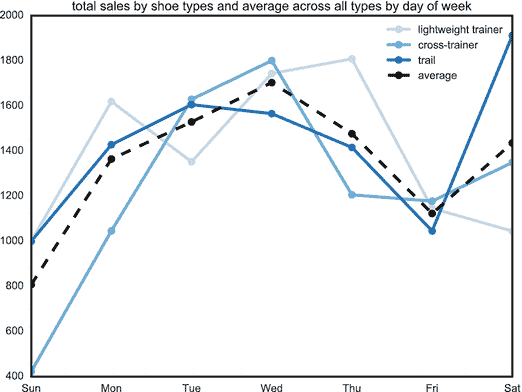

图`14-2`. 按鞋类统计的总销售额及按星期几统计的所有类型平均值

注意：平均而言，所有类型的鞋在周日的总销售额都有小幅下降，但不同类型在一周中的不同日子达到峰值。请访问 [`http://ds.tips/tuc2E`](http://ds.tips/tuc2E) 查看如何创建此图表。

它可能不会导向任何结果。事实上，这些小发现中的大多数最终只会是死胡同。然而，其中少数几个将成为通向未来可能极有价值之物的垫脚石。团队探索数据越多，他们就会为未来的问题建立越多的联系。

这些语言在组织中通常不常听到。像`垫脚石`、`意外发现`和`发现`这样的词，听起来更像是你在浪漫喜剧预告片中会用的关键词。然而，这些恰恰是试图学习新奇有趣事物的关键部分。

加拿大哲学家马歇尔·麦克卢汉曾说过：“我不知道是谁发现了水，但肯定不是鱼。” ² 发现的很大一部分在于，能够坦然接受自己不知道信息将引向何方。你必须能够追寻意料之外的事物。通向发现的那些`垫脚石`，只有在你走完路程后才会变得清晰。关键在于，不要仅仅为了忠于目标而忽视那些看起来有趣的东西。

请记住，数据科学就是将科学方法应用于你的数据。科学方法的一个关键部分是进行观察并提出有趣的问题。不要为了短期规划而牺牲你的探索。

## 充实组织知识

你已经了解到，让团队探索数据并寻找有趣关联是一种可预测的发现重大成果的方式。此外，还有`DSLC`框架，它迫使团队每两周讲述有趣的故事，让组织了解团队的工作。组织得到的不是客观规划，而是可预测的交付。为团队提供一个可预测的框架，是让他们专注于构建知识的绝佳方式。这是一种双周一次的分享故事的节奏。如果组织其他成员不喜欢他们的故事，也随时可以鼓励他们转向不同的方向。

`DSLC`、`冲刺`和`探索`三者协同工作，共同交付洞察与学习成果。如果你在数据科学团队工作，应该努力让这三者保持平衡。`DSLC`为团队提供了如何思考交付价值的蓝图。团队应明确角色，并在提问、研究和讨论结果的循环中工作。

`冲刺`为组织提供了一种可预测的节奏。如果没有冲刺，团队可能面临花太多时间准备而非交付的风险。大多数情况下，你的数据分析师都在清洗和准备大型数据集。一个为期两周的冲刺迫使数据分析师以尽可能小的模块进行工作，并鼓励他（她）交付更多小型报告，而非一次大型演示。

最后，组织需要高度重视数据探索。团队应有自由去跟进有趣的发现。组织其他成员仍能了解团队的工作，但工作内容可能会发生变化。它可能基于偶然的发现而转向。

`冲刺`与`探索`之间的平衡有助于保持对话的活力。团队拥有额外的自由，作为回报，组织每周都能获得反馈。如果做得好，数据科学团队将与组织紧密合作，帮助员工和高管了解业务及其客户。这是一种轻量结构化和频繁发现之间的完美平衡。

话虽如此，这种平衡并不容易实现。在某些冲刺中，团队可能无法交付任何有趣的成果。在其他时候，数据集可能显得过于庞大复杂，以至于无法分解到两周的冲刺中完成。

这个`DSLC`框架并非旨在解决这些问题。它只是一种照亮困境的方式。它迫使团队思考小规模问题，从而鼓励组织允许探索活动。

确保你的冲刺始终交付价值的一种方法，是在每次故事分享会结束时提出明确的`行动号召`。你的听众会热衷于充实组织知识。你可以通过清晰地建议他们如何利用这些新数据，来凸显这些知识的价值。

让我们回到你的跑鞋网站。你发现鞋子是否有评分与其销售情况之间存在明确的关联。在你的故事分享会上，你应该设置一个清晰的可视化图表，展示销量与评分之间的关联。新的组织知识是：没有评分的鞋子销量更差。然而，这不应成为你故事的标题。相反，你应该展示组织如何从这些新知识中获取价值。你可以将可视化图表命名为：“增加我们带评分产品的数量应能提高整体销量。”

通过这个标题，你不仅仅是在陈述组织已知的信息。你所做的，是清晰地勾勒出你的团队交付的价值。在一周之内，数据科学团队就提出了一条提高销量的建议。这就是一个`行动号召`。如果你想提高网站的销量，就鼓励顾客为他们的产品打分。这个`行动号召`可以指向组织其他成员，也可以指向团队本身。在故事分享会上，组织可能会建议数据科学团队想出一个关于如何提高产品评分的精彩故事。

当你在数据科学团队工作时，请记住，你的组织会以非常务实的方式看待新知识。务必平衡好`DSLC`、`冲刺`和`探索`，以交付有趣的故事。这些故事应包含新的组织知识，并伴有清晰的`行动号召`。当你的团队有了清晰的`行动号召`时，你更有可能从组织其他成员那里获得有趣的反馈。他们可能会要求你跟进你的故事，或者创建能提供更多指导的新故事。

## 专注于探索而非例行工作

1999 年，两位心理学家进行了一项实验。³ 他们录制了一段六人传球的视频，并给 40 名学生播放。他们让学生数一数球从一个人传到下一个人手中的次数。大多数学生都能数出传球的次数。但他们没有说明的是，一个穿着大猩猩服装的人会走到屏幕中央。大猩猩在中央停了下来，然后走出了镜头。当被问及时，近一半的学生没有注意到大猩猩。事实上，参与者们如此确信它不存在，以至于不得不重放视频。

心理学家发表了他们的研究成果，并将其称为“感知盲视”。这种情况发生在人们过于专注于例行任务时，以至于对有趣的事件视而不见。观看视频的学生们过于专注于数传球次数，以至于没有注意到一个穿着大猩猩服装的人。

这项研究被重复了数十次。一项实验在 CT 扫描图像上放置了一个跳舞的小猩猩图像，以检查放射科医生是否会注意到。⁴ 结果显示 80%的医生没有注意到。即使是知道这项研究的人，发现意料之外事物的可能性也仅仅略有提高。

这表明例行工作往往会关闭我们大脑中用于发现意外事件的部分。许多人在做着复杂的例行工作，却可能对一只大猩猩视而不见。

这对你的数据科学团队来说可能是一个真正的危险。请记住，数据科学的大部分价值在于探索。你希望团队中的每个人都能注意到有趣的事物，然而部分工作又是例行公事。你的数据分析师仍然要花大部分时间来清洗数据。你需要警惕的是，当你的团队过于专注于例行工作时，他们可能会错过一些意料之外的东西。

我曾为一家试图理解客户为何点击某些广告的公司工作。每则广告都展示了一辆汽车的图片。当客户点击汽车时，图像和点击率会被记录到集群中。数据科学团队创建了几个数据可视化图表。他们专注于创建实时成功率和点击率。有很多工具可以帮助他们以有趣的方式展示这些信息。数据科学团队非常忙碌，并且陷入了一种可预测的收集数据的节奏中。

在一次故事分享会上，数据分析师深入点击了一个数据可视化图表，以展示数据中的细节。作为例子，他们展示了一则红色福特野马车广告的结果。不知何故，这则广告的效果非常好，其点击率要高得多。团队中的一位利益相关者打断了演示，并询问为什么这则广告如此成功。数据科学团队此前没有考虑过这个问题。他们过于专注于获取点击率数据，以至于没有真正注意到任何有趣的事情。他们的工作变成了例行公事。他们收集数据、清洗数据，然后上传到集群。他们没有提出多少有趣的问题。就像一只大猩猩走进了他们的数据，而他们却完全没有注意到。

数据科学团队在下一个冲刺阶段解决了这个问题。研究负责人针对那则成功的广告提出了一些有趣的问题。是什么让这则广告更成功？是汽车的品牌吗？是汽车的类型吗？是汽车的颜色吗？为什么网站上的客户更有可能购买这辆汽车？

经过对这些问题的一番探讨，团队讲述了一个有趣的故事。事实证明，汽车颜色对点击率有轻微的影响，如图 14-3 所示。这一点，再加上汽车的品牌和型号，很可能是这则广告更为成功的原因。数据科学团队在接下来的故事分享会上带着行动号召离开了。他们建议将更多的汽车改成红色，这将提高他们的整体广告收入。

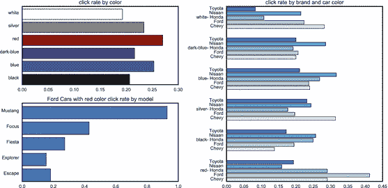

在所有颜色中，红色的点击率可能比其他颜色略高。如果按品牌细分，只有福特的红色点击率高于其品牌的平均值。例如，对于日产来说，蓝色是点击率最高的颜色。如果你进一步按红色福特的型号细分，只有野马车的点击率极高；其他型号则相对较低。了解如何创建此图表，请访问 [`http://ds.tips/wr5nU`](http://ds.tips/wr5nU)。

这个团队很幸运，团队之外有一位利益相关者指出了他们数据中的“大猩猩”。大多数团队必须专注于确保他们在提出有趣的问题。

请记住，你的团队交付的是洞察，而不是数据。没有奖项是颁给最干净的数据或最大的集群的。尽管如此，你的团队很容易沉迷于数据科学中这些例行公事的部分。当这种情况发生时，你的团队可能就不会注意到他们数据中的“大猩猩”。

### 将洞察与商业价值联系起来

即使你的团队发现了有趣的东西，你仍然需要将其与实际的商业价值联系起来。将探索与商业价值联系起来并非易事。如果团队知道该往哪里找，那就不叫探索了。在数据科学中，通常你只有在找到洞察之后，才能知道其商业价值。你必须经历整个 `DSLC` 流程，才能交付任何新的知识。

这是采用冲刺（sprint）工作模式的主要好处之一。你会每两周一次，一点一点地交付这些洞察。在每个冲刺中，你都是在已有的认知基础上进行构建。研究负责人可以评估你的洞察，并将其与商业价值联系起来。如果团队走错了方向，他们可以转向更有趣的领域。

我曾为一家致力于改善员工安全的零售商工作。他们创建了一个收集所有非结构化数据的 `Hadoop` 集群。这个集群包含了视频、图像和工伤报告。数据科学团队利用这些数据，生成了整个组织所有工伤事故的词云，然后在他们的故事讲述会上展示了这个词云的简单可视化图表（见图 14-4）。当他们开始讲述故事时，随着团队成员描述常见的工伤，你可以看到会议室里的每个人都揉了揉手或交叉了双腿。会议结束时，数据分析师表示他们将在下一个冲刺中完善分析。他们会创建能讲述更深层次故事的数据可视化图表，并涵盖更具体的工伤情况。

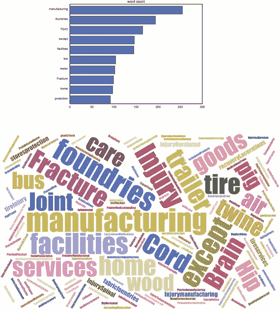

**图 14-4.** 该组织所有工伤事故的词云

> **注意**
>
> 请访问 [`http://ds.tips/waxU8`](http://ds.tips/waxU8) 查看如何创建此图表。

会议室里的一位利益相关者向数据科学团队提出了一个简单的问题：“为什么你们只关注工伤，而不关注导致工伤的设备？” 会议室里的每个人都能同情那些受伤的人。尽管如此，真正的价值在于努力预防未来的工伤。团队本应使用预测分析来判断工作是否过于危险。

这个数据科学团队一直专注于谁受了伤，这是一个需要讲述的艰难故事。然而，对现有员工来说，真正的商业价值在于预防未来的工伤。团队需要转向，去研究员工受伤时正在使用的设备，或者他们遵循的流程。这是一个全新的、需要探索的数据集。

如果团队没有采用冲刺工作模式，他们可能会花费数月甚至更长时间来完善和探索关于工伤的数据。他们会讲述有趣的故事，但可能不是利益相关者想听的那些。相反，在下一个冲刺中，团队专注于危险活动。他们基于之前的数据进行构建，讲述了一个关于危险设备和流程的全新故事。

数据科学团队探索数据时，与商业价值之间缺乏明确联系，这并不罕见。事实上，`Gartner Group` 估计，有 85% 的数据分析团队工作与商业价值脱节。⁵ 其中一部分原因是工作性质决定的。评估你所不了解的东西是困难的。另一部分原因则是要确保与利益相关者建立清晰的联系。你的研究负责人会与业务部门合作，将团队的洞察与真正的价值联系起来。

如前所述，采用冲刺工作模式使团队在发现有趣事物时能够快速调整方向。利益相关者可能不总是知道在哪里找到商业价值。相反，他们更可能告诉你哪些方向行不通。尽管如此，这个反馈循环对于让团队保持在正轨上至关重要。知道哪些路走不通，最终可能会引导你走上正确的道路。

数据科学团队应该从事有趣的工作。这是组织中能够积累真正洞察力的地方之一。然而，团队也无法免受典型的业务压力。如果你的数据科学团队不能产生真正的价值，那么用不了多久，利益相关者就会开始质疑他们的工作。

大多数数据科学团队的工作方式与组织内其他部门大相径庭。如果你不能很快开始显示出成本节约的效果，你可能撑不到真正做出改变的那一天。创造价值的最佳方式是在业务部门和你的数据科学团队之间建立紧密的反馈循环。利益相关者应该知道每个冲刺阶段团队在做什么，并且这些工作应该明确地与他们认为有价值的东西联系起来。

在每次故事讲述会上，试着讲述一个简单的故事，说明团队学到了什么，以及它将如何帮助组织的其他部门。这些会议对于保持团队高效工作并专注于有趣的工作至关重要。

### 本章小结

在本章中，你学习了如何通过设想在没有目标的情况下工作来改变公司的心态。你发现，对目标的执着可能会阻碍团队进行探索和发现。在第四部分，你将学习如何提出好的问题。要提出好的问题，你必须理解批判性思维，你将在第 [15](http://dx.doi.org/10.1007/978-1-4842-2295-9_15) 章中学习这一点。

### 脚注

1. ↑ Kenneth O. Stanley 和 Joel Lehman 著，《为什么伟大无法被计划》（Springer Science Business Media, 2015），第 978-3 页。

2. ↑ 引用自贝尔豪威尔公司总裁 Peter G. Peterson 在 1966 年 11 月 16-17 日于伊利诺伊州芝加哥举行的技术与世界贸易研讨会上的演讲，起始页 83，引用页 91，会议由美国商务部及国家标准与技术研究院、国家标准局出版物（HathiTrust）联合主办，美国政府印刷局，华盛顿特区 [`hdl.handle.net/2027/uc1.b4112688?urlappend=%3Bseq=103`](http://hdl.handle.net/2027/uc1.b4112688?urlappend=%3Bseq=103)

3. ↑ Daniel J. Simons 和 Christopher F. Chabris 著，“我们中间的猩猩：持续性动态事件非注意盲视”，《感知》第 28 卷，第 9 期（1999 年）：第 1059-1074 页。

4. ↑ Trafton Drew、Melissa L-H. Võ 和 Jeremy M. Wolfe 著，“隐形大猩猩再次出击：专家观察者中的持续性非注意盲视”，《心理科学》第 24 卷，第 9 期（2013 年）：第 1848-1853 页。

5. ↑ Ted Friedman 和 Kurt Schlegel 著，“数据与分析领导力：用可信数据赋能员工”，载于《Gartner 商业智能、分析与信息管理峰会》，澳大利亚悉尼，2016 年。

## 第四部分：提出好的问题

提出好的问题

乔纳斯·索尔克曾说过：“人们认为的发现时刻，实际上是对问题的发现。” 正如你在本书中学到的，数据科学最重要的部分之一就是发现好的问题。在本书的这一部分，你将了解如何做到这一点。要提出好的问题，你必须理解批判性思维（提出关键问题）。接下来，你将了解如何鼓励人们提出有趣的问题，以及在哪里寻找好问题。

### 15. 理解批判性思维

问题对于你的数据科学团队来说是强大且必不可少的。在本章中，你将了解如何驾驭问题的力量。然后，你会学到那些有趣的问题是批判性思维的一部分。你还将了解批判性推理，以及如何像淘金一样找到正确的问题。

#### 善用提问的力量

想象一下，你正在向一群同事做演示。你提出了一个提高公司销售额的策略——这花了你数周时间准备。演示进行到一半，有人打断你，问了一个关于你假设的问题："你是怎么得出这些结果的？" 你会如何回应这个问题？在一些组织里，这会被视为对抗和挑衅。通常，这类问题来自持怀疑态度的主管或持反对意见的人。无论如何，这都打破了演示的正常节奏。

在悉尼·芬克尔斯坦的著作《*为什么聪明的 executives 会失败：以及你能从他们的错误中学到什么*》中，他指出，许多高管对好消息照单全收，从不质疑。他们把提问留给了坏消息或当他们持反对意见时，这意味着大多数组织将提问视为一种反对。当没有人提问时，人们通常会重复同样的错误。他们容易陷入群体思维，并存在盲点。许多公开的失败都可以追溯到那些从未被提出的关键问题。

正如本书反复提到的，大多数组织仍然专注于完成任务。它们有使命宣言，鼓励团队驱动和交付成果，并使用明确界定的目标和激进的时间线工作。很难想象存在一个组织或会议，其中每个人都会提出有趣的问题。在许多组织中，根本没有时间去鼓励这种提问。然而，让你的数据科学团队超脱于这种现实之外至关重要。你的团队需要创造一个对有趣问题持开放态度的环境。你所在组织的其他部分可能生活在一个充满陈述的世界里，但你的团队需要适应一个充满不确定性、论点、问题和推理的世界。

仔细想想，数据科学已经为你提供了许多答案。你会有显示购买趋势的报告，以及数TB的显示产品评级的数据。你的团队需要利用这些答案来提出有趣的问题。创造一个人人都能自在地质疑彼此想法的氛围，是你的责任。

要让你的数据科学团队保持在正轨上，有几件事需要记住。

首先，如果你的数据科学团队是新组建的，那么这个团队很可能并不擅长提出正确的问题。那是因为他们缺乏足够的练习。大多数团队不问问题，是因为好问题会挑战你的思维，并且不容易被搪塞或忽视。它们会迫使团队去解开那些原本已经理解透彻的东西，这比被动聆听要费时费力得多。

回想一下上学时，你的老师很可能快速推进课程内容，因为他们期望你死记硬背事实并阅读专家建议。你举手提问时，很可能问的是相当简单的问题，可能是一些平淡无奇的问题，比如“这个考试会考吗？”没有人会问更大胆的问题，比如“我们为什么要学这门课？”甚至“我们可以学点别的吗？”

在工作中，你可能很少有机会提出有趣的问题。大多数公司仍然根据人们贯彻公司愿景的能力来提拔员工。你需要和同事和睦相处。总是不停地提问，并不是与人相处的上策。你需要为你的数据科学团队改变这种看法。

第二件要记住的事是：提出好问题确实很费劲。大多数人仍然更喜欢做简单的陈述。告诉世界你的想法很容易，但在一个能提出好问题的人面前为自己的想法辩护，就没那么容易了。例如，想想你为自己做的一件有益健康的事。也许是吃某些食物，或是做某些锻炼。现在问问自己，你是怎么知道这是健康的？是因为有人告诉你的，还是因为你自己的感觉？如果是因为有人告诉你的，你又如何知道那个人是正确的？许多专家对于什么是健康的意见不一。哪个专家才是对的？

不用多久你就会意识到，提问会让人筋疲力尽。解构你原本深信不疑的观点需要付出大量努力。现在想象一下在团队环境中这样做。

请记住，提出好问题很难，而且并不总是受欢迎。尽管如此，这对你的数据科学团队至关重要。最好的问题会让你对数据产生新的见解，这将帮助你构建组织知识。

##### 淘金之问

提出有趣的问题是批判性思维的关键组成部分。那么，让我们来问一个有趣的问题：什么是批判性思维？大多数人认为批判性思维是一种批评形式。你评判某件事，并判断它是好是坏、是对是错。那么，这是否意味着如果你不同意某人的观点，你就在运用批判性思维呢？大多数人会说不。

批判性思维不是你评判事物的能力。批判性思维中的“批判性”在于找出那些可能动摇观点根基的关键问题。它关乎你剖析构成公认信念的那些结论的能力。这无关你的判断——而关乎你发现本质问题的能力。

许多组织抱怨他们没有能运用批判性思维的人才。试图找出关键问题并非时时刻刻都能做到。这有点像跑步。大多数人能跑一点，经过一些锻炼后能跑得更多。即使是最好的运动员也无法每天都跑。

想想我们那个跑鞋网站的例子。假设公司发放了客户优惠券，并在年底举办了一场为期一天的促销活动。月底时，数据分析师运行了一份报告，显示销售额增长了10%，如图15-1所示。我们很容易得出这样的结论：更低的价格鼓励了更多人购买鞋子。更高的销售额弥补了折扣带来的损失，促销活动奏效了。更多人买了鞋，公司获得了更高的收入。许多团队会就此止步。

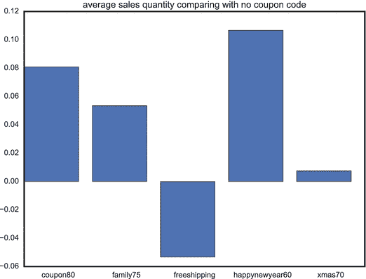

图15-1. 平均销售数量

按商品SKU和优惠券代码（包括无优惠券代码）透视平均销售数量，计算每种优惠券代码的平均销售数量减去无优惠券代码的平均销售数量，就能得出使用每种优惠券代码比不使用优惠券代码平均多卖了多少件。对于折扣最高的优惠券代码（60%），平均比不使用任何优惠券多卖出0.1件。查看如何创建此图表，请访问[`http://ds.tips/6acuV`](http://ds.tips/6acuV)。

这时，你的数据科学团队就应该运用他们的批判性思维了。记住，关键不在于判断好坏；而在于找出关键问题，例如：

- 我们怎么知道收入的增长与促销活动有关？也许不管有没有促销，同样数量的人本来也会买鞋。

- 什么样的数据能显示促销与销售之间存在强关联？

- 促销活动真的有效吗？

每个人都假设促销活动有效。这就是许多公司开展促销活动的原因。但这意味着它们对你的网站也有效吗？这些问题为研究主管开辟了一个全新的探索领域。当你只是简单地接受促销有效时，一切都很简单——它们有效，那么我们就做更多促销。

现在团队已经提出了他们的问题，是时候让研究主管转向另一个方向，提出更关键的问题了，例如：

- 我们如何证明这些促销活动有效？

- 我们应该只分析这次促销活动的收入吗？

- 客户购买的是打折商品吗？

- 是否仅仅是吸引了更多人访问网站的问题？

这种技巧通常被称为“淘金之问”。这源自早期的一种采矿技术，矿工们会在沙子中筛淘寻找金子。沙子就是你们团队提出的所有问题。研究主管与团队合作，找出值得探索的“金块级”问题。这并不容易，因为判断哪些问题是“金块”本身就是一种价值判断。由研究主管来决定这些问题是否有趣。

“淘金之问”的要义在于，尽管你会有大量无关紧要的问题，但那少数几个“金块”问题却能改变你组织的运作方式。每一块金子背后都会有大量的沙子。筛选如此大量的材料需要极大的耐心。

如果你是团队的研究主管，请试着专注于积极倾听每个人的问题。通常，他们的问题会是你自己问题的一个早期版本。不要害怕问大的“为什么”。促销有效这件事对每个人来说可能显而易见。但这并不意味着你应该忽略这个问题。如果你对答案不满意，你可能需要与数据分析师合作创建一些报告。

另外，一定要留意你自己的结论。记住，批判性思维就是要打破这些结论。确保你能够评估团队其他成员所说的话。

这可能是一项非常累人的工作。你不希望因为没花时间提问而被迫接受某个结论。如果你没能提出这些关键问题，请放心地重新安排会议时间。等大家精力更充沛时再聚到一起讨论。

### 聚焦推理

我们许多人都有根深蒂固的信念，这些信念引导我们，并帮助我们理解新事物。在数据科学团队中工作时，这些信念可能会深刻影响你和其他人看待同一份数据的方式。这就是为什么批判性思维的一个关键部分是理解这些信念背后的推理。你不仅要能够描述自己的信念，还需要描述这些信念背后的推理过程。

`推理`是支撑关于数据结论的证据、经验和价值观。在数据科学团队中工作时，理解彼此的推理至关重要。这将有助于团队提出引人深思的问题。

让我们看一个简单的陈述作为例子。“你应该多喝绿茶，因为它对健康有益。”这里的观点是你应该多喝绿茶。推理方式是它对健康有益。当你运用批判性思维时，你会想针对推理提出疑问。为什么它对健康有益？你怎么知道它对健康有益？它对所有人的健康都有益吗？如果你不运用批判性思维，你只会停留在观点层面。你只是接受了“你应该多喝绿茶”这个事实。

现在，让我们回到跑鞋网站的例子。想象设计团队正在研究他们从客户那里收到的一些反馈。网站上的许多图片描绘的是处于巅峰身体状态的跑步者。你的数据科学团队正试图确定改变这些图片是否会影响销量。

你的团队与网页设计师合作进行了一些实验。他们随机将健壮跑步者的图片替换为那些不太健壮、年龄较大的跑步者图片。团队与数据分析师合作创建报告，以查看图片更改后数据之间的差异。报告显示总体销量有所下降，如图15-2所示。

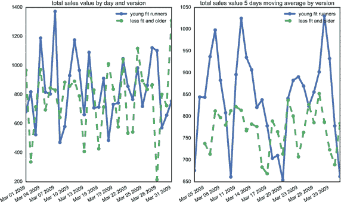

图15-2. 总体销量下降

查看时间序列，你会发现“不太健壮且年龄较大”版本的页面每日总销量略低。如果查看五天移动平均值，“不太健壮且年龄较大”版本在整个月内都更低。如何创建此图表，请参见`http://ds.tips/X3xex`。

现在团队需要讨论这些结果。你的项目经理认为销量下降是因为跑步者受到了图片的激励。他们不想看到反映自己现状的照片。相反，他们希望看到自己渴望成为的那种人的照片。销量下降让鞋子看起来效果不佳。它模糊了“如果你买了这双鞋，你就会变得更健康”这一信息。

数据分析师不同意这种看法，并认为销量下降是因为客户认为这些图片代表的是理想客户。结果，客户就假设这些鞋子是为刚开始跑步的人设计的。

要运用批判性思维，你必须审视每个陈述背后的推理。在这两个例子中，关键词是“因为”和“结果”。这些词暗示推理即将出现。

对于项目经理来说，推理是客户“受激励的不是他们现在的样子，而是他们想成为的样子”。对于数据分析师来说，推理是“客户假设该产品是为刚开始跑步的人设计的”。

现在你有了推理，就可以开始寻找关键问题。客户是否渴望看起来年轻健美？客户真的相信不太健壮的人意味着鞋子是给新跑者准备的吗？你认为谁的论点更有说服力？更重要的是，每个论点的弱点是什么？为什么不太健壮的跑步者会被认为是刚开始跑步的人？你可能会认为恰恰相反。一个年长的跑步者通常已经跑了好多年了。

项目经理的论点也有弱点。客户真的会相信买一双跑鞋就能让他们看起来更年轻吗？这是否意味着使用更年轻、更健壮的跑步者的图片会提高销量？

现在你有了推理和一些关键问题，就可以与研究负责人合作，寻找数据并确定最有趣的问题。购买特定鞋款的客户年龄中位数是多少？可以使用哪些策略来确定他们是否是新跑者？这些问题将帮助你获得关于客户动机的新见解。

`推理`可以是寻找关键问题的第一步。请记住，批判性思维有助于你的团队从其报告中获得更多价值。你可以帮助研究负责人决定什么是有趣的。这些有趣的问题将帮助你的团队获得最佳洞见。

## 检验你的推理

回想一下上一次你听到有人说他/她错了是什么时候。不是关于餐厅或电影的错误，而是关于他/她曾经深信不疑的某个观点。你能想到任何例子吗？如果你想不出来，也没关系。看到有人改变想法，这种情况确实非常罕见。在某些组织中，这会被视为立场摇摆或领导力不佳，总之不是你经常能看到的事。

一位名叫理查德·穆勒的加州大学物理学家，多年来一直在反驳全球气候变化的理论。他协助创立了“伯克利地球”组织。他的许多研究都得到了石油和天然气行业的资助。后来，他自己进行的研究发现了全球气温上升的非常有力的证据。他得出结论：自己错了。人类应该为气候变化负责。穆勒意识到，反对他的事实过于强有力，不容忽视，于是他改变了自己的想法。他并非悄无声息地改变。他在《纽约时报》上发表了一篇长篇署名评论文章 ²，概述了他最初的论点，以及为什么反方论点更为有力。

请记住，质疑他人的想法很容易。困难的是质疑自己的想法。请从两个角度来思考批判性思维：

*   **强势批判性思维**：当你对自己的信念提出批判性问题时。
*   **弱势批判性思维**：当你只寻找批判性问题来攻击他人的信念时。

你可能认识更多采用弱势批判性思维的人。他们对于自己所相信的事情有深思熟虑的论点，并且永远不会质疑自己的信念。如果你提出问题，他们会尽力捍卫自己的立场。但他们不会基于你的问题进一步构建，也不会自己提出新的问题。在你的数据科学团队中，你应该应用强势批判性思维。团队中的每个人都应该质疑自己的想法，提出有趣的问题，并探索自己论点中的薄弱环节。这就是你应该在数据科学团队中应用批判性思维的方式。

试着想象一下这在你的数据科学团队中会是怎样的情景。假设一家跑鞋网站举办了一次促销活动，向每位购买产品的顾客发送了一张优惠券。数据科学团队查看了使用优惠券进行购买的人数。数据显示，8% 的顾客查看了优惠券。在这 8% 的顾客中，大约 5% 的人在优惠券过期前使用了它。数据还显示，在向顾客发送优惠券的当天，收入出现了跃升。见`图 15-3`。

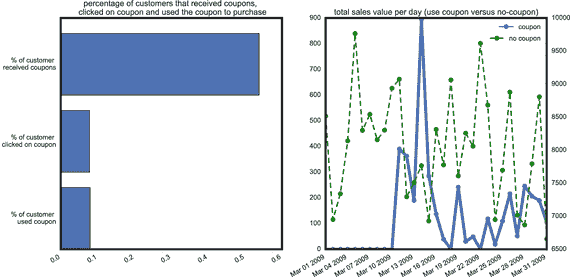

**图 15-3. 使用优惠券进行购买的人数**

左侧的图表显示大约 50% 的顾客收到了优惠券。第二个条形图显示，其中只有 8% 的顾客实际点击了优惠券。这些人中只有 5% 使用了优惠券。右侧的图表显示，在向顾客发送优惠券的当天，销售额出现了飙升。优惠券确实影响了“无优惠券”的销售额，但如果你比较实际数字，由于实际点击并使用优惠券的人并不多，优惠券销售额仅占总销售额的 10%。了解如何创建这些图表，请访问`http://ds.tips/pre6E`。

你的数据科学团队想知道这次促销活动带来了多少收入。那么让我们应用一些强势批判性思维。你可以认为，网站获得的所有新增收入都是这次促销活动的直接结果。

那么这个论点的薄弱环节在哪里？也许一些收到优惠券的顾客最终购买了促销活动之外的产品。他们是否应该被计算在内？也许你应该只计算那些实际使用了优惠券的人。此方法的问题在于，你没有看到促销活动的全部影响。也许，发送一封电子邮件询问顾客为什么有一段时间没有购物，效果会一样好。这可能是一个有趣的实验。

你的数据科学团队应该能够质疑所有这些想法。团队中的某个人可能强烈认为任何新增收入都是促销活动的结果。同一个人也应该理解该方法的弱点，并能够提出有趣的问题，例如：“如果我们用这种方式查看数据，我们是否完全理解了顾客？” 也许，顾客只是需要被提醒一下你的网站。如果你只关注那些实际使用了优惠券的顾客，就更容易将他们分成两组：一组是受到省钱激励的顾客，另一组是仅仅需要提醒的顾客。

当你的团队应用强势批判性思维时，它应该更像是一次开放式的讨论。没有人应该感觉自己像是在为自己辩护。这种方法是你团队提出有趣问题，并最终获得更深入见解的绝佳途径。

### 本章小结

在本章中，你学习了如何利用问题的力量，以及那些有趣的问题正是批判性思维的一部分。你还了解了什么是批判性思维，以及如何淘金千里来找出那些伟大的问题。最后，你探索了如何在提问时运用推理并检验你的推理。在第 16 章中，你将学习如何鼓励人们提问。

**脚注**

1.  西德尼·芬克尔斯坦，《聪明高管为何会失败：以及你能从他们的错误中学到什么》。企鹅出版社，2004 年。
2.  理查德·A·穆勒，“一个气候变化怀疑论者的转变”，《观点专栏》，《纽约时报》，2016 年 1 月 2 日，`http://www.nytimes.com/2012/07/30/opinion/the-conversion-of-a-climate-change-skeptic.html?_r=0`。

## 16. 鼓励提问

在本章中，你将学习鼓励提问的各种方法。你会了解如何主持提问会议。接着，你将探索不同类型的问题，以及如何使用`question board`和`question trees`有效地展示和组织这些问题。最后，你将学习如何发现新的问题，我们将在第 17 章中进一步详细讨论。

### 主持提问会议

提问与学习，是数据科学团队与仅仅观察数据的团队之间的关键区别。请记住，数据科学的核心在于运用科学方法获取洞见。提出好问题，正是这种科学方法的核心。

正如我们在本书中反复讨论的，组织通常将提问视为一种评判，而非学习的方式。作为数据科学团队的领导者，你需要确保你的团队能够提出好问题。做到这一点的最佳方法之一，就是建立一个良好的思想交流环境。

研究主管是负责引导提问的领导者，要确保团队能提出好问题。研究主管还应专注于学习，而非评判。团队中的每个人都应努力做到深度倾听，这是一种更专注地倾听彼此想法的方式，并且能够在不感到被评判的情况下，对这些想法提出异议。

建立这种环境的一个好方法是举办提问会议。在这些会议中，鼓励参与者在发表陈述之前先提问。这有时被称为“提问优先”方法。这些会议的目标是产生尽可能多的问题。会议的重点是让每个人提出问题并倾听。如果你是研究主管，请劝阻任何人不要携带智能手机或笔记本电脑。你希望每个人都专注于倾听。

我曾在一家刚刚开始涉足数据科学的组织工作。当时团队开会，预测有多少人会参加一项医学研究。数据分析师展示了他们过去研究的图表，并表示可以创建一个数据模型来预测谁可能会参与。会议出现了一阵短暂的沉默，然后就结束了。一周后，团队再次聚首。数据分析师提交了一份报告，显示历史数据表明每项研究可能会有一定数量的参与者。

现在，想象一下，如果这次会议是以关注好问题的方式进行的。如果你是研究主管，你可以这样开始会议：“大家都知道我们为什么要开这个会吗？”然后等待回应。一个好的提问领导者不怕短暂的沉默。不要试图自己回答自己的问题。给在座的每个人留出思考答案的时间。

一旦你确信每个人都理解了会议的目的，就提出挑战。你可以这样总结挑战来开场：“我们浪费了很多钱，因为我们不知道谁会来参加我们的医学研究。” 把解决方案留给团队的其他成员。你也可以用一个非常开放的问题来引导，比如：“我们需要更好地预测谁可能会来。” 然后坐下，看看是否有人开始提问。如果几分钟后没人说话，你可以问：“大家都明白为什么这是个挑战吗？”

你希望从团队那里得到的，是类似“是不是有些研究的报名人数会比其他的更多？”这样的问题。这类问题能让你的数据分析师为报告提供更完整、更有趣的数据。

你要避免的是那些会迅速终止对话的简短陈述，例如：“我们应该做研究，看看竞争对手是如何填满他们的医学研究名额的。” 这会让人们无法提出他们最好的想法。记住，正是讨论才为你的团队带来了最大的价值。你希望团队在探索数据时感到自在。

如果你是研究主管，如果团队难以提出高质量的问题，不要太气馁。大多数组织仍然认为，最好是一群“知道事情”的人（或者至少说话听起来像是知道）。他们喜欢用清晰陈述说话的团队。这种“明确性”仍然被认为比“不知道”更有价值。可能要开好几次会议，人们才能自在地提出好问题。在举办了几次提问会议之后，你可能会发现，那些敢于提出尖锐问题的小组，往往能获得更深刻的洞见。

### 识别问题类型

如果你主持了一场有效的提问会议，你很可能会得到许多好问题。这很好。请记住，你希望你的团队像“淘金”一样，筛选过几十个问题后，才找到几个他们想深入探索的问题。就像早期淘金的矿工一样，你要能够从沙子里筛出金子。你需要知道如何区分好问题与那些可以暂时搁置的问题。

做到这一点的一个好方法是考虑不同类型的问题。每种类型都有其优点和挑战。如果你是研究主管，你可以帮助团队识别哪种类型的问题能引出最有趣的洞见。最常见的两种问题类型是开放式问题和封闭式问题。这两类问题又都可以是本质性问题或非本质性问题。有些问题类型比其他类型更容易区分。

# 问题类型与组织方法

你能识别的第一种类型是开放式问题。开放式问题没有固定的答案。想想那个跑鞋网站。你的数据科学团队可以提出一个开放式问题，比如：“谁是我们理想的客户？”开放式问题通常需要更多的讨论。这类问题能让你试图弄清楚彼此的推理过程。例如，团队中可能有人说，理想的客户是购买大量跑鞋的人。另一个人可能会质疑这个推理，提出理想的客户是鼓励其他人购买跑鞋的人，或者是一位博主，或者是一位创办了跑步俱乐部的跑者。

开放式问题通常没有唯一答案。相反，它是用来辩论的。谁的推理最有说服力，通常就能解决这个问题。你的数据科学团队需要寻找关于谁是理想客户的最强论点，然后数据分析师将尝试用数据来支持这个论点。

## 封闭式问题

封闭式问题则通常更具终结性。封闭式问题可能是这样的：“我们跑者的平均年龄是多少？”这类问题通常也会有一些讨论。你的团队可能需要考虑使用平均年龄还是年龄中位数的优势。他们还可能质疑这些信息的价值。从这个问题你还能衍生出哪些其他问题？

如果你是研究主管，要确保团队没有提出太多单一类型的问题。问太多的开放式问题会让每个人都花太多时间在提问上，而没有足够的时间去梳理数据。问太多的封闭式问题则会导致团队花费太多时间在细小的、容易证明的问题上，而忽略了全局。

## 本质性与非本质性问题

一旦你确定了问题是开放式还是封闭式，接下来要弄清楚它是不是一个本质性问题。本质性问题旨在激发团队的深入讨论。这类问题在大多数组织中通常很难提出。它们可以是简单的问题，比如：“人们为什么从我们这里购买跑鞋？”也可以是更复杂的问题，比如：“人们为什么跑步？”

本质性问题通常是开放式的，需要进行辩论。不应该只有一个正确答案。你也可以有封闭式的本质性问题。团队可能会问：“我们是不是应该停止印刷产品目录，只通过网站销售跑鞋？”封闭式的本质性问题比较少见。

你可能已经猜到了，还有许多不同类型的非本质性问题。非本质性问题并非坏事。在你开始提出本质性问题之前，你可能需要先经历许多非本质性问题。一个好的策略是，先提出许多封闭的、非本质性的问题，以此来积累想法，然后再提出更宏大的本质性问题。

假设你想了解人们为什么跑步。你的科研团队可能希望用第一个冲刺阶段来排除非必要问题。我们的客户是否属于跑步俱乐部？大多数客户是长期跑者还是刚刚起步？他们家中是否还有其他跑步的人？这些问题可能有助于你构建一个关于客户为何喜欢跑步的案例。如果你的团队对人们喜欢跑步的原因有扎实的推理，这将帮助你营销产品以满足这些需求。

如果你是团队的研究负责人，请密切关注这些不同类型的问题。它们将帮助你引导讨论，并梳理出最具价值的问题。如果你了解这些不同类型，就更有可能找到能带来最佳洞见的金矿。

## 组织你的问题

如果你是侦探剧的爱好者，你可能见过“案情墙”——侦探在试图拼凑未解之谜的各个碎片时使用它。他或她会把照片和笔记贴在墙上，并尝试连接不同的碎片。这块板子就变成了一个视觉故事。这就是为什么你经常看到侦探坐在地板上盯着板子，试图从数据中的所有小谜题中拼凑出完整的故事。

你的数据科学团队也将面临类似的挑战。他们试图讲述一个故事，但手中只有零散的拼图。你的团队可以使用相同的技巧来创建一块“问题板”——一个让他们可以看到所有问题和数据的地方。这样他们就能讲述一个更宏大的故事。

正如第 13 章所述，创建问题板是展示想法并向团队及整个组织征集问题的绝佳方式。在板的顶部，你应该放置一个简单的标识，例如“问题板”或“提问”。问题板是一种清晰的方式，可以将问题集中沟通并组织起来。

你的数据科学团队应该拥有几十甚至几百个不同的问题。问题板很可能是团队的关键会议点，也是团队成员和利益相关者讨论项目的绝佳场所。

开始时，请将你的问题板放在团队成员办公桌旁或走廊里。开放空间不适合放置问题板。你需要人们站在板子旁边阅读问题。另一个建议是将板子放在人流量大的区域附近。理想地点是饮水机、零食吧或洗手间旁边。它应该是一个能让几位团队成员会面且不打扰他人的地方。

通常，组织问题板的最佳方式是使用不同颜色的便利贴。你需要从上到下组织你的板子。板子顶部的便利贴包含你的核心问题。使用红色或粉色的便利贴来记录这些问题。在它们下方，你可以使用黄色便利贴来记录非核心问题。请记住，这些是涉及较小问题的问题。它们通常是带有正确答案的封闭式问题。最后，你可以使用白色或紫色的便利贴来记录结果。这些是团队发现的、可能有助于解答问题的小数据点。

拥有问题板有五大好处：

- 它为团队提供了一个共享空间，以促进小组讨论。
- 它展示了问题之间是如何相互关联的。
- 它帮助你按类型组织问题。
- 它帮助你讲述故事。问题板显示了团队可能正在努力解决的那些更大的问题。
- 它为组织中的其他人提供了一个参与的地方。你希望团队之外的人能够添加他们自己的问题，并看到你们的进展。

请记住，你希望团队进行深入的讨论。每个人都应该能够质疑彼此的理由。团队应该倾听彼此的问题，并尝试提出自己的问题。他们应该专注于学习，而不是评判自己问题的好坏。

问题板有助于此，因为它为人们提供了一个聚焦讨论的场所。它还能帮助团队站起来，亲身参与，并产生新的想法。

你的许多问题将是相互关联的。通常，你会遇到一些核心问题，它们与几个封闭的、非核心的问题相关联。如果这些问题在物理墙上，你可以用绳子来显示这些联系。如果在白板上，你可以直接画不同颜色的线条。这将帮助你的团队保持组织性，甚至能让他们优先处理最高价值的问题。

正如第 13 章中讨论的，问题板将邀请团队之外的其他人员参与。你可能需要在板子旁边留一沓绿色的便利贴。再留下一支记号笔和一张小纸条，邀请其他人添加他们自己的问题。有时，这些来自团队外部的问题能讲述出最有趣的故事。

### 创建问题树

你的问题板将是传达数据科学故事的关键部分。它应包含团队正在努力解决的问题，也可能包含一些能提示答案的小数据片段。一个好的问题板能鼓励组织中的其他成员参与进来，吸引大家成为你们共同故事的一部分。

问题板面临的挑战之一是如何保持条理清晰。由于它是为小组讨论而设计的，你希望每个人都能共享相同的信息。它不应该包含多个由个人笔记组成的不同分组。如果每个分组只有一个人的想法，那么只有那个人才能理解其含义。

相反，所有的问题都应该使用同一套系统来组织。最好的方法之一是创建问题树。问题树是一组与一个核心问题相关的便利贴。你需要用最引人注目的颜色来书写核心问题，通常是用红色或粉色。

让我们为跑鞋网站设想一个问题板。你的团队提出的一个问题是：“我们的网站能否帮助鼓励非跑步者成为跑步者？”如果你是团队的研究负责人，你希望把这个核心问题写在红色便利贴上，并贴在板子的最顶端。

在这个核心问题下方，你可以开始添加其他问题。它可以是另一个核心问题，比如“是什么促使人们跑步？”也可以是非核心问题，比如“非跑步者会在我们网站上购物吗？”由于这是一个封闭式问题，你可以在黄色问题便利贴旁边贴一张数据小贴纸。内容可能是：“数据显示，我们 65%的顾客在一周内不跑步。”你可以使用如图 16-1 所示的饼图来说明这一点。

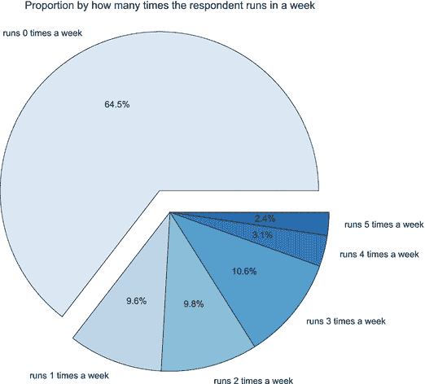

图 16-1. 饼图显示了受访者每周跑步的次数

假设这些生成的数据来自公司对其客户进行的一项调查。调查的问题是：“您平均每周跑步多少次？”查看数据时，你会发现大约 65%的受访者根本不跑步，而 55%的受访者每周跑步一次或更多。查看如何创建此图表，请访问`http://ds.tips/S3eve`。

看到问题树的人应该能够理解团队的思考过程。她应该看到，较低层级的问题分支始于一个开放式的核心问题（“我们的网站能否帮助鼓励非跑步者成为跑步者？”），并看到团队正在解决这个问题。她应该能够顺着思路一直看到不同的分支。

假设“是什么促使人们跑步？”这个问题向自己的方向延伸。在这个问题下面是另一个问题：“他们跑步是为了缓解压力吗？”再往下是另一个问题：“那些有压力的非跑步者能看到跑步的好处吗？”

有了问题树，研究负责人现在就有了一份报告，可以向组织其他成员展示进展。她可以表明数据科学团队正在同时研究几个高价值的问题。不难看出，深入了解如何创造客户可能会增加收入。

问题树帮助研究负责人将团队的工作与实际的商业价值联系起来。一个问题板应该包含几个问题树。在板子的最顶端，应该有几个红色或粉色的核心问题。每个问题都应该像倒置的树一样向下分支成若干其他问题。请务必如前所述使用不同颜色的便利贴（核心问题用红色或粉色，非核心问题用黄色）。有时，开放性问题会分支到不同的问题树上，而封闭式问题则应该用显示数据的小便利贴来结束。

就像任何树木一样，你需要修剪你的问题。这是研究负责人的关键职责之一。她需要确保你的问题能带来实际的商业价值。如果她认为你的问题无法带来洞见，她可能会将它们从问题板上移除，以免数据分析师开始盲目寻找结果。

> **注意**
>
> 研究负责人通常会在团队的问题会议中移除问题。你不希望研究负责人在没有与团队沟通变更的情况下，就把问题从板上移除。

问题树的关键点之一在于，它实际上反映了大多数团队提出新问题的方式。请记住，数据科学是运用科学方法探索数据，这意味着你大部分的数据科学工作将是经验性的。你的团队会提出一些问题，收集数据，然后通过提出一系列问题来对数据做出反应。当你使用问题树时，它反映了团队所学到的东西。同时，它也向组织其他成员展示了你的进展。

### 寻找新问题

有两种方法可以帮助你的团队找到更好的问题。一种是组织中的某人在你的问题板上发布好问题，这些是你的“馈赠问题”。另一种是通过在与数据科学团队的定期会议中努力寻找好问题。

发布在你板子上的馈赠问题很大程度上取决于你的组织。有些组织更倾向于协作，有的则管控更严。如果你的组织更加开放，你可能会被大量问题淹没，需要优先安排讨论。如果组织较为封闭，你可能会连续几周都看不到任何输入。

无论哪种情况，填满问题板的最佳方法就是让它看起来更有吸引力。一个好方法是制作一个简单的标志来征集问题，例如“请为我们的数据科学团队提出任何问题”。另一种方法是将问题板整合到有趣的演示中。

假设有人提出了一个问题：“什么造就了一双完美的跑鞋？”这是一个开放式的核心问题。如果你是研究负责人，你可能希望把这个问题抄写到红色便利贴上，然后把它放在问题树的顶端。在下次演示时，让团队讨论一些有趣的馈赠问题，并讲述一个关于数据所揭示内容的故事。他们想讲述一个关于完美跑鞋的故事。他们可能会谈论颜色、质量和款式的组合，并用简单的数据可视化来支持这些数据。接下来，让公司其他人知道这个好故事从何而来：一个发布在板子上的有趣馈赠问题。这种认可会鼓励其他人参与进来。组织中大多数人都一直在寻找更好的参与方式。如果你能展示出他们的问题很重要，那么填满你的问题板就会容易得多。

来自团队外部的问题是获得洞见的绝佳途径。这些问题通常简单明了，但这往往使它们非常难以讨论。这些简单的问题常常最能挑战我们的假设。正因如此，这些馈赠问题能极大地帮助你的团队专注于商业价值。

不幸的是，你们大多数问题都不是馈赠得来的。相反，它们是与数据科学团队其他成员进行艰难讨论的结果。这些问题来之不易，也难以创造。

如果你是团队的研究负责人，请尽力利用好你的馈赠问题。同时，也要与团队其他成员共同努力，在第 17 章你将看到的六个关键领域中寻找问题。你们拥有的问题越多，团队就越有可能找到关键洞见，并将其与实际的商业价值联系起来。

## 总结

在本章中，你学习了鼓励提问的各种方式以及如何主持提问会议。接着，你了解了不同类型的问题，以及如何利用问题板和问题树来有效展示和组织这些问题。最后，你简要学习了如何发现新问题，这部分内容将在第 17 章中更详细地介绍。

# 17. 寻找问题的方向

让团队提出高质量的问题，往往并非仅仅营造一个合适的环境那么简单。即使是技能娴熟的数据科学团队，通常也需要更多引导。当你与团队会面时，应将提问重点聚焦在六个关键领域。虽然这些领域并非唯一能挖掘出好问题的地方，但它们通常是很好的起点。这些问题主要涉及以下方面：

- 澄清关键术语

- 根除潜在假设

- 发现错误

- 探寻其他原因

- 揭露误导性统计数据

- 强调数据缺失

这六个领域各自具有独特的提问风格。你提出的用于根除假设的问题，与那些针对误导性统计数据的问题大相径庭。每个领域都会引导团队走上不同的探索路径，后续各节将对它们进行更详细的讨论。

这六个领域旨在作为指导。并非你所有的问题都会涵盖这六个方面。相反，你可以这样理解：如果你讨论了这六个领域，那么你一定会至少提出几个问题。这些问题将成为驱动数据科学团队前进的动力。在每个冲刺周期中，你的团队都会致力于处理问题板上的问题，或是对其重新确定优先级。

### 澄清关键术语

乔治·卡林曾开玩笑说，他把一美元放进零钱兑换机，结果什么也没变¹。这不禁让人好奇，他期望的是哪种“变化”。你永远不会知道答案，因为他使用的词语有多重含义。不幸的是，英语中许多词语都是如此。我们使用词语的语境对其含义有很大影响。这就是为什么审视关键词汇和短语是收集有趣问题的最佳方法之一。

数据科学讨论应运用批判性思维。你需要仔细审视彼此的推理，然后对推理提出质疑，以便更好地理解每个人的想法。做到这一点最好的方法之一，就是质疑关键术语和短语。

那么，让我们回到跑鞋网站的例子。假设数据科学团队中有人提出了一个有趣的问题：“人们经常跑步是因为跑步能让他们更快乐吗？”这是一个开放式的本质性问题，意味着它可能没有非此即彼的答案。相反，团队必须提出强有力的论据，并由数据支撑。

数据科学团队应该质疑哪些关键术语和短语呢？想想那些可能存在歧义或有多重含义的词语。这些词语通常是抽象的，并且需要一定程度的解读。在这个例子中，有几个词值得探讨：“经常”和“更快乐”。

想想“经常”这个词。它对你意味着什么？其含义通常因人而异。例如，我妻子喜欢去餐馆。我们尽量每周至少去一次。如果你问我，我会说我们经常去餐馆。如果你问她，她会说我们从来不去餐馆。

你的数据科学团队应该提出问题，以澄清“经常”这个词的含义。你可能想提出一个封闭式问题，比如“我们的平均客户每周跑多少次步？”，然后将这个问题挂在你问题树上先前那个问题的下方。

你还应该探讨“更快乐”这个词。“更快乐”对你来说意味着什么？你的客户跑步是因为他们喜欢跑步吗？也许他们实际上喜欢的是跑完步的感觉，当他们跑完步回到家时最快乐。也许他们不喜欢跑步，但这是他们知道如何缓解压力的唯一方式。从某种意义上说，他们因为跑步而变得更快乐。

这是你可以提出进一步问题的另一个领域。你可以提出一个宽泛的本质性问题，比如“什么能让我们的客户快乐？”。你也可以尝试将“快乐”分解成不同部分。或许可以问这样一个问题：“我们的客户跑步是因为他们觉得不得不跑吗？”你甚至可以进行更具体的提问，比如“我们的客户在跑完步时最快乐吗？”

现在你看到了，针对关键短语和词语的提问如何能迅速产生更多问题。请记住，当你的团队进行提问会议时，研究负责人的职责就是“沙里淘金”。你的数据科学团队提出这些问题，并不意味着他们有义务一定要得出最终成果。研究负责人会倾听这些问题，并从中挑出那些听起来最有趣的“金块”。

围绕这一个问题（人们经常跑步是因为跑步能让他们更快乐吗？），你现在又有了五六个可能更有趣的问题。你的团队正在提出那些可能与商业价值相关的、开放式的本质性问题。

想想那个开放式的本质性问题：“什么能让我们的客户快乐？”这个问题看似简单，几乎微不足道，但如果你的数据科学团队能够获得一些洞见，它就会转化为真正的商业价值。这些洞见就是你的数据科学团队将要交付的“金块”。然而，许多数据科学团队并不去探究这类问题，因为他们觉得这些“关键术语”是显而易见的。请记住，对你显而易见的事情，对其他人未必如此。所以，花时间去问这些问题吧，这样你就能让数据科学团队更高效、更具洞察力。

### 挖掘隐含假设

寻找好问题的另一种方法是寻找隐藏的假设。人们无时无刻不在做出隐藏的假设，这本身并无过错。事实上，你需要这些假设来提高效率。例如，你假定同事工作表现良好；通常，人们也假定你所说的是实话。你总不希望每做一件事都要反复揣测。

你需要警惕的是那些可能导致盲点的假设。这些假设会阻碍你探索有趣的问题，并让你的团队陷入群体思维。这一点在你的数据科学团队中尤为突出，因此，挖掘潜在假设是获取新问题的最佳途径之一。

一般来说，假设具有以下四个特征：

- 它们常常是隐藏的或未被明确表述的。很少有人会以“如果我们假定这是真的……”来开启对话。

- 它们通常被视为理所当然或“常识”。

- 它们对决定你的推理或结论至关重要。你的推理甚至可能完全依赖于这些假设。

- 它们可能具有欺骗性。通常，有缺陷的推理会被某个“常识”假设所掩盖，例如：“糖对身体不好，所以人工甜味剂一定对你有益。”

我曾经为一个组织工作，该组织在分析客户服务数据时发现，有很大比例的电话是客户打来订购产品的。由于维护呼叫中心成本高昂，数据科学团队的任务是设法改变这种行为，希望鼓励客户使用网站或移动应用。

研究负责人首先提出了一些有趣的问题：为什么人们要打电话？我们能做些什么让客户更容易使用网站？如何让更多客户使用我们的移动应用？为什么客户更喜欢与人交谈？

其中一些问题背后潜藏着假设。研究负责人假设人们打电话是因为他们不喜欢网站，而且客户没有安装移动应用。这个推理可能正确，也可能错误。关键在于不要先入为主地认为它是正确的。如果团队不假思索地接受这个推理，就可能错失发现关键洞见的机会。在这个案例中，大多数打电话的人是正在工地工作的专业人士，他们无法使用智能手机或访问网页。

团队可能发现假设的另一个领域，是在尝试预测未来行为时。假设我们的跑鞋网站想利用预测分析来确定哪些鞋最畅销。他们可能发现，过去色彩鲜艳的鞋子销量不错。于是，他们创建了一个模型，预测色彩鲜艳的鞋子会更成功，如图 17-1 所示。

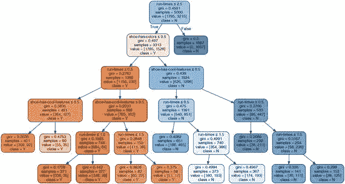

**图 17-1.** 客户如何决定购买哪双鞋

你创建的调查包含以下变量：

1.  每周跑步多少次？

2.  鞋子是否有炫酷功能？

3.  鞋子是否有多种颜色？

4.  受访者是否购买了该鞋子？

第四个特征被用作决策树预测的因变量。了解如何创建此图表，请访问 [`http://ds.tips/fuJE3`](http://ds.tips/fuJE3)。

处理这种假设的一个好方法是先尝试识别推理过程。在这里，推理是：色彩鲜艳的跑鞋过去卖得很好。一旦你掌握了这个推理，就可以开始思考背后的假设。

其中一个假设是，跑鞋之所以成功是因为颜色鲜艳。请记住，相关性并不一定意味着因果关系。也许优质制造商一直在努力让鞋子更鲜艳，这意味着跑步者购买的是恰好颜色鲜艳的高品质跑鞋。只需提出几个审慎的问题，就能凸显出这些假设中的一部分。例如一个简单的问题：“顾客购买跑鞋是因为颜色鲜艳，还是出于其他原因？”

要记住，假设本身并无好坏之分。发现它们是对是错，也并非坏事，甚至无关紧要。关键是要专注于识别它们出现在何处。一个被当作事实接受的假设，可能会引发一连串有缺陷的推理。同时也要注意，假设并不总是一个需要纠正的错误，它更像是一条值得探索的路径。

假设带来的主要挑战在于，如果你不把它们暴露出来，它们往往会不断累积。不知不觉中，你的团队就可能基于一堆站不住脚的假设开展工作。一旦发生这种情况，就很难做出有趣的发现了。

## 发现错误

数据中的错误未必是会造成最大麻烦的那一类。在数据科学团队中，更大的问题在于团队推理中的错误。数据错误可能只是一次挫折，或导致产生一系列虚假报告。而推理错误则可能将整个团队引向完全不同的方向。团队可能会花费数周甚至数月的时间在错误的地方寻找问题，从而阻碍大家提出有价值的疑问。

你已了解，收集好问题就像淘金。在找到有趣的问题之前，你可能会经历好几个糟糕的问题。有些关键措辞和表述需要厘清。同时，也存在一些假设，它们可能将错误的推理与看似正确的结论捆绑在一起。一旦你剥离这些假设并澄清表述，留下的就应是纯粹的推理。从很多方面来看，你实际上是在提出一个更难的问题：“这个推理正确吗？”

总的来说，在质疑他人的推理时，你需要警惕七种危险情况：

1.  **人身攻击**：在数据科学团队中，如果有人声称“你不懂这些数据”，就属于这种情况。这话可能没错，但这并不是建设性地驳回他人问题的方式。
2.  **问题驳回**：你不应因为一个有趣的问题可能引出令人不安的疑问而将其驳回。你不希望数据科学团队说出诸如“提出这个问题会涉及什么组织政治？”这样的话。
3.  **快速共识**：有时也称为“诉诸大众”的推理。它与群体思维密切相关，其错误依据是：如果大家都迅速同意，那么他们一定是对的。
4.  **依赖可疑权威的推理**：你有时会看到这种经典说法：“我在网上看到这张图表，所以它肯定是对的。”
5.  **循环推理（或偷换概念）**：有时会在数据科学团队中见到。你会听到类似“我们是一家数据驱动的公司，所以我们的数据必须是正确的”这样的话。
6.  **稻草人推理**：这是指故意歪曲他人的理由，以此来衬托自己的理由正确。这种情况通常可以通过某人点名批评他人来识别。比如：“如果你接受比尔的论点，认为数据很糟糕，那我们就得从头开始。”
7.  **虚假两难**：这有时会对好问题产生寒蝉效应。它基于“只有两种可能结果”的思维。你可能会听到类似“如果数据是对的，那就意味着我们都是错的”这样的话。

将这七种危险视为指南，以保持你的提问会议富有成效。每一种情况都可能导致团队推理软弱、问题浅薄。

我曾与一个数据科学团队合作，为州教育部开发一个测试应用程序。他们想看看是否能用预测分析来确定哪些学生需要额外帮助。团队拥有海量的测试数据，但在构建有效模型时遇到了困难。

在提问会议上，一名团队成员问道：“这些测试能否很好地评估学生掌握的知识？”另一个人回应说：“这是州立标准，而且我们又不是教育工作者，所以我们应该接受数据是正确的。再说了，如果数据不正确，你就没法使用任何数据了。”

这些言论迅速扼杀了讨论。如果团队当时能深入探讨这些问题，效果会好得多。然而，他们依赖于危险的推理：州立标准可能来自可疑的权威。人身攻击则假设在座无人具备提问的足够知识。最后，还存在一个虚假两难：数据要么全好，要么全坏。

在团队的提问会议上要警惕这些危险。拥有所有答案并不重要。重要的是识别出软弱的推理。你不希望软弱的推理取代有趣的问题。

## 质疑证据

正如我们在本书中反复提到的，寻找有趣问题的最佳方法之一就是寻找假设。我们还探讨了错误推理的危险。当你在寻找好问题时，推理错误可能会产生寒蝉效应。一旦发现推理错误，数据科学团队就可以考虑对那些可能被视为理所当然的事实提出批判性问题。

许多组织在日常工作中依赖广为接受的事实。当你与数据科学团队合作时，这些事实会作为背景存在。关键在于，在提出有趣问题时，确保这些事实并非不可触碰。事实上，你的数据科学团队可能是组织中少数几个对质疑既定事实感兴趣的群体之一。

在数据科学团队中，每当你遇到一个事实，都应该从三个问题开始：

*   我们应该相信它吗？
*   是否有证据支持它？*证据*是你可以用来证明某个更大事实的、已确立的数据。如果有证据，你应该提出第三个问题。
*   证据的质量如何？它是否支持这些事实？

你不应将证据视为证明或反驳事实的工具。相反，应尝试将其视为强证据或弱证据。有强证据表明吃太多糖对健康有害。有弱证据表明蜂蜜比糖更健康。当你审视证据时，你所做的只是判断你是否可以依赖这些事实。在这个具体案例中，你可能想减少糖的摄入，但不想用蜂蜜来替代装糖的罐子。

在数据科学团队工作时，你会看到各种既定事实。每个事实可能都有不同的证据来源，这些来源都能引出有趣的问题。一些最常见的证据类型包括直觉、个人经验、案例、专家意见、类比，甚至研究报告。

当你看到某个事实得到证据支持时，不要将其视为停止的标志。相反，应将其视为一条久未探索、布满灰尘的走廊。那里可能藏着能支持你既定事实的新东西。你也可能会发现根本没有证据，这个事实只是一个未经检验的假设。

我曾为一家公司工作，其数据科学团队正在处理一组信用卡交易数据。该公司将信用卡数据视为向银行客户提供促销活动的一种途径。他们对客户的信用卡消费了解得越多，就越能精准地投放促销活动。

数据科学团队与业务部门的某位同事合作，试图改进模型。团队开始针对某个特定品牌的信用卡进行一项新促销实验。业务部门的利益相关者说，他们不应该用那种特定类型的信用卡进行实验，因为大多数使用该信用卡的客户只将其用于大额消费。数据科学团队问这个人是怎么知道这个事实的。这位利益相关者说她“干这行已经好多年了”，这是她的直觉。

会议结束后，数据科学团队决定测试这位经理的直觉。他们在问题板上创建了新的问题。其中一个问题是：“客户是否只使用这种类型的信用卡进行大额消费？”结果证明，这位经理是对的。有非常强的证据表明，如见图 17-2 所示，这个品牌的信用卡主要用于大额消费。数据科学团队用更坚实的证据支持了经理的直觉，并用交易历史和购买价格为其提供了佐证。

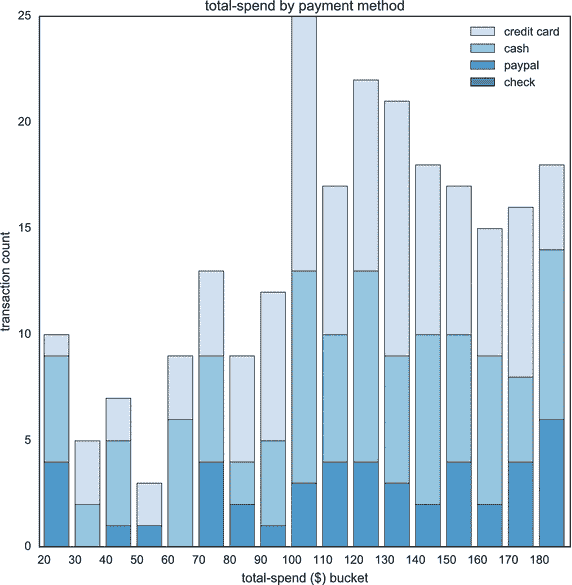
图 17-2. 按支付方式划分的总消费额

查看每个交易金额区间的计数，随着总金额的增加，用信用卡支付的交易也越来越多；第二大类是现金。请访问 [`http://ds.tips/br5wR`](http://ds.tips/br5wR) 了解如何制作此图表。

在问题研讨会上，你还需要评估其他团队成员提供的证据。直觉本身并没有错。通常，直觉可能是伟大发现的起点。然而，并非团队中每个人都有相同的直觉。关于每位团队成员在数据中看到了什么，可能存在分歧。当这种情况发生时，请一起研究彼此的证据。询问为什么一个人的直觉可能比另一个人的更准确。也许他们有更多的经验，或者过去曾参与过类似的项目。

请记住，事实并非总是刻在石碑上，一成不变。随着证据的强弱变化，事实也可能发生改变。当你身处数据科学团队时，不要害怕质疑证据。这往往是新洞察的来源。

## 探寻竞争性原因

说“相关性不等于因果性”很容易，但在实践中看清这一点却并不简单。通常，当你看到因果关系时，没有任何理由去质疑它们之间是如何关联的。有时很难看出“某事发生之后出现的某个结果”与“因某事而导致的某个结果”之间的区别。在工作中和生活中，你都会遇到这种情况。

我和妻子决定不在家里买游戏主机。相反，我们和儿子达成了一个折中方案：我们让祖父母家有一台游戏主机。这样一来，每次我们去拜访时，儿子既能见到祖父母，又能玩他的新游戏。每次我们去之前，都会给儿子买一款新游戏。游戏会在我们出发前寄到。儿子认为，我们买了新游戏，然后立刻飞到了奶奶家，这样他就能玩了。这看起来是一个非常清晰的因果关系。

实际上，游戏机的到来是一个竞争性原因。游戏到了，我们收拾行李出发。但它仍然不是真正的原因。真正的原因是我们有去奶奶家的机票，所以我们才买了新游戏。

这些竞争性原因并不总是容易发现的。需要注意以下三点：

- **原因是否真正说得通：** 世间存在许多竞争性原因。柠檬进口量增加与交通事故减少之间存在关联；冰淇淋销量增加与鲨鱼袭击事件增多之间也存在关联。然而，这些关联根本说不通。柠檬并不会让人们成为更好的司机，鲨鱼也不吃冰淇淋。你遇到的多数竞争性原因不会这么明显。务必要审视原因与结果之间联系的证据。
- **原因是否与其他结果一致：** 你可能会发现跑鞋购买量与天气变暖之间存在关联。这意味着，如果你发现运动短裤购买量与天气变暖之间也存在关联，那么它很可能是一个真正的原因。几个一致的原因会增加你所面对的是一个真正原因的可能性。
- **该事件能否用其他竞争性原因来解释：** 也许跑鞋购买量在天气变暖时增加，是因为夏季跑鞋更便宜。如果你能想出好几个其他的竞争性原因，那么你可能就没有看到真正的原因。

当你身处数据科学团队时，要时刻留意竞争性原因。

我曾与一个州教育部门的数据科学团队合作过。该团队正在开发一个应用程序，以更好地理解学生评估数据。数据显示，当学生使用软件程序进行评估（而非书面评估）时，他们的分数更高，如图 17-3 所示。这使得该软件看起来非常有效。仅仅是使用计算机参加考试这一行为就提高了学生的知识水平。

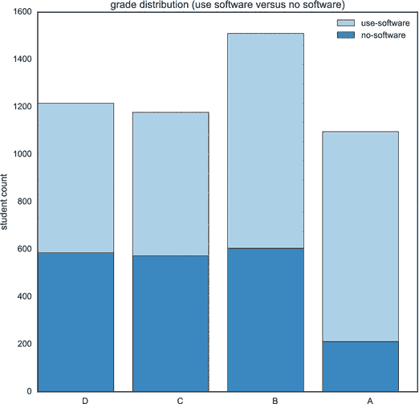
图 17-3. 使用软件与不使用软件的成绩分布

从整体分布来看，大多数学生得了 B，得 A 的学生较少。然而，在不使用软件的情况下，学生得 C 或 D 的概率几乎各占一半；而在得 B，尤其是得 A 的学生中，使用软件的比例更高。请访问 `http://ds.tips/fRa5r` 了解如何制作此图表。

这对该软件来说是极好的营销素材：如果你使用它，你的分数就会提高。但实际上，这根本说不通。数据科学团队并没有盲目接受这个因果关系。为什么从纸质考试转向在线考试会提高学生的学习成绩？为什么随着他们继续使用该软件，他们的进步却没有持续增加？这些数据正是一个竞争性原因的显著特征。

在一次问题研讨会上，研究负责人提出了这个问题。她问道：“为什么我们的学生取得了更高的分数？”数据科学团队试图通过设想竞争性原因来分解这个问题。他们提出了一些有趣的问题：“当他们开始使用该软件时，还发生了其他什么变化？”以及“是否有学生没有取得这种进步？”

结果发现，考试成绩的跃升有一个竞争性原因，而真正的原因有更强有力的证据支持。原来，许多使用该软件的学校都获得了州政府的拨款来改善硬件设备。为了鼓励学校使用新软件，每个教室都配备了十几台新电脑。这些电脑让学生能够更频繁地参加考试，他们因此对试题更加熟悉，考试成绩也随之提高了。

当你身处数据科学团队时，不要害怕质疑因果关系。团队应该准备好提出竞争性原因来解释某些事件。如果这些原因说得通，你就应该调查这种联系。你提出的一些最棒的问题，可能正来自于排除这些竞争性原因并找到真正原因的过程。

## 揭露误导性统计数据

在审视统计数据时，你很可能会发现许多问题。正如你所见，统计数据不能替代事实。统计数据会说谎。事实上，很多统计数据都在撒谎。至少，它们是在讲述自己版本的"真相"。

在提问会议上，你的团队应谨慎仔细地评估统计数据。团队成员应该相互质疑，并对来自团队外部的统计数字保持怀疑。

在第 4 章中，你看到了计算平均值时遇到的挑战（那个政客的例子）。统计上的算术平均数可能给出一个答案，而中位数则可能给出不同的答案。通常，人们会根据自己希望看到的结果而偏好其中一种。然而，还有许多其他方式可以用统计数据说谎。其中一些方式更为隐蔽。你必须仔细聆听才能察觉其中的"障眼法"。

其中一种方法就是"推断性统计"。具体做法是，你先用一则故事建立一种统计联系，然后将这种联系嫁接到另一则故事上。例如，假设有一项研究指出，20%的时间里人们会在开车时发短信，如图 17-4 所示。一家试图推销汽车保险的公司可能会推出这样一则广告："每五个人中就有一个人开车时发短信。请确保你拥有良好的保险。"

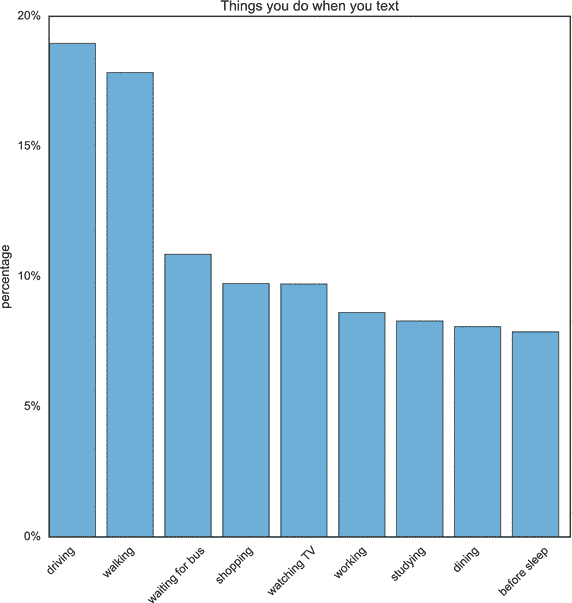
图 17-4. 人们在发短信时同时进行的活动

根据这项研究，人们在开车时发短信的时间占比接近 20%。发短信时第二高的活动是步行。你可以访问 `http://ds.tips/f2asP` 查看如何制作此图表。

注意这里的"障眼法"。一个统计数据讲述了一个关于短信的故事：大约 20%的时间里，人们在开车时发短信。而保险公司的故事则是关于一群人：大约 20%的人正在做某件事。也许开车时发短信的司机很少，但他们发短信的频率很高，这影响了数据。你可能在开车时有 20%的时间在发短信，但这并不意味着 20%的人在开车时发短信。一个普通人可能每天有 5%的时间在吸烟，但这并不意味着 5%的人在吸烟。保险公司试图告诉我们的故事关乎安全。它试图制造一种印象，即每个人都被发短信分散了注意力。它将"发短信"与"驾驶更危险"联系了起来。

让我们回到我们的跑鞋网站。想象一下，数据科学团队中的某个人强烈认为数据显示人们正在与朋友结伴跑步，这支持推出一个新的促销活动。数据分析师提供了一个统计数据，显示 50%的客户将优惠券转发给了朋友，并勾选了"他们是我朋友"的选项。他认为，有多达一半的客户和他们的朋友一起跑步。他相信数据科学团队应该研究一个社交互动更强的网站是否能提升销量。乍一看，这听起来很有道理。但实际上，是你团队中的这个人试图在创建一种"统计推断"。

解决这个问题的最佳方法是将统计数据与故事分开。就跑鞋网站而言，你有两个故事：一个说顾客喜欢他们的朋友省钱，另一个说顾客和朋友一起跑步。当你把它们当作两个独立的故事来思考时，就更容易看出它们之间可能存在脱节。你可能需要向团队中的那个人问几个问题。省钱和与朋友跑步之间有什么联系？有哪些统计数据可以显示有多少客户与朋友一起跑步？这里存在任何联系吗？

统计推断可以成为提出有趣问题的绝佳工具。只有当团队把它们当作事实时，它们才会变得危险。它们可能是有趣事物的影子，但不应该被视为证据。

另一个可能出现误导性统计数据的领域是"可疑的遗漏"。你可能会在度量尺度上看到这一点。想象一下，你数据科学团队中的某个人使用了一个统计数据，称某次促销活动使跑鞋订单增加了 5,000 单，如图 17-5 所示。这听起来可能令人印象深刻。唯一缺少的是度量尺度。你需要问一个关键问题：该网站通常每月有多少订单？如果是 5 万单，那么这很好地证明了你进行了一次成功的促销。如果是 500 万单，那可能就没多大影响。

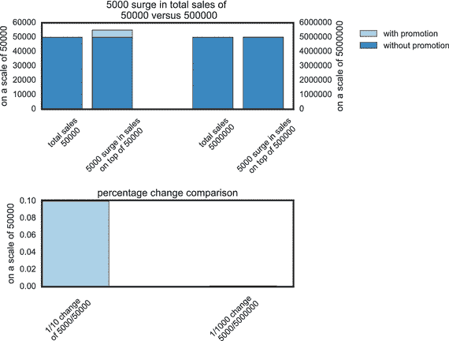
图 17-5. 在 5 万的基础上增加 5,000，与在 500 万的基础上增加 5,000 的对比

在上面的图表中，你几乎注意不到在 500 万基础上出现的这 5,000 单的增长。同样，如果你看一下下方图表中的百分比变化，在 500 万基础上增加 5,000 几乎可以忽略不计。你可以访问 `http://ds.tips/tRab2` 查看如何制作此图表。

你也会在百分比上看到这种情况。也许团队中有人说红色跑鞋的销量增长了 500%，如图 17-6 所示。这相当令人印象深刻，除非当然她是从卖出 2 双红色跑鞋增长到了 12 双。

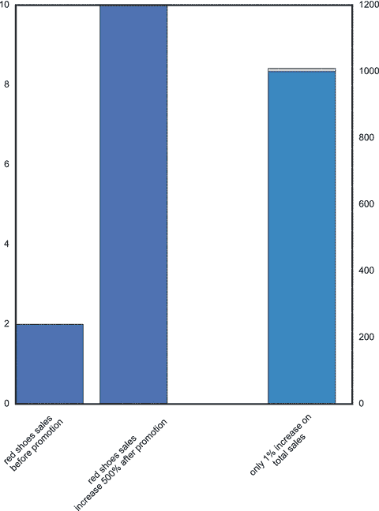
图 17-6. 红色跑鞋销量增长 500%

一次促销活动后，红色跑鞋的销量可能增长了 500%；但是，你应该假设总销量大约是每天 1,000 双，而这个增长只相当于 1%的增幅。你可以访问 `http://ds.tips/5ugEc` 查看如何制作此图表。

当你在数据科学团队工作时，要小心不要将统计数据视为事实。有一些常见的方法可以让统计数据看起来像是在讲述一个有趣的故事。你的团队需要提出关键问题，然后提出更多有趣的问题以获得更深入的见解。

## 高亮缺失数据

提出优质问题的最佳方法之一就是检查缺失的信息。一点点的信息缺失就可能彻底改变故事走向。有时是数据本身不完整，有时则是讲述者因为数据会呈现不同故事而故意略去信息。这种现象在广告中屡见不鲜。

举个常见的广告例子。你可能听过一个流行的说法：每五个牙医中就有四个推荐嚼口香糖的患者选择无糖口香糖。这看起来支持力度相当大。然而，这里就缺失了一些信息。一个恰到好处的问题就能改变整个故事。牙医通常对患者嚼口香糖有什么建议？也许 100%的牙医都告诉患者永远不要嚼口香糖。而在这些患者中，也许有 10%的人坚持认为无法戒掉这个习惯。

那么针对这 10%的人，大多数牙医会说：如果你坚持要嚼口香糖，请确保它是无糖的。你看，这完全是一个不同的故事。没有任何广告商会说：“100%的牙医都说不要嚼口香糖，但如果你非要嚼，请试试无糖的。”

在你的数据科学团队中，你将经常寻找缺失的信息。你需要留意那些重要的信息，因为它们会重塑你的推理。你总是可以要求获取更多信息。真正的问题是，哪些缺失的信息会重塑整个故事。你甚至可能最终讲出一个与原始故事截然不同的版本。

我曾为一个组织工作，该组织试图弄清为什么参与其医学研究的男性多于女性。他们从实验室得到一份报告，显示男性参与医学研究的可能性高出 60%，如图 17-7 所示。数据科学团队的任务是试图找出原因。当数据科学团队查看这份报告时，他们问道：“我们遗漏了什么重要信息？”有几个可能有所帮助的信息点。他们还问道：“他们参与的可能性高出 60%意味着什么？”这是指申请参与的人数男女相等，但被接纳参与研究的男性更多？还是说被接纳的人数男女相等，但实际参与的男性更多？

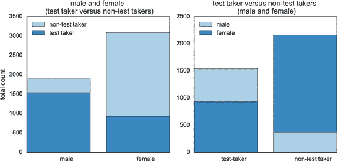
图 17-7. 测试参与者和非测试参与者——男性和女性

你可以从两个角度分析该表格。左侧是按男性和女性划分。大约 80%的男性是测试参与者，而女性只有 30%。右侧是按测试参与者和非测试参与者划分。60%的测试参与者是男性，而在非测试参与者中，男性仅占 15%。了解如何创建此图表请访问 [`http://ds.tips/6Wewr`](http://ds.tips/6Wewr)。

了解这些信息会讲述一个完全不同的故事。其中一个故事是关于更多男性被接纳，另一个故事则是关于更多男性实际到场。

在寻找缺失信息时，你可以尝试几种方法。首先，你应该尝试理解信息可能缺失的原因。可能是由于空间或时间限制。提供信息的人可能对该主题了解不多。或者，此人可能有美化信息的动机。如果属于这些情况，你可能需要投入更多精力来寻找缺失的信息。

另一件需要注意的事情是，当数字周围环绕着比较级形容词时——比如“快 60%”、“大 20%”或“薄 30%”这样的短语。通常，这些短语背后隐藏着重要的缺失信息，你可以据此提出一些有趣的追问，比如比什么快、比什么大、比什么薄？

最后，一个判断信息是否缺失的好方法是尝试从反面思考。为什么男性比女性更多地参与医学研究这件事很重要？让更多女性参与研究有什么好处吗？

事实证明，最后一个问题帮助团队找到了缺失的信息。让更多女性参与的好处在于，年轻女性服用处方药的可能性更大，这使得研究更加全面。他们可以测试更多的药物相互作用。

这个好处正是问题的另一面。女性更难参与，是因为她们可能正在服用研究不允许的处方药。更准确的统计表述应该是：“被允许参与医学研究的人中，有 60%是男性。”这讲述了一个完全不同的故事。

在数据科学团队工作时，请始终保持警惕，积极寻找缺失的信息。那些重要的信息可能就隐藏着你的数据想要告诉你的真实故事。

#### 总结

在本章中，你学到了与数据科学团队会面时应重点关注的六个提问领域。你要重点关注能够实现以下目的的问题：

- 澄清关键术语
- 深挖假设前提
- 发现错误
- 探究其他原因
- 揭露误导性统计
- 高亮缺失数据

你了解到，并非你所有的问题都会涵盖这六个领域，但如果你聚焦于此，你的团队一定会提出至少几个问题。在第十八章中，你将学习如何在试图提出好问题时避免可能出现的陷阱。

### 18. 避免提出好问题时的陷阱

在本章关于避免陷阱的内容中，我将帮助你发现可能导致你在提问时遇到困难的四个原因，以及如何克服它们。

#### 克服问题偏见

问题是获取数据洞察的核心。你已经了解了许多帮助团队提出更好问题的技巧。但除非你对提问感到自如，否则这些技巧不会有太大帮助。你可能在提问时会遇到多种原因造成的困难。以下是数据科学团队中非常常见的四个原因：

- 自我保护
- 时间不足
- 经验不足
- 企业文化不鼓励提问

在接下来的章节中，你将详细了解每一个原因。

##### 自我保护

第一个原因是团队成员有保护自己的天然欲望。没有人愿意显得错误或无知。当你与其他专业人士同处一个团队时，挑战他人的答案尤其困难。提出一个好问题需要勇气。这会让你显得脆弱，尤其是在为一个高度重视答案的组织工作时。

提出好问题需要练习。如果你擅长此道，你会发现许多看似拥有答案的人实际上在问题面前非常脆弱。这既有助于你，也有助于团队其他成员。如果你无法应对简单的问题，那么你的答案很可能并不那么好。

##### 时间不足

第二个常见原因是团队时间不够。正如你所见，提问会让人筋疲力尽。在刚开始时，每次提问会议似乎都变得更长、更复杂。当没有时间提出有趣的问题时，团队干脆就不再提问了，这使得发现新见解变得困难。

许多数据科学团队都落入了这个陷阱。他们过于专注于清洗数据，以至于没有留下任何时间来提出有趣的问题。通常，组织中的其他部门也强化了这一点。做实际的事情被视为真正的工作。许多组织更倾向于一个忙碌的团队，而不是一个高效的团队。当这种情况发生时，每个人都专注于划船，以至于没有人花时间去质疑你的船要驶向何方。

请记住，没有人会因为拥有最干净的数据集而获奖。一个无法产出见解的数据科学团队很难创造商业价值。

##### 经验不足

第三个常见原因是团队单纯缺乏提出好问题的经验。当团队成员来自工程、软件开发或项目管理领域时，这种情况非常普遍。这些成员可能整个职业生涯都在努力成为那个知道答案的人。压抑这种本能并专注于提问可能会很困难。来自科学或学术界的团队成员可能更容易完成这种转变。这就是为什么拥有良好的混合搭配可能会更容易。

当团队刚开始时，他们倾向于提出很多诱导性问题。这些问题包含了某种形式的答案。一个诱导性问题可能是这样的：“我看到更多女性在我们的网站上购买跑鞋。你认为这是因为我们的女性顾客数量增加了吗？”

这类问题并不能真正开启讨论。通常，对方的唯一选择就是同意或反对。一个更好的问题可能是这样的：“为什么女性在我们的网站上购买更多鞋子？”一旦团队的其他成员开始讨论，你就可以提出自己的看法。

##### 企业文化不鼓励提问

第四个常见原因是数据科学团队身处一种不鼓励提问的企业文化中。社会科学家丹尼尔·扬克洛维奇¹指出，大多数美国组织创造了一种行动文化。当这些组织面临问题时，他们的第一反应是冲进去并想出一个解决办法。他们不希望任何人坐在那里问问题。而是要全员上阵。

这种反应在许多组织中效果不错。例如，如果你在客户服务或零售业工作，你可能只需要关注即时修复。但在数据科学中，这种思维方式会导致问题。它会阻碍团队学习任何新东西。

数据科学团队最不想听到的就是一股推动完成某项实际任务的压力。你不希望利益相关者这样说：“等你们把所有数据上传到集群之后，再提问吧。”这暗示他们仍然认为你的团队只是在完成项目，而不是在寻找关键见解。

当你在数据科学团队工作时，要警惕个人和组织对提问的偏见。提问是通往发现的第一步。如果你跳过了这一步，你的团队将很难学到任何新东西。

#### 总结

在本章中，你了解到在提问方面可能遇到问题的四个原因，以及如何克服它们。总结如下，本章详细讨论的四个原因为：

- 自我保护
- 时间不足
- 经验不足
- 企业文化不鼓励提问

在第五部分，你将了解讲故事的基本方面，从第 19 章定义故事开始。

脚注 1

丹尼尔·扬克洛维奇，《对话的魔力：将冲突转化为合作》（西蒙与舒斯特出版社，2001 年）。

## 第五部分：用数据科学讲故事

历史学家尤瓦尔·诺亚·赫拉利在他的著作《人类简史：从动物到上帝》¹中写道，我们的原始人祖先并非通过制造工具而成为现代人类。相反，是他们能够互相讲述复杂故事的能力。正是我们共享的叙事，成为了从流浪的非洲猿类进化到今天*智人*的关键一步。这些故事帮助我们形成了关于农业、正义和宗教的新思想。这就是为什么讲故事深深植根于我们最基本的沟通方式中，在沟通新颖且复杂的想法时尤其如此。在本部分中，我们将讨论讲故事的基本方面。你的数据科学团队的见解只有在你能够将数据与某个更宏大的想法联系起来时，才能发挥作用。通常，做到这一点的最佳方式是将一个清晰而有趣的故事编织在一起。仅仅展示数据是不够的。为了让你的团队成功，利益相关者需要理解这些新想法背后的含义。一个好故事将有助于弥合这一差距。

脚注 1

尤瓦尔·诺亚·赫拉利。《人类简史：从动物到上帝》（兰登书屋，2014 年）。*需要页码

### 19. 定义故事

我的一位同事最近买了一台新摄像机，制作了一部关于他墨西哥之旅的短片。他用了软件让视频看起来美轮美奂。开场字幕就像电影院里看到的那样。他有音乐、画外音，甚至还有一些特效。

我们一起坐下来看了他 15 分钟的影片。大约看了五分钟，我就想起了讲故事和看视频之间的区别。他完全没有试图让我融入他的旅程。那只是对一个美丽地方的精彩影像记录。我完全无法与他的经历产生共鸣。这 15 分钟过得相当缓慢。影片结束后两分钟，我甚至说不出刚才看到了什么。

许多数据科学团队对讲故事的理解也是如此。如果你只有漂亮的图表，那么故事就会自己讲述出来。如果我放上一张易于理解的图表，观众就会明白其中的含义。实际上，就像那个墨西哥视频一样，把东西做得漂亮并不意味着它就变得有趣。美感可以增强体验，但它不能取代故事。

很多数据可视化资料都侧重于制作图表的技巧。数据科学团队需要记住，数据可视化和讲故事不是一回事。事实上，它们截然不同。一个漂亮的数据可视化就像精心设计的电影布景。它可能搭建了背景，但不会让你感受到任何深层含义。这就是为什么你不会去看长达两小时的漂亮电影布景视频。

究竟是什么构成了一个故事，这并不容易定义。有一些结构性的定义。它们勾勒出人物、冲突以及达成重要目标的过程。古希腊哲学家亚里士多德提出了故事的六大要素。其中包括情节、神话和壮观场面。

这些定义是一个不错的起点，但它们只让你了解了故事的要素。它们可能无法帮助你的团队与观众建立联系。这有点像试图通过专注于刷子和凿子来学习雕塑。相反，你应该把故事看作一种建立联系的方式。

对于你的数据科学团队来说，试着把故事视为一种运用语言和视觉元素，帮助观众理解并将故事与某个更宏大的意义联系起来的途径。

这是讲故事时你需要思考的首要问题之一：你将如何建立联系？你将如何帮助你的观众找到更宏大的意义？

关于这个定义，有几点需要注意。首先，你是在运用语言和视觉元素来建立联系。你所说的和你所展示的本身并不是故事。实际上，视觉元素常常会横亘在你和观众之间。

想想你见过的最精彩的演示。你离开时会说：“我没太听懂他们说什么，但那张图表太棒了”吗？更可能是相反的情况。你很可能记住了那个被误解的孩子，或者那个劳累过度的家长。那十几张 PowerPoint 幻灯片可能早已消失在遥远的记忆中。

定义的第二部分是“帮助”观众。记住，一个好故事是为了观众的利益。没有什么比看着一个数据科学团队谈论他们自己的成就更无聊的了。你讲故事是为了帮助观众与材料建立联系。你说的每一句话都应该是为了他们的利益。这意味着你不应该谈论过程或分享功劳。直接切入正题，帮助你的观众。

最后，记住一切都关乎建立联系，以帮助你的观众找到某种意义。当你做得很好的时候，观众就会找到你试图传达的某些意义。也许他们只找到了部分意义。那可能是他们能找到的最紧密联系的部分。这没问题，你可以以此为基石，讲述你的下一个故事。

重要的是要明白，你演示的美感和制作价值并不等同于一个好故事。如果我朋友少花点时间在特效上，多花点时间建立联系，我从他的视频中能收获更多。墨西哥是一个美丽的国家，充满了丰富多彩的历史和精彩的故事。如果他仅仅从那里开始，我就会觉得我们拥有了一段共同的经历。我会分享他旅程的更大意义，而不仅仅是看看那些影像。

现在你已经知道了故事的大致定义，那么如何讲好一个故事并让观众始终保持投入呢？你将在本章中找到答案。

## 编织故事

当你做演示时，观众分心的方式有很多种，让他们保持参与和专注可能是一个挑战。你头顶上可能有一个时钟，所以观众会不停地看时间。如今，许多会议室都有玻璃门和玻璃墙，这让观众容易被房间外的人分散注意力。在现代办公室里讲故事并非易事。你需要格外努力，在观众身处房间时专注于吸引他们。当你开始讲故事时，你要立刻开始“编织故事”。

### 什么是“编织故事”

这是 19 世纪水手们在讲一个好故事时使用的术语。作为水手的一部分就是要懂得如何搓绳。每一股线都需要扭结交织在一起，才能编成一根结实的绳子。

当你的团队试图“编一个好故事”时，可以关注五个关键的线索：

- 激发观众的好奇心。
- 尝试用类比或共同经历与观众建立联系。
- 尽量少用“我”这样的词。多用“你”或“你的”。你想让焦点落在观众身上。
- 提出有趣的问题。
- 不要太严肃。如果你风趣幽默或平易近人，观众就更容易接受你的观点。

以下各节将对每一点进行更详细的说明。

### 激发好奇心

那么，我们先从激发观众的好奇心开始。想象一下，你要去参加一个普通的会议。演示幻灯片上写着：“第四季度销售预测”。所以你知道第三季度末有一个相当强劲的上升趋势。

再想象一下同一个会议，但幻灯片上只显示演讲者的名字。会议开始，演讲者做了自我介绍。她开头说道，过去几个月的销售额一直在增长，但数据科学团队却搞不清楚原因。观众可能心里在问，为什么数据科学团队不知道销售额增长的原因，并好奇这个故事将如何发展。换句话说，观众产生了好奇心。他们想看看演讲者如何将未解之谜与答案编织在一起。如果你能保持观众的好奇心，他们在你讲故事时就会很有耐心。

### 与听众建立联系，善用“你”

另一个可以尝试的“线索”是分享一段大家都能感同身受的经历。当你讲述故事时，听众需要将你视为一个活生生的人，与你产生共鸣。你不想让他们觉得你只是一个团队成员或部门代表。你希望他们渴望了解，作为个体的你，有什么话要说。这将有助于他们将你的讲述与他们已有的认知联系起来。

尽管作为数据科学家，你的工作是谈论数字，但不要从谈论数字开始。相反，先谈一段经历。例如：“当我第一次看到这些数据时，我想起了人们在排长队等待时的感受。”然后，再接着描述排队问题的严重性，以及这可能会让你流失客户。

在分享个人经历时不要过度。记住，要尽量减少使用“我”这样的字眼。分享经历是为了帮助听众找到意义，而不是单纯地讲述你自己。你是将自己作为一个例子，引导他们如何去理解这些数据。

### 提出有趣的问题

你或许还想分享一些你数据科学团队提出的问题。在本书中，你已经学会了如何提出有趣的问题。你可以用这些问题来激发听众的好奇心。如果你的团队觉得这些问题很有趣，那么你的听众有很大概率也会觉得它们有意思。将问题与经历巧妙地编织在一起。让他们感觉是在和你一起寻找答案。一个好的问题会让你的听众渴望得到答案。

### 保持轻松氛围

最后，记住不要太严肃。当听众觉得你乐在其中时，他们会自然地被你的故事吸引。这同样能激发他们的好奇心。他们可能会想，为什么你看起来如此享受。不要表现得滑稽可笑，那会损害你的可信度。相反，努力营造一种轻松愉快的体验。你甚至可以在讲述团队如何提出问题的过程中加入一些幽默。听众希望在你的帮助下，将你的讲述与某种总体意义联系起来。让他们知道这是一段有趣的旅程，他们也就更愿意参与其中。

这五条线索将帮助你编织出一个强有力的故事。每一条线索都会增强你整个讲述环节的力量。你可能无法全部用到，但请试着记住它们是如何交织在一起，牢牢抓住听众的注意力，引导他们探寻意义的。

## 五种叙述方式

现在，你已经了解了编织故事的五个不同线索，让我们放眼更大的主题，来看看你可以用哪些不同类型的叙述方式来“套牢”你的听众。

叙述几乎可以是你所说的任何内容。电视广告是一种叙述，我抱怨等了好久才买到电影票也是一种叙述。并非所有叙述都是故事，记住，故事是为了帮助听众与某个更大的意义建立联系。我等了很久才买到电影票这件事本身并没有什么宏大意义。我不是在努力探寻真理，我只是想看新一部的《星球大战》。

你可以使用不同类型的叙述来帮助听众过渡到你的宏大故事中。当你想向听众解释数据科学概念时，以下五种叙述方式尤其有用：

- 轶事
- 案例研究
- 举例
- 情景假设
- 片段描写

接下来的章节会逐一为你详细介绍。

### 轶事

我们先从轶事说起。轶事是关于某个与你宏大主题相关的简短个人经历。这里的关键词是“简短”和“相关”。你的轶事要足够长到引人入胜，又要足够短到不分散对宏大故事的注意力。轶事在讲述环节的开头非常有用。例如，假设你正在进行一场关于为什么这么多客户在结账前放弃购买的讲述。你可以先分享一个小轶事，讲述你自己某次空手离开商店的经历。你可以说那是因为做决定的压力太大。然后，再把这个经历引向更大的故事——为什么那么多客户可能会放弃购买。

### 案例研究

另一种很棒的叙述方式是案例研究。案例研究是讲述一个小问题以及它是如何被解决的。当你想呈现一个带有可能解决方案的故事时，案例研究非常有用，比如讨论过去的一个数据科学难题以及解决问题的方案。假设你想用一个案例研究来弄清楚客户为什么放弃购买。你可以解释，当网站重新设计后，购买量出现了小幅下降。设计团队简化了网站，购买量又回升了。这个案例研究与一个更大的故事相关联，在那个故事中，数据科学团队指出结账流程过于复杂。

### 举例

第三种叙述方式是举例。举例与案例研究类似，区别在于它不一定要摆出挑战和解决方案。它通常也涉及他人。当你试图论证宏大故事中的某个部分时，可以使用举例。也许你可以指出，其他好几家公司也在尝试简化客户在线购买流程。因此，你的听众即将听到的故事，对于你的公司而言，并非特例或孤例。

### 情景假设

第四种叙述方式是情景假设。情景假设是列出一系列事件，并请听众思考每种可能的结果。情景假设并不常用，这很可惜，因为它通常是让听众思考未来的好方法。很多演讲者觉得情景假设听起来太幼稚，所以如果你决定使用，务必确保它不过于简单。

情景假设通常在讲述环节的开头效果最好，并且应该用第三人称来叙述。你不希望它听起来像个人轶事。例如，你可以描述这样一个场景：朱莉在午休时间，只剩五分钟来购买她想要的商品。三分钟后，她找到了想要的商品并放入购物车。就在她准备结账时，她又看到了另外四件想要的东西。她的钱不够买下全部五件商品，她该怎么办？她是放弃购物车，想着稍后再回来，结果却忘了？

### 片段描写

最后一种叙述方式是片段描写。片段描写就像一个小场景或一部微电影，通常用第三人称叙述。一个好的片段描写能抓住听众的注意力。你可以用一个关于沮丧客户的小片段来开场你的讲述环节。比如这样说：“他们为什么总是重新设计网站？上次改版我才刚搞清楚所有东西在哪儿。”

这五种叙述风格应该能帮助你提高听众的参与度。记住，这些叙述本身并不是故事。它们可以辅助你，但无法替代你的宏大故事及其所蕴含的意义。

## 总结

在本章中，你学习了“编故事”（spin a yarn）这个短语，以及如何通过五个关键“线索”将其融入你的叙述中。

- 激发听众的好奇心。
- 尝试通过类比或共同经历与听众建立联系。
- 尽量不要使用“我”或“我的”这样的词。相反，使用“你”或“你的”。你要让焦点集中在听众身上。
- 提出有趣的问题。
- 不要过于严肃。如果你幽默风趣或平易近人，听众会更容易接受你的想法。

接着，你学习了五种叙述类型（轶事、案例研究、例子、场景描写和片段描写）。当你试图向听众解释数据科学概念时，可以使用这些类型。在第 20 章中，你将学习如何理解故事结构。

---
脚注 1
S. H. 布彻，《亚里士多德诗学》。（麦克米伦出版社，1961 年）。

### 20. 理解故事结构

# 讲故事

讲故事并不仅仅是对所发生事件的简短描述。如果你告诉某人你去杂货店买了一加仑牛奶，这不算是在讲故事。故事具有复杂且一致的结构。需要有冲突和情节。在本章中，我们将讨论一个典型故事的各个要素。你可以运用这些要素来编织出能抓住听众想象力的内容。仅仅描述数据是不够的。一个复杂的数据科学故事必须展示出这些洞察为何重要。你还会发现，你的许多数据科学故事会遵循相似的情节。当你看到这些模式时，你可以以一种有助于听众从你们团队的洞察中提取意义的方式来构建你的故事。

## 运用故事结构

你已经了解了如何将不同的线索编织成一个故事。还有一些不同的技巧可以用来吸引听众。那么现在，让我们来看看如何将所有内容整合到一个更大的结构中的不同方法。

你的数据科学故事应该包含三个阶段：开头、中间和结尾。你应该利用这些阶段来帮助听众找到你故事的意义。在每个阶段，你都需要做不同的事情。

在第一阶段，与听众一起设定背景。第二阶段应引入冲突。然后，你应该通过创造一些行动来结束故事。也许你解决了冲突，或者角色从挣扎中学到了东西。

### 设定背景

背景是你设置场景和角色的地方，介绍他们并将他们置于特定的时空之中。你应该尽可能快地设定好背景。许多人花太多时间来设定背景。你只需要花足够的时间来介绍角色并将他们置于某个场景中即可。

例如，假设你的研究负责人在一个故事分享会上进行演示。她通过设定背景来开场。她开始说道：“我们一直在密切监控在我们网站上购买鞋子的客户。我们可以看到他们的居住地，并将其与他们的购鞋频率联系起来。” 这设定了背景：购买跑鞋的客户，以及他们的居住地与购鞋频率的关联。

### 引入冲突

在中间部分，开始讲述冲突。实际上，冲突是故事中最令人难忘的部分。前一个例子中的研究负责人可能会说：“居住在城市地区的客户更有可能购买跑鞋。事实上，居住地人口密度越大，他们购买跑鞋的频率就越高。我们觉得这很奇怪。作为跑步爱好者，我们并不真正喜欢在人口密集的地区跑步。那里有太多大型车辆和交通。所以我们决定进行一些实验。”

冲突是你吸引听众的地方。他们可能已经在心里想，这真是出乎意料。研究负责人用个人轶事来激发他们的好奇心，他们甚至可能开始提出自己的理论。也许他们认为这是因为客户更年轻，或者他们住得离大公园更近？

接下来，研究负责人想要创造一些行动。这就是她通过解释冲突的解决方案来应对冲突的地方，她查找数据的地方，以及她的发现。她应该稍微谈一下所采取的行动，但同时也不要过多地解释细节。她可能会说：“我们进行了一个实验来查看他们的年龄。这些客户往往比较年轻，但当我们调整了年龄因素后，仍然存在相当大的差异。我们还查看了一些拥有大量活跃客户的地图。我们想看看是否有更多的跑步路线。结果发现，城市外的路线普遍更好。”

现在，研究负责人将听众吸引到这场“挣扎”中。她不想花太多时间谈论所有的实验。同时，她仍然希望激发他们的好奇心，甚至可能建立一些期望。

注意：在本章稍后的部分，你将了解更多关于如何呈现冲突的内容。

### 结束故事

为了收尾，她会说类似这样的话：“结果发现，我们发现的最强关联是，如果客户居住地距离健身房在三英里以内，他们就更有可能购买跑鞋。” 这就是你在图 20-1 中看到的情况。

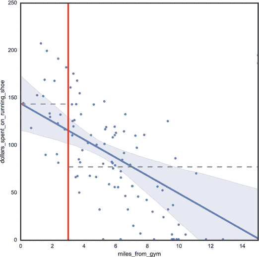

**图 20-1**. 居住地靠近健身房的客户

橙色虚线显示居住在距健身房三英里以内客户在跑鞋上的平均花费，灰色虚线显示居住在距健身房三英里以外客户在跑鞋上的平均花费。这两个变量之间存在明显的负相关关系。请参见 [`http://ds.tips/pUhe3`](http://ds.tips/pUhe3) 了解如何制作此图表。

她用一个简短的小片段来收尾：“所以想象一下我们那位住在健身房附近的客户。他在室内跑步，并且总是在寻找保持身材的新方法。仅仅是靠近健身房就足以让他购买更多的跑鞋。”

她通过引入新的洞察来结束故事。也许她还会询问听众是否有任何问题，并利用这些问题为下一次故事分享会提出一系列新问题。

为你的故事赋予一定的结构，有助于听众从你的故事中获得意义。请记住，你应该把最大的精力放在故事的中间部分。听众最有可能记住的是冲突。然后你可以以一个行动项目来收尾，甚至提出更多问题以获取更深入的洞察。

## 引入剧情线索

在上一节中，你了解到一个故事基本包含三个阶段（背景、冲突和结局）。在背景与冲突之间，你需要引入剧情线索。人物与剧情共同构成了故事的难忘之处。例如，在莎士比亚的《*罗密欧与朱丽叶*》中，罗密欧与朱丽叶是人物，而他们被禁忌的爱情则是剧情的一部分。他们的心碎与死亡则是剧情的最终篇章（剧透预警）。

在数据科学领域，剧情是你叙述故事的主体部分。它既包含数据本身所述说的内容，也包含你对其含义的解读。你的故事情节不必为了吸引人而刻意追求原创。真正让故事引人入胜的，是你如何将剧情与人物在背景中交织融合。

在克里斯托弗·布克的《七种基本情节》¹中，他认为所有故事都只包含少数几种情节。他指出，人类在聆听故事时具有非常相似的心理需求。并非所有人都认同这在文学领域是真理，但对于数据科学故事而言，这几乎可以肯定是成立的。你的受众只会寻找几种不同类型的情节。

布克的七种情节是：

- 白手起家

- 战胜恶魔

- 追寻探索

- 旅途与回归

- 喜剧

- 悲剧与重生

在讲述你的数据科学故事时，请牢记这些情节。这些情节有助于精确定义你试图传达的信息。数据科学喜剧不太可能受到受众的欢迎，但其他六种情节只需稍加调整即可应用于你的叙述环节。

### 白手起家

最常听到的故事之一便是“白手起家”。几乎每个组织都对能用于创造新收入的洞察感兴趣。也许你的团队有一个新产品的想法，也许你已经找到了一种方法来扩大现有产品的规模。当你讲述这类故事时，请思考如何以一种与白手起家情节一致的方式来叙述。描述组织的现状，并描绘一条通向未来财富的清晰路径。切记要清晰地铺陈剧情，以帮助阐明你的故事，并引导受众找到其中深意。

### 战胜恶魔与追寻探索

数据科学故事中另外两种常见的情节是“战胜恶魔”和“追寻探索”。许多组织试图利用数据来应对危险的挑战。也许你的产品遇到了新的竞争对手，数据也显示了销售额的严重下滑。那么，将你的剧情聚焦于运用从数据中获得的巧妙策略来战胜这个“恶魔”（竞争对手）。鼓励你的受众开启一段追寻探索之旅。当你试图说服受众去尝试不同的事情时，例如开展新的业务或引入新产品，这种情节尤为有效。这种情节会使你的目标变得富有浪漫色彩。

### 旅途与回归

一种不太常见的情节是“旅途与回归”，有时也被称为事后剖析。例如，你启动了一个新项目，但最终判定它不值得继续推进。现在，团队需要仔细审视数据，判断是否有任何经验教训可以汲取，或者这次经历是否蕴含任何价值。随着数据科学日益普及，你会看到更多这类情节。组织总想从失败中学习经验。因此，未来你可能会看到更多“旅途与回归”式的叙事环节。

### 悲剧与重生

你不常听到的一种故事是数据科学悲剧。大多数组织更倾向于遮掩其悲剧。你更可能在政府项目中看到数据科学悲剧，因为其受众对全面了解悲剧的始末深感兴趣。一个数据科学悲剧故事，将会是对所有出错环节的全面分析。它不像事后剖析那样侧重于经验教训，而是仅仅专注于理解这个令人遗憾的故事全貌。

最后，你可能会讲述一个关于重生的故事。有时，公司会审视数据，然后判定其当前的业务线已难以为继。即便是像 IBM 这样的大公司，也可能决定彻底转型其业务。IBM 从低利润的个人电脑和硬件销售模式，转向了高利润的服务与咨询业务。他们之所以能做到这一点，是因为当时的 CEO 能够讲述一个令人信服的故事。那是一个高科技版本的《青蛙王子》的故事。

## 呈现冲突

请记住，故事是通过视觉元素编织叙事，帮助观众与某种意义产生联结。人们常以为通过成功与成就的故事就能与他人建立联系，因此许多商务会议都以某项新成就或目标开场。观众或许会鼓掌，但他们并未真正触及任何意义。实际上，正是挣扎与冲突，才能帮助人们找到意义，并将观众与故事联结起来。

当你进行故事讲述分享会时，你的观众很可能整天都在过滤信息。如果你与高层利益相关者共事，这一点尤为明显。他们每天要处理数百条信息，翻阅数十份报告。要成为高效的数据科学团队，你必须以不同的方式与观众沟通。

你已经见识过数据如何讲述故事。事实上，你也看到同一组数据能演绎出多个不同的故事。你的挑战在于：将死板的数据进行逆向工程，使其蕴含创造者的人性光彩。你需要传达挣扎与冲突，为数据科学故事构建情节。

那么这具体是什么样的？想象你在一家大型信用卡处理公司的数据科学团队工作。团队发现，信用卡客户在即将无力偿还账单之前，会改变消费模式。这些客户在陷入财务困境前，会突然增加信用卡使用额度。你的数据科学团队在数十万张信用卡中观察到了这种模式。

你的研究主管可以用多种方式呈现这些信息。她或许会展示一张简单的折线图，显示客户陷入困境前消费额的上升趋势；或者讲述一个关于数十万客户的故事。这两种方式都能呈现信息，但很可能无法让观众与数据产生共鸣。呈现信息的最佳方式是讲述一个有趣的故事，包含真实的情节、挣扎与冲突。

首先，创造一个真实姓名的人物角色。这不应是真实客户的姓名，但可以基于客户最常见的特征来塑造。你的研究主管可以这样开始她的故事分享会："今天，我们的数据科学团队想谈谈一位客户。我们称他为艾伦。两个月后，艾伦将无力偿还信用卡账单。他成为我们的客户已约六年。过去两个月，他的消费额度已用至上限。这对艾伦而言相当反常。他 48 岁，正用信用卡购买食品杂货和支付交通费用。通常，他只用信用卡购买机票和支付酒店账单。我们知道艾伦即将无力偿还账单。现在我们该怎么办？"

通过这种方式呈现数据，研究主管将数十万客户的数据整合起来，创造了一个包含真实人类挣扎的情节。你的观众应该能以更有趣的方式与这些数据产生联结。也许他们正在思考是否对艾伦负有责任。是否应该给他寄封信或打个电话？

不仅为角色命名很重要，你还需要补充角色生活的一些细节。观众得知艾伦 48 岁，成为客户已有六年。这些细节有助于强化挣扎感，丰满情节。

观众将能更轻松地与数据背后的意义产生联结。讨论"如何应对艾伦"远比讨论他代表的数十万客户容易得多。这是一个包含真实挣扎的真实情节，通过细节得到了强化。

尽管艾伦并不真实存在，但为了故事的目的，他变得栩栩如生。他能以纯数据本身可能无法做到的方式展现冲突。曾经静止的数据，变成了一个包含真实挣扎、细节和情节的故事。

#### 本章小结

在本章中，你学习了如何将数据科学故事的所有要素整合到更大的结构中。你掌握了如何与观众协作设定背景、引入冲突并创造行动。随后，你审视了在背景与冲突之间应包含的不同类型情节，以及如何呈现冲突。在第 21 章中，你将学习如何定义故事细节。

**脚注**

1. 克里斯托弗·布克，《七个基本情节：我们为何讲故事》（A&C Black 出版社，2004 年）。

### 21. 定义故事细节

在第 20 章中，你了解到如果故事包含情节和冲突，人们更容易产生共鸣。这种挣扎会将听众带入你的故事。在确立了情节和冲突之后，你需要让故事保持活力。一个好方法是为故事的各个部分添加细节。这些细节就像一张张小小的思维便利贴，帮助听众记住更大的情节和冲突，也有助于他们在聆听时构建出一幅心理画面。

我曾经为一家试图利用数据科学来促使人们参与医学研究的组织工作。结果发现，很多人害怕针头——具体来说，是抽血用的针头。事实上，存在一个害怕针头和血液的人群切面，而这个切面涵盖了大量的人。

我自己对这两样东西也都不太喜欢，所以完全能理解这对医学研究的影响。只要涉及针头，你就会失去很多人。如果同时涉及针头和血液，失去的人就更多了。这种对针头和血液的恐惧让该组织陷入了困境。他们需要那些通常对研究不感兴趣的人开始参与进来。

数据科学团队提出了一些好问题，并生成了多份报告。这些报告引出了一个有趣的故事。他们发现，如果一个人参与研究并获得了非常好的体验，那么他更有可能参与未来的研究。因此，如果一个不喜欢针头的人，在一次无针研究中获得了积极体验，那么他可能会愿意参与未来包含针头的研究。

数据科学团队想讲述这个故事。研究负责人决定使用一位真实的参与者，只更改其姓名。所有参与者都填写了一份详细的申请表，并由一名护士进行评估，护士也会补充一些信息。我们的研究负责人利用这些信息的一部分来构建她的故事。这些申请表堪称细节的宝库，同时提供了护士的观察和参与者的反馈。

研究负责人从一件小事说起。她说：“当我还是护士的时候，我总能看出谁害怕针头。他们总是以某种方式交叉双臂。他们会抓住自己的两个手肘，以此来保护手臂不被扎到。这样的人有很多，而我们需要他们参与我们的医学研究。所以，我要跟你们讲讲我在我们的一份报告中找到的一个人的故事。”

“我们姑且称她为特蕾西。她参与了我们的一项医学研究，是关于一种正在研发的帮助睡眠的药物。研究第一天，她带着自己的枕头来了。她一定对这种药的效果抱有乐观的期待。她希望这种新药能帮到她，因为她在压力大的时候睡眠不太好。”

“结果，特蕾西是那些没能从药物中获得任何益处的参与者之一。离开时，她告诉护士，她父亲是一名医生，所以她觉得自己有义务参与医学研究。她说自己永远当不了医生，因为她既怕血又怕针头。几个月后，她决定参与一项流感疫苗试验。这项研究需要注射疫苗，之后还需要抽血检测。那么，特蕾西为什么决定参与呢？”

研究负责人用一段号召行动的呼吁结束了她的故事。数据科学团队认为，让人们参与无针研究是增加潜在参与者数量的最佳方式。

现在，想想你刚才听到的故事。你记得哪些内容？你记得参与者的名字吗？你记得她为什么参与第一次研究吗？你可能记得，但更有可能的是，你记得那些细节——那些帮助你构建心理画面的零碎信息。你可能记得她带了一个枕头，或者她父亲是医生。

这些细节帮助你完整地讲述故事。它们像快照一样，帮助听众把握全貌。在讲述你的数据科学故事时，试着用这些小小的细节为你的故事增添活力。它们能帮助听众与情节和挣扎产生联结。

#### 报告不等于讲述

商业演示很无聊。它们并非为有趣而设计，而是为了传达你的状态。它们就像是对利益相关者进行的一次口头“回复全部”。这在常规的状态会议上通常没问题，但你希望你的数据科学团队能做些不同的事情。

请记住，数据科学就是将科学方法应用于你的数据。你的团队会探索数据、提出问题、寻找关键见解，并解释各种不同的结果。团队面临的大多数挑战都与解释数据有关。你需要分解数据并解释其含义。

我曾经与一个数据科学团队合作，他们的重点是向信用卡客户推送促销活动。团队提出了很多有趣的问题，其中一些涉及客户的购买习惯。其中一个问题引出了一个关键见解。团队想知道客户是否会批量接受促销（同时接受多个促销）。结果发现，这个问题引出了几份非常有趣的报告，报告显示，如果一位客户接受了一个促销，他或她就更有可能接受下一批促销。

数据科学团队想在一次数据故事讲述会议上展示这一见解。研究负责人准备了一个演示文稿，但那不是一个故事。她只想解释这些发现，而这些发现仍处于探索阶段。该演示完全没有尝试解释这些发现意味着什么。团队只是指出客户更有可能批量接受促销，然后把决定如何使用这些信息的问题留给了会议室里的其他人。

我提醒研究负责人，“故事讲述会”不是仅仅呈现信息的地方。她需要将信息编织成一个有趣的故事，这样会议室里的人们才能参与其中，并与故事的含义产生联结。

我问研究负责人，为什么她认为客户会批量接受促销。她说，数据表明，大多数消费者的收入是批量到账的，这导致他们在收入高峰期消费更多，在低谷期消费更少。客户在人生的特定阶段也更可能接受促销。

我们俩都同意，这是传达这一信息的更好方式。会议室里的每个人都有过类似的经历。他们在人生的不同阶段，可支配的金钱不是更多就是更少。为什么不利用这种共同经历来传达关于客户如何接受促销的信息呢？研究负责人拿出了一个新的演示文稿。她创作了一个故事，名为“促销在不同人生阶段的影响”。

她从一个关于自己过去的轶事开始了演示。她说，上大学时，她有一个室友。她们经常收到邮寄的优惠券，提供买一送一的餐食。下课后，室友会回家问邮件里有什么，这样她们就能决定当晚去哪里吃晚饭。她说，四年大学下来，她们最后吃出了同样的口味。

有几个人笑了——而他们已经开始思考人们如何在人生的不同阶段使用商业促销了。对于研究负责人来说，这为讲述故事的其余部分创造了一个轻松得多的过渡。她描述了大多数客户如何在人生的不同时期以不同的比率接受促销。不是稳定持续的接受，而是处于相似境况的客户会批量接受促销。

这个轶事与故事相结合，极大地鼓励了群体的参与。许多观众变得非常好奇，并提出了诸如“这是否意味着，如果一个人感觉自己处于人生的脆弱时期，晋升可能会更有效？”之类的问题。另一位观众问道：“团队距离预测客户何时可能进入愿意接受大量促销活动的阶段还有多远？”

如果她只是做了一个典型的演示报告，她绝不可能获得这种程度的参与。故事吸引了她，并帮助他们将数据与自身经历联系起来。观众想到了自己可能更有可能接受促销的时期。然后，他们能够提出有趣的问题，并基于这一见解进行深入探讨。

#### 了解你的受众

在讲故事时，最大的挑战之一是了解你的受众。你听众中的每个人都有自己的世界观，并且会带着一连串的假设和信念来聆听你的故事。你的听众在那里是因为他们想从你这里听到一些东西。他们可能还不知道具体是什么，但当他们听到时，他们会有所回应。

我曾为一个大型政治竞选活动工作过。该竞选活动试图利用技术来更好地了解其受众。竞选开始几个月后，候选人向一群在过去几十年里失去过许多工作的人发表演讲。他站在一个旧工业建筑的骨架里，谈论新的工作培训。他讲了一个关于每个人如何能从高科技技能中受益的故事。观众鼓了掌，但并没有真正与故事产生共鸣。

几天后，这位候选人的对手去了一个类似的环境。他在一个破旧的废弃仓库里，旁边是一条缓慢流淌的棕色河流，发表了演讲。他以这样一句话开始讲述故事：“我知道你们很多人都不确定。你们不确定自己的生活方式是否有未来。”然后他讲了一个关于如何保存重要事物的简短故事。故事结束时，眼神呆滞的观众一直鼓掌直到候选人离开舞台。

第一位候选人显然不了解他的听众。听众不想回去学习如何成为会计。他们只是希望一切能恢复原样。当第二位候选人触及他们的内心时，他们就能够与故事产生联系。

政治竞选当然与数据科学团队不同；然而，原则仍然适用。你越了解你的受众，你在讲述故事时就会越有效。

## 了解受众的最佳方法之一

了解你受众的最佳方法之一是一种称为“预热房间”的技巧。这就是你四处走动，与一些听众闲聊的时候。他们中的一些人会直接告诉你他们在寻找什么。你可能会听到诸如“我很好奇这将如何与我正在做的事情联系起来”之类的评论。然后你可以问她：“你在做什么？”如果发生类似的事情，你可能需要实时调整你的故事，以满足受众的期望。

通常，你可以将受众分为五个不同的群体：

- `观察者`：观察者只是因为在日历上看到了会议才出现的人。此人对该主题不太了解，期望值也很低。对于这个受众群体，你能做的并不多。只需尽量让你的故事有趣，并限制使用缩略语或技术术语。

- `看门人`：看门人出现在听众中，是想看看你的故事会如何影响他或她的工作。这是你在“预热房间”时会遇到的那种人的典型例子。如果你在故事中使用了一个例子，试着直接将其与那个人所在部门的某个人联系起来。这有助于此人建立明确的联系。

- `管理者`：你听众中的管理者对相互依赖关系感兴趣。同样，你可以使用例子来展示部门之间的互动。你也可以在故事结尾创建明确的行动项目。这个受众群体通常是提出最多后续问题的群体。

- `专家`：你听众中的专家总是会追求更详细的细节。如果你不小心，专家可能会让你的故事偏离轨道，使其变得不那么有趣。如果他们这样做了，一定要解释新的细节，以便其他听众能够继续参与。

- `高管`：你听众中的高管希望从更大的问题中寻找答案。如果在故事结尾，高管提出了诸如“您如何看待这对组织其他部分的影响？”这样的问题，那总是一个好兆头。如果你的听众中有高管，不要展示太多幻灯片。如果他们在盯着你的幻灯片看，他们就没有在听你说话。

如果你努力识别你的受众并理解他们的需求，他们就更有可能与你的故事产生共鸣。如果你将受众分成这些群体，你就更有可能满足他们的期望。

### 相信你所说的话

约翰·斯坦贝克曾说过：“如果一个故事与听者无关，他就不会去听……一个伟大的、经久不衰的故事是关于每个人的，否则它就无法持久。奇异和陌生的事物毫无趣味——唯有深植于个人经历、令人熟悉的东西才引人入胜。”¹

当你讲故事时，你最具说服力的武器就是你对话题本身的兴趣。你的听众会始终观察你是否相信你所说的话。如果他们感觉到你全身心投入在讲述中，他们就会更容易与你的故事产生共鸣。

我在法学院读书时，曾选修了一门诉讼课程。这门课讲的是如何与陪审团就当事人经历的事情进行沟通。陪审团总是对你的当事人的故事充满好奇：他们是如何走到这一步的？他们为何被审判？

我们的教授与陪审团打交道已有数十年。他那长长的白胡须让他看起来几乎像一位绝地武士。他给了我们一些简单的建议。他说，讲故事时，尽量不要让它听起来多么与众不同。不要试图编造一些离奇曲折的情节。相反，要专注于你所了解的内容。讲述一个关于平凡事物的好故事，因为只有你所了解的东西，才是你能够真实呈现的。陪审团能够察觉出你何时不相信自己说的话。说出你相信的东西，即使它简单又平凡。只需清晰且饱含激情地说出来。

当你试图与听众建立联系时，道理也是一样的。如果你自己都不相信故事有趣，那么讲述起来会非常困难。伪装激情是极其困难的。

如果一个人对她的主题充满热情，她几乎总能以一种引人入胜的方式来谈论它。我曾听过一场关于飞机上免费航空杂志的演讲。演讲者对这一主题是如此热情，以至于深深吸引了听众。我也听过一些关于国际政治动荡的演讲。你能明显感觉到演讲者对这个话题并不感兴趣，因此他的描述方式也显得技术化且索然无味。

这种现象在数据可视化中尤为常见。一些研究负责人认为，好的数据可视化能为无趣的故事增添“亮点”。但是，如果你自己都不觉得故事有趣，那么即使是最华丽的图表也无法让它变得更有趣。你的听众需要从你身上感受到兴趣，而不是从你投在屏幕上的任何东西中获取。

有几种方法可以帮助你以有趣的方式呈现故事：

- 确保话题本身有趣。如果你无法呈现有趣的内容，那就什么都不要呈现。如果你对多少人买了红色跑鞋这件事不感兴趣，那么你就不可能讲出一个关于它的有趣故事。在你的故事中寻找有趣之处。如果你找不到，那就不该去讲这个故事。

- 将你自己与故事联系起来。告诉你的听众为什么你觉得它有趣。或许可以讲一个故事，比如你曾去美国西南部旅行。你注意到那里人们穿着的颜色在全国其他地方并不常见。于是回来后，你想看看是否有办法更好地满足这群客户的需求。谈谈你为了达成这个目标而采取的步骤。

- 听起来像个真人。许多组织给员工施加巨大压力，要求他们高效、超能，几乎像一支由`瓦肯人`组成的军队，只专注于工作绩效方面。他们摒弃激情和情感。这对于讲故事来说效果不佳。当一个人展现出脆弱、能自嘲时，他人更容易与之建立联系。

- 分享你真诚的情感。你不想让你的 `Storytelling Session`（故事讲述会）听起来像一个互助小组，但分享一种感受将有助于你的听众相信你所说的话。

请记住，你自身是你带给演示的最重要的东西。精美的图表、巧妙的故事以及堆积如山的数据，都无法弥补你带给这个主题的激情。如果你不能以一种有趣的方式去解释，即使是最非凡的数据也会显得枯燥。关键在于确保你相信这个故事是有趣的。如果你自己都无法说服自己，你就不可能说服你的听众。

### 总结

在本章中，你学到了不能仅仅报告数据，而需要做一些与众不同的事情。了解你的听众并熟悉听众中的不同类型（观察者、决策者、管理者、专家和执行者）至关重要。你还学到了要相信你所说的话，从而能够以有趣的方式呈现你的故事。在第 22 章中，你将了解如何让你的故事更具人性化，让人们认同你所讲述的内容。

### 脚注

¹ 约翰·斯坦贝克，《伊甸之东》（纽约：企鹅图书，1986 年）。

## 22. 让故事充满人性

我们已经花了很多时间讨论故事。你也看到了一个简单的叙述与一个拥有情节、角色和冲突的故事之间的区别。你还了解了如何以一种能吸引听众的方式来呈现故事。不过，这毕竟是一本关于数据科学的书。它关乎运用科学方法来更好地理解你的数据。最终，你将拥有数据，并希望听众能以有意义的方式与之建立联系。然后，你通过引导听众采取某种行动来创造价值。

你已经了解了如何先构思故事，因为这是你呈现数据的方式。现在，你需要反向梳理你的数据漩涡，并映照出创造这些数据的、有缺陷、情绪化且难以预测的人类。这是主要的挑战，也是区分数据科学团队与数据分析师的关键所在。作为数据科学团队，你的工作就是揭示数字背后的人性，这就是为什么你不应该仅仅用数字的语言来传达信息。

这样来思考。你在机场，在一个空座位上发现了一部被遗落的手机。这个人没有锁屏，你可以访问他所有的数据。你该如何找到手机的主人？你需要从这部手机中获取哪些数据才能找到主人？

很可能，你不会一开始就去分析手机价格与有人会归还它之间的概率关系（统计模型）。此外，如果你复述这个故事，你可能也不会使用数据和统计的语言；比如说：“我发现了一部智能手机，但我没动它，因为有人归还它的概率很高。”相反，你会以更“人性化”的方式来重构这个故事。也许这个人当时正在等飞机，然后跑出去找东西吃了。你查看手机上的近期通话记录，看看主人在离开前是否给某人打过电话。你知道人们在登机前常常会打电话给丈夫、妻子、男/女朋友。也许你会查看日历，看是否有航班信息。

你并没有把这部智能手机仅仅看作一个数据仓库；你把它看作一部珍贵的设备，里面存着这个人的照片、视频和联系人——这是一些会让人想念的东西。最终，你会处理这些数据，因为从中你能找到这部智能手机的电话号码、日历和联系信息。在这个思考过程中，你从故事开始，也以故事结束，而数据只是中间的工具——希望在故事的结尾，这个人能与他的手机重聚。

在保罗·史密斯的《用故事领导》一书中，他描述了宝洁公司的 CEO 如何来到演示现场，背对着幻灯片坐下。史密斯描述说，给这位 CEO 做演示时，他一次也没有转身去看数据。演示结束后，他意识到这并非偶然。大公司的 CEO 们无时无刻不在看数据。他们知道数据是工具，而讲述者所讲的故事才具有全部价值。这就是为什么当你进行故事讲述时，不要过分强调数据。如果数据不能与听众建立联系，它就毫无价值，而数据本身是无法做到这一点的。正是你围绕数据讲述的故事，才能帮助听众与其中的意义联系起来。

在你的演示过程中，你希望听众放下笔，合上笔记本电脑。你希望他们看着你，只是偶尔瞥一眼你展示的数据。如果他们花太多时间看图表或图形，那他们很可能在想别的事情。只有当故事将听众与数据联系起来，并赋予其意义之后，你的听众才会被激励去采取行动。

### 引入可视化

市面上有许多关于数据可视化的优秀书籍和课程。在第八章中，我推荐了科尔·努斯鲍默·克纳弗利克的《用数据讲故事》和爱德华·塔夫特的《定量信息的视觉显示》。这两本书都从非常实用的视角看待故事讲述。它们讨论了精彩的视觉效果如何创造精彩的故事。它们暗示数据可视化与精彩的故事讲述是相辅相成的。你可以在这两本书中看到这一点。

《用数据讲故事》涵盖了六课。前面的课程涉及选择显示方式和消除图表杂乱等内容，最后一课是关于讲述故事。你应该反过来看待这些课程，把故事讲述的课程放在其他课程之前。你的数据科学团队需要先理解数据并讲述一个故事，帮助听众在考虑图表和图形之前找到一些意义。

这些书籍和课程非常出色，但它们夸大了数据可视化的重要性。图表和报告当然有助于讲述你的故事，但正是故事的质量将听众与更宏大的意义联系起来。可视化只是这项工作中很小的一部分。

你的数据可视化既可能帮助你的故事，也可能损害它。过多的可视化会分散注意力，因为每次你展示一张新图像，人们都需要时间来适应这种变化。在吸引听众时，要保守地展示数据量。这些书籍为你提供了很多好主意，告诉你如何以最少的杂乱展示最多的数据。希望你的听众只需瞥一眼可视化图表就能理解它在说什么，然后他们就可以继续聆听更宏大的故事。

要记住的最重要的一点是：数据可视化是酱料，而不是主菜。一个真正有趣的故事不需要好的可视化。同时，即使是最好的数据可视化也无法掩盖一个无聊的故事。

如果你是团队的研究负责人，你可以做以下几件事来简化你的可视化，使其在不分散听众注意力的情况下为故事增值：

-   将你的数据分解成易于消化的小块。听众关注数据的时间越长，他们投入到听你故事上的精力就越少。尝试这两本书中的技巧来创建轻量级的可视化。两本书都描述了剥离不必要信息的过程。你的目标是提炼出传达有趣信息所需的最基本元素。在你查看可视化时关闭文本标签，看看数据是否仍然有意义。如果你选择展示大量数据，那么与其展示一两张需要听众费力消化的图表，不如呈现一系列持续不断、易于理解的信息块。

-   明确区分呈现数据和讲述故事。一个很好的区分方法是使用翻页器。手里拿着翻页器来切换幻灯片和呈现数据。放下翻页器，用双手来讲述你的故事。这能让你的听众有机会吸收数据，这样他们就不必在接收新的可视化信息的同时还要听故事。

-   记住，数据可视化本身作用有限。如果你想讲述一个关于像芝加哥这样伟大城市的故事，不要只展示一张漂亮的地铁图。像地铁图这样精彩的数据可视化能告诉你往哪儿走，但不能给你一个去那里的理由。讲述关于美食、迷人的社区以及密歇根湖沙滩的故事。这些事情能激发听众的行动，或许会让他们想要去游览。

如果你理解了可视化的局限性，你就能从它带来的附加好处中获得价值。只是不要犯这样的错误：以为好的可视化就能取代一个有趣的故事。

## 排除干扰

在讲述数据科学故事时，你很容易想要分享大量数据。有些团队觉得这是展示他们工作成果的好机会。不幸的是，故事分享会并不是展示数据科学复杂性的好时机。如你所见，一个好的故事分享会将数据作为配角，而非主角。这也是你会把演讲中所有不能增强故事性的内容都剔除的原因之一。当你越来越接近最终确定故事分享会的内容时，你应该做减法，而不是加法。

有两个主要方面需要你尽可能地保持简洁明了。首先，正如上一节所讨论的，要确保你的数据可视化图表尽可能清晰。其次，要确保故事中恰好有足够的人物、情节和冲突来支撑整个故事。剥离一切，直抵故事的本质。

我曾在一家机构工作，那里的故事分享会由一位主管主导。他通常以祝贺数据科学团队取得出色成果开始会议。接着，他会谈论公司变得更以数据驱动是多么重要。他说这是由在座的利益相关者制定的组织战略的重要组成部分。

十分钟后，主管才开始讲述故事的核心内容。不幸的是，此时大部分听众已经心不在焉了。一些高管在看手机，另一些则只是茫然地盯着第一张幻灯片。演讲开头添加的这些额外信息，让主管更难吸引听众的注意力。

现在想象一下，如果主管能立刻抓住观众的兴趣。他说：“我们认为找到了一种更好地预测客户行为的方法。通过观察模式，我们越来越擅长在客户产生购买念头之前就预判他们会买什么。”然后他讲述一个关于典型客户的故事，甚至在故事中用到其他角色。用这种方式，从他开始讲故事的那一刻起，听众的注意力就被抓住了。

记住，听众希望从你的故事中有所收获。一旦故事分享会开始，就要给他们一些有趣的东西。当你继续给予更多时，他们就会越来越深入你的故事。

这就是为什么你应该努力剥除通常在每次会议开始时都会有的那些组织惯例。故事分享会是一个特殊的场合。你的研究负责人绝不应该把它当作一个普通的进度会议来对待。你不必祝贺团队。你也不必展示他们工作的重要性。当你给予听众他们想要的东西时，他们才更有可能从你的故事中获取意义。

你的故事分享会不需要很多的数据可视化图表。当你使用它们时，要尽量消除任何干扰信息。剔除所有可以轻松概括的详细数据。从图表中删掉任何不需要的文字。审视数据可视化图表时，问问自己是否还有什么可以删掉。如果删掉它，会影响你想要传达的信息吗？并非每个数据点都需要文字标签，也并非每个数据序列都需要明确标注。例如，如果你有一个显示周一到周五的时间序列，则不需要每天都标注。

当你消除干扰信息时，你实际上是在为听众分担一部分工作。他们不必花太多心思去琢磨图表，猜测你要讲什么。你可以清除你和听众之间的这些障碍。

记住，少即是多。一个好的故事分享会不像烟花表演。你不需要用视觉、听觉和绚丽的色彩让听众眼花缭乱。它应该非常简单和聚焦。应该有易于阅读的可视化图表和一个简洁、仅有几个难忘细节的故事情节。

## 总结

在本章中，你学到了数据科学团队应该使用故事来揭示数字背后的人性。一个很好的方法就是在讲故事时结合可视化。此外，你还发现应该移除演讲中所有不能增强故事性的内容。在第 23 章中，你将了解如何使用隐喻来引入新想法。

脚注

1

保罗·史密斯，《`用故事领导`：打造引人入胜、令人信服且鼓舞人心的商业叙事指南》（AMACOM，美国管理协会分部，2012 年）。

2

科尔·努斯鲍默·克纳夫里克，《`用数据讲故事`：面向商业专业人士的数据可视化指南》（约翰·威利父子出版公司，2015 年）。

3

爱德华·R·塔夫特，《`定量信息的视觉展示`》，第二版（美国：Graphics Press USA，2001 年）。

# 23. 运用隐喻

我们生活在一个充满隐喻的世界。在常见的习语中便能发现它们的身影：你可能会“忙得不可开交（busy as a bee）”、“心碎（heartbroken）”，或者“静如止水（quiet as a mouse）”。它们在文学作品中屡见不鲜。你或许听过“整个世界是一个舞台”这样的隐喻，或者麦克白试图窥探“时间的种子”的表述。政治家们也在演讲中大量使用它们，比如里根总统的“美国的晨曦”，以及奥巴马总统形容经济已经“陷入了沟渠”。

隐喻之所以如此常见，是因为它们行之有效。它们将你已知的事物与未知的事物联系起来，让陌生的事物显得更熟悉。在《我们赖以生存的隐喻》¹一书中，作者乔治·莱考夫和马克·约翰逊认为，隐喻对我们的思维方式至关重要。我们使用隐喻来理解诸如爱、战争和合作等概念。他们写道：“那些能够将自己的隐喻强加于文化的人，才能定义我们认为是真实的东西。”

当你讲述数据科学故事时，要善用隐喻作为引入新想法的途径。请记住，隐喻能让未知的事物变得熟悉，而当你听到关于熟悉事物的故事时，你更有可能将其与某种意义联系起来。

从文学角度来看，隐喻将两件事物等同起来。以“链式反应（chain reaction）”这个短语为例。你会联想到链条如何通过每个环节连接在一起。当你思考某事发生时，这个事件会影响到其他几个环节。这比“自放大事件”这样的术语要容易想象得多。

在叙事中，只需将隐喻视为任何能将未知事物与你已知事物联系起来的东西。这样，你就不必过于纠结隐喻、寓言、明喻和类比之间的细微差别。保持简单就好。如果你在比较两个不同的事物，那就把它看作一个隐喻。

数据科学涉及许多复杂的概念，因此已经有一些公认的隐喻：`数据仓库`、`数据挖掘`、`数据湖`、`技术债务`、`沙里淘金`等等，仅举几例。这就是你在描述复杂数据科学概念时需要运用的诗意语言。

假设你的团队为一家大型电影制片厂工作。你想找到一种方法，利用预测分析来决定一部新电影应该在多少块银幕上放映。你不想在太多银幕上放映，因为那样会导致剧院里出现大量空座。你也不想在太少银幕上放映，因为人们可能买不到票而完全放弃观看。你的数据科学团队收集了结构化和非结构化数据。你们拥有大量结构化数据，显示人们在不同网站上观看了电影预告片。此外，你们还有大量非结构化数据，表明电影引起了广泛热议。人们在 Twitter 和 Facebook 等社交媒体平台上大量讨论这部电影。

当你的研究负责人向听众讲述数据故事时，与其说“我们的非结构化数据分析表明，大家对这部电影很感兴趣”，不如说“社交媒体上充满了友好的讨论，这表明人们非常想看这部电影”。这样一来，听众立刻就能理解这些数据的价值和来源。听众脑海中也会浮现出数据是如何生成的形象。

你也可以在其他方面运用隐喻。例如，“这是抢手的票（These are hot tickets）”和“电影上映几周后，我们可以期待一个降温期（cool-off period）”。这些隐喻让故事更有趣、更生动，从而保持听众的参与度，并帮助他们从你的故事中找到意义。

使用隐喻，你很可能会打破你和听众之间的隔阂。在数据科学中，使用复杂术语总是存在一定风险，你随时可能造成理解隔阂。隐喻不仅能让你的故事听起来更有趣，还能降低参与的门槛。比起“非结构化数据分析”，听众可能更容易对“友好的讨论”的价值提出质疑。听众参与得越多，他们就越有可能从故事中提取出意义。

## 设定愿景

南希·杜阿尔特在她的著作《共鸣：打造吸引观众转化的视觉故事》²中，阐述了一系列用于创造愿景以激发变革的技巧。她谈到的技巧之一是制造对比。这是将当前情境与未来愿景区分开来的能力。很多时候，你可能想利用数据科学故事来为你的组织创造一个新愿景。例如，你在数据中发现了新趋势，并想改变方向以利用这个新洞察。或者，你可能在数据中发现了一些信息，为组织中的新角色提供了依据。

## 设定愿景

无论如何，设定愿景是讲故事时最具挑战性的事情之一。一个对比现在与未来的故事需要极大的信任。如果人们不相信你知道前行的方向，没有人愿意与你一起踏上新的征程。这就是为什么你要做的首要事情之一就是帮助建立自己的可信度。方法之一是利用参与、愿景和真诚（`EVA`）。如果你是电影《机器人总动员》（Wall-E）的粉丝，记住这个方法应该不难（“伊娃”）。当你想要讲述一个包含未来新愿景的故事时，这个技巧非常有价值。

你首先要做的就是吸引听众的参与。运用我们在本书中介绍的一些技巧来将他们引入你的故事。如果你不能让你的听众相信有一个有趣的故事要讲，他们就不会有动力去做出任何改变。以下是一些供你记住的要点：

*   专注于有趣的情节，并塑造具有令人难忘细节的鲜明角色。
*   为未来设定一个清晰的愿景。帮助听众描绘未来愿景中的实际变化图景。
*   以真诚的态度传达这一愿景。如果听起来像销售话术，你的听众就不会相信你的愿景是为了他们的最佳利益。

### 创造有趣的情节

假设你在一家电力公司工作。你的数据科学团队想出了一种更有效地分配电力的方法。在你的故事讲述会议上，谈谈你们目前是如何分配电力的。解释一下，大量电力被浪费是因为它们被输送到了不需要的地方。建议你们可以利用数据科学来创建设备，并根据实时需求动态路由电力。让他们知道，你们的团队可以根据非结构化和结构化数据的组合来预测客户需要多少电力。他们可以分析来自国家气象局的数据，然后将其与来自社交媒体的一些非结构化数据进行比较。你可以利用一个常见的隐喻，比如“智能电网”，来帮助讲述这个故事。你也可以引入其他正在尝试类似方法的公司的案例研究，然后运用批判性思维来对比你的组织并强调关键差异。所有这些想法都有助于构建你故事情节。你希望组织开启一次新的征程，所以要让角色有趣，并在现在与未来之间建立一些冲突。

### 构建愿景

愿景是故事中最具影响力的部分。描绘一个未来图景：组织利用数据科学，根据个体需求实时调配电力。谈谈这如何更环保。例如，德克萨斯州的一个风电场某日风大，产生的多余电力可以供给亚利桑那州正经历热浪的地区。

你也可以将系统比作一个生命有机体。用这个比喻来阐述系统将如何适应并随着稳定的数据流“呼吸”。所有这些技巧都有助于吸引听众，并巩固你的愿景。

### 保持真诚

最后，你需要保持真诚。当你尝试 `EVA` 方法时，你的听众需要感觉你是组织内部的人。对于顾问和组织外部的人来说，要展现出真正吸引听众、建立新愿景所需的那种真诚是极其困难的。你需要表现得像一个关心组织、对这个探索真正感兴趣的人。

描绘未来愿景是你将要讲述的、最具挑战性的故事之一，但如果你想做出真正的改变，就必须这样做。请记住 `EVA` 方法，它能帮你把这些故事讲得更成功。

## 激励听众

哲学家柏拉图曾说过：“讲故事的人统治社会。”他们之所以能做到，是因为他们能激励人们倾听并做出改变。你已经了解了如何通过不同技巧来构建故事，以吸引听众并传达意义。现在是将所有要素整合起来，让听众付诸行动的时候了。你需要将那种参与感转化为能够激励听众做出改变的动力。

引导听众采取行动有七个步骤，每一步都建立在前一步之上，并以新的行动项作为结束。你应该让你的听众在离开你的`讲故事会议`时，受到激励去尝试新事物。

1.  **了解你的听众**：弄清楚是什么在激励你的听众。如果你能精准定位他们的需求，就可以量身定制故事，以迎合他们的恐惧或渴望。
2.  **建立情感连接**：使用个人轶事和简短的生活片段，在情感层面打动他们。
3.  **提供背景**：不谈过去，就无法谈论未来。让听众理解为什么需要做新的事情。
4.  **让听众关心你的角色和情节**：如果听众不关心组织或数据，他们就不会有行动的动力。
5.  **使用比喻让变革显得更熟悉**：你不希望听众害怕采取行动。一个好的比喻能让听众更容易接受那些看似新奇或有风险的事物。
6.  **使用清晰的对比**：利用背景设定听众当前的位置，然后用对比来展示他们需要达到的目标。这可能是一个新产品或服务，也可能是一个数据故事，表明组织应该停止做某事。
7.  **创建明确的行动号召**：如果你前六个步骤做得很好，听众就已经准备好采取新的行动。清楚说明你希望听众做出什么不同的改变。你不希望听众回到老路上，继续做他们一直做的事情。

思考如何运用这七个步骤来讲述一个关于跑鞋网站的故事。假设数据科学团队有确凿证据表明，顾客对在线购买跑鞋犹豫不决。数据表明，一些顾客频繁退货，然后去别处购买跑鞋。数据科学团队提出了一些有趣的问题，现在研究负责人想讲述一个关于她发现的故事。

她首先虚构一个能代表数据所显示特征的顾客。这个顾客什么都网购。对于在线商店，她发现令人沮丧的是，在购买前无法试穿跑鞋。

于是，研究负责人讲述了一个故事：如果公司在几个大城市开设一些新门店，销售额有望增长。数据科学团队运用批判性思维指出，许多其他组织正在尝试传统的实体店。她构建的背景是：这个网站正在流失潜在客户。她使用了“实体店”和“云端虚拟商店”的比喻。在她的故事中，研究负责人表示希望融合两类商店的优点。然后，她讲述了公司开设这些门店，并将顾客与这种新体验连接起来的情节。她遵循了典型的“探索”情节结构。她讲述了一个关于组织如何走向新领域的故事。接着，她在现有网站和漂亮的新店之间建立了非常清晰的对比。最后，她以行动号召结束了故事：她希望听众为这个新项目争取预算。

她将这些要素结合在一起，以激励听众做出改变。如果你是研究负责人，请确保你的每一次`讲故事会议`都以非常明确且立即的行动号召结束。

## 避免叙事陷阱

讲故事时最大的挑战之一，是认为要显得专业，就必须将数据以原始数字集的形式呈现。许多组织认为数据会自己说话，数字本身的强大力量会促使听众采取行动。如果你的组织文化注重目标和合规性，这种情况尤为常见。在这些组织中，你不需要讲述项目如何符合预算的故事，也不必汇报完成了多少个里程碑。

在数据科学领域工作，你需要传达的远不止简单的状态报告，而是要发现新东西。请记住，数据科学中的“科学”是关于运用科学方法探索数据。这类数据复杂且需要解读。你的团队不仅需要向听众展示精心设计的报告，还要帮助他们理解数据的含义。

想想你接触复杂数据的场景：比如想了解天气信息，或者查看候选人在即将到来的选举中表现如何。这两者都是复杂的数据问题，也正因如此，它们常常不够准确。大多数人不会深入探究你的数据，他们更希望听一个故事，想听到你对数据的解读。给他们太多数据不仅无益，反而可能让他们不知所措。

想象一下，你正在看一个政治节目，评论员展示出四个柱状图说：“如你们所见，数据会自己说话。”大多数人可能会直接换台，根本不会看那些图表。数据科学也是如此。如果你的故事仅仅依靠图表，听众很快就会对你的演示失去兴趣。一个好的数据故事，会把图表当作点缀，去提升一道主菜的品质。

为了避免过度依赖数据可视化，有几点需要注意：

*   审视你的演示。如果你使用幻灯片，有多少张？如果是一个小时的演示，你有三十张幻灯片，那你不是在讲故事，很可能只是在展示数据。
*   审视你准备数据所花的时间。确保图表清晰很重要，但要记住，图表往往是听众最先遗忘的东西之一。想要产生最大影响，就要专注于那些听众会记住的内容。听众更可能记住一个清晰、有趣的故事。

如果你的组织有着非常保守的管理文化，讲故事可能会很困难。在这样的组织中，从政治角度考虑，展示图表并让管理者自己解读数据通常更安全。你可能会倾向于把自己塑造成一个中立的陈述者。但这种方法的问题是，作为数据科学团队的一员，你依然要对结果负责。因此，无论他们对你的数据做出何种解读，你都要承担后果。在这种情况下，通过一个精心讲述的故事来表达你的观点，通常仍是更好的策略。这样，至少你能在一定程度上掌控结果走向。

最后，对于新团队来说，接受“可以从数据中创造故事”这一观点往往非常困难。有些数据看起来就像死气沉沉的十进制数列。对这些团队而言，看着这些数字并反向推导出产生它们的行为，确实是个真正的挑战。坦率地说，这是数据科学团队面临的最大挑战之一。避免这种情况的最佳方法是让报告人性化。不要将报告命名为“即将到来的消费趋势”，而是可以命名为“人们在买什么”。这些细微的调整能让你更容易将数据视为现实世界事件的反映。

像任何技能一样，数据讲故事需要时间来提高。首先思考故事的关键特征，如情节和冲突。然后努力以有趣的方式呈现你的数据。随着时间的推移，你的故事会变得更加丰富和有趣。你甚至可能做出更有力的结论和更大胆的解读。试着记住要在讲故事和与听众互动时获得乐趣。这将改善你的故事，并让你成为一个更有趣的讲述者。

在本章中，你了解了在讲述数据科学故事时如何避免一些常见陷阱。务必审视你的演示，找出过度强调数据的警示信号。同时，要留意组织文化方面可能增加讲故事难度的挑战。在第 25 章中，你将看到如何将本书的五个部分结合起来，并在你的组织中实现真正的改变。

## 第六部分

### 收尾工作

嗯，这很有趣。我们覆盖了很多领域。首先，我们为理解数据科学打下了基础。然后，你了解了如何创建数据科学团队。你还学会了如何将你的数据科学团队角色与组织中已有的成员对应起来。接着，你了解了一个新的数据科学生命周期（DSLC）框架，用于团队协作。你探索了如何随着时间的推移交付短暂价值冲刺，这使你能根据反馈调整工作方向，产生更深刻的见解。接下来，你学习了如何运用数据推理并使用强意识批判性思维。最后，你学习了如何讲述一个引人入胜的数据科学故事。好的故事是连接你所学与你所能传达内容的桥梁。没有这座桥梁，你就无法获得所需的宝贵反馈，将团队的见解与真实的商业价值联系起来。

那么，接下来呢？还有一个最后的挑战。你需要理解你所在组织的文化，这样才能帮助他们做出改变。

### 25. 开启组织变革

组织变革管理是一个已被充分探索的领域。你已经掌握了在组织中启动数据科学所需的知识，但本章中，你将学习一些其他工具，用以帮助改变组织的心态。

本书开篇，我描述了自己在 20 世纪 90 年代初于西北大学学术计算与网络服务部（`ACNS`）的工作。当时，办公室位于芝加哥市中心。每天早晨，我都会乘坐从北侧红线到市中心州街和芝加哥大道站的高架列车。每次穿过这些北侧社区时，我总会经过一栋带小围栏院子的房子。篱笆后面有一只狗，每天早上我前往车站时，它都会抓挠、挖刨并吠叫。这成了我们的日常，我和那只狗每天早晨的互动。我走向列车，而它则抓、挖、叫。有时我甚至能看到它油亮棕色的脑袋探出篱笆顶端。

一天早晨，这只狗异常亢奋。当它用身体撞击吱嘎作响的木板时，篱笆板像大喇叭一样隆隆作响。我瞥了一眼篱笆，便继续喝手中热气腾腾的西北大学咖啡杯。那只狗成功将一条腿搭上了篱笆边，接着借此翻身，凭借超常的力量翻越了篱笆。它有些笨拙地站起来，对自己的成就似乎和我一样惊讶。它带着一丝后悔回头看了看篱笆，又看了看我。我们的目光相遇，在那一瞬间，我们意识到有些东西变了。我们俩都不知道该怎么办。

当我看到组织进行重大变革时，总会想起这个故事。通常，所有的热情和努力都投入到“抓、挖、刨”以尝试新事物上。但事实上，组织并非如此变革。大型组织通常不会因激情而改变。它们由对长期、切实改进的不懈追求所驱动。

大多数组织变革失败的原因有三个：

- 他们不理解变革。组织往往不理解新的数据科学思维模式的价值。关键参与者不清楚一个探索性和实证性组织会是什么样子。他们对旅程终点组织的样貌没有清晰图景。因此他们可能只有少数团队尝试新的数据科学思维模式。这些团队会尝试新事物，但没有明确的前进计划。没人能传达进行组织变革的益处。

- 他们对自身文化缺乏清晰认知。他们不了解数据科学思维模式将如何融入更广泛的组织规范。他们没有考虑过组织是否会接受这一变革。数据科学思维模式与组织运作方式之间可能存在巨大脱节。在实施数据科学变革之前，你需要客观了解更大的组织文化。

- 他们没有真正的变革计划。组织不知道实现变革所需的具体步骤。他们或许理解数据科学思维模式，并认为拥有合适的文化，但不知道如何将两者连接起来。这可能是一个巨大挑战，因为在大多数组织中，用科学方法思考数据是一项重大变革。如果不将其视为组织变革，你会很快遇到不可逾越的挑战。即使是受欢迎且被广泛接受的变革，也未必总能契合组织文化。被普遍接受的做法也不一定适合你的团队。如果不将新的数据科学思维模式视为组织变革，你就面临真正的失败风险。或许会有一些创新孤岛，但实现持久变革将异常困难。

在本章中，你将了解不同类型的组织文化以及如何识别自身组织的文化。随后，你将接触到一种资源，帮助你学会如何让组织克服对变革的恐惧。

#### 理解组织文化

对大多数组织而言，实施变革的第一步是更好地理解其文化。组织文化本质上是人们无需思考就会做的事情。麻省理工学院前教授埃德加·沙因就此写了一本精彩的书¹。他提出了一个更复杂的定义，认为组织文化是：

> "一个群体在解决其问题过程中习得的、行之有效且被视为有效的基本假设模式，并被作为感知、思考和感受这些问题的正确方式传授给新成员。"

他的一个关键观点是，组织文化根深蒂固。这些是人们无需询问就会做的事情，是群体习得并传授给新成员的假设。这正是组织文化极难改变的原因。在组织中，人们有一套成功模式。新成员入职时会被教导这些内容，并被告知这是做事的正确方法。因此，这种“文化”被视为正确的工作方式，非常难以改变。业务分析师和项目管理官员都已接受其组织文化是完成任务的方式。当这种文化中的某人想要扭转局面时，往往会被视为倒退和错误。当你谈论一种新思维模式时尤其如此。

这就是为什么大量精力都投入到“抓、挖、刨”试图推动新变革上。这种策略的唯一挑战是：当开始实施某些变革时，你知道该做什么吗？当你确实让一些人翻过“篱笆”时会发生什么？在许多组织中，这种对话从未发生。所有努力都投入到了推动变革上。但当你完成变革后，有些人并不轻易接受新思维模式，那该怎么办？在把所有精力投入“抓、挖、刨”之前，你需要评估组织的文化。

幸运的是，有一个很好的资源可以帮助你识别组织文化。那就是威廉·施奈德的《再造选择》一书²。他创建了四个类别来帮你识别文化，每个类别侧重于不同方面（图 25-1）。四种类型是：

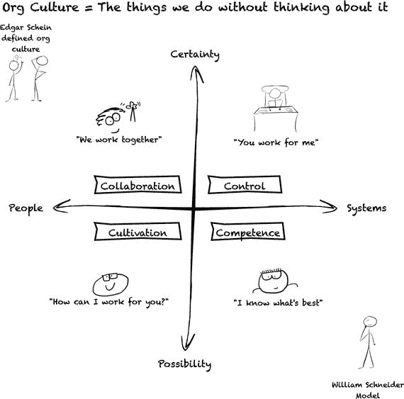

图 25-1. 住在健身房附近的顾客

- 控制型

- 协作型

- 培养型

- 胜任型

在他的书中，他提供了一份问卷，你可以在组织中传阅。问卷帮助确定哪个类别最能描述你的组织。类别之间可能有所重叠。你的公司可能非常重视胜任力，但同时也相当重视协作。并非每个类别都能涵盖整个组织。尽管如此，你很可能看到一种明显突出的组织文化类型。

每种文化都有其优势与劣势。一种文化可能乐于接受新变革，而另一种文化可能连最合理的变革都会抵制。关键在于，一旦你理解了组织文化，就能更轻松地判断数据科学思维模式能在多大程度上扩展到你的团队之外。

##### 控制型文化

我们先从控制型文化说起。这种文化往往非常专制，就像狼群一样。这类公司通常管理风格保守，非常强调等级制度。在控制型文化中，每个人都清楚自己为谁工作，以及谁为自己工作。控制型文化非常强调服从。个人的角色就是服从上级的要求。这类组织的领导者会传达一个愿景，然后所有下属负责执行这个愿景。

组织内部也会有人确保每个人都遵循这个愿景。控制型文化倾向于让员工留在自己的职能领域内，人员通常很少流动。在这种文化中，权威很大程度上来自于职位和头衔。总监对经理有权威，经理对主管有权威。头衔本身就代表了权威的层级。

由于极其强调服从，控制型文化中的决策往往非常周密。最高层追求确定性。高管层或总监们希望知道决策是什么时候做出的。他们需要下属“签字确认”该决策。要在这些组织中推动重大变革，就需要让高层人士，比如首席数据官（`CDO`）或首席信息官（`CIO`），来“赞助”这项变革。没有这个赞助人，要想在你的团队之外做出任何持久的改变将极其困难。不幸的是，控制型文化如此重视确定性，以至于很难让高层赞助人同意进行重大变革。重大变革本质上几乎总是伴随着风险。控制型文化进行重大、高风险变革最常见的方式，是在几乎没有其他选择的时候。这类组织通常更为保守，其规范崇尚秩序和确定性。他们通常更喜欢可预测的流程。这就是为什么很多这类组织会倾向于依赖大型系统的变革。这些系统被设计成让每个人都知道自己在更大流程中的角色和位置。

数据科学团队在控制型文化中常常举步维艰，因为数据科学团队的角色比控制型文化中的角色更灵活。此外，探索本身就不确定性极高。在强大的控制型文化中，数据科学团队通常既不容易获取数据，也没有决策权。控制型文化强调组织的职能领域和强大的部门壁垒。这使得这些团队的项目经理很难打破数据孤岛。即便面临这些挑战，许多数据科学团队依然在强大的控制型文化中工作。控制型文化在大企业中非常普遍，而正是这些企业可能拥有海量有趣的数据。在很多方面，具有强大控制型文化的组织往往能从运行良好的数据科学团队中获益最多。

##### 能力型文化

第二种非常常见的文化是能力型文化。这种文化在软件开发组织中很普遍。典型的能力型文化是：一群软件开发人员创建了一个非常流行的工具，然后这些开发人员就成了事实上的管理者。这种能力文化作为其组织的一部分被建立起来。能力型文化的领导力重点在于设定标准和创建任务。他们根据每位员工的能力水平来分配任务。因此，管理风格是高度任务驱动的。管理团队试图以分析的方式来分配任务。核心就是谁能最好地完成工作。具有强大能力型文化的组织往往是矩阵式组织。在矩阵式组织中，一名员工可能有多个管理者。例如，一个质量保证开发人员可能既要向质量保证经理汇报，也要向软件开发经理汇报。这意味着很多员工都想成为专家，并且他们的主要精力都放在专业化上。你不想成为一个对开发了解太多的质量保证开发人员，否则你的软件开发工程师可能会给你分配任务，让你很快不堪重负。因此，能力型文化非常强调专业化。

## 四种组织文化类型

### 能力型文化
在能力型文化中，权力和权威很大程度上来自于发展高水平的专业知识。这些组织中的决策往往非常具有分析性。这类公司会把一个问题分解成各个组成部分，然后将这些部分分配给不同的员工。他们把组织视为一个工程问题。通常，当工程师遇到问题时，他们会将其分解成各个组件。这些组织文化通过推动宏大目标来管理变革。他们会设定一个宏大目标，并将其分解成任务来推进。他们通常非常专业，在这些能力型文化中，有着强烈的精英主义意识。你可以作为一个低级员工或实习生进入公司，如果你能专业化发展并达到高水平专业知识，你就能在组织内步步高升。

具有强大能力型文化的组织往往工作节奏也非常紧张。它们并不总是最容易工作的地方。能力型文化也可能难以拥抱数据科学的思维方式。数据科学通常是跨学科的。你需要了解一点统计学、数学、叙事技巧和编程。那些非常强调专业化的文化可能不太容易适应这种方法。你在需要讲好一个故事时，不会希望自己的数据分析师拒绝帮忙。你也不希望项目经理和研究负责人觉得自己没有资格提出好问题。能力型文化非常看重成为专家。这就是为什么专业知识的门槛很高。这可能是一个挑战，因为在数据科学团队中，往往正是外部人员会提出一些最好的问题。

### 培育型文化
第三种文化类型是培育型文化。这是四种类型中最罕见的一种。在这种以人为本的文化中，领导者专注于赋能员工，使员工能够成为最佳雇员。管理者喜欢确保每个人都快乐。他们希望员工享受成为组织一员的过程，并且非常强调员工满意度调查。这类组织倾向于建立以员工为中心、资源环绕四周的轮轴式权力结构。每位管理者都像轮子上的一根辐条。他们周围的人试图帮助员工弄清楚需要什么才能做到最好。

在培育型文化中，非常强调自我表达。管理者专注于发展和培养员工。他们希望成就每个人。领导力通常注重个人魅力。如果你是在培育型文化中具有个人魅力的人，即使你刚以初级职位加入公司，也能迅速成为权威人物。

管理者专注于培养他人的优势。培育型领导者通过团队的人才来解决问题，从而在组织中获得晋升。

在培育型文化中，成为通才备受重视。你不希望敲开某人的门，却听到他们解决不了你的问题。

在培育型文化中，你永远不会看到有人被困在体制内。培育型文化对部门分工和流程的强调要少得多。此外，这类组织的决策过程可能很困难，因为它是高度参与和有机的。团队中的每个人都想达成共识。

千禧一代和 30 岁以下的年轻人倾向于在这种培育型文化中取得成功。³ 许多年轻员工尤其热衷于寻求共识。由年轻企业家运营的组织非常重视这种培育型文化，并且更愿意拥抱变化、接纳新想法。他们认为变化是培育过程的一部分。他们会召开参与式的会议，讨论变革。然后，一旦他们决定变革对公司有利，就会迅速推行。这些组织鼓励成长和发展，并且工作氛围通常相当有趣，因为员工可以自由地犯错。

然而，培育型文化面临的挑战是决策过程往往很缓慢。可以想象，让大群体达成所有人都同意的决定需要很长时间。真正的培育型文化很少见。有些组织可能感觉自身是培育型文化，但仔细观察，你会发现它们并未真正遵循许多关键做法。这类组织很多只是控制型文化，披着一层培育型文化的薄薄外衣。

### 协作型文化
第四种也是最后一种文化是协作型文化。这种文化与培育型文化几乎一样罕见。你在信息技术领域真的不太常见到它，因为它不符合典型的领导风格。这种文化更多出现在培训组织中。协作型文化中的领导者往往是团队建设者和教练。他们的管理风格非常民主，但不像培育型文化那样临时随意。不一定要让所有人达成一致，但你仍然会看到一群管理者紧密合作，共同提出有趣的想法。这便是协作的全部意义所在。这类公司倾向于拥有群体集群，而不是像在控制型文化中看到的自上而下的层级结构。他们仍然非常强调成为通才。

协作型文化与培育型文化的最大区别在于，前者中权威来自于人际关系。有时你会在家族企业中看到这一点。你与组织高层人员的关系越近，你的权威就越大。高层人员之间的协作更紧密。他们倾向于通过头脑风暴会议和一些实验来做出决定。与控制型或胜任型文化相比，他们对变革更开放一些。如果组织正试图接纳数据科学思维模式，这会有所帮助。如果你拥有协作型文化，你的组织接受变革并不困难。然而，协作型文化可能会觉得数据科学的某些关键组成部分相当难以应对。一个有效的数据科学团队必须有权力去探索新想法并允许犯错。这种权力被下放到了团队层面。而协作型文化中，权力仍然倾向于集中在高层。他们只是比控制型文化稍微民主一些。

## 识别你的文化类型

现在你已经了解了这四种不同的文化类型，你需要弄清楚哪一种与你的组织最匹配（如果你还没这么做的话）。请记住，协作型文化或培育型文化更容易接纳数据科学思维模式的关键组成部分。这些文化中的个人也更容易发生变化，因为他们在组织中已经天然具有成为通才的倾向。

如果你拥有强大的控制型文化，你的组织会倾向于传统的庞大系统方法。这类组织倾向于创建大型流程，使每个人都清楚自己的职责。在许多方面，这与你所期望的运行数据科学项目的小型、自组织团队模式恰恰相反。这类文化也常常难以接纳科学方法的某些关键组成部分。实验和探索本质上具有不可预测性。控制型文化通常偏爱流程复杂、结果可预测的模式。如果你的控制型文化非常强大，你或许可以从小处着手，建立几个独立的团队。如果这些团队成功了，你就有机会进行更大范围的组织变革。请记住，这类文化通常最难改变。

如果你拥有胜任型文化，你的组织在尝试接纳数据科学思维模式时可能会面临类似的挑战。科学方法在很大程度上是将事物分解成有趣的问题，以便团队可以筛选这些问题，寻找更深层的洞见。这与胜任型文化通常看待工作的方式大相径庭。他们将大问题视为可以分解成任务的事项。这是一种高度分析性的方法，而非经验性的。胜任型文化中的团队需要确切知道他们要做什么才能完成工作。这类组织也倾向于拥有高度专业化的团队。团队中的每个人都应拥有自己的专长。这在很多方面使得团队协作性降低，每个人都是自己领域的权威。同样，这使得接纳数据科学思维模式变得更加困难。你希望你的数据科学团队能够提出有趣的问题。这些问题可能来自研究负责人，但也可能来自数据分析师，甚至项目经理。团队中的每个人都被认为有能力提出有趣的问题。对于强大的胜任型文化来说，这可能是一个不小的改变。

## 实施变革

在识别了你的组织文化之后，你就可以着手进行变革了。关于组织变革的最佳著作之一是《无畏的变革》¹。这本书揭示了组织接受或拒绝变革的模式。你可以利用对自身文化的了解，来识别哪些模式在你的组织中最有效。即使在控制型文化中，你有时也能为后续变革奠定基础。这本书面向的是“无权领导者”——那些在组织中没有任何显性或隐性权威的领导者。因此，你不需要是 CEO 或总监，也能尝试在你的组织中推动变革。

这本书非常适合用来引导组织思维模式的转变。即使在一个强大的控制型文化中，你也不一定非得是 C 级高管或经理才能启动变革进程。你只需要是一个有好想法并愿意将其引入的人。书中为变革领导者提供了 48 种模式。你可以根据组织文化，将这些模式组合搭配，形成一套整体策略。

书中最有帮助的指南之一是关于组织变革的“迷思”。其中一些迷思可能会阻碍你的变革努力。最常见的迷思包括：“如果这是个好主意，说服别人接受它就会很容易”，以及“实施新想法只需要知识和有效的计划”。另一个迷思是，如果某人对变革持怀疑态度，你可以无视或忽略他们。这本书为你提供了如何应对怀疑者以及如何倾听他们意见的策略。你不应该忽视怀疑者；他们可能是对的，并且看到了你没看到的东西。

书中指出的另一个迷思是，你可以在组织中独自担当变革推动者——仅仅依靠你的知识魅力、个人魅力以及 `PowerPoint` 的力量就足以推动变革。而这本书试图说明的是，你需要建立一群能帮助你推动变革的人。如果你无权无势，最好的办法就是先与一小群人达成共识，然后推动变革向前发展。

最后一个迷思是，认为一旦说服某人支持变革，他们就会一直支持下去。这本书擅长的一点是，将变革描述成一种近乎“抛接球”的行为：你成功说服某人变革是值得的，但你仍需时不时地回去与他们沟通。在这种情况下，要询问他们是否仍然认同，是否还支持变革。即使人们接受了变革和这个想法，他们也可能会回到旧习惯中去。当你试图在控制型组织中推动重大变革时，这一点尤其常见。

《无畏的变革》基于一个理念：人们接受新想法的速度是不同的。这些人自然会落入以下几个群体之一：

*   **天然创新者**：这个群体看到新事物时，会是第一批接受变革的人。你会在你的数据科学思维模式中看到这一点。你组织中的一些创新者会非常有兴趣运用科学方法来更好地理解你的数据。
*   **早期采纳者**：这个群体感兴趣，但他们想了解更多。他们可能认为这是个好主意，但积极性不如创新者高。
*   **早期多数**：这个群体是最大的部分。他们认为这个想法很有趣，但在加入之前会先观望别人怎么说。
*   **后期多数**：这个群体会说：“好吧，如果所有人都加入了，那我就加入，但我真的不想当第一个。”
*   **落后者**：这些人会说：“我真的很喜欢现在做事的方式，不明白为什么要改变。”

当你考虑进行大规模的组织变革时，人们接受变革速度不同的这个概念很有帮助。你正试图转向数据科学思维模式，而这通常是对文化的一次重大变革。这就是为什么你通常需要确保让早期多数群体认同。你可以利用你的创新者作为招募他们的方式，并努力获得足够的共识，以便推动你的敏捷转型并积累一些势头。

另一件要记住的事情是，当你试图改变组织文化时，你不仅要与人们的头脑对话，还要与他们心灵对话。你要能够在他们与变革产生情感共鸣的层面上与他们交谈。这能让你激励你的创新者，并鼓励你的早期采纳者。不要只谈论生产力。要将你的数据科学思维模式作为一种更好地理解客户的方式来谈论。甚至可以把它当作一种与客户建立情感联系的方式。创新者和早期采纳者通常都在寻找有趣的事情去支持。如果你能激发他们的兴趣，他们通常会陪着你完成整个组织变革。

这本书还探讨了这样一个观点：你无法压过别人。你不能忽视组织中的愤世嫉俗者和怀疑者。通常，这些人的观点是正确的，并且有充分的理由。我经常看到一些组织中，变革领导者试图忽视这些人，并将他们视为障碍。他们会把他们当作不想做出大改变的落后者而不予理睬。如果你无视这些愤世嫉俗者和怀疑者，你很可能会遇到更多问题。这些人往往是第一个指出挑战的人。你应该仔细倾听他们，理解他们想说什么。即使他们对某些方面持怀疑或批评态度，也要努力说服他们这场转型是可以实现的。你的怀疑者们会权衡你变革的益处与付出的努力成本。

### 总结

在本章中，你了解了不同类型的组织文化，以及如何识别你所在组织的文化。随后，你了解了一本能帮助你学习如何让组织克服对变革恐惧的资源。在下一节中，作为压轴大戏，我将为你提供一些临别感言。

---

¹ 原书脚注：⁴（注：此脚注为原文格式，保留不译）

### 终章

至此，我们走到了最后。希望你喜欢这本关于数据科学的书，并对如何组建能够提出有趣问题并交付真正商业价值的团队有了更清晰的认识。我试图强调的关键点之一在于，数据科学不仅仅是一套实践方法，更关乎一种探索与实证的思维模式。市面上有许多关于数据科学战术层面的书籍，而我在本书中的尝试有所不同——我想表明的是，战术的生命周期远短于向更宏观的数据科学思维模式的转变。如果你学习了`R`、`Python`、统计学或`Hadoop`，那么你将拥有部分所需的工具，但仅靠使用这些工具并不能让你成为一个数据科学团队。请记住要关注数据科学中的“科学”二字。这种数据科学思维模式能让你以更富趣味的方式自由运用这些工具。以全新方式思考你的数据，远比仅仅下载新工具和新软件更具挑战性。培养新的数据科学思维模式是一项真正的挑战，但这将使你与数据的协作变得更有成效、更具收获。

希望你享受本书的阅读过程，并在提出精彩问题、收集深刻洞见以及从数据中汲取更多知识的过程中获得乐趣。

**脚注**

[1] Edgar H. Schein, *组织文化与领导力*，第 2 卷。（John Wiley & Sons，2010 年）。

[2] William E. Schneider, *再造替代方案：让现有文化发挥作用之计划*（Richard D Irwin Publishing，1994 年）。

[3] Brad Karsh 与 Courtney Templin, *管理者 3.0：千禧一代改写管理规则指南*。AMACOM Div American Mgmt Assn，2013 年。

[4] Linda Rising 与 Mary Lynn Manns, *无畏变革：引入新思想的模式*（Pearson Education，2004 年）。

### 索引

#### A

`敏捷` `航线` `杰森·斯蒂芬博士` `阿尔伯特·爱因斯坦` `美国统计协会` `分析` `分析` `Apache Spark` `考古学家` `亚里士多德` `神话` `情节` `景观` `人工智能` `美国统计协会` (参见 `美国统计协会`) `提出好问题`

#### B

`加州大学伯克利分校` `伯克利地球组织` `理查德·穆勒` `大数据` `大数据问题` `大垃圾` `布克七种剧情模式` `克里斯托弗·布克` `战胜怪物` `探寻之旅` `白手起家` `重生` `悲剧` `旅程与回归` `头脑风暴会议` `商业价值`

#### C

`呼叫中心` `改变组织思维模式` `查尔斯·惠伦` `老烟枪` `芝加哥` `芝加哥地铁图` `单调的合唱` `气候变化` `科尔·努斯鲍默·克纳夫利克` `协作文化` `协作` `收集数据` `收集、访问和报告数据（基础工作）` `汽车颜色` `哥伦比亚大学` `能力文化` `冲突` `共识` `控制文化` `专制` `控制策略` `相关性` `相关系数` `相关性不意味着因果` `虚假因果` `优惠券` `创建、读取、更新、删除` `创意漫游` `信用卡` `批判性思维` `封闭式问题` `关键问题` `开放式问题` `推理` `强批判性思维` `弱批判性思维` `批判性的` `跨行业数据挖掘标准流程` `六个阶段` `CRUD` (参见 `创建、读取、更新、删除`) `培育文化` `客户流失率` `客户自助门户` `住在健身房附近的客户` `洞察循环`

#### D

`丹尼尔·平克` `概念时代` `丹尼尔·扬克洛维奇` `数据分析师` `数据库工程师` `数据库服务器` `数据清洗` `数据驱动` `数据挖掘` `数据模型` `数据科学` `数据科学家` `数据科学洞见` `数据科学生命周期` `数据科学思维模式` `数据科学团队` `数据擦洗` `数据孤岛` `数据故事化` `数据可视化` `数据可视化` `定义好的流程` `可交付成果` `交付有价值的软件` `数据民主化` `教育部` `描述性统计` `均值` `中位数` `作为管理者的开发者` `分布式文件系统` `分发结果` `观点多样性` `狗，吠叫` `药物相互作用` `邓宁-克鲁格研究`

#### E

`企业数据仓库` (参见 `企业数据仓库`) `爱德华·R·塔夫特` `图表垃圾` `数据-墨水比` `爱德华·塔夫特` `共情` `经验性的` `经验方法` `经验流程` `经验主义` `鼓励创新` `参与、愿景和真实性` (另见 `南希·杜阿尔特`) `企业数据仓库` `雌激素补充剂` `ETL` (参见 `提取、转换、加载`) `高管层支持` `实验` `探索性的` `探索数据` `提取、转换、加载`

#### F

`Facebook` `失败的实验` `托马斯·爱迪生` `无畏的改变` `琳达·瑞辛` `反馈循环` `五类受众群体` `高管` `专家` `守门人` `经理` `观察者` `故事的五个关键线索` `类比` `提出有趣的问题` `保持轻松` `激发好奇心` `使用“你”` `数据科学生命周期的五个会议` `改进会议` `问题分解会议` `研究规划会议` `故事讲述会` `可视化设计会议` `有缺陷的推理` `完整数据报告`

#### G

`高德纳集团` `乔治·卡林` `乔治·莱考夫` `金块问题` `我们中间的大猩猩` `CT 扫描` `大猩猩` `感知盲点` `西蒙斯，丹尼尔·J` `研究生院` `群体思维`

#### H

`Hadoop` `Hadoop 集群` `HBase` `英雄` `隐藏假设` `高科技公司` `希拉里·梅森` `Bitly` `激素替代疗法` (另见 `雌激素补充剂`) `HTML` (参见 `超文本标记语言`) `超文本标记语言` `假设`

#### I

`IBM` `IBM SPSS` `信息管理系统` `IDC` (参见 `国际数据公司`) `汽车图片` (参见 `汽车颜色`) `健康跑步者的图片` `国际数据公司` `互联网标题` (另见 `互联网新闻`) `互联网新闻`

#### J

`约翰·斯坦贝克` `约翰·W·福尔曼` `乔纳斯·索尔克` `陪审团，说服`

#### K

`了解你的受众`

#### L

`支持的路灯` `安德鲁·朗` `提供支持而非照亮` `利奥·布雷曼` `线性回归` `LinkedIn` `透过玻璃门的钥匙孔窥视` `发现循环`

#### M

`机器学习` `让数据可操作` `管理风格` `服从型` `民主型` `人员驱动` `任务驱动` `MapReduce` `马克·吐温` `马歇尔·麦克卢汉` `医学研究` (另见 `无针研究`) `隐喻` `墨西哥之旅` `微软` `Microsoft Word` `中间件` `里程碑` `千禧一代，培育文化` `多学科` `客观的神话` `肯·斯坦利` `垫脚石`

#### N

`南希·杜阿尔特` `叙事` `叙事` `美国国家航空航天局` `阿波罗太空任务` `国家气象局` `无针研究` `Netflix` `《纸牌屋》` `评分数据` `纽约证券交易所` `纽约时报` `专栏版` `西北大学学术计算和网络服务` `NoSQL` `聚合` `Cassandra`

#### O

`目标驱动` `目标` `在线杂志` `Oracle` `组织变革` `埃德加·沙因` `群体` `神话` `组织文化` `组织文化，变革` `组织文化，识别` `组织知识` `组织学习`

#### P

`发现的速度` `淘金` `保罗·史密斯` `剥开假设` `个人轶事` `制药` `柏拉图` `项目管理协会` (参见 `项目管理协会`) `项目管理办公室` (参见 `项目管理办公室`) `宝丽来即时相机` `爱德华·兰德` `政治家` `PostgreSQL` `PowerPoint` `演示` `可预测的价值` `预测性分析` `处方药` `概率` `宝洁公司 CEO` `项目管理` `大爆炸` `可交付物` `约束` `甘特图` `铁三角` `项目管理协会` `项目管理办公室` `项目经理` `数据民主化` `盾牌与推土机` `促销` `Python`

#### Q

`量化信息` `问题偏差` `问题板` `礼物问题` `问题优先方法` `问题会议` `问卷` `问题` `必要问题` `非必要问题` `问题树` `分支` `修剪问题` `问题类型` `必要问题` `非必要问题`

#### R

`R` `推理` `关系型数据库管理系统` `在线分析处理` `在线事务处理` `模式` `视图` `研究负责人` `投资回报率` `竞争性原因` `因果` `ROI` (参见 `投资回报率`) `浪漫喜剧` `浪漫跑步伴侣` `罗密欧与朱丽叶`

#### S

`Scala` `科学方法` `范围、成本与进度` `爬取` `擦洗` `软件开发生命周期` (参见 `软件开发生命周期`) `自动驾驶汽车` `半结构化数据` `可扩展标记语言 (XML)` `JavaScript 对象表示法 (JSON)` `意义建构` `意外发现` `提问的七大陷阱` `人身攻击` `循环论证` (参见 `障眼法`) `错误二分法` `可疑权威` `质疑驳回` `急于达成共识` `稻草人推理` `帮助受众采取行动的七个步骤` `莎士比亚` `西德尼·芬克尔斯坦` `故事的六个重要元素` `六个关键问题领域` `澄清关键术语` `发现错误` `挑战证据` `误导性统计` `缺失信息` `挖掘假设` `持怀疑态度` `障眼法` `草率的推理` `放错地方的智能手机` `软推理` `软件开发生命周期` (另见 `瀑布模型`) `编织故事` `电子表格` `冲刺` `从概念到现金` `快速转向` `SQL` (参见 `结构化查询语言`) `利益相关者` `统计推断` `统计学家` `统计学` `便利贴` `故事背景` `故事结构` `故事化` `消除干扰` `意义` `陷阱` `结构化数据` `结构化查询语言` `粉饰信息` `糖对健康有害` `夏日梦想家` `可视化` `交响曲` `雪城大学`

#### T

`团队冻结` `团队` `发短信和开车` `时间盒` `提问困难` `企业文化不鼓励提问` `提问经验不足` `时间不够` `自我保护` `Twitter` `推文` `两周冲刺`

#### U

`基本假设` `芝加哥大学`

#### V

`维恩图` `客户 360 度视图` `视觉闲聊`

#### W, X

`团队漫游` `预热房间` `瀑布模型` `编织故事` `轶事` (另见 `个人轶事`) `案例研究` `例子` `场景` `小插曲` `Web API` `公认事实` `公认事实` (参见 `公认事实`) `白板` `威廉·施耐德` `威廉·S·克利夫兰` `WordPress` `万维网`

#### Y, Z

`尤瓦尔·诺亚·赫拉利`