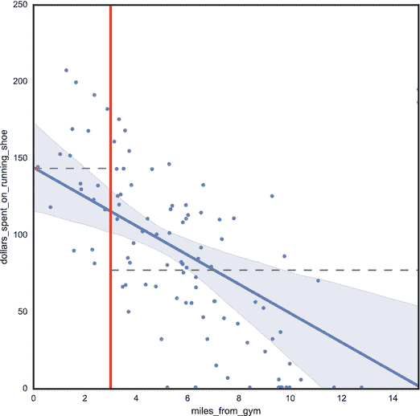

## 第五部分：用数据科学讲故事

历史学家尤瓦尔·诺亚·赫拉利在他的著作《人类简史：从动物到上帝》¹中写道，我们的原始人祖先并非通过制造工具而成为现代人类。相反，是他们能够互相讲述复杂故事的能力。正是我们共享的叙事，成为了从流浪的非洲猿类进化到今天*智人*的关键一步。这些故事帮助我们形成了关于农业、正义和宗教的新思想。这就是为什么讲故事深深植根于我们最基本的沟通方式中，在沟通新颖且复杂的想法时尤其如此。在本部分中，我们将讨论讲故事的基本方面。你的数据科学团队的见解只有在你能够将数据与某个更宏大的想法联系起来时，才能发挥作用。通常，做到这一点的最佳方式是将一个清晰而有趣的故事编织在一起。仅仅展示数据是不够的。为了让你的团队成功，利益相关者需要理解这些新想法背后的含义。一个好故事将有助于弥合这一差距。

脚注 1

尤瓦尔·诺亚·赫拉利。《人类简史：从动物到上帝》（兰登书屋，2014 年）。*需要页码

### 19. 定义故事

我的一位同事最近买了一台新摄像机，制作了一部关于他墨西哥之旅的短片。他用了软件让视频看起来美轮美奂。开场字幕就像电影院里看到的那样。他有音乐、画外音，甚至还有一些特效。

我们一起坐下来看了他 15 分钟的影片。大约看了五分钟，我就想起了讲故事和看视频之间的区别。他完全没有试图让我融入他的旅程。那只是对一个美丽地方的精彩影像记录。我完全无法与他的经历产生共鸣。这 15 分钟过得相当缓慢。影片结束后两分钟，我甚至说不出刚才看到了什么。

许多数据科学团队对讲故事的理解也是如此。如果你只有漂亮的图表，那么故事就会自己讲述出来。如果我放上一张易于理解的图表，观众就会明白其中的含义。实际上，就像那个墨西哥视频一样，把东西做得漂亮并不意味着它就变得有趣。美感可以增强体验，但它不能取代故事。

很多数据可视化资料都侧重于制作图表的技巧。数据科学团队需要记住，数据可视化和讲故事不是一回事。事实上，它们截然不同。一个漂亮的数据可视化就像精心设计的电影布景。它可能搭建了背景，但不会让你感受到任何深层含义。这就是为什么你不会去看长达两小时的漂亮电影布景视频。

究竟是什么构成了一个故事，这并不容易定义。有一些结构性的定义。它们勾勒出人物、冲突以及达成重要目标的过程。古希腊哲学家亚里士多德提出了故事的六大要素。其中包括情节、神话和壮观场面。

这些定义是一个不错的起点，但它们只让你了解了故事的要素。它们可能无法帮助你的团队与观众建立联系。这有点像试图通过专注于刷子和凿子来学习雕塑。相反，你应该把故事看作一种建立联系的方式。

对于你的数据科学团队来说，试着把故事视为一种运用语言和视觉元素，帮助观众理解并将故事与某个更宏大的意义联系起来的途径。

这是讲故事时你需要思考的首要问题之一：你将如何建立联系？你将如何帮助你的观众找到更宏大的意义？

关于这个定义，有几点需要注意。首先，你是在运用语言和视觉元素来建立联系。你所说的和你所展示的本身并不是故事。实际上，视觉元素常常会横亘在你和观众之间。

想想你见过的最精彩的演示。你离开时会说：“我没太听懂他们说什么，但那张图表太棒了”吗？更可能是相反的情况。你很可能记住了那个被误解的孩子，或者那个劳累过度的家长。那十几张 PowerPoint 幻灯片可能早已消失在遥远的记忆中。

定义的第二部分是“帮助”观众。记住，一个好故事是为了观众的利益。没有什么比看着一个数据科学团队谈论他们自己的成就更无聊的了。你讲故事是为了帮助观众与材料建立联系。你说的每一句话都应该是为了他们的利益。这意味着你不应该谈论过程或分享功劳。直接切入正题，帮助你的观众。

最后，记住一切都关乎建立联系，以帮助你的观众找到某种意义。当你做得很好的时候，观众就会找到你试图传达的某些意义。也许他们只找到了部分意义。那可能是他们能找到的最紧密联系的部分。这没问题，你可以以此为基石，讲述你的下一个故事。

重要的是要明白，你演示的美感和制作价值并不等同于一个好故事。如果我朋友少花点时间在特效上，多花点时间建立联系，我从他的视频中能收获更多。墨西哥是一个美丽的国家，充满了丰富多彩的历史和精彩的故事。如果他仅仅从那里开始，我就会觉得我们拥有了一段共同的经历。我会分享他旅程的更大意义，而不仅仅是看看那些影像。

现在你已经知道了故事的大致定义，那么如何讲好一个故事并让观众始终保持投入呢？你将在本章中找到答案。

## 编织故事

当你做演示时，观众分心的方式有很多种，让他们保持参与和专注可能是一个挑战。你头顶上可能有一个时钟，所以观众会不停地看时间。如今，许多会议室都有玻璃门和玻璃墙，这让观众容易被房间外的人分散注意力。在现代办公室里讲故事并非易事。你需要格外努力，在观众身处房间时专注于吸引他们。当你开始讲故事时，你要立刻开始“编织故事”。

### 什么是“编织故事”

这是 19 世纪水手们在讲一个好故事时使用的术语。作为水手的一部分就是要懂得如何搓绳。每一股线都需要扭结交织在一起，才能编成一根结实的绳子。

当你的团队试图“编一个好故事”时，可以关注五个关键的线索：

- 激发观众的好奇心。
- 尝试用类比或共同经历与观众建立联系。
- 尽量少用“我”这样的词。多用“你”或“你的”。你想让焦点落在观众身上。
- 提出有趣的问题。
- 不要太严肃。如果你风趣幽默或平易近人，观众就更容易接受你的观点。

以下各节将对每一点进行更详细的说明。

### 激发好奇心

那么，我们先从激发观众的好奇心开始。想象一下，你要去参加一个普通的会议。演示幻灯片上写着：“第四季度销售预测”。所以你知道第三季度末有一个相当强劲的上升趋势。

再想象一下同一个会议，但幻灯片上只显示演讲者的名字。会议开始，演讲者做了自我介绍。她开头说道，过去几个月的销售额一直在增长，但数据科学团队却搞不清楚原因。观众可能心里在问，为什么数据科学团队不知道销售额增长的原因，并好奇这个故事将如何发展。换句话说，观众产生了好奇心。他们想看看演讲者如何将未解之谜与答案编织在一起。如果你能保持观众的好奇心，他们在你讲故事时就会很有耐心。

### 与听众建立联系，善用“你”

另一个可以尝试的“线索”是分享一段大家都能感同身受的经历。当你讲述故事时，听众需要将你视为一个活生生的人，与你产生共鸣。你不想让他们觉得你只是一个团队成员或部门代表。你希望他们渴望了解，作为个体的你，有什么话要说。这将有助于他们将你的讲述与他们已有的认知联系起来。

尽管作为数据科学家，你的工作是谈论数字，但不要从谈论数字开始。相反，先谈一段经历。例如：“当我第一次看到这些数据时，我想起了人们在排长队等待时的感受。”然后，再接着描述排队问题的严重性，以及这可能会让你流失客户。

在分享个人经历时不要过度。记住，要尽量减少使用“我”这样的字眼。分享经历是为了帮助听众找到意义，而不是单纯地讲述你自己。你是将自己作为一个例子，引导他们如何去理解这些数据。

### 提出有趣的问题

你或许还想分享一些你数据科学团队提出的问题。在本书中，你已经学会了如何提出有趣的问题。你可以用这些问题来激发听众的好奇心。如果你的团队觉得这些问题很有趣，那么你的听众有很大概率也会觉得它们有意思。将问题与经历巧妙地编织在一起。让他们感觉是在和你一起寻找答案。一个好的问题会让你的听众渴望得到答案。

### 保持轻松氛围

最后，记住不要太严肃。当听众觉得你乐在其中时，他们会自然地被你的故事吸引。这同样能激发他们的好奇心。他们可能会想，为什么你看起来如此享受。不要表现得滑稽可笑，那会损害你的可信度。相反，努力营造一种轻松愉快的体验。你甚至可以在讲述团队如何提出问题的过程中加入一些幽默。听众希望在你的帮助下，将你的讲述与某种总体意义联系起来。让他们知道这是一段有趣的旅程，他们也就更愿意参与其中。

这五条线索将帮助你编织出一个强有力的故事。每一条线索都会增强你整个讲述环节的力量。你可能无法全部用到，但请试着记住它们是如何交织在一起，牢牢抓住听众的注意力，引导他们探寻意义的。

## 五种叙述方式

现在，你已经了解了编织故事的五个不同线索，让我们放眼更大的主题，来看看你可以用哪些不同类型的叙述方式来“套牢”你的听众。

叙述几乎可以是你所说的任何内容。电视广告是一种叙述，我抱怨等了好久才买到电影票也是一种叙述。并非所有叙述都是故事，记住，故事是为了帮助听众与某个更大的意义建立联系。我等了很久才买到电影票这件事本身并没有什么宏大意义。我不是在努力探寻真理，我只是想看新一部的《星球大战》。

你可以使用不同类型的叙述来帮助听众过渡到你的宏大故事中。当你想向听众解释数据科学概念时，以下五种叙述方式尤其有用：

- 轶事
- 案例研究
- 举例
- 情景假设
- 片段描写

接下来的章节会逐一为你详细介绍。

### 轶事

我们先从轶事说起。轶事是关于某个与你宏大主题相关的简短个人经历。这里的关键词是“简短”和“相关”。你的轶事要足够长到引人入胜，又要足够短到不分散对宏大故事的注意力。轶事在讲述环节的开头非常有用。例如，假设你正在进行一场关于为什么这么多客户在结账前放弃购买的讲述。你可以先分享一个小轶事，讲述你自己某次空手离开商店的经历。你可以说那是因为做决定的压力太大。然后，再把这个经历引向更大的故事——为什么那么多客户可能会放弃购买。

### 案例研究

另一种很棒的叙述方式是案例研究。案例研究是讲述一个小问题以及它是如何被解决的。当你想呈现一个带有可能解决方案的故事时，案例研究非常有用，比如讨论过去的一个数据科学难题以及解决问题的方案。假设你想用一个案例研究来弄清楚客户为什么放弃购买。你可以解释，当网站重新设计后，购买量出现了小幅下降。设计团队简化了网站，购买量又回升了。这个案例研究与一个更大的故事相关联，在那个故事中，数据科学团队指出结账流程过于复杂。

### 举例

第三种叙述方式是举例。举例与案例研究类似，区别在于它不一定要摆出挑战和解决方案。它通常也涉及他人。当你试图论证宏大故事中的某个部分时，可以使用举例。也许你可以指出，其他好几家公司也在尝试简化客户在线购买流程。因此，你的听众即将听到的故事，对于你的公司而言，并非特例或孤例。

### 情景假设

第四种叙述方式是情景假设。情景假设是列出一系列事件，并请听众思考每种可能的结果。情景假设并不常用，这很可惜，因为它通常是让听众思考未来的好方法。很多演讲者觉得情景假设听起来太幼稚，所以如果你决定使用，务必确保它不过于简单。

情景假设通常在讲述环节的开头效果最好，并且应该用第三人称来叙述。你不希望它听起来像个人轶事。例如，你可以描述这样一个场景：朱莉在午休时间，只剩五分钟来购买她想要的商品。三分钟后，她找到了想要的商品并放入购物车。就在她准备结账时，她又看到了另外四件想要的东西。她的钱不够买下全部五件商品，她该怎么办？她是放弃购物车，想着稍后再回来，结果却忘了？

### 片段描写

最后一种叙述方式是片段描写。片段描写就像一个小场景或一部微电影，通常用第三人称叙述。一个好的片段描写能抓住听众的注意力。你可以用一个关于沮丧客户的小片段来开场你的讲述环节。比如这样说：“他们为什么总是重新设计网站？上次改版我才刚搞清楚所有东西在哪儿。”

这五种叙述风格应该能帮助你提高听众的参与度。记住，这些叙述本身并不是故事。它们可以辅助你，但无法替代你的宏大故事及其所蕴含的意义。

## 总结

在本章中，你学习了“编故事”（spin a yarn）这个短语，以及如何通过五个关键“线索”将其融入你的叙述中。

- 激发听众的好奇心。
- 尝试通过类比或共同经历与听众建立联系。
- 尽量不要使用“我”或“我的”这样的词。相反，使用“你”或“你的”。你要让焦点集中在听众身上。
- 提出有趣的问题。
- 不要过于严肃。如果你幽默风趣或平易近人，听众会更容易接受你的想法。

接着，你学习了五种叙述类型（轶事、案例研究、例子、场景描写和片段描写）。当你试图向听众解释数据科学概念时，可以使用这些类型。在第 20 章中，你将学习如何理解故事结构。

---
脚注 1
S. H. 布彻，《亚里士多德诗学》。（麦克米伦出版社，1961 年）。

### 20. 理解故事结构

# 讲故事

讲故事并不仅仅是对所发生事件的简短描述。如果你告诉某人你去杂货店买了一加仑牛奶，这不算是在讲故事。故事具有复杂且一致的结构。需要有冲突和情节。在本章中，我们将讨论一个典型故事的各个要素。你可以运用这些要素来编织出能抓住听众想象力的内容。仅仅描述数据是不够的。一个复杂的数据科学故事必须展示出这些洞察为何重要。你还会发现，你的许多数据科学故事会遵循相似的情节。当你看到这些模式时，你可以以一种有助于听众从你们团队的洞察中提取意义的方式来构建你的故事。

## 运用故事结构

你已经了解了如何将不同的线索编织成一个故事。还有一些不同的技巧可以用来吸引听众。那么现在，让我们来看看如何将所有内容整合到一个更大的结构中的不同方法。

你的数据科学故事应该包含三个阶段：开头、中间和结尾。你应该利用这些阶段来帮助听众找到你故事的意义。在每个阶段，你都需要做不同的事情。

在第一阶段，与听众一起设定背景。第二阶段应引入冲突。然后，你应该通过创造一些行动来结束故事。也许你解决了冲突，或者角色从挣扎中学到了东西。

### 设定背景

背景是你设置场景和角色的地方，介绍他们并将他们置于特定的时空之中。你应该尽可能快地设定好背景。许多人花太多时间来设定背景。你只需要花足够的时间来介绍角色并将他们置于某个场景中即可。

例如，假设你的研究负责人在一个故事分享会上进行演示。她通过设定背景来开场。她开始说道：“我们一直在密切监控在我们网站上购买鞋子的客户。我们可以看到他们的居住地，并将其与他们的购鞋频率联系起来。” 这设定了背景：购买跑鞋的客户，以及他们的居住地与购鞋频率的关联。

### 引入冲突

在中间部分，开始讲述冲突。实际上，冲突是故事中最令人难忘的部分。前一个例子中的研究负责人可能会说：“居住在城市地区的客户更有可能购买跑鞋。事实上，居住地人口密度越大，他们购买跑鞋的频率就越高。我们觉得这很奇怪。作为跑步爱好者，我们并不真正喜欢在人口密集的地区跑步。那里有太多大型车辆和交通。所以我们决定进行一些实验。”

冲突是你吸引听众的地方。他们可能已经在心里想，这真是出乎意料。研究负责人用个人轶事来激发他们的好奇心，他们甚至可能开始提出自己的理论。也许他们认为这是因为客户更年轻，或者他们住得离大公园更近？

接下来，研究负责人想要创造一些行动。这就是她通过解释冲突的解决方案来应对冲突的地方，她查找数据的地方，以及她的发现。她应该稍微谈一下所采取的行动，但同时也不要过多地解释细节。她可能会说：“我们进行了一个实验来查看他们的年龄。这些客户往往比较年轻，但当我们调整了年龄因素后，仍然存在相当大的差异。我们还查看了一些拥有大量活跃客户的地图。我们想看看是否有更多的跑步路线。结果发现，城市外的路线普遍更好。”

现在，研究负责人将听众吸引到这场“挣扎”中。她不想花太多时间谈论所有的实验。同时，她仍然希望激发他们的好奇心，甚至可能建立一些期望。

注意：在本章稍后的部分，你将了解更多关于如何呈现冲突的内容。

### 结束故事

为了收尾，她会说类似这样的话：“结果发现，我们发现的最强关联是，如果客户居住地距离健身房在三英里以内，他们就更有可能购买跑鞋。” 这就是你在图 20-1 中看到的情况。

**图 20-1**. 居住地靠近健身房的客户

橙色虚线显示居住在距健身房三英里以内客户在跑鞋上的平均花费，灰色虚线显示居住在距健身房三英里以外客户在跑鞋上的平均花费。这两个变量之间存在明显的负相关关系。请参见 [`http://ds.tips/pUhe3`](http://ds.tips/pUhe3) 了解如何制作此图表。

她用一个简短的小片段来收尾：“所以想象一下我们那位住在健身房附近的客户。他在室内跑步，并且总是在寻找保持身材的新方法。仅仅是靠近健身房就足以让他购买更多的跑鞋。”

她通过引入新的洞察来结束故事。也许她还会询问听众是否有任何问题，并利用这些问题为下一次故事分享会提出一系列新问题。

为你的故事赋予一定的结构，有助于听众从你的故事中获得意义。请记住，你应该把最大的精力放在故事的中间部分。听众最有可能记住的是冲突。然后你可以以一个行动项目来收尾，甚至提出更多问题以获取更深入的洞察。

## 引入剧情线索

在上一节中，你了解到一个故事基本包含三个阶段（背景、冲突和结局）。在背景与冲突之间，你需要引入剧情线索。人物与剧情共同构成了故事的难忘之处。例如，在莎士比亚的《*罗密欧与朱丽叶*》中，罗密欧与朱丽叶是人物，而他们被禁忌的爱情则是剧情的一部分。他们的心碎与死亡则是剧情的最终篇章（剧透预警）。

在数据科学领域，剧情是你叙述故事的主体部分。它既包含数据本身所述说的内容，也包含你对其含义的解读。你的故事情节不必为了吸引人而刻意追求原创。真正让故事引人入胜的，是你如何将剧情与人物在背景中交织融合。

在克里斯托弗·布克的《七种基本情节》¹中，他认为所有故事都只包含少数几种情节。他指出，人类在聆听故事时具有非常相似的心理需求。并非所有人都认同这在文学领域是真理，但对于数据科学故事而言，这几乎可以肯定是成立的。你的受众只会寻找几种不同类型的情节。

布克的七种情节是：

- 白手起家

- 战胜恶魔

- 追寻探索

- 旅途与回归

- 喜剧

- 悲剧与重生

在讲述你的数据科学故事时，请牢记这些情节。这些情节有助于精确定义你试图传达的信息。数据科学喜剧不太可能受到受众的欢迎，但其他六种情节只需稍加调整即可应用于你的叙述环节。

### 白手起家

最常听到的故事之一便是“白手起家”。几乎每个组织都对能用于创造新收入的洞察感兴趣。也许你的团队有一个新产品的想法，也许你已经找到了一种方法来扩大现有产品的规模。当你讲述这类故事时，请思考如何以一种与白手起家情节一致的方式来叙述。描述组织的现状，并描绘一条通向未来财富的清晰路径。切记要清晰地铺陈剧情，以帮助阐明你的故事，并引导受众找到其中深意。

### 战胜恶魔与追寻探索

数据科学故事中另外两种常见的情节是“战胜恶魔”和“追寻探索”。许多组织试图利用数据来应对危险的挑战。也许你的产品遇到了新的竞争对手，数据也显示了销售额的严重下滑。那么，将你的剧情聚焦于运用从数据中获得的巧妙策略来战胜这个“恶魔”（竞争对手）。鼓励你的受众开启一段追寻探索之旅。当你试图说服受众去尝试不同的事情时，例如开展新的业务或引入新产品，这种情节尤为有效。这种情节会使你的目标变得富有浪漫色彩。

### 旅途与回归

一种不太常见的情节是“旅途与回归”，有时也被称为事后剖析。例如，你启动了一个新项目，但最终判定它不值得继续推进。现在，团队需要仔细审视数据，判断是否有任何经验教训可以汲取，或者这次经历是否蕴含任何价值。随着数据科学日益普及，你会看到更多这类情节。组织总想从失败中学习经验。因此，未来你可能会看到更多“旅途与回归”式的叙事环节。

### 悲剧与重生

你不常听到的一种故事是数据科学悲剧。大多数组织更倾向于遮掩其悲剧。你更可能在政府项目中看到数据科学悲剧，因为其受众对全面了解悲剧的始末深感兴趣。一个数据科学悲剧故事，将会是对所有出错环节的全面分析。它不像事后剖析那样侧重于经验教训，而是仅仅专注于理解这个令人遗憾的故事全貌。

最后，你可能会讲述一个关于重生的故事。有时，公司会审视数据，然后判定其当前的业务线已难以为继。即便是像 IBM 这样的大公司，也可能决定彻底转型其业务。IBM 从低利润的个人电脑和硬件销售模式，转向了高利润的服务与咨询业务。他们之所以能做到这一点，是因为当时的 CEO 能够讲述一个令人信服的故事。那是一个高科技版本的《青蛙王子》的故事。

## 呈现冲突

请记住，故事是通过视觉元素编织叙事，帮助观众与某种意义产生联结。人们常以为通过成功与成就的故事就能与他人建立联系，因此许多商务会议都以某项新成就或目标开场。观众或许会鼓掌，但他们并未真正触及任何意义。实际上，正是挣扎与冲突，才能帮助人们找到意义，并将观众与故事联结起来。

当你进行故事讲述分享会时，你的观众很可能整天都在过滤信息。如果你与高层利益相关者共事，这一点尤为明显。他们每天要处理数百条信息，翻阅数十份报告。要成为高效的数据科学团队，你必须以不同的方式与观众沟通。

你已经见识过数据如何讲述故事。事实上，你也看到同一组数据能演绎出多个不同的故事。你的挑战在于：将死板的数据进行逆向工程，使其蕴含创造者的人性光彩。你需要传达挣扎与冲突，为数据科学故事构建情节。

那么这具体是什么样的？想象你在一家大型信用卡处理公司的数据科学团队工作。团队发现，信用卡客户在即将无力偿还账单之前，会改变消费模式。这些客户在陷入财务困境前，会突然增加信用卡使用额度。你的数据科学团队在数十万张信用卡中观察到了这种模式。

你的研究主管可以用多种方式呈现这些信息。她或许会展示一张简单的折线图，显示客户陷入困境前消费额的上升趋势；或者讲述一个关于数十万客户的故事。这两种方式都能呈现信息，但很可能无法让观众与数据产生共鸣。呈现信息的最佳方式是讲述一个有趣的故事，包含真实的情节、挣扎与冲突。

首先，创造一个真实姓名的人物角色。这不应是真实客户的姓名，但可以基于客户最常见的特征来塑造。你的研究主管可以这样开始她的故事分享会："今天，我们的数据科学团队想谈谈一位客户。我们称他为艾伦。两个月后，艾伦将无力偿还信用卡账单。他成为我们的客户已约六年。过去两个月，他的消费额度已用至上限。这对艾伦而言相当反常。他 48 岁，正用信用卡购买食品杂货和支付交通费用。通常，他只用信用卡购买机票和支付酒店账单。我们知道艾伦即将无力偿还账单。现在我们该怎么办？"

通过这种方式呈现数据，研究主管将数十万客户的数据整合起来，创造了一个包含真实人类挣扎的情节。你的观众应该能以更有趣的方式与这些数据产生联结。也许他们正在思考是否对艾伦负有责任。是否应该给他寄封信或打个电话？

不仅为角色命名很重要，你还需要补充角色生活的一些细节。观众得知艾伦 48 岁，成为客户已有六年。这些细节有助于强化挣扎感，丰满情节。

观众将能更轻松地与数据背后的意义产生联结。讨论"如何应对艾伦"远比讨论他代表的数十万客户容易得多。这是一个包含真实挣扎的真实情节，通过细节得到了强化。

尽管艾伦并不真实存在，但为了故事的目的，他变得栩栩如生。他能以纯数据本身可能无法做到的方式展现冲突。曾经静止的数据，变成了一个包含真实挣扎、细节和情节的故事。

#### 本章小结

在本章中，你学习了如何将数据科学故事的所有要素整合到更大的结构中。你掌握了如何与观众协作设定背景、引入冲突并创造行动。随后，你审视了在背景与冲突之间应包含的不同类型情节，以及如何呈现冲突。在第 21 章中，你将学习如何定义故事细节。

**脚注**

1. 克里斯托弗·布克，《七个基本情节：我们为何讲故事》（A&C Black 出版社，2004 年）。

### 21. 定义故事细节

在第 20 章中，你了解到如果故事包含情节和冲突，人们更容易产生共鸣。这种挣扎会将听众带入你的故事。在确立了情节和冲突之后，你需要让故事保持活力。一个好方法是为故事的各个部分添加细节。这些细节就像一张张小小的思维便利贴，帮助听众记住更大的情节和冲突，也有助于他们在聆听时构建出一幅心理画面。

我曾经为一家试图利用数据科学来促使人们参与医学研究的组织工作。结果发现，很多人害怕针头——具体来说，是抽血用的针头。事实上，存在一个害怕针头和血液的人群切面，而这个切面涵盖了大量的人。

我自己对这两样东西也都不太喜欢，所以完全能理解这对医学研究的影响。只要涉及针头，你就会失去很多人。如果同时涉及针头和血液，失去的人就更多了。这种对针头和血液的恐惧让该组织陷入了困境。他们需要那些通常对研究不感兴趣的人开始参与进来。

数据科学团队提出了一些好问题，并生成了多份报告。这些报告引出了一个有趣的故事。他们发现，如果一个人参与研究并获得了非常好的体验，那么他更有可能参与未来的研究。因此，如果一个不喜欢针头的人，在一次无针研究中获得了积极体验，那么他可能会愿意参与未来包含针头的研究。

数据科学团队想讲述这个故事。研究负责人决定使用一位真实的参与者，只更改其姓名。所有参与者都填写了一份详细的申请表，并由一名护士进行评估，护士也会补充一些信息。我们的研究负责人利用这些信息的一部分来构建她的故事。这些申请表堪称细节的宝库，同时提供了护士的观察和参与者的反馈。

研究负责人从一件小事说起。她说：“当我还是护士的时候，我总能看出谁害怕针头。他们总是以某种方式交叉双臂。他们会抓住自己的两个手肘，以此来保护手臂不被扎到。这样的人有很多，而我们需要他们参与我们的医学研究。所以，我要跟你们讲讲我在我们的一份报告中找到的一个人的故事。”

“我们姑且称她为特蕾西。她参与了我们的一项医学研究，是关于一种正在研发的帮助睡眠的药物。研究第一天，她带着自己的枕头来了。她一定对这种药的效果抱有乐观的期待。她希望这种新药能帮到她，因为她在压力大的时候睡眠不太好。”

“结果，特蕾西是那些没能从药物中获得任何益处的参与者之一。离开时，她告诉护士，她父亲是一名医生，所以她觉得自己有义务参与医学研究。她说自己永远当不了医生，因为她既怕血又怕针头。几个月后，她决定参与一项流感疫苗试验。这项研究需要注射疫苗，之后还需要抽血检测。那么，特蕾西为什么决定参与呢？”

研究负责人用一段号召行动的呼吁结束了她的故事。数据科学团队认为，让人们参与无针研究是增加潜在参与者数量的最佳方式。

现在，想想你刚才听到的故事。你记得哪些内容？你记得参与者的名字吗？你记得她为什么参与第一次研究吗？你可能记得，但更有可能的是，你记得那些细节——那些帮助你构建心理画面的零碎信息。你可能记得她带了一个枕头，或者她父亲是医生。

这些细节帮助你完整地讲述故事。它们像快照一样，帮助听众把握全貌。在讲述你的数据科学故事时，试着用这些小小的细节为你的故事增添活力。它们能帮助听众与情节和挣扎产生联结。

#### 报告不等于讲述

商业演示很无聊。它们并非为有趣而设计，而是为了传达你的状态。它们就像是对利益相关者进行的一次口头“回复全部”。这在常规的状态会议上通常没问题，但你希望你的数据科学团队能做些不同的事情。

请记住，数据科学就是将科学方法应用于你的数据。你的团队会探索数据、提出问题、寻找关键见解，并解释各种不同的结果。团队面临的大多数挑战都与解释数据有关。你需要分解数据并解释其含义。

我曾经与一个数据科学团队合作，他们的重点是向信用卡客户推送促销活动。团队提出了很多有趣的问题，其中一些涉及客户的购买习惯。其中一个问题引出了一个关键见解。团队想知道客户是否会批量接受促销（同时接受多个促销）。结果发现，这个问题引出了几份非常有趣的报告，报告显示，如果一位客户接受了一个促销，他或她就更有可能接受下一批促销。

数据科学团队想在一次数据故事讲述会议上展示这一见解。研究负责人准备了一个演示文稿，但那不是一个故事。她只想解释这些发现，而这些发现仍处于探索阶段。该演示完全没有尝试解释这些发现意味着什么。团队只是指出客户更有可能批量接受促销，然后把决定如何使用这些信息的问题留给了会议室里的其他人。

我提醒研究负责人，“故事讲述会”不是仅仅呈现信息的地方。她需要将信息编织成一个有趣的故事，这样会议室里的人们才能参与其中，并与故事的含义产生联结。

我问研究负责人，为什么她认为客户会批量接受促销。她说，数据表明，大多数消费者的收入是批量到账的，这导致他们在收入高峰期消费更多，在低谷期消费更少。客户在人生的特定阶段也更可能接受促销。

我们俩都同意，这是传达这一信息的更好方式。会议室里的每个人都有过类似的经历。他们在人生的不同阶段，可支配的金钱不是更多就是更少。为什么不利用这种共同经历来传达关于客户如何接受促销的信息呢？研究负责人拿出了一个新的演示文稿。她创作了一个故事，名为“促销在不同人生阶段的影响”。

她从一个关于自己过去的轶事开始了演示。她说，上大学时，她有一个室友。她们经常收到邮寄的优惠券，提供买一送一的餐食。下课后，室友会回家问邮件里有什么，这样她们就能决定当晚去哪里吃晚饭。她说，四年大学下来，她们最后吃出了同样的口味。

有几个人笑了——而他们已经开始思考人们如何在人生的不同阶段使用商业促销了。对于研究负责人来说，这为讲述故事的其余部分创造了一个轻松得多的过渡。她描述了大多数客户如何在人生的不同时期以不同的比率接受促销。不是稳定持续的接受，而是处于相似境况的客户会批量接受促销。

这个轶事与故事相结合，极大地鼓励了群体的参与。许多观众变得非常好奇，并提出了诸如“这是否意味着，如果一个人感觉自己处于人生的脆弱时期，晋升可能会更有效？”之类的问题。另一位观众问道：“团队距离预测客户何时可能进入愿意接受大量促销活动的阶段还有多远？”

如果她只是做了一个典型的演示报告，她绝不可能获得这种程度的参与。故事吸引了她，并帮助他们将数据与自身经历联系起来。观众想到了自己可能更有可能接受促销的时期。然后，他们能够提出有趣的问题，并基于这一见解进行深入探讨。

#### 了解你的受众

在讲故事时，最大的挑战之一是了解你的受众。你听众中的每个人都有自己的世界观，并且会带着一连串的假设和信念来聆听你的故事。你的听众在那里是因为他们想从你这里听到一些东西。他们可能还不知道具体是什么，但当他们听到时，他们会有所回应。

我曾为一个大型政治竞选活动工作过。该竞选活动试图利用技术来更好地了解其受众。竞选开始几个月后，候选人向一群在过去几十年里失去过许多工作的人发表演讲。他站在一个旧工业建筑的骨架里，谈论新的工作培训。他讲了一个关于每个人如何能从高科技技能中受益的故事。观众鼓了掌，但并没有真正与故事产生共鸣。

几天后，这位候选人的对手去了一个类似的环境。他在一个破旧的废弃仓库里，旁边是一条缓慢流淌的棕色河流，发表了演讲。他以这样一句话开始讲述故事：“我知道你们很多人都不确定。你们不确定自己的生活方式是否有未来。”然后他讲了一个关于如何保存重要事物的简短故事。故事结束时，眼神呆滞的观众一直鼓掌直到候选人离开舞台。

第一位候选人显然不了解他的听众。听众不想回去学习如何成为会计。他们只是希望一切能恢复原样。当第二位候选人触及他们的内心时，他们就能够与故事产生联系。

政治竞选当然与数据科学团队不同；然而，原则仍然适用。你越了解你的受众，你在讲述故事时就会越有效。

## 了解受众的最佳方法之一

了解你受众的最佳方法之一是一种称为“预热房间”的技巧。这就是你四处走动，与一些听众闲聊的时候。他们中的一些人会直接告诉你他们在寻找什么。你可能会听到诸如“我很好奇这将如何与我正在做的事情联系起来”之类的评论。然后你可以问她：“你在做什么？”如果发生类似的事情，你可能需要实时调整你的故事，以满足受众的期望。

通常，你可以将受众分为五个不同的群体：

- `观察者`：观察者只是因为在日历上看到了会议才出现的人。此人对该主题不太了解，期望值也很低。对于这个受众群体，你能做的并不多。只需尽量让你的故事有趣，并限制使用缩略语或技术术语。

- `看门人`：看门人出现在听众中，是想看看你的故事会如何影响他或她的工作。这是你在“预热房间”时会遇到的那种人的典型例子。如果你在故事中使用了一个例子，试着直接将其与那个人所在部门的某个人联系起来。这有助于此人建立明确的联系。

- `管理者`：你听众中的管理者对相互依赖关系感兴趣。同样，你可以使用例子来展示部门之间的互动。你也可以在故事结尾创建明确的行动项目。这个受众群体通常是提出最多后续问题的群体。

- `专家`：你听众中的专家总是会追求更详细的细节。如果你不小心，专家可能会让你的故事偏离轨道，使其变得不那么有趣。如果他们这样做了，一定要解释新的细节，以便其他听众能够继续参与。

- `高管`：你听众中的高管希望从更大的问题中寻找答案。如果在故事结尾，高管提出了诸如“您如何看待这对组织其他部分的影响？”这样的问题，那总是一个好兆头。如果你的听众中有高管，不要展示太多幻灯片。如果他们在盯着你的幻灯片看，他们就没有在听你说话。

如果你努力识别你的受众并理解他们的需求，他们就更有可能与你的故事产生共鸣。如果你将受众分成这些群体，你就更有可能满足他们的期望。

### 相信你所说的话

约翰·斯坦贝克曾说过：“如果一个故事与听者无关，他就不会去听……一个伟大的、经久不衰的故事是关于每个人的，否则它就无法持久。奇异和陌生的事物毫无趣味——唯有深植于个人经历、令人熟悉的东西才引人入胜。”¹

当你讲故事时，你最具说服力的武器就是你对话题本身的兴趣。你的听众会始终观察你是否相信你所说的话。如果他们感觉到你全身心投入在讲述中，他们就会更容易与你的故事产生共鸣。

我在法学院读书时，曾选修了一门诉讼课程。这门课讲的是如何与陪审团就当事人经历的事情进行沟通。陪审团总是对你的当事人的故事充满好奇：他们是如何走到这一步的？他们为何被审判？

我们的教授与陪审团打交道已有数十年。他那长长的白胡须让他看起来几乎像一位绝地武士。他给了我们一些简单的建议。他说，讲故事时，尽量不要让它听起来多么与众不同。不要试图编造一些离奇曲折的情节。相反，要专注于你所了解的内容。讲述一个关于平凡事物的好故事，因为只有你所了解的东西，才是你能够真实呈现的。陪审团能够察觉出你何时不相信自己说的话。说出你相信的东西，即使它简单又平凡。只需清晰且饱含激情地说出来。

当你试图与听众建立联系时，道理也是一样的。如果你自己都不相信故事有趣，那么讲述起来会非常困难。伪装激情是极其困难的。

如果一个人对她的主题充满热情，她几乎总能以一种引人入胜的方式来谈论它。我曾听过一场关于飞机上免费航空杂志的演讲。演讲者对这一主题是如此热情，以至于深深吸引了听众。我也听过一些关于国际政治动荡的演讲。你能明显感觉到演讲者对这个话题并不感兴趣，因此他的描述方式也显得技术化且索然无味。

这种现象在数据可视化中尤为常见。一些研究负责人认为，好的数据可视化能为无趣的故事增添“亮点”。但是，如果你自己都不觉得故事有趣，那么即使是最华丽的图表也无法让它变得更有趣。你的听众需要从你身上感受到兴趣，而不是从你投在屏幕上的任何东西中获取。

有几种方法可以帮助你以有趣的方式呈现故事：

- 确保话题本身有趣。如果你无法呈现有趣的内容，那就什么都不要呈现。如果你对多少人买了红色跑鞋这件事不感兴趣，那么你就不可能讲出一个关于它的有趣故事。在你的故事中寻找有趣之处。如果你找不到，那就不该去讲这个故事。

- 将你自己与故事联系起来。告诉你的听众为什么你觉得它有趣。或许可以讲一个故事，比如你曾去美国西南部旅行。你注意到那里人们穿着的颜色在全国其他地方并不常见。于是回来后，你想看看是否有办法更好地满足这群客户的需求。谈谈你为了达成这个目标而采取的步骤。

- 听起来像个真人。许多组织给员工施加巨大压力，要求他们高效、超能，几乎像一支由`瓦肯人`组成的军队，只专注于工作绩效方面。他们摒弃激情和情感。这对于讲故事来说效果不佳。当一个人展现出脆弱、能自嘲时，他人更容易与之建立联系。

- 分享你真诚的情感。你不想让你的 `Storytelling Session`（故事讲述会）听起来像一个互助小组，但分享一种感受将有助于你的听众相信你所说的话。

请记住，你自身是你带给演示的最重要的东西。精美的图表、巧妙的故事以及堆积如山的数据，都无法弥补你带给这个主题的激情。如果你不能以一种有趣的方式去解释，即使是最非凡的数据也会显得枯燥。关键在于确保你相信这个故事是有趣的。如果你自己都无法说服自己，你就不可能说服你的听众。

### 总结

在本章中，你学到了不能仅仅报告数据，而需要做一些与众不同的事情。了解你的听众并熟悉听众中的不同类型（观察者、决策者、管理者、专家和执行者）至关重要。你还学到了要相信你所说的话，从而能够以有趣的方式呈现你的故事。在第 22 章中，你将了解如何让你的故事更具人性化，让人们认同你所讲述的内容。

### 脚注

¹ 约翰·斯坦贝克，《伊甸之东》（纽约：企鹅图书，1986 年）。

## 22. 让故事充满人性

我们已经花了很多时间讨论故事。你也看到了一个简单的叙述与一个拥有情节、角色和冲突的故事之间的区别。你还了解了如何以一种能吸引听众的方式来呈现故事。不过，这毕竟是一本关于数据科学的书。它关乎运用科学方法来更好地理解你的数据。最终，你将拥有数据，并希望听众能以有意义的方式与之建立联系。然后，你通过引导听众采取某种行动来创造价值。

你已经了解了如何先构思故事，因为这是你呈现数据的方式。现在，你需要反向梳理你的数据漩涡，并映照出创造这些数据的、有缺陷、情绪化且难以预测的人类。这是主要的挑战，也是区分数据科学团队与数据分析师的关键所在。作为数据科学团队，你的工作就是揭示数字背后的人性，这就是为什么你不应该仅仅用数字的语言来传达信息。

这样来思考。你在机场，在一个空座位上发现了一部被遗落的手机。这个人没有锁屏，你可以访问他所有的数据。你该如何找到手机的主人？你需要从这部手机中获取哪些数据才能找到主人？

很可能，你不会一开始就去分析手机价格与有人会归还它之间的概率关系（统计模型）。此外，如果你复述这个故事，你可能也不会使用数据和统计的语言；比如说：“我发现了一部智能手机，但我没动它，因为有人归还它的概率很高。”相反，你会以更“人性化”的方式来重构这个故事。也许这个人当时正在等飞机，然后跑出去找东西吃了。你查看手机上的近期通话记录，看看主人在离开前是否给某人打过电话。你知道人们在登机前常常会打电话给丈夫、妻子、男/女朋友。也许你会查看日历，看是否有航班信息。

你并没有把这部智能手机仅仅看作一个数据仓库；你把它看作一部珍贵的设备，里面存着这个人的照片、视频和联系人——这是一些会让人想念的东西。最终，你会处理这些数据，因为从中你能找到这部智能手机的电话号码、日历和联系信息。在这个思考过程中，你从故事开始，也以故事结束，而数据只是中间的工具——希望在故事的结尾，这个人能与他的手机重聚。

在保罗·史密斯的《用故事领导》一书中，他描述了宝洁公司的 CEO 如何来到演示现场，背对着幻灯片坐下。史密斯描述说，给这位 CEO 做演示时，他一次也没有转身去看数据。演示结束后，他意识到这并非偶然。大公司的 CEO 们无时无刻不在看数据。他们知道数据是工具，而讲述者所讲的故事才具有全部价值。这就是为什么当你进行故事讲述时，不要过分强调数据。如果数据不能与听众建立联系，它就毫无价值，而数据本身是无法做到这一点的。正是你围绕数据讲述的故事，才能帮助听众与其中的意义联系起来。

在你的演示过程中，你希望听众放下笔，合上笔记本电脑。你希望他们看着你，只是偶尔瞥一眼你展示的数据。如果他们花太多时间看图表或图形，那他们很可能在想别的事情。只有当故事将听众与数据联系起来，并赋予其意义之后，你的听众才会被激励去采取行动。

### 引入可视化

市面上有许多关于数据可视化的优秀书籍和课程。在第八章中，我推荐了科尔·努斯鲍默·克纳弗利克的《用数据讲故事》和爱德华·塔夫特的《定量信息的视觉显示》。这两本书都从非常实用的视角看待故事讲述。它们讨论了精彩的视觉效果如何创造精彩的故事。它们暗示数据可视化与精彩的故事讲述是相辅相成的。你可以在这两本书中看到这一点。

《用数据讲故事》涵盖了六课。前面的课程涉及选择显示方式和消除图表杂乱等内容，最后一课是关于讲述故事。你应该反过来看待这些课程，把故事讲述的课程放在其他课程之前。你的数据科学团队需要先理解数据并讲述一个故事，帮助听众在考虑图表和图形之前找到一些意义。

这些书籍和课程非常出色，但它们夸大了数据可视化的重要性。图表和报告当然有助于讲述你的故事，但正是故事的质量将听众与更宏大的意义联系起来。可视化只是这项工作中很小的一部分。

你的数据可视化既可能帮助你的故事，也可能损害它。过多的可视化会分散注意力，因为每次你展示一张新图像，人们都需要时间来适应这种变化。在吸引听众时，要保守地展示数据量。这些书籍为你提供了很多好主意，告诉你如何以最少的杂乱展示最多的数据。希望你的听众只需瞥一眼可视化图表就能理解它在说什么，然后他们就可以继续聆听更宏大的故事。

要记住的最重要的一点是：数据可视化是酱料，而不是主菜。一个真正有趣的故事不需要好的可视化。同时，即使是最好的数据可视化也无法掩盖一个无聊的故事。

如果你是团队的研究负责人，你可以做以下几件事来简化你的可视化，使其在不分散听众注意力的情况下为故事增值：

-   将你的数据分解成易于消化的小块。听众关注数据的时间越长，他们投入到听你故事上的精力就越少。尝试这两本书中的技巧来创建轻量级的可视化。两本书都描述了剥离不必要信息的过程。你的目标是提炼出传达有趣信息所需的最基本元素。在你查看可视化时关闭文本标签，看看数据是否仍然有意义。如果你选择展示大量数据，那么与其展示一两张需要听众费力消化的图表，不如呈现一系列持续不断、易于理解的信息块。

-   明确区分呈现数据和讲述故事。一个很好的区分方法是使用翻页器。手里拿着翻页器来切换幻灯片和呈现数据。放下翻页器，用双手来讲述你的故事。这能让你的听众有机会吸收数据，这样他们就不必在接收新的可视化信息的同时还要听故事。

-   记住，数据可视化本身作用有限。如果你想讲述一个关于像芝加哥这样伟大城市的故事，不要只展示一张漂亮的地铁图。像地铁图这样精彩的数据可视化能告诉你往哪儿走，但不能给你一个去那里的理由。讲述关于美食、迷人的社区以及密歇根湖沙滩的故事。这些事情能激发听众的行动，或许会让他们想要去游览。

如果你理解了可视化的局限性，你就能从它带来的附加好处中获得价值。只是不要犯这样的错误：以为好的可视化就能取代一个有趣的故事。

## 排除干扰

在讲述数据科学故事时，你很容易想要分享大量数据。有些团队觉得这是展示他们工作成果的好机会。不幸的是，故事分享会并不是展示数据科学复杂性的好时机。如你所见，一个好的故事分享会将数据作为配角，而非主角。这也是你会把演讲中所有不能增强故事性的内容都剔除的原因之一。当你越来越接近最终确定故事分享会的内容时，你应该做减法，而不是加法。

有两个主要方面需要你尽可能地保持简洁明了。首先，正如上一节所讨论的，要确保你的数据可视化图表尽可能清晰。其次，要确保故事中恰好有足够的人物、情节和冲突来支撑整个故事。剥离一切，直抵故事的本质。

我曾在一家机构工作，那里的故事分享会由一位主管主导。他通常以祝贺数据科学团队取得出色成果开始会议。接着，他会谈论公司变得更以数据驱动是多么重要。他说这是由在座的利益相关者制定的组织战略的重要组成部分。

十分钟后，主管才开始讲述故事的核心内容。不幸的是，此时大部分听众已经心不在焉了。一些高管在看手机，另一些则只是茫然地盯着第一张幻灯片。演讲开头添加的这些额外信息，让主管更难吸引听众的注意力。

现在想象一下，如果主管能立刻抓住观众的兴趣。他说：“我们认为找到了一种更好地预测客户行为的方法。通过观察模式，我们越来越擅长在客户产生购买念头之前就预判他们会买什么。”然后他讲述一个关于典型客户的故事，甚至在故事中用到其他角色。用这种方式，从他开始讲故事的那一刻起，听众的注意力就被抓住了。

记住，听众希望从你的故事中有所收获。一旦故事分享会开始，就要给他们一些有趣的东西。当你继续给予更多时，他们就会越来越深入你的故事。

这就是为什么你应该努力剥除通常在每次会议开始时都会有的那些组织惯例。故事分享会是一个特殊的场合。你的研究负责人绝不应该把它当作一个普通的进度会议来对待。你不必祝贺团队。你也不必展示他们工作的重要性。当你给予听众他们想要的东西时，他们才更有可能从你的故事中获取意义。

你的故事分享会不需要很多的数据可视化图表。当你使用它们时，要尽量消除任何干扰信息。剔除所有可以轻松概括的详细数据。从图表中删掉任何不需要的文字。审视数据可视化图表时，问问自己是否还有什么可以删掉。如果删掉它，会影响你想要传达的信息吗？并非每个数据点都需要文字标签，也并非每个数据序列都需要明确标注。例如，如果你有一个显示周一到周五的时间序列，则不需要每天都标注。

当你消除干扰信息时，你实际上是在为听众分担一部分工作。他们不必花太多心思去琢磨图表，猜测你要讲什么。你可以清除你和听众之间的这些障碍。

记住，少即是多。一个好的故事分享会不像烟花表演。你不需要用视觉、听觉和绚丽的色彩让听众眼花缭乱。它应该非常简单和聚焦。应该有易于阅读的可视化图表和一个简洁、仅有几个难忘细节的故事情节。

## 总结

在本章中，你学到了数据科学团队应该使用故事来揭示数字背后的人性。一个很好的方法就是在讲故事时结合可视化。此外，你还发现应该移除演讲中所有不能增强故事性的内容。在第 23 章中，你将了解如何使用隐喻来引入新想法。

脚注

1

保罗·史密斯，《`用故事领导`：打造引人入胜、令人信服且鼓舞人心的商业叙事指南》（AMACOM，美国管理协会分部，2012 年）。

2

科尔·努斯鲍默·克纳夫里克，《`用数据讲故事`：面向商业专业人士的数据可视化指南》（约翰·威利父子出版公司，2015 年）。

3

爱德华·R·塔夫特，《`定量信息的视觉展示`》，第二版（美国：Graphics Press USA，2001 年）。

# 23. 运用隐喻

我们生活在一个充满隐喻的世界。在常见的习语中便能发现它们的身影：你可能会“忙得不可开交（busy as a bee）”、“心碎（heartbroken）”，或者“静如止水（quiet as a mouse）”。它们在文学作品中屡见不鲜。你或许听过“整个世界是一个舞台”这样的隐喻，或者麦克白试图窥探“时间的种子”的表述。政治家们也在演讲中大量使用它们，比如里根总统的“美国的晨曦”，以及奥巴马总统形容经济已经“陷入了沟渠”。

隐喻之所以如此常见，是因为它们行之有效。它们将你已知的事物与未知的事物联系起来，让陌生的事物显得更熟悉。在《我们赖以生存的隐喻》¹一书中，作者乔治·莱考夫和马克·约翰逊认为，隐喻对我们的思维方式至关重要。我们使用隐喻来理解诸如爱、战争和合作等概念。他们写道：“那些能够将自己的隐喻强加于文化的人，才能定义我们认为是真实的东西。”

当你讲述数据科学故事时，要善用隐喻作为引入新想法的途径。请记住，隐喻能让未知的事物变得熟悉，而当你听到关于熟悉事物的故事时，你更有可能将其与某种意义联系起来。

从文学角度来看，隐喻将两件事物等同起来。以“链式反应（chain reaction）”这个短语为例。你会联想到链条如何通过每个环节连接在一起。当你思考某事发生时，这个事件会影响到其他几个环节。这比“自放大事件”这样的术语要容易想象得多。

在叙事中，只需将隐喻视为任何能将未知事物与你已知事物联系起来的东西。这样，你就不必过于纠结隐喻、寓言、明喻和类比之间的细微差别。保持简单就好。如果你在比较两个不同的事物，那就把它看作一个隐喻。

数据科学涉及许多复杂的概念，因此已经有一些公认的隐喻：`数据仓库`、`数据挖掘`、`数据湖`、`技术债务`、`沙里淘金`等等，仅举几例。这就是你在描述复杂数据科学概念时需要运用的诗意语言。

假设你的团队为一家大型电影制片厂工作。你想找到一种方法，利用预测分析来决定一部新电影应该在多少块银幕上放映。你不想在太多银幕上放映，因为那样会导致剧院里出现大量空座。你也不想在太少银幕上放映，因为人们可能买不到票而完全放弃观看。你的数据科学团队收集了结构化和非结构化数据。你们拥有大量结构化数据，显示人们在不同网站上观看了电影预告片。此外，你们还有大量非结构化数据，表明电影引起了广泛热议。人们在 Twitter 和 Facebook 等社交媒体平台上大量讨论这部电影。

当你的研究负责人向听众讲述数据故事时，与其说“我们的非结构化数据分析表明，大家对这部电影很感兴趣”，不如说“社交媒体上充满了友好的讨论，这表明人们非常想看这部电影”。这样一来，听众立刻就能理解这些数据的价值和来源。听众脑海中也会浮现出数据是如何生成的形象。

你也可以在其他方面运用隐喻。例如，“这是抢手的票（These are hot tickets）”和“电影上映几周后，我们可以期待一个降温期（cool-off period）”。这些隐喻让故事更有趣、更生动，从而保持听众的参与度，并帮助他们从你的故事中找到意义。

使用隐喻，你很可能会打破你和听众之间的隔阂。在数据科学中，使用复杂术语总是存在一定风险，你随时可能造成理解隔阂。隐喻不仅能让你的故事听起来更有趣，还能降低参与的门槛。比起“非结构化数据分析”，听众可能更容易对“友好的讨论”的价值提出质疑。听众参与得越多，他们就越有可能从故事中提取出意义。

## 设定愿景

南希·杜阿尔特在她的著作《共鸣：打造吸引观众转化的视觉故事》²中，阐述了一系列用于创造愿景以激发变革的技巧。她谈到的技巧之一是制造对比。这是将当前情境与未来愿景区分开来的能力。很多时候，你可能想利用数据科学故事来为你的组织创造一个新愿景。例如，你在数据中发现了新趋势，并想改变方向以利用这个新洞察。或者，你可能在数据中发现了一些信息，为组织中的新角色提供了依据。

## 设定愿景

无论如何，设定愿景是讲故事时最具挑战性的事情之一。一个对比现在与未来的故事需要极大的信任。如果人们不相信你知道前行的方向，没有人愿意与你一起踏上新的征程。这就是为什么你要做的首要事情之一就是帮助建立自己的可信度。方法之一是利用参与、愿景和真诚（`EVA`）。如果你是电影《机器人总动员》（Wall-E）的粉丝，记住这个方法应该不难（“伊娃”）。当你想要讲述一个包含未来新愿景的故事时，这个技巧非常有价值。

你首先要做的就是吸引听众的参与。运用我们在本书中介绍的一些技巧来将他们引入你的故事。如果你不能让你的听众相信有一个有趣的故事要讲，他们就不会有动力去做出任何改变。以下是一些供你记住的要点：

*   专注于有趣的情节，并塑造具有令人难忘细节的鲜明角色。
*   为未来设定一个清晰的愿景。帮助听众描绘未来愿景中的实际变化图景。
*   以真诚的态度传达这一愿景。如果听起来像销售话术，你的听众就不会相信你的愿景是为了他们的最佳利益。

### 创造有趣的情节

假设你在一家电力公司工作。你的数据科学团队想出了一种更有效地分配电力的方法。在你的故事讲述会议上，谈谈你们目前是如何分配电力的。解释一下，大量电力被浪费是因为它们被输送到了不需要的地方。建议你们可以利用数据科学来创建设备，并根据实时需求动态路由电力。让他们知道，你们的团队可以根据非结构化和结构化数据的组合来预测客户需要多少电力。他们可以分析来自国家气象局的数据，然后将其与来自社交媒体的一些非结构化数据进行比较。你可以利用一个常见的隐喻，比如“智能电网”，来帮助讲述这个故事。你也可以引入其他正在尝试类似方法的公司的案例研究，然后运用批判性思维来对比你的组织并强调关键差异。所有这些想法都有助于构建你故事情节。你希望组织开启一次新的征程，所以要让角色有趣，并在现在与未来之间建立一些冲突。

### 构建愿景

愿景是故事中最具影响力的部分。描绘一个未来图景：组织利用数据科学，根据个体需求实时调配电力。谈谈这如何更环保。例如，德克萨斯州的一个风电场某日风大，产生的多余电力可以供给亚利桑那州正经历热浪的地区。

你也可以将系统比作一个生命有机体。用这个比喻来阐述系统将如何适应并随着稳定的数据流“呼吸”。所有这些技巧都有助于吸引听众，并巩固你的愿景。

### 保持真诚

最后，你需要保持真诚。当你尝试 `EVA` 方法时，你的听众需要感觉你是组织内部的人。对于顾问和组织外部的人来说，要展现出真正吸引听众、建立新愿景所需的那种真诚是极其困难的。你需要表现得像一个关心组织、对这个探索真正感兴趣的人。

描绘未来愿景是你将要讲述的、最具挑战性的故事之一，但如果你想做出真正的改变，就必须这样做。请记住 `EVA` 方法，它能帮你把这些故事讲得更成功。

## 激励听众

哲学家柏拉图曾说过：“讲故事的人统治社会。”他们之所以能做到，是因为他们能激励人们倾听并做出改变。你已经了解了如何通过不同技巧来构建故事，以吸引听众并传达意义。现在是将所有要素整合起来，让听众付诸行动的时候了。你需要将那种参与感转化为能够激励听众做出改变的动力。

引导听众采取行动有七个步骤，每一步都建立在前一步之上，并以新的行动项作为结束。你应该让你的听众在离开你的`讲故事会议`时，受到激励去尝试新事物。

1.  **了解你的听众**：弄清楚是什么在激励你的听众。如果你能精准定位他们的需求，就可以量身定制故事，以迎合他们的恐惧或渴望。
2.  **建立情感连接**：使用个人轶事和简短的生活片段，在情感层面打动他们。
3.  **提供背景**：不谈过去，就无法谈论未来。让听众理解为什么需要做新的事情。
4.  **让听众关心你的角色和情节**：如果听众不关心组织或数据，他们就不会有行动的动力。
5.  **使用比喻让变革显得更熟悉**：你不希望听众害怕采取行动。一个好的比喻能让听众更容易接受那些看似新奇或有风险的事物。
6.  **使用清晰的对比**：利用背景设定听众当前的位置，然后用对比来展示他们需要达到的目标。这可能是一个新产品或服务，也可能是一个数据故事，表明组织应该停止做某事。
7.  **创建明确的行动号召**：如果你前六个步骤做得很好，听众就已经准备好采取新的行动。清楚说明你希望听众做出什么不同的改变。你不希望听众回到老路上，继续做他们一直做的事情。

思考如何运用这七个步骤来讲述一个关于跑鞋网站的故事。假设数据科学团队有确凿证据表明，顾客对在线购买跑鞋犹豫不决。数据表明，一些顾客频繁退货，然后去别处购买跑鞋。数据科学团队提出了一些有趣的问题，现在研究负责人想讲述一个关于她发现的故事。

她首先虚构一个能代表数据所显示特征的顾客。这个顾客什么都网购。对于在线商店，她发现令人沮丧的是，在购买前无法试穿跑鞋。

于是，研究负责人讲述了一个故事：如果公司在几个大城市开设一些新门店，销售额有望增长。数据科学团队运用批判性思维指出，许多其他组织正在尝试传统的实体店。她构建的背景是：这个网站正在流失潜在客户。她使用了“实体店”和“云端虚拟商店”的比喻。在她的故事中，研究负责人表示希望融合两类商店的优点。然后，她讲述了公司开设这些门店，并将顾客与这种新体验连接起来的情节。她遵循了典型的“探索”情节结构。她讲述了一个关于组织如何走向新领域的故事。接着，她在现有网站和漂亮的新店之间建立了非常清晰的对比。最后，她以行动号召结束了故事：她希望听众为这个新项目争取预算。

她将这些要素结合在一起，以激励听众做出改变。如果你是研究负责人，请确保你的每一次`讲故事会议`都以非常明确且立即的行动号召结束。

## 避免叙事陷阱

讲故事时最大的挑战之一，是认为要显得专业，就必须将数据以原始数字集的形式呈现。许多组织认为数据会自己说话，数字本身的强大力量会促使听众采取行动。如果你的组织文化注重目标和合规性，这种情况尤为常见。在这些组织中，你不需要讲述项目如何符合预算的故事，也不必汇报完成了多少个里程碑。

在数据科学领域工作，你需要传达的远不止简单的状态报告，而是要发现新东西。请记住，数据科学中的“科学”是关于运用科学方法探索数据。这类数据复杂且需要解读。你的团队不仅需要向听众展示精心设计的报告，还要帮助他们理解数据的含义。

想想你接触复杂数据的场景：比如想了解天气信息，或者查看候选人在即将到来的选举中表现如何。这两者都是复杂的数据问题，也正因如此，它们常常不够准确。大多数人不会深入探究你的数据，他们更希望听一个故事，想听到你对数据的解读。给他们太多数据不仅无益，反而可能让他们不知所措。

想象一下，你正在看一个政治节目，评论员展示出四个柱状图说：“如你们所见，数据会自己说话。”大多数人可能会直接换台，根本不会看那些图表。数据科学也是如此。如果你的故事仅仅依靠图表，听众很快就会对你的演示失去兴趣。一个好的数据故事，会把图表当作点缀，去提升一道主菜的品质。

为了避免过度依赖数据可视化，有几点需要注意：

*   审视你的演示。如果你使用幻灯片，有多少张？如果是一个小时的演示，你有三十张幻灯片，那你不是在讲故事，很可能只是在展示数据。
*   审视你准备数据所花的时间。确保图表清晰很重要，但要记住，图表往往是听众最先遗忘的东西之一。想要产生最大影响，就要专注于那些听众会记住的内容。听众更可能记住一个清晰、有趣的故事。

如果你的组织有着非常保守的管理文化，讲故事可能会很困难。在这样的组织中，从政治角度考虑，展示图表并让管理者自己解读数据通常更安全。你可能会倾向于把自己塑造成一个中立的陈述者。但这种方法的问题是，作为数据科学团队的一员，你依然要对结果负责。因此，无论他们对你的数据做出何种解读，你都要承担后果。在这种情况下，通过一个精心讲述的故事来表达你的观点，通常仍是更好的策略。这样，至少你能在一定程度上掌控结果走向。

最后，对于新团队来说，接受“可以从数据中创造故事”这一观点往往非常困难。有些数据看起来就像死气沉沉的十进制数列。对这些团队而言，看着这些数字并反向推导出产生它们的行为，确实是个真正的挑战。坦率地说，这是数据科学团队面临的最大挑战之一。避免这种情况的最佳方法是让报告人性化。不要将报告命名为“即将到来的消费趋势”，而是可以命名为“人们在买什么”。这些细微的调整能让你更容易将数据视为现实世界事件的反映。

像任何技能一样，数据讲故事需要时间来提高。首先思考故事的关键特征，如情节和冲突。然后努力以有趣的方式呈现你的数据。随着时间的推移，你的故事会变得更加丰富和有趣。你甚至可能做出更有力的结论和更大胆的解读。试着记住要在讲故事和与听众互动时获得乐趣。这将改善你的故事，并让你成为一个更有趣的讲述者。

在本章中，你了解了在讲述数据科学故事时如何避免一些常见陷阱。务必审视你的演示，找出过度强调数据的警示信号。同时，要留意组织文化方面可能增加讲故事难度的挑战。在第 25 章中，你将看到如何将本书的五个部分结合起来，并在你的组织中实现真正的改变。

