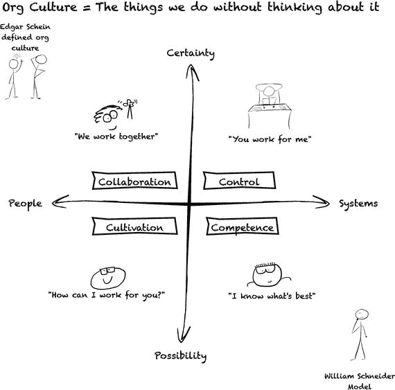

## 第六部分

### 24. 收尾工作

嗯，这很有趣。我们覆盖了很多领域。首先，我们为理解数据科学打下了基础。然后，你了解了如何创建数据科学团队。你还学会了如何将你的数据科学团队角色与组织中已有的成员对应起来。接着，你了解了一个新的数据科学生命周期（DSLC）框架，用于团队协作。你探索了如何随着时间的推移交付短暂价值冲刺，这使你能根据反馈调整工作方向，产生更深刻的见解。接下来，你学习了如何运用数据推理并使用强意识批判性思维。最后，你学习了如何讲述一个引人入胜的数据科学故事。好的故事是连接你所学与你所能传达内容的桥梁。没有这座桥梁，你就无法获得所需的宝贵反馈，将团队的见解与真实的商业价值联系起来。

那么，接下来呢？还有一个最后的挑战。你需要理解你所在组织的文化，这样才能帮助他们做出改变。

### 25. 开启组织变革

组织变革管理是一个已被充分探索的领域。你已经掌握了在组织中启动数据科学所需的知识，但本章中，你将学习一些其他工具，用以帮助改变组织的心态。

本书开篇，我描述了自己在 20 世纪 90 年代初于西北大学学术计算与网络服务部（`ACNS`）的工作。当时，办公室位于芝加哥市中心。每天早晨，我都会乘坐从北侧红线到市中心州街和芝加哥大道站的高架列车。每次穿过这些北侧社区时，我总会经过一栋带小围栏院子的房子。篱笆后面有一只狗，每天早上我前往车站时，它都会抓挠、挖刨并吠叫。这成了我们的日常，我和那只狗每天早晨的互动。我走向列车，而它则抓、挖、叫。有时我甚至能看到它油亮棕色的脑袋探出篱笆顶端。

一天早晨，这只狗异常亢奋。当它用身体撞击吱嘎作响的木板时，篱笆板像大喇叭一样隆隆作响。我瞥了一眼篱笆，便继续喝手中热气腾腾的西北大学咖啡杯。那只狗成功将一条腿搭上了篱笆边，接着借此翻身，凭借超常的力量翻越了篱笆。它有些笨拙地站起来，对自己的成就似乎和我一样惊讶。它带着一丝后悔回头看了看篱笆，又看了看我。我们的目光相遇，在那一瞬间，我们意识到有些东西变了。我们俩都不知道该怎么办。

当我看到组织进行重大变革时，总会想起这个故事。通常，所有的热情和努力都投入到“抓、挖、刨”以尝试新事物上。但事实上，组织并非如此变革。大型组织通常不会因激情而改变。它们由对长期、切实改进的不懈追求所驱动。

大多数组织变革失败的原因有三个：

- 他们不理解变革。组织往往不理解新的数据科学思维模式的价值。关键参与者不清楚一个探索性和实证性组织会是什么样子。他们对旅程终点组织的样貌没有清晰图景。因此他们可能只有少数团队尝试新的数据科学思维模式。这些团队会尝试新事物，但没有明确的前进计划。没人能传达进行组织变革的益处。

- 他们对自身文化缺乏清晰认知。他们不了解数据科学思维模式将如何融入更广泛的组织规范。他们没有考虑过组织是否会接受这一变革。数据科学思维模式与组织运作方式之间可能存在巨大脱节。在实施数据科学变革之前，你需要客观了解更大的组织文化。

- 他们没有真正的变革计划。组织不知道实现变革所需的具体步骤。他们或许理解数据科学思维模式，并认为拥有合适的文化，但不知道如何将两者连接起来。这可能是一个巨大挑战，因为在大多数组织中，用科学方法思考数据是一项重大变革。如果不将其视为组织变革，你会很快遇到不可逾越的挑战。即使是受欢迎且被广泛接受的变革，也未必总能契合组织文化。被普遍接受的做法也不一定适合你的团队。如果不将新的数据科学思维模式视为组织变革，你就面临真正的失败风险。或许会有一些创新孤岛，但实现持久变革将异常困难。

在本章中，你将了解不同类型的组织文化以及如何识别自身组织的文化。随后，你将接触到一种资源，帮助你学会如何让组织克服对变革的恐惧。

#### 理解组织文化

对大多数组织而言，实施变革的第一步是更好地理解其文化。组织文化本质上是人们无需思考就会做的事情。麻省理工学院前教授埃德加·沙因就此写了一本精彩的书¹。他提出了一个更复杂的定义，认为组织文化是：

> "一个群体在解决其问题过程中习得的、行之有效且被视为有效的基本假设模式，并被作为感知、思考和感受这些问题的正确方式传授给新成员。"

他的一个关键观点是，组织文化根深蒂固。这些是人们无需询问就会做的事情，是群体习得并传授给新成员的假设。这正是组织文化极难改变的原因。在组织中，人们有一套成功模式。新成员入职时会被教导这些内容，并被告知这是做事的正确方法。因此，这种“文化”被视为正确的工作方式，非常难以改变。业务分析师和项目管理官员都已接受其组织文化是完成任务的方式。当这种文化中的某人想要扭转局面时，往往会被视为倒退和错误。当你谈论一种新思维模式时尤其如此。

这就是为什么大量精力都投入到“抓、挖、刨”试图推动新变革上。这种策略的唯一挑战是：当开始实施某些变革时，你知道该做什么吗？当你确实让一些人翻过“篱笆”时会发生什么？在许多组织中，这种对话从未发生。所有努力都投入到了推动变革上。但当你完成变革后，有些人并不轻易接受新思维模式，那该怎么办？在把所有精力投入“抓、挖、刨”之前，你需要评估组织的文化。

幸运的是，有一个很好的资源可以帮助你识别组织文化。那就是威廉·施奈德的《再造选择》一书²。他创建了四个类别来帮你识别文化，每个类别侧重于不同方面（图 25-1）。四种类型是：

图 25-1. 住在健身房附近的顾客

- 控制型

- 协作型

- 培养型

- 胜任型

在他的书中，他提供了一份问卷，你可以在组织中传阅。问卷帮助确定哪个类别最能描述你的组织。类别之间可能有所重叠。你的公司可能非常重视胜任力，但同时也相当重视协作。并非每个类别都能涵盖整个组织。尽管如此，你很可能看到一种明显突出的组织文化类型。

每种文化都有其优势与劣势。一种文化可能乐于接受新变革，而另一种文化可能连最合理的变革都会抵制。关键在于，一旦你理解了组织文化，就能更轻松地判断数据科学思维模式能在多大程度上扩展到你的团队之外。

##### 控制型文化

我们先从控制型文化说起。这种文化往往非常专制，就像狼群一样。这类公司通常管理风格保守，非常强调等级制度。在控制型文化中，每个人都清楚自己为谁工作，以及谁为自己工作。控制型文化非常强调服从。个人的角色就是服从上级的要求。这类组织的领导者会传达一个愿景，然后所有下属负责执行这个愿景。

组织内部也会有人确保每个人都遵循这个愿景。控制型文化倾向于让员工留在自己的职能领域内，人员通常很少流动。在这种文化中，权威很大程度上来自于职位和头衔。总监对经理有权威，经理对主管有权威。头衔本身就代表了权威的层级。

由于极其强调服从，控制型文化中的决策往往非常周密。最高层追求确定性。高管层或总监们希望知道决策是什么时候做出的。他们需要下属“签字确认”该决策。要在这些组织中推动重大变革，就需要让高层人士，比如首席数据官（`CDO`）或首席信息官（`CIO`），来“赞助”这项变革。没有这个赞助人，要想在你的团队之外做出任何持久的改变将极其困难。不幸的是，控制型文化如此重视确定性，以至于很难让高层赞助人同意进行重大变革。重大变革本质上几乎总是伴随着风险。控制型文化进行重大、高风险变革最常见的方式，是在几乎没有其他选择的时候。这类组织通常更为保守，其规范崇尚秩序和确定性。他们通常更喜欢可预测的流程。这就是为什么很多这类组织会倾向于依赖大型系统的变革。这些系统被设计成让每个人都知道自己在更大流程中的角色和位置。

数据科学团队在控制型文化中常常举步维艰，因为数据科学团队的角色比控制型文化中的角色更灵活。此外，探索本身就不确定性极高。在强大的控制型文化中，数据科学团队通常既不容易获取数据，也没有决策权。控制型文化强调组织的职能领域和强大的部门壁垒。这使得这些团队的项目经理很难打破数据孤岛。即便面临这些挑战，许多数据科学团队依然在强大的控制型文化中工作。控制型文化在大企业中非常普遍，而正是这些企业可能拥有海量有趣的数据。在很多方面，具有强大控制型文化的组织往往能从运行良好的数据科学团队中获益最多。

##### 能力型文化

第二种非常常见的文化是能力型文化。这种文化在软件开发组织中很普遍。典型的能力型文化是：一群软件开发人员创建了一个非常流行的工具，然后这些开发人员就成了事实上的管理者。这种能力文化作为其组织的一部分被建立起来。能力型文化的领导力重点在于设定标准和创建任务。他们根据每位员工的能力水平来分配任务。因此，管理风格是高度任务驱动的。管理团队试图以分析的方式来分配任务。核心就是谁能最好地完成工作。具有强大能力型文化的组织往往是矩阵式组织。在矩阵式组织中，一名员工可能有多个管理者。例如，一个质量保证开发人员可能既要向质量保证经理汇报，也要向软件开发经理汇报。这意味着很多员工都想成为专家，并且他们的主要精力都放在专业化上。你不想成为一个对开发了解太多的质量保证开发人员，否则你的软件开发工程师可能会给你分配任务，让你很快不堪重负。因此，能力型文化非常强调专业化。

## 四种组织文化类型

### 能力型文化
在能力型文化中，权力和权威很大程度上来自于发展高水平的专业知识。这些组织中的决策往往非常具有分析性。这类公司会把一个问题分解成各个组成部分，然后将这些部分分配给不同的员工。他们把组织视为一个工程问题。通常，当工程师遇到问题时，他们会将其分解成各个组件。这些组织文化通过推动宏大目标来管理变革。他们会设定一个宏大目标，并将其分解成任务来推进。他们通常非常专业，在这些能力型文化中，有着强烈的精英主义意识。你可以作为一个低级员工或实习生进入公司，如果你能专业化发展并达到高水平专业知识，你就能在组织内步步高升。

具有强大能力型文化的组织往往工作节奏也非常紧张。它们并不总是最容易工作的地方。能力型文化也可能难以拥抱数据科学的思维方式。数据科学通常是跨学科的。你需要了解一点统计学、数学、叙事技巧和编程。那些非常强调专业化的文化可能不太容易适应这种方法。你在需要讲好一个故事时，不会希望自己的数据分析师拒绝帮忙。你也不希望项目经理和研究负责人觉得自己没有资格提出好问题。能力型文化非常看重成为专家。这就是为什么专业知识的门槛很高。这可能是一个挑战，因为在数据科学团队中，往往正是外部人员会提出一些最好的问题。

### 培育型文化
第三种文化类型是培育型文化。这是四种类型中最罕见的一种。在这种以人为本的文化中，领导者专注于赋能员工，使员工能够成为最佳雇员。管理者喜欢确保每个人都快乐。他们希望员工享受成为组织一员的过程，并且非常强调员工满意度调查。这类组织倾向于建立以员工为中心、资源环绕四周的轮轴式权力结构。每位管理者都像轮子上的一根辐条。他们周围的人试图帮助员工弄清楚需要什么才能做到最好。

在培育型文化中，非常强调自我表达。管理者专注于发展和培养员工。他们希望成就每个人。领导力通常注重个人魅力。如果你是在培育型文化中具有个人魅力的人，即使你刚以初级职位加入公司，也能迅速成为权威人物。

管理者专注于培养他人的优势。培育型领导者通过团队的人才来解决问题，从而在组织中获得晋升。

在培育型文化中，成为通才备受重视。你不希望敲开某人的门，却听到他们解决不了你的问题。

在培育型文化中，你永远不会看到有人被困在体制内。培育型文化对部门分工和流程的强调要少得多。此外，这类组织的决策过程可能很困难，因为它是高度参与和有机的。团队中的每个人都想达成共识。

千禧一代和 30 岁以下的年轻人倾向于在这种培育型文化中取得成功。³ 许多年轻员工尤其热衷于寻求共识。由年轻企业家运营的组织非常重视这种培育型文化，并且更愿意拥抱变化、接纳新想法。他们认为变化是培育过程的一部分。他们会召开参与式的会议，讨论变革。然后，一旦他们决定变革对公司有利，就会迅速推行。这些组织鼓励成长和发展，并且工作氛围通常相当有趣，因为员工可以自由地犯错。

然而，培育型文化面临的挑战是决策过程往往很缓慢。可以想象，让大群体达成所有人都同意的决定需要很长时间。真正的培育型文化很少见。有些组织可能感觉自身是培育型文化，但仔细观察，你会发现它们并未真正遵循许多关键做法。这类组织很多只是控制型文化，披着一层培育型文化的薄薄外衣。

### 协作型文化
第四种也是最后一种文化是协作型文化。这种文化与培育型文化几乎一样罕见。你在信息技术领域真的不太常见到它，因为它不符合典型的领导风格。这种文化更多出现在培训组织中。协作型文化中的领导者往往是团队建设者和教练。他们的管理风格非常民主，但不像培育型文化那样临时随意。不一定要让所有人达成一致，但你仍然会看到一群管理者紧密合作，共同提出有趣的想法。这便是协作的全部意义所在。这类公司倾向于拥有群体集群，而不是像在控制型文化中看到的自上而下的层级结构。他们仍然非常强调成为通才。

协作型文化与培育型文化的最大区别在于，前者中权威来自于人际关系。有时你会在家族企业中看到这一点。你与组织高层人员的关系越近，你的权威就越大。高层人员之间的协作更紧密。他们倾向于通过头脑风暴会议和一些实验来做出决定。与控制型或胜任型文化相比，他们对变革更开放一些。如果组织正试图接纳数据科学思维模式，这会有所帮助。如果你拥有协作型文化，你的组织接受变革并不困难。然而，协作型文化可能会觉得数据科学的某些关键组成部分相当难以应对。一个有效的数据科学团队必须有权力去探索新想法并允许犯错。这种权力被下放到了团队层面。而协作型文化中，权力仍然倾向于集中在高层。他们只是比控制型文化稍微民主一些。

## 识别你的文化类型

现在你已经了解了这四种不同的文化类型，你需要弄清楚哪一种与你的组织最匹配（如果你还没这么做的话）。请记住，协作型文化或培育型文化更容易接纳数据科学思维模式的关键组成部分。这些文化中的个人也更容易发生变化，因为他们在组织中已经天然具有成为通才的倾向。

如果你拥有强大的控制型文化，你的组织会倾向于传统的庞大系统方法。这类组织倾向于创建大型流程，使每个人都清楚自己的职责。在许多方面，这与你所期望的运行数据科学项目的小型、自组织团队模式恰恰相反。这类文化也常常难以接纳科学方法的某些关键组成部分。实验和探索本质上具有不可预测性。控制型文化通常偏爱流程复杂、结果可预测的模式。如果你的控制型文化非常强大，你或许可以从小处着手，建立几个独立的团队。如果这些团队成功了，你就有机会进行更大范围的组织变革。请记住，这类文化通常最难改变。

如果你拥有胜任型文化，你的组织在尝试接纳数据科学思维模式时可能会面临类似的挑战。科学方法在很大程度上是将事物分解成有趣的问题，以便团队可以筛选这些问题，寻找更深层的洞见。这与胜任型文化通常看待工作的方式大相径庭。他们将大问题视为可以分解成任务的事项。这是一种高度分析性的方法，而非经验性的。胜任型文化中的团队需要确切知道他们要做什么才能完成工作。这类组织也倾向于拥有高度专业化的团队。团队中的每个人都应拥有自己的专长。这在很多方面使得团队协作性降低，每个人都是自己领域的权威。同样，这使得接纳数据科学思维模式变得更加困难。你希望你的数据科学团队能够提出有趣的问题。这些问题可能来自研究负责人，但也可能来自数据分析师，甚至项目经理。团队中的每个人都被认为有能力提出有趣的问题。对于强大的胜任型文化来说，这可能是一个不小的改变。

## 实施变革

在识别了你的组织文化之后，你就可以着手进行变革了。关于组织变革的最佳著作之一是《无畏的变革》¹。这本书揭示了组织接受或拒绝变革的模式。你可以利用对自身文化的了解，来识别哪些模式在你的组织中最有效。即使在控制型文化中，你有时也能为后续变革奠定基础。这本书面向的是“无权领导者”——那些在组织中没有任何显性或隐性权威的领导者。因此，你不需要是 CEO 或总监，也能尝试在你的组织中推动变革。

这本书非常适合用来引导组织思维模式的转变。即使在一个强大的控制型文化中，你也不一定非得是 C 级高管或经理才能启动变革进程。你只需要是一个有好想法并愿意将其引入的人。书中为变革领导者提供了 48 种模式。你可以根据组织文化，将这些模式组合搭配，形成一套整体策略。

书中最有帮助的指南之一是关于组织变革的“迷思”。其中一些迷思可能会阻碍你的变革努力。最常见的迷思包括：“如果这是个好主意，说服别人接受它就会很容易”，以及“实施新想法只需要知识和有效的计划”。另一个迷思是，如果某人对变革持怀疑态度，你可以无视或忽略他们。这本书为你提供了如何应对怀疑者以及如何倾听他们意见的策略。你不应该忽视怀疑者；他们可能是对的，并且看到了你没看到的东西。

书中指出的另一个迷思是，你可以在组织中独自担当变革推动者——仅仅依靠你的知识魅力、个人魅力以及 `PowerPoint` 的力量就足以推动变革。而这本书试图说明的是，你需要建立一群能帮助你推动变革的人。如果你无权无势，最好的办法就是先与一小群人达成共识，然后推动变革向前发展。

最后一个迷思是，认为一旦说服某人支持变革，他们就会一直支持下去。这本书擅长的一点是，将变革描述成一种近乎“抛接球”的行为：你成功说服某人变革是值得的，但你仍需时不时地回去与他们沟通。在这种情况下，要询问他们是否仍然认同，是否还支持变革。即使人们接受了变革和这个想法，他们也可能会回到旧习惯中去。当你试图在控制型组织中推动重大变革时，这一点尤其常见。

《无畏的变革》基于一个理念：人们接受新想法的速度是不同的。这些人自然会落入以下几个群体之一：

*   **天然创新者**：这个群体看到新事物时，会是第一批接受变革的人。你会在你的数据科学思维模式中看到这一点。你组织中的一些创新者会非常有兴趣运用科学方法来更好地理解你的数据。
*   **早期采纳者**：这个群体感兴趣，但他们想了解更多。他们可能认为这是个好主意，但积极性不如创新者高。
*   **早期多数**：这个群体是最大的部分。他们认为这个想法很有趣，但在加入之前会先观望别人怎么说。
*   **后期多数**：这个群体会说：“好吧，如果所有人都加入了，那我就加入，但我真的不想当第一个。”
*   **落后者**：这些人会说：“我真的很喜欢现在做事的方式，不明白为什么要改变。”

当你考虑进行大规模的组织变革时，人们接受变革速度不同的这个概念很有帮助。你正试图转向数据科学思维模式，而这通常是对文化的一次重大变革。这就是为什么你通常需要确保让早期多数群体认同。你可以利用你的创新者作为招募他们的方式，并努力获得足够的共识，以便推动你的敏捷转型并积累一些势头。

另一件要记住的事情是，当你试图改变组织文化时，你不仅要与人们的头脑对话，还要与他们心灵对话。你要能够在他们与变革产生情感共鸣的层面上与他们交谈。这能让你激励你的创新者，并鼓励你的早期采纳者。不要只谈论生产力。要将你的数据科学思维模式作为一种更好地理解客户的方式来谈论。甚至可以把它当作一种与客户建立情感联系的方式。创新者和早期采纳者通常都在寻找有趣的事情去支持。如果你能激发他们的兴趣，他们通常会陪着你完成整个组织变革。

这本书还探讨了这样一个观点：你无法压过别人。你不能忽视组织中的愤世嫉俗者和怀疑者。通常，这些人的观点是正确的，并且有充分的理由。我经常看到一些组织中，变革领导者试图忽视这些人，并将他们视为障碍。他们会把他们当作不想做出大改变的落后者而不予理睬。如果你无视这些愤世嫉俗者和怀疑者，你很可能会遇到更多问题。这些人往往是第一个指出挑战的人。你应该仔细倾听他们，理解他们想说什么。即使他们对某些方面持怀疑或批评态度，也要努力说服他们这场转型是可以实现的。你的怀疑者们会权衡你变革的益处与付出的努力成本。

### 总结

在本章中，你了解了不同类型的组织文化，以及如何识别你所在组织的文化。随后，你了解了一本能帮助你学习如何让组织克服对变革恐惧的资源。在下一节中，作为压轴大戏，我将为你提供一些临别感言。

---

¹ 原书脚注：⁴（注：此脚注为原文格式，保留不译）

### 终章

至此，我们走到了最后。希望你喜欢这本关于数据科学的书，并对如何组建能够提出有趣问题并交付真正商业价值的团队有了更清晰的认识。我试图强调的关键点之一在于，数据科学不仅仅是一套实践方法，更关乎一种探索与实证的思维模式。市面上有许多关于数据科学战术层面的书籍，而我在本书中的尝试有所不同——我想表明的是，战术的生命周期远短于向更宏观的数据科学思维模式的转变。如果你学习了`R`、`Python`、统计学或`Hadoop`，那么你将拥有部分所需的工具，但仅靠使用这些工具并不能让你成为一个数据科学团队。请记住要关注数据科学中的“科学”二字。这种数据科学思维模式能让你以更富趣味的方式自由运用这些工具。以全新方式思考你的数据，远比仅仅下载新工具和新软件更具挑战性。培养新的数据科学思维模式是一项真正的挑战，但这将使你与数据的协作变得更有成效、更具收获。

希望你享受本书的阅读过程，并在提出精彩问题、收集深刻洞见以及从数据中汲取更多知识的过程中获得乐趣。

**脚注**

[1] Edgar H. Schein, *组织文化与领导力*，第 2 卷。（John Wiley & Sons，2010 年）。

[2] William E. Schneider, *再造替代方案：让现有文化发挥作用之计划*（Richard D Irwin Publishing，1994 年）。

[3] Brad Karsh 与 Courtney Templin, *管理者 3.0：千禧一代改写管理规则指南*。AMACOM Div American Mgmt Assn，2013 年。

[4] Linda Rising 与 Mary Lynn Manns, *无畏变革：引入新思想的模式*（Pearson Education，2004 年）。

### 索引

#### A

`敏捷` `航线` `杰森·斯蒂芬博士` `阿尔伯特·爱因斯坦` `美国统计协会` `分析` `分析` `Apache Spark` `考古学家` `亚里士多德` `神话` `情节` `景观` `人工智能` `美国统计协会` (参见 `美国统计协会`) `提出好问题`

#### B

`加州大学伯克利分校` `伯克利地球组织` `理查德·穆勒` `大数据` `大数据问题` `大垃圾` `布克七种剧情模式` `克里斯托弗·布克` `战胜怪物` `探寻之旅` `白手起家` `重生` `悲剧` `旅程与回归` `头脑风暴会议` `商业价值`

#### C

`呼叫中心` `改变组织思维模式` `查尔斯·惠伦` `老烟枪` `芝加哥` `芝加哥地铁图` `单调的合唱` `气候变化` `科尔·努斯鲍默·克纳夫利克` `协作文化` `协作` `收集数据` `收集、访问和报告数据（基础工作）` `汽车颜色` `哥伦比亚大学` `能力文化` `冲突` `共识` `控制文化` `专制` `控制策略` `相关性` `相关系数` `相关性不意味着因果` `虚假因果` `优惠券` `创建、读取、更新、删除` `创意漫游` `信用卡` `批判性思维` `封闭式问题` `关键问题` `开放式问题` `推理` `强批判性思维` `弱批判性思维` `批判性的` `跨行业数据挖掘标准流程` `六个阶段` `CRUD` (参见 `创建、读取、更新、删除`) `培育文化` `客户流失率` `客户自助门户` `住在健身房附近的客户` `洞察循环`

#### D

`丹尼尔·平克` `概念时代` `丹尼尔·扬克洛维奇` `数据分析师` `数据库工程师` `数据库服务器` `数据清洗` `数据驱动` `数据挖掘` `数据模型` `数据科学` `数据科学家` `数据科学洞见` `数据科学生命周期` `数据科学思维模式` `数据科学团队` `数据擦洗` `数据孤岛` `数据故事化` `数据可视化` `数据可视化` `定义好的流程` `可交付成果` `交付有价值的软件` `数据民主化` `教育部` `描述性统计` `均值` `中位数` `作为管理者的开发者` `分布式文件系统` `分发结果` `观点多样性` `狗，吠叫` `药物相互作用` `邓宁-克鲁格研究`

#### E

`企业数据仓库` (参见 `企业数据仓库`) `爱德华·R·塔夫特` `图表垃圾` `数据-墨水比` `爱德华·塔夫特` `共情` `经验性的` `经验方法` `经验流程` `经验主义` `鼓励创新` `参与、愿景和真实性` (另见 `南希·杜阿尔特`) `企业数据仓库` `雌激素补充剂` `ETL` (参见 `提取、转换、加载`) `高管层支持` `实验` `探索性的` `探索数据` `提取、转换、加载`

#### F

`Facebook` `失败的实验` `托马斯·爱迪生` `无畏的改变` `琳达·瑞辛` `反馈循环` `五类受众群体` `高管` `专家` `守门人` `经理` `观察者` `故事的五个关键线索` `类比` `提出有趣的问题` `保持轻松` `激发好奇心` `使用“你”` `数据科学生命周期的五个会议` `改进会议` `问题分解会议` `研究规划会议` `故事讲述会` `可视化设计会议` `有缺陷的推理` `完整数据报告`

#### G

`高德纳集团` `乔治·卡林` `乔治·莱考夫` `金块问题` `我们中间的大猩猩` `CT 扫描` `大猩猩` `感知盲点` `西蒙斯，丹尼尔·J` `研究生院` `群体思维`

#### H

`Hadoop` `Hadoop 集群` `HBase` `英雄` `隐藏假设` `高科技公司` `希拉里·梅森` `Bitly` `激素替代疗法` (另见 `雌激素补充剂`) `HTML` (参见 `超文本标记语言`) `超文本标记语言` `假设`

#### I

`IBM` `IBM SPSS` `信息管理系统` `IDC` (参见 `国际数据公司`) `汽车图片` (参见 `汽车颜色`) `健康跑步者的图片` `国际数据公司` `互联网标题` (另见 `互联网新闻`) `互联网新闻`

#### J

`约翰·斯坦贝克` `约翰·W·福尔曼` `乔纳斯·索尔克` `陪审团，说服`

#### K

`了解你的受众`

#### L

`支持的路灯` `安德鲁·朗` `提供支持而非照亮` `利奥·布雷曼` `线性回归` `LinkedIn` `透过玻璃门的钥匙孔窥视` `发现循环`

#### M

`机器学习` `让数据可操作` `管理风格` `服从型` `民主型` `人员驱动` `任务驱动` `MapReduce` `马克·吐温` `马歇尔·麦克卢汉` `医学研究` (另见 `无针研究`) `隐喻` `墨西哥之旅` `微软` `Microsoft Word` `中间件` `里程碑` `千禧一代，培育文化` `多学科` `客观的神话` `肯·斯坦利` `垫脚石`

#### N

`南希·杜阿尔特` `叙事` `叙事` `美国国家航空航天局` `阿波罗太空任务` `国家气象局` `无针研究` `Netflix` `《纸牌屋》` `评分数据` `纽约证券交易所` `纽约时报` `专栏版` `西北大学学术计算和网络服务` `NoSQL` `聚合` `Cassandra`

#### O

`目标驱动` `目标` `在线杂志` `Oracle` `组织变革` `埃德加·沙因` `群体` `神话` `组织文化` `组织文化，变革` `组织文化，识别` `组织知识` `组织学习`

#### P

`发现的速度` `淘金` `保罗·史密斯` `剥开假设` `个人轶事` `制药` `柏拉图` `项目管理协会` (参见 `项目管理协会`) `项目管理办公室` (参见 `项目管理办公室`) `宝丽来即时相机` `爱德华·兰德` `政治家` `PostgreSQL` `PowerPoint` `演示` `可预测的价值` `预测性分析` `处方药` `概率` `宝洁公司 CEO` `项目管理` `大爆炸` `可交付物` `约束` `甘特图` `铁三角` `项目管理协会` `项目管理办公室` `项目经理` `数据民主化` `盾牌与推土机` `促销` `Python`

#### Q

`量化信息` `问题偏差` `问题板` `礼物问题` `问题优先方法` `问题会议` `问卷` `问题` `必要问题` `非必要问题` `问题树` `分支` `修剪问题` `问题类型` `必要问题` `非必要问题`

#### R

`R` `推理` `关系型数据库管理系统` `在线分析处理` `在线事务处理` `模式` `视图` `研究负责人` `投资回报率` `竞争性原因` `因果` `ROI` (参见 `投资回报率`) `浪漫喜剧` `浪漫跑步伴侣` `罗密欧与朱丽叶`

#### S

`Scala` `科学方法` `范围、成本与进度` `爬取` `擦洗` `软件开发生命周期` (参见 `软件开发生命周期`) `自动驾驶汽车` `半结构化数据` `可扩展标记语言 (XML)` `JavaScript 对象表示法 (JSON)` `意义建构` `意外发现` `提问的七大陷阱` `人身攻击` `循环论证` (参见 `障眼法`) `错误二分法` `可疑权威` `质疑驳回` `急于达成共识` `稻草人推理` `帮助受众采取行动的七个步骤` `莎士比亚` `西德尼·芬克尔斯坦` `故事的六个重要元素` `六个关键问题领域` `澄清关键术语` `发现错误` `挑战证据` `误导性统计` `缺失信息` `挖掘假设` `持怀疑态度` `障眼法` `草率的推理` `放错地方的智能手机` `软推理` `软件开发生命周期` (另见 `瀑布模型`) `编织故事` `电子表格` `冲刺` `从概念到现金` `快速转向` `SQL` (参见 `结构化查询语言`) `利益相关者` `统计推断` `统计学家` `统计学` `便利贴` `故事背景` `故事结构` `故事化` `消除干扰` `意义` `陷阱` `结构化数据` `结构化查询语言` `粉饰信息` `糖对健康有害` `夏日梦想家` `可视化` `交响曲` `雪城大学`

#### T

`团队冻结` `团队` `发短信和开车` `时间盒` `提问困难` `企业文化不鼓励提问` `提问经验不足` `时间不够` `自我保护` `Twitter` `推文` `两周冲刺`

#### U

`基本假设` `芝加哥大学`

#### V

`维恩图` `客户 360 度视图` `视觉闲聊`

#### W, X

`团队漫游` `预热房间` `瀑布模型` `编织故事` `轶事` (另见 `个人轶事`) `案例研究` `例子` `场景` `小插曲` `Web API` `公认事实` `公认事实` (参见 `公认事实`) `白板` `威廉·施耐德` `威廉·S·克利夫兰` `WordPress` `万维网`

#### Y, Z

`尤瓦尔·诺亚·赫拉利`