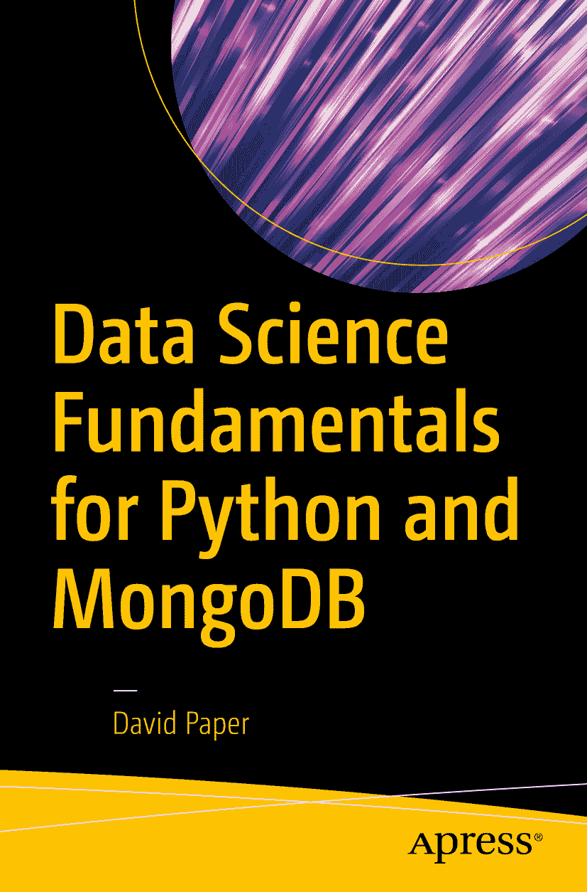

ISBN 978-1-4842-3596-6 e-ISBN 978-1-4842-3597-3 [`doi.org/10.1007/978-1-4842-3597-3`](https://doi.org/10.1007/978-1-4842-3597-3) 美国国会图书馆控制号：2018941864 © David Paper 2018 本作品受版权保护。出版商保留所有权利，无论是涉及材料的全部或部分，特别是翻译、重印、重用插图、朗诵、广播、以缩微胶片或任何其他物理方式复制，以及传输或信息存储与检索、电子改编、计算机软件，或采用目前已知或未来开发的类似或不同方法进行使用的权利。本书中可能出现商标名称、标识和图像。我们仅在编辑性场合使用这些名称、标识和图像，以维护商标所有者的权益，并无意侵犯商标权。本书中使用的商品名称、商标、服务标志及类似术语，即使未明确标识，也不应被视为对其是否受专有权利保护的立场表达。尽管本书中的建议和信息在出版时被认为是真实准确的，但作者、编辑和出版商均不对可能存在的任何错误或疏漏承担法律责任。出版商对本书所含内容不作任何明示或暗示的担保。本书由 Springer Science+Business Media New York 在全球范围内发行，地址：233 Spring Street, 6th Floor, New York, NY 10013。电话：1-800-SPRINGER，传真：(201) 348-4505，电子邮件：orders-ny@springer-sbm.com，或访问 www.springeronline.com。Apress Media, LLC 是一家加利福尼亚有限责任公司，其唯一成员（所有者）是 Springer Science + Business Media Finance Inc (SSBM Finance Inc)。SSBM Finance Inc 是一家特拉华州公司。

*献给 Lady、Sam、Bruce、Malik、John、Moonshadow 和 Moonbeam，他们的支持与爱始终是无条件的。献给 Apress 的工作人员，感谢你们为促成此项目所付出的所有支持与辛勤工作。最后，特别感谢 Jonathan 在亚马逊上找到了我，感谢 Jill 容忍一位强迫症作者，以及感谢 Mark 进行了全面且富有建设性的技术审阅。*

## 致谢

我进入数据分析领域的起点是探索 Wes McKinney 所著的 *Python for Data Analysis*，我强烈推荐给所有人。我进入数据科学领域的起点是探索 Joel Grus 所著的 *Data Science from Scratch*。Joel 的书可能不适合胆小的人，但这绝对是一个我很庆幸自己接受了的挑战！最后，我要感谢 *stackoverflow* 的所有贡献者，他们的编程解决方案不可或缺。

### 关于作者与关于技术审阅者

### 关于作者

### 关于技术审阅者

