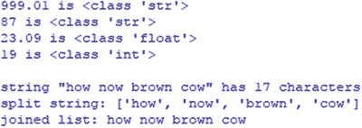
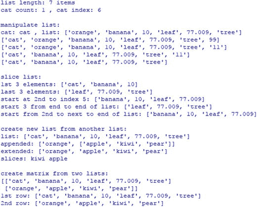
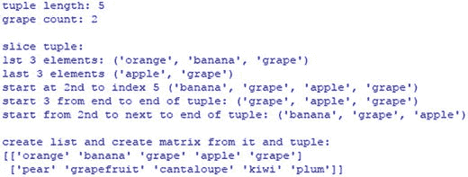
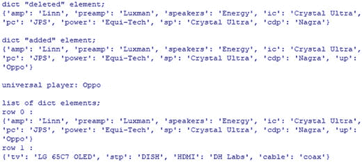
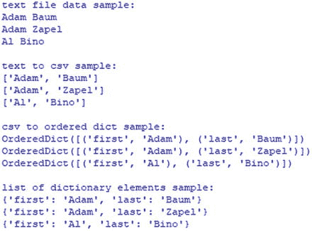
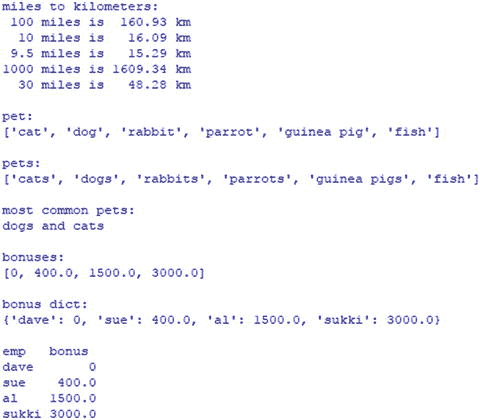
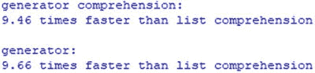
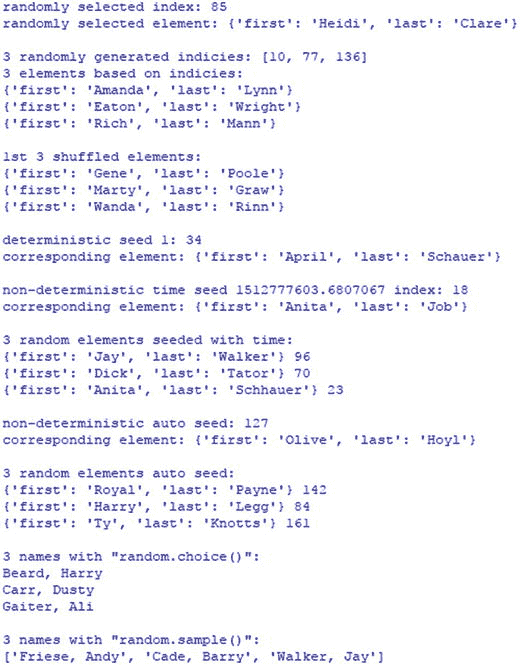
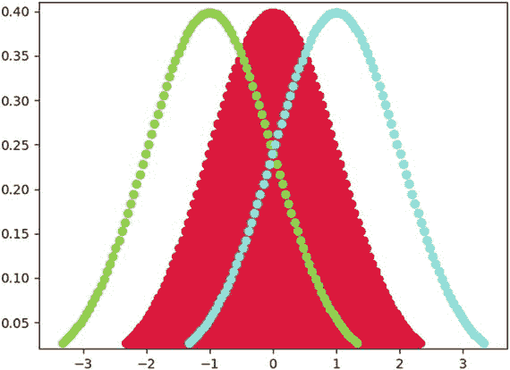
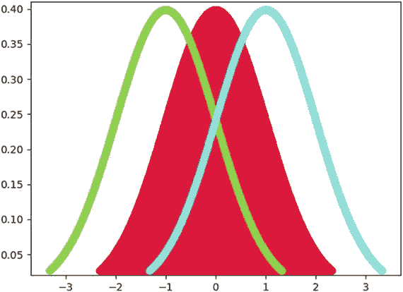

# 引言

数据科学是一个跨学科领域，涵盖科学方法、流程和系统，旨在从各种形式（结构化或非结构化）的数据中提取知识或洞见。它借鉴了数学、统计学、信息科学、计算机科学、机器学习、可视化、数据挖掘和预测分析等学科的原理。然而，其根本基础在于数学。

本书解释并应用了数据科学的基础知识，这对于数据库管理员和开发人员等正在向数据科学实践方向进行职业转型的技术专业人士至关重要。本书以示例驱动，提供完整的`Python`编码示例，以补充和阐明数据科学概念，并丰富学习体验。编码示例在适当情况下包含可视化。本书是应用和实现机器学习算法的必要前导，因为它向读者介绍了数据科学的基础原理。

本书内容自成体系。掌握本书内容所需的所有数学、统计学、随机过程和编程技能均在书中涵盖。无需深入了解面向对象编程，因为书中提供并解释了完整可用的示例。示例在必要时会深入且复杂，以确保获得适当的数据科学敏锐度。本书帮助您构建处理和理解复杂数据科学算法所需的基础技能。

*《数据科学基础：示例驱动》* 是那些有志于从事数据科学职业的人的绝佳起点。与任何科学一样，数据科学的基础知识是胜任工作的前提。如果没有扎实的数学、统计学、数据处理和编码能力，成功之路充其量也只能是“崎岖不平”。本书中的编码示例简洁、准确且完整，完美地补充了所介绍的数据科学概念。

本书共分为六章。第1章介绍了使用`Python`处理、转换和加工数据以用于数据科学应用所需的编程基础。第2章介绍了用于决策的蒙特卡洛模拟，以及用于统计处理的数据分布。第3章介绍了应用于向量和矩阵的线性代数。第4章介绍了用于最小化（或最大化）函数的梯度下降算法，这非常重要，因为大多数数据科学问题都是优化问题。第5章侧重于为解决数据科学问题而进行的数据整理、清洗和转换。第6章侧重于通过降维、网络爬取和高效处理大型数据集来探索数据。

所有编码示例和数据文件的`Python`编程代码均可通过Apress在[`www.apress.com/9781484235966`](http://www.apress.com/9781484235966)上查看和下载。具体的链接说明包含在本书的版权页中。

要安装`Python`模块，`pip`是首选的安装程序。因此，要从Anaconda提示符安装`matplotlib`模块：`pip install matplotlib`。Anaconda是一个广泛流行的`Python`（和R）开源发行版，专为大规模数据处理、预测分析和科学计算而设计，可简化包管理和部署。我曾使用过其他发行版，但效果不尽如人意，因此我强烈推荐Anaconda。

## Python 基础

`Python`具有多项特性，使其非常适合学习和实践数据科学。它是免费的，编码相对简单，易于理解，并且拥有许多有用的库来促进数据科学问题的解决。它还允许快速原型化几乎任何数据科学场景，并以清晰、易于理解的方式演示数据科学概念。

本章的目标*不是*全面教授`Python`，而是介绍、解释和阐明该语言的基础特性（如逻辑、数据结构和库），这些特性有助于原型化、应用和/或解决数据科学问题。

`Python`基础知识通过一系列广泛的活动及相关编码示例来涵盖，具体如下：

1. 函数与字符串
2. 列表、元组与字典
3. 数据读写
4. 列表推导式
5. 生成器
6. 数据随机化
7. MongoDB 与 JSON
8. 可视化

### 函数与字符串

`Python`函数是一等公民，这意味着它们可以作为参数、返回值使用，可以赋值给变量，也可以存储在数据结构中。简单来说，函数就像典型的变量一样。函数既可以是自定义的，也可以是内置的。自定义函数由程序员创建，而内置函数则是语言本身的一部分。字符串是非常流行的类型，用单引号或双引号括起来。

以下代码示例定义了自定义函数并使用了内置函数：

```python
def num_to_str(n):
    return str(n)
def str_to_int(s):
    return int(s)
def str_to_float(f):
    return float(f)

if __name__ == "__main__":
    ### 井号用于单行注释
    '''
    三个引号用于多行注释
    '''
    float_num = 999.01
    int_num = 87
    float_str = '23.09'
    int_str = '19'
    string = 'how now brown cow'

    s_float = num_to_str(float_num)
    s_int = num_to_str(int_num)
    i_str = str_to_int(int_str)
    f_str = str_to_float(float_str)

    print (s_float, 'is', type(s_float))
    print (s_int, 'is', type(s_int))
    print (f_str, 'is', type(f_str))
    print (i_str, 'is', type(i_str))

    print ('\nstring', '"' + string + '" has', len(string), 'characters')
    str_ls = string.split()
    print ('split string:', str_ls)
    print ('joined list:', ' '.join(str_ls))
```



一种流行的编码风格是首先展示库导入和函数，然后是主代码块。代码示例以三个自定义函数开头，这些函数分别将数字转换为字符串、将字符串转换为数字以及将字符串转换为浮点数。每个自定义函数都返回一个内置函数，让`Python`执行转换。主代码块以注释开头。单行注释用`#`（井号）表示。多行注释用三个连续的单引号表示。接下来的五行代码为变量赋值。接下来的四行代码将每个变量类型转换为另一种类型。例如，函数`num_to_str()`将变量`float_num`转换为字符串类型。接下来的五行代码打印变量及其关联的`Python`数据类型。内置函数`type()`返回给定对象的类型。剩下的四行代码打印并操作一个字符串变量。

### 列表、元组和字典

列表是有序集合，其中的值用逗号分隔，并放在方括号内。索引从0（零）开始。列表项不必是同一类型，并且可以通过多种方式进行切片、连接和操作。

以下代码示例创建了一个列表，对其进行操作和切片，从另一个列表创建新列表并向其中添加元素，以及从两个列表创建矩阵：

# 列表、元组与字典操作

## 列表操作

```python
import numpy as np
if __name__ == "__main__":
    ls = ['orange', 'banana', 10, 'leaf', 77.009, 'tree', 'cat']
    print ('list length:', len(ls), 'items')
    print ('cat count:', ls.count('cat'), ',', 'cat index:', ls.index('cat'))
    print ('\nmanipulate list:')
    cat = ls.pop(6)
    print ('cat:', cat, ', list:', ls)
    ls.insert(0, 'cat')
    ls.append(99)
    print (ls)
    ls[7] = '11'
    print (ls)
    ls.pop(1)
    print (ls)
    ls.pop()
    print (ls)
    print ('\nslice list:')
    print ('1st 3 elements:', ls[:3])
    print ('last 3 elements:', ls[3:])
    print ('start at 2nd to index 5:', ls[1:5])
    print ('start 3 from end to end of list:', ls[-3:])
    print ('start from 2nd to next to end of list:', ls[1:-1])
    print ('\ncreate new list from another list:')
    print ('list:', ls)
    fruit = ['orange']
    more_fruit = ['apple', 'kiwi', 'pear']
    fruit.append(more_fruit)
    print ('appended:', fruit)
    fruit.pop(1)
    fruit.extend(more_fruit)
    print ('extended:', fruit)
    a, b = fruit[2], fruit[1]
    print ('slices:', a, b)
    print ('\ncreate matrix from two lists:')
    matrix = np.array([ls, fruit])
    print (matrix)
    print ('1st row:', matrix[0])
    print ('2nd row:', matrix[1])
```



代码示例首先导入 `NumPy`，这是用于科学计算的基础包（库、模块）。它对于线性代数非常有用，而线性代数是数据科学的基础。可以把 Python 库想象成包含许多方法的巨型类。

主代码块首先创建列表 `ls`，打印其长度、元素（项）数量、`cat` 元素的数量以及 `cat` 元素的索引。

代码继续操作 `ls`。首先，弹出第 7 个元素（索引 6）并将其赋值给变量 `cat`。请记住，列表索引从 0 开始。函数 `pop()` 从 `ls` 中移除 `cat`。其次，将 `cat` 添加回 `ls` 的第一个位置（索引 0），并将 `99` 追加到列表末尾。函数 `append()` 将一个对象添加到列表末尾。第三，将字符串 `'11'` 替换为第 8 个元素（索引 7）。最后，从 `ls` 中弹出第二个元素和最后一个元素。

代码继续对 `ls` 进行切片。首先，使用 `ls[:3]` 打印前三个元素。其次，使用 `ls[3:]` 打印最后三个元素。第三，使用 `ls[1:5]` 打印从第二个元素开始到索引为 5 的元素。第四，使用 `ls[-3:]` 打印从末尾倒数第三个元素到末尾。第五，使用 `ls[1:-1]` 打印从第二个元素开始到倒数第二个元素。

代码继续从另一个列表创建新列表。首先，创建一个包含一个元素的 `fruit`。其次，将列表 `more_fruit` 追加到 `fruit`。请注意，`append` 将列表 `more_fruit` 作为 `fruit` 的第二个元素添加，这可能不是你想要的。因此，第三步，弹出 `fruit` 的第二个元素，并将 `more_fruit` 扩展到 `fruit`。函数 `extend()` 在添加列表之前会将其展开。这样，`fruit` 现在有四个元素。第四，将第三个元素赋值给 `a`，第二个元素赋值给 `b`，并打印切片。Python 允许在一行中给多个变量赋值，这非常方便和简洁。

代码最后从两个列表——`ls` 和 `fruit`——创建一个矩阵并打印它。Python 矩阵是一个二维（2-D）数组，由行和列组成，其中每一行都是一个列表。

## 元组操作

元组是由圆括号括起来的不可变 Python 对象序列。与列表不同，元组不能被更改。元组对于返回多个值的函数非常方便。

以下代码示例创建了一个元组，对其进行了切片，创建了一个列表，并从元组和列表创建了一个矩阵：

```python
import numpy as np
if __name__ == "__main__":
    tup = ('orange', 'banana', 'grape', 'apple', 'grape')
    print ('tuple length:', len(tup))
    print ('grape count:', tup.count('grape'))
    print ('\nslice tuple:')
    print ('1st 3 elements:', tup[:3])
    print ('last 3 elements', tup[3:])
    print ('start at 2nd to index 5', tup[1:5])
    print ('start 3 from end to end of tuple:', tup[-3:])
    print ('start from 2nd to next to end of tuple:', tup[1:-1])
    print ('\ncreate list and create matrix from it and tuple:')
    fruit = ['pear', 'grapefruit', 'cantaloupe', 'kiwi', 'plum']
    matrix = np.array([tup, fruit])
    print (matrix)
```



代码首先导入 `NumPy`。主程序块首先创建元组 `tup`，打印其长度、元素（项）数量、`grape` 元素的数量以及 `grape` 的索引。

代码继续对 `tup` 进行切片。首先，使用 `tup[:3]` 打印前三个元素。其次，使用 `tup[3:]` 打印最后三个元素。第三，使用 `tup[1:5]` 打印从第二个元素开始到索引为 5 的元素。第四，使用 `tup[-3:]` 打印从末尾倒数三个元素到末尾。第五，使用 `tup[1:-1]` 打印从第二个元素到倒数第二个元素。

代码继续创建一个新的 `fruit` 列表，并从 `tup` 和 `fruit` 创建一个矩阵。

## 字典操作

字典是一个由键/值对标识的无序元素集合。它是处理数据时极其重要的数据结构。下面的示例非常简单，但下一节将基于数据集给出一个更复杂的示例。

以下代码示例创建了一个字典，删除一个元素，添加一个元素，创建一个字典元素列表，并遍历该列表：

```python
if __name__ == "__main__":
    audio = {'amp':'Linn', 'preamp':'Luxman', 'speakers':'Energy',
             'ic':'Crystal Ultra', 'pc':'JPS', 'power':'Equi-Tech',
             'sp':'Crystal Ultra', 'cdp':'Nagra', 'up':'Esoteric'}
    del audio['up']
    print ('dict "deleted" element;')
    print (audio, '\n')
    print ('dict "added" element;')
    audio['up'] = 'Oppo'
    print (audio, '\n')
    print ('universal player:', audio['up'], '\n')
    dict_ls = [audio]
    video = {'tv':'LG 65C7 OLED', 'stp':'DISH', 'HDMI':'DH Labs',
             'cable' : 'coax'}
    print ('list of dict elements;')
    dict_ls.append(video)
    for i, row in enumerate(dict_ls):
        print ('row', i, ':')
        print (row)
```



主程序块首先创建包含多个元素的字典 `audio`。接着删除键为 `up`、值为 `Esoteric` 的元素，并显示结果。然后，重新添加一个键为 `up`、值为 `Oppo` 的新元素并显示。下一步创建一个包含字典 `audio` 的列表，创建字典 `video`，并将新字典添加到列表中。最后一部分使用 `for` 循环遍历字典列表并显示这两个字典。一个可与循环语句配合使用的非常有用的函数是 `enumerate()`。它为一个可迭代对象添加一个计数器。可迭代对象是可以被迭代的对象。`enumerate()` 函数非常有用，因为计数器会自动创建并递增，这意味着代码更少。

## 读写数据

读写数据的能力是任何数据科学工作的基础。所有数据文件均可在网站上获取。最基本的数据类型是文本和 CSV（逗号分隔值）。因此，我们将从这里开始。

以下代码示例读取一个文本文件并对其进行清理以便处理。然后读取清理后的文本文件，将其保存为 CSV 文件，读取该 CSV 文件，将其转换为 `OrderedDict` 元素列表，并将此列表转换为常规字典元素列表。

```python
import csv

def read_txt(f):
    with open(f, 'r') as f:
        d = f.readlines()
    return [x.strip() for x in d]

def conv_csv(t, c):
    data = read_txt(t)
    with open(c, 'w', newline='') as csv_file:
        writer = csv.writer(csv_file)
        for line in data:
            ls = line.split()
            writer.writerow(ls)

def read_csv(f):
    contents = ''
    with open(f, 'r') as f:
        reader = csv.reader(f)
    return list(reader)

def read_dict(f, h):
    input_file = csv.DictReader(open(f), fieldnames=h)
    return input_file

def od_to_d(od):
    return dict(od)

if __name__ == "__main__":
    f = 'data/names.txt'
    data = read_txt(f)
    print ('text file data sample:')
    for i, row in enumerate(data):
        if i < 3:
            print (row)

    csv_f = 'data/names.csv'
    conv_csv(f, csv_f)

    r_csv = read_csv(csv_f)
    print ('\ntext to csv sample:')
    for i, row in enumerate(r_csv):
        if i < 3:
            print (row)

    headers = ['first', 'last']
    r_dict = read_dict(csv_f, headers)

    dict_ls = []
    print ('\ncsv to ordered dict sample:')
    for i, row in enumerate(r_dict):
        r = od_to_d(row)
        dict_ls.append(r)
        if i < 3:
            print (row)

    print ('\nlist of dictionary elements sample:')
    for i, row in enumerate(dict_ls):
        if i < 3:
            print (row)
```

输出：



代码首先导入 `csv` 库，该库实现了用于读写 CSV 格式表格数据的类。接着定义了五个函数。函数 `read_txt()` 读取文本（`.txt`）文件，并使用列表推导式去除多余字符，列表推导式是在 Python 中定义和创建列表的一种优雅方式。列表推导式将在下一节中详细介绍。函数 `conv_csv()` 将文本转换为 CSV 文件并保存到磁盘。函数 `read_csv()` 读取 CSV 文件并将其作为列表返回。函数 `read_dict()` 读取 CSV 文件并返回一个 `OrderedDict` 元素列表。`OrderedDict` 是字典的一个子类，它会记住其内容被添加的顺序，而常规字典不跟踪插入顺序。最后，函数 `od_to_d()` 将一个 `OrderedDict` 元素转换为一个常规字典元素。在我看来，使用常规字典元素要直观得多。主程序块首先读取一个文本文件并对其进行清理以便处理。然而，代码中并未对该清理后的文件进行任何处理。包含此步骤只是为了让你了解如何完成此任务。代码继续将文本文件转换为 CSV 并保存到磁盘。然后从磁盘读取 CSV 文件并显示几条记录。接下来，创建一个 `headers` 列表，用于存储即将创建的字典的键。创建列表 `dict_ls` 用于存放字典元素。代码继续创建一个 `OrderedDict` 列表 `r_dict`。然后迭代 `OrderedDict` 列表，以便将每个元素转换为常规字典元素并追加到 `dict_ls` 中。在迭代过程中会显示几条记录。最后，迭代 `dict_ls` 并显示几条记录。我强烈建议你花些时间熟悉这些数据结构，因为它们在数据科学应用中广泛使用。

### 列表推导式

列表推导式提供了一种创建列表的简洁方法。其逻辑被封装在方括号内，包含一个表达式，后跟一个 `for` 子句，并且可以通过添加更多的 `for` 或 `if` 子句来增强。

上一节中的 `read_txt()` 函数包含了以下列表推导式：

```
[x.strip() for x in d]
```

该逻辑从可迭代对象 `d` 中的字符串里去除多余字符。在这个例子中，`d` 是一个字符串列表。

以下代码示例使用列表推导式将英里转换为公里、处理宠物名称以及计算奖金：

```python
if __name__ == "__main__":
    miles = [100, 10, 9.5, 1000, 30]
    kilometers = [x * 1.60934 for x in miles]
    print ('英里转公里:')
    for i, row in enumerate(kilometers):
        print ('{:>4} {:>8}{:>8} {:>2}'.
               format(miles[i],'英里等于', round(row,2), '公里'))

    print ('\n 宠物:')
    pet = ['猫', '狗', '兔子', '鹦鹉', '豚鼠', '鱼']
    print (pet)

    print ('\n 宠物们:')
    pets = [x + '们' if x != '鱼' else x for x in pet]
    print (pets)

    subset = [x for x in pets if x != '鱼' and x != '兔子们'
              and x != '鹦鹉们' and x != '豚鼠们']
    print ('\n 最常见的宠物:')
    print (subset[1], '和', subset[0])

    sales = [9000, 20000, 50000, 100000]
    print ('\n 奖金:')
    bonus = [0 if x < 10000 else x * 0.02 if x >= 10000 and x <= 20000 else x * 0.03 for x in sales]

    people = ['约翰', '玛丽', '马克', '戴安娜']
    print ('\n 人员:')
    print (people)

    print ('\n 每人奖金:')
    bonus_dict = {k: y for k, y in zip(people, bonus)}
    for k, y in bonus_dict.items():
        print ('{:<5} {:>6}'.format(k, y))
```

输出：



主程序块首先创建了两个列表——`miles`和`kilometers`。`kilometers`列表是通过列表推导式创建的，它将每个英里值乘以`1.60934`。起初，列表推导式可能看起来令人困惑，但熟能生巧，随着时间的推移会变得更容易。主程序块接着打印英里和对应的公里。`format()`函数提供了复杂的格式化选项。每个英里值（`{:>4}`）最多右对齐四个字符。每个表示英里和公里的字符串最多右对齐八个字符（`{:>8}`）。最后，每个表示公里的字符串最多右对齐两个字符（`{:>2}`）。起初这看起来可能有点复杂，但一旦你习惯了，它实际上非常合乎逻辑（而且优雅）。主程序块接着创建了`pet`和`pets`列表。`pets`列表是通过列表推导式创建的，如果不是鱼，则使宠物名称变为复数形式。我建议你在继续之前先研究一下这个列表推导式，因为它们会变得越来越复杂。代码接着使用列表推导式创建了一个`subset`列表，其中只包含狗和猫。下一部分创建了两个列表——`sales`和`bonus`。`Bonus`是通过列表推导式创建的，它为每个销售额值计算奖金。如果销售额低于`10,000`，则不支付奖金。如果销售额在`10,000`到`20,000`之间（含），则奖金为销售额的`2%`。最后，如果销售额大于`20,000`，则奖金为销售额的`3%`。起初我对这个列表推导式感到困惑，但现在我理解了。所以，尝试自己写一些，你就会掌握它的要领。最后一部分创建了一个`people`列表来关联每个销售额值，接着创建一个字典来保存每个人的奖金，最后通过迭代字典元素结束。格式化非常优雅。表头正确地将`emp`和`bonus`左对齐。每个项目都经过格式化，使得人员名称最多左对齐五个字符（`{:<5}`），奖金最多右对齐六个字符（`{:>6}`）。

### 生成器

生成器是一种特殊类型的迭代器，但速度更快，因为值只在需要时才生成。这个过程被称为惰性（或延迟）求值。典型的迭代器要慢得多，因为它们会完整地构建在内存中。常规函数返回值，而生成器则产出值。遍历和访问生成器值的最佳方式是使用循环。最后，可以通过将方括号替换为圆括号来将列表推导式转换为生成器。

以下代码示例读取一个 CSV 文件并创建一个`OrderedDict`元素列表。然后它将列表元素转换为常规字典元素。代码接着模拟了列表推导式、生成器推导式和生成器的执行时间。在模拟过程中，会为每种方式创建一个时间列表。模拟是对现实世界过程或系统随时间的模仿，它在数据科学中被广泛使用。

```python
import csv, time, numpy as np

def read_dict(f, h):
    input_file = csv.DictReader(open(f), fieldnames=h)
    return (input_file)

def conv_reg_dict(d):
    return [dict(x) for x in d]

def sim_times(d, n):
    i = 0
    lsd, lsgc = [], []
    while i < n:
        start = time.clock()
        [x for x in d]
        time_d = time.clock() - start
        lsd.append(time_d)
        start = time.clock()
        (x for x in d)
        time_gc = time.clock() - start
        lsgc.append(time_gc)
        i += 1
    return (lsd, lsgc)

def gen(d):
    yield (x for x in d)

def sim_gen(d, n):
    i = 0
    lsg = []
    generator = gen(d)
    while i < n:
        start = time.clock()
        for row in generator:
            None
        time_g = time.clock() - start
        lsg.append(time_g)
        i += 1
        generator = gen(d)
    return lsg

def avg_ls(ls):
    return np.mean(ls)

if __name__ == '__main__':
    f = 'data/names.csv'
    headers = ['first', 'last']
    r_dict = read_dict(f, headers)
    dict_ls = conv_reg_dict(r_dict)
    n = 1000
    ls_times, gc_times = sim_times(dict_ls, n)
    g_times = sim_gen(dict_ls, n)
    avg_ls = np.mean(ls_times)
    avg_gc = np.mean(gc_times)
    avg_g = np.mean(g_times)
    gc_ls = round((avg_ls / avg_gc), 2)
    g_ls = round((avg_ls / avg_g), 2)
    print ('生成器推导式:')
    print (gc_ls, '倍快于列表推导式\n')
    print ('生成器:')
    print (g_ls, '倍快于列表推导式')
```

输出：



代码首先导入了`csv`、`time`和`numpy`库。函数`read_dict()`将一个 CSV（`.csv`）文件转换为一个`OrderedDict`元素列表。函数`conv_reg_dict()`将一个`OrderedDict`元素列表转换为一个普通字典元素列表（以便于处理）。函数`sim_times()`运行一个模拟，创建两个列表——`lsd`和`lsgc`。列表`lsd`包含`n`次列表推导的运行时间，列表`lsgc`包含`n`次生成器推导的运行时间。通过反复运行这些过程（`n`次），使用模拟可以更准确地了解这两种过程实际所需的时间。在本例中，模拟运行了 1000 次（`n = 1000`）。当然，你可以根据需要运行任意多次或少量次数的模拟。函数`gen()`和`sim_gen()`协同工作。函数`gen()`创建一个生成器。函数`sim_gen()`模拟该生成器`n`次。我必须创建这两个函数，因为生成一个生成器（使用`yield`）需要与创建生成器推导不同的过程。函数`avg_ls()`返回一个数字列表的均值（平均值）。主程序块首先将一个 CSV 文件（我们在本章前面创建的那个）读取到一个`OrderedDict`元素列表中，并将其转换为一个普通字典元素列表。代码接着模拟列表推导和生成器推导的运行时间 1000 次（`n = 1000`）。第一次模拟计算了遍历之前创建的字典列表时，列表推导和生成器推导各自的 1000 次运行时间，并分别返回一个包含这些运行时间的列表。第二次模拟通过遍历字典列表来为一个生成器计算 1000 次运行时间，并返回一个包含这些运行时间的列表。代码最后计算了三种技术——列表推导、生成器推导和生成器——各自的平均运行时间，并对这些平均值进行了比较。

模拟验证了生成器推导比列表推导快十倍以上，而生成器比列表推导快八倍以上（运行时间会因你的电脑而异）。这是合理的，因为列表推导将所有数据存储在内存中，而生成器则是在需要数据时才（惰性地）进行求值。自然，生成器的速度优势在处理大数据集时变得更加重要。如果没有模拟，运行时间**无法**被验证，因为我们获取的是随机的内部系统时钟时间。

## 数据随机化

一个随机过程是从某个概率空间到状态空间的一系列随机变量（呼！）。简单来说，它是一个随时间变化的随机过程。数据随机化是以不可预测的方式从样本中选择值的过程，目的是模拟现实。模拟使得数据随机化可以在数据科学中得到应用。上一节演示了如何使用模拟来现实地比较可迭代对象（列表推导、生成器推导和生成器）。

在 Python 中，使用伪随机数来模拟数据随机性（现实）。它们并非真正的随机数，因为第一代随机数没有前一个数。我们必须提供一个种子（或随机种子）来初始化一个伪随机数生成器。`random`库为各种数据分布实现了伪随机数生成器，而`random.seed()`用于生成初始的（第一代）种子数。

# Python 随机选择与 MongoDB 简介

以下代码示例读取一个 CSV 文件并将其转换为一个普通字典元素列表。代码接着创建一个随机数，用于从列表中检索一个随机元素。接下来，创建一个包含三个随机选择元素的生成器并显示它。代码继续显示从列表中随机打乱顺序的三个元素。下一段代码确定性地为随机数生成器设置种子，这意味着所有生成的随机数都将基于该种子而相同。因此，除非更改种子，否则显示的元素将始终相同。然后，代码使用系统时间来非确定性地生成随机数并显示这三个元素。接着，通过另一种方法生成非确定性随机数并显示这三个元素。最后一部分创建一个名字列表，以便可以使用随机选择和抽样方法来显示元素。

```python
import csv, random, time
def read_dict(f, h):
    input_file = csv.DictReader(open(f), fieldnames=h)
    return (input_file)
def conv_reg_dict(d):
    return [dict(x) for x in d]
def r_inds(ls, n):
    length = len(ls) - 1
    yield [random.randrange(length) for _ in range(n)]
def get_slice(ls, n):
    return ls[:n]
def p_line():
    print ()
if __name__ == '__main__':
    f = 'data/names.csv'
    headers = ['first', 'last']
    r_dict = read_dict(f, headers)
    dict_ls = conv_reg_dict(r_dict)
    n = len(dict_ls)
    r = random.randrange(0, n-1)
    print ('randomly selected index:', r)
    print ('randomly selected element:', dict_ls[r])
    elements = 3
    generator = next(r_inds(dict_ls, elements))
    p_line()
    print (elements, 'randomly generated indicies:', generator)
    print (elements, 'elements based on indicies:')
    for row in generator:
        print (dict_ls[row])
    x = [[i] for i in range(n-1)]
    random.shuffle(x)
    p_line()
    print ('1st', elements, 'shuffled elements:')
    ind = get_slice(x, elements)
    for row in ind:
        print (dict_ls[row[0]])
    seed = 1
    random_seed = random.seed(seed)
    rs1 = random.randrange(0, n-1)
    p_line()
    print ('deterministic seed', str(seed) + ':', rs1)
    print ('corresponding element:', dict_ls[rs1])
    t = time.time()
    random_seed = random.seed(t)
    rs2 = random.randrange(0, n-1)
    p_line()
    print ('non-deterministic time seed', str(t) + ' index:', rs2)
    print ('corresponding element:', dict_ls[rs2], '\n')
    print (elements, 'random elements seeded with time:')
    for i in range(elements):
        r = random.randint(0, n-1)
        print (dict_ls[r], r)
    random_seed = random.seed()
    rs3 = random.randrange(0, n-1)
    p_line()
    print ('non-deterministic auto seed:', rs3)
    print ('corresponding element:', dict_ls[rs3], '\n')
    print (elements, 'random elements auto seed:')
    for i in range(elements):
        r = random.randint(0, n-1)
        print (dict_ls[r], r)
    names = []
    for row in dict_ls:
        name = row['last'] + ', ' + row['first']
        names.append(name)
    p_line()
    print (elements, 'names with "random.choice()":')
    for row in range(elements):
        print (random.choice(names))
    p_line()
    print (elements, 'names with "random.sample()":')
    print (random.sample(names, elements))
```



代码首先导入 `csv`、`random` 和 `time` 库。函数 `read_dict()` 和 `conv_reg_dict()` 已在前文解释过。函数 `r_inds()` 从字典列表中生成一个包含 `n` 个元素的随机列表。为了获得正确的长度，需要减一，因为 Python 列表的索引从零开始。函数 `get_slice()` 从字典列表中创建一个随机打乱顺序的 `n` 元素列表。函数 `p_line()` 打印一个空行。

主程序块首先读取一个 CSV 文件，并将其转换为常规字典元素列表。接着，代码使用 `random.randrange()` 基于字典列表的索引数量生成一个随机数，并显示该索引及其对应的字典元素。然后，创建一个生成器，并用三个随机确定的元素填充它。从生成器中打印出索引及其对应的元素。

代码的下一部分随机打乱索引，并将其放入列表 `x` 中。通过基于存储在列表 `x` 中的打乱索引切片三个随机元素，创建一个索引值。随后显示这三个元素。

代码继续，在函数中使用一个固定数字（`seed`）创建一个确定性的随机种子。因此，每次运行程序时，由该种子生成的随机数都是相同的。这意味着显示的字典元素也将相同。

接下来，介绍了两种生成非确定性随机数的方法——`random.seed(t)` 和 `random.seed()`——其中 `t` 随系统时间变化，而不使用参数则会自动改变随机数。每种方法都会显示随机生成的元素。

代码的最后一部分创建一个仅包含名字和姓氏的名称列表，以便可以使用 `random.choice()` 和 `random.sample()`。

## MongoDB 与 JSON

MongoDB 是一种基于文档的数据库，属于 NoSQL 类别。NoSQL（不仅仅是 SQL 数据库）是一种数据库设计方法，可以容纳多种数据模型，包括键值、文档、列式和图形格式。它使用类似 JSON 的文档并带有模式。它与 Python 的集成非常出色。MongoDB 中的集合在概念上类似于关系数据库中的表，而文档在概念上类似于行。JSON 是一种轻量级的数据交换格式，易于人类读写，也易于机器解析和生成。

来自 MongoDB 的数据库查询由 PyMongo 处理。PyMongo 是一个 Python 发行版，包含用于处理 MongoDB 的工具。它是使用 Python 工具处理 MongoDB 最高效的方式。创建 PyMongo 是为了利用 Python 作为编程语言和 MongoDB 作为数据库的优势。`pymongo` 库是 MongoDB 的原生驱动程序，这意味着它内置于 Python 语言中。由于是原生的，`pymongo` 库会自动可用（无需导入到代码中）。

以下代码示例读取一个 CSV 文件并将其转换为常规字典元素列表。代码接着从字典列表创建一个 JSON 文件并将其保存到磁盘。然后，代码连接到 MongoDB 并插入 JSON 数据。代码的最后一部分操作 MongoDB 数据库中的数据。首先，查询数据库中的所有数据并显示几条记录。其次，倒回数据库。倒回将指针设置回第一个数据库记录。最后，执行各种查询。

## 代码解释

Python代码首先导入`json`、`csv`、`sys`和`os`库。接着，建立指向类`conn`的路径（`sys.path.append`）。方法`getcwd()`（来自`os`库）获取当前工作目录，用于定位类。然后导入类`conn`。我构建这个类是为了简化从任何程序到数据库的连接。代码继续包含四个函数。函数`read_dict()`和`conv_reg_dict()`已在前面解释过。函数`dump_json()`将JSON数据写入磁盘。函数`read_json()`从磁盘读取JSON数据。主程序块首先读取一个CSV文件，并将其转换为常规字典元素列表。接着，将该列表以JSON格式转储到磁盘。代码继续创建一个PyMongo连接实例`test`作为对象，并将其赋值给变量`obj`。你可以创建任何你想要的实例，但`test`是默认值。接下来，通过`obj`的方法`getDB()`将数据库实例赋值给`db`。然后在MongoDB中创建集合`names`，并赋值给变量`names`。在原型设计时，我总是在操作集合之前先删除它。这可以消除重复键错误。代码继续将JSON数据插入到集合中。对于MongoDB集合中的每个文档，我通过为`_id`分配顺序编号来显式创建主键值。MongoDB专门使用`_id`作为集合中每个文档的主键标识符。如果你不自行命名，系统会自动创建一个标识符，在我看来这会使操作变得混乱。代码继续执行PyMongo查询`names.find()`，该查询从`names`集合中检索所有文档。显示三条记录，以验证查询是否正常工作。要重用已经访问过的查询，必须发出`rewind()`。下一个PyMongo查询访问并显示三个（`n = 3`）文档。再下一个查询访问并显示最后三个文档。接下来，我们进入更复杂的查询。首先，访问名字为`Ella`的文档。其次，访问名字为`Ella`或`Lou`的文档。第三，访问文档`Lou Pole`。第四，访问名字为`Ella`或姓氏为`Pole`的文档。最后，使用正则表达式访问姓氏以`Sch`开头的文档。正则表达式是定义搜索模式的字符序列。最后，添加一个新文档，显示它，并显示集合中的最后三个文档。

## 可视化

可视化是将数据以图形方式表示，并利用这些表示来深入了解数据的过程。可视化是数据科学中最重要的技能之一，因为它有助于我们处理大量复杂数据的方式。

以下代码示例创建并绘制一组正态分布的数据。然后，将数据向左移动（并绘图）和向右移动（并绘图）。正态分布是一种关于均值对称的概率分布，它对数据科学非常重要，因为它很好地模拟了事件在现实中自然发生的方式。

# 正态分布数据示例

```python
import matplotlib.pyplot as plt
from scipy.stats import norm
import numpy as np
if __name__ == '__main__':
x = np.linspace(norm.ppf(0.01), norm.ppf(0.99), num=100)
x_left = x - 1
x_right = x + 1
y = norm.pdf(x)
plt.ylim(0.02, 0.41)
plt.scatter(x, y, color="crimson")
plt.fill_between(x, y, color="crimson")
plt.scatter(x_left, y, color="chartreuse")
plt.scatter(x_right, y, color="cyan")
plt.show()
```



## 图 1-1

代码示例（图 1-1）首先导入`matplotlib`、`scipy`和`numpy`库。`matplotlib`库是一个二维绘图模块，能够在各种硬拷贝格式和跨平台的交互式环境中生成出版质量的图形。`SciPy`库为数值积分和优化提供了用户友好且高效的数值例程。主程序块首先创建`0.01`到`0.99`之间的`100`个数字序列。原因是正态分布基于概率，而概率必须在`0`和`1`之间。代码继续将该序列向左移动一个单位，向右移动一个单位，以便后续绘图。`ylim()`方法用于将图表拉到底部（x 轴）。为原始数据、向左移动一个单位和向右移动一个单位的数据创建散点图，并使用不同颜色以增强效果。

在主程序块`np.linspace()`函数的第一行，将数据点数量从`num = 100`增加到`num = 1000`，看看会发生什么。结果是正态分布曲线变得平滑，因为更多的数据提供了更真实的自然世界图景。



## 图 1-2

平滑之所以有效（图 1-2），是因为正态分布由连续随机变量组成。连续随机变量是具有无限且不可数取值集合的随机变量。因此，更多的数据能带来更强的预测真实性。由于我们无法添加无限的数据，我们只能尽可能多地使用数据。其权衡是，更多的数据会增加计算机处理资源和执行时间。因此，数据科学家在进行其技艺时必须权衡这一取舍。