# 2. 蒙特卡洛模拟与密度函数

蒙特卡洛模拟（MCS）应用重复随机抽样（随机性）来获得确定性问题求解的数值结果。它广泛应用于优化、数值积分和基于风险的决策。概率密度函数和累积密度函数是应用随机变量概率分布的统计度量，可与 MCS 结合使用来解决确定性问题。

## 注

读者可参考下载的源代码文件查看本章中的彩色图片。

## 股票模拟

第一个示例是假设性的且较为简单，但有助于演示数据随机化。它从一个虚构的、价格为 20 美元的股票开始。然后，它预测了 200 天后的价格并绘制了图表。

```python
import matplotlib.pyplot as plt, numpy as np
from scipy import stats
def cum_price(p, d, m, s):
data = []
for d in range(d):
prob = stats.norm.rvs(loc=m, scale=s)
price = (p * prob)
data.append(price)
p = price
return data
if __name__ == "__main__":
stk_price, days, mean, s = 20, 200, 1.001, 0.005
data = cum_price(stk_price, days, mean, s)
plt.plot(data, color="lime")
plt.ylabel('Price')
plt.xlabel('days')
plt.title('stock closing prices')
plt.show()
```

输出：

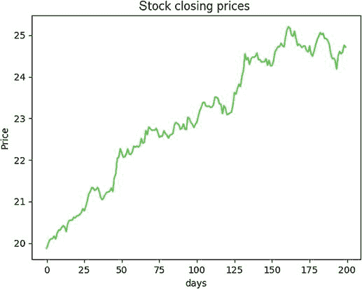

图 2-1 简单随机图

代码首先导入了`matplotlib`、`numpy`和`scipy`库。接着定义了函数`cum_price()`，该函数使用`norm_rvs()`生成了 200 个正态分布的随机数（每天一个）。数据的随机性至关重要。主程序块创建了变量。`Mean`设置为略高于 1，标准差（`s`）设置为一个非常小的数值，以生成一个缓慢增长的股票价格。`Mean`（`mu`）是价值的平均变化量。标准差是数据的变异或离散程度。当`s`为 0.005 时，我们的数据变异非常小。也就是说，数据集中的数值彼此非常接近。请记住，这不是一个真实场景！代码继续绘制结果，如图 2-1 所示。

下一个示例将 MCS 与一个迭代 100 次的`while`循环结合了起来：

```python
import matplotlib.pyplot as plt, numpy as np
from scipy import stats
def cum_price(p, d, m, s):
data = []
for d in range(d):
prob = stats.norm.rvs(loc=m, scale=s)
price = (p * prob)
data.append(price)
p = price
return data
if __name__ == "__main__":
stk_price, days, mu, sigma = 20, 200, 1.001, 0.005
x = 0
while x < 100:
data = cum_price(stk_price, days, mu, sigma)
plt.plot(data)
x += 1
plt.ylabel('Price')
plt.xlabel('day')
plt.title('Stock closing price')
plt.show()
```

输出：

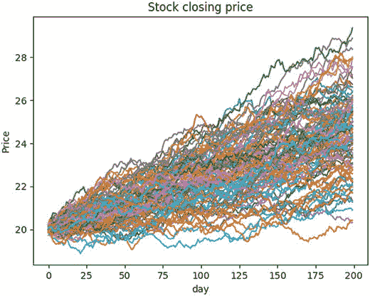

图 2-2 蒙特卡洛模拟增强图

`while`循环使我们能够可视化（如图 2-2 所示）200 天内 100 种可能的股票价格结果。请注意，这里使用了`mu`（均值）和`sigma`（标准差）。这个示例展示了 MCS 在决策制定中的强大功能。

## 假设分析

假设分析会改变算法中的值，以观察它们对结果的影响。请务必一次只改变一个变量，否则你将无法知道是哪个变量导致了变化。在前一个示例中，如果我们将`days`改为 500，同时保持其他所有变量不变，结果会怎样？绘制这一变化的结果如下（图 2-3）：

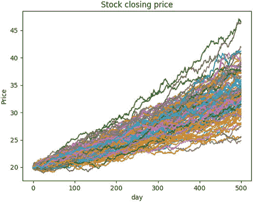

图 2-3 500 天的假设分析

注意，价格变化变慢了。将`mu`（均值）改为 1.002（别忘了将`days`改回 200）会导致变化加快（平均值更大），结果如下（图 2-4）：

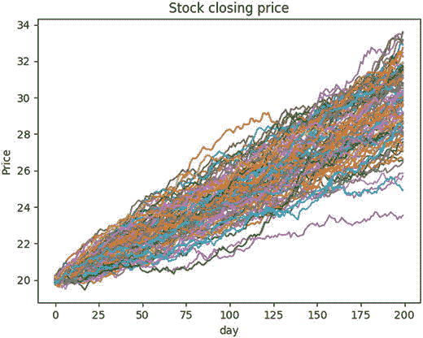

图 2-4 `mu` = 1.002 的假设分析

将`sigma`改为 0.02 会导致更大的变异，结果如下（图 2-5）：

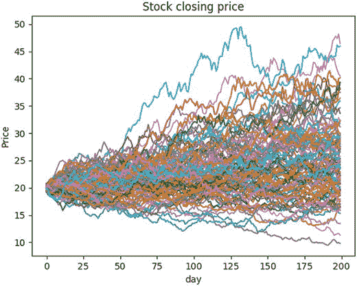

图 2-5 `sigma` = 0.02 的假设分析

## 产品需求模拟

离散概率是指样本空间或总体中每个离散随机值发生的概率。随机变量根据机会取不同的值。离散随机变量只能取可数个值。相比之下，连续随机变量可以在一个区间（如正态分布）内取不可数个值。

在代码示例中，对一种虚构产品的需求通过四个离散概率结果进行预测：随机变量为 10,000 单位的概率是 10%，为 20,000 单位的概率是 35%，为 40,000 单位的概率是 30%，为 60,000 单位的概率是 25%。简单来说，10%的情况下需求是 10,000，35%的情况下需求是 20,000，30%的情况下需求是 40,000，25%的情况下需求是 60,000。离散结果的总和必须为 100%。该代码在一个生产算法上运行 MCS，该算法确定每个离散结果的利润，并绘制结果。

## 生产数量可视化

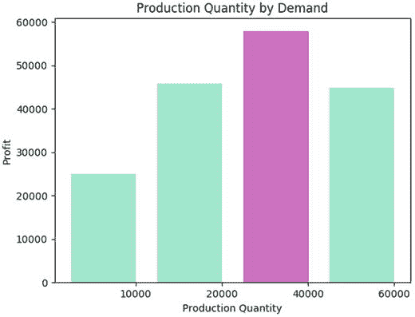

图 2-6

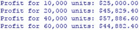

代码首先导入 `matplotlib` 和 `numpy` 库，随后定义了四个函数。函数 `demand()` 首先生成一个均匀分布的随机概率，然后根据待解决问题所设定的四种离散概率结果之一进行返回。函数 `production()` 基于我设计的算法返回利润值。请注意，任何基于利润的算法都可以替换，这充分体现了蒙特卡洛模拟（MCS）的惊人灵活性。函数 `mcs()` 将模拟运行 10,000 次。增加运行次数可提高预测精度，但代价是需要更多的计算机处理资源和运行时间。函数 `max_bar()` 用于确定柱状图中的最高柱形，以便更清晰地展示。主程序块首先模拟每种离散概率结果下的利润，然后打印并可视化结果。MCS 预测，生产 40,000 个单位的产品可获得最高利润，如图 2-6 所示。

增加 MCS 模拟次数能够更准确地预测现实情况，因为其基于随机推理（数据随机化）。你也可以根据解决问题的需要，用此代码结构替换任何离散概率分布。如前所述，你可以使用任何算法与 MCS 结合进行预测，这使其成为数据科学家手中极其灵活的工具。

我们还可以通过在 MCS 上运行 MCS 来进一步提高精度。以下代码示例使用了与之前相同的算法和流程，但在原始 MCS 的基础上增加了一层 MCS，以获得更准确的预测：

```python
import matplotlib.pyplot as plt, numpy as np
def demand():
    p = np.random.uniform(0,1)
    if p = 0.10 and p = 0.45 and p  0:
        disposal_cost = disposal * units_not_sold
    else:
        disposal_cost = 0
    profit = revenue - total_cost - disposal_cost
    return profit
def mcs(x, n, units, price, unit_cost, disposal):
    profit = []
    while x <= n:
        d = demand()
        v = production(d, units, price, unit_cost, disposal)
        profit.append(v)
        x += 1
    return profit
def max_bar(ls):
    tup = max(enumerate(ls))
    return tup[0] - 1
if __name__ == "__main__":
    units = [10000, 20000, 40000, 60000]
    price, unit_cost, disposal = 4, 1.5, 0.2
    avg_p = []
    x, n = 1, 10000
    profit_10 = mcs(x, n, units[0], price, unit_cost, disposal)
    avg_p.append(np.mean(profit_10))
    print ('Profit for {:,.0f}'.format(units[0]),
          'units: ${:,.2f}'.format(np.mean(profit_10)))
    profit_20 = mcs(x, n, units[1], price, unit_cost, disposal)
    avg_p.append(np.mean(np.mean(profit_20)))
    print ('Profit for {:,.0f}'.format(units[1]),
          'units: ${:,.2f}'.format(np.mean(profit_20)))
    profit_40 = mcs(x, n, units[2], price, unit_cost, disposal)
    avg_p.append(np.mean(profit_40))
    print ('Profit for {:,.0f}'.format(units[2]),
          'units: ${:,.2f}'.format(np.mean(profit_40)))
    profit_60 = mcs(x, n, units[3], price, unit_cost, disposal)
    avg_p.append(np.mean(profit_60))
    print ('Profit for {:,.0f}'.format(units[3]),
          'units: ${:,.2f}'.format(np.mean(profit_60)))
    labels = ['10000','20000','40000','60000']
    pos = np.arange(len(labels))
    width = 0.75 # set less than 1.0 for spaces between bins
    plt.figure(2)
    ax = plt.axes()
    ax.set_xticks(pos + (width / 2))
    ax.set_xticklabels(labels)
    barlist = plt.bar(pos, avg_p, width, color="aquamarine")
    barlist[max_bar(avg_p)].set_color('orchid')
    plt.ylabel('Profit')
    plt.xlabel('Production Quantity')
    plt.title('Production Quantity by Demand')
    plt.show()
```

## 使用概率密度函数和累积分布函数实现随机性

```
import matplotlib.pyplot as plt, numpy as np

def demand():
    p = np.random.uniform(0,1)
    if p <= 0.10:
        d = 0
    elif p <= 0.45:
        d = 1
    elif p <= 0.8:
        d = 2
    else:
        d = 3
    return d

def production(d, units, price, unit_cost, disposal):
    if d <= units:
        units_sold = d
        units_not_sold = units - d
    else:
        units_sold = units
        units_not_sold = 0
    revenue = price * units_sold
    total_cost = unit_cost * units
    if units_not_sold > 0:
        disposal_cost = disposal * units_not_sold
    else:
        disposal_cost = 0
    profit = revenue - total_cost - disposal_cost
    return profit

def mcs(x, n, units, price, unit_cost, disposal):
    profit = []
    while x <= n:
        d = demand()
        v = production(d, units, price, unit_cost, disposal)
        profit.append(v)
        x += 1
    return profit

def display(p, i):
    print ('Profit for {:,.0f}'.format(units[i]),
           'units: ${:,.2f}'.format(np.mean(p)))

if __name__ == "__main__":
    units = [10000, 20000, 40000, 60000]
    price, unit_cost, disposal = 4, 1.5, 0.2
    avg_ls = []
    x, n, y, z = 1, 10000, 1, 1000
    while y <= z:
        profit_10 = mcs(x, n, units[0], price, unit_cost, disposal)
        profit_20 = mcs(x, n, units[1], price, unit_cost, disposal)
        avg_profit = np.mean(profit_20)
        profit_40 = mcs(x, n, units[2], price, unit_cost, disposal)
        avg_profit = np.mean(profit_40)
        profit_60 = mcs(x, n, units[3], price, unit_cost, disposal)
        avg_profit = np.mean(profit_60)
        avg_ls.append({'p10':np.mean(profit_10),
                       'p20':np.mean(profit_20),
                       'p40':np.mean(profit_40),
                       'p60':np.mean(profit_60)})
        y += 1
    mcs_p10, mcs_p20, mcs_p40, mcs_p60 = [], [], [], []
    for row in avg_ls:
        mcs_p10.append(row['p10'])
        mcs_p20.append(row['p20'])
        mcs_p40.append(row['p40'])
        mcs_p60.append(row['p60'])
    display(np.mean(mcs_p10), 0)
    display(np.mean(mcs_p20), 1)
    display(np.mean(mcs_p40), 2)
    display(np.mean(mcs_p60), 3)
```

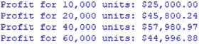

此示例的代码与上一个相同，唯一的区别在于 MCS 的 `while` 循环（`while y <= z`）。在此循环中，利润的计算方式与之前相同，均使用函数 `mcs()`，但每次模拟的结果都会被追加到列表 `avg_ls` 中。因此，`avg_ls` 包含了原始模拟结果的 1,000 次（`z = 1000`）模拟结果。精度提高了，但需要更多的计算机资源和运行时间。在原始 MCS 上运行 1,000 次模拟需要一分多钟，这需要大量的处理时间！

在数据科学中，随机性伪装成现实（自然世界），因为未来无法预测。也就是说，随机化是数据科学家模拟现实的方式。更多的数据意味着更高的精度和预测能力（更逼真）。它在离散事件模拟和确定性问题求解中扮演着关键角色。随机化广泛应用于统计学、MCS、密码学、统计学、医学和科学等多个领域。

连续随机变量的密度是其概率密度函数（`PDF`）。`PDF` 是指随机变量取值为 `x` 的概率，其中 `x` 是样本区间内的一个点。该概率由随机变量的 `PDF` 在样本范围（区间）上的积分确定。也就是说，概率由密度函数曲线下方、水平轴上方以及范围最小值与最大值之间的面积给出。积分（或求积）是一个数学对象，可以解释为正态分布曲线下的面积。累积分布函数（`CDF`）是指随机变量取值小于或等于 `x` 的概率。也就是说，`CDF` 累积了所有小于或等于 `x` 的概率。百分点函数（`PPF`）是 `CDF` 的反函数。它通常被称为逆累积分布函数（`ICDF`）。`ICDF` 在数据科学中非常有用，因为它代表了 `PDF` 曲线下某个面积所对应的实际值。关于密度函数的精彩解释，请参考 [`www.itl.nist.gov/div898/handbook/eda/section3/eda362.htm`](http://www.itl.nist.gov/div898/handbook/eda/section3/eda362.htm)。

如前所述，概率由随机变量的 `PDF` 在样本区间上的积分确定。也就是说，积分用于确定某个随机变量落在特定范围（样本）内的概率。在微积分中，积分代表一类函数（原函数），其导数为被积函数。积分符号代表积分运算，而被积函数则是在定积分或不定积分中被积分的函数。微积分基本定理将定积分的计算与不定积分联系起来。我在此处包含这些信息，唯一目的是强调微积分对数据科学的重要性。微积分中另一个对数据科学很重要的概念——“梯度下降”，将在后面的第 4 章中介绍。

尽管理论解释非常宝贵，但它们可能不够直观。更好地理解这些概念的一个好方法是看一个例子。

在代码示例中，为 `PDF`、`CDF` 和 `ICDF`（`PPF`）创建了二维图表。示例中还包含了颜色映射表的概念。颜色映射表是一个查找表，用于指定渲染调色板图像时要使用的颜色。调色板图像是一种通过将其像素映射到仅包含图像中实际存在的颜色的调色板来进行高效编码的图像。`matplotlib` 库包含了大量的颜色映射表。有关可用的颜色映射表，请参考 [`https://matplotlib.org/examples/color/colormaps_reference.html`](https://matplotlib.org/examples/color/colormaps_reference.html)。

```python
import matplotlib.pyplot as plt
from scipy.stats import norm
import numpy as np
if __name__ == '__main__':
    x = np.linspace(norm.ppf(0.01), norm.ppf(0.99), num=1000)
    y1 = norm.pdf(x)
    plt.figure('PDF')
    plt.xlim(x.min()-.1, x.max()+0.1)
    plt.ylim(y1.min(), y1.max()+0.01)
    plt.xlabel('x')
    plt.ylabel('Probability Density')
    plt.title('Normal PDF')
    plt.scatter(x, y1, c=x, cmap="jet")
    plt.fill_between(x, y1, color="thistle")
    plt.show()
    plt.close('PDF')
    plt.figure('CDF')
    plt.xlabel('x')
    plt.ylabel('Probability')
    plt.title('Normal CDF')
    y2 = norm.cdf(x)
    plt.scatter(x, y2, c=x, cmap="jet")
    plt.show()
    plt.close('CDF')
    plt.figure('ICDF')
    plt.xlabel('Probability')
    plt.ylabel('x')
    plt.title('Normal ICDF (PPF)')
    y3 = norm.ppf(x)
    plt.scatter(x, y3, c=x, cmap="jet")
    plt.show()
    plt.close('ICDF')
```

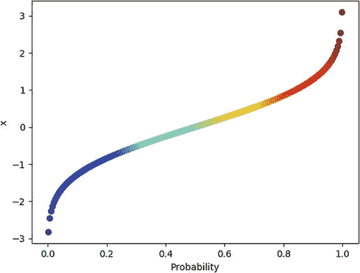

## 图 2-9 正态逆累积分布函数可视化

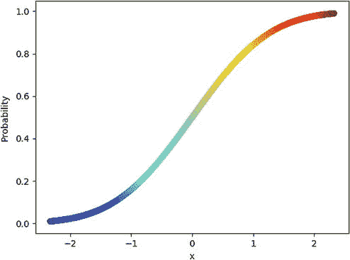

## 图 2-8 正态累积分布函数可视化

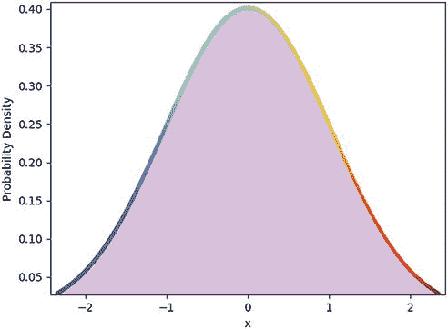

## 图 2-7 正态概率密度函数可视化

代码首先导入三个库——`matplotlib`、`scipy` 和 `numpy`。主程序块首先在 `0.01` 到 `0.99` 之间创建了 `1000` 个 `x` 值的序列（因为概率必须介于 `0` 和 `1` 之间）。接着，基于这些 `x` 值创建了一个 PDF `y` 值的序列。代码继续绘制生成的 PDF，如图 2-7 所示。接下来，创建并绘制了 CDF（图 2-8）和 ICDF（图 2-9）的序列。从可视化结果中可以更容易地看出，PDF 代表了正态分布下所有可能的 `x` 值（概率）。同时，CDF 也更易于可视化，因为它代表了所有可能概率的累积。最后，通过可视化（见图 2-9）更容易理解 ICDF，因为 x 轴代表概率，而 y 轴代表与这些概率相关的实际值。

让我们应用 ICDF。假设你是苹果公司的数据科学家，你的老板要求你确定苹果 iPhone 8 的故障率，以便她为上级制作一份演示文稿。在这个假设的例子中，你的老板期望得到四个计算结果：`5%` 的手机发生故障所需的时间、`95%` 的手机发生故障的时间区间（范围）、`5%` 的手机存活（未发生故障）的时间，以及 `95%` 的手机存活的时间区间。所有情况均以小时为单位报告时间。通过数据探索，你确定平均（`mu`）故障时间为 `1000` 小时，标准差（`sigma`）为 `300` 小时。

以下代码示例计算了四种场景下的 ICDF，并以易于理解的格式向你的老板展示结果：

```python
from scipy.stats import norm
import numpy as np
def np_rstrip(v):
    return np.char.rstrip(v.astype(str), '.0')
def transform(t):
    one, two = round(t[0]), round(t[1])
    return (np_rstrip(one), np_rstrip(two))
if __name__ == "__main__":
    mu, sigma = 1000, 300
    print ('预期故障率：')
    fail = np_rstrip(round(norm.ppf(0.05, loc=mu, scale=sigma)))
    print ('5% 在', fail, '小时内发生故障')
    fail_range = norm.interval(0.95, loc=mu, scale=sigma)
    lo, hi = transform(fail_range)
    print ('95% 在', lo, '到', hi, end=' ')
    print ('小时的使用时间内发生故障')
    print ('\n 预期存活率：')
    last = np_rstrip(round(norm.ppf(0.95, loc=mu, scale=sigma)))
    print ('5% 存活至', last, '小时的使用时间')
    last_range = norm.interval(0.05, loc=mu, scale=sigma)
    lo, hi = transform(last_range)
    print ('95% 在', lo, '到', hi, '小时的使用时间内存活')
```

输出：

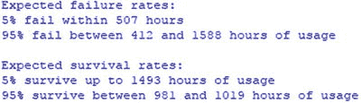

代码示例首先导入 `scipy` 和 `numpy` 库。接着定义了两个函数。函数 `np_rstrip()` 将 numpy 浮点数转换为字符串并移除多余字符。函数 `transform()` 对数字进行四舍五入并返回一个元组。这两个函数都用于将数字四舍五入到无小数位，以便于你虚构的老板理解。主程序块首先将 `mu` 和 `sigma` 初始化为 `1000`（故障）和 `300`（变异）。也就是说，平均而言，我们的智能手机在 `1000` 小时内发生故障，故障时间在 `700` 到 `1300` 小时之间变化。接下来，使用 `norm.ppf()` 查找 `5%` 故障率的 ICDF 值以及 `95%` 发生故障的区间。因此，预计所有手机中有 `5%` 会在 `507` 小时内发生故障，而 `95%` 会在 `412` 到 `1588` 小时的使用时间内发生故障。接着，查找 `5%` 存活率的 ICDF 值以及 `95%` 存活的区间。因此，所有手机中有 `5%` 能存活至 `1493` 小时，而 `95%` 能在 `981` 到 `1019` 小时的使用时间内存活。

简单来说，ICDF 允许你从已知概率反向推导，找到对应的 `x` 值！更多信息请参考 [`http://support.minitab.com/en-us/minitab-express/1/help-and-how-to/basic-statistics/probability-distributions/supporting-topics/basics/using-the-inverse-cumulative-distribution-function-icdf/#what-is-an-inverse-cumulative-distribution-function-icdf`](http://support.minitab.com/en-us/minitab-express/1/help-and-how-to/basic-statistics/probability-distributions/supporting-topics/basics/using-the-inverse-cumulative-distribution-function-icdf/#what-is-an-inverse-cumulative-distribution-function-icdf)。

让我们尝试假设分析。如果我们将错误率（`sigma`）从 `300` 降低到 `30` 会怎样？

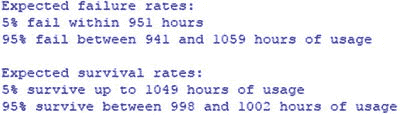

现在，预计所有手机中有 `5%` 会在 `951` 小时内发生故障，而 `95%` 会在 `941` 到 `1059` 小时的使用时间内发生故障。并且，所有手机中有 `5%` 能存活至 `1049` 小时，而 `95%` 能在 `998` 到 `1002` 小时的使用时间内存活。这意味着什么？更小的变异（误差）表明，故障率和存活率的值都更接近平均值。这很合理，因为变异是基于平均值 `1000` 计算得出的。

让我们转向一个模拟示例。假设你的老板要求你确定某款汽车的最佳月订购量，假设需求服从正态分布（必须如此，因为 PDF 基于此假设），平均需求（`mu`）为 `200`，变异（`sigma`）为 `30`。每辆汽车成本为 `25,000` 美元，售价为 `45,000` 美元，未按全价售出的汽车中有一半可以 `30,000` 美元的价格售出。与其他 MCS 实验一样，你可以修改利润算法以增强现实性。根据供应商的限制，你的订购量可选为 `160`、`180`、`200`、`220`、`240`、`260` 或 `280`。

MCS 用于根据所提供的信息计算每个订购量对应的利润。在模拟的每次迭代中，需求都是随机生成的。通过对每个订购量运行 MCS，可以自动计算各订购量下的利润。

```python
import numpy as np
import matplotlib.pyplot as plt
def str_int(s):
    val = "%.2f" % profit
    return float(val)
if __name__ == "__main__":
    orders = [180, 200, 220, 240, 260, 280, 300]
    mu, sigma, n = 200, 30, 10000
    cost, price, discount = 25000, 45000, 30000
    profit_ls = []
    for order in orders:
        x = 1
        profit_val = []
        inv_cost = order * cost
        while x  0:
                damt = round(abs(diff) / 2) * discount
                profit = (demand * price) - inv_cost + damt
            else:
                profit = (order * price) - inv_cost
        else:
            profit = (order * price) - inv_cost
        profit = str_int(profit)
        profit_val.append(profit)
        x += 1
        avg_profit = np.mean(profit_val)
        profit_ls.append(avg_profit)
        print ('${0:,.2f}'.format(avg_profit), '(profit)',
               'for order:', order)
    max_profit = max(profit_ls)
    profit_np = np.array(profit_ls)
    max_ind = np.where(profit_np == profit_np.max())
    print ('\nMaximum profit', '${0:,.2f}'.format(max_profit),
           'for order', orders[int(max_ind[0])])
    barlist = plt.bar(orders, profit_ls, width=15, color="thistle")
    barlist[int(max_ind[0])].set_color('lime')
    plt.title('Profits by Order Quantity')
    plt.xlabel('orders')
    plt.ylabel('profit')
    plt.tight_layout()
    plt.show()
```

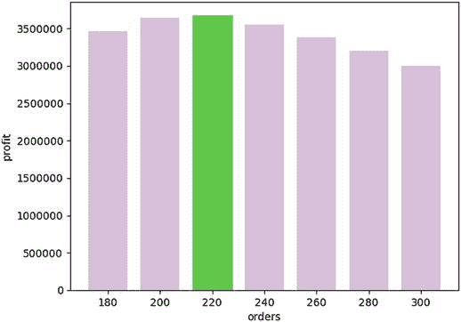

**图 2-10** 按订单数量可视化利润

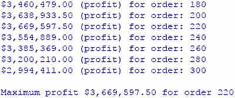

代码首先导入 `numpy` 和 `matplotlib`。接着定义了一个函数（`str_int()`），用于将字符串转换为浮点数。主程序块首先初始化 `orders`、`mu`、`sigma`、`n`、`cost`、`price`、`discount` 以及按订单分类的利润列表。然后，它遍历每个订单数量，并运行包含 10,000 次迭代的 MCS。每次模拟迭代中，使用随机生成的需求概率来计算利润。计算利润的技术相当简单，但你可以替换为自己的算法。你也可以根据自己的数据修改任何给定的信息。通过 MCS 计算每个订单的利润后，代码继续寻找利润最高的订单数量。最后，代码生成一个条形图，通过可视化来阐明结果，如图 2-10 所示。

最后一个代码示例创建了一个 PDF 可视化：

```python
import matplotlib.pyplot as plt, numpy as np
from scipy.stats import norm
if __name__ == '__main__':
    n = 100
    x = np.linspace(norm.ppf(0.01), norm.ppf(0.99), num=n)
    y = norm.pdf(x)
    dic = {}
    for i, row in enumerate(y):
        dic[x[i]] = [np.random.uniform(0, row) for _ in range(n)]
    xs = []
    ys = []
    for key, vals in dic.items():
        for y in vals:
            xs.append(key)
            ys.append(y)
    plt.xlim(min(xs), max(xs))
    plt.ylim(0, max(ys)+0.02)
    plt.title('Normal PDF')
    plt.xlabel('x')
    plt.ylabel('Probability Density')
    plt.scatter(xs, ys, c=xs, cmap="rainbow")
    plt.show()
```

输出：

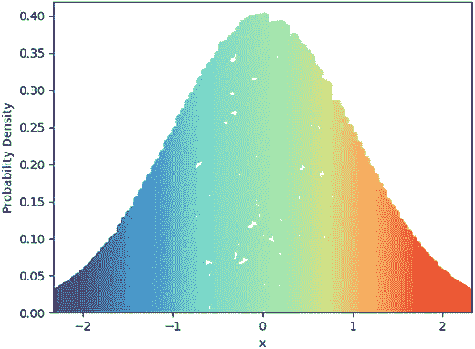

**图 2-11** 100 次模拟下的所有 PDF 概率

代码首先导入 `matplotlib`、`numpy` 和 `scipy` 库。主程序块首先初始化你想要绘制的点数、PDF 的 `x` 和 `y` 值以及一个字典。为了绘制所有 PDF 概率，为 x 轴上的每个点创建了一组随机生成的值。为了完成此任务，代码将 100（`n = 100`）个值从 0.01 到 0.99 分配给 `x`。接着，它将 100 个 PDF 值分配给 `y`。然后，字典元素由一个（键，值）对填充，该对由每个 `x` 值作为键，以及一个包含 100（`n = 100`）个介于 0 和 `pdf(x)` 之间的随机生成数字的列表作为与 `x` 关联的值。尽管创建字典的代码很简单，但请仔细思考其背后的逻辑，因为它相当抽象。代码接着从字典中构建（`x`，`y`）对。结果是 10,000（100 X 100）个（`x`，`y`）对，其中每 100 个 `x` 值都有 100 个关联的 `y` 值，如图 2-11 所示。

为了使可视化更平滑，在主程序块的开头将 `n` 增加到 1,000（`n = 1000`）：

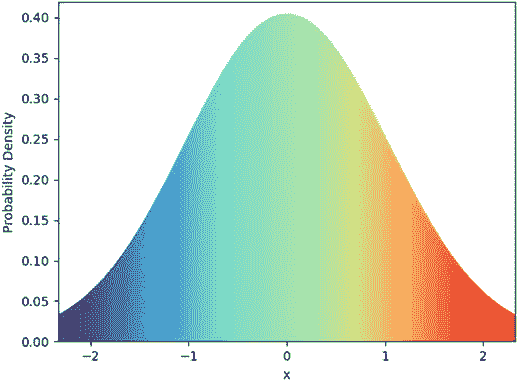

**图 2-12** 1,000 次模拟下的所有 PDF 概率

通过将 `n` 增加到 1000，将绘制出 1,000,000（1,000 X 1,000）个（`x`，`y`）对，如图 2-12 所示！