# 3. 线性代数

线性代数是数学的一个分支，涉及向量空间以及这些空间之间的线性映射。简单来说，它探索的是类似线性的关系。现代科学的几乎每个领域都使用线性代数来近似建模方程。特别是，数据科学在机器学习、数学建模和维度分布问题求解方面依赖于线性代数。

## 向量空间

向量空间是向量的集合。向量是任何具有大小和方向的量，它决定了空间中一个点相对于另一个点的位置。大小是通过运动、长度和/或速度来衡量的物体的尺寸。向量可以相加和（通过标量）相乘，以形成新的向量。标量是任何具有大小（尺寸）的量。在实际应用中，向量是有限空间中的点。

向量的例子包括呼吸、行走和位移。呼吸需要膈肌施加一个具有大小和方向的力。行走需要朝某个方向移动。位移衡量一个物体在某个方向上移动了多远。

### 向量数学

在向量数学中，向量被描绘为一条有向线段，其长度代表向量的大小，箭头指示从起点（尾）到终点（头）的方向。起点是线段开始的地方，终点是线段结束的地方（箭头）。如果两个向量的大小和方向相同，则它们相等。

要将两个向量 `a` 和 `b` 相加，从 `a` 的终点开始绘制 `b`，并构成一个三角形。直观地说，从某个原点开始，绘制 `a`（图 3-1），从 `a` 的终点开始绘制 `b`（图 3-2），结果 `c`（图 3-3）就是从 `a` 的起点到 `b` 的终点的线段。第一个示例展示了向量加法以及该过程的图形化描述：

```python
import matplotlib.pyplot as plt, numpy as np
def vector_add(a, b):
    return np.add(a, b)
def set_up():
    plt.figure()
    plt.xlim(-.05, add_vectors[0]+0.4)
    plt.ylim(-1.1, add_vectors[1]+0.4)
if __name__ == "__main__":
    v1, v2 = np.array([3, -1]), np.array([2, 3])
    add_vectors = vector_add(v1, v2)
    set_up()
    ax = plt.axes()
    ax.arrow(0, 0, 3, -1, head_width=0.1, fc="b", ec="b")
    ax.text(1.5, -0.35, 'a')
    ax.set_facecolor('honeydew')
    set_up()
    ax = plt.axes()
    ax.arrow(0, 0, 3, -1, head_width=0.1, fc="b", ec="b")
    ax.arrow(3, -1, 2, 3, head_width=0.1, fc="crimson", ec="crimson")
    ax.text(1.5, -0.35, 'a')
    ax.text(4, -0.1, 'b')
    ax.set_facecolor('honeydew')
    set_up()
    ax = plt.axes()
    ax.arrow(0, 0, 3, -1, head_width=0.1, fc="b", ec="b")
    ax.arrow(3, -1, 2, 3, head_width=0.1, fc="crimson", ec="crimson")
    ax.arrow(0, 0, 5, 2, head_width=0.1, fc="springgreen", ec="springgreen")
    ax.text(1.5, -0.35, 'a')
    ax.text(4, -0.1, 'b')
    ax.text(2.3, 1.2, 'a + b')
    ax.text(4.5, 2.08, add_vectors, color="fuchsia")
    ax.set_facecolor('honeydew')
    plt.show()
```

输出：

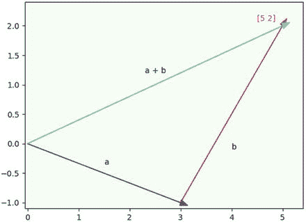

图 3-3

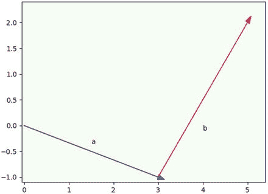

图 3-2

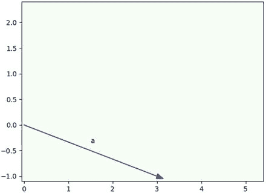

图 3-1

代码首先导入 `matplotlib` 和 `numpy` 库。`matplotlib` 库是一个用于高质量可视化的绘图库。`numpy` 库是科学计算的基础包，是处理向量和矩阵的绝佳库。代码接着定义了两个函数——`vector_add()` 和 `set_up()`。函数 `vector_add()` 用于将两个向量相加。函数 `set_up()` 用于设置绘图图形。主程序块首先创建两个向量并将它们相加。代码的其余部分以图形方式演示了向量加法的工作原理。首先，它创建一个 `axes()` 对象，其中包含一个表示向量 `a` 的箭头，该箭头从原点 (0, 0) 开始，到 (3, -1) 结束。接着添加文本和背景颜色。然后，它创建第二个 `axes()` 对象，其中包含相同的箭头 `a`，但添加了从 (3, -1) 开始并延伸到 (2, 3) 的箭头 `b`（向量 `b`）。最后，它创建第三个 `axes()` 对象，其中包含相同的箭头 `a` 和 `b`，但添加了从 (0, 0) 开始到 (5, 2) 结束的箭头 `c`（`a + b`）。

第二个示例通过使用子图（图 3-4）修改了前一个示例。子图将图形划分为一个 `m × n` 的网格，以提供不同的可视化体验。

```python
import matplotlib.pyplot as plt, numpy as np
def vector_add(a, b):
    return np.add(a, b)
if __name__ == "__main__":
    v1, v2 = np.array([3, -1]), np.array([2, 3])
    add_vectors = vector_add(v1, v2)
    f, ax = plt.subplots(3)
    x, y = [0, 3], [0, -1]
    ax[0].set_xlim([-0.05, 3.1])
    ax[0].set_ylim([-1.1, 0.1])
    ax[0].scatter(x,y,s=1)
    ax[0].arrow(0, 0, 3, -1, head_width=0.1, head_length=0.07,
                fc='b', ec="b")
    ax[0].text(1.5, -0.35, 'a')
    ax[0].set_facecolor('honeydew')
    x, y = ([0, 3, 5]), ([0, -1, 2])
    ax[1].set_xlim([-0.05, 5.1])
    ax[1].set_ylim([-1.2, 2.2])
    ax[1].scatter(x,y,s=0.5)
    ax[1].arrow(0, 0, 3, -1, head_width=0.2, head_length=0.1,
                fc='b', ec="b")
    ax[1].arrow(3, -1, 2, 3, head_width=0.16, head_length=0.1,
                fc='crimson', ec="crimson")
    ax[1].text(1.5, -0.35, 'a')
    ax[1].text(4, -0.1, 'b')
    ax[1].set_facecolor('honeydew')
    x, y = ([0, 3, 5]), ([0, -1, 2])
    ax[2].set_xlim([-0.05, 5.25])
    ax[2].set_ylim([-1.2, 2.3])
    ax[2].scatter(x,y,s=0.5)
    ax[2].arrow(0, 0, 3, -1, head_width=0.15, head_length=0.1,
                fc='b', ec="b")
    ax[2].arrow(3, -1, 2, 3, head_width=0.15, head_length=0.1,
                fc='crimson', ec="crimson")
    ax[2].arrow(0, 0, 5, 2, head_width=0.1, head_length=0.1,
                fc='springgreen', ec="springgreen")
    ax[2].text(1.5, -0.35, 'a')
    ax[2].text(4, -0.1, 'b')
    ax[2].text(2.3, 1.2, 'a + b')
    ax[2].text(4.9, 1.4, add_vectors, color="fuchsia")
    ax[2].set_facecolor('honeydew')
plt.tight_layout()
plt.show()
```

输出：

# 向量与矩阵数学基础

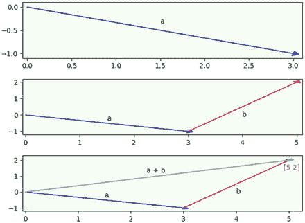

图 3-4 向量加法的子图可视化

## 向量加法与减法

代码首先导入 `matplotlib` 和 `numpy` 库。接着使用与之前相同的 `vector_add()` 函数。主程序块使用 `plt.subplots(3)` 创建三个子图，并赋值给 `f` 和 `ax`，其中 `f` 代表图形，`ax` 代表每个子图（`ax[0]`、`ax[1]` 和 `ax[2]`）。代码不是操作单个图形，而是通过索引 `ax` 来构建每个子图。代码使用 `plt.tight_layout()` 自动对齐每个子图。

第三个示例增加了向量减法。减去两个向量相当于加上一个向量的相反数（取反）。因此，向量 `a` 减去向量 `b` 等同于 `a + (-b)`。该代码示例演示了二维和三维向量的加法和减法：

```python
import numpy as np
def vector_add(a, b):
return np.add(a, b)
def vector_sub(a, b):
return np.subtract(a, b)
if __name__ == "__main__":
v1, v2 = np.array([3, -1]), np.array([2, 3])
add = vector_add(v1, v2)
sub = vector_sub(v1, v2)
print ('2D vectors:')
print (v1, '+', v2, '=', add)
print (v1, '-', v2, '=', sub)
v1 = np.array([1, 3, -5])
v2 = np.array([2, -1, 3])
add = vector_add(v1, v2)
sub = vector_sub(v1, v2)
print ('\n3D vectors:')
print (v1, '+', v2, '=', add)
print (v1, '-', v2, '=', sub)
```

输出：

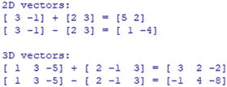

代码首先导入 `numpy` 库。接着定义函数 `vector_add()` 和 `vector_subtract()`，分别用于向量的加法和减法。主程序块首先创建两个二维向量，并对它们进行加法和减法运算。接着对两个三维向量进行加法和减法运算。任何 n 维向量都可以用同样的方式进行加法和减法运算。

向量的大小通过距离公式来度量。单个向量的大小是从原点 (0, 0) 到该向量的距离。两个向量之间的大小是从第一个向量到第二个向量的距离。距离公式是（第二个向量的第一个值减去第一个向量的第一个值的平方）加上（第二个向量的第二个值减去第一个向量的第二个值的平方）之和的平方根。

## 矩阵数学

矩阵是一个由数字组成的数组。可以对矩阵执行多种运算，例如加法、减法、取反、乘法和除法。矩阵的维度是指其行数和列数，按此顺序表示。也就是说，一个 2 × 3 的矩阵有两行三列。通常，一个 m × n 的矩阵有 m 行和 n 列。元素是矩阵中的一个条目。具体来说，矩阵 `A` 中位于 `row[i]` 和 `column[j]` 的元素表示为 `a[i,j]`。最后，矩阵中的向量通常被视为列向量。因此，一个 2 × 3 的矩阵有三个向量（列），每个向量包含两个元素。在执行矩阵乘法或在数据科学算法中使用矩阵时，这是一个需要理解的重要概念。

第一个代码示例创建了一个 `numpy` 矩阵，将其乘以一个标量，计算了按行和按列的均值，从 `numpy` 数组创建了一个 `numpy` 矩阵，并按行和元素显示它：

```python
import numpy as np
def mult_scalar(m, s):
    matrix = np.empty(m.shape)
    m_shape = m.shape
    for i, v in enumerate(range(m_shape[0])):
        result = [x * s for x in m[v]]
        x = np.array(result[0])
        matrix[i] = x
    return matrix
def display(m):
    s = np.shape(m)
    cols = s[1]
    for i, row in enumerate(m):
        print ('row', str(i) + ':', row, 'elements:', end=' ')
        for col in range(cols):
            print (row[col], end=' ')
        print ()
if __name__ == "__main__":
    v1, v2, v3 = [1, 7, -4], [2, -3, 10], [3, 5, 6]
    A = np.matrix([v1, v2, v3])
    print ('matrix A:\n', A)
    scalar = 0.5
    B = mult_scalar(A, scalar)
    print ('\nmatrix B:\n', B)
    mu_col = np.mean(A, axis=0, dtype=np.float64)
    print ('\nmean A (column-wise):\n', mu_col)
    mu_row = np.mean(A, axis=1, dtype=np.float64)
    print ('\nmean A (row-wise):\n', mu_row)
    print ('\nmatrix C:')
    C = np.array([[2, 14, -8], [4, -6, 20], [6, 10, 12]])
    print (C)
    print ('\ndisplay each row and element:')
    display(C)
```

输出：

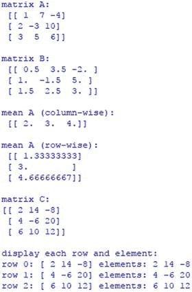

代码首先导入 `numpy`。接着是两个函数——`mult_scalar()` 和 `display()`。函数 `mult_scalar()` 将矩阵乘以一个标量。函数 `display()` 按行和行中的每个元素显示矩阵。主程序块创建了三个向量，并将它们添加到 `numpy` 矩阵 `A` 中。通过将标量 `0.5` 乘以 `A` 来创建 `B`。接下来，按列和按行计算 `A` 的均值。最后，从三个 `numpy` 数组创建 `numpy` 矩阵 `C`，并按行和元素显示。

第二个代码示例创建了一个 `numpy` 矩阵 `A`，对其列和行求和，计算了两个向量的点积，并计算了两个矩阵的点积。点积将两个向量相乘，得到一个可用于计算向量长度和向量之间夹角的大小。具体来说，两个向量 `a` 和 `b` 的点积是 `a[x] × b[x] + a[y] × b[y]`。

对于矩阵乘法，点积从两个矩阵 `A` 和 `B` 生成矩阵 `C`。然而，当两个向量都被视为列矩阵时，它们不能相乘。为了解决这个问题，将 `A` 中的第一个向量转置，将其变成一个 1 × n 的行矩阵，这样它就可以与 `B` 中的第一个向量相乘并求和。现在乘积是良定义的，因为一个 1 × n 矩阵与一个 n × 1 矩阵的乘积是一个 1 × 1 矩阵（一个标量）。要得到点积，对 `A` 和 `B` 中剩余的向量重复此过程。`Numpy` 包含一个方便的函数，可以为你计算点积，这大大简化了矩阵乘法。

```python
import numpy as np
def sum_cols(matrix):
    return np.sum(matrix, axis=0)
def sum_rows(matrix):
    return np.sum(matrix, axis=1)
def dot(v, w):
    return np.dot(v, w)
if __name__ == "__main__":
    v1, v2, v3 = [1, 7, -4], [2, -3, 10], [3, 5, 6]
    A = np.matrix([v1, v2, v3])
    print ('matrix A:\n', A)
    v_cols = sum_cols(A)
    print ('\nsum A by column:\n', v_cols)
    v_rows = sum_rows(A)
    print ('\nsum A by row:\n', v_rows)
    dot_product = dot(v1, v2)
    print ('\nvector 1:', v1)
    print ('vector 2:', v2)
    print ('\ndot product v1 and v2:')
    print (dot_product)
    v1, v2, v3 = [-2, 5, 4], [1, 2, 9], [10, -9, 3]
    B = np.matrix([v1, v2, v3])
    print ('\nmatrix B:\n', B)
    C = A.dot(B)
    print ('\nmatrix C (dot product A and B):\n', C)
    print ('\nC by row:')
    for i, row in enumerate(C):
        print ('row', str(i) + ': ', end='')
        for v in np.nditer(row):
            print (v, end=' ')
        print()
```

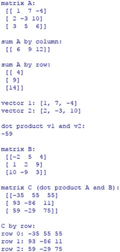

代码首先导入 `numpy`。接着是三个函数——`sum_cols()`、`sum_rows()` 和 `dot()`。函数 `sum_cols()` 对每一列求和，并返回一个包含这些值的行。函数 `sum_rows()` 对每一行求和，并返回一个包含这些值的列。函数 `dot()` 计算点积。主程序块首先创建三个向量，然后用它们创建矩阵 `A`。对 `A` 的列和行进行求和。然后计算两个向量（`v1` 和 `v2`）的点积。接下来，创建三个新向量，然后用它们创建矩阵 `B`。通过计算 `A` 和 `B` 的点积来创建矩阵 `C`。最后，显示 `C` 的每一行。

第三个代码示例展示了一个实际场景。假设一家公司销售三种馅饼——牛肉馅饼、鸡肉馅饼和蔬菜馅饼。牛肉馅饼每个售价 3 美元，鸡肉馅饼每个售价 4 美元，蔬菜馅饼每个售价 2 美元。馅饼成本的向量表示为 `[3, 4, 2]`。你还知道周一至周四每种馅饼的销量。牛肉销量周一为 13，周二为 9，周三为 7，周四为 15。因此牛肉销量的向量为 `[13, 9, 7, 15]`。使用同样的逻辑，鸡肉销量的向量为 `[8, 7, 4, 6]`，蔬菜销量的向量为 `[6, 4, 0, 3]`。目标是计算四天（周一至周四）的总销售额。

```python
import numpy as np
def dot(v, w):
    return np.dot(v, w)
def display(m):
    for i, row in enumerate(m):
        print ('total sales by day:\n', end='')
        for v in np.nditer(row):
            print (v, end=' ')
        print()
if __name__ == "__main__":
    a = [3, 4, 2]
    A = np.matrix([a])
    print ('cost matrix A:\n', A)
    v1, v2, v3 = [13, 9, 7, 15], [8, 7, 4, 6], [6, 4, 0, 3]
    B = np.matrix([v1, v2, v3])
    print ('\ndaily sales by item matrix B:\n', B)
    C = A.dot(B)
    print ('\ndot product matrix C:\n', C, '\n')
    display(C)
```

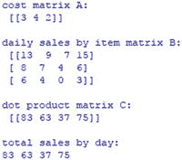

代码首先导入 `numpy`。接着是函数 `dot()`，它计算点积，以及函数 `display()`，它逐行显示矩阵的元素。主程序块首先创建一个包含每种馅饼成本的向量。然后将其转换为矩阵 `A`。接下来，创建三个向量，分别代表周一至周五每种馅饼的销量。代码继续将这三个向量转换为矩阵 `B`。通过求 `A` 和 `B` 的点积来创建矩阵 `C`。这个场景演示了点积如何用于解决商业问题。

第四个代码示例计算单个向量以及两个向量之间的模（距离）和方向（角度）：

```python
import math, numpy as np
def sqrt_sum_squares(ls):
    return math.sqrt(sum(map(lambda x:x*x,ls)))
def mag(v):
    return np.linalg.norm(v)
def a_tang(v):
    return math.degrees(math.atan(v[1]/v[0]))
def dist(v, w):
    return math.sqrt(((w[0]-v[0])** 2) + ((w[1]-v[1])** 2))
def mags(v, w):
    return np.linalg.norm(v - w)
def a_tangs(v, w):
    val = (w[1] - v[1]) / (w[0] - v[0])
    return math.degrees(math.atan(val))
if __name__ == "__main__":
    v = np.array([3, 4])
    print ('single vector', str(v) + ':')
    print ('magnitude:', sqrt_sum_squares(v))
    print ('NumPY magnitude:', mag(v))
    print ('direction:', round(a_tang(v)), 'degrees\n')
    v1, v2 = np.array([2, 3]), np.array([5, 8])
    print ('two vectors', str(v1) + ' and ' + str(v2) + ':')
    print ('magnitude', round(dist(v1, v2),2))
    print ('NumPY magnitude:', round(mags(v1, v2),2))
    print ('direction:', round(a_tangs(v1, v2)), 'degrees\n')
    v1, v2 = np.array([0, 0]), np.array([3, 4])
    print ('use origin (0,0) as 1st vector:')
    print ('"two vectors', str(v1) + ' and ' + str(v2) + '"')
    print ('magnitude:', round(mags(v1, v2),2))
    print ('direction:', round(a_tangs(v1, v2)), 'degrees')
```

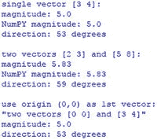

代码首先导入`math`和`numpy`库。接着定义了六个函数。函数`sqrt_sum_squares()`从零开始计算单个向量的模。函数`mag()`功能相同，但使用了`numpy`。函数`a_tang()`计算向量的反正切，即向量从原点`(0,0)`出发的方向（角度）。函数`dist()`从零开始计算两个向量之间的模。函数`mags()`功能相同，但使用了`numpy`。函数`a_tangs()`计算两个向量的反正切。主程序块创建一个向量，计算其模和方向，并显示结果。接着，计算并显示两个向量的模和方向。最后，使用两个向量的公式计算单个向量的模和方向。这是通过将原点`(0,0)`作为第一个向量来实现的。因此，不需要为单个向量计算模和方向的函数，因为任何单个向量总是从原点`(0,0)`出发。所以，一个向量就是空间中的一个点，要么从原点`(0,0)`测量，要么通过模和方向相对于另一个向量来测量。

## 基本矩阵变换

第一个代码示例介绍了单位矩阵，它是一个主对角线元素为 1、其余元素为 0 的方阵。矩阵`A`与其单位矩阵的乘积是`A`，这在数学上很重要，因为乘法的单位元性质指出，任何数乘以 1 都等于其本身。

```python
import numpy as np
def slice_row(M, i):
    return M[i,:]
def slice_col(M, j):
    return M[:, j]
def to_int(M):
    return M.astype(np.int64)
if __name__ == "__main__":
    A = [[1, 9, 3, 6, 7],
         [4, 8, 6, 2, 1],
         [9, 8, 7, 1, 2],
         [1, 1, 9, 2, 4],
         [9, 1, 1, 3, 5]]
    A = np.matrix(A)
    print ('A:\n', A)
    print ('\n1st row: ', slice_row(A, 0))
    print ('\n3rd column:\n', slice_col(A, 2))
    shapeA = np.shape(A)
    I = np.identity(np.shape(A)[0])
    I = to_int(I)
    print ('\nI:\n', I)
    dot_product = np.dot(A, I)
    print ('\nA * I = A:\n', dot_product)
    print ('\nA\':\n', A.I)
    A_by_Ainv = np.round(np.dot(A, A.I), decimals=0, out=None)
    A_by_Ainv = to_int(A_by_Ainv)
    print ('\nA * A\':\n', A_by_Ainv)
```

输出：

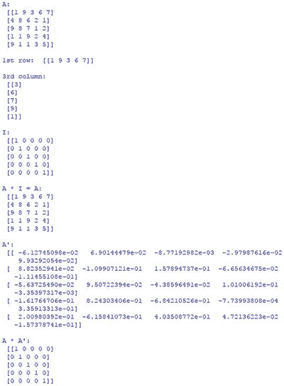

代码首先导入`numpy`。接着定义了三个函数。函数`slice_row()`从矩阵中切取一行。函数`slice_col()`从矩阵中切取一列。函数`to_int()`将矩阵元素转换为整数。主程序块首先创建矩阵`A`。接着为`A`创建单位矩阵。最后，通过使用`A`与`A'`（`A`的逆矩阵）的点积，为`A`创建单位矩阵。

第二个代码示例将一个列表的列表转换为`numpy`矩阵并遍历它：

```python
import numpy as np
if __name__ == "__main__":
    data = [
        [41, 72, 180], [27, 66, 140],
        [18, 59, 101], [57, 72, 160],
        [21, 59, 112], [29, 77, 250],
        [55, 60, 120], [28, 72, 110],
        [19, 59, 99], [32, 68, 125],
        [31, 79, 322], [36, 69, 111]
    ]
    A = np.matrix(data)
    print ('manual traversal:')
    for p in range(A.shape[0]):
        for q in range(A.shape[1]):
            print (A[p,q], end=' ')
        print ()
```

输出：

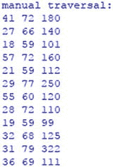

代码首先导入`numpy`。主程序块首先创建一个列表的列表，将其转换为`numpy`矩阵`A`，并遍历`A`。虽然我演示了几种遍历`numpy`矩阵的方法，但这是我最喜欢的方法。

第三个代码示例将一个列表的列表转换为`numpy`矩阵`A`。然后对`A`进行切片操作：

```python
import numpy as np
if __name__ == "__main__":
    points_3D_space = [
        [0, 0, 0],
        [1, 2, 3],
        [2, 2, 2],
        [9, 9, 9] ]
    A = np.matrix(points_3D_space)
    print ('slice entire A:')
    print (A[:])
    print ('\nslice 2nd column:')
    print (A[0:4, 1])
    print ('\nslice 2nd column (alt method):')
    print (A[:, 1])
    print ('\nslice 2nd & 3rd value 3rd column:')
    print (A[1:3, 2])
    print ('\nslice last row:')
    print (A[-1])
    print ('\nslice last row (alt method):')
    print (A[3])
    print ('\nslice 1st row:')
    print (A[0, :])
    print ('\nslice 2nd row; 2nd & 3rd value:')
    print (A[1, 1:3])
```

输出：

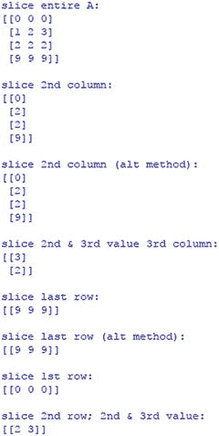

代码首先导入`numpy`。主程序块首先创建一个列表的列表，并将其转换为`numpy`矩阵`A`。代码接着对矩阵进行切片操作。

## Pandas 矩阵应用

Pandas 库提供了高性能、易于使用的数据结构和分析工具。最常用的 Pandas 对象是 `DataFrame`（`df`）。`df` 是一个二维结构，具有可能不同类型的带标签轴（行和列）。数学运算会在行和列标签上对齐。`df` 可以按列或按行来理解。要按列查看，请使用 `axis = 0` 或 `axis = 'index'`。要按行查看，请使用 `axis = 1` 或 `axis = 'columns'`。在处理行时，这可能会显得违反直觉，但 Pandas 就是这样实现此功能的。

Pandas 的 `df` 比 NumPy 矩阵更容易使用，但效率也较低。也就是说，处理 Pandas 的 `df` 需要更多的资源。NumPy 库针对处理大量数据和数值计算进行了优化。

第一个示例创建了一个列表的列表，将其放入 Pandas 的 `df` 中，并显示一些数据：

```python
import pandas as pd
if __name__ == "__main__":
    data = [
        [41, 72, 180], [27, 66, 140],
        [18, 59, 101], [57, 72, 160],
        [21, 59, 112], [29, 77, 250],
        [55, 60, 120], [28, 72, 110],
        [19, 59, 99], [32, 68, 125],
        [31, 79, 322], [36, 69, 111]
    ]
    headers = ['age', 'height', 'weight']
    df = pd.DataFrame(data, columns=headers)
    n = 3
    print ('First', n, '"df" rows:\n', df.head(n))
    print ('\nFirst "df" row:')
    print (df[0:1])
    print ('\nRows 2 through 4')
    print (df[2:5])
    print ('\nFirst', n, 'rows "age" column')
    print (df[['age']].head(n))
    print ('\nLast', n, 'rows "weight" and "age" columns')
    print (df[['weight', 'age']].tail(n))
    print ('\nRows 3 through 6 "weight" and "age" columns')
    print (df.ix[3:6, ['weight', 'age']])
```

输出：

# Pandas与梯度下降基础

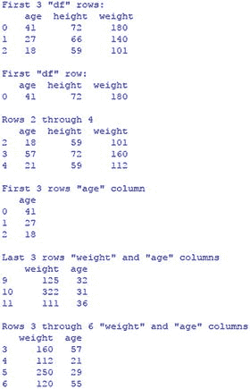

代码首先导入 Pandas。主块首先创建一个列表的列表，并将其添加到 Pandas 的 `df` 中。像我们在这里做的那样，创建自己的列标题是一个好主意。方法 `head()` 和 `tail()` 会自动显示前五条记录和最后五条记录，除非指定了数值。在本例中，我们显示前三条和最后三条记录。使用 `head()` 和 `tail()` 非常有用，尤其是在处理大型 `df` 时。请注意，对 `df` 进行切片和切块是多么容易。同时，请注意显示你选择的列数据是多么容易。

第二个示例创建了一个列表的列表，将其放入 NumPy 矩阵 `A` 中，并将 `A` 放入 Pandas 的 `df` 中。这种能力非常重要，因为它展示了从 NumPy 矩阵创建 `df` 是多么容易。因此，你可以先使用 NumPy 矩阵进行精确和高效的计算，然后转换为 Pandas 进行切片、切块和其他操作。

```python
import pandas as pd, numpy as np
if __name__ == "__main__":
    data = [
        [41, 72, 180], [27, 66, 140],
        [18, 59, 101], [57, 72, 160],
        [21, 59, 112], [29, 77, 250],
        [55, 60, 120], [28, 72, 110],
        [19, 59, 99], [32, 68, 125],
        [31, 79, 322], [36, 69, 111]
    ]
    A = np.matrix(data)
    headers = ['age', 'height', 'weight']
    df = pd.DataFrame(A, columns=headers)
    print ('Entire "df":')
    print (df, '\n')
    print ('Sliced by "age" and "height":')
    print (df[['age', 'height']])
```

输出：

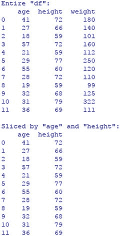

代码首先导入 Pandas 和 NumPy。主块首先创建一个列表的列表，将其转换为 NumPy 矩阵 `A`，然后将 `A` 添加到 Pandas 的 `df` 中。

第三个示例创建了一个列表的列表，将其放入一个字典元素列表中，然后放入 Pandas 的 `df` 中。这种能力也非常重要，因为在处理数据科学应用时，字典是非常高效的数据结构。

```python
import pandas as pd
if __name__ == "__main__":
    data = [
        [41, 72, 180], [27, 66, 140],
        [18, 59, 101], [57, 72, 160],
        [21, 59, 112], [29, 77, 250],
        [55, 60, 120], [28, 72, 110],
        [19, 59, 99], [32, 68, 125],
        [31, 79, 322], [36, 69, 111]
    ]
    d = {}
    dls = []
    key = ['age', 'height', 'weight']
    for row in data:
        for i, num in enumerate(row):
            d[key[i]] = num
        dls.append(d)
        d = {}
    df = pd.DataFrame(dls)
    print ('dict elements from list:')
    for row in dls:
        print (row)
    print ('\nheight from 1st dict element is:', end=' ')
    print (dls[0]['height'])
    print ('\n"df" converted from dict list:\n', df)
    print ('\nheight 1st df element:\n', df[['height']].head(1))
```

输出：

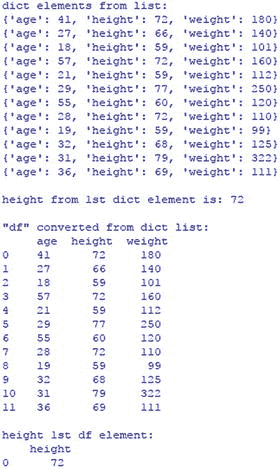

第四个代码示例创建了两个列表的列表——`data` 和 `scores`。`data` 列表保存了 12 名运动员的年龄、身高和体重。`scores` 列表保存了 12 名学生的三次考试成绩。`data` 列表直接放入 `df1`，`scores` 列表直接放入 `df2`。计算并显示平均值。

```python
import pandas as pd, numpy as np
if __name__ == "__main__":
    data = [
        [41, 72, 180], [27, 66, 140],
        [18, 59, 101], [57, 72, 160],
        [21, 59, 112], [29, 77, 250],
        [55, 60, 120], [28, 72, 110],
        [19, 59, 99], [32, 68, 125],
        [31, 79, 322], [36, 69, 111]
    ]
    scores = [
        [99, 90, 88], [77, 66, 81], [78, 77, 83],
        [75, 72, 79], [88, 77, 93], [88, 77, 94],
        [100, 99, 93], [94, 74, 90], [98, 97, 99],
        [73, 68, 77], [55, 50, 68], [36, 77, 90]
    ]
    n = 3
    key1 = ['age', 'height', 'weight']
    df1 = pd.DataFrame(data, columns=key1)
    print ('df1 slice:\n', df1.head(n))
    avg_cols = df1.apply(np.mean, axis=0)
    print ('\naverage by columns:')
    print (avg_cols)
    avg_wt = df1[['weight']].apply(np.mean, axis="index")
    print ('\naverage weight')
    print (avg_wt)
    key2 = ['exam1', 'exam2', 'exam3']
    df2 = pd.DataFrame(scores, columns=key2)
    print ('\ndf2 slice:\n', df2.head(n))
    avg_scores = df2.apply(np.mean, axis=1)
    print ('\naverage scores for 1st', n, 'students (rows):')
    print (avg_scores.head(n))
    avg_slice = df2[['exam1','exam3']].apply(np.mean, axis="columns")
    print ('\naverage "exam1" & "exam3" 1st', n, 'students (rows):')
    print (avg_slice[0:n])
```

输出：

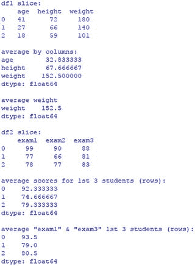

代码首先导入 Pandas 和 NumPy。主块创建了 `data` 和 `scores` 列表，并分别将它们放入 `df1` 和 `df2` 中。对于 `df1`（数据），我们按列求平均值，因为我们的目标是返回所有运动员的平均年龄、身高和体重。对于 `df2`（成绩），我们按行求平均值，因为我们的目标是返回每个学生的平均总考试成绩。如果目标是计算某次考试的平均总分，我们可以对 `df2` 按列求平均值。如果你愿意，可以尝试一下。

### 梯度下降

梯度下降（GD）是一种最小化（或最大化）函数的算法。应用时，从一组函数参数的初始值开始，迭代地向一组使函数最小化的参数值移动。迭代最小化是通过微积分实现的，即沿着函数梯度的负方向迈出步长。GD 很重要，因为优化是机器学习的重要组成部分。此外，GD 易于实现、通用且高效（快速）。

### 简单函数的最小化（与最大化）

梯度下降法是一种一阶迭代优化算法，用于寻找函数 `f` 的最小值。一个函数可以表示为 `f` 或 `f(x)`。简单来说，梯度下降法通过最小化（或最大化）一个代价函数来找到最小误差。代价函数是你想要最小化的东西。

让我们从一个最小化的例子开始。为了找到 `f` 的局部最小值，需要沿着当前点 `f` 的负梯度方向，按比例迈出步长。梯度就是 `f` 的导数（变化率）。梯度下降法唯一的缺点是它找到的是局部最小值，而不是整个函数的最小值。

# 幂法则与梯度下降法入门

## 幂法则简介

幂法则用于对形如 `f(x) = x^r` 的函数求导。

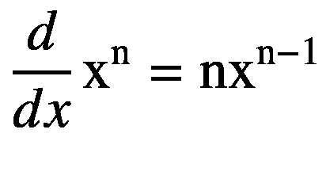

所以，`x^n` 的导数等于 `nx^(n−1)`。简单来说，导数就是指数乘以 `x`，且指数减 1。为了最小化 `f(x) = x⁴ – 3x³ + 2`，需要找到它的导数，即 `f'(x) = 4x³ – 9x²`。因此，第一步总是找到导数 `f'(x)`。第二步是绘制原始函数图像，以了解其形状。第三步是运行梯度下降法。第四步是绘制局部最小值。

## 第一个例子：四次函数

第一个例子找到了 `f(x)` 的局部最小值，并在子图中显示了 `f(x)`、`f'(x)` 和最小值，如图 4-1 所示。

### 代码实现

```python
import matplotlib.pyplot as plt, numpy as np
def f(x):
    return x**4 - 3 * x**3 + 2
def df(x):
    return 4 * x**3 - 9 * x**2
if __name__ == "__main__":
    x = np.arange(-5, 5, 0.2)
    y, y_dx = f(x), df(x)
    f, axarr = plt.subplots(3, sharex=True)
    axarr[0].plot(x, y, color="mediumspringgreen")
    axarr[0].set_xlabel('x')
    axarr[0].set_ylabel('f(x)')
    axarr[0].set_title('f(x)')
    axarr[1].plot(x, y_dx, color="coral")
    axarr[1].set_xlabel('x')
    axarr[1].set_ylabel('dy/dx(x)')
    axarr[1].set_title('derivative of f(x)')
    axarr[2].set_xlabel('x')
    axarr[2].set_ylabel('GD')
    axarr[2].set_title('local minimum')
    iterations, cur_x, gamma, precision = 0, 6, 0.01, 0.00001
    previous_step_size = cur_x
    while previous_step_size > precision:
        prev_x = cur_x
        cur_x += -gamma * df(prev_x)
        previous_step_size = abs(cur_x - prev_x)
        iterations += 1
        axarr[2].plot(prev_x, cur_x, "o")
    f.subplots_adjust(hspace=0.3)
    f.tight_layout()
    plt.show()
    print ('minimum:', cur_x, '\niterations:', iterations)
```

### 输出与解释

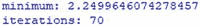

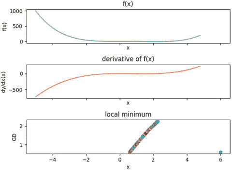

**图 4-1**  
`f(x)`、`f'(x)` 和局部最小值的子图可视化

代码示例首先导入 `matplotlib` 和 `numpy`。接着定义了用于绘制原始函数的函数 `f(x)` 和用于绘制导数的函数 `df(x)`。主程序块首先为 `f(x)` 创建数值。接着创建一个子图。梯度下降法从初始化变量开始。变量 `cur_x` 是模拟的起始点。变量 `gamma` 是步长。变量 `precision` 是容差。容差越小，精度越高，但需要更多的迭代次数（资源）。模拟持续进行，直到 `previous_step_size` 大于 `precision`。每次迭代都将 `-gamma`（步长）乘以当前点的梯度（导数），以将其移向局部最小值。然后，变量 `previous_step_size` 被赋值为 `cur_x` 和 `prev_x` 之间的差值。每个点都被绘制出来。求解 `x` 得到的 `f(x)` 最小值约为 2.25。我知道这个结果是正确的，因为我手动计算过。关于如何手动计算的精彩课程，请查看 [`http://www.dummies.com/education/math/calculus/how-to-find-local-extrema-with-the-first-derivative-test/`](http://www.dummies.com/education/math/calculus/how-to-find-local-extrema-with-the-first-derivative-test/)。

## 第二个例子：三次函数

第二个例子找到了 `f(x) = x³ – 6x² + 9x + 15` 的局部最小值和最大值。首先找到 `f'(x)`，即 `3x² – 12x + 9`。接着，找到局部最小值、绘图、局部最大值、绘图。在这种情况下我没有使用子图，因为可视化效果不够丰富。也就是说，通过观察 `f(x)` 的图形更容易看出近似的局部最小值和最大值，也更容易理解梯度下降法是如何发挥其魔力的。

### 代码实现

```python
import matplotlib.pyplot as plt, numpy as np
def f(x):
    return x**3 - 6 * x**2 + 9 * x + 15
def df(x):
    return 3 * x**2 - 12 * x + 9
if __name__ == "__main__":
    x = np.arange(-0.5, 5, 0.2)
    y = f(x)
    plt.figure('f(x)')
    plt.xlabel('x')
    plt.ylabel('f(x)')
    plt.title('f(x)')
    plt.plot(x, y, color="blueviolet")
    plt.figure('local minimum')
    plt.xlabel('x')
    plt.ylabel('GD')
    plt.title('local minimum')
    iterations, cur_x, gamma, precision = 0, 6, 0.01, 0.00001
    previous_step_size = cur_x
    while previous_step_size > precision:
        prev_x = cur_x
        cur_x += -gamma * df(prev_x)
        previous_step_size = abs(cur_x - prev_x)
        iterations += 1
        plt.plot(prev_x, cur_x, "o")
    local_min = cur_x
    print ('minimum:', local_min, 'iterations:', iterations)
    plt.figure('local maximum')
    plt.xlabel('x')
    plt.ylabel('GD')
    plt.title('local maximum')
    iterations, cur_x, gamma, precision = 0, 0.5, 0.01, 0.00001
    previous_step_size = cur_x
    while previous_step_size > precision:
        prev_x = cur_x
        cur_x += -gamma * -df(prev_x)
        previous_step_size = abs(cur_x - prev_x)
        iterations += 1
        plt.plot(prev_x, cur_x, "o")
    local_max = cur_x
    print ('maximum:', local_max, 'iterations:', iterations)
    plt.show()
```

### 输出与解释

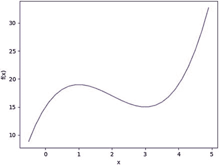  
**图 4-2**  
函数 `f(x)`

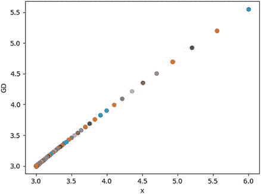  
**图 4-3**  
函数 `f(x)` 的局部最小值

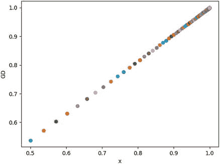  
**图 4-4**  
函数 `f(x)` 的局部最大值

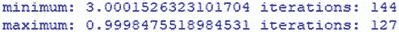

代码首先导入`matplotlib`和`numpy`库。接着定义了函数`f(x)`和`df(x)`，它们分别用算法表示了原始函数及其导数。主程序块首先为`f(x)`创建数据并绘制其图形。接着找到局部最小值和最大值，并绘制它们。注意，用于局部最小值的`cur_x`（起始点）是6，而用于局部最大值的则是0.5。这就是数据科学与其说是科学，不如说是艺术的地方，因为这些点是我通过反复试验找到的。还要注意，用于局部最大值的梯度下降法是导数的相反数。同样，我知道结果是正确的，因为我手动计算了局部最小值和最大值。在这个例子中，我使用单独的图形而不是子图的主要原因是，为了说明绘制`f(x)`图形是多么重要。仅通过观察图形，你就能看出`f(x)`的`x`的局部最大值接近1，而`f(x)`的`x`的局部最小值接近3。此外，从这个图形中你可以看到，该函数有一个大于1的全局最大值。图4-2、4-3和4-4提供了这些可视化结果。

### Sigmoid 函数的最小化与最大化

Sigmoid函数是一种数学函数，其曲线呈S形或sigmoid曲线。它在数据科学中非常重要，原因如下。首先，它相对于网络参数易于求导，这对于训练神经网络至关重要。其次，许多常见概率分布的累积分布函数都是sigmoid形的。第三，许多自然过程（例如，复杂的学习曲线）随时间推移会遵循sigmoid曲线。因此，在没有特定数学模型可用时，通常会使用sigmoid函数。

第一个示例寻找sigmoid函数的局部最小值：

```python
import matplotlib.pyplot as plt, numpy as np
def sigmoid(x):
return 1 / (1 + np.exp(-x))
def df(x):
return x * (1-x)
if __name__ == "__main__":
x = np.arange(-10., 10., 0.2)
y, y_dx = sigmoid(x), df(x)
f, axarr = plt.subplots(3, sharex=True)
axarr[0].plot(x, y, color="lime")
axarr[0].set_xlabel('x')
axarr[0].set_ylabel('f(x)')
axarr[0].set_title('Sigmoid Function')
axarr[1].plot(x, y_dx, color="coral")
axarr[1].set_xlabel('x')
axarr[1].set_ylabel('dy/dx(x)')
axarr[1].set_title('Derivative of f(x)')
axarr[2].set_xlabel('x')
axarr[2].set_ylabel('GD')
axarr[2].set_title('local minimum')
iterations, cur_x, gamma, precision = 0, 0.01, 0.01, 0.00001
previous_step_size = cur_x
while previous_step_size > precision:
prev_x = cur_x
cur_x += -gamma * df(prev_x)
previous_step_size = abs(cur_x - prev_x)
iterations += 1
plt.plot(prev_x, cur_x, "o")
f.subplots_adjust(hspace=0.3)
f.tight_layout()
print ('minimum:', cur_x, '\niterations:', iterations)
plt.show()
```

输出：

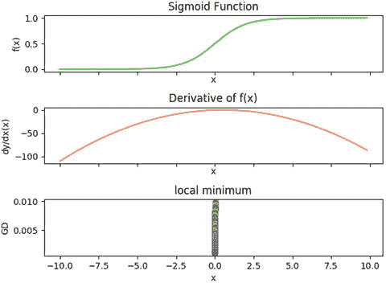

**图 4-5** `f(x)`、`f'(x)` 和局部最小值的子图

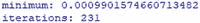

代码首先导入`matplotlib`和`numpy`。接着定义了函数`sigmoid(x)`和`df(x)`，它们分别用算法表示了sigmoid函数及其导数。主程序块首先为`f(x)`和`f'(x)`创建数据。然后为`f(x)`、`f'(x)`和局部最小值创建子图。在此例中，使用子图进行可视化效果良好。从`f(x)`和`f'(x)`的图（图4-5）中可以很容易看出局部最小值接近0。接下来，代码运行梯度下降法来寻找局部最小值并绘制它。同样，梯度下降法的起始点`cur_x`是通过试错法找到的。如果你将`cur_x`起始点设得离局部最小值更远（你可以通过查看`f'(x)`的子图来估计），迭代次数会增加，因为梯度下降法算法需要更长时间才能收敛到局部最小值。正如预期，局部最小值大约为0。

第二个示例寻找sigmoid函数的局部最大值：

```python
import matplotlib.pyplot as plt, numpy as np
def sigmoid(x):
return 1 / (1 + np.exp(-x))
def df(x):
return x * (1-x)
if __name__ == "__main__":
x = np.arange(-10., 10., 0.2)
y, y_dx = sigmoid(x), df(x)
f, axarr = plt.subplots(3, sharex=True)
axarr[0].plot(x, y, color="lime")
axarr[0].set_xlabel('x')
axarr[0].set_ylabel('f(x)')
axarr[0].set_title('Sigmoid Function')
axarr[1].plot(x, y_dx, color="coral")
axarr[1].set_xlabel('x')
axarr[1].set_ylabel('dy/dx(x)')
axarr[1].set_title('Derivative of f(x)')
axarr[2].set_xlabel('x')
axarr[2].set_ylabel('GD')
axarr[2].set_title('local maximum')
iterations, cur_x, gamma, precision = 0, 0.01, 0.01, 0.00001
previous_step_size = cur_x
while previous_step_size > precision:
prev_x = cur_x
cur_x += -gamma * -df(prev_x)
previous_step_size = abs(cur_x - prev_x)
iterations += 1
plt.plot(prev_x, cur_x, "o")
f.subplots_adjust(hspace=0.3)
f.tight_layout()
print ('maximum:', cur_x, '\niterations:', iterations)
plt.show()
```

输出：

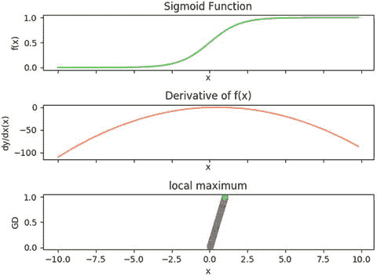

**图 4-6** `f(x)`、`f'(x)` 和局部最大值的子图

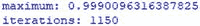

代码首先导入`matplotlib`和`numpy`。接着定义了函数`sigmoid(x)`和`df(x)`，它们分别用算法表示了sigmoid函数及其导数。主程序块首先为`f(x)`和`f'(x)`创建数据。然后为`f(x)`、`f'(x)`和局部最大值（图4-6）创建子图。从`f(x)`的图中可以很容易看出局部最大值接近1。接下来，代码运行梯度下降法来寻找局部最大值并绘制它。同样，梯度下降法的起始点`cur_x`是通过试错法找到的。如果你将`cur_x`起始点设得离局部最大值更远（你可以通过查看`f(x)`的子图来估计），迭代次数会增加，因为梯度下降法算法需要更长时间才能收敛到局部最大值。正如预期，局部最大值大约为1。

### 控制步长的欧几里得距离最小化

# 欧几里得距离与梯度下降

欧几里得距离是欧几里得空间中两点之间的普通直线距离。借助这种距离，欧几里得空间便成为一个度量空间。与之相关的范数是欧几里得范数（EN）。欧几里得范数为每个向量赋予其箭头长度，因此，欧几里得范数实际上就是向量的大小。定义了范数的向量空间称为赋范向量空间。

要在三维空间中寻找 `f(x)` 的局部最小值，第一步是找到所有三维向量的最小值。第二步是创建一个随机的三维向量 `[x, y, z]`。第三步是选取一个随机起点，然后沿着梯度 `f'(x)` 的反方向迈出微小步长，直到到达一个梯度非常小的点。每一步微小步长（从当前向量到下一个向量）都使用欧几里得距离度量来衡量。欧几里得距离度量是欧几里得空间中两点之间的距离。之所以需要这个度量，是因为我们需要知道每一步微小步长该如何移动。因此，欧几里得距离度量补充了梯度下降法，以在三维空间中寻找局部最小值。

## 代码示例

以下代码示例展示了如何在三维空间中寻找 sigmoid 函数的局部最小值：

```python
import matplotlib.pyplot as plt
from mpl_toolkits.mplot3d import Axes3D
import random, numpy as np
from scipy.spatial import distance
def step(v, direction, step_size):
    return [v_i + step_size * direction_i
            for v_i, direction_i in zip(v, direction)]
def sigmoid_gradient(v):
    return [v_i * (1-v_i) for v_i in v]
def mod_vector(v):
    for i, v_i in enumerate(v):
        if v_i == float("inf") or v_i == float("-inf"):
            v[i] = random.randint(-1, 1)
    return v
if __name__ == "__main__":
    v = [random.randint(-10, 10) for i in range(3)]
    tolerance = 0.0000001
    iterations = 1
    fig = plt.figure('Euclidean')
    ax = fig.add_subplot(111, projection="3d")
    while True:
        gradient = sigmoid_gradient(v)
        next_v = step(v, gradient, -0.01)
        xs = gradient[0]
        ys = gradient[1]
        zs = gradient[2]
        ax.scatter(xs, ys, zs, c="lime", marker="o")
        v = mod_vector(v)
        next_v = mod_vector(next_v)
        test_v = distance.euclidean(v, next_v)
        if test_v < tolerance:
            break
        v = next_v
        iterations += 1
    print ('minimum:', test_v, '\niterations:', iterations)
    ax.set_xlabel('X axis')
    ax.set_ylabel('Y axis')
    ax.set_zlabel('Z axis')
    plt.tight_layout()
    plt.show()
```

输出：

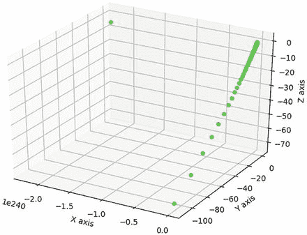

图 4-7 局部最小值的三维渲染图

代码首先导入了 `matplotlib`、`mpl_toolkits`、`random`、`numpy` 和 `scipy` 库。函数 `step()` 根据梯度，按指定步长将向量沿某个方向移动。函数 `sigmoid_gradient()` 返回 `f'(sigmoid)` 在三维空间中的一个点。函数 `mod_vector()` 确保模拟过程中产生的错误向量能被妥善处理。主程序块首先创建一个随机生成的三维向量 `[x, y, z]` 作为模拟的起点，然后设定一个容差（精度）。容差越小，结果越精确。接着创建一个子图，用于显示局部最小值的三维渲染图（图 4-7）。梯度下降模拟会生成一组受 sigmoid 梯度影响的三维向量，直到梯度变得非常小。梯度的大小（模）通过欧几里得距离度量来计算。正如预期，局部最小值接近 0。

# 使用蒙特卡洛模拟稳定欧几里得距离最小化

前一个示例中的欧几里得距离实验基于一个随机过程。具体来说，起始向量 `v` 是通过 `randomint()` 随机生成的。因此，每次运行梯度下降实验时，迭代次数都会产生不同的结果。从第 2 章我们已经知道，蒙特卡洛模拟（MCS）能高效地对随机过程进行建模。然而，MCS 也能稳定随机实验。

## 代码示例

以下代码示例首先将梯度下降实验包装在一个循环中，该循环运行 `n` 次模拟。通过 `n` 次模拟，计算出平均迭代次数。然后将结果代码再包装在另一个循环中，该循环运行 `m` 次试验。通过 `m` 次试验，计算出每次平均迭代次数之间的平均差距。差距是通过从最大平均迭代次数中减去最小平均迭代次数得到的。差距越小，结果越稳定（精确）。要提高精度，可以增加模拟次数（`n`）。唯一的限制是计算能力。也就是说，运行 1000 次模拟比运行 100 次需要更多的计算能力。稳定（精确）的结果允许与其他实验进行比较。

```python
import random, numpy as np
from scipy.spatial import distance
def step(v, direction, step_size):
    return [v_i + step_size * direction_i
            for v_i, direction_i in zip(v, direction)]
def sigmoid_gradient(v):
    return [v_i * (1-v_i) for v_i in v]
def mod_vector(v):
    for i, v_i in enumerate(v):
        if v_i == float("inf") or v_i == float("-inf"):
            v[i] = random.randint(-1, 1)
    return v
if __name__ == "__main__":
    trials= 10
    sims = 10
    avg_its = []
    for _ in range(trials):
        its = []
        for _ in range(sims):
            v = [random.randint(-10, 10) for i in range(3)]
            tolerance = 0.0000001
            iterations = 0
            while True:
                gradient = sigmoid_gradient(v)
                next_v = step(v, gradient, -0.01)
                v = mod_vector(v)
                next_v = mod_vector(next_v)
                test_v = distance.euclidean(v, next_v)
                if test_v < tolerance:
                    break
                v = next_v
                iterations += 1
            its.append(iterations)
        a = round(np.mean(its))
        avg_its.append(a)
    gap = np.max(avg_its) - np.min(avg_its)
    print (trials, 'trials with', sims, 'simulations each:')
    print ('gap', gap)
    print ('avg iterations', round(np.mean(avg_its)))
```

输出：

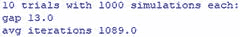
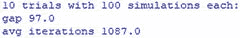
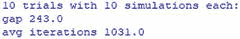

输出结果分别对应 10 次、100 次和 1000 次模拟。通过运行 10 次（试验）各包含 1000 次模拟，差距缩小到了 13。因此，我们有很高的置信度认为，最小化该函数所需的迭代次数接近 1089。我们可以通过将代码再包装在一个循环中来进一步稳定结果，以减少差距和迭代次数的波动。然而，计算机处理时间会成为一个问题。对于这类实验，利用 MCS 为云计算提供了强有力的理由。理解 MCS 的这种应用可能有些困难，但它是处理并解决数据科学问题的一个非常强大的工具。

### 使用 NumPy 方法加速欧几里得距离最小化

由于 `numpy` 数组比 Python 列表更快，因此使用 `numpy` 方法计算欧几里得距离会更高效。以下代码示例使用 `np.linalg.norm()` 替代 `distance.euclidean()` 来计算 GD 实验中的欧几里得距离。

```python
import matplotlib.pyplot as plt
from mpl_toolkits.mplot3d import Axes3D
import random, numpy as np
def step(v, direction, step_size):
return [v_i + step_size * direction_i
for v_i, direction_i in zip(v, direction)]
def sigmoid_gradient(v):
return [v_i * (1-v_i) for v_i in v]
def round_v(v):
return np.round(v, decimals=3)
if __name__ == "__main__":
v = [random.randint(-10, 10) for i in range(3)]
tolerance = 0.0000001
iterations = 1
fig = plt.figure('norm')
ax = fig.add_subplot(111, projection="3d")
while True:
gradient = sigmoid_gradient(v)
next_v = step(v, gradient, -0.01)
round_gradient = round_v(gradient)
xs = round_gradient[0]
ys = round_gradient[1]
zs = round_gradient[2]
ax.scatter(xs, ys, zs, c="lime", marker="o")
norm_v = np.linalg.norm(v)
norm_next_v = np.linalg.norm(next_v)
test_v = norm_v - norm_next_v
if test_v < tolerance:
break
v = next_v
iterations += 1
print ('minimum:', test_v, '\niterations:', iterations)
ax.set_xlabel('X axis')
ax.set_ylabel('Y axis')
ax.set_zlabel('Z axis')
plt.show()
```

输出：

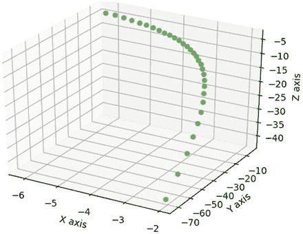

图 4-8 局部最小值的 NumPy 3D 渲染

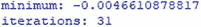

迭代次数大幅降低至 31 次（图 4-8）。然而，由于 GD 实验是随机的，我们可以使用 MCS 进行客观比较。

使用相同的 MCS 方法，代码示例首先将 GD 实验包装在一个运行 `n` 次模拟的循环中。然后将生成的代码再包装在另一个运行 `m` 次试验的循环中。

```python
import random, numpy as np
def step(v, direction, step_size):
return [v_i + step_size * direction_i
for v_i, direction_i in zip(v, direction)]
def sigmoid_gradient(v):
return [v_i * (1-v_i) for v_i in v]
def round_v(v):
return np.round(v, decimals=3)
if __name__ == "__main__":
trials= 10
sims = 10
avg_its = []
for _ in range(trials):
its = []
for _ in range(sims):
v = [random.randint(-10, 10) for i in range(3)]
tolerance = 0.0000001
iterations = 0
while True:
gradient = sigmoid_gradient(v)
next_v = step(v, gradient, -0.01)
norm_v = np.linalg.norm(v)
norm_next_v = np.linalg.norm(next_v)
test_v = norm_v - norm_next_v
if test_v < tolerance:
break
v = next_v
iterations += 1
its.append(iterations)
a = round(np.mean(its))
avg_its.append(a)
gap = np.max(avg_its) - np.min(avg_its)
print (trials, 'trials with', sims, 'simulations each:')
print ('gap', gap)
print ('avg iterations', round(np.mean(avg_its)))
```

输出：

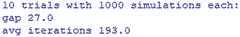

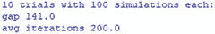

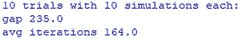

使用 `numpy` 处理速度要快得多。平均迭代次数接近 193。因此，使用 `numpy` 替代方案计算欧几里得距离的速度提高了五倍以上！

### 随机梯度下降的最小化与最大化

在本章中，到目前为止的优化实验都使用了批量梯度下降。批量梯度下降使用整个数据集计算梯度。随机梯度下降则使用单个样本计算梯度，因此计算速度要快得多。之所以称为随机梯度下降，是因为梯度是随机确定的。然而，与批量梯度下降不同，随机梯度下降是一种近似方法。如果需要精确梯度，随机梯度下降并非最优选择。随机梯度下降的另一个问题是，它可能会在最小值附近徘徊，而实际上无法收敛。因此，绘制模拟过程的进度图以观察情况非常重要。

现在让我们改变方向，优化另一个重要函数——残差平方和（RSS）。RSS 函数是一种统计技术，用于衡量回归函数与数据集之间剩余的误差（方差）量。回归分析是一种估计变量之间关系的算法。它广泛用于预测和预报。它也是数据科学应用中一种流行的建模和预测算法。

第一个代码示例生成一个样本，运行 GD 实验 `n` 次，并随机处理样本：

# 随机梯度下降模拟

```python
import matplotlib.pyplot as plt
import random, numpy as np
def rnd():
    return [random.randint(-10,10) for i in range(3)]
def random_vectors(n):
    ls = []
    for v in range(n):
        ls.append(rnd())
    return ls
def sos(v):
    return sum(v_i ** 2 for v_i in v)
def sos_gradient(v):
    return [2 * v_i for v_i in v]
def in_random_order(data):
    indexes = [i for i, _ in enumerate(data)]
    random.shuffle(indexes)
    for i in indexes:
        yield data[i]
if __name__ == "__main__":
    v, x, y = rnd(), random_vectors(3), random_vectors(3)
    data = list(zip(x, y))
    theta = v
    alpha, value = 0.01, 0
    min_theta, min_value = None, float("inf")
    iterations_with_no_improvement = 0
    n, x = 30, 1
    for i, _ in enumerate(range(n)):
        y = np.linalg.norm(theta)
        plt.scatter(x, y, c="r")
        x = x + 1
        s = []
        for x_i, y_i in data:
            s.extend([sos(theta), sos(x_i), sos(y_i)])
        value = sum(s)
        if value < min_value:
            min_theta, min_value = theta, value
            iterations_with_no_improvement = 0
            alpha = 0.01
        else:
            iterations_with_no_improvement += 1
            alpha *= 0.9
        g = []
        for x_i, y_i in in_random_order(data):
            g.extend([sos_gradient(theta), sos_gradient(x_i),
                      sos_gradient(y_i)])
        for v in g:
            theta = np.around(np.subtract(theta,alpha*np.array(v)),3)
        g = []
        print ('minimum:', np.around(min_theta, 4),
               'with', i+1, 'iterations')
        print ('iterations with no improvement:',
               iterations_with_no_improvement)
        print ('magnitude of min vector:', np.linalg.norm(min_theta))
        plt.show()
```

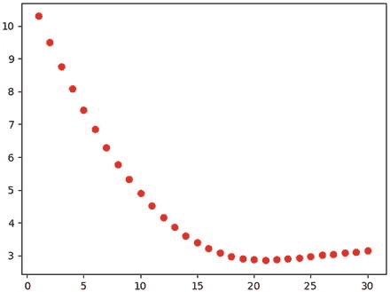

图 4-9

RSS 最小化

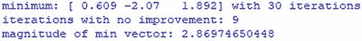

代码首先导入 `matplotlib`、`random` 和 `numpy`。接着是函数 `rnd()`，它返回一个从 -10 到 10 的随机整数列表。函数 `random_vectors(n)` 生成一个包含 `n` 个数字的列表（随机样本）。函数 `sos(v)` 返回向量的 RSS。函数 `sos_gradient(v)` 返回向量 RSS 的导数（梯度）。函数 `in_random_order(data)` 生成一个随机打乱索引的列表。该函数为 GD 算法增添了随机性。主程序块首先生成一个随机向量 `v` 作为模拟的起点。接着创建一个大小为 3 的 `x` 和 `y` 向量样本。然后，将该向量赋值给 `theta`，这是某个通用概率分布向量的常见名称。我们可以随意命名该向量，但一个常见的数据科学问题是找到 `theta` 的值。代码继续设置固定步长 `alpha`、最小 `theta` 值、最小结束值、无改进迭代次数、模拟次数 `n`，以及 x 坐标的绘图值（图 4-9）。

### 随机梯度下降与数据工作

模拟开始时，将 `theta` 的幅度赋值给 `y`。接着，绘制当前的 `x` 和 `y` 坐标。`x` 坐标递增 1，以绘制每个 `y` 坐标向最小值收敛的过程。下一段代码计算每个 `theta` 以及 `x` 和 `y` 样本的 RSS。该值用于判断模拟是否在局部最小值附近徘徊，而非收敛。代码的最后部分以随机（随机梯度）顺序遍历样本数据点，计算 `theta`、`x` 和 `y` 的梯度，将这三个值放入列表 `g` 中，并遍历该向量以找到下一个 `theta` 值。

哇！这并不简单，但这就是随机梯度下降（SGD）的工作原理。请注意，生成的最小值为 2.87，并非真实最小值 0。因此，随机梯度下降所需的迭代次数较少，但无法产生真实最小值。

可以通过调整寻找下一个 `theta` 的算法来优化之前的模拟。在前一个示例中，下一个 `theta` 是根据每个样本的当前 `theta`、`x` 值和 `y` 值计算的梯度来计算的。然而，实际的新 `theta` 是基于样本中的第三个数据点。因此，第二个示例通过取整个样本中的最小 `theta`（而非第三个数据点）进行了优化。

### 第三个示例用于寻找最大值

```python
import matplotlib.pyplot as plt
import random, numpy as np
def rnd():
    return [random.randint(-10,10) for i in range(3)]
def random_vectors(n):
    ls = []
    for v in range(n):
        ls.append([random.randint(-10,10) for i in range(3)])
    return ls
def sos_gradient(v):
    return [2 * v_i for v_i in v]
def negate(function):
    def new_function(*args, **kwargs):
        return np.negative(function(*args, **kwargs))
    return new_function
def in_random_order(data):
    indexes = [i for i, _ in enumerate(data)]
    random.shuffle(indexes)
    for i in indexes:
        yield data[i]
if __name__ == "__main__":
    v, x, y = rnd(), random_vectors(3), random_vectors(3)
    data = list(zip(x, y))
    theta, alpha = v, 0.01
    neg_gradient = negate(sos_gradient)
    n, x = 100, 1
    for i, row in enumerate(range(n)):
        y = np.linalg.norm(theta)
        plt.scatter(x, y, c="r")
        x = x + 1
        g = []
        for x_i, y_i in in_random_order(data):
            g.extend([neg_gradient(theta), neg_gradient(x_i),
                      neg_gradient(y_i)])
        for v in g:
            theta = np.around(np.subtract(theta,alpha*np.array(v)),3)
        g = []
    print ('maximum:', np.around(theta, 4),
           'with', i+1, 'iterations')
    print ('magnitude of max vector:', np.linalg.norm(theta))
    plt.show()
```

输出：

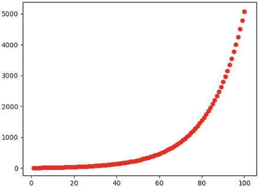

**图 4-11** `RSS` 最大化

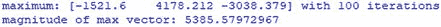

与第一个示例相比，代码中唯一的区别是`negate()`函数，它通过取反梯度来寻找最大值。由于 `RSS` 的最大值是无穷大（我们可以通过图 4-11 的可视化看出），我们可以在 100 次迭代后停止。尝试 1000 次迭代，看看会发生什么。