# 5. 数据工作

数据工作详细介绍了数据科学问题解决的最早过程。第一步是识别问题，这决定了后续所有需要完成的工作。第二步是收集数据。第三步是整理（清洗）数据，这一步至关重要。数据整理是将数据转换为对机器学习和其他数据科学问题有用的形式。当然，整理后的数据可能还需要进行清洗。第四步是数据可视化。可视化有助于你了解数据，并有望识别出模式。

## 一维数据示例

以下代码示例生成了两种非常常见的数据分布——均匀分布和正态分布的可视化。均匀分布具有恒定的概率。也就是说，属于该分布的所有事件概率相等。正态分布关于中心对称，这意味着其 50%的值小于均值，50%的值大于均值。其形状类似于钟形曲线。正态分布极其重要，因为它为许多自然发生的事件建模。

```python
import matplotlib.pyplot as plt
import numpy as np
if __name__ == "__main__":
plt.figure('Uniform Distribution')
uniform = np.random.uniform(-3, 3, 1000)
count, bins, ignored = plt.hist(uniform, 20, facecolor="lime")
plt.xlabel('Interval: [-3, 3]')
plt.ylabel('Frequency')
plt.title('Uniform Distribution')
plt.axis([-3,3,0,100])
plt.grid(True)
plt.figure('Normal Distribution')
normal = np.random.normal(0, 1, 1000)
count, bins, ignored = plt.hist(normal, 20, facecolor="fuchsia")
plt.xlabel('Interval: [-3, 3]')
plt.ylabel('Frequency')
plt.title('Normal Distribution')
plt.axis([-3,3,0,140])
plt.grid(True)
plt.show()
```

输出：


图 5-2 正态分布


图 5-1 均匀分布

代码示例首先导入`matplotlib`和`numpy`。主块首先创建一个图形和用于均匀分布的数据。接着，基于这些数据创建并绘制直方图。然后创建并绘制正态分布的图形。参见图 5-1 和图 5-2。

### 二维数据示例

对二维数据进行建模能更真实地呈现自然发生的事件。以下代码示例比较了两个具有相同均值和标准差（`SD`）的正态分布随机生成数据集。`SD`衡量一组数据值的变异（离散）程度。尽管两个数据集均呈正态分布且具有相同的均值和`SD`，但它们的联合分布（相关性）却截然不同。相关性是指两个变量之间的相互依存关系。

```python
import matplotlib.pyplot as plt
import matplotlib.gridspec as gridspec
import numpy as np, random
from scipy.special import ndtri
def inverse_normal_cdf(r):
return ndtri(r)
def random_normal():
return inverse_normal_cdf(random.random())
def scatter(loc):
plt.scatter(xs, ys1, marker='.', color="black", label="ys1")
plt.scatter(xs, ys2, marker='.', color="gray",  label='ys2')
plt.xlabel('xs')
plt.ylabel('ys')
plt.legend(loc=loc)
plt.tight_layout()
if __name__ == "__main__":
xs = [random_normal() for _ in range(1000)]
ys1 = [ x + random_normal() / 2 for x in xs]
ys2 = [-x + random_normal() / 2 for x in xs]
gs = gridspec.GridSpec(2, 2)
fig = plt.figure()
ax1 = fig.add_subplot(gs[0,0])
plt.title('ys1 data')
n, bins, ignored = plt.hist(ys1, 50, normed=1,
facecolor='chartreuse', alpha=0.75)
ax2 = fig.add_subplot(gs[0,1])
plt.title('ys2 data')
n, bins, ignored = plt.hist(ys2, 50, normed=1,
facecolor='fuchsia', alpha=0.75)
ax3 = fig.add_subplot(gs[1,:])
plt.title('Correlation')
scatter(6)
print (np.corrcoef(xs, ys1)[0, 1])
print (np.corrcoef(xs, ys2)[0, 1])
plt.show()
```

输出：


图 5-3 正态分布与相关性的子图


代码示例首先导入了`matplotlib`、`numpy`、`random`和`scipy`库。方法`gridspec`用于指定放置子图的网格几何结构。方法`ndtri`返回标准正态累积分布函数（`CDF`）。`CDF`是指随机变量`X`取值小于或等于`x`的概率，其中`x`代表正态分布曲线下的面积。代码接着定义了三个函数。函数`inverse_normal_cdf()`基于一个随机变量返回`CDF`。函数`random_normal()`调用函数`inverse_normal_cdf()`，传入一个随机生成的值`X`，并返回`CDF`。函数`scatter()`用于创建散点图。主程序块首先创建随机生成的`x`和`y`值`xs`、`ys1`和`ys2`。然后创建一个`gridspec()`来容纳这些分布。接着分别为`xs`、`ys1`数据和`xs`、`ys2`数据创建直方图。随后，为两个分布创建相关性图。最后，生成两个分布的相关性系数。图 5-3 展示了这些图形。

该代码示例揭示了两个重要启示。第一，使用`ndtri()`创建一组随机生成的数字会生成一个正态分布的数据集。也就是说，函数`ndtri()`返回的是随机生成值的`CDF`。第二，两个正态分布的数据集即使看起来相似，也未必真正相似。在本例中，它们的相关性是相反的。因此，需要通过可视化和相关性分析来展示数据集之间的差异。

## 数据相关性与基础统计

相关性是指两个或多个变量共同波动（变化）的程度。相关矩阵是一个展示变量集之间相关系数的表格。相关系数衡量两个或多个变量之间关联的强度。

以下代码示例创建了三个具有`x`和`y`坐标的数据集，计算相关性并绘制图形。第一个数据集代表正相关；第二个代表负相关；第三个代表弱相关。

## Matplotlib 散点图示例：展示相关性

代码示例首先导入了`random`、`numpy`和`matplotlib`库。主程序块首先生成具有正相关关系的`x`和`y`坐标，并显示相关矩阵。接着创建一个网格来容纳子图，即第一个子图网格，并绘制散点图。然后，生成具有负相关关系的`x`和`y`坐标，并显示相关矩阵。创建并绘制第二个子图网格。最后，生成具有弱相关关系的`x`和`y`坐标，并显示相关矩阵。创建并绘制第三个子图网格，并显示所有三个散点图。图 5-4 展示了这些图形。

### Pandas 相关性分析与热力图示例

`Pandas`是一个Python包，它提供快速、灵活且富有表现力的数据结构，使得在实际数据分析中处理几乎任何类型的数据都变得简单、直观且实用。`DataFrame`（`df`）是一种二维标签化数据结构，也是`pandas`中最常用的对象。

第一个代码示例创建了一个相关性矩阵及其可视化图表：

```python
import random, numpy as np, pandas as pd
import matplotlib.pyplot as plt
import matplotlib.cm as cm
import matplotlib.colors as colors
if __name__ == "__main__":
    np.random.seed(0)
    df = pd.DataFrame({'a': np.random.randint(0, 50, 1000)})
    df['b'] = df['a'] + np.random.normal(0, 10, 1000)
    df['c'] = 100 - df['a'] + np.random.normal(0, 5, 1000)
    df['d'] = np.random.randint(0, 50, 1000)
    colormap = cm.viridis
    colorlist = [colors.rgb2hex(colormap(i))
                 for i in np.linspace(0, 1, len(df['a']))]
    df['colors'] = colorlist
    print(df.corr())
    pd.plotting.scatter_matrix(df, c=df['colors'], diagonal="kde",
                               figsize=(10, 6))
    plt.show()
```

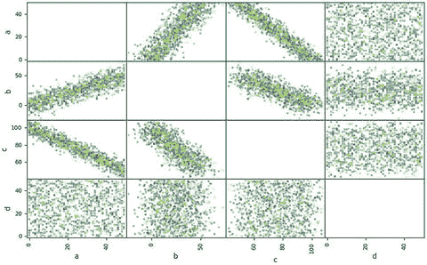

**图 5-5** 相关性矩阵可视化

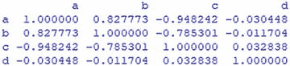

该代码示例首先导入了`random`、`numpy`、`pandas`和`matplotlib`库。`main`块首先创建了一个包含四列数据的`df`，这些列由各种随机数填充。接着，它为各列之间的相关性创建了一个颜色映射，打印出相关性矩阵，并绘制了该颜色映射图（图 5-5）。

从相关性矩阵中，我们可以看到相关性最强的变量是`a`和`b`（0.83）、`a`和`c`（–0.95）以及`b`和`c`（–0.79）。从颜色映射图中，我们可以看到`a`和`b`呈正相关，`a`和`c`呈负相关，`b`和`c`也呈负相关。然而，实际的相关性数值从该可视化图中并不明显。

热力图是一种数据的图形化表示方式，其中矩阵中的各个数值以颜色来表示。它是数据科学中一种流行的可视化技术。使用`pandas`，热力图可以提供一种精细的相关性可视化，其中每个变量都由其自身的颜色表示。

第二个代码示例使用热力图来可视化变量间的相关性。如果你的电脑上尚未安装`seaborn`库，则需要先进行安装（例如，`pip install seaborn`）。

```python
import random, numpy as np, pandas as pd
import matplotlib.pyplot as plt
import seaborn as sns
if __name__ == "__main__":
    np.random.seed(0)
    df = pd.DataFrame({'a': np.random.randint(0, 50, 1000)})
    df['b'] = df['a'] + np.random.normal(0, 10, 1000)
    df['c'] = 100 - df['a'] + np.random.normal(0, 5, 1000)
    df['d'] = np.random.randint(0, 50, 1000)
    plt.figure()
    sns.heatmap(df.corr(), annot=True, cmap="OrRd")
    plt.show()
```

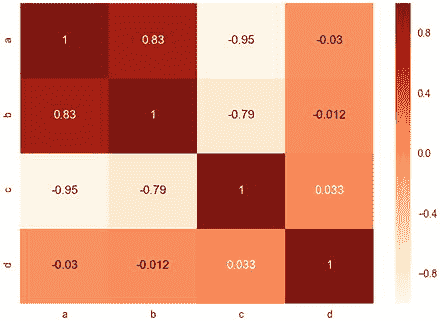

**图 5-6** 热力图

该代码首先导入了`random`、`numpy`、`pandas`、`matplotlib`和`seaborn`库。`Seaborn`是一个基于`matplotlib`的Python可视化库。`main`块首先生成了四列数据（变量），并绘制了一张热力图（图 5-6）。属性`cmap`用于指定颜色映射。`matplotlib`的颜色映射列表可以在以下网址找到：[`https://matplotlib.org/examples/color/colormaps_reference.html`](https://matplotlib.org/examples/color/colormaps_reference.html)。

## 多种可视化示例

第一个代码示例介绍了安德鲁斯曲线，这是一种可视化高维数据结构的方法。本示例使用的数据是鸢尾花数据集，它是模式识别文献中最著名的数据集之一。鸢尾花数据集包含三种不同类型的鸢尾花（Setosa、Versicolour和Virginica）的花瓣和花萼长度。

安德鲁斯曲线允许将多变量数据绘制成大量曲线，这些曲线使用样本的属性（变量）作为系数。通过为每个类别使用不同的颜色绘制曲线，可以可视化数据聚类。属于同一类别的样本的曲线通常会靠得更近，并形成更大的结构。鸢尾花数据集的原始数据位于以下URL：

# 安德鲁斯曲线与平行坐标

[`https://raw.githubusercontent.com/pandas-dev/pandas/master/pandas/tests/data/iris.csv`](https://raw.githubusercontent.com/pandas-dev/pandas/master/pandas/tests/data/iris.csv)

```python
import matplotlib.pyplot as plt
import pandas as pd
from pandas.plotting import andrews_curves
if __name__ == "__main__":
data = pd.read_csv('data/iris.csv')
plt.figure()
andrews_curves(data, 'Name',
color=['b','mediumspringgreen','r'])
plt.show()
```

输出结果：

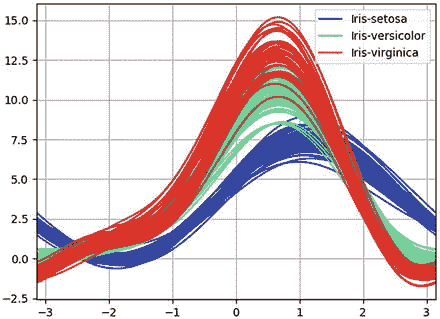

`图 5-7` 安德鲁斯曲线

该代码示例首先导入了 `matplotlib` 和 `pandas`。`main` 块首先将鸢尾花数据集读入 pandas 的 `df` 数据中。接着，为每个类别——Iris-setosa、Iris-versicolor 和 Iris-virginica——绘制了安德鲁斯曲线（`图 5-7`）。从该可视化图中，很难看出哪些属性能够清晰地区分每个类别。

第二个代码示例介绍了平行坐标：

```python
import matplotlib.pyplot as plt
import pandas as pd
from pandas.plotting import parallel_coordinates
if __name__ == "__main__":
data = pd.read_csv('data/iris.csv')
plt.figure()
parallel_coordinates(data, 'Name',
color=['b','mediumspringgreen','r'])
plt.show()
```

输出结果：

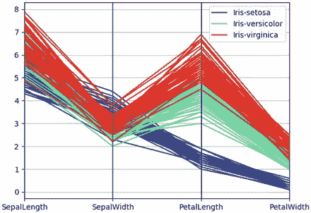

`图 5-8` 平行坐标

平行坐标是另一种绘制多变量数据的技术。它允许可视化数据中的聚类，并直观地估计其他统计量。数据点表示为相连的线段。每条垂直线代表一个属性。一组相连的线段代表一个数据点。倾向于聚类的点会显得更靠近。

该代码示例首先导入了 `matplotlib` 和 `pandas`。`main` 块首先将鸢尾花数据集读入 pandas 的 `df` 数据中。接着，为每个类别绘制了平行坐标图（`图 5-8`）。从该可视化图中，属性 `PetalLength` 和 `PetalWidth` 对于这三个物种（鸢尾花的类别）来说区分度最高。因此，`PetalLength` 和 `PetalWidth` 是区分鸢尾花物种的最佳分类器。而安德鲁斯曲线则未能清晰地提供这一重要信息。

这里有一个有用的 URL：[`http://wilkelab.org/classes/SDS348/2016_spring/worksheets/class9.html`](http://wilkelab.org/classes/SDS348/2016_spring/worksheets/class9.html)

第三个代码示例介绍了 RadViz：

```python
import matplotlib.pyplot as plt
import pandas as pd
from pandas.plotting import radviz
if __name__ == "__main__":
data = pd.read_csv('data/iris.csv')
plt.figure()
radviz(data, 'Name',
color=['b','mediumspringgreen','r'])
plt.show()
```

输出结果：

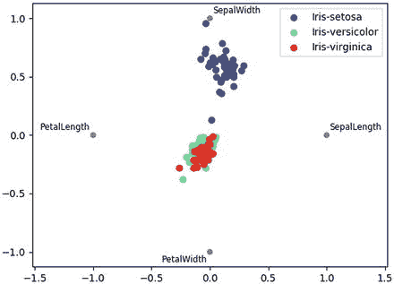

`图 5-9` RadVis

RadVis 是另一种用于可视化多变量数据的技术。该代码示例首先导入了 `matplotlib` 和 `pandas`。`main` 块首先将鸢尾花数据集读入 pandas 的 `df` 数据中。接着，为每个类别绘制了 RadVis 坐标图（`图 5-9`）。使用这种可视化方法，很难看出任何区别。因此，就识别变异的能力而言（对于本例），平行坐标技术似乎是这三种方法中最好的。

## 使用 Pandas 和 JSON 清洗 CSV 文件

以下代码示例将一个脏数据 CSV 文件加载到 Pandas 的 `df` 中并显示，以定位错误数据。接着，它将同一个 CSV 文件加载到一个字典元素列表中进行清洗。最后，清洗后的数据被保存为 JSON 格式。

```python
import csv, pandas as pd, json
def to_dict(d):
return [dict(row) for row in d]
def dump_json(f, d):
with open(f, 'w') as f:
json.dump(d, f)
def read_json(f):
with open(f) as f:
return json.load(f)
if __name__ == "__main__":
df = pd.read_csv("data/audio.csv")
print (df, '\n')
data = csv.DictReader(open('data/audio.csv'))
d = to_dict(data)
for row in d:
if (row['pno'][0] not in ['a', 'c', 'p', 's']):
if (row['pno'][0] == '8'):
row['pno'] = 'a' + row['pno']
elif (row['pno'][0] == '7'):
row['pno'] = 'p' + row['pno']
elif (row['pno'][0] == '5'):
row['pno'] = 's' + row['pno']
if (row['color']) == '-':
row['color'] = 'silver'
if row['model'] == '-':
row['model'] = 'S1'
if (row['mfg']) == '100':
row['mfg'] = 'Linn'
if (row['desc'] == '0') and row['pno'][0] == 'p':
row['desc'] = 'preamplifier'
elif (row['desc'] == '-') and row['pno'][0] == 's':
row['desc'] = 'speakers'
if (row['price'][0] == '$'):
row['price'] =\
row['price'].translate({ord(i): None for i in '$,.'})
json_file = 'data/audio.json'
dump_json(json_file, d)
data = read_json(json_file)
for i, row in enumerate(data):
if i < 5:
print (row)
```

输出：


代码示例首先导入了 `csv`、`pandas` 和 `json` 库。函数 `to_dict()` 将 `OrderedDict` 元素列表转换为常规字典元素列表，以便于处理。函数 `dump_json()` 将数据保存到 JSON 文件。函数 `read_json()` 将 JSON 数据读取到 Python 列表中。主程序块首先将 CSV 文件加载到 Pandas 的 `df` 中并显示，以便可视化脏数据。接着，它将同一个 CSV 文件加载到一个字典元素列表中，以便于清洗。然后，所有脏数据被清洗。代码继续将清洗后的数据保存到 JSON 文件 `audio.json` 中。最后，加载 `audio.json` 并显示几条记录，以确保一切正常。

# 数据切片与数据立方体

## 切片与切块

切片与切块是将数据分解成更小的部分或视图，以便更好地理解数据，并以各种不同且有用的方式将其呈现为信息。在多维数组中，切片是对应于感兴趣维度的一个或多个成员的单个值的数据列。切片是在特定属性上进行过滤，而切块则类似于缩放功能，它选择所有维度的子集，但仅针对维度的特定值。

以下代码示例将`audio.json`加载到`Pandas`的`df`中，按列和行对数据进行切片，并显示结果：

```python
import pandas as pd
if __name__ == "__main__":
df = pd.read_json("data/audio.json")
amps = df[df.desc == 'amplifier']
print (amps, '\n')
price = df.query('price >= 40000')
print (price, '\n')
between = df.query('4999 < price < 6000')
print (between, '\n')
row = df.loc[[0, 10, 19]]
print (row)
```

输出：


代码示例首先导入了`Pandas`。主程序块首先将`audio.json`加载到`Pandas`的`df`中。接着，从`desc`列中按放大器对`df`进行切片。代码继续按`price`列对价格超过 40,000 美元的设备进行切片。下一个切片是按`price`列对价格在 5,000 美元到 6,000 美元之间的设备进行切片。最后一个切片是按第 0、10 和 19 行进行切片。

## 数据立方体

数据立方体是一个`n`维的值数组。由于`n`维立方体难以概念化，实践中大多数是三维的。

让我们构建一个包含三只股票——`GOOGL`、`AMZ`和`MKL`的立方体。每只股票包含五天的数据。每天的数据包括`open`（开盘价）、`high`（最高价）、`low`（最低价）、`close`（收盘价）、`adj close`（调整收盘价）和`volume`（成交量）的值。因此，三个维度是股票、天数和值。数据来源于实际的股票报价。

以下代码示例创建了一个立方体，将其保存到 JSON 文件，读取该 JSON，并显示一些信息：

## 数据缩放与整理

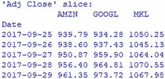

代码示例首先导入了 `json`。函数 `dump_json()` 和 `read_json()` 分别用于保存和读取 JSON 数据。主程序块通过创建一个字典 `d`、为每只股票创建字典，并按天和属性向每只股票的字典添加数据，从而创建了一个立方体。代码继续将立方体保存到 JSON 文件 `cube.json` 中。最后，代码读取 `cube.json` 并显示立方体的一个切片。

数据缩放是指改变数据的类型、离散程度和/或位置，以便比较原本无法比较的数据。数据缩放在数据科学中非常常见。第一种技术是**均值中心化**，它通过减去均值来转换数据。第二种技术是**归一化**，它将数据转换到 0 到 1 的范围内。第三种技术是**标准化**，它将数据转换为均值为 0、方差为 1（标准差 = 1）的形式，通常称为标准正态分布。

第一个代码示例生成一个正态分布并对其进行中心化：

```python
import json
def dump_json(f, d):
    with open(f, 'w') as f:
        json.dump(d, f)
def read_json(f):
    with open(f) as f:
        return json.load(f)
def rnd(n):
    return '{:.2f}'.format(n)
if __name__ == "__main__":
    d = dict()
    googl = dict()
    googl['2017-09-25'] =\
        {'Open':939.450012, 'High':939.750000, 'Low':924.510010,
         'Close':934.280029, 'Adj Close':934.280029, 'Volume':1873400}
    googl['2017-09-26'] =\
        {'Open':936.690002, 'High':944.080017, 'Low':935.119995,
         'Close':937.429993, 'Adj Close':937.429993, 'Volume':1672700}
    googl['2017-09-27'] =\
        {'Open':942.739990, 'High':965.429993, 'Low':941.950012,
         'Close':959.900024, 'Adj Close':959.900024, 'Volume':2334600}
    googl['2017-09-28'] =\
        {'Open':956.250000, 'High':966.179993, 'Low':955.549988,
         'Close':964.809998, 'Adj Close':964.809998, 'Volume':1400900}
    googl['2017-09-29'] =\
        {'Open':966.000000, 'High':975.809998, 'Low':966.000000,
         'Close':973.719971, 'Adj Close':973.719971, 'Volume':2031100}
    amzn = dict()
    amzn['2017-09-25'] =\
        {'Open':949.309998, 'High':949.419983, 'Low':932.890015,
         'Close':939.789978, 'Adj Close':939.789978, 'Volume':5124000}
    amzn['2017-09-26'] =\
        {'Open':945.489990, 'High':948.630005, 'Low':931.750000,
         'Close':937.429993, 'Adj Close':938.599976, 'Volume':3564800}
    amzn['2017-09-27'] =\
        {'Open':948.000000, 'High':955.299988, 'Low':943.299988,
         'Close':950.869995, 'Adj Close':950.869995, 'Volume':3148900}
    amzn['2017-09-28'] =\
        {'Open':951.859985, 'High':959.700012, 'Low':950.099976,
         'Close':956.400024, 'Adj Close':956.400024, 'Volume':2522600}
    amzn['2017-09-29'] =\
        {'Open':960.109985, 'High':964.830017, 'Low':958.380005,
         'Close':961.349976, 'Adj Close':961.349976, 'Volume':2543800}
    mkl = dict()
    mkl['2017-09-25'] =\
        {'Open':1056.199951, 'High':1060.089966, 'Low':1047.930054,
         'Close':1050.250000, 'Adj Close':1050.250000, 'Volume':23300}
    mkl['2017-09-26'] =\
        {'Open':1052.729980, 'High':1058.520020, 'Low':1045.000000,
         'Close':1045.130005, 'Adj Close':1045.130005, 'Volume':25800}
    mkl['2017-09-27'] =\
        {'Open':1047.560059, 'High':1069.099976, 'Low':1047.010010,
         'Close':1064.040039, 'Adj Close':1064.040039, 'Volume':21100}
    mkl['2017-09-28'] =\
        {'Open':1064.130005, 'High':1073.000000, 'Low':1058.079956,
         'Close':1070.550049, 'Adj Close':1070.550049, 'Volume':23500}
    mkl['2017-09-29'] =\
        {'Open':1068.439941, 'High':1073.000000, 'Low':1060.069946,
         'Close':1067.979980, 'Adj Close':1067.979980 , 'Volume':20700}
    d['GOOGL'], d['AMZN'], d['MKL'] = googl, amzn, mkl
    json_file = 'data/cube.json'
    dump_json(json_file, d)
    d = read_json(json_file)
    s = ' '
    print ('\'Adj Close\' 切片:')
    print (10*s, 'AMZN', s, 'GOOGL', s, 'MKL')
    print ('日期')
    print ('2017-09-25', rnd(d['AMZN']['2017-09-25']['Adj Close']),
          rnd(d['GOOGL']['2017-09-25']['Adj Close']),
          rnd(d['MKL']['2017-09-25']['Adj Close']))
    print ('2017-09-26', rnd(d['AMZN']['2017-09-26']['Adj Close']),
          rnd(d['GOOGL']['2017-09-26']['Adj Close']),
          rnd(d['MKL']['2017-09-26']['Adj Close']))
    print ('2017-09-27', rnd(d['AMZN']['2017-09-27']['Adj Close']),
          rnd(d['GOOGL']['2017-09-27']['Adj Close']),
          rnd(d['MKL']['2017-09-27']['Adj Close']))
    print ('2017-09-28', rnd(d['AMZN']['2017-09-28']['Adj Close']),
          rnd(d['GOOGL']['2017-09-28']['Adj Close']),
          rnd(d['MKL']['2017-09-28']['Adj Close']))
    print ('2017-09-29', rnd(d['AMZN']['2017-09-29']['Adj Close']),
          rnd(d['GOOGL']['2017-09-29']['Adj Close']),
          rnd(d['MKL']['2017-09-29']['Adj Close']))
```

## 数据中心化

代码示例首先导入`numpy`和`matplotlib`。函数`rnd_nrml()`根据均值(`mu`)、标准差(`sigma`)和数据点数量(`n`)生成一个正态分布。函数`ctr()`从每个数据点中减去均值。主程序块首先创建正态分布，然后绘制原始分布和中心化后的分布（图 5-10）。请注意，两个分布的形状完全相同，但第二个分布的中心化均值为 0。

```python
import numpy as np
import matplotlib.pyplot as plt
def rnd_nrml(m, s, n):
    return np.random.normal(m, s, n)
def ctr(d):
    return [x-np.mean(d) for x in d]
if __name__ == "__main__":
    mu, sigma, n, c1, c2, b = 10, 15, 100, 'pink',\
        'springgreen', True
    s = rnd_nrml(mu, sigma, n)
    plt.figure()
    ax = plt.subplot(211)
    ax.set_title('normal distribution')
    count, bins, ignored = plt.hist(s, 30, color=c1, normed=b)
    sc = ctr(s)
    ax = plt.subplot(212)
    ax.set_title('normal distribution "centered"')
    count, bins, ignored = plt.hist(sc, 30, color=c2, normed=b)
    plt.tight_layout()
    plt.show()
```

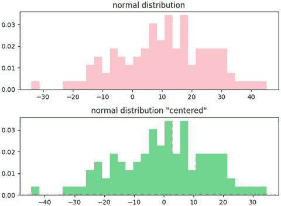
图 5-10 数据中心化的子图

## 数据归一化

第二个代码示例生成一个正态分布并对其进行归一化：

```python
import numpy as np
import matplotlib.pyplot as plt
def rnd_nrml(m, s, n):
    return np.random.normal(m, s, n)
def nrml(d):
    return [(x-np.amin(d))/(np.amax(d)-np.amin(d)) for x in d]
if __name__ == "__main__":
    mu, sigma, n, c1, c2, b = 10, 15, 100, 'orchid',\
        'royalblue', True
    s = rnd_nrml(mu, sigma, n)
    plt.figure()
    ax = plt.subplot(211)
    ax.set_title('normal distribution')
    count, bins, ignored = plt.hist(s, 30, color=c1, normed=b)
    sn = nrml(s)
    ax = plt.subplot(212)
    ax.set_title('normal distribution "normalized"')
    count, bins, ignored = plt.hist(sn, 30, color=c2, normed=b)
    plt.tight_layout()
    plt.show()
```

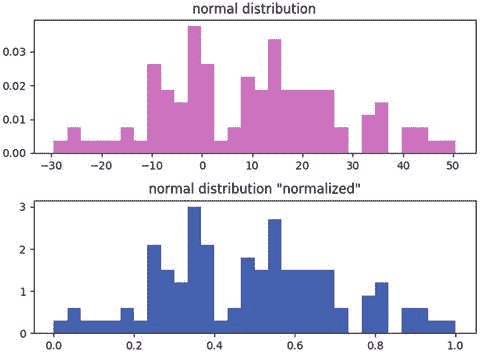
图 5-11 数据归一化的子图

代码示例首先导入`numpy`和`matplotlib`。函数`rnd_nrml()`根据均值(`mu`)、标准差(`sigma`)和数据点数量(`n`)生成一个正态分布。函数`nrml()`将数据转换到 0 到 1 的范围内。主程序块首先创建正态分布，然后绘制原始分布和归一化后的分布（图 5-11）。请注意，两个分布的形状完全相同，但第二个分布被归一化到了 0 到 1 之间。

## 标准正态分布转换

第三个代码示例将数据转换为均值为 0、方差为 1 的形式（标准正态分布）：

```python
import numpy as np, csv
import matplotlib.pyplot as plt
def rnd_nrml(m, s, n):
    return np.random.normal(m, s, n)
def std_nrml(d, m, s):
    return [(x-m)/s for x in d]
if __name__ == "__main__":
    mu, sigma, n, b = 0, 1, 1000, True
    c1, c2 = 'peachpuff', 'lime'
    s = rnd_nrml(mu, sigma, n)
    plt.figure(1)
    plt.title('standard normal distribution')
    count, bins, ignored = plt.hist(s, 30, color=c1, normed=b)
    plt.plot(bins, 1/(sigma * np.sqrt(2 * np.pi)) *
        np.exp( - (bins - mu)**2 / (2 * sigma**2) ),
        linewidth=2, color=c2)
    start1, start2 = 5, 600
    mu1, sigma1, n, b = 10, 15, 500, True
    x1 = np.arange(start1, n+start1, 1)
    y1 = rnd_nrml(mu1, sigma1, n)
    mu2, sigma2, n, b = 25, 5, 500, True
    x2 = np.arange(start2, n+start2, 1)
    y2 = rnd_nrml(mu2, sigma2, n)
    plt.figure(2)
    ax = plt.subplot(211)
    ax.set_title('dataset1 (mu=10, sigma=15)')
    count, bins, ignored = plt.hist(y1, 30, color="r", normed=b)
    ax = plt.subplot(212)
    ax.set_title('dataset2 (mu=5, sigma=5)')
    count, bins, ignored = plt.hist(y2, 30, color="g", normed=b)
    plt.tight_layout()
    plt.figure(3)
    ax = plt.subplot(211)
    ax.set_title('Normal Distributions')
    g1, g2 = (x1, y1), (x2, y2)
    data = (g1, g2)
    colors = ('red', 'green')
    groups = ('dataset1', 'dataset2')
    for data, color, group in zip(data, colors, groups):
        x, y = data
        ax.scatter(x, y, alpha=0.8, c=color, edgecolors="none",
            s=30, label=group)
    plt.legend(loc=4)
    ax = plt.subplot(212)
    ax.set_title('Standard Normal Distributions')
    ds1 = (x1, std_nrml(y1, mu1, sigma1))
    y1_sn = ds1[1]
    ds2 = (x2, std_nrml(y2, mu2, sigma2))
    y2_sn = ds2[1]
    g1, g2 = (x1, y1_sn), (x2, y2_sn)
    data = (g1, g2)
    for data, color, group in zip(data, colors, groups):
        x, y = data
        ax.scatter(x, y, alpha=0.8, c=color, edgecolors="none",
            s=30, label=group)
    plt.tight_layout()
    plt.show()
```

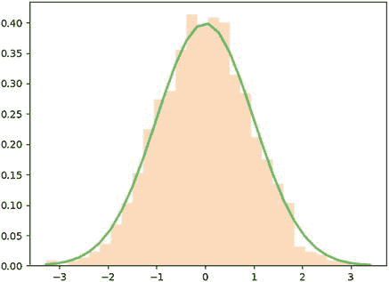
图 5-12 标准正态分布

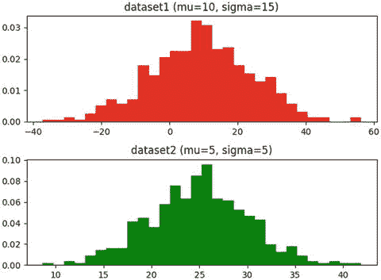
图 5-13 正态分布

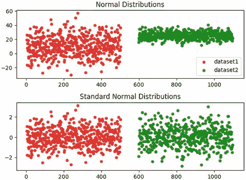

图 5-14

## 正态分布与标准正态分布

代码示例首先导入 `numpy` 和 `matplotlib`。函数 `rnd_nrml()` 根据均值 (`mu`)、标准差 (`sigma`) 和数据点数量 (`n`) 生成一个正态分布。函数 `std_nrml()` 将数据转换为标准正态分布。主程序块首先创建一个标准正态分布，并以直方图和曲线图的形式展示（图 5-12）。接着，代码创建并绘制了两个不同的正态分布数据集（图 5-13）。然后，将这两个数据集重新缩放为标准正态分布并绘制出来（图 5-14）。现在，这些数据集就可以相互比较了。尽管数据集的原始图看起来差异很大，但实际上它们的分布非常相似。

## 第四个代码示例

第四个代码示例读取一个 CSV 数据集，将其保存为 JSON 格式，进行数据整理，并打印几条记录。数据的 URL 是：`https://community.tableau.com/docs/DOC-1236`。但是，该网站上的数据会发生变化，因此请使用我们网站上的数据来操作此示例。

```python
import csv, json
def read_dict(f):
    return csv.DictReader(open(f))
def to_dict(d):
    return [dict(row) for row in d]
def dump_json(f, d):
    with open(f, 'w') as fout:
        json.dump(d, fout)
def read_json(f):
    with open(f) as f:
        return json.load(f)
def mk_data(d):
    for i, row in enumerate(d):
        e = {}
        e['_id'] = i
        e['cust'] = row['Customer Name']
        e['item'] = row['Sub-Category']
        e['sale'] = rnd(row['Sales'])
        e['quan'] = row['Quantity']
        e['disc'] = row['Discount']
        e['prof'] = rnd(row['Profit'])
        e['segm'] = row['Segment']
        yield e
def rnd(v):
    return str(round(float(v),2))
if __name__ == "__main__":
    f= 'data/superstore.csv'
    d = read_dict(f)
    data = to_dict(d)
    jsonf = 'data/superstore.json'
    dump_json(jsonf, data)
    print ('"superstore" data added to JSON\n')
    json_data = read_json(jsonf)
    print ("{:20s} {:15s} {:10s} {:3s} {:5s} {:12s} {:10s}".
        format('CUSTOMER', 'ITEM', 'SALES', 'Q', 'DISC',
            'PROFIT', 'SEGMENT'))
    generator = mk_data(json_data)
    for i, row in enumerate(generator):
        if i < 10:
            print ("{:20s} {:15s}".format(row['cust'], row['item']),
                "{:10s} {:3s}".format(row['sale'], row['quan']),
                "{:5s} {:12s}".format(row['disc'], row['prof']),
                "{:10s}".format(row['segm']))
        else:
            break
```

输出：

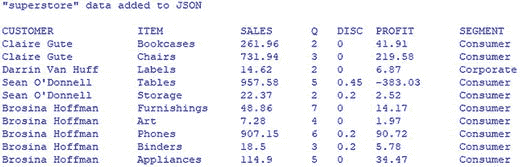

代码示例首先导入 `csv` 和 `json` 库。函数 `read_dict()` 将 CSV 文件读取为 `OrderedDict`。函数 `to_dict()` 将 `OrderedDict` 转换为常规字典。函数 `dump_json()` 将文件保存为 JSON 格式。函数 `read_json()` 读取 JSON 文件。函数 `mk_data()` 创建一个生成器对象，该对象由来自 JSON 文件的经过整理的数据组成。函数 `rnd()` 将数字四舍五入到小数点后两位。主程序块首先读取一个 CSV 文件并将其转换为 JSON。代码接着读取新创建的 JSON 数据。然后，从 JSON 数据创建一个生成器对象。生成器对象至关重要，因为它比列表的处理速度快数个数量级。由于数据集接近 10,000 条记录，速度非常重要。为了验证数据创建是否正确，生成器对象被迭代几次以打印一些经过整理的记录。

## 第五个也是最后一个代码示例

第五个也是最后一个代码示例读取前一个示例中创建的 JSON 文件，对其进行整理，并将整理后的数据集保存为 JSON：

```python
import json
def read_json(f):
    with open(f) as f:
        return json.load(f)
def mk_data(d):
    for i, row in enumerate(d):
        e = {}
        e['_id'] = i
        e['cust'] = row['Customer Name']
        e['item'] = row['Sub-Category']
        e['sale'] = rnd(row['Sales'])
        e['quan'] = row['Quantity']
        e['disc'] = row['Discount']
        e['prof'] = rnd(row['Profit'])
        e['segm'] = row['Segment']
        yield e
def rnd(v):
    return str(round(float(v),2))
if __name__ == "__main__":
    jsonf = 'data/superstore.json'
    json_data = read_json(jsonf)
    l = len(list(mk_data(json_data)))
    generator = mk_data(json_data)
    jsonf= 'data/wrangled.json'
    with open(jsonf, 'w') as f:
        f.write('[')
    for i, row in enumerate(generator):
        j = json.dumps(row)
        if i < l - 1:
            with open(jsonf, 'a') as f:
                f.write(j)
                f.write(',')
        else:
            with open(jsonf, 'a') as f:
                f.write(j)
                f.write(']')
    json_data = read_json(jsonf)
    for i, row in enumerate(json_data):
        if i < 5:
            print (row['cust'], row['item'], row['sale'])
        else:
            break
```

输出：

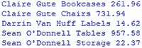

代码示例导入`json`。函数`read_json()`读取JSON文件。函数`mk_data()`创建一个生成器对象，该对象由来自JSON文件的经过整理的数据组成。函数`rnd()`将数字四舍五入到小数点后两位。主程序块首先读取一个JSON文件。必须创建两次生成器对象。第一个生成器允许我们找到JSON文件的长度。第二个生成器由来自JSON文件的经过整理的数据组成。接下来，遍历生成器，以便我们可以创建一个包含整理后数据的JSON文件。尽管生成器对象创建和遍历速度非常快，但创建一个包含近10,000条整理后记录的JSON文件仍需一些时间。在我的机器上，这花了33秒多一点，所以请耐心等待。