# 6. 探索数据

探索深入数据的领域。数据科学中的一个重要主题是降维。本章借用第 5 章中整理过的数据来演示其工作原理。另一个主题是速度模拟。处理大型数据集时，速度至关重要。大数据通过学术界和工业界广泛使用的一个流行数据集进行探索。最后，Twitter 和网络爬虫是两个重要的数据探索来源。

## 热力图

热力图在第 5 章中介绍过，但当时没有为整理后的数据集创建热力图。因此，我们首先为 `wrangled.json` 数据创建一个热力图可视化。

```python
import json, pandas as pd
import matplotlib.pyplot as plt
import seaborn as sns
def read_json(f):
    with open(f) as f:
        return json.load(f)
def verify_keys(d, **kwargs):
    data = d[0].items()
    k1 = set([tup[0] for tup in data])
    s = kwargs.items()
    k2 = set([tup[1] for tup in s])
    return list(k1.intersection(k2))
def build_ls(k, d):
    return [{k: row[k] for k in (keys)} for row in d]
def get_rows(d, n):
    [print(row) for i, row in enumerate(d) if i < n]
def conv_float(d):
    return [dict([k, float(v)] for k, v in row.items()) for row in d]
if __name__ == "__main__":
    f= 'data/wrangled.json'
    data = read_json(f)
    keys = verify_keys(data, c1="sale", c2="quan", c3="disc", c4="prof")
    heat = build_ls(keys, data)
    print ('"heat" 中的第一行：')
    get_rows(heat, 1)
    heat = conv_float(heat)
    print ('\n 转换为浮点数后的 "heat" 第一行：')
    get_rows(heat, 1)
    df = pd.DataFrame(heat)
    plt.figure()
    sns.heatmap(df.corr(), annot=True, cmap="OrRd")
    plt.show()
```

输出：

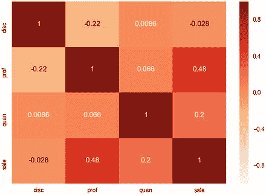

图 6-1

热力图

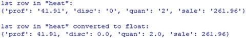

代码示例首先导入 `json`、`pandas`、`matplotlib` 和 `seaborn` 库。函数 `read_json()` 读取 JSON 文件。函数 `verify_keys()` 确保感兴趣的键存在于 JSON 文件中。这一点很重要，因为我们只能基于数值变量创建热力图，而 JSON 文件中唯一的候选变量是销售额、数量、折扣和利润。函数 `build_ls()` 基于数值变量构建一个字典元素列表。函数 `get_rows()` 从列表中返回 `n` 行。函数 `conv_float()` 将字典元素转换为浮点数。主程序块首先读取 JSON 文件 `wrangled.json`。接着，它仅获取数值变量的键。然后，它基于相应的键构建一个字典元素列表（`heat`）。代码显示 `heat` 中的第一行以验证所有值是否为浮点数。由于它们不是，代码将它们转换为浮点数。然后，代码从 `heat` 创建一个 `df` 并绘制热力图（图 6-1）。

### 主成分分析

主成分分析（PCA）用于寻找数据的主成分。主成分代表了数据中的潜在结构，因为它们揭示了数据方差最大（即数据最分散）的方向。PCA 利用特征向量和特征值来揭示数据方差。特征向量代表一个方向，而特征值则是一个数值，表示数据在该特征向量方向上的方差。具有最高特征值的特征向量就是主成分。一个数据集可以分解为特征向量和特征值。数据集中特征向量（及特征值）的数量等于其维度数。由于 `wrangled.json` 数据集有四个维度（变量），因此它包含四个特征向量/特征值。

第一个代码示例对 `wrangled.json` 数据集执行了 PCA。然而，PCA 仅适用于数值型数据，因此数据集被精简为仅包含这些数值特征。

```python
import matplotlib.pyplot as plt, pandas as pd
import numpy as np, json, random as rnd
from sklearn.preprocessing import StandardScaler
from pandas.plotting import parallel_coordinates
def read_json(f):
with open(f) as f:
return json.load(f)
def unique_features(k, d):
return list(set([dic[k] for dic in d]))
def sire_features(k, d):
return [{k: row[k] for k in (k)} for row in d]
def sire_numeric(k, d):
s = conv_float(sire_features(k, d))
return s
def sire_sample(k, v, d, m):
indices = np.arange(0, len(d), 1)
s = [d[i] for i in indices if d[i][k] == v]
n = len(s)
num_keys = ['sale', 'quan', 'disc', 'prof']
for i, row in enumerate(s):
for k in num_keys:
row[k] = float(row[k])
s = rnd_sample(m, len(s), s)
return (s, n)
def rnd_sample(m, n, d):
indices = sorted(rnd.sample(range(n), m))
return [d[i] for i in indices]
def conv_float(d):
return [dict([k, float(v)] for k, v in row.items()) for row in d]
if __name__ == "__main__":
f = 'data/wrangled.json'
data = read_json(f)
segm = unique_features('segm', data)
print ('classes in "segm" feature:')
print (segm)
keys = ['sale', 'quan', 'disc', 'prof', 'segm']
features = sire_features(keys, data)
num_keys = ['sale', 'quan', 'disc', 'prof']
numeric_data = sire_numeric(num_keys, features)
k, v = "segm", "Home Office"
m = 100
s_home = sire_sample(k, v, features, m)
v = "Consumer"
s_cons = sire_sample(k, v, features, m)
v = "Corporate"
s_corp = sire_sample(k, v, features, m)
print ('\nHome Office slice:', s_home[1])
print('Consumer slice:', s_cons[1])
print ('Coporate slice:', s_corp[1])
print ('sample size:', m)
df_home = pd.DataFrame(s_home[0])
df_cons = pd.DataFrame(s_cons[0])
df_corp = pd.DataFrame(s_corp[0])
frames = [df_home, df_cons, df_corp]
result = pd.concat(frames)
plt.figure()
parallel_coordinates(result, 'segm', color=
['orange','lime','fuchsia'])
df = pd.DataFrame(numeric_data)
X = df.ix[:].values
X_std = StandardScaler().fit_transform(X)
mean_vec = np.mean(X_std, axis=0)
cov_mat = np.cov(X_std.T)
print ('\ncovariance matrix:\n', cov_mat)
eig_vals, eig_vecs = np.linalg.eig(cov_mat)
print ('\nEigenvectors:\n', eig_vecs)
print ('\nEigenvalues:\n', np.sort(eig_vals)[::-1])
tot = sum(eig_vals)
var_exp = [(i / tot)*100 for i in sorted(eig_vals, reverse=True)]
print ('\nvariance explained:\n', var_exp)
corr_mat = np.corrcoef(X.T)
print ('\ncorrelation matrix:\n', corr_mat)
eig_vals, eig_vecs = np.linalg.eig(corr_mat)
print ('\nEigenvectors:\n', eig_vecs)
print ('\nEigenvalues:\n', np.sort(eig_vals)[::-1])
tot = sum(eig_vals)
var_exp = [(i / tot)*100 for i in sorted(eig_vals, reverse=True)]
print ('\nvariance explained:\n', var_exp)
cum_var_exp = np.cumsum(var_exp)
fig, ax = plt.subplots()
labels = ['PC1', 'PC2', 'PC3', 'PC4']
width = 0.35
index = np.arange(len(var_exp))
ax.bar(index, var_exp,
color=['fuchsia', 'lime', 'thistle', 'thistle'])
for i, v in enumerate(var_exp):
v = round(v, 2)
val = str(v) + '%'
ax.text(i, v+0.5, val, ha="center", color="b",
fontsize=9, fontweight="bold")
plt.xticks(index, labels)
plt.title('Variance Explained')
plt.show()
```

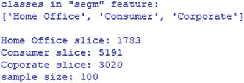

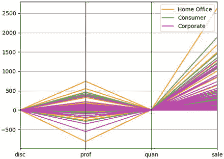

**图 6-2** 平行坐标图

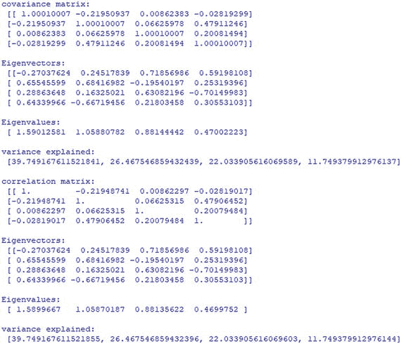

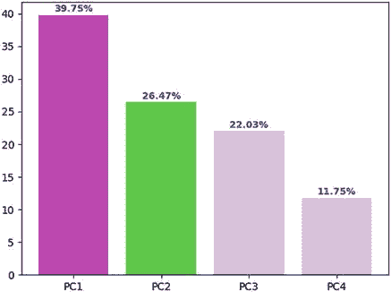

**图 6-3** 方差解释图

代码示例首先导入了 `matplotlib`、`pandas`、`numpy`、`json`、`random` 和 `sklearn` 库。函数 `read_json()` 用于读取 JSON 文件。函数 `unique_features()` 从某个维度（特征）中提取出唯一的类别（分类）。在此例中，它从 `segm` 特征中提取出三个类别——家庭办公室、企业和消费者。由于数据集接近 10,000 条记录，我需要确认其中包含哪些类别。函数 `sire_features()` 提取出一个仅包含感兴趣特征的新数据集。函数 `sire_numeric()` 将数字字符串转换为浮点数。函数 `sire_sample()` 返回一个经过类别筛选的、包含 `n` 条记录的随机样本。函数 `rnd_sample()` 创建一个随机样本。函数 `convert_float()` 将数字字符串数据转换为浮点数。

# 数据分析示例

主程序块首先读取 `wrangled.json`，并创建一个仅包含感兴趣特征的数据集特征。代码接着创建一个仅包含数值型数据特征的数据集 `numeric`。数据集 `numeric` 用于生成 PCA。接下来，为每个类别创建三个大小为 100 的样本。这些样本用于创建平行坐标可视化（图 6-2）。PCA 的代码随后对数值型数据集进行标准化和转换。创建一个协方差矩阵，以便生成特征向量和特征值。我还包含了使用相关矩阵的 PCA，因为某些学科更倾向于使用它。最后，创建了主成分的可视化。

平行坐标图显示 `prof`（利润）和 `sale`（销售额）是最重要的特征。PCA 可视化（图 6-3）显示，第一主成分占 39.75%，第二主成分占 26.47%，第三主成分占 22.03%，第四主成分占 11.75%。在这种情况下，PCA 分析并不是非常有用，因为所有四个主成分都是必需的，尤其是前三个。因此，我们不能在后续分析中舍弃任何一个维度。

第二个代码示例使用鸢尾花数据集进行 PCA：

```python
import matplotlib.pyplot as plt, pandas as pd, numpy as np
from sklearn.preprocessing import StandardScaler
from pandas.plotting import parallel_coordinates

def conv_float(d):
    return d.astype(float)

if __name__ == "__main__":
    df = pd.read_csv('data/iris.csv')
    X = df.ix[:,0:4].values
    y = df.ix[:,4].values
    X_std = StandardScaler().fit_transform(X)
    mean_vec = np.mean(X_std, axis=0)
    cov_mat = np.cov(X_std.T)
    eig_vals, eig_vecs = np.linalg.eig(cov_mat)
    print ('Eigenvectors:\n', eig_vecs)
    print ('\nEigenvalues:\n', eig_vals)
    plt.figure()
    parallel_coordinates(df, 'Name', color=
        ['orange','lime','fuchsia'])
    tot = sum(eig_vals)
    var_exp = [(i / tot)*100 for i in sorted(eig_vals, reverse=True)]
    cum_var_exp = np.cumsum(var_exp)
    fig, ax = plt.subplots()
    labels = ['PC1', 'PC2', 'PC3', 'PC4']
    width = 0.35
    index = np.arange(len(var_exp))
    ax.bar(index, var_exp,
        color=['fuchsia', 'lime', 'thistle', 'thistle'])
    for i, v in enumerate(var_exp):
        v = round(v, 2)
        val = str(v) + '%'
        ax.text(i, v+0.5, val, ha="center", color="b",
            fontsize=9, fontweight="bold")
    plt.xticks(index, labels)
    plt.title('Variance Explained')
    plt.show()
```

输出：

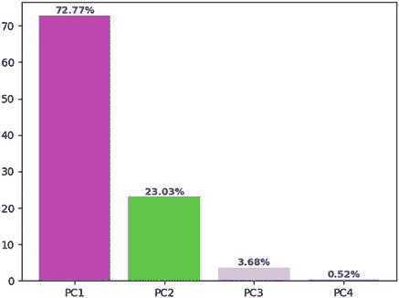

图 6-5
方差解释

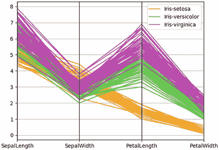

图 6-4
平行坐标

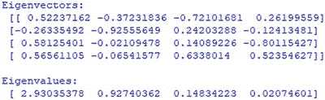

这个代码示例比上一个短得多，因为我们不需要进行数据整理、清洗（那么多）以及创建随机样本（用于平行坐标可视化）。代码首先导入了 `matplotlib`、`pandas`、`numpy` 和 `sklearn` 库。函数 `conv_float()` 将数字字符串转换为浮点数。主程序块首先读取鸢尾花数据集。接着对数据进行标准化和转换，以进行 PCA。然后显示平行坐标和方差解释。

平行坐标图显示 `PetalLength`（花瓣长度）和 `PetalWidth`（花瓣宽度）是最重要的特征（图 6-4）。PCA 可视化（方差解释）显示，第一主成分占 72.77%，第二主成分占 23.03%，第三主成分占 3.68%，第四主成分占 0.52%（图 6-5）。在这种情况下，PCA 分析非常有用，因为前两个主成分解释了超过 95% 的方差。因此，我们可以舍弃 `PC3` 和 `PC4`，不再考虑。

为清晰起见，PCA 的第一步是探索特征向量和特征值。特征值最低的特征向量包含的数据分布信息最少，因此可以舍弃。在这个例子中，前两个特征值要高得多，尤其是 `PC1`。因此，舍弃 `PC3` 和 `PC4` 是合理的。第二步是测量解释方差，这可以通过特征值计算得出。解释方差告诉我们每个主成分可以解释多少信息（方差）。查看解释方差可以确认 `PC3` 和 `PC4` 并不重要。

## 速度模拟

在数据科学中，速度很重要，尤其是当数据集变得更大时。生成器有助于内存优化，因为生成器函数一次只返回一个项目（按需返回），而不是一次性返回所有项目。

该代码示例对比了列表和生成器之间的速度：

```python
import json, humanfriendly as hf
from time import clock

def read_json(f):
    with open(f) as f:
        return json.load(f)

def mk_gen(k, d):
    for row in d:
        dic = {}
        for key in k:
            dic[key] = float(row[key])
        yield dic

def conv_float(keys, d):
    return [dict([k, float(v)] for k, v in row.items()
        if k in keys) for row in d]

if __name__ == "__main__":
    f = 'data/wrangled.json'
    data = read_json(f)
    keys = ['sale', 'quan', 'disc', 'prof']
    print ('create, convert, and display list:')
    start = clock()
    data = conv_float(keys, data)
    for i, row in enumerate(data):
        if i < 5:
            print (row)
    end = clock()
    elapsed_ls = end - start
    print (hf.format_timespan(elapsed_ls, detailed=True))
    print ('\ncreate, convert, and display generator:')
    start = clock()
    generator = mk_gen(keys, data)
    for i, row in enumerate(generator):
        if i < 5:
            print (row)
    end = clock()
    elapsed_gen = end - start
    print (hf.format_timespan(elapsed_gen, detailed=True))
    speed = round(elapsed_ls / elapsed_gen, 2)
    print ('\ngenerator is', speed, 'times faster')
```

输出：

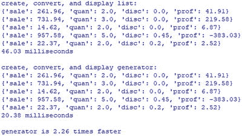

## 代码示例概述

代码示例首先导入了 `json`、`humanfriendly` 和 `time` 库。你可能需要像我一样安装 `humanfriendly`：`pip install humanfriendly`。函数 `read_json()` 读取 JSON。函数 `mk_gen()` 基于 `wrangled.json` 中的四个特征创建一个生成器，并将值转换为浮点数。函数 `conv_float()` 将列表中的字典值转换为浮点数。主程序块首先将 `wrangled.json` 读入一个列表。代码接着对根据键创建新列表并将值转换为浮点数的过程进行计时。接下来，创建一个模拟列表创建和转换过程的生成器。生成器的速度快了 2.26 倍（在我的电脑上）。

## 大数据

大数据是 21 世纪的热门话题。那么，让我们来处理一个相对较大的数据集。GroupLens 是一个提供大型社会计算数据集用于理论和实践的网站。GroupLens 收集并提供了来自 MovieLens 网站的评分数据集：

[`https://grouplens.org/datasets/movielens/`](https://grouplens.org/datasets/movielens/)

我们将探索 1M 数据集，其中包含约六千万用户对四千部电影的一百万条评分。由于我相对较新的电脑处理能力有限，我曾对处理超过一百万条数据感到犹豫。

第一个代码示例读取、清洗、计算大小并将 MovieLens 数据转储为 JSON：

```python
import json, csv

def read_dat(h, f):
    return csv.DictReader((line.replace('::', ':')
        for line in open(f)),
        delimiter=':', fieldnames=h,
        quoting=csv.QUOTE_NONE)

def gen_dict(d):
    for row in d:
        yield dict(row)

def dump_json(f, l, d):
    f = open(f, 'w')
    f.write('[')
    for i, row in enumerate(d):
        j = json.dumps(row)
        f.write(j)
        if i < l - 1:
            f.write(',')
        else:
            f.write(']')
    f.close()

def read_json(f):
    with open(f) as f:
        return json.load(f)

def display(n, f):
    for i, row in enumerate(f):
        if i < n:
            print (row)
    print()

if __name__ == "__main__":
    print ('... sizing data ...\n')
    u_dat = 'data/ml-1m/users.dat'
    m_dat = 'data/ml-1m/movies.dat'
    r_dat = 'data/ml-1m/ratings.dat'
    unames = ['user_id', 'gender', 'age', 'occupation', 'zip']
    mnames = ['movie_id', 'title', 'genres']
    rnames = ['user_id', 'movie_id', 'rating', 'timestamp']
    users = read_dat(unames, u_dat)
    ul = len(list(gen_dict(users)))
    movies = read_dat(mnames, m_dat)
    ml = len(list(gen_dict(movies)))
    ratings = read_dat(rnames, r_dat)
    rl = len(list(gen_dict(ratings)))
    print ('size of datasets:')
    print ('users', ul)
    print ('movies', ml)
    print ('ratings', rl)
    print ('\n... dumping data ...\n')
    users = read_dat(unames, u_dat)
    users = gen_dict(users)
    movies = read_dat(mnames, m_dat)
    movies = gen_dict(movies)
    ratings = read_dat(rnames, r_dat)
    ratings = gen_dict(ratings)
    uf = 'data/users.json'
    dump_json(uf, ul, users)
    mf = 'data/movies.json'
    dump_json(mf, ml, movies)
    rf = 'data/ratings.json'
    dump_json(rf, rl, ratings)
    print ('\n... verifying data ...\n')
    u = read_json(uf)
    m = read_json(mf)
    r = read_json(rf)
    n = 1
    display(n, u)
    display(n, m)
    display(n, r)
```

输出：

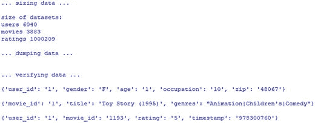

代码示例首先导入 `json` 和 `csv` 库。函数 `read_dat()` 读取并清洗数据（将双冒号替换为单冒号作为分隔符）。函数 `gen_dict()` 将 `OrderedDict` 列表转换为常规字典列表以便处理。函数 `dump_json()` 是我编写的用于将数据转储为 JSON 的自定义函数。函数 `read_json()` 读取 JSON。函数 `display()` 显示部分数据以进行验证。主程序块首先读取三个数据集并计算其大小。然后重新读取数据集并转储为 JSON。数据集需要重新读取，因为生成器只能遍历一次。由于评分数据集超过一百万条记录，处理需要几秒钟时间。

第二个代码示例清洗电影数据集，这需要额外的清洗工作：

```python
import json, numpy as np
def read_json(f):
with open(f) as f:
return json.load(f)
def dump_json(f, d):
with open(f, 'w') as fout:
json.dump(d, fout)
def display(n, d):
[print (row) for i,row in enumerate(d) if i < n]
def get_indx(k, d):
return [row[k] for row in d if 'null' in row]
def get_data(k, l, d):
return [row for i, row in enumerate(d) if row[k] in l]
def get_unique(key, d):
s = set()
for row in d:
for k, v in row.items():
if k in key:
s.add(v)
return np.sort(list(s))
if __name__ == "__main__":
mf = 'data/movies.json'
m = read_json(mf)
n = 20
display(n, m)
print ()
indx = get_indx('movie_id', m)
for row in m:
if row['movie_id'] in indx:
row['title'] = row['title'] + ':' + row['genres']
row['genres'] = row['null'][0]
del row['null']
title = row['title'].split(" ")
year = title.pop()
year = ''.join(c for c in year if c not in '()')
row['title'] = ' '.join(title)
row['year'] = year
data = get_data('movie_id', indx, m)
n = 2
display(n, data)
s = get_unique('year', m)
print ('\n', s, '\n')
rec = get_data('year', ['Assignment'], m)
print (rec[0])
rec = get_data('year', ["L'Associe1982"], m)
print (rec[0], '\n')
b1, b2, cnt = False, False, 0
for row in m:
if row['movie_id'] in ['1001']:
row['year'] = '1982'
print (row)
b1 = True
elif row['movie_id'] in ['2382']:
row['title'] = 'Police Academy 5: Assignment: Miami Beach'
row['genres'] = 'Comedy'
row['year'] = '1988'
print (row)
b2 = True
elif b1 and b2: break
cnt += 1
print ('\n', cnt, len(m))
mf = 'data/cmovies.json'
dump_json(mf, m)
m = read_json(mf)
display(n, m)
```

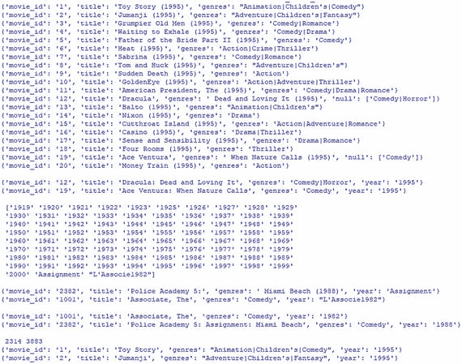

代码示例首先导入 `json` 和 `numpy` 库。函数 `read_json()` 读取 JSON。函数 `dump_json()` 保存 JSON。函数 `display()` 显示 `n` 条记录。函数 `get_indx()` 返回包含 `null` 键的字典元素的索引。函数 `get_data()` 返回按索引和 `movie_id` 键过滤的数据集。函数 `get_unique()` 返回字典元素列表中唯一值的列表。主程序块首先读取 `movies.json` 并显示以供检查。记录 12 和 19 包含 `null` 键。代码继续查找所有包含 `null` 键的 `movie_id` 索引。接下来的几行清洗所有电影。包含 `null` 键的记录需要额外的逻辑才能完全清洗，但所有记录都修改了标题并添加了新的 `year` 键。为了验证，显示了记录 12 和 19。为了确保一切正常，代码基于 `year` 查找所有唯一键。注意，有两条记录没有合法的年份。因此，代码清洗了这两条记录。代码中添加了第二个 `elif`，以便在清洗完两条脏记录后停止处理。虽然代码中没有包含，但我检查了 `movie_id`、`title` 和 `genres` 键，没有发现问题。

连接 MongoDB 的代码如下：

```python
class conn:
from pymongo import MongoClient
client = MongoClient('localhost', port=27017)
def __init__(self, dbname):
self.db = conn.client[dbname]
def getDB(self):
return self.db
```

我创建了目录 `classes` 并将代码保存在 `conn.py` 中。

第三个代码示例从三个数据集中生成有用信息。

# 数据集生成与存储脚本解析

代码示例首先导入 `json`、`numpy`、`sys`、`os`、`humanfriendly`、`time` 和 `conn`（我创建的一个用于连接 MongoDB 的自定义类）。函数 `read_json()` 用于读取 JSON 文件。函数 `get_column()` 返回一个列向量。函数 `remove_nr()` 用于移除未被评分的 `movie_id` 值。函数 `get_info()` 返回评分、用户、年龄和性别作为列向量，以及电影的标题。该函数非常复杂，因为每个向量都是通过遍历其中一个数据集并进行比较来创建的。为了使其更简洁，大量使用了列表推导式。函数 `generate()` 生成一个字典元素，其中包含每部电影的平均评分、平均年龄、男女评分者数量、评分数量、`movie_id` 和标题。函数 `gen_ls()` 生成由函数 `generate()` 生成的每个字典元素。

主程序块首先读取三个 JSON 数据集。接着，获取两个列向量——来自电影数据集的每个 `movie_id` 和来自评分数据集的 `movie_id`。每个列向量被转换为一个集合以去除重复项。使用列向量而非完整记录是为了加快处理速度。接下来，返回一个新的列向量，其中仅包含已被评分的电影。

代码继续获取 `movie_id` 为 1 的每部电影的评分、用户、年龄和性别的标题和列向量。显示该电影的平均评分及其标题和评分数量。代码的最后部分创建了一个生成器，其中包含一个字典元素列表。每个字典元素包含 `movie_id`、标题、平均评分、平均年龄、评分数量、男性评分者数量和女性评分者数量。接着，创建另一个生成器来生成该列表。创建生成器是瞬间完成的，但展开（解包）内容需要时间。请记住，第一个生成器运行数十亿次进程，第二个生成器运行第一个生成器。因此，将内容保存到 MongoDB 需要将近半小时。

为了验证结果，让我们查看 MongoDB 中的数据。命令 `show collections` 是我运行的第一个命令，用于检查是否创建了 `movie_info` 集合：

接下来，我运行 `db.movie_info.count()` 来检查文档数量：

现在我知道了文档数量，可以显示前五条和后五条记录：

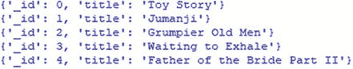
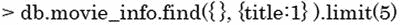

从数据探索来看，`movie_info` 集合似乎已正确创建。

## 第 4 个代码示例

第 4 个代码示例将三个数据集——`users.json`、`cmovies.json` 和 `ratings.json`——保存到 MongoDB：

```python
import sys, os, json, humanfriendly as hf
from time import clock
sys.path.append(os.getcwd() + '/classes')
import conn
def read_json(f):
    with open(f) as f:
        return json.load(f)
def create_db(c, d):
    c = db[c]
    c.drop()
    for i, row in enumerate(d):
        row['_id'] = i
        c.insert(row)
if __name__ == "__main__":
    u = read_json('data/users.json')
    m = read_json('data/cmovies.json')
    r = read_json('data/ratings.json')
    obj = conn.conn('test')
    db = obj.getDB()
    print ('... creating MongoDB collections ...\n')
    start = clock()
    create_db('users', u)
    create_db('movies', m)
    create_db('ratings', r)
    end = clock()
    elapsed_ls = end - start
    print (hf.format_timespan(elapsed_ls, detailed=True))
```

输出：

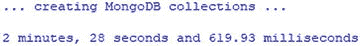

代码示例首先导入了 `sys`、`os`、`json`、`humanfriendly`、`time` 以及自定义类 `conn`。函数 `read_json` 用于读取 JSON。函数 `create_db()` 用于创建 MongoDB 集合。主程序块首先读取三个数据集——`users.json`、`cmovies.json` 和 `ratings.json`——并将它们保存到 MongoDB 集合中。由于 `ratings.json` 数据集包含超过一百万条记录，将其保存到数据库需要一些时间。

## 第 5 个代码示例

第 5 个代码示例介绍了聚合管道，这是一个基于数据处理管道概念构建的 MongoDB 数据聚合框架。文档进入一个多阶段管道，该管道将它们转换为聚合结果。除了按一个或多个特定字段对文档进行分组和排序以及聚合数组内容外，管道阶段还可以使用运算符来执行诸如计算平均值或连接字符串等任务。该管道使用原生 MongoDB 操作提供高效的数据聚合，是 MongoDB 中数据聚合的首选方法。

```python
import sys, os
sys.path.append(os.getcwd() + '/classes')
import conn
def match_item(k, v, d):
    pipeline = [ {'$match' : { k : v }} ]
    q = db.command('aggregate',d,pipeline=pipeline)
    return q
if __name__ == "__main__":
    obj = conn.conn('test')
    db = obj.getDB()
    movie = 'Toy Story'
    q = match_item('title', movie, 'movie_info')
    r = q['result'][0]
    print (movie, 'document:')
    print (r)
    print ('average rating', r['avg_rating'], '\n')
    user_id = '3'
    print ('*** user', user_id, '***')
    q = match_item('user_id', user_id, 'users')
    r = q['result'][0]
    print ('age', r['age'], 'gender', r['gender'], 'occupation',\
           r['occupation'], 'zip', r['zip'], '\n')
    print ('*** "user 3" movie ratings of 5 ***')
    q = match_item('user_id', user_id, 'ratings')
    mid = q['result']
    for row in mid:
        if row['rating'] == '5':
            q = match_item('movie_id', row['movie_id'], 'movies')
            title = q['result'][0]['title']
            genre = q['result'][0]['genres']
            print (row['movie_id'], title, genre)
    mid = '1136'
    q = match_item('mid', mid, 'movie_info')
    title = q['result'][0]['title']
    avg_rating = q['result'][0]['avg_rating']
    print ()
    print ('"' + title + '"', 'average rating:', avg_rating)
```

输出：

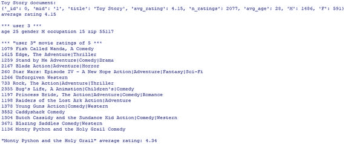

代码示例首先导入了 `sys`、`os` 和自定义类 `conn`。函数 `match_item()` 使用聚合管道来匹配符合条件的记录。主程序块首先使用聚合管道从 `movie_info` 集合中返回《玩具总动员》的文档。代码接着使用管道从 `users` 集合中返回用户 3 的文档。接下来，聚合管道用于返回用户 3 的所有评分为 5 的电影。最后，管道用于从 `movie_info` 集合中返回《巨蟒与圣杯》的平均评分。聚合管道效率高，功能丰富。

## 第 6 个代码示例

第 6 个代码示例演示了一个多阶段聚合管道：

```python
import sys, os
sys.path.append(os.getcwd() + '/classes')
import conn
def stages(k, v, r, d):
    pipeline = [ {'$match' : { '$and' : [ { k : v },
                {'rating':{'$eq':r} }] } },
                {'$project' : {
                    '_id' : 1,
                    'user_id' : 1,
                    'movie_id' : 1,
                    'rating' : 1 } },
                {'$limit' : 100}]
    q = db.command('aggregate',d,pipeline=pipeline)
    return q
def match_item(k, v, d):
    pipeline = [ {'$match' : { k : v }} ]
    q = db.command('aggregate',d,pipeline=pipeline)
    return q
if __name__ == "__main__":
    obj = conn.conn('test')
    db = obj.getDB()
    u = '3'
    r = '5'
    q = stages('user_id', u, r, 'ratings')
    result = q['result']
    print ('ratings of', r, 'for user ' + str(u) + ':')
    for i, row in enumerate(result):
        print (row)
        n = i+1
    print ()
    print (n, 'associated movie titles:')
    for i, row in enumerate(result):
        q = match_item('movie_id', row['movie_id'], 'movies')
        r = q['result'][0]
        print (r['title'])
```

输出：

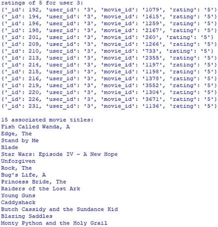

代码示例首先导入了`sys`、`os`和自定义类`conn`。函数`stages()`使用了一个三阶段聚合管道。第一阶段查找用户 3 的所有评分为 5 的记录。第二阶段投影要显示的字段。第三阶段限制返回的文档数量。包含一个限制阶段非常重要，因为结果数据库很大，并且管道有大小限制。函数`match_item()`使用聚合管道来匹配符合条件的记录。主程序块首先使用`stages()`管道返回用户 3 的所有评分为 5 的记录。代码接着遍历这些数据，并使用`match_item()`管道获取用户 3 评分为 5 的电影标题。管道是从 MongoDB 查询文档的高效方法，但需要练习才能熟悉其语法。

## Twitter

Twitter 是一个极好的数据来源，因为你可以获取几乎任何主题的数据。要访问 Twitter 的数据，你需要连接到 Twitter Streaming API。连接需要来自 Twitter 的四项信息——API 密钥、API 密钥密文、访问令牌和访问令牌密文（加密）。在你注册并获取凭证后，你需要安装一个 Twitter API。我选择了 Twitter API `TwitterSearch`，但还有很多其他选择。

第 1 个代码示例创建 JSON 来保存我的 Twitter 凭证（将你的凭证插入到每个变量中）：

```python
import json
if __name__ == '__main__':
    consumer_key = ''
    consumer_secret = ''
    access_token = ''
    access_encrypted = ''
    data = {}
    data['ck'] = consumer_key
    data['cs'] = consumer_secret
    data['at'] = access_token
    data['ae'] = access_encrypted
    json_data = json.dumps(data)
    header = '[\n'
    ender = ']'
    obj = open('data/credentials.json', 'w')
    obj.write(header)
    obj.write(json_data + '\n')
    obj.write(ender)
    obj.close()
```

我选择将凭证保存在 JSON 中，以将其隐藏起来。代码示例导入了`json`库。主程序块将凭证保存到 JSON 中。

第 2 个代码示例使用`TwitterSearch` API 流式传输 Twitter 数据。安装方法：`pip install TwitterSearchAPI`。

```python
from TwitterSearch import *
import json, sys
class twitSearch:
    def __init__(self, cred, ls, limit):
        self.cred = cred
        self.ls = ls
        self.limit = limit
    def search(self):
        num = 0
        dt = []
        dic = {}
        try:
            tso = TwitterSearchOrder()
            tso.set_keywords(self.ls)
            tso.set_language('en')
            tso.set_include_entities(False)
            ts = TwitterSearch(
                consumer_key = self.cred[0]['ck'],
                consumer_secret = self.cred[0]['cs'],
                access_token = self.cred[0]['at'],
                access_token_secret = self.cred[0]['ae']
            )
            for tweet in ts.search_tweets_iterable(tso):
                if num <= self.limit:
                    dic['_id'] = num
                    dic['tweeter'] = tweet['user']['screen_name']
                    dic['tweet_text'] = tweet['text']
                    dt.append(dic)
                    dic = {}
                else:
                    break
                num += 1
        except TwitterSearchException as e:
            print (e)
        return dt
def get_creds():
    with open('data/credentials.json') as json_data:
        d = json.load(json_data)
    json_data.close()
    return d
def write_json(f, d):
    with open(f, 'w') as fout:
        json.dump(d, fout)
def translate():
    return dict.fromkeys(range(0x10000, sys.maxunicode + 1), 0xfffd)
def read_json(f):
    with open(f) as f:
        return json.load(f)
if __name__ == '__main__':
    cred = get_creds()
    ls = ['machine', 'learning']
    limit = 10
    obj = twitSearch(cred, ls, limit)
    data = obj.search()
    f = 'data/TwitterSearch.json'
    write_json(f, data)
    non_bmp_map = translate()
    print ('twitter data:')
    for row in data:
        row['tweet_text'] = str(row['tweet_text']).translate(non_bmp_map)
        tweet_text = row['tweet_text'][0:50]
        print ('{:<3}{:18s}{}'.format(row['_id'], row['tweeter'], tweet_text))
    print ('\nverify JSON:')
    read_data = read_json(f)
    for i, p in enumerate(read_data):
        if i < 3:
            p['tweet_text'] = str(p['tweet_text']).translate(non_bmp_map)
            tweet_text = p['tweet_text'][0:50]
            print ('{:<3}{:18s}{}'.format(p['_id'], p['tweeter'], tweet_text))
```

输出：

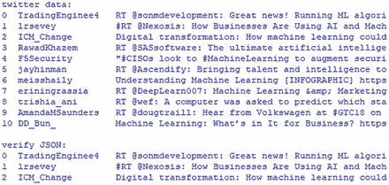

代码示例首先导入了`TwitterSearch`、`json`和`sys`库。类`twitSearch`基于 Twitter 凭证、关键词列表和限制数量来流式传输 Twitter 数据。函数`get_cred()`从 JSON 返回 Twitter 凭证。函数`write_json()`将数据写入 JSON。函数`translate()`将基本多文种平面（BMP）之外的流式数据转换为可用格式。例如，表情符号就在 BMP 之外。函数`read_json()`读取 JSON。主程序块首先获取 Twitter 凭证，创建一个搜索关键词列表和一个限制数量。在这个例子中，搜索关键词列表包含`machine`和`learning`，因为我想要流式传输关于机器学习的数据。限制数量为十，将流式传输的记录限制为十条推文。代码继续将 Twitter 数据写入 JSON，翻译推文以控制非 BMP 数据，并打印推文。最后，代码读取 JSON 以验证推文是否已正确保存，并打印一些内容。

## 网页抓取

网页抓取是一种从网站提取信息的编程方法。它专注于将非结构化的 HTML 格式数据转换为结构化数据。由于 HTML 的非结构化特性，网页抓取在编程上要求很高。也就是说，HTML 几乎没有结构规则，这意味着不同网站的 HTML 结构模式往往不同。因此，准备好为每次网页抓取任务编写自定义代码吧。

代码示例从一个流行的技术书籍出版公司抓取书籍信息。第一步是定位网页。第二步是打开一个包含源代码的窗口。第三步是遍历源代码以识别要抓取的数据。第四步是进行抓取。

使用 Google Chrome，点击“更多工具”，然后点击“开发者工具”以打开源代码窗口。接下来，将鼠标光标悬停在源代码上，直到找到数据。向下移动源代码树以找到你想要抓取的标签。最后，抓取数据。

要安装`BeautifulSoup`，请执行`pip install BeautifulSoup`。

```python
from bs4 import BeautifulSoup
import requests, json

def build_title(t):
    t = t.text
    t = t.split()
    ls = []
    for row in t:
        if row != '-':
            ls.append(row)
        elif row == '-':
            break
    return ' '.join(ls)

def release_date(r):
    r = r.text
    r = r.split()
    prefix = r[0] + s + r[1]
    if len(r) == 5:
        date = r[2] + s + r[3] + s + r[4]
    else:
        date = r[2] + s + r[3]
    return prefix, date

def write_json(f, d):
    with open(f, 'w') as fout:
        json.dump(d, fout)

def read_json(f):
    with open(f) as f:
        return json.load(f)

if __name__ == '__main__':
    s = ' '
    dic_ls = []
    base_url = "https://ssearch.oreilly.com/?q=data+science"
    soup = BeautifulSoup(requests.get(base_url).text, 'lxml')
    books = soup.find_all('article')
    for i, row in enumerate(books):
        dic = {}
        tag = row.name
        tag_val = row['class']
        title = row.find('p', {'class' : 'title'})
        title = build_title(title)
        url = row.find('a', {'class' : 'learn-more'})
        learn_more = url.get('href')
        author = row.find('p', {'class' : 'note'}).text
        release = row.find('p', {'class' : 'note date2'})
        prefix, date = release_date(release)
        if len(tag_val) == 2:
            publisher = row.find('p', {'class' : 'note publisher'}).text
            item = row.find('img', {'class' : 'book'})
            cat = item.get('class')[0]
        else:
            publisher, cat = None, None
        desc = row.find('p', {'class' : 'description'}).text.split()
        desc = [row for i, row in enumerate(desc) if i < 7]
        desc = ' '.join(desc) + ' ...'
        dic['title'] = title
        dic['learn_more'] = learn_more
        if author[0:3] != 'Pub':
            dic['author'] = author
        if publisher is not None:
            dic['publisher'] = publisher
            dic['category'] = cat
        else:
            dic['event'] = desc
        dic['date'] = date
        dic_ls.append(dic)
    f = 'data/scraped.json'
    write_json(f, dic_ls)
    data = read_json(f)
    for i, row in enumerate(data):
        if i < 6:
            print (row['title'])
            if 'author' in row.keys():
                print (row['author'])
            if 'publisher' in row.keys():
                print (row['publisher'])
            if 'category' in row.keys():
                print ('Category:', row['category'])
            print ('Release Date:', row['date'])
            if 'event' in row.keys():
                print ('Event:', row['event'])
            print ('Publish Date:', row['date'])
            print ('Learn more:', row['learn_more'])
            print ()
```

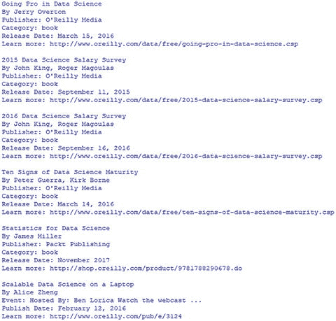

代码示例首先导入了 `BeautifulSoup`、`requests` 和 `json` 库。函数 `build_title()` 将抓取到的标题数据构建成一个字符串。函数 `release_date()` 将抓取到的日期数据构建成一个字符串。函数 `write_json()` 和 `read_json()` 分别用于写入和读取 JSON。主程序块首先将 URL 页面转换为一个 `BeautifulSoup` 对象。代码继续将所有 `article` 标签放入变量 `books` 中。通过探索，我发现 `article` 标签包含了我想抓取的信息。接下来，遍历每个 `article` 标签。如果每个 `article` 标签中的信息结构一致，抓取会容易得多。但由于并非如此，提取每条信息的逻辑就变得相当复杂。每条信息都被放入一个字典元素中，随后被追加到一个列表中。最后，该列表被保存为 JSON。读取 JSON 并显示几条记录以验证一切正常。

## 索引

### A

聚合管道 使用原生操作的多阶段 安德鲁斯曲线

### B

`BeautifulSoup` 大数据 MongoDB 电影数据集 MovieLens 数据 保存为 JSON 三个数据集

### C

逗号分隔值（CSV）文件 相关性 数据 相关系数 度量 正态分布 和 pandas 参见 Pandas 相关性 立方体数据 累积分布函数（CDF）

### D

数据 安德鲁斯曲线 相关系数 度量 正态分布 和 立方体 数据切块 正态分布 一维 pandas 参见 Pandas 相关性 平行坐标 RadViz 缩放 正态分布 读取 CSV 数据集 零均值和单位方差 切片 二维 均匀分布 数据整理 数据框（df） 数据随机化 数据科学基础 读写 数据可视化 数据切块 字典

### E, F

欧几里得距离最小化 3-D 空间 MCS numpy 方法

### G

生成器 优势 列表推导式 OrderedDict 元素 `read_dict()` 函数 `sim_times()` 函数 模拟 梯度下降（GD）算法 欧几里得距离 参见欧几里得距离最小化 简单函数 参见简单函数最小化 随机 参见随机梯度下降 GroupLens 网站

### H

热力图 pandas 相关性和 `wrangled.json` 数据

### I

逆累积分布函数（ICDF） 鸢尾花数据集

### J, K

JSON 清洗后的数据 发送到 MongoDB 和

### L

惰性求值 线性代数 基础 矩阵变换 单位矩阵性质 numpy 矩阵 切片 矩阵数学 `display()` 函数 `dot()` 函数 模 乘法 `mult_scalar()` 函数 numpy 矩阵 pandas 矩阵 应用 平均值 数据结构 `df` `head()` 和 `tail()` 方法 numpy 矩阵 向量数学 加法 有向线段 从原点出发的模 减法 可视化 向量空间 列表 列表推导式 创建新列表 字典元素 元组 和

### M

MongoDB 聚合管道 使用原生操作的多阶段 连接到 JSON 和 保存数据集 蒙特卡洛模拟（MCS） 增强图 产品需求模拟 准确预测 `demand()` 函数 函数 `mcs()` `max_bar()` 函数 正态分布 生产算法 `production()` 函数 随机性 使用 PDF 和 CDF 连续随机变量 微积分基本定理 梯度下降 ICDF 积分 较少变异（误差） matplotlib 库 `np_rstrip()` 函数 PPF 利润计算 可视化 假设分析 股票模拟 假设分析 电影数据集 MovieLens 网站

### N

NoSQL Numpy 方法

### O

一维数据

### P, Q

Pandas 相关性分析 清洗 CSV 文件 创建矩阵 可视化 热力图 平行坐标 百分点函数 (PPF) 主成分分析 (PCA) 特征向量 鸢尾花数据集 `wrangled.json` 数据集 概率密度函数 (PDF) PyMongo Python 函数与字符串基础 矩阵 编程代码 伪随机数

### R

# RadViz 残差平方和 (RSS)

## S

Sigmoid 函数 最小化 局部最大值 局部最小值 简单函数 最小化 数据切片 速度模拟 标准差 (SD) 标准正态分布 随机梯度下降 批次 最大值 最小值 `theta` `n` 次 `RSS` 函数 运行 `n` 次

## T

元组 Twitter `pip install TwitterSearchAPI` 将凭据保存为 JSON 格式 二维数据

## U

均匀分布

## V

可视化

## W, X, Y, Z

网络爬虫，`BeautifulSoup` 数据整理