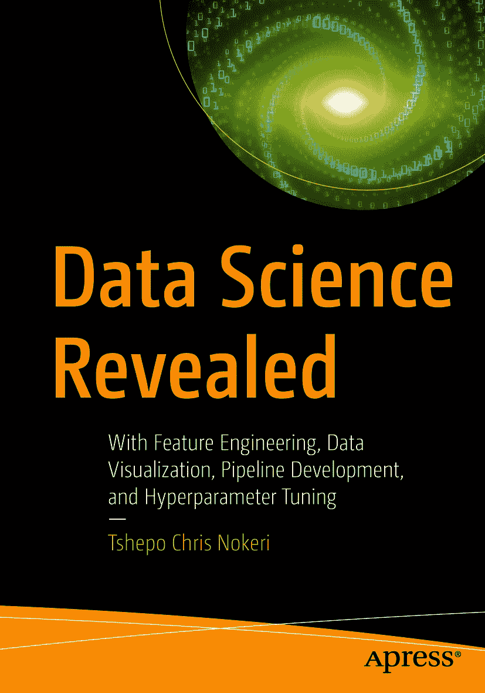

ISBN 978-1-4842-6869-8 e-ISBN 978-1-4842-6870-4 [`doi.org/10.1007/978-1-4842-6870-4`](https://doi.org/10.1007/978-1-4842-6870-4) © Tshepo Chris Nokeri 2021 Apress Standard 本出版物中使用的通用描述性名称、注册商标、商标、服务标记等，即使未作明确声明，也不意味着这些名称不受相关保护法律和法规的约束，因此可自由用于一般用途。出版商、作者和编辑假定本书中的建议和信息在出版之日是真实准确的。出版商、作者或编辑均不对本书所含材料或可能存在的任何错误或遗漏提供明示或暗示的担保。出版商对已出版地图中的管辖权主张和机构归属保持中立。本书通过 Springer Science+Business Media New York 在全球图书贸易中发行，地址：1 New York Plaza, Suite 4600, New York, NY 10004-1562, USA。电话：1-800-SPRINGER，传真：(201) 348-4505，电子邮件：orders-ny@springer-sbm.com，或访问 www.springeronline.com。Apress Media, LLC 是一家加利福尼亚有限责任公司，其唯一成员（所有者）是 Springer Science + Business Media Finance Inc (SSBM Finance Inc)。SSBM Finance Inc 是一家特拉华州公司。

*谨以此书献给我的家人，以及所有在我生命中愉快地扮演重要角色的人。*

