# 1. 简单线性回归入门

本书将带你进入数据科学的世界，揭示进行数据科学研究的正确方法。书中涵盖了必要的统计与编程技术，帮助你从宏观视角理解数据科学。不仅如此，它还为运用数据科学技术解决问题提供了理论、技术和数学基础。

本章将介绍`参数方法`，也称为`线性方法`。理解如何在违反回归假设的情况下测试回归模型，将使你能够轻松应对后续章节中的问题。阅读时需注意，示例数据中只有一个因变量。本章不涉及使用方差膨胀因子（`VIF`）处理多重共线性问题。

简单线性回归用于估计自变量与因变量之间关系的性质，其中`自变量`可以是连续变量或分类变量，而`因变量`则必然是连续变量。它研究自变量的变化如何影响因变量的变化。标准公式如公式 1-1 所示。

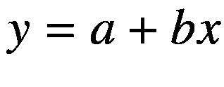

（公式 1-1）

其中，`y` 代表因变量，`a` 代表截距（当自变量保持不变时因变量的均值），`b` 代表斜率或梯度（直线的方向），`x` 代表自变量。

该模型为数据点拟合一条直线。如果它能完美地将直线拟合到数据点上，那么这就是一个典范模型。相反，如果数据点严重偏离直线，则违反了回归假设。

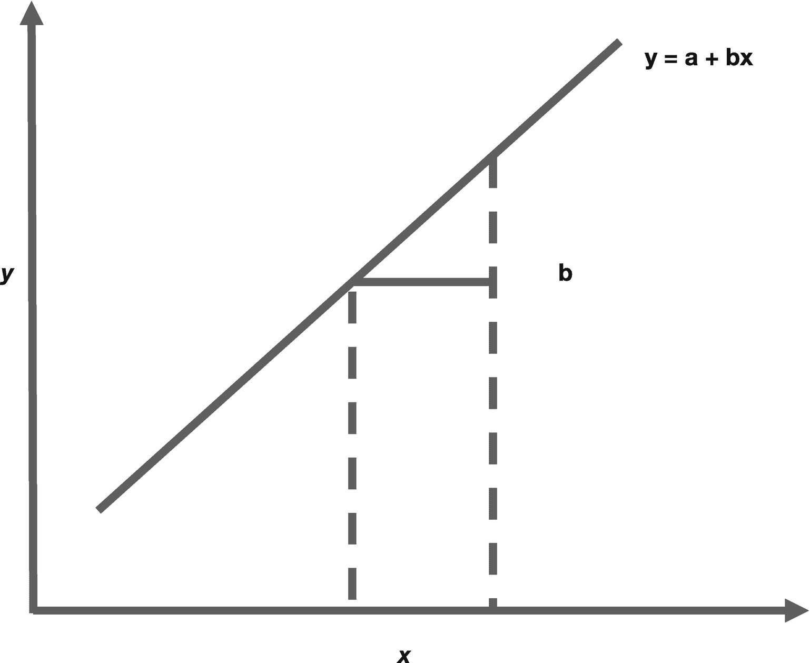

图 1-1

完美线性回归模型的成对散点图

图 1-1 展示了一个最优模型（由于变异性，这在现实世界中几乎不可能发生）。大多数情况下，数据点会散布在直线附近。为了解决这个问题，回归模型（或称回归器）在建模过程中引入了一个误差项，以使数据点的平方偏差尽可能小。它通过估计截距和斜率来减小误差项。最常见的回归模型是最小二乘模型。公式 1-2 表达了最小二乘模型的公式。

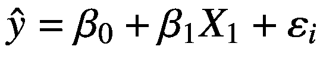

（公式 1-2）

其中，`ŷ` 代表期望的因变量，`β₀` 代表截距，`β₁` 代表斜率，`X₁` 代表自变量，`εᵢ` 代表误差项（即 `n` 个数据点中第 `i` 个点的残差），如公式 1-3 所示。

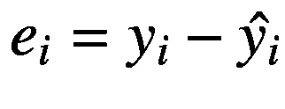

（公式 1-3）

最小二乘回归模型确保残差的平方和较小。公式 1-4 利用以下性质估计残差的平方和。

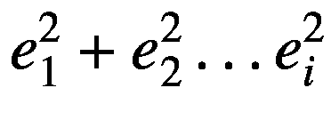

（公式 1-4）

公式 1-4 假设残差始终为零，且估计值是无偏的。

## 回归假设

如果回归模型满足表 1-1 中指定的假设，那么它就是可靠的。

表 1-1

线性回归假设

| 假设 | 描述 |
| --- | --- |
| `线性性` | 自变量与因变量之间必须存在线性关系。我们通过成对散点图来验证这一假设。 |
| `正态性` | 数据必须来自正态分布。当变量的值围绕真实均值对称分布时，即为正态分布。我们通过正态概率图（也称为`正态 Q-Q 图`）来验证这一假设。为了进行可靠的正态性检验，可使用名为`柯尔莫哥洛夫-斯米尔诺夫检验`的检验统计量。如果不满足正态性，则需对数据进行变换。 |
| `多重共线性` | 数据中必须几乎没有或完全没有多重共线性。如果自变量之间存在高度相关性，则存在多重共线性。我们通过使用相关矩阵、容忍度和`VIF`来验证这一假设。如果存在多重共线性，则必须对数据中心化。示例数据只有一个因变量，因此不涉及使用`VIF`处理多重共线性。 |
| `无自相关` | 残差中必须不存在自相关。当残差彼此不独立时，即存在自相关。我们通过滞后图、自相关函数图和偏自相关图来验证这一假设。为了进行可靠的自相关检验，可使用德宾-沃森检验。 |

相反，如果回归模型违反了基本的回归假设，那么模型将难以泛化。

## 实践中的简单线性回归

示例数据¹包含两列（每列代表一个变量）。第一列包含员工工作年限的值（自变量），第二列包含员工薪资的值（因变量）。

## 检查数据质量

最小二乘模型是敏感的（数据质量会影响其性能）。为了获得最佳模型性能，需确保数据中没有缺失值或异常值，并在训练回归模型之前对数据进行缩放。

### 检测缺失值

数据中明显存在的缺失值会导致模型性能不佳。为避免此困境，在加载数据后，应检查数据中是否存在缺失值。

#### 缺失值热力图

代码清单 1-1 绘制了一个显示缺失值的热力图（见图 1-2）。

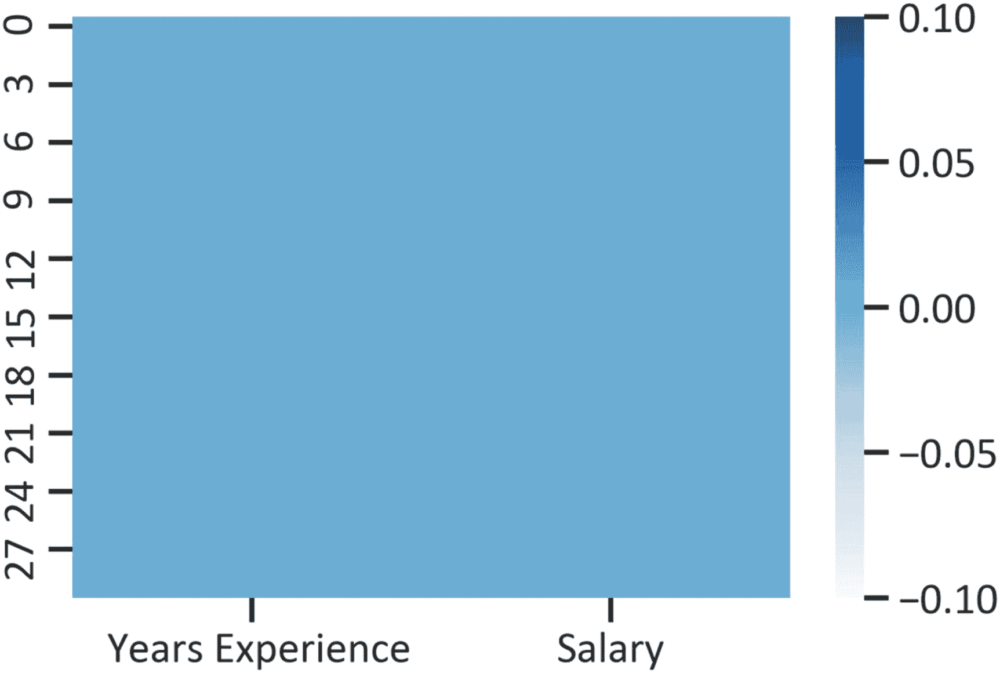

图 1-2

缺失值热力图

```
import seaborn as sns
sns.heatmap(df.isnull(),cmap="Blues")
plt.show()
```

代码清单 1-1

缺失值热力图

图 1-2 显示数据中未检测到缺失值。如果数据中存在缺失值，热力图将如图 1-3 所示。

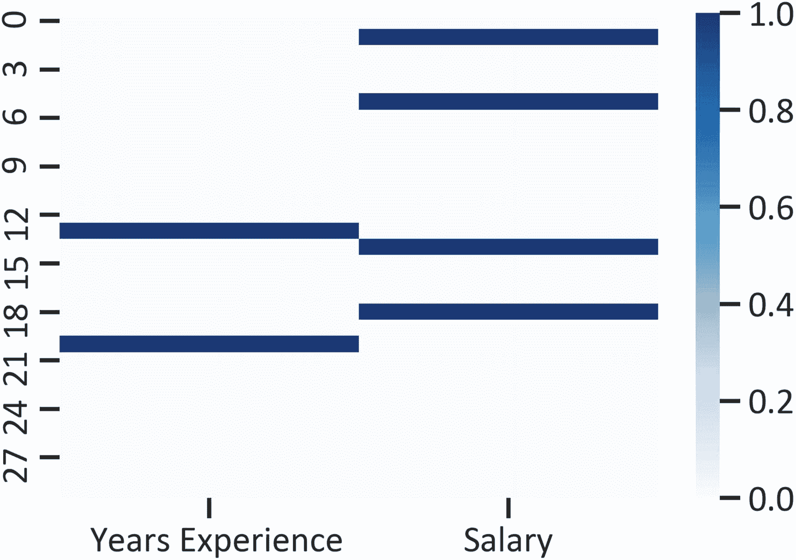

图 1-3

缺失值热力图

如果数据中存在缺失值，请用该变量的均值或中位数替换缺失值。代码清单 1-2 使用均值替换缺失值。

```
df["YearsExperience"].fillna(df["YearsExperience"].mean())
df["Salary"].fillna(df["YearsExperience"].mean())
```

代码清单 1-2

用均值替换缺失值

代码清单 1-3 使用中位数替换缺失值。

```
df["YearsExperience"].fillna(df["YearsExperience"].median())
df["Salary"].fillna(df["YearsExperience"].median())
```

代码清单 1-3

用中位数替换缺失值

### 检测正态性

回归模型假设数据服从正态分布（数据点围绕真实均值对称分布）。若数据不服从正态分布，需进行数据变换以降低其偏度。负偏态数据需采用幂变换或指数变换，而正偏态数据则需采用对数变换或平方根变换。具有不同均值和方差的标准正态分布在数学上可用分布函数表示。

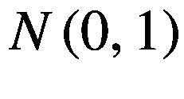

（公式 1-5）

此处，均值等于 0，标准差等于 1。

#### 直方图

直方图的 x 轴表示变量的区间，y 轴表示数值的频率。代码清单 1-4 绘制了员工工作年限的分布，图 1-4 展示了员工工作年限的分布情况。

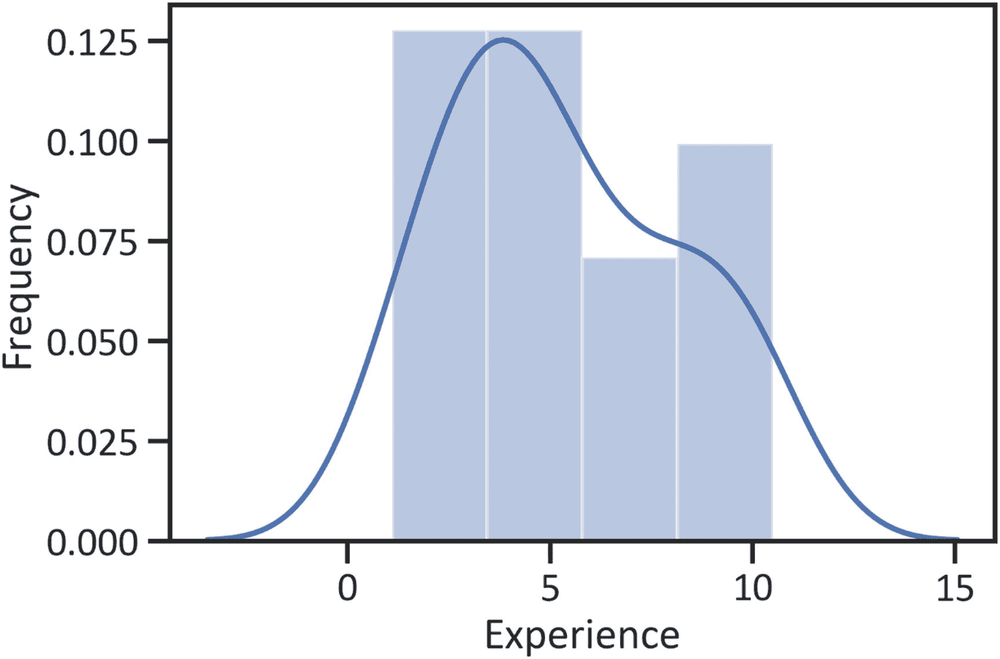

图 1-4

直方图

```
sns.distplot(df["YearsExperience"])
plt.ylabel("Frequency")
plt.xlabel("Experience")
plt.show()
```

代码清单 1-4
员工工作年限直方图

图 1-4 显示员工工作年限的值略微服从正态分布。我们无法使用均值来概括该自变量。

代码清单 1-5 绘制了员工薪资的直方图（见图 1-5）。

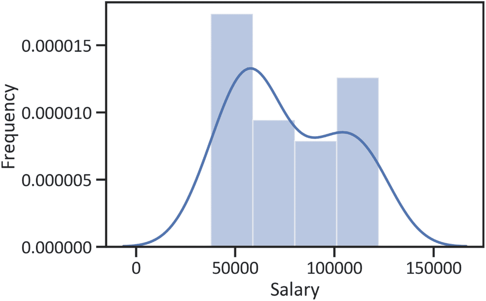

图 1-5

直方图

```
sns.distplot(df["Salary"])
plt.ylabel("Frequency")
plt.xlabel("Salary")
plt.show()
```

代码清单 1-5
员工薪资直方图

图 1-4 和图 1-15 均显示非极端正态分布。当数据中存在异常值时，偏态现象经常发生。

### 检测异常值

异常值是指过小或过大的数据点。它可能通过增大误差率来影响模型。若数据中存在异常值，应将其移除，或用均值或中位数替换。

### 箱线图

检测异常值最简单的方法是使用箱线图。箱线图简洁地总结了数据独特形状和离散程度的信息。它具有以下属性：一个代表数据中间值的箱子，一条代表 50%数据点所在位置的中位数线，以及代表四分位数的直线，其中 25%的数据点位于直线上方，75%的数据点位于直线下方。而`Q3`代表 75%的数据在其上方、25%的数据在其下方的点。这条直线和其他直线代表须线，它将`Q1`或`Q3`与除异常值外最远的数据点连接起来。

清单 1-6 绘制了员工工作年限的箱线图。

# 数据分析与可视化

## 图表展示

代码清单 1-6 绘制了员工工作年限的箱线图。

```
sns.boxplot(df["YearsExperience"])
plt.xlabel("Experience")
plt.show()
Listing 1-6
Employees’ Years of Work Experience Box Plot
```

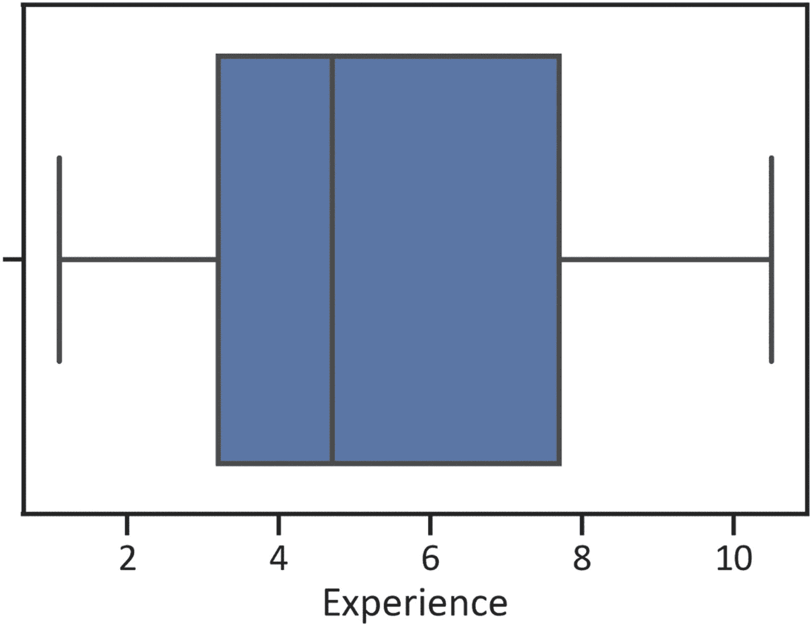

图 1-6 显示员工工作年限的值略微左偏，且数据中不存在异常值。

清单 1-7 为因变量的值构建了一个箱线图（见图 1-7）。

```
sns.boxplot(df["Salary"])
plt.xlabel("Salary")
plt.show()
Listing 1-7
Employees’ Salaries Box Plot
```

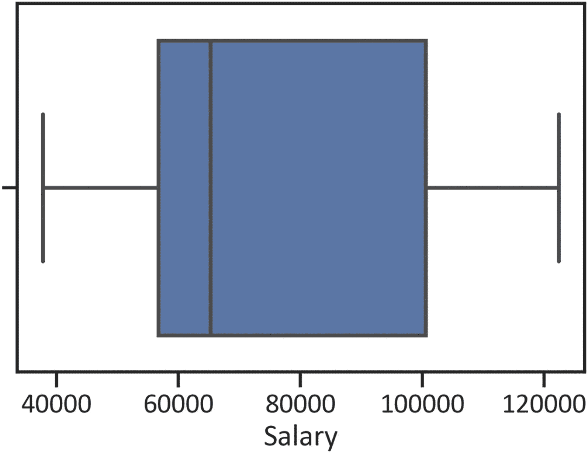

图 1-7 表明员工薪资的值左偏，且数据中未检测到异常值。图 1-6 和图 1-7 都略微近似于正态分布。

清单 1-8 绘制了员工工作年限和员工薪资的折线图（见图 1-8）。图 1-8 展示了由直线连接随时间变化的趋势。它有两个轴：x 轴（水平）和 y 轴（垂直）。这些轴在图形上表示为 (`x`, `y`)。自变量位于 x 轴上，因变量位于 y 轴上。

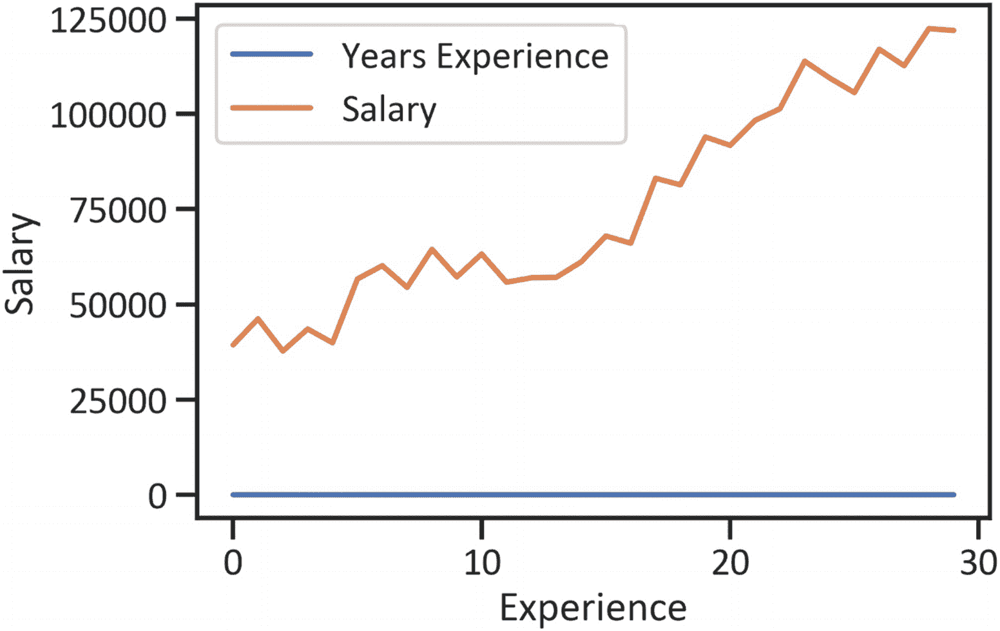

```
df.plot(kind="line")
plt.xlabel("Experience")
plt.ylabel("Salary")
plt.show()
Listing 1-8
Employees’ Years of Work Experience and Employees’ Salaries Line Plot
```

图 1-8 并未显示出一条理想的直线。数据点始终遵循长期上升趋势。这条直线向右上方倾斜。员工的薪资随着其工作年限的增加而增加。

清单 1-9 返回一个使用核密度估计显示概率密度函数的图（见图 1-9）。它捕捉了连续随机变量的概率。

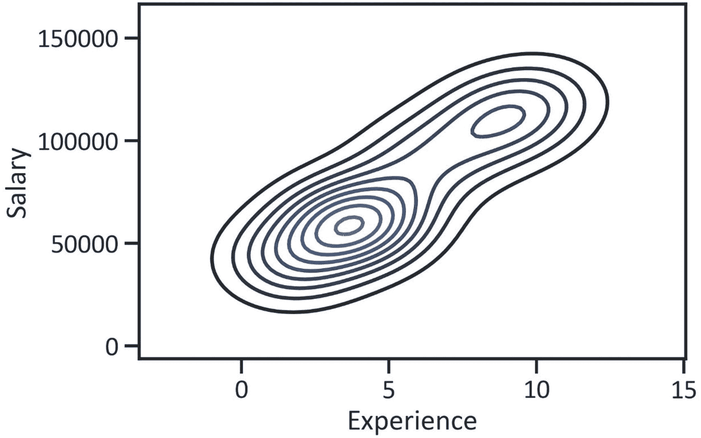

```
sns.kdeplot(df["YearsExperience"],df["Salary"])
plt.title("Experience and salary density plot")
plt.xlabel("Experience")
plt.ylabel("Salary")
plt.show()
Listing 1-9
Density Plot
```

图 1-9 显示了一个二维概率密度；然而，该分布不够正态。它包含聚集的数据点，这无意中增加了数据解读的难度。

清单 1-10 返回一个描绘变量之间关联的散点图（见图 1-10）。

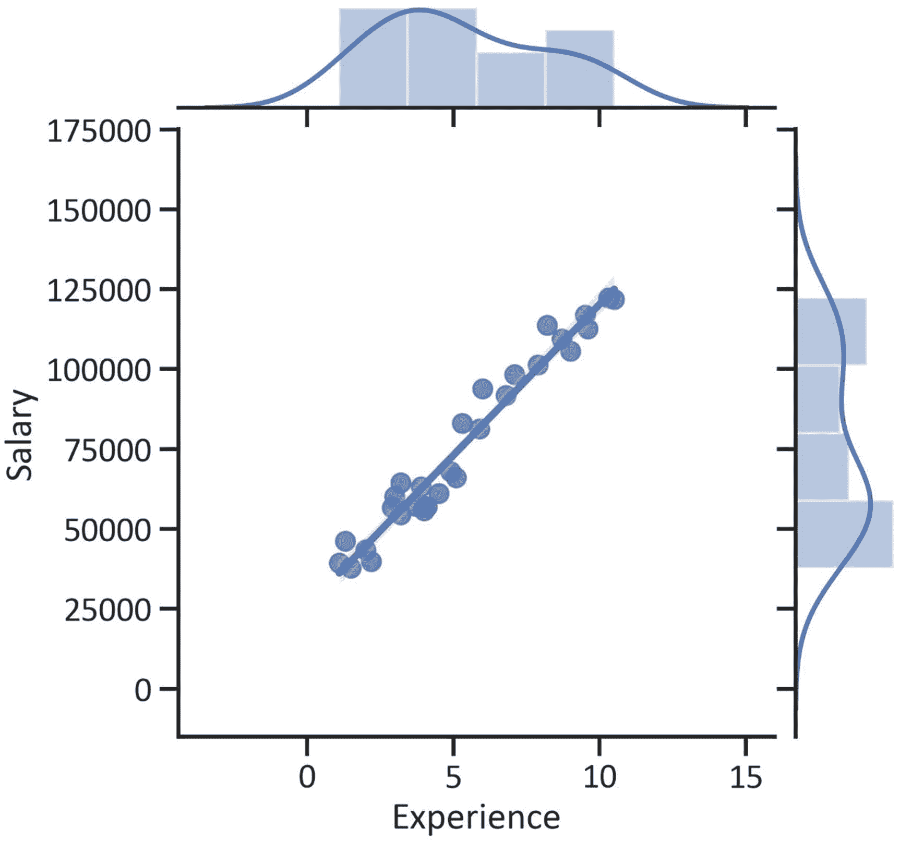

```
sns.jointplot(x="YearsExperience",y="Salary",data=df,kind="reg")
plt.xlabel("Experience")
plt.ylabel("Salary")
plt.show()
Listing 1-10
Employees’ Years of Work Experience and Employees’ Salaries Joint Plot
```

图 1-10 表明一条直线完美地拟合了数据点。员工工作年限与员工薪资之间存在强正相关关系。

清单 1-11 使用集中趋势汇总了数据（见表 1-2）。

|          | 计数     | 均值        | 标准差        | 最小值   | 25%      | 50%     | 75%       | 最大值     |
|----------|----------|-------------|---------------|----------|----------|---------|-----------|------------|
| **工作年限** | 30.0     | 5.313333    | 2.837888      | 1.1      | 3.20     | 4.7     | 7.70      | 10.5       |
| **薪资**   | 30.0     | 76003.000000| 27414.429785  | 37731.0  | 56720.75 | 65237.0 | 100544.75 | 122391.0   |

```
df.describe().transpose()
Listing 1-11
Summarize the Central Tendency
```

表 1-2 突出显示，员工工作年限的算术平均值为 5 年，员工薪资的算术平均值为每年 76,003 美元。员工工作年限的值与均值偏差 3，员工薪资的值与均值偏差 27,414 美元。最低工作年限为 1 年，最低薪资为 37,731 美元。薪资最高的员工年薪为 122,391 美元，拥有约 11 年工作经验。四分之一的员工年薪约为 56,721 美元。年薪在 100,544 美元及以上的员工属于高收入阶层。

# 理解相关性

线性回归的核心在于检验相关系数。相关性估计了自变量与因变量之间线性关系的表观强度。确定两个变量之间相关性的方法有多种，例如皮尔逊相关法、斯皮尔曼相关法和肯德尔相关法。

## 皮尔逊相关法

清单 1-12 应用了皮尔逊相关法（因变量为连续变量）。公式 1-6 表达了该方法。

$$ {r}_{xy}=\frac{s_{xy}}{s_x{s}_y} $$

（公式 1-6）

这里，`s[x]` 代表自变量的标准差，`s[y]` 代表因变量的标准差，`s[xy]` 代表协方差。该方法产生的值范围从 -1 到 1，其中 -1 表示强负相关关系，0 表示无相关关系，1 表示强正相关关系。

## 相关矩阵

图 1-11 显示了员工工作年限与员工薪资之间的相关性。

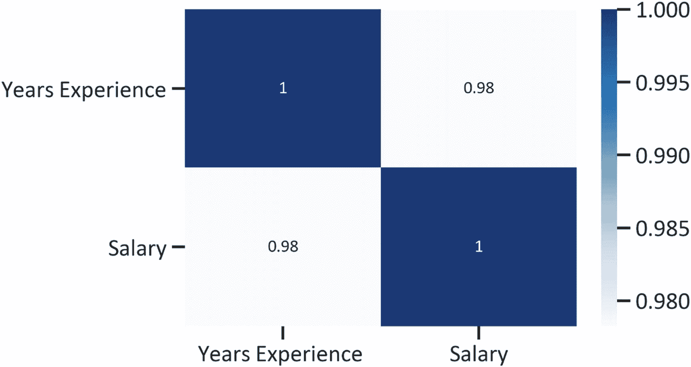

```
dfcorr = df.corr(method="pearson")
sns.heatmap(dfcorr, annot=True,annot_kws={"size":12}, cmap="Blues")
plt.show()
Listing 1-12
Correlation Matrix
```

图 1-11 显示了一条从左上角到右下角的由 1 组成的对角线（每个变量与自身完全相关）。员工工作年限与员工薪资之间存在强正相关关系。

## 协方差方法

协方差是两个变量之间的联合变异性（它估计两个变量如何一起变化）。公式 1-7 表达了协方差方法。

$$ {S}_{xy}=\frac{\sum \left({x}_i-\underset{\_}{x}\right)\left({y}_i-\underset{\_}{y}\right)\ }{n-1} $$

（公式 1-7）

这里，`n` 是样本数量，`y[i]` 表示标量随机变量，`x` 和 `y` 是这些标量随机变量的均值。

## 协方差矩阵

代码清单 1-13 生成了协方差矩阵（见图 1-12）。

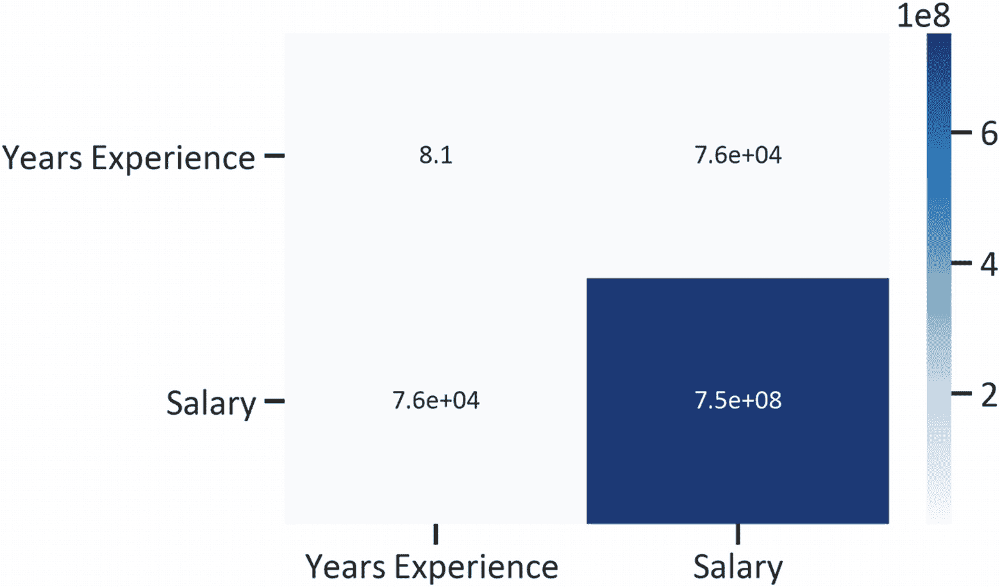

```
dfcov = df.cov()
sns.heatmap(dfcov, annot=True,annot_kws={"size":12}, cmap="Blues")
plt.show()
代码清单 1-13
协方差矩阵
```

图 1-12 显示协方差约为 0.0076（接近 1）。这证实了变量之间存在正相关关系。

## 分配和重塑数组

代码清单 1-14 使用 `NumPy` 分配了 `x` 和 `y` 的数组。一个数组包含一个或多个变量。

```
x = np.array(df["YearsExperience"])
y = np.array(df["Salary"])
代码清单 1-14
分配 x 和 y 数组
```

代码清单 1-15 重塑了 `x` 和 `y`（将一维数据转换为二维数据）。

```python
x = x.reshape(-1,1)
y = y.reshape(-1,1)
```

### 将数据拆分为训练数据和测试数据

监督模型需要数据划分。代码清单 1-16 通过调用 `train_test_split()` 方法将数据拆分为训练数据和测试数据。

```python
from sklearn.model_selection import train_test_split
x_train, x_test, y_train, y_test = train_test_split(x,y,test_size=0.2, random_state=0)
```

请注意，80% 的数据用于训练，20% 的数据用于测试。

## 数据归一化

常见的缩放方法包括：`StandardScaler()`，它缩放数据使得均值为 0，标准差为 1；`MinMaxScaler()`，它将数据缩放到 0 到 1 之间，如果数据中有负值，则缩放到 -1 到 1 之间；以及 `RobustScaler()`，它移除异常值并使用缩放后的数据（使用前述任一缩放方法）。代码清单 1-17 应用 `StandardScaler()` 方法对数据进行归一化。

```python
from sklearn.preprocessing import StandardScaler
scaler = StandardScaler()
x_train = scaler.fit_transform(x_train)
x_test = scaler.transform(x_test)
```

## 使用 Statsmodels 开发最小二乘模型

`Statsmodels` 是一个 Python 科学计算包，包含一组不同的类和函数，用于正确估计统计模型和执行检验统计。它补充了用于统计计算的 `SciPy` 包。默认情况下，它不包含截距项。代码清单 1-18 手动向模型添加了一个截距项。

```python
x_constant = sm.add_constant(x_train)
x_test = sm.add_constant(x_test)
```

代码清单 1-19 完成了回归器的构建。

```python
model = sm.OLS(y_train, x_constant).fit()
```

### 预测

代码清单 1-20 列出了预测值（见表 1-3）。

**表 1-3** 预测值

|    | 预测薪资 |
| ---- | ---- |
| **0** | 40748.961841 |
| **1** | 122699.622956 |
| **2** | 64961.657170 |
| **3** | 63099.142145 |
| **4** | 115249.562855 |
| **5** | 107799.502753 |

```python
y_pred = model.predict(x_test)
pd.DataFrame(y_pred, columns = ["Predicted salary"])
```

### 评估模型

代码清单 1-21 返回了回归器性能的摘要（见表 1-4）。

**表 1-4** 结果

| 因变量： | y | R-squared： | 0.941 |
| ---- | ---- | ---- | ---- |
| **模型：** | OLS | **调整后 R-squared：** | 0.939 |
| **方法：** | 最小二乘法 | **F 统计量：** | 352.1 |
| **日期：** | 2020 年 10 月 16 日，周五 | **Prob (F 统计量)：** | 5.03e-15 |
| **时间：** | 14:42:15 | **对数似然：** | -242.89 |
| **观测数：** | 24 | **AIC：** | 489.8 |
| **残差自由度：** | 22 | **BIC：** | 492.1 |
| **模型自由度：** | 1 |    |    |
| **协方差类型：** | 非稳健 |    |    |
|    | **系数** | **标准误** | **T 值** | **P>&#124;t&#124;** | **[0.025** | **0.975]** |
| ---- | ---- | ---- | ---- | ---- | ---- | ---- |
| **常数项** | 7.389e+04 | 1281.861 | 57.640 | 0.000 | 7.12e+04 | 7.65e+04 |
| **x1** | 2.405e+04 | 1281.861 | 18.765 | 0.000 | 2.14e+04 | 2.67e+04 |
| **Omnibus：** | 3.105 | **Durbin-Watson：** | 2.608 |
| ---- | ---- | ---- | ---- |
| **Prob(Omnibus)：** | 0.212 | **Jarque-Bera (JB)：** | 1.567 |
| **偏度：** | 0.297 | **Prob(JB)：** | 0.457 |
| **峰度：** | 1.898 | **条件数** | 1.00 |

```python
summary = model.summary()
summary
```

`R-squared` 表示模型能解释的数据变异程度。另一方面，调整后的 `R-squared` 表示自变量对因变量解释的变异程度。该模型解释了数据中 94.1% 的变异，自变量（`YearsExperience`）解释了数据中 93.9% 的变异。该模型很好地解释了数据。p 值略高于 0.05。我们拒绝原假设，接受备择假设。员工的工作年限与员工薪资之间存在显著差异。

## 使用 SciKit-Learn 开发最小二乘模型

`SciKit-Learn` 包在训练和测试模型方面很受欢迎。它具有支持数据预处理、模型选择、训练和评估的功能。

### 最小二乘模型超参数优化

超参数是在训练模型之前设置的值。它控制模型的学习过程。超参数优化涉及指定一个值列表，并找到能产生最佳模型性能的值。

#### 步骤 1：使用默认超参数拟合最小二乘模型

代码清单 1-22 使用默认超参数拟合最小二乘模型。

```python
from sklearn.linear_model import LinearRegression
lm = LinearRegression()
lm.fit(x_train,y_train)
```

#### 步骤 2：确定交叉验证得分的均值和标准差

交叉验证涉及检验模型对数据的泛化程度。代码清单 1-23 使用 `R²` 分数作为标准来寻找交叉验证得分。还有其他可用作标准的分数，例如均方误差（在考虑回归关系后，模型对数据变异性的解释程度）和均方根误差（在不考虑回归关系的情况下对变异性的解释程度）。代码清单 1-23 查找回归器的默认参数。

```python
lm.get_params()
```

一次密集搜索会返回一个估计器、一个参数空间、用于搜索候选参数的方法、交叉验证方案以及评分函数。交叉验证方法包括 `RandomizedSearchCV`（考虑特定数量的候选参数）、`GridSearchCV`（考虑所有参数组合）以及 `BayesSearchCV`（通过将高斯过程作为函数的先验来处理，利用先前的损失来确定对损失进行采样的最佳点）。下面，我们将向您展示如何使用 `GridSearchCV` 和 `BayesSearchCV` 执行交叉验证。表 1-5 突出显示了可优化的超参数。

**表 1-5** 可优化的超参数

| 参数 | 描述 |
| ---- | ---- |
| `fit_intercept` | 决定模型是否必须估计截距 |
| `normalize` | 决定是否必须对自变量进行归一化 |
| `copy_X` | 决定是否必须复制自变量 |

代码清单 1-24 创建了网格模型。

```python
from sklearn.model_selection import GridSearchCV
param_grid = {'fit_intercept':[True,False],
'normalize':[True,False],
'copy_X':[True, False]}
grid_model  = GridSearchCV(estimator=lm,
param_grid=param_grid,
n_jobs=-1)
grid_model.fit(x_train,y_train)
```

代码清单 1-25 返回最佳交叉验证得分和最佳参数。

# 代码清单 1-25 使用 GridSearchCV 查找最佳超参数

```
print("Best score: ", grid_model.best_score_, "Best parameters: ", grid_model.best_params_)
```

最佳得分：0.9272138118711238 最佳参数：{‘copy_X’: True, ‘fit_intercept’: True, ‘normalize’: True}

另一种查找正确超参数的方法是使用贝叶斯优化。代码清单 1-26 使用 `Skopt` 执行贝叶斯优化。要在 Python 环境中安装它，请使用 `pip install scikit-optimize`。

# 代码清单 1-26 使用 `BayesSearchCV` 开发网格模型

```
from skopt import BayesSearchCV
param_grid = {'fit_intercept':[True,False],
'normalize':[True,False],
'copy_X':[True, False]}
grid_model = BayesSearchCV(lm,param_grid,n_iter=30,random_state=1234,verbose=0)
grid_model.fit(x_train,y_train)
```

# 代码清单 1-27 使用 `BayesSearchCV` 查找最佳超参数

代码清单 1-27 查找最佳交叉验证得分和最佳参数。

```
print("Best score: ", grid_model.best_score_, "Best parameters: ", grid_model.best_params_)
```

最佳得分：0.9266258295344271 最佳参数：OrderedDict([(‘copy_X’, False), (‘fit_intercept’, True), (‘normalize’, False)])

## 最终确定最小二乘模型

代码清单 1-28 使用代码清单 1-27 中估计的超参数完成最小二乘模型。

```
lm = LinearRegression(copy_X= True,
fit_intercept= True,
normalize= True)
lm.fit(x_train,y_train)
```

## 查找截距

代码清单 1-29 估计截距。截距是在保持因变量不变的情况下，自变量的均值。

```
lm.intercept_
```

输出为 `array([73886.20833333])`。

## 查找估计系数

代码清单 1-30 估计系数。

```
lm.coef_
```

输出为 `array([[24053.85556857]])`。

一条直线的公式表示如下：

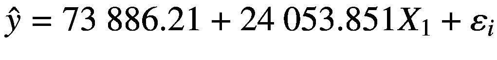

(公式 1-8)

工作年限每增加一年，薪水增加 24,054。

## 使用 SciKit-Learn 测试最小二乘模型性能

代码清单 1-31 应用 `predict()` 方法返回预测值，然后将该数组传递给一个数据框（见表 1-6）。

**表 1-6** 实际值

|   | 预测薪水 |
| --- | --- |
| **0** | 40748.961841 |
| **1** | 122699.622956 |
| **2** | 64961.657170 |
| **3** | 63099.142145 |
| **4** | 115249.562855 |
| **5** | 107799.502753 |

```
y_pred = lm.predict(x_test)
pd.DataFrame(y_pred, columns = ["Predicted salary"])
```

代码清单 1-32 将实际值制成表格（见表 1-7）。

**表 1-7** 薪水的实际值

|   | 实际薪水 |
| --- | --- |
| **0** | 37731.0 |
| **1** | 122391.0 |
| **2** | 57081.0 |
| **3** | 63218.0 |
| **4** | 116969.0 |
| **5** | 109431.0 |

```
pd.DataFrame(y_test, columns = ["Actual salary"])
```

表 1-7 表明回归器存在轻微误差。

## 平均绝对误差

绝对误差是估计值与真实值之间的差值。例如，如果模型预测薪水为 40,749 美元，而实际值为 37,731 美元，那么该模型的绝对误差为 40,749 美元 – 37,731 美元 = 3,018 美元。平均绝对误差（MAE）表示估计中误差的平均幅度，不考虑方向。

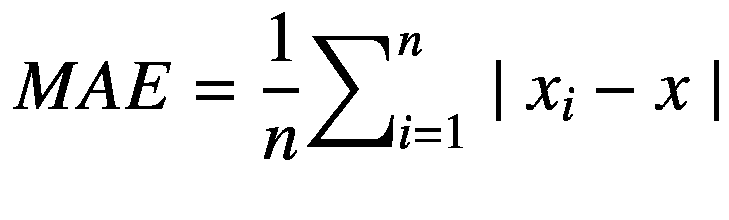

(公式 1-9)

这里，`n` 表示误差的数量，`∣x[i] − x∣` 表示绝对误差。

## 均方误差

均方误差（MSE）表示在考虑回归关系后，模型对数据变异性的解释程度。

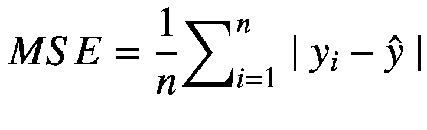

(公式 1-10)

## 均方根误差

均方根误差（RMSE）表示在不考虑回归关系的情况下解释的变异性。要获得 RMSE 分数，请使用 MSE 的平方根。

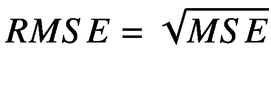

(公式 1-11)

## R 平方

R 平方（R²）表示模型所能解释的数据变异程度。该指标的取值范围为 0 到 1，其中 0 表示回归模型对数据变异性的解释能力很差，而 1 则表示回归模型对数据的解释能力最佳。

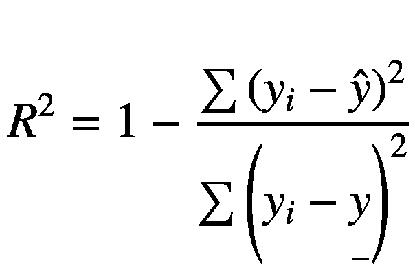

（公式 1-12）

此处， 表示 `y` 的预测值，而 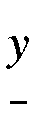 表示 `y` 的平均值。R² 分数需要乘以一百。例如，如果分数是 0.9，那么模型解释了数据中 90% 的变异。

还有其他用于模型评估的指标，例如：

*   解释方差分数：一个衡量模型与实际数据之间差异的指标。如果该分数接近 1，则表明存在强相关性。

*   平均伽马偏差：一个衡量因变量尺度并估计相对误差的指标。它是幂参数为 2 的 Tweedie 偏差。

*   平均泊松偏差：一个衡量因变量尺度并估计相对误差的指标。它是幂参数为 1 的 Tweedie 偏差。

清单 1-33 列出了这些评估指标（见表 1-8）。

**表 1-8** 性能矩阵

| | 值 |
| --- | --- |
| **MAE** | 2.446172e+03 |
| **MSE** | 1.282341e+07 |
| **RMSE** | 3.580979e+03 |
| **R²** | 9.881695e-01 |
| **解释方差分数** | 9.897038e-01 |
| **平均伽马偏差** | 3.709334e-03 |
| **平均泊松偏差** | 2.129260e+02 |

## 模型评估与残差分析

```
MAE = metrics.mean_absolute_error(y_test, y_pred)
MSE = metrics.mean_squared_error(y_test, y_pred)
RMSE = np.sqrt(MSE)
R2 = metrics.r2_score(y_test, y_pred)
EV = metrics.explained_variance_score(y_test, y_pred)
MGD = metrics.mean_gamma_deviance(y_test, y_pred)
MPD = metrics.mean_poisson_deviance(y_test, y_pred)
lmmodelevaluation = [[MAE, MSE, RMSE, R2, EV, MGD, MPD]]
lmmodelevaluationdata = pd.DataFrame(lmmodelevaluation,
                                     index=["Values"],
                                     columns=["MAE",
                                              "MSE",
                                              "RMSE",
                                              "R2",
                                              "Explained variance score",
                                              "Mean gamma deviance",
                                              "Mean Poisson deviance"]).transpose()
lmmodelevaluationdata
清单 1-33
评估指标
```

表 1-8 表明该模型解释了数据中 98% 的变异。员工的工作年限与员工薪资之间存在强相关性。平均而言，不考虑方向的误差幅度为 2,446，均方误差为 1。

### 训练数据

清单 1-34 通过在数据点之间绘制一条线来验证变量之间是否存在线性关系（见图 1-13）。

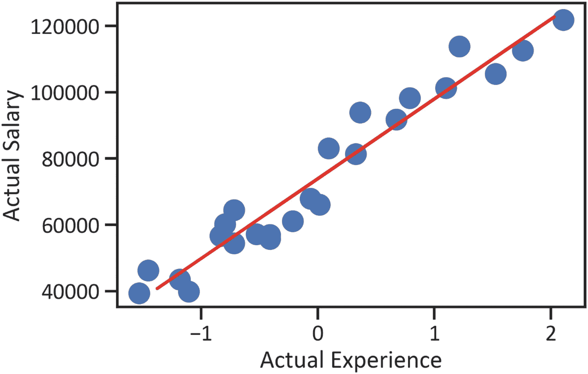

**图 1-13** 训练数据

```
plt.scatter(x_train, y_train, s=200)
plt.plot(x_test, y_pred, color="red")
plt.xlabel("Actual Experience")
plt.ylabel("Actual Salary")
plt.show()
清单 1-34
训练数据
```

图 1-13 证实数据点接近一条直线，但并非极度接近。员工的工作年限与员工薪资之间存在线性关系。

### 测试数据

清单 1-35 返回图 1-14，该图显示了员工工作年限的实际值与员工工作年限的预测值。

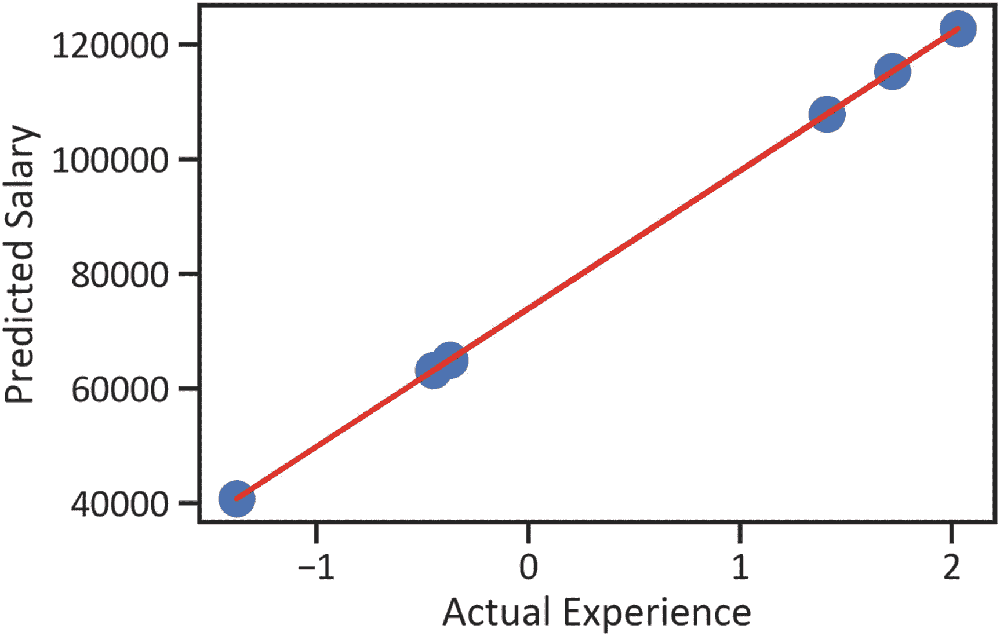

**图 1-14** 测试数据

```
plt.scatter(y_test, y_pred, s=200)
plt.axhline(color="red")
plt.xlabel("Actual Salary")
plt.ylabel("Predicted Salary")
plt.show()
清单 1-35
测试数据
```

图 1-14 确认了一个完美拟合的模型。如前所述，由于变异性，完美模型在现实世界中很少见。

### 实际值与预测值

模型评估涉及比较因变量的实际值和预测值。清单 1-36 返回了员工薪资实际值与员工薪资预测值之间的差异（见图 1-15）。

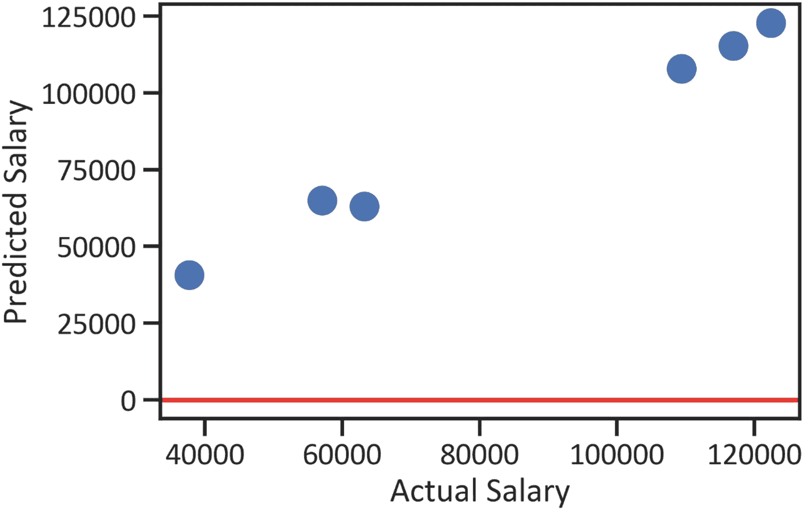

**图 1-15** 实际值与预测值

```
plt.scatter(y_test, y_pred, s=200)
plt.axhline(color="red")
plt.xlabel("Actual Salary")
plt.ylabel("Predicted Salary")
plt.show()
清单 1-36
实际值与预测值
```

员工薪资的实际值与预测值之间存在显著差异，但这些差异并不大。

## 诊断残差

残差表示实际值与预测值之间的差异。残差诊断涉及发现模型所犯错误的行为模式。我们可以使用多种工具来检查模型是否满足假设。分析残差最简单的方法是查看其平均值。如果残差的平均值接近 0，则模型拟合良好。

为了以图形方式表示残差并理解错误的行为模式，我们可以使用一些图，例如自相关函数图、偏自相关函数图、拟合值与残差值图、杠杆值与残差值图、拟合值与学生化残差值图、杠杆值与学生化残差值图（也称为 Cook's D 影响图）以及正态概率（或正态 Q-Q）图。这些图对于检测残差中的异常非常有用。

如果残差中存在某种模式或形状，则模型违反了回归假设。主要有三种模式，即*扇形模式*，当变异性随预测值增加时发生（误差项不受自变量值影响）；*抛物线模式*，当预测值相关或存在乘法误差时发生；以及*双弓模式*，当自变量是比例或百分比时发生。还有其他因素会影响残差的行为模式，例如数据的分布和明显存在的异常值。确保我们为模型提供高质量的数据非常重要。

### 使用 Statsmodels 评估残差

清单 1-37 展示了残差诊断指标，清单 1-38 展示了箱线图。

```
model_residual = model.resid
model_fitted = model.fittedvalues
model_leverage = model.get_influence().hat_matrix_diag
model_norm_residual = model.get_influence().resid_studentized_internal
model_norm_residual_ab_sqrt = np.sqrt(np.abs(model_norm_residual))
清单 1-37
残差诊断指标
```

图 1-16 展示了残差的离散情况。

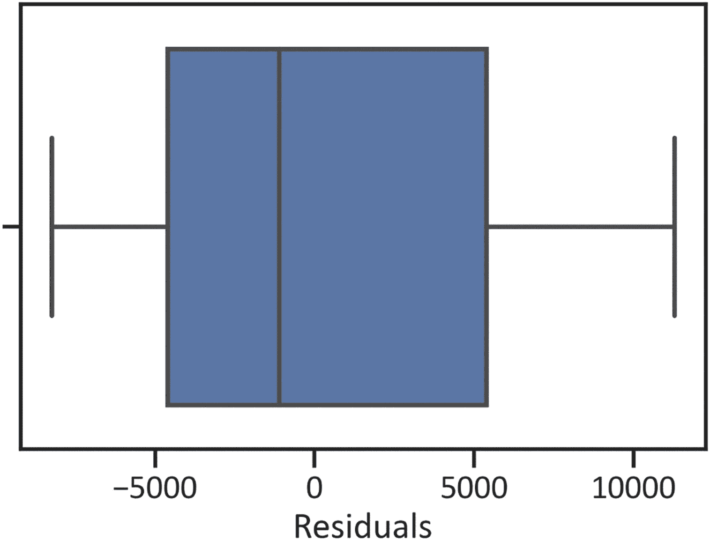

图 1-16

残差箱线图

```
model_residual = pd.DataFrame(model_residual)
model_residual.columns = ["Residuals"]
sns.boxplot(model_residual["Residuals"])
plt.xlabel("Residuals")
plt.show()
清单 1-38
残差箱线图
```

图 1-16 显示残差的均值接近 0，但并非极端接近。残差围绕真实值对称分布（表现良好）。

#### 正态 Q-Q 图

清单 1-39 绘制了正态 Q-Q 图。图 1-17 用于判断数据是否来自正态理论分布。它通过比较两个概率分布（x 轴上的理论分位数和 y 轴上的样本分位数值）来验证正态性假设。

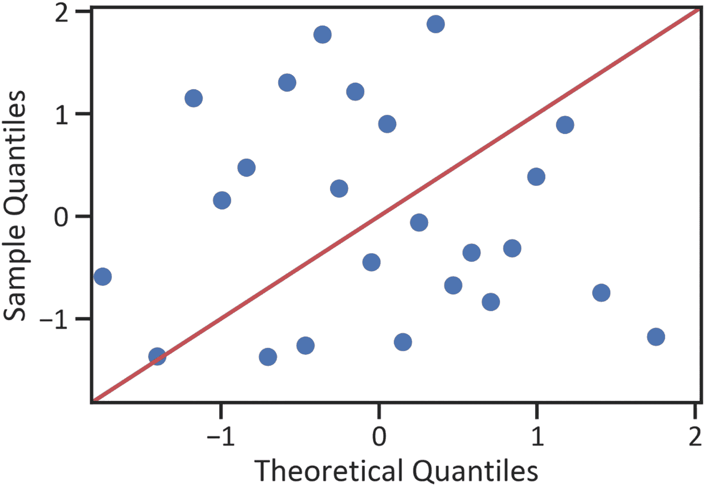

图 1-17

正态 Q-Q 图

```
fig, ax = plt.subplots()
fig = sm.graphics.qqplot(model_residual, ax=ax, line="45", fit=True, dist=stats.norm)
plt.show()
清单 1-39
正态 Q-Q 图
```

图 1-17 显示数据点并未形成一条直线。它们偏离了直线。图中还显示了数据中的异常值。

#### Cook's D 影响

清单 1-40 绘制了 Cook's D 影响图。图 1-18 用于检测将回归函数拉向自身的异常值。它使用一个临界值来确定异常值。临界值代表我们判断某个观测值是否为异常值的阈值。我们使用 `4/n-k-1` 来估算临界值，其中 *n* 是样本量，*k* 是用于评估性能的异常值数量。

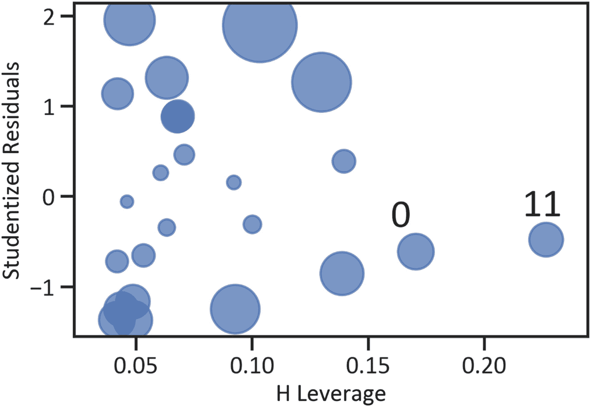

图 1-18

Cook's D 影响

```
fig, ax = plt.subplots()
fig = sm.graphics.influence_plot(model, ax=ax, criterion="cooks")
plt.show()
清单 1-40
Cook's D 影响
```

图 1-18 显示了有影响力的数据点（观测值 0 处有一个小点，观测值 11 处有一个极端点）。移除它们会显著提高模型的预测能力。

#### 拟合值与残差值

清单 1-41 绘制了拟合值与残差值。图 1-19 比较了拟合值（预测响应）与残差（实际值与预测值之差）。它用于检查方差不齐、非线性以及异常值。

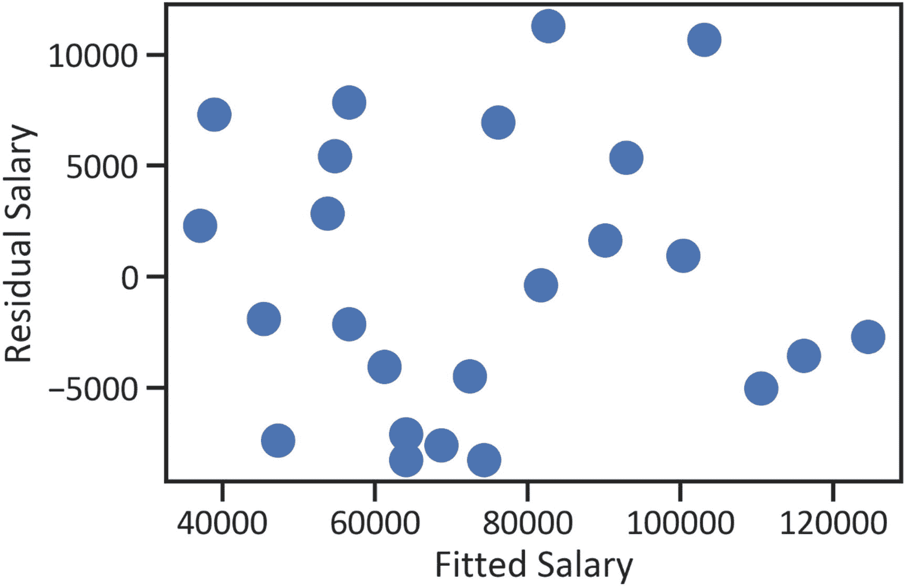

图 1-19 拟合值与残差值

```
plt.scatter(model_fitted,model_residual,s=200)
plt.xlabel("Fitted Salary")
plt.ylabel("Residual Salary")
plt.show()
清单 1-41
拟合值与残差值
```

图 1-19 显示了表现良好的拟合薪资与残差薪资图的特征。没有大的残差。此外，残差围绕零点随机波动。该模型满足线性假设。

#### 杠杆值与残差值

清单 1-42 绘制了杠杆值（`x` 距离 y 均值的远近程度）与残差值（见图 1-20）。

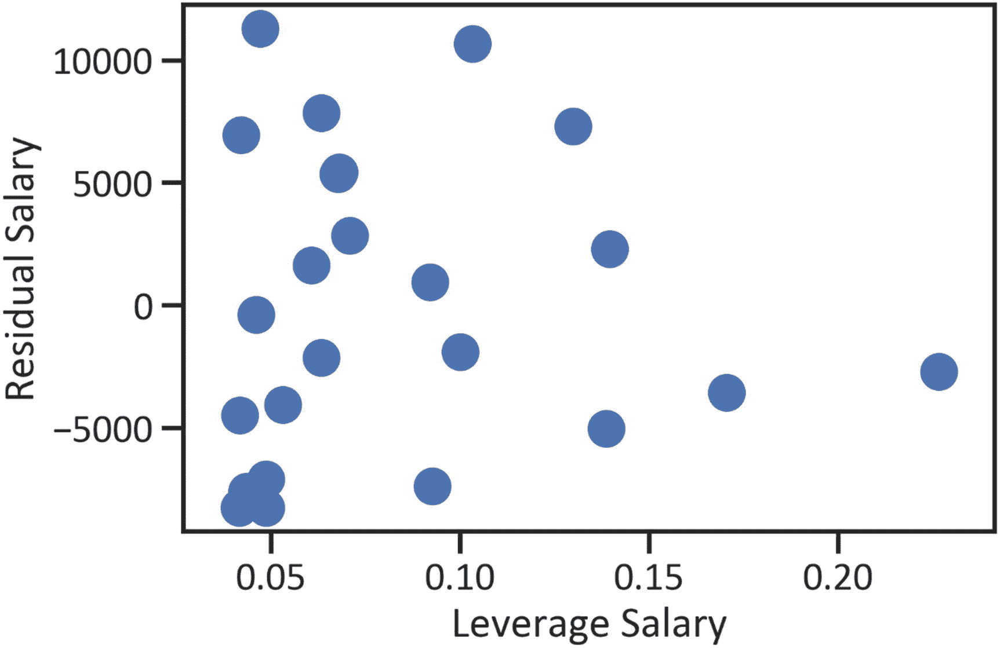

图 1-20 杠杆值与残差值

```
plt.scatter(model_leverage,model_residual,s=200)
plt.xlabel("Leverage Salary")
plt.ylabel("Residual Salary")
plt.show()
清单 1-42
杠杆值与残差值
```

图 1-2 表明存在一个高杠杆数据点，它导致了预测的不准确性。

#### 拟合值与学生化残差值

清单 1-43 返回预测响应和标准化删除残差（见图 1-21）。学生化残差大于或等于 3 的点是有影响力的点。

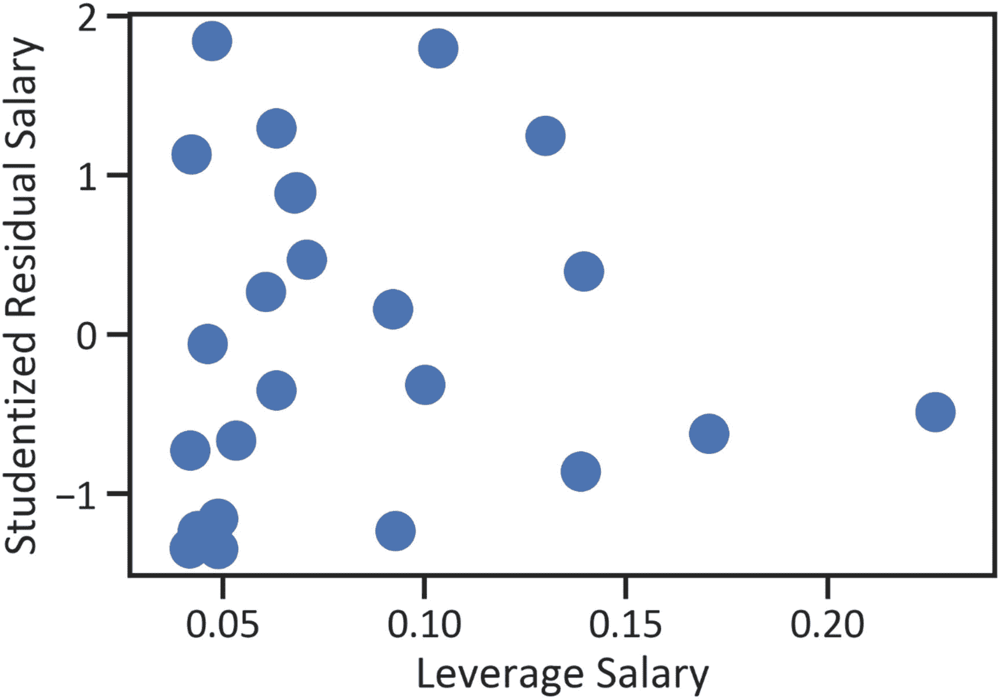

图 1-21 拟合值与学生化残差值

```
plt.scatter(model_leverage,model_norm_residual,s=200)
plt.xlabel("Leverage Salary")
plt.ylabel("Studentized Residual Salary")
plt.show()
清单 1-43
拟合值与学生化残差值
```

图 1-21 确认了随机分布（残差没有遵循任何趋势或模式）。

#### 杠杆值与学生化残差值

识别有影响力数据点的另一种方法是将自变量的数据点与其他数据点的距离与标准化删除残差进行比较。参见清单 1-44。

```
plt.scatter(model_leverage,model_norm_residual,s=200)
plt.xlabel("Leverage Salary")
plt.ylabel("Studentized Residual Salary")
plt.show()
清单 1-44
拟合值与学生化残差值
```

图 1-22 显示了表现良好的残差特征，但存在一个极端异常值。


图 1-22 拟合值与学生化残差值

### 使用 SciKit-Learn 评估残差

以下部分通过自相关函数和偏自相关函数，研究残差与自身之间的相关程度。

## 自相关函数

自相关表示数据与自身（而非其他数据）的相关程度（参见列表 1-45）。图 1-23 用于判断先前滞后期的残差之间是否存在自相关。该图有两个坐标轴，x 轴表示滞后期，y 轴表示残差的自相关函数。

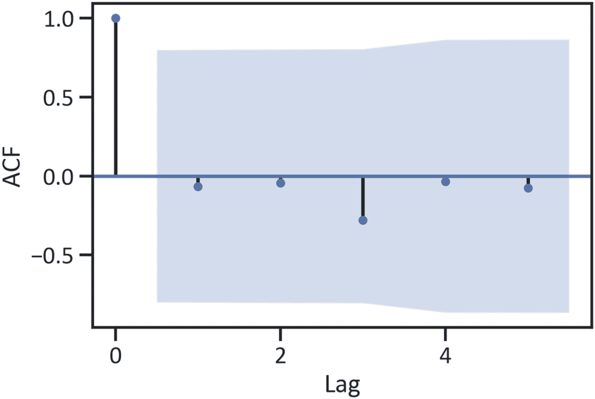

图 1-23 自相关函数图

```
from statsmodels.graphics.tsaplots import plot_acf
residuallm = y_test - y_pred
plot_acf(residuallm)
plt.xlabel("Lag")
plt.ylabel("ACF")
plt.show()
列表 1-45
自相关函数
```

图 1-23 显示，在滞后期 0 时，相关性为 1（数据与自身相关）。在滞后期 1、2、4 和 5 处存在轻微的负相关，在滞后期 3 处存在中等程度的负相关。

## 偏自相关函数

列表 1-46 绘制了在低阶滞后期中未被解释的系数的偏相关图（参见图 1-24）。

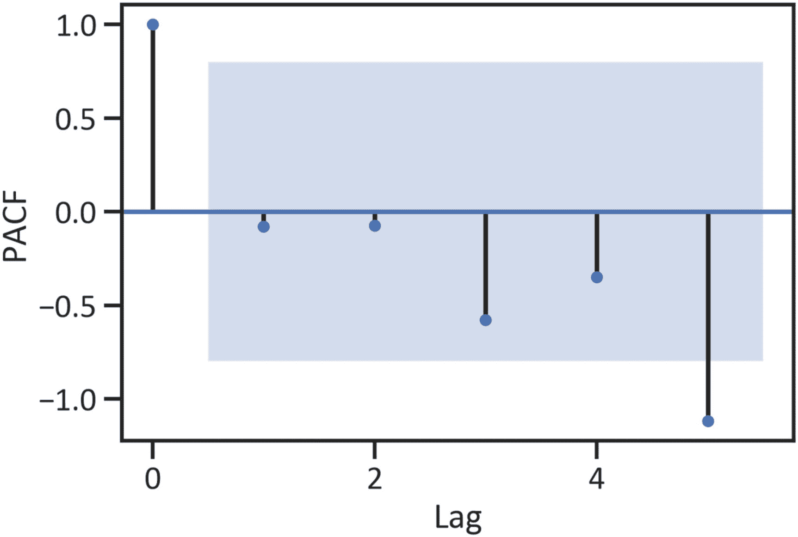

图 1-24 偏自相关函数

```
from statsmodels.graphics.tsaplots import plot_pacf
plot_pacf(residualslm)
plt.xlabel("Lag")
plt.ylabel("PACF")
plt.show()
列表 1-46
偏自相关函数
```

滞后期 0 可以解释所有高阶自相关。

## 结论

本章介绍了简单线性回归方法、最小二乘模型及其应用。通过使用两个回归变量（分别应用 `Statsmodels` 和 `SciKit-Learn`），检验了员工工作年限与员工薪资之间是否存在显著差异。研究结果表明，员工工作年限与员工薪资之间存在显著差异。数据存在线性关系，但回归变量违反了某些回归假设。由于数据中的微小异常（这在样本量较小时很常见），它们会产生边际误差。后续章节将介绍处理误差的技术；引入由偏差和方差引起的误差概念，以及如何使用高级参数方法（如岭回归和套索回归）来解决这些误差。

脚注 1